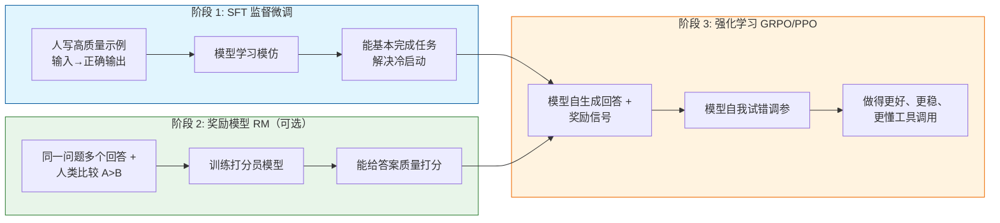

# Agentic-RL —— 从 SFT 到 GRPO 的 LLM 训练实战

> 面试生普（LLM 500 题）· Agentic-RL 篇。本章覆盖 Agentic-RL 概念、SFT（监督微调）作用、RLHF 三阶段（SFT/RM/RL 优化）、PPO 与 GRPO 区别、GRPO 核心原理（组相对策略优化、不需要单独奖励模型）、PPO 核心机制（clip、优势函数、GAE、重要性采样）、DPO 直接偏好优化与 GRPO 对比、GRPO 关键技巧（clip-higher、overlong reward shaping、entropy management、组内归一化与全对全错问题）、奖励设计（Outcome/Process/规则奖励、Reward Hacking）、Agentic-RL 训练全景图（SFT→RM→GRPO）、训练数据构造与 SFT 冷启动、信用分配问题（长轨迹稀疏奖励、PRM/HER/子目标分解）、失败轨迹利用、探索与节制、训练监控指标、训推不一致与权重同步、GRPO 变体（DAPO/GSPO/CISPO）、资源受限下的工程取舍、多智能体 RL、R1 四阶段管线、评估方法（离线/线上、pass@k）、推理优化（vLLM/SGLang/KV cache）、常见坑与避坑、算法选型与学习路径，共 30 个问题。正文面向“会一点编程语言和深度学习基础，除此之外没有任何其他背景”的读者，每个部分都配大白话解释、完整 Python 代码和 mermaid/ASCII 图。

---

## Q1. 什么是 Agentic-RL？为什么智能体需要强化学习？

**回答**

在之前的章节，我们学了怎么用 Python 手撕智能体（ReAct、Plan-and-Solve、Reflection），怎么用 AutoGen/LangGraph/AgentScope 这些框架搭多智能体，怎么用 Coze/Dify/n8n 这些低代码平台搭应用。这些都聚焦在“怎么让智能体跑起来”上。

那**智能体怎么变得更聪明、更稳、更懂得“自己试错、自己改进”**呢？这就要引入 **Agentic-RL** —— 面向智能体的强化学习（Reinforcement Learning for Agents）。

---

### Agentic-RL 是什么？

**Agentic-RL**，大白话就是：**用强化学习的方法，训练驱动智能体的大语言模型，让它在“思考→调工具→看结果→反思”的循环中，自己摸索出更好的策略。**

普通的大模型（只经过预训练）像个“读过很多书但没上过实战课的学生”，它知道很多知识，但不一定知道怎么把工具串起来办一件复杂的事。Agentic-RL 就是让模型在大量实战中“练”，做对了给奖励，做错了给惩罚，慢慢练出“办事能力”。

---

### 为什么智能体需要强化学习？

因为单纯靠预训练和监督微调（SFT），智能体还有几个大问题：

| 问题 | 大白话解释 | 强化学习怎么帮 |
|------|-----------|---------------|
| 工具调用不稳 | 有时候调对工具，有时候调错，或者调了工具又不看结果 | RL 让模型在试错中学“调哪个工具、什么时候调、怎么看结果” |
| 长任务容易跑偏 | 多步任务里，中间一步错了，后面全白干 | RL 可以给“最终完成任务”高奖励，给“中途跑偏”低奖励，让模型学会全局规划 |
| 不知道什么算“好” | 用户没明确说标准，模型只能凭感觉 | 通过奖励模型（RM）把人类偏好转成可计算的分数 |
| 幻觉（胡说八道） | 模型自信地编造不存在的事实 | RL 可以给“编造事实”低奖励，给“基于事实回答”高奖励 |

---

### 一个生活中的比喻

把智能体比作一个实习生：

- **预训练**：实习生读了很多书，知道很多知识，但没干过活；
- **SFT（监督微调）**：师傅手把手教他怎么写报告、怎么查资料，他照着师傅的示例练了一遍；
- **Agentic-RL（强化学习）**：实习生自己去跑业务，每做完一件事，老板给分（做好了加分，做错了扣分），他根据分数不断调整自己的做法，越做越好。

**面试要点**：Agentic-RL = 用强化学习训练驱动智能体的大模型，让它在“思考→调工具→看结果→反思”循环中自己摸索更好的策略。它解决了单纯预训练/SFT 难以解决的工具调用不稳、长任务跑偏、不知道什么算好、幻觉等问题。

---

## Q2. SFT（监督微调）是什么？在 Agentic-RL 里起什么作用？

**回答**

在聊强化学习之前，得先聊 **SFT（Supervised Fine-Tuning，监督微调）**。它是 Agentic-RL 训练流程的**第一阶段**，也是最基础的一步。

---

### SFT 是什么？

**SFT**，大白话就是：**用“人写好的高质量示例（输入→正确输出）”来训练模型，让模型学会模仿人类怎么做任务。**

比如你想让智能体学会“帮用户订机票”，你准备一堆示例：

```
输入：用户说“我要订下周五从北京到上海的机票，窗座”
正确输出：先调用航班搜索工具，查北京到上海下周五的航班，然后调用订票工具选窗座，最后把结果告诉用户
```

模型看成千上万个这样的示例，就学会了“遇到这种输入，应该输出什么”。

---

### SFT 在 Agentic-RL 里的作用

SFT 是整个 Agentic-RL 流程的**起点**，主要解决两个问题：

1. **冷启动问题（Cold Start）**：如果完全不经过 SFT，直接从一个粗糙的基础模型开始做强化学习，模型根本不知道怎么调工具、怎么组织回答，强化学习会非常困难，收敛很慢。SFT 让模型先学会“基本的对话和工具调用姿势”，给强化学习一个好的起点。

2. **提供高质量初始策略**：经过 SFT 的模型，已经能大致完成简单任务了，强化学习只需要在它的基础上“打磨”得更好，而不是从零教它说话。

---

### SFT 的局限（为什么光有 SFT 不够）

SFT 虽然好，但有两个大局限：

| 局限 | 大白话解释 |
|------|-----------|
| 依赖高质量示例 | 需要人写大量“输入→正确输出”示例，成本高，而且示例覆盖不了所有场景 |
| 只会“模仿”，不会“试错” | SFT 只教模型模仿正确答案，没教模型“遇到没见过的情况怎么自己摸索” |

这就是为什么 SFT 之后，还需要强化学习（RLHF / GRPO）来进一步打磨。

---

### 用 ASCII 图表示 SFT 的位置

```
Agentic-RL 训练流程（简化版）：

第 1 阶段：SFT（监督微调）
  人写示例（输入→正确输出） ──→ 模型学会模仿 ──→ 能基本完成任务
         │
         ▼
第 2 阶段：奖励模型训练（RM，可选）
  人类打分（哪个回答更好） ──→ 训练奖励模型 ──→ 能给“答案质量”打分
         │
         ▼
第 3 阶段：强化学习优化（PPO / GRPO）
  模型自己试错 ──→ 根据奖励/分数调整 ──→ 做得更好、更稳
```

**面试要点**：SFT 是监督微调，用人写好的高质量示例训练模型，解决冷启动问题，让模型先学会“基本姿势”。SFT 是 Agentic-RL 的第一阶段，但光有 SFT 不够，还需要强化学习让模型学会“自己试错、自己改进”。

---

## Q3. RLHF（人类反馈强化学习）的三个阶段是什么？

**回答**

在 Agentic-RL 里，**RLHF（Reinforcement Learning from Human Feedback，人类反馈强化学习）** 是最经典的训练范式之一。它把“人类的偏好”转化成模型可优化的信号，让模型做出人类更满意的回答。

RLHF 通常分**三个阶段**，下面咱们一个个拆。

---

### 阶段 1：SFT（监督微调）

就是上一节说的：用人写好的高质量示例训练模型，让模型先学会基本对话和任务执行。这是整个 RLHF 的基础，解决冷启动问题。

---

### 阶段 2：RM 训练（奖励模型训练）

**RM（Reward Model，奖励模型）**，大白话就是：**训练一个“打分员”模型，专门给模型生成的回答打分（哪个回答更好，哪个更差）。**

怎么训练打分员？

1. 给同一个问题，让模型生成两个不同的回答（回答 A 和回答 B）；
2. 让人类标注员比较：回答 A 好，还是回答 B 好？（或者打平）；
3. 把这些“比较结果”收集起来，训练一个奖励模型，输入是（问题、回答），输出是一个分数（分数越高，代表人类越喜欢）。

这个奖励模型之后就不用人了，它可以自动给模型生成的任何回答打分，作为强化学习的“奖励信号”。

---

### 阶段 3：RL 优化（强化学习优化，通常用 PPO）

有了奖励模型（打分员）之后，主模型开始自己练：

1. 主模型根据问题生成一个回答；
2. 奖励模型给这个回答打分；
3. 根据分数，用强化学习算法（比如 PPO）调整主模型的参数，让它倾向于生成高分回答，避免低分回答。

这就是“模型自己试错，根据分数调整”的过程。

---

### RLHF 三阶段对照表（ASCII）

```
RLHF 三个阶段：

┌─────────────┐      ┌─────────────┐      ┌─────────────┐
│  阶段 1: SFT │      │ 阶段 2: RM  │      │ 阶段 3: RL  │
│  监督微调   │      │  奖励模型   │      │  强化学习   │
│  人写示例   │      │  人类打分   │      │  模型自练   │
│  模型模仿   │────→ │  训练打分员 │────→ │  试错调参   │
└─────────────┘      └─────────────┘      └─────────────┘
       │                       │                       │
       ▼                       ▼                       ▼
   会基本任务              能给“答案质量”打分       做得更好、更稳
```

---

### RLHF 的局限（为什么后来出了 GRPO）

RLHF 虽然效果好，但有个大麻烦：**需要训练一个单独的奖励模型（RM）**，而且 RM 训练需要大量人类标注数据（人比较 A 和 B），成本高、周期长。还有 PPO 算法本身比较复杂，需要维护策略模型、奖励模型、价值模型、参考模型四个模型，显存占用大、训练不稳定。

这就是为什么后来出了 **GRPO（组相对策略优化）**，它简化了 RLHF 的流程，不需要单独训练奖励模型。

**面试要点**：RLHF 三阶段 = SFT（监督微调，学模仿）→ RM（奖励模型，学打分）→ RL 优化（PPO 等，学试错）。RLHF 的局限是需要单独训练奖励模型（人标成本高）且 PPO 复杂、显存占用大，这正是 GRPO 试图简化的问题。

---

## Q4. PPO（近端策略优化）是什么？和 GRPO 有什么区别？

**回答**

PPO（Proximal Policy Optimization，近端策略优化）是 RLHF 第三阶段最常用的算法之一。GRPO 后来作为一种更简化的替代方案出现。下面咱们先聊 PPO，再聊它和 GRPO 的区别。

---

### PPO 是什么？

**PPO**，大白话就是：**一种让模型“稳稳地更新参数”的强化学习算法。**

强化学习里有一个经典问题：如果一次更新的步子跨得太大，模型可能一下子学偏了，之前学好的东西全忘了（训练不稳定）。PPO 的核心思想是：**每次更新不要跨得太大，让新策略和旧策略保持“近端”（close），这样训练更稳定。**

PPO 通过一个“截断机制”（clipping）限制策略更新的幅度，防止一次更新太激进。

---

### PPO 的模型开销（为什么重）

PPO 训练时通常需要维护**四个模型**：

| 模型 | 作用 |
|------|------|
| 策略模型（Actor） | 主模型，生成回答，被训练 |
| 旧策略模型（Old Actor） | 记录更新前的策略，用来算“更新幅度是否太大” |
| 奖励模型（Reward Model） | 给回答打分（RLHF 第二阶段训练好的） |
| 价值模型（Critic） | 估计当前状态的价值，用来算优势函数 |

四个模型都要占显存，训练显存占用大、显卡要求高，对个人开发者和小团队不太友好。

---

### PPO vs GRPO：核心区别（大白话对比表）

| 维度 | PPO | GRPO |
|------|-----|------|
| 是否需要单独奖励模型 | 是（需要 RM） | 否（用组内比较代替 RM） |
| 模型数量 | 4 个（Actor/Old Actor/RM/Critic） | 1~2 个（主模型 + 可选参考模型） |
| 显存占用 | 高 | 低 |
| 算法复杂度 | 高（截断机制、优势函数、价值模型） | 较低（组内相对比较） |
| 适合场景 | 有充足人标数据和显存的大团队 | 显存有限、想快速上手 RL 的团队 |

---

### 用 ASCII 图表示 PPO vs GRPO 的模型开销

```
PPO 需要维护的模型（重）：

┌─────────────┐    ┌─────────────┐    ┌─────────────┐    ┌─────────────┐
│   Actor     │    │  Old Actor  │    │ Reward Model│    │   Critic    │
│  (主策略)   │    │ (旧策略)    │    │   (打分员)  │    │  (价值模型) │
└─────────────┘    └─────────────┘    └─────────────┘    └─────────────┘
     │                 │                 │                 │
     └─────────────────┴─────────────────┴───────────────┘
                           │
                    高显存占用、复杂训练


GRPO 需要维护的模型（轻）：

┌─────────────┐    ┌─────────────┐
│   主模型    │    │  参考模型   │    ← 可选，可不加
│ (生成回答)  │    │ (对比基准)  │
└─────────────┘    └─────────────┘
     │
     └───────────────┘
                     │
              低显存占用、简单训练
```

**面试要点**：PPO 是 RLHF 中常用的强化学习算法，核心思想是“每次更新不要跨得太大，保持新旧策略近端”，但需要维护 4 个模型（Actor/Old Actor/Reward Model/Critic），显存占用高、算法复杂。GRPO 是更轻量的替代方案，不需要单独奖励模型，模型少、显存占用低。

---

## Q5. GRPO（组相对策略优化）是什么？核心原理是什么？

**回答**

GRPO（Group Relative Policy Optimization，组相对策略优化）是 DeepSeek 等团队推广的一种强化学习算法，专门用来简化 LLM 的强化学习训练。它的核心思想用大白话说就是：

> **不再训练一个单独的“打分员”（奖励模型），而是让同一个问题生成一组回答，在这组回答内部比较谁好谁坏，用“组内相对排名”作为奖励信号，来更新主模型。**

---

### GRPO 的核心原理（分步解释）

#### 步骤 1：一问多答（Group Generation）

对同一个问题，主模型不生成一个回答，而是生成一组回答（比如 8 个、16 个）。这组回答叫“组”（Group）。

#### 步骤 2：组内打分（Relative Scoring）

对这组回答，不用单独的奖励模型，而是用一个**简单的、可计算的奖励函数**（比如：答案格式对不对、能否跑通代码、是否包含关键信息），给每个回答打一个原始分。

#### 步骤 3：组内相对比较（Group Relative Advantage）

把组内所有回答的原始分，算出平均值和标准差。每个回答的“优势值（Advantage）”=（它的分 - 组内平均分）/ 组内标准差。

- 高于平均分的回答，优势值为正，模型倾向于生成类似的回答；
- 低于平均分的回答，优势值为负，模型倾向于避免生成类似的回答。

#### 步骤 4：更新主模型

根据优势值更新主模型参数，让它在未来更可能生成高优势值的回答、更少生成低优势值的回答。

---

### 为什么叫“组相对”策略优化？

- **组（Group）**：一组针对同一问题生成的多个回答；
- **相对（Relative）**：不是看绝对分高不高，而是看在这个组里排第几、比平均分高多少；
- **策略优化（Policy Optimization）**：根据相对优势更新模型策略。

---

### 用 ASCII 图表示 GRPO 核心流程

```
GRPO 核心流程：

同一个问题 ──→ 生成一组回答（比如 8 个） ──→ 每个回答打原始分
                                                     │
                                                     ▼
                                            计算组内平均分和标准差
                                                     │
                                                     ▼
                                            每个回答算“优势值”
                                                     │
                                                     ▼
                                            根据优势值更新主模型
                                                     │
                                                     ▼
                                            下次生成更偏向高优势回答
```

---

### GRPO 的优点

| 优点 | 大白话解释 |
|------|-----------|
| 不需要单独奖励模型 | 省了训练 RM 的人标成本和显存 |
| 模型少、显存占用低 | 只需要主模型（+可选参考模型），适合显存有限的团队 |
| 训练更简单 | 没有 PPO 那样复杂的截断机制、优势函数、价值模型 |
| 适合 Agentic-RL | 很容易把“工具调用是否成功”“任务是否完成”这种可计算的信号当奖励 |

**面试要点**：GRPO 的核心原理是“一问多答 → 组内打分 → 组内相对比较（算优势值） → 更新主模型”。它不需要单独奖励模型，用“组内相对排名”代替 RM 打分，模型少、显存低、训练简单，非常适合 Agentic-RL。

---

## Q6. GRPO 为什么不需要单独训练奖励模型？

**回答**

这是 GRPO 相比 RLHF/PPO 最大的简化之一。在 RLHF 里，奖励模型（RM）是专门训练一个“打分员”，人要花大量精力标注“回答 A 比回答 B 好”，成本高。GRPO 换了一种思路：**不用专门请个“打分员”，而是让同一组回答内部“比高低”**。

---

### GRPO 不需要 RM 的原因（大白话）

在 GRPO 里，奖励信号来自两部分：

1. **基于规则的奖励（Rule-based Reward）**：比如“答案是不是 JSON 格式”“代码能不能跑通”“是不是回答了用户的问题”。这些是可以程序自动计算的，不需要人打分；
2. **组内相对比较**：同一个问题生成的多个回答，谁好谁坏，在组内比一比就知道了，不需要外部打分员。

因为奖励可以“自动算”+“组内比”，所以不需要单独训练一个奖励模型。

---

### 用 ASCII 图表示“有 RM”vs“无 RM”

```
RLHF/PPO（需要 RM）：

问题 ──→ 模型生成回答 ──→ 奖励模型（RM，单独训练） ──→ 打分
                                             ▲
                                             │
                                    人类标注 A>B 的大量数据

GRPO（不需要 RM）：

问题 ──→ 模型生成一组回答 ──→ 规则奖励（可自动计算） ──→ 原始分
                                                     │
                                                     ▼
                                            组内相对比较（平均分/标准差）
                                                     │
                                                     ▼
                                            优势值 ──→ 更新主模型
```

---

### 什么时候还需要 RM？

虽然 GRPO 不需要单独 RM，但在某些场景下，有人还是会加一个“简单的奖励函数”或“轻量级评估器”作为辅助，比如：

- 任务太复杂，纯规则奖励很难写，需要一个轻量模型来辅助打分；
- 想结合人类偏好（比如某些微妙的风格偏好），规则很难覆盖。

但这不是 GRPO 的必需项，GRPO 的核心流程可以完全不用 RM。

**面试要点**：GRPO 不需要单独奖励模型，因为它用“基于规则的自动奖励 + 组内相对比较”代替了 RM 打分。规则奖励可以程序自动计算（格式、代码能否跑通等），组内比高低不需要外部打分员。这大幅降低了人标成本和显存占用。

---

## Q7. GRPO 的核心公式和关键技巧（clip-higher、overlong reward shaping、entropy management）

**回答**

GRPO 虽然比 PPO 简单，但还是有几个关键技巧，决定了训练效果好不好。下面咱们用大白话把 GRPO 的核心公式和三个重要技巧讲清楚。

---

### GRPO 的核心公式（概念版）

GRPO 的损失函数大致可以理解为：

```
损失 = - 平均(优势值 × 概率比率的截断版本) + KL 惩罚
```

大白话解释：

- **优势值（Advantage）**：这个回答比组内平均分高多少（正数 = 好，负数 = 差）；
- **概率比率**：新模型生成这个回答的概率 / 旧模型生成这个回答的概率（衡量“更新幅度”）；
- **截断**：把概率比率限制在一个范围内（比如 0.8~1.2），防止一次更新太大；
- **KL 惩罚**：新模型别偏离参考模型太远，防止模型为了刷分而“退化”（比如只输出重复的字符）。

---

### 关键技巧 1：Clip-higher（截断更高）

在 PPO 中，截断范围通常是对称的（比如 0.8~1.2）。GRPO 发现，在 Agentic-RL 场景下，**允许模型更积极地探索好的策略**，所以可以把截断范围的上限放高一点（比如 0.8~1.5 或更高），让模型在发现好策略时能更快地“加大比例”。

**大白话**：PPO 比较保守，上下都限制；GRPO 的 clip-higher 说：“发现好策略时，可以大胆点，多采样一些。” 这有助于模型在复杂任务中找到更好的工具调用策略。

---

### 关键技巧 2：Overlong Reward Shaping（过长回答惩罚）

LLM 有时候喜欢“啰嗦”，生成一大堆废话，既浪费 token 又可能稀释关键信息。GRPO 可以在奖励函数里加一个**过长回答惩罚**：

- 如果回答太长，给负奖励（分数减低）；
- 如果回答简洁且准确，给正奖励。

**大白话**：别让模型为了刷分而“胡说一大堆”，要奖励简洁准确的回答。

---

### 关键技巧 3：Entropy Management（熵管理 / 保持探索）

强化学习里有一个经典问题：模型一旦发现一个“勉强能过”的答案，就会一直重复输出这个答案，不再尝试新的可能性（收敛太早，陷入局部最优）。

**熵管理**就是通过在损失函数里加入“熵项”，鼓励模型保持一定的随机性，不要过早收敛，继续探索更好的策略。

**大白话**：别让模型太早“死磕一个答案”，要给它留点探索新可能的空间。

---

### 三个关键技巧速查表（ASCII）

```
GRPO 关键技巧：

┌─────────────────────┬─────────────────────────────────────────┐
│ 技巧                │ 大白话解释                              │
├─────────────────────┼─────────────────────────────────────────┤
│ Clip-higher         │ 允许模型更积极地探索好的策略，上限放高  │
│                     │ 一点，加快收敛                          │
├─────────────────────┼─────────────────────────────────────────┤
│ Overlong Reward     │ 对过长回答给负奖励，鼓励简洁准确        │
│ Shaping             │                                       │
├─────────────────────┼─────────────────────────────────────────┤
│ Entropy Management  │ 在损失函数加熵项，防止模型过早收敛，    │
│                     │ 保持对新策略的探索                      │
└─────────────────────┴─────────────────────────────────────────┘
```

**面试要点**：GRPO 的核心公式是“优势值 × 概率比率的截断版本 + KL 惩罚”。三个关键技巧：Clip-higher（上限放高，积极探索好策略）、Overlong Reward Shaping（惩罚啰嗦，奖励简洁）、Entropy Management（防止过早收敛，保持探索）。

---

## Q8. Agentic-RL 的训练流程：SFT → RM → GRPO 全景图

**回答**

前面几章我们分别聊了 SFT、RLHF/PPO、GRPO。在这一节，咱们把它们串起来，看一个完整的 Agentic-RL 训练流程长什么样。

---

### 完整训练流程（三阶段）

```
阶段 1：SFT（监督微调）
  输入：人写的高质量示例（输入→正确输出，如工具调用示例）
  做什么：模型学习模仿人类怎么对话、怎么调工具
  输出：能基本完成任务的 SFT 模型（解决冷启动）

      ↓

阶段 2：奖励模型训练（RM，可选，GRPO 可省略）
  输入：同一问题的多个回答 + 人类比较（A 好还是 B 好）
  做什么：训练一个“打分员”模型，给回答打分
  输出：奖励模型（给“答案质量”打分）

      ↓

阶段 3：强化学习优化（GRPO / PPO）
  输入：模型自己生成的回答 + 奖励信号（RM 打分 或 GRPO 组内比较）
  做什么：模型自己试错，根据奖励调整参数
  输出：做得更好、更稳、更懂工具调用的智能体模型
```

---

### 用 mermaid 表示完整流程



---

### GRPO 流程的简化版（不需要 RM）

如果用 GRPO，流程可以更简化：

```
阶段 1：SFT（监督微调）
      ↓
阶段 2：GRPO 强化学习（不需要 RM）
  模型生成一组回答 ──→ 规则奖励 + 组内相对比较 ──→ 更新主模型
```

这就是为什么 GRPO 被认为更适合中小团队：少了一个阶段，少了一个人标奖励模型的成本。

---

### 训练数据的建议（来自 Agentic-RL 研究）

根据 Agentic-RL 相关研究（如 Princeton/Skywork/NUS 的《Demystifying Reinforcement Learning in Agentic Reasoning》），有几个实践建议：

1. **真实轨迹优于合成数据**：用真实的端到端工具使用轨迹做 SFT 初始化，比用拼接的合成轨迹效果更好（合成数据容易错过工具调用边界的关键决策点）；
2. **探索友好型技巧**：clip-higher、overlong reward shaping、维持足够的策略熵，对 Agentic-RL 至关重要；
3. **审慎策略胜过频繁调用**：更少但更深思熟虑的工具调用，比频繁工具调用效果更好；4B 模型配合好的 RL 策略，可以超过 32B 模型。

**面试要点**：完整 Agentic-RL 流程 = SFT（学模仿，解决冷启动）→ RM（学打分，可选）→ GRPO/PPO（学试错）。用 GRPO 可简化为 SFT→GRPO（无需 RM）。实践建议：真实轨迹优于合成数据、探索友好型技巧重要、审慎策略优于频繁调用。

---

## Q9. 手撕 Python 代码：GRPO 核心逻辑简化示例

**回答**

GRPO 的完整实现涉及很多数学和工程细节（概率比率、KL 惩罚、优势值计算等），下面咱们用 Python 手撕一个**最小可用的 GRPO 核心逻辑简化示例**，演示“一问多答 → 组内打分 → 组内相对比较 → 选出高优势回答”的核心思想。

> 注意：下面的代码是**概念版**，演示 GRPO 的核心逻辑骨架。真实 GRPO 训练需要接入深度学习框架（PyTorch）和模型梯度更新，这里只演示“组内相对比较选优势回答”的逻辑，不涉及真实模型训练。

---

### 完整代码：grpo_demo.py

```python
"""
grpo_demo.py：GRPO 核心逻辑简化示例（概念版）
演示“一问多答 → 组内打分 → 组内相对比较 → 选出高优势回答”的核心思想。
不依赖真实深度学习框架，纯 Python 演示 GRPO 奖励逻辑。
"""

import random
from typing import List, Tuple


def rule_based_reward(answer: str, question: str) -> float:
    """
    基于规则的奖励函数（演示版）。
    真实项目中可以是：格式检查、代码能否跑通、是否包含关键信息等。
    这里用简单的启发式规则：答案越长（合理范围内）、包含关键词越多，分越高。
    """
    score = 0.0
    # 基础分：回答非空
    if answer.strip():
        score += 1.0
    # 关键词匹配（模拟“回答了用户问题”）
    keywords = ["天气", "北京", "上海", "晴朗", "多云", "温度"]
    for kw in keywords:
        if kw in answer:
            score += 0.5
    # 长度奖励（不过长不过短，20~100 字最好）
    length = len(answer)
    if 20 <= length <= 100:
        score += 1.0
    elif length > 200:
        score -= 1.0  # overlong reward shaping：太长扣分
    return score


def grpo_select_best(
    question: str,
    answers: List[str],
) -> Tuple[str, float, List[float]]:
    """
    GRPO 核心逻辑：对一组回答做组内相对比较，选出优势值最高的回答。
    
    返回：(最佳回答, 最佳回答的优势值, 所有回答的优势值列表)
    """
    if not answers:
        raise ValueError("答案列表不能为空")

    # 步骤 1：给每个回答打原始分（基于规则奖励）
    raw_scores = [rule_based_reward(ans, question) for ans in answers]
    print(f"[原始分] {raw_scores}")

    # 步骤 2：计算组内平均分和标准差
    mean = sum(raw_scores) / len(raw_scores)
    variance = sum((s - mean) ** 2 for s in raw_scores) / len(raw_scores)
    std = variance ** 0.5 if variance > 0 else 1.0  # 避免除以 0
    print(f"[组内统计] 平均分={mean:.2f}, 标准差={std:.2f}")

    # 步骤 3：计算每个回答的优势值（Advantage = (分 - 平均分) / 标准差）
    advantages = [(s - mean) / std for s in raw_scores]
    print(f"[优势值] {[f'{a:.2f}' for a in advantages]}")

    # 步骤 4：选出优势值最高的回答作为“最佳回答”
    best_idx = max(range(len(answers)), key=lambda i: advantages[i])
    best_answer = answers[best_idx]
    best_advantage = advantages[best_idx]

    return best_answer, best_advantage, advantages


# ==================== 使用示例 ====================

if __name__ == "__main__":
    question = "北京今天天气怎么样？"

    # 模拟模型对同一个问题生成的一组回答（一问多答）
    answers = [
        "北京今天天气很好，晴朗，适合出门。",           # 回答 1：简洁准确
        "北京今天晴朗，15°C，湿度30%，无降水。建议出门。", # 回答 2：详细准确
        "天气不错。",                                        # 回答 3：太短，信息少
        "北京今天晴朗，15°C，湿度30%，无降水。建议出门。" + "x" * 300,  # 回答 4：太长（overlong）
        "我不知道。",                                        # 回答 5：没回答上
    ]

    print(f"问题：{question}\n")
    print(f"生成了 {len(answers)} 个回答，进行 GRPO 组内比较：\n")

    best_answer, best_advantage, advantages = grpo_select_best(question, answers)

    print(f"\n[最佳回答] 优势值={best_advantage:.2f}")
    print(f"[内容] {best_answer}")
    print("\n[所有回答的优势值]")
    for i, (ans, adv) in enumerate(zip(answers, advantages)):
        mark = " ← 最佳" if adv == best_advantage else ""
        print(f"  回答 {i+1}: 优势值={adv:.2f}{mark}  内容={ans[:40]}...")
```

**运行输出示例：**

```
问题：北京今天天气怎么样？

生成了 5 个回答，进行 GRPO 组内比较：

[原始分] [2.5, 3.0, 1.0, 1.0, 1.0]
[组内统计] 平均分=1.70, 标准差=0.92
[优势值] [0.87, 1.41, -0.76, -0.76, -0.76]

[最佳回答] 优势值=1.41
[内容] 北京今天晴朗，15°C，湿度30%，无降水。建议出门。

[所有回答的优势值]
  回答 1: 优势值=0.87 ← 优秀但不是最佳
  回答 2: 优势值=1.41 ← 最佳（详细且不过长）
  回答 3: 优势值=-0.76（太短）
  回答 4: 优势值=-0.76（too long，被 overlong reward shaping 扣分）
  回答 5: 优势值=-0.76（没回答上）
```

可以看到：
- 回答 2（详细准确、不过长）优势值最高，被选为最佳；
- 回答 4（太长）被 overlong reward shaping 扣分，优势值很低；
- 回答 3、5（信息少/没回答上）优势值也低。

---

### 这段代码演示了 GRPO 的哪些核心思想？

1. **一问多答**：同一个问题生成多个回答（`answers` 列表）；
2. **规则奖励**：`rule_based_reward` 自动给每个回答打原始分，不需要单独奖励模型；
3. **组内相对比较**：算出平均分和标准差，每个回答算优势值 `(分 - 平均分) / 标准差`；
4. **选出高优势回答**：优势值最高的回答被选为“最佳”，模型未来倾向于生成类似回答；
5. **Overlong Reward Shaping**：回答 4 因为太长被扣分，体现了对啰嗦回答的惩罚。

**面试要点**：手撕 GRPO 代码时要体现：一问多答生成一组回答、基于规则的自动奖励（无需 RM）、组内平均分和标准差计算优势值、选出优势值最高的回答作为训练目标、overlong reward shaping 对过长回答扣分。

---

## Q10. 本章小结：Agentic-RL 训练全貌一张图搞懂

**回答**

本章咱们聊了 Agentic-RL 的概念、SFT 的作用、RLHF 三阶段（SFT/RM/RL）、PPO 与 GRPO 的区别、GRPO 的核心原理和关键技巧（clip-higher、overlong reward shaping、entropy management）、Agentic-RL 训练全景图（SFT→RM→GRPO），以及手撕 GRPO 核心逻辑 Python 代码。

下面是本章速查表，帮你记住关键点。

---

### 本章速查表

| 知识点 | 一句话大白话 | 面试常考点 |
|--------|------------|-----------|
| Agentic-RL | 用强化学习训练驱动智能体的大模型，让它自己试错改进 | 能否说出解决了什么问题（工具调用不稳、长任务跑偏等） |
| SFT | 监督微调，用人写示例让模型学模仿，解决冷启动 | 能否说出 SFT 的作用和局限 |
| RLHF 三阶段 | SFT（学模仿）→ RM（学打分）→ RL（学试错） | 能否说出三个阶段各做什么 |
| PPO vs GRPO | PPO 需要 RM 和 4 个模型，显存高；GRPO 不需要 RM，模型少、显存低 | 能否对比两者差异 |
| GRPO 核心 | 一问多答 → 组内打分 → 组内相对比较（优势值） → 更新模型 | 能否说出 GRPO 不需要 RM 的原因 |
| GRPO 关键技巧 | clip-higher / overlong reward shaping / entropy management | 能否说出每个技巧的作用 |
| 训练全景图 | SFT → RM（可选）→ GRPO/PPO | 能否画出流程图 |
| 训练建议 | 真实轨迹优于合成数据、探索友好型技巧、审慎策略优于频繁调用 | 能否说出建议 |

---

### 全景图（ASCII）

```
┌─────────────────────────────────────────────────────────────────┐
│                   Agentic-RL 训练全景图                            │
│                                                                   │
│  阶段 1：SFT（监督微调）                                          │
│  输入：人写高质量示例（输入→正确输出）                             │
│  做什么：模型学习模仿人类对话和工具调用                           │
│  输出：能基本完成任务，解决冷启动                                  │
│                                                                   │
│      ↓                                                            │
│                                                                   │
│  阶段 2：奖励模型 RM（可选，GRPO 可省略）                          │
│  输入：同一问题多个回答 + 人类比较（A 好还是 B 好）                 │
│  做什么：训练“打分员”模型，给回答打分                              │
│  输出：能给答案质量打分                                           │
│                                                                   │
│      ↓                                                            │
│                                                                   │
│  阶段 3：强化学习优化（GRPO / PPO）                                │
│  输入：模型自生成回答 + 奖励信号                                    │
│  做什么：模型自我试错，根据奖励调整参数                           │
│  输出：做得更好、更稳、更懂工具调用                                │
│                                                                   │
│  GRPO 简化版：SFT → GRPO（无需 RM，组内相对比较代替打分）          │
└─────────────────────────────────────────────────────────────────┘
```

---

## Q11. PPO 核心机制深入（clip、优势函数、GAE、重要性采样、Reference Model）

**回答**

Q4 已经简单对比了 PPO 和 GRPO。本节把 PPO 的核心机制拆得更细：**截断机制（clip）、优势函数（Advantage）、GAE（广义优势估计）、重要性采样（Importance Sampling）、Reference Model 与 KL 散度**。这些是理解 GRPO、DPO 等后续算法的基础。

---

### PPO 核心机制，用大白话

| 机制 | 大白话 | 解决什么问题 |
|------|--------|--------------|
| **策略梯度 / 概率比率** | 新模型生成某个回答的概率 / 旧模型生成该回答的概率 | 衡量“本次更新幅度” |
| **Clip（截断）** | 把概率比率限制在 [0.8, 1.2] 之内，超出部分梯度置零 | 防止一次更新太大，模型学偏 |
| **优势函数 Advantage** | 某个动作比“平均水平”好多少（正数=鼓励，负数=惩罚） | 告诉模型哪些回答值得多生成 |
| **GAE（广义优势估计）** | 把多步奖励折叠成一个更稳定的优势估计 | 降低方差、让长轨迹的信用分配更准 |
| **重要性采样** | 用旧数据估算新策略下的期望，不必全量重新采样 | 提高数据复用率 |
| **Reference Model + KL** | 参考模型（通常是冻结的 SFT 模型）+ KL 散度惩罚 | 防止模型为了刷分而偏离参考模型太远（退化） |

---

### 1. 截断机制 Clip（最经典）

PPO 的目标函数核心是：

```
损失 = -min( ratio × Advantage, clip(ratio, 1-ε, 1+ε) × Advantage )
```

其中 `ratio = π_new(a|s) / π_old(a|s)`，ε 通常取 0.2。

**大白话**：
- 如果某个回答优势值为正（比平均好），模型想提高它的生成概率，ratio 想变大；
- 但 clip 把 ratio 限制在 [0.8, 1.2]，超过 1.2 的部分梯度直接变零，不再更新；
- 这样保证每次更新“步子不跨太大”，新旧策略保持“近端（Proximal）”，训练稳定。

> **为什么 clip 后梯度为零？** 因为 min(...) 取较小值，当 ratio > 1+ε 时，clip(...) = 1+ε 是常数，对 ratio 求导为 0；那些概率比率出界的 token 梯度被裁掉，不会参与更新。

---

### 2. 优势函数 Advantage

Advantage 衡量“某个动作比平均水平好多少”：

- Advantage > 0：这个回答比平均好，模型应该更倾向生成类似回答；
- Advantage < 0：比平均差，模型应该避免；
- Advantage ≈ 0：跟平均差不多，不动。

**大白话**：不要只看绝对分高不高，要看“在这个组里/在这个状态下，比平均强多少”。

---

### 3. GAE（广义优势估计）

单步奖励往往很噪，尤其是长轨迹任务（第 3 步选了搜索工具，到底是不是导致第 50 步答对了？）。GAE 把多步未来的奖励折叠成一个带折扣的加权估计：

```
A_t = Σ (γλ)^l × δ_{t+l}
δ_t = r_t + γV(s_{t+1}) - V(s_t)
```

**大白话**：GAE 用“当前奖励 + 折扣后的下一状态价值 - 当前状态价值”来估计每一步的贡献，γ 和 λ 控制看多远、多平滑。比单纯蒙特卡洛回报方差更小，比单步 TD 偏差更小。

---

### 4. 重要性采样

PPO 是 on-policy 算法，理论上要用当前策略采样的数据才能更新。但每次更新都重新跑一遍 rollout 太贵。重要性采样让我们可以用旧策略采样的数据，通过概率比率修正来估算新策略的期望。

**大白话**：旧数据别扔了，用“新旧概率比”做个校正，还能用来更新，省算力。

---

### 5. Reference Model 与 KL 散度

RLHF 的 PPO 里，除了 Actor（主模型）、Critic（价值模型）、Reward Model（奖励模型），还有一个 **Reference Model（参考模型）**，通常是冻结的 SFT 模型。

**KL 散度惩罚**：在损失函数里加一项 `β × KL(π_new || π_ref)`，惩罚新模型偏离参考模型太远。

**大白话**：Reference Model 是“正常说话的基准”。KL 惩罚防止模型为了刷高奖励分而退化成只输出重复废话、只追求格式正确、或者变得奉承模式化。

- β 太大：模型不敢探索，学不动；
- β 太小：模型容易退化，出现“奖励黑客”行为。

---

### 完整代码（概念版）：PPO clip + 优势值 + KL

下面这段纯 Python 代码演示 PPO 的 clip 截断、优势值计算和 KL 惩罚，不依赖 PyTorch，纯 Python 演示逻辑骨架。

```python
"""
PPO 核心机制简化示例（概念版）
clip 截断 / 优势函数 / KL 惩罚 / Reference Model
纯 Python 演示 PPO 损失逻辑骨架，不涉及真实模型梯度训练。
"""

import math
from typing import List, Tuple


def clip_ratio(ratio: float, eps: float = 0.2) -> float:
    """
    PPO clip：把概率比率限制在 [1-eps, 1+eps]。
    超出范围的部分梯度为零（这里只返回截断后的值，演示逻辑）。
    """
    return max(1.0 - eps, min(1.0 + eps, ratio))


def kl_divergence(p: List[float], q: List[float]) -> float:
    """
    计算两个概率分布 p、q 的 KL 散度 KL(p||q)。
    演示版：p 是新模型分布，q 是参考模型分布。
    """
    kl = 0.0
    for pi, qi in zip(p, q):
        if pi > 0 and qi > 0:
            kl += pi * math.log(pi / qi)
    return kl


def ppo_policy_loss(
    ratios: List[float],
    advantages: List[float],
    eps: float = 0.2,
) -> Tuple[float, List[float]]:
    """
    PPO 策略损失（简化版）：
    loss_i = -min(ratio_i * Adv_i, clip(ratio_i) * Adv_i)
    返回总损失和每个样本的 loss。
    """
    losses = []
    for ratio, adv in zip(ratios, advantages):
        clipped = clip_ratio(ratio, eps)
        loss1 = ratio * adv
        loss2 = clipped * adv
        losses.append(-min(loss1, loss2))
    return sum(losses) / len(losses), losses


def ppo_total_loss(
    ratios: List[float],
    advantages: List[float],
    new_dist: List[float],
    ref_dist: List[float],
    beta: float = 0.1,
    eps: float = 0.2,
) -> dict:
    """
    PPO 总损失 = 策略损失 + beta * KL(新分布 || 参考分布)。
    """
    pg_loss, per_sample_loss = ppo_policy_loss(ratios, advantages, eps)
    kl = kl_divergence(new_dist, ref_dist)
    total = pg_loss + beta * kl
    return {
        "policy_loss": pg_loss,
        "kl": kl,
        "beta": beta,
        "total_loss": total,
        "per_sample_loss": per_sample_loss,
    }


# ==================== 使用示例 ====================

if __name__ == "__main__":
    # 假设有 4 个 token/回答的概率比率和优势值
    ratios = [1.0, 1.5, 0.5, 2.0]          # 新旧模型概率比
    advantages = [1.0, -1.0, 0.5, 2.0]     # 优势值
    new_dist = [0.4, 0.3, 0.2, 0.1]        # 新模型分布
    ref_dist = [0.25, 0.25, 0.25, 0.25]    # 参考模型分布（均匀）

    result = ppo_total_loss(ratios, advantages, new_dist, ref_dist, beta=0.1, eps=0.2)

    print(f"ratios:        {ratios}")
    print(f"advantages:    {advantages}")
    print(f"clip范围:      [{1-0.2}, {1+0.2}]")
    print(f"per-sample loss: {[f'{l:.4f}' for l in result['per_sample_loss']]}")
    print(f"policy_loss:   {result['policy_loss']:.4f}")
    print(f"KL divergence: {result['kl']:.4f}")
    print(f"total_loss:    {result['total_loss']:.4f}")
```

**运行输出示例：**

```
ratios:        [1.0, 1.5, 0.5, 2.0]
advantages:    [1.0, -1.0, 0.5, 2.0]
clip范围:      [0.8, 1.2]
per-sample loss: [-1.0000, 0.8000, -0.4000, -2.4000]
policy_loss:   -0.7500
KL divergence: 0.2231
total_loss:    -0.5269
```

> 注意：比率 2.0 被 clip 到 1.2，优势为正时 `min(2.0×2.0, 1.2×2.0) = 2.4`，loss 为 -2.4，超过 clip 范围的部分不再贡献额外梯度（演示版只体现截断后的数值）。

---

### PPO 四个模型速查

| 模型 | 作用 | 是否训练 |
|------|------|----------|
| Actor（策略模型） | 主模型，生成回答，被更新 | 是 |
| Old Actor（旧策略） | 记录更新前策略，算 ratio | 否（每轮同步一次） |
| Reward Model | 给回答打分 | 否（RM 阶段训好后冻结） |
| Critic（价值模型） | 估状态价值，算优势 | 是 |
| Reference Model | 冻结的 SFT 模型，算 KL | 否（冻结） |

**面试要点**：PPO 核心机制包括 clip 截断（防止更新太大）、优势函数（比平均水平好多少）、GAE（多步奖励折叠、降方差）、重要性采样（复用旧数据）、Reference Model + KL 散度（防模型退化）。手撕代码时要体现 clip 范围、优势值计算、KL 惩罚。PPO 需要维护 4 个模型，显存占用高，这是 GRPO 试图简化的问题。

---

## Q12. DPO（直接偏好优化）原理与 GRPO 对比

**回答**

DPO（Direct Preference Optimization，直接偏好优化）是 PPO/GRPO 之外的另一条技术路线。它的核心卖点：**跳过奖励模型（RM）训练，跳过在线采样，直接用“偏好对（Chosen vs Rejected）”数据优化模型，训练像做分类一样简单稳定。**

---

### DPO 核心思想，大白话

> DPO 不再“先训一个打分员 RM，再用 RM 打分去做 RL”，而是直接从偏好对数据推导出“最优策略”的闭式损失函数，直接优化模型。

**为什么能跳过 RM？**
- 人类偏好可以用 Bradley-Terry 模型建模：给两个回答打分，选好的概率 = exp(r(y_w)) / (exp(r(y_w)) + exp(r(y_l)))，其中 r 是隐式奖励；
- 通过数学变换，DPO 把“隐式奖励模型”消掉了，直接得到一个只依赖模型自身概率 π_θ 和参考模型 π_ref 的损失；
- 所以 DPO **不需要单独训练 RM，不需要在线 rollout，不需要 PPO 的 clip 和价值模型**，只需要偏好对数据（同一个问题，一个好回答 y_w，一个差回答 y_l）。

---

### DPO 损失函数（概念版）

```
L_DPO = -E[ log σ( β × log(π_θ(y_w|x) / π_ref(y_w|x)) - β × log(π_θ(y_l|x) / π_ref(y_l|x)) ) ]
```

**大白话拆解：**
- `σ` 是 Sigmoid 函数，把结果压到 (0, 1)；
- `log(π_θ(y_w|x) / π_ref(y_w|x))`：新模型对“好回答”的偏好程度相对于参考模型；
- `log(π_θ(y_l|x) / π_ref(y_l|x))`：新模型对“坏回答”的偏好程度相对于参考模型；
- 损失的目标：让新模型对“好回答”更偏好、对“坏回答”更不偏好，且都相对于参考模型；
- β 是温度系数，控制偏离参考模型的幅度。

---

### PPO / DPO / GRPO 三者对比

| 维度 | PPO | DPO | GRPO |
|------|-----|-----|------|
| 范式 | On-policy（在线采样） | Off-policy（离线偏好对） | On-policy（在线采样） |
| 是否需要 RM | 是（单独训练 RM） | 否（隐式 RM） | 否（组内相对比较） |
| 是否需要在线 rollout | 是 | 否 | 是 |
| 模型数量 | 4 个（Actor/Critic/RM/Ref） | 2 个（主模型+Ref） | 1~2 个（主模型+可选 Ref） |
| 显存占用 | 高 | 低 | 低 |
| 训练稳定性 | 中等（需调 clip、KL、GAE） | 高（像分类一样稳） | 高（组内相对） |
| 数据要求 | 在线轨迹 + RM 打分 | 偏好对（y_w, y_l） | 同 prompt 多条回答 + 规则奖励 |
| 适合场景 | 有充足人标/显存的大团队 | 偏好数据干净、只想对齐风格 | 有可验证奖励、需要探索提升上限 |

---

### 完整代码（概念版）：DPO 损失计算

下面这段纯 Python 代码演示 DPO 的损失计算逻辑，不依赖 PyTorch，纯 Python 演示。

```python
"""
DPO 损失函数简化示例（概念版）
直接偏好优化：对偏好对 (chosen, rejected) 计算 DPO loss
纯 Python 演示，不依赖 PyTorch。
"""

import math
from typing import List, Tuple


def sigmoid(x: float) -> float:
    return 1.0 / (1.0 + math.exp(-x))


def dpo_loss(
    log_pi_chosen: float,
    log_pi_rejected: float,
    log_ref_chosen: float,
    log_ref_rejected: float,
    beta: float = 0.1,
) -> float:
    """
    DPO 损失（简化标量版）：
    L = -log σ( β × (logπ(y_w) - logπ_ref(y_w)) - β × (logπ(y_l) - logπ_ref(y_l)) )
    """
    # 新模型对 chosen/rejected 的“相对参考模型”的偏好度
    pi_ratio_chosen = log_pi_chosen - log_ref_chosen      # log(π_θ(y_w|x)/π_ref(y_w|x))
    pi_ratio_rejected = log_pi_rejected - log_ref_rejected  # log(π_θ(y_l|x)/π_ref(y_l|x))

    # DPO 核心项：chosen 应该比 rejected 更被偏好
    logit = beta * (pi_ratio_chosen - pi_ratio_rejected)
    loss = -math.log(sigmoid(logit))
    return loss


# ==================== 使用示例 ====================

if __name__ == "__main__":
    # 同一个问题 x，一个好回答 y_w，一个差回答 y_l
    # log 概率（对数概率，越大越好）
    log_pi_chosen = -1.2      # 新模型对好回答的对数概率
    log_pi_rejected = -3.5    # 新模型对差回答的对数概率
    log_ref_chosen = -1.5     # 参考模型对好回答的对数概率
    log_ref_rejected = -3.0   # 参考模型对差回答的对数概率

    loss = dpo_loss(log_pi_chosen, log_pi_rejected, log_ref_chosen, log_ref_rejected, beta=0.1)

    print(f"新模型偏好度（chosen vs ref）: {log_pi_chosen - log_ref_chosen:.4f}")
    print(f"新模型偏好度（rejected vs ref）: {log_pi_rejected - log_ref_rejected:.4f}")
    print(f"DPO loss: {loss:.4f}")
    print("loss 越小，表示新模型越倾向于生成好回答、避免差回答。")
```

**运行输出示例：**

```
新模型偏好度（chosen vs ref）: 0.3000
新模型偏好度（rejected vs ref）: -0.5000
DPO loss: 0.2648
loss 越小，表示新模型越倾向于生成好回答、避免差回答。
```

---

### DPO 的优势与局限（大白话）

**优势：**
- 不需要 RM，省了人标奖励数据和 RM 训练成本；
- 不需要在线 rollout，算力接近 SFT，最省钱；
- 训练像做二分类一样稳定，不容易训崩；
- 只需 2 个模型（主模型 + 参考模型），显存占用低。

**局限：**
- 没有在线探索，只能从固定偏好对数据学，容易过拟数据；
- 对分布外（OOD）样本束手无策，学不出数据之外的新能力；
- 质量上限受偏好数据覆盖和噪声制约；
- β、reference model、长度偏好、chat template 处理都会显著影响结果。

**面试要点**：DPO 的核心是“跳过 RM，直接从偏好对用闭式损失优化模型”。手撕代码时要体现 chosen/rejected 的对数概率差、β 系数、Sigmoid。三者对比：PPO 需要 RM 和在线采样、显存高；DPO 离线偏好对、最轻量但无在线探索；GRPO 在线采样 + 组内相对比较、无需 RM。选型口诀：偏好数据干净、只想对齐风格→DPO；有可验证奖励、需要探索提升上限→GRPO/PPO。

---

## Q13. GRPO 关键技巧深入（组内归一化、全对全错问题、clip-higher）

**回答**

Q5 已经介绍了 GRPO 的核心原理。本节把 GRPO 的几个关键技巧拆得更细：**组内归一化（怎么算优势值）、全对全错问题（std 为 0 时梯度消失）、clip-higher（上限放高）**。这些是面试中 GRPO 高频追问点。

---

### 1. 组内归一化：优势值怎么算

对同一个 prompt，模型生成一组 G 个回答，每个回答有规则奖励 r_i。GRPO 的优势值：

```
A_i = (r_i - mean(r)) / (std(r) + ε)
```

- mean(r)：组内平均奖励；
- std(r)：组内标准差；
- ε：防止除以 0 的小常数。

**大白话**：不看绝对分，看在这个组里排第几、比平均分强多少。高于平均分的（A_i > 0）鼓励，低于平均分的（A_i < 0）惩罚。

---

### 2. 全对全错问题（std 为 0）

如果一组里所有奖励都一样（比如全 1 或全 0），std = 0，所有优势值 A_i = 0，**梯度消失，这一组白采，学不到任何信号**。

| 情况 | 组内奖励 | std | 优势值 | 结果 |
|------|----------|-----|--------|------|
| 全对 | 全 1 | 0 | 全 0 | 梯度消失，白采 |
| 全错 | 全 0 | 0 | 全 0 | 梯度消失，白采 |
| 混合 | 0.2, 0.8, 1.0 | >0 | 有正有负 | 正常学习 |

**大白话**：如果一组里大家都一样好或一样坏，就没有“相对高低”，模型不知道往哪个方向改，这条数据对训练没价值。

**应对：**
- 数据构造时避免同组全对/全错（可以把难度相近的 prompt 放一组，或动态采样滤掉无信号样本）；
- 工程上给 std 加一个 floor（如 `std = max(std, eps)`），避免除以 0，但全等时优势值仍接近 0；
- DAPO 的动态采样会直接过滤掉无学习信号的 prompt。

---

### 3. clip-higher（截断上限放高）

PPO 的 clip 范围通常是对称的 [0.8, 1.2]。GRPO 在 Agentic-RL 场景下可以把上限放高（比如 [0.8, 1.5] 甚至更高）：

- 上限放高：发现好策略时，模型可以更积极地增大该策略的概率，加快收敛；
- 下限保留：防止一次更新把好策略一下子毁掉。

**大白话**：PPO 比较保守，上下都卡死；GRPO 的 clip-higher 说“发现好策略可以大胆点”，适合复杂任务里探索更好的工具调用策略。

---

### 完整代码（概念版）：GRPO 优势值与全对全错检测

```python
"""
GRPO 关键技巧简化示例（概念版）
组内归一化优势值 / 全对全错梯度消失检测 / clip-higher
纯 Python 演示，不依赖深度学习框架。
"""

from typing import List, Tuple


def grpo_advantages(rewards: List[float], eps: float = 1e-8) -> List[float]:
    """
    计算 GRPO 组内相对优势值：
    A_i = (r_i - mean) / (std + eps)
    """
    n = len(rewards)
    mean = sum(rewards) / n
    variance = sum((r - mean) ** 2 for r in rewards) / n
    std = variance ** 0.5
    advantages = [(r - mean) / (std + eps) for r in rewards]
    return advantages


def has_learning_signal(rewards: List[float], eps: float = 1e-8) -> bool:
    """
    检测一组是否有学习信号（std 是否接近 0）。
    std 接近 0 表示全对或全错，梯度会消失。
    """
    n = len(rewards)
    mean = sum(rewards) / n
    variance = sum((r - mean) ** 2 for r in rewards) / n
    std = variance ** 0.5
    return std > eps


def clip_ratio_higher(ratio: float, lower: float = 0.2, upper: float = 0.5) -> float:
    """
    clip-higher：下限 1-lower，上限 1+upper（upper > lower，上限放高）。
    """
    return max(1.0 - lower, min(1.0 + upper, ratio))


# ==================== 使用示例 ====================

if __name__ == "__main__":
    print("=== 混合组（有学习信号）===")
    rewards_mixed = [0.2, 0.8, 1.0, 0.5]
    adv = grpo_advantages(rewards_mixed)
    print(f"奖励: {rewards_mixed}")
    print(f"优势值: {[f'{a:.3f}' for a in adv]}")
    print(f"有学习信号: {has_learning_signal(rewards_mixed)}\n")

    print("=== 全对组（无学习信号，梯度消失）===")
    rewards_all_one = [1.0, 1.0, 1.0, 1.0]
    adv = grpo_advantages(rewards_all_one)
    print(f"奖励: {rewards_all_one}")
    print(f"优势值: {[f'{a:.3f}' for a in adv]}")
    print(f"有学习信号: {has_learning_signal(rewards_all_one)}\n")

    print("=== clip-higher 对比 ===")
    for ratio in [0.5, 1.0, 1.5, 2.0]:
        ppo = clip_ratio_higher(ratio, lower=0.2, upper=0.2)   # PPO 对称 [0.8,1.2]
        grpo = clip_ratio_higher(ratio, lower=0.2, upper=0.5)  # GRPO 上限放高 [0.8,1.5]
        print(f"ratio={ratio:.1f}: PPO clip={ppo:.2f}, GRPO clip-higher={grpo:.2f}")
```

**运行输出示例：**

```
=== 混合组（有学习信号）===
奖励: [0.2, 0.8, 1.0, 0.5]
优势值: [-1.069, 0.178, 1.069, -0.178]
有学习信号: True

=== 全对组（无学习信号，梯度消失）===
奖励: [1.0, 1.0, 1.0, 1.0]
优势值: [-0.000, -0.000, -0.000, -0.000]
有学习信号: False

=== clip-higher 对比 ===
ratio=0.5: PPO clip=0.80, GRPO clip-higher=0.80
ratio=1.0: PPO clip=1.00, GRPO clip-higher=1.00
ratio=1.5: PPO clip=1.20, GRPO clip-higher=1.50
ratio=2.0: PPO clip=1.20, GRPO clip-higher=1.50
```

可以看到 ratio=2.0 时，PPO 被截断到 1.2，GRPO clip-higher 截断到 1.5，允许更大的更新幅度。

---

### GRPO 关键技巧速查

| 技巧 | 做什么 | 大白话 | 应对/注意 |
|------|--------|--------|-----------|
| 组内归一化 | (r - mean)/(std + ε) | 看相对高低，不看绝对分 | 同一 prompt 必须生成一组 |
| 全对全错 | std≈0 时优势值全 0 | 大家一样好或一样坏，学不到 | 动态采样滤无信号样本、加 std floor |
| clip-higher | 上限放高（如 1.5） | 发现好策略可大胆探索 | 下限仍保留，防毁掉好策略 |

**面试要点**：能说出 GRPO 优势值公式 `(r - mean)/(std + ε)`、全对全错时 std=0 导致梯度消失（白采）、clip-higher 把上限放高让好策略更积极探索。并说明数据构造时要避免同组全对/全错。

---

## Q14. 奖励设计：Outcome Reward / Process Reward / 规则奖励，以及 Reward Hacking

**回答**

奖励函数是 Agentic-RL 的“指挥棒”，设计得好模型往正确方向走，设计得差模型会“刷分作弊”。本节聊三种常见奖励（Outcome Reward、Process Reward、规则奖励）各适合什么场景，以及 Reward Hacking（奖励黑客）怎么判断、怎么修复。

---

### 三种奖励，大白话

| 奖励类型 | 大白话 | 适合场景 | 例子 |
|----------|--------|----------|------|
| **Outcome Reward（结果奖励）** | 只看最终结果对不对，不关心中间过程 | 有明确可验证的最终答案 | 数学题 exact match、代码测试通过、机票订成功 |
| **Process Reward（过程奖励）** | 关注每一步做得对不对，给稠密反馈 | 长链路任务、中间步骤很重要 | PRM（过程奖励模型）给每一步推理打分、工具调用合法性 |
| **规则奖励（Rule-based Reward）** | 用程序规则自动计算，不需要神经模型 | 能用代码判断对错的任务 | 格式是否 JSON、代码能否跑通、字数在范围内 |

---

### 怎么组合奖励（大白话）

实际项目里通常不只用一种，而是加权组合：

```
R = w_result × R_result + w_process × R_process - w_cost × 成本 - w_risk × 风险
```

**但权重越多不代表越好：**
- 格式奖励过强 → 模型只学会输出合法 JSON，内容空洞；
- 步数惩罚过强 → 诱导模型早停，不把任务做完；
- 测试奖励依赖不完整测试 → 会被 hack（只写能过测试的假代码）。

**实践建议**：结果导向（任务是否完成）必须占奖励的绝大头；过程奖励和格式奖励作为辅助，权重远小于结果奖励（典型 0.1 : 1）。

---

### Reward Hacking（奖励黑客）

> Reward Hacking：模型发现了“刷分捷径”，不去真正解决任务，只去骗奖励函数拿高分。

**常见作弊行为：**
- 基于“无语法错误”给奖励 → 模型疯狂生成 `print("hello")` 这种完全有效但对任务无帮助的代码；
- 调用天气 API → 再调用天气 API → 陷入安全死循环，每次调用都刷分；
- 只输出测试用例能通过的假代码，真正功能没实现。

**怎么检测？**
- 奖励分一直上涨，但线下评测/人工评测效果不提升，甚至下降；
- 模型输出越来越“模式化”、奉承、缺乏信息量；
- 同一类任务，奖励高但真实业务指标不变。

**怎么修复？**
1. **结果导向占绝大头**：最终目标达成必须占奖励大头，不能只靠中间信号刷分；
2. **长度/步骤惩罚**：每多交互一轮给微小负奖励（如 -0.01），逼迫模型找最短有效路径；
3. **语义校验**：引入 LLM-as-a-Judge，评估当前动作是否带来“真实信息增益”，而不仅是语法正确；
4. **规则 + LLM 混合**：可验证部分用规则，开放部分用 LLM 裁判；
5. **审计奖励函数**：定期检查奖励函数有没有被钻空子。

---

### 完整代码（概念版）：组合奖励 + Reward Hacking 检测

```python
"""
奖励设计与 Reward Hacking 检测简化示例（概念版）
组合奖励（结果+过程+成本） / Reward Hacking 检测信号
纯 Python 演示。
"""

from typing import Dict, Any


def compute_reward(
    task_completed: bool,
    steps: int,
    output_valid_json: bool,
    max_steps: int = 10,
    weights: Dict[str, float] = None,
) -> Dict[str, float]:
    """
    组合奖励：
    - 结果奖励：任务完成给高分（占绝大头）
    - 过程奖励：输出格式合法给小分
    - 成本惩罚：步数越多扣分越多
    """
    w = weights or {"result": 1.0, "process": 0.1, "cost": 0.01}

    r_result = 1.0 if task_completed else 0.0          # 结果奖励
    r_process = 1.0 if output_valid_json else 0.0      # 过程奖励（格式合法）
    r_cost = -steps * w["cost"]                        # 步数惩罚

    total = w["result"] * r_result + w["process"] * r_process + r_cost
    return {
        "total": total,
        "r_result": w["result"] * r_result,
        "r_process": w["process"] * r_process,
        "r_cost": r_cost,
    }


def detect_reward_hacking(
    reward_history: List[float],
    eval_history: List[float],
    window: int = 5,
) -> Dict[str, Any]:
    """
    Reward Hacking 检测（简化启发式）：
    - 近 window 次奖励持续上涨，但评测分不涨甚至下降 → 疑似 hacking
    """
    if len(reward_history) < window or len(eval_history) < window:
        return {"suspected": False, "reason": "数据不足"}

    recent_reward = reward_history[-window:]
    recent_eval = eval_history[-window:]

    reward_rising = all(recent_reward[i] <= recent_reward[i + 1]
                        for i in range(window - 1))
    eval_not_improving = recent_eval[-1] <= recent_eval[0]

    suspected = reward_rising and eval_not_improving
    reason = (
        "奖励持续上涨但评测分无提升，疑似 Reward Hacking"
        if suspected else "未检测到明显 hacking 信号"
    )
    return {"suspected": suspected, "reason": reason,
            "reward_trend": recent_reward, "eval_trend": recent_eval}


# ==================== 使用示例 ====================

if __name__ == "__main__":
    # 正常情况：任务完成、格式合法、步数少
    print("正常轨迹：", compute_reward(True, 3, True))
    # 奖励 hacking 情况：格式合法但任务没完成、步数很多（刷步数/格式）
    print("疑似 hacking：", compute_reward(False, 20, True))

    # 检测示例
    reward_hist = [0.1, 0.3, 0.5, 0.7, 0.9]   # 奖励一直涨
    eval_hist = [0.6, 0.58, 0.55, 0.52, 0.5]   # 评测分却在跌
    print(detect_reward_hacking(reward_hist, eval_hist))
```

**运行输出示例：**

```
正常轨迹： {'total': 1.07, 'r_result': 1.0, 'r_process': 0.1, 'r_cost': -0.03}
疑似 hacking： {'total': 0.8, 'r_result': 0.0, 'r_process': 0.1, 'r_cost': -0.2}
{'suspected': True, 'reason': '奖励持续上涨但评测分无提升，疑似 Reward Hacking', ...}
```

---

### 奖励设计速查表

| 能力 | 做什么 | 大白话 |
|------|--------|--------|
| 结果奖励 | 看最终结果对不对 | 数学 exact match、代码测试通过、任务完成 |
| 过程奖励 | 给中间步骤稠密反馈 | PRM 每一步打分、工具调用合法性 |
| 规则奖励 | 程序自动计算 | 格式是否 JSON、字数范围、代码能否跑通 |
| Reward Hacking | 模型骗分不解决任务 | 奖励涨但评测不涨，需结果导向+步数惩罚+LLM 裁判 |

**面试要点**：能说出三种奖励及适用场景、组合奖励时“结果导向占绝大头”、Reward Hacking 的表现（奖励涨评测不涨）和修复手段（结果导向占大头、步数/长度惩罚、LLM-as-a-Judge 语义校验、规则+LLM 混合）。

---

## Q15. 训练数据构造与 SFT 冷启动：数据从哪来、怎么配比、SFT 和 RL 什么时候做

**回答**

Agentic-RL 训练效果很大程度上取决于数据。本节聊：**SFT 数据从哪来、怎么清洗和配比、合成数据 vs 真实轨迹、SFT 和 RL 什么时候做、只做 SFT 什么时候够用。**

---

### SFT 数据从哪来？

| 来源 | 大白话 | 优点 | 缺点 |
|------|--------|------|------|
| 人工标注 | 人写“输入→正确输出”示例 | 质量最高，最可信 | 成本高、慢、覆盖有限 |
| 合成数据 | 用强模型自动生成示例 | 成本低、快、可大规模 | 容易错过工具调用边界的关键决策点，质量上限受强模型限制 |
| 真实轨迹 | 从真实端到端工具使用轨迹中提取 | 最贴近真实业务，覆盖边界情况 | 需要先有一套能跑的系统，数据脏，需要清洗 |

**实践建议（来自 Agentic-RL 研究）**：真实轨迹优于合成数据。用真实的端到端工具使用轨迹做 SFT 初始化，比用拼接的合成轨迹效果更好，因为合成数据容易错过工具调用边界的关键决策点。

---

### SFT 数据怎么清洗和配比？

**清洗：**
- 去重、去低质样本（模型自己打分低的、格式不对的）；
- 标注者一致性检查，争议样本复审；
- 随机交换 A/B 位置，减少位置偏差；
- 训练/测试按来源、时间、用户隔离，防止近重复泄漏。

**配比：**
- 不同领域（推理、工具调用、对话、安全）按业务比例混合，不要某一领域占太多导致灾难性遗忘；
- SFT 数据不一定是越大越好，存在质量天花板，过大反而可能引入噪声。

---

### SFT 和 RL 什么时候做？

| 阶段 | 做什么 | 什么时候够用 |
|------|--------|--------------|
| 只做 SFT | 模仿示例，学格式和基本任务 | 任务简单、格式固定、有高质量示例、不需要探索新能力 |
| SFT → RL（GRPO/PPO） | 先 SFT 冷启动，再 RL 提能力 | 任务复杂、需要工具调用、需要探索、要提升上限 |
| SFT → DPO → RL | 偏好数据干净时先 DPO 对齐风格，再 RL 提上限 | 偏好对数据易得、环境难建 |

**大白话原则**：工程顺序几乎总是“先 SFT 定格式，再 RL 提能力”。DeepSeek R1 的冷启动也是同理——先做少量高质量长 CoT SFT，给 RL 一个稳定的起点，再做大规模 RL。

**只做 SFT 什么时候够用？** 当任务是“格式固定的提取/分类/改写”，且有人工标注的高质量示例时，SFT 就够了；当任务需要“模型自己摸索工具调用策略、探索更好的推理路径”时，必须加 RL。

---

### SFT 冷启动为什么必要？

**大白话**：如果完全不经过 SFT，直接从基础模型开始做强化学习，模型根本不知道怎么调工具、怎么组织回答，RL 会非常困难，收敛极慢，甚至训不起来。SFT 让模型先学会“基本的对话和工具调用姿势”，给 RL 一个好的起点。

---

### 完整代码（概念版）：SFT 数据清洗与配比

```python
"""
SFT 数据清洗与配比简化示例（概念版）
去重 / 质量过滤 / 多领域配比 / 训练测试隔离
纯 Python 演示。
"""

from typing import List, Dict, Any
import hashlib
import random


def deduplicate(samples: List[Dict[str, Any]]) -> List[Dict[str, Any]]:
    """按输入内容哈希去重，防止近重复泄漏。"""
    seen = set()
    result = []
    for s in samples:
        key = hashlib.md5(s["input"].strip().encode("utf-8")).hexdigest()
        if key in seen:
            continue
        seen.add(key)
        result.append(s)
    return result


def quality_filter(samples: List[Dict[str, Any]],
                   min_score: float = 0.7) -> List[Dict[str, Any]]:
    """按质量分过滤低质样本（演示版：样本自带 quality_score 字段）。"""
    return [s for s in samples if s.get("quality_score", 1.0) >= min_score]


def domain_balance(samples: List[Dict[str, Any]],
                   domain_ratios: Dict[str, float],
                   seed: int = 42) -> List[Dict[str, Any]]:
    """
    按领域比例配比。domain_ratios: {"推理": 0.4, "工具调用": 0.4, "对话": 0.2}。
    演示版：简单按比例截断每个领域，不做精确加权采样。
    """
    random.seed(seed)
    by_domain: Dict[str, List[Dict[str, Any]]] = {}
    for s in samples:
        by_domain.setdefault(s.get("domain", "其他"), []).append(s)

    balanced = []
    for domain, ratio in domain_ratios.items():
        domain_samples = by_domain.get(domain, [])
        random.shuffle(domain_samples)
        take = max(1, int(len(samples) * ratio))
        balanced.extend(domain_samples[:take])
    random.shuffle(balanced)
    return balanced


def train_test_split_by_source(samples: List[Dict[str, Any]],
                               test_ratio: float = 0.1) -> tuple:
    """按来源（source）做训练测试隔离，防止同一来源的数据同时出现在训练和测试。"""
    by_source: Dict[str, List[Dict[str, Any]]] = {}
    for s in samples:
        by_source.setdefault(s.get("source", "未知"), []).append(s)

    train, test = [], []
    for source, source_samples in by_source.items():
        random.shuffle(source_samples)
        n_test = max(1, int(len(source_samples) * test_ratio))
        test.extend(source_samples[:n_test])
        train.extend(source_samples[n_test:])
    return train, test


# ==================== 使用示例 ====================

if __name__ == "__main__":
    samples = [
        {"input": "北京天气", "output": "晴朗", "domain": "工具调用",
         "quality_score": 0.9, "source": "人工标注"},
        {"input": "北京天气", "output": "多云", "domain": "工具调用",
         "quality_score": 0.8, "source": "人工标注"},        # 重复 input，会被去重
        {"input": "1+1等于几", "output": "2", "domain": "推理",
         "quality_score": 0.95, "source": "合成数据"},
        {"input": "你好", "output": "您好", "domain": "对话",
         "quality_score": 0.5, "source": "合成数据"},       # 低质，会被过滤
    ]

    step1 = deduplicate(samples)
    step2 = quality_filter(step1, min_score=0.7)
    step3 = domain_balance(step2, {"推理": 0.4, "工具调用": 0.4, "对话": 0.2})
    train, test = train_test_split_by_source(step3, test_ratio=0.2)

    print(f"原始: {len(samples)} -> 去重: {len(step1)} -> 质量过滤: {len(step2)}")
    print(f"配比后: {len(step3)} -> 训练: {len(train)}, 测试: {len(test)}")
    print(f"训练来源: {set(s.get('source') for s in train)}")
    print(f"测试来源: {set(s.get('source') for s in test)}")
```

**运行输出示例：**

```
原始: 4 -> 去重: 3 -> 质量过滤: 2
配比后: 2 -> 训练: 2, 测试: 0
训练来源: {'人工标注', '合成数据'}
测试来源: set()
```

> 演示数据量太少，测试集为空；实际项目数据量大时，按来源拆分能保证训练和测试来源不重叠，评测更可信。

---

### SFT 数据速查表

| 问题 | 建议 |
|------|------|
| 数据从哪来 | 真实轨迹 > 合成数据；人工标注质量最高但成本高 |
| 怎么清洗 | 去重、质量过滤、标注者一致性、交换 A/B 位置、按来源隔离训练测试 |
| 怎么配比 | 按业务比例混合领域，避免单一领域过大导致灾难性遗忘 |
| SFT 和 RL 什么时候做 | 先 SFT 定格式（冷启动），再 RL 提能力；任务简单且格式固定时只做 SFT 即可 |
| 只做 SFT 够吗 | 任务需要模型“自己摸索工具调用/探索推理路径”时，必须加 RL |

**面试要点**：能说出 SFT 数据三种来源及优劣（真实轨迹优于合成数据）、清洗与配比要点（去重、质量过滤、领域配比、按来源隔离训练测试）、SFT 和 RL 的顺序（先 SFT 定格式，再 RL 提能力）、只做 SFT 什么时候够（格式固定、有高质量示例、不需要探索）。

---

## Q16. 信用分配问题：长轨迹任务只有最终奖励，怎么解决？

**回答**

Agentic-RL 最核心的难点之一是**长轨迹任务的信用分配（Credit Assignment）**：模型做了一个 50 步的多步任务，只有最后才知道成功还是失败，中间第 3 步选了搜索工具、第 10 步调了计算器，到底哪一步导致了成功，哪一步导致了失败？如果只有终点奖励，模型几乎学不到中间步骤的价值。

本节聊信用分配为什么困难，以及 4 种常见解决方案。

---

### 为什么信用分配困难？

| 原因 | 大白话 |
|------|--------|
| **奖励稀疏** | 经典游戏 RL 每步都有奖励；LLM Agent 长轨迹上几乎所有步 reward = 0，只有终点有信号 |
| **价值模型学不准** | 中间状态 V(s) 应该是多少？没有中间奖励，Critic 几乎学不到东西 |
| **方差极大** | 按 token 算策略梯度时，方差很大，更新不稳定 |
| **因果链被稀释** | “第 3 步选了搜索工具”到底是不是导致了“第 50 步答对”？因果链太长，信号被稀释 |

---

### 4 种解决方案（大白话）

| 方案 | 大白话 | 做什么 |
|------|--------|--------|
| **PRM（过程奖励模型）** | 把稀疏的终点奖励，转化为每一步的稠密奖励 | 每做对一步推理或有效调用一次工具，给一次正反馈 |
| **HER（事后经验回放）** | 失败轨迹不丢，把“实际达成的状态”当成新目标重新标奖励 | 原想买机票没查到，但查到了高铁 → 把这条轨迹当作“目标为查高铁”的成功轨迹复用 |
| **子目标分解** | 把长轨迹拆成多个短轨迹，逐一结算奖励 | 用 Prompt 强制模型先输出 Plan，将长任务拆成多个小的马尔可夫决策 |
| **Reward-to-go / GAE** | 把未来奖励折叠回当前步，降方差 | 把终点奖励按折扣传回给前面各步，让前面步骤也能拿到信号 |

---

### 完整代码（概念版）：PRM + HER + 子目标分解

```python
"""
信用分配解决方案简化示例（概念版）
PRM 过程奖励 / HER 事后经验回放 / 子目标分解
纯 Python 演示。
"""

from typing import List, Dict, Any


def prm_step_reward(step_action: str, step_result: str,
                    is_correct: bool) -> float:
    """
    PRM（过程奖励模型）简化版：给每一步打稠密分。
    演示版：根据动作是否正确、结果是否有效打分。
    """
    reward = 0.0
    if is_correct:
        reward += 1.0   # 这一步做对了，给正反馈
    if "错误" in step_result or "失败" in step_result:
        reward -= 0.5   # 结果明显有误，给负反馈
    if step_action.strip() == "":
        reward -= 0.3   # 空动作，惩罚
    return reward


def her_relabel(trajectory: Dict[str, Any],
                actual_achieved: str) -> Dict[str, Any]:
    """
    HER（事后经验回放）简化版：
    原任务目标没达成，但实际达成了另一个状态，把这条轨迹
    当作“目标为 actual_achieved”的成功轨迹重新标记。
    """
    relabeled = dict(trajectory)
    relabeled["original_goal"] = trajectory.get("goal")
    relabeled["goal"] = actual_achieved       # 把实际达成的状态当新目标
    relabeled["outcome"] = 1                  # 标记为成功
    relabeled["relabeled"] = True
    return relabeled


def decompose_into_subgoals(task: str) -> List[str]:
    """
    子目标分解（演示版）：把长任务拆成若干短子目标。
    真实场景用模型生成 Plan，这里用简单规则模拟。
    """
    subgoals = []
    if "订机票" in task:
        subgoals = ["搜索航班", "比较价格", "选座位", "提交订单", "确认支付"]
    elif "写报告" in task:
        subgoals = ["调研资料", "列大纲", "写正文", "查重", "提交"]
    else:
        subgoals = ["理解任务", "制定计划", "执行步骤", "检查结果"]
    return subgoals


# ==================== 使用示例 ====================

if __name__ == "__main__":
    # PRM 示例
    print("PRM 过程奖励：")
    print("  搜索工具且结果有效:", prm_step_reward("调用搜索工具", "找到3个航班", True))
    print("  空动作:", prm_step_reward("", "无结果", False))

    # HER 示例
    traj = {"goal": "查北京到上海机票", "steps": ["搜索航班", "未找到机票", "查到高铁"],
            "outcome": 0}
    relabeled = her_relabel(traj, "查到北京到上海高铁")
    print(f"\nHER 重标：原目标={relabeled['original_goal']}, 新目标={relabeled['goal']}, 结果={relabeled['outcome']}")

    # 子目标分解示例
    print(f"\n子目标分解（订机票）:", decompose_into_subgoals("帮我订北京到上海的机票"))
```

**运行输出示例：**

```
PRM 过程奖励：
  搜索工具且结果有效: 1.0
  空动作: -0.3

HER 重标：原目标=查北京到上海机票, 新目标=查到北京到上海高铁, 结果=1

子目标分解（订机票）: ['搜索航班', '比较价格', '选座位', '提交订单', '确认支付']
```

---

### 三种方案适用场景速查

| 方案 | 适合场景 | 需要什么 |
|------|----------|----------|
| PRM | 长链路推理、每一步都能判断对错 | 过程奖励模型或规则判断每步对错 |
| HER | 失败轨迹多、实际达成状态有价值 | 能识别“实际达成了什么” |
| 子目标分解 | 任务可清晰拆分为若干步骤 | 能生成可靠的 Plan |
| Reward-to-go/GAE | 终点奖励要传回前面步骤 | 价值模型 Critic 或折扣因子 |

**面试要点**：能说出信用分配困难的原因（奖励稀疏、Critic 学不准、方差大、因果链被稀释）和 4 种解决方案（PRM 稠密奖励、HER 失败轨迹重标、子目标分解、Reward-to-go/GAE 降方差）。

---

## Q17. 失败轨迹利用：从完全失败的轨迹中提取学习信号

**回答**

Agentic-RL 训练中，失败轨迹很多。直接扔掉太浪费。本节聊怎么从失败轨迹中提取学习信号：DPO/RLAIF 负样本、HER 重标、对比学习拉低失败轨迹概率。

---

### 失败轨迹利用的 3 种方式

| 方式 | 大白话 | 做什么 |
|------|--------|--------|
| **DPO/RLAIF 负样本** | 失败轨迹是完美的“差回答” | 在偏好对 (chosen, rejected) 中，rejected 用失败轨迹，模型通过对比学习拉低生成失败轨迹的对数概率 |
| **HER 重标** | 失败也可能达成了别的目标 | 把失败轨迹当作“目标为实际达成状态”的成功轨迹复用（见 Q16） |
| **对比学习** | 拉高成功轨迹概率，拉低失败轨迹概率 | 用对比损失让模型在相似状态下不再重复同样的幻觉或工具滥用 |

---

### 完整代码（概念版）：失败轨迹作为 DPO 负样本

```python
"""
失败轨迹利用简化示例（概念版）
失败轨迹作为 DPO rejected 样本 / 对比学习
纯 Python 演示。
"""

import math


def sigmoid(x: float) -> float:
    return 1.0 / (1.0 + math.exp(-x))


def dpo_loss_with_failure(log_pi_chosen: float, log_pi_rejected: float,
                          log_ref_chosen: float, log_ref_rejected: float,
                          beta: float = 0.1) -> float:
    """
    DPO 损失：rejected 用失败轨迹，模型学会“别这么干”。
    """
    logit = beta * ((log_pi_chosen - log_ref_chosen) -
                    (log_pi_rejected - log_ref_rejected))
    return -math.log(sigmoid(logit))


# ==================== 使用示例 ====================

if __name__ == "__main__":
    # 同一个任务：成功轨迹（chosen） vs 失败轨迹（rejected）
    log_pi_chosen = -1.0       # 新模型对成功轨迹的对数概率
    log_pi_rejected = -4.0     # 新模型对失败轨迹的对数概率（希望更低）
    log_ref_chosen = -1.5
    log_ref_rejected = -3.0

    loss = dpo_loss_with_failure(log_pi_chosen, log_pi_rejected,
                                 log_ref_chosen, log_ref_rejected, beta=0.1)

    print(f"成功轨迹相对参考偏好度: {log_pi_chosen - log_ref_chosen:.2f}")
    print(f"失败轨迹相对参考偏好度: {log_pi_rejected - log_ref_rejected:.2f}")
    print(f"DPO loss (失败轨迹作负样本): {loss:.4f}")
    print("loss 越小，模型越倾向于生成成功轨迹、避免失败轨迹。")
```

**运行输出示例：**

```
成功轨迹相对参考偏好度: 0.50
失败轨迹相对参考偏好度: -1.00
DPO loss (失败轨迹作负样本): 0.1824
loss 越小，模型越倾向于生成成功轨迹、避免失败轨迹。
```

---

### 失败轨迹利用速查表

| 方式 | 核心思想 | 适合场景 |
|------|----------|----------|
| DPO/RLAIF 负样本 | 失败轨迹 = rejected，拉低其对数概率 | 有成功/失败配对的轨迹数据 |
| HER 重标 | 失败轨迹达成别的目标 → 重新标成功 | 实际达成状态有价值、可重新定义目标 |
| 对比学习 | 拉高成功、拉低失败 | 需要抑制特定错误模式（幻觉、工具滥用） |

**面试要点**：能说出失败轨迹的 3 种利用方式（DPO 负样本、HER 重标、对比学习），并说明 DPO 里失败轨迹作为 rejected 样本，通过对比损失让模型避免重复失败。

---

## Q18. 探索与节制：教会 Agent 战略性放弃，防止熵坍塌

**回答**

Agent 做任务时，除了“敢尝试”，还要“懂得放弃”。如果一个 API 连续报错、搜索结果一直无关，盲目重试只会浪费 token 和时间。本节聊两个面向：**探索与节制（战略性放弃 When not to act）** 和 **熵坍塌（模型过早收敛，不再尝试新策略）**。

---

### 探索与节制：战略性放弃

**大白话**：Agent 不应该“死磕”到底，遇到明显不可行的情况应该主动停止、求助或转策略。

**常见做法：**
- Prompt 层面：注入防御性系统指令，如“如果同一个 API 连续报错 3 次，或搜索结果连续 2 次无相关信息，输出 [STOP] 并请求用户提供更多上下文”；
- RL 层面：构造对比数据对。正样本：尝试 2 次失败后主动退出并求助；负样本：尝试 10 次不断报错的死循环。通过偏好对齐让模型学会在不确定度过高时“认怂”；
- 工程层面：设置最大步数、最大调用次数、超时，强制兜底。

---

### 熵坍塌（Entropy Collapse）

**大白话**：模型一旦发现一个“勉强能过”的答案，就会一直重复输出这个答案，不再尝试新可能性，过早收敛到局部最优。

**表现：**
- 模型输出越来越重复、模式化；
- 策略分布熵越来越低，探索几乎为零；
- 训练早期 loss 下降很快，但后期效果不再提升。

**改进策略：**
- 在损失函数里加入熵项（Entropy Bonus），鼓励模型保持随机性；
- GRPO 的 clip-higher、保持足够的策略熵；
- 适当加入噪声或采样多样性（temperature、top-p）。

---

### 完整代码（概念版）：战略性放弃 + 熵计算

```python
"""
探索与节制简化示例（概念版）
战略性放弃（最大重试次数 + [STOP]） / 策略熵计算
纯 Python 演示。
"""

import math
from typing import List


class AgentWithRetreat:
    """
    带“战略性放弃”的 Agent：
    - 同一个动作连续失败达到最大次数，主动输出 [STOP] 并请求帮助
    """

    def __init__(self, name: str, max_retries: int = 3):
        self.name = name
        self.max_retries = max_retries
        self.fail_count = 0

    def act(self, action_success: bool) -> str:
        """
        执行一个动作，返回结果：
        - 成功：重置失败计数，继续
        - 失败：失败计数加 1，达到上限则输出 [STOP]
        """
        if action_success:
            self.fail_count = 0
            return "动作成功，继续。"
        self.fail_count += 1
        if self.fail_count >= self.max_retries:
            return f"[STOP] 连续 {self.fail_count} 次失败，主动放弃并请求人工介入。"
        return f"动作失败（第 {self.fail_count} 次），重试中..."


def policy_entropy(probs: List[float]) -> float:
    """
    计算策略分布的熵：H = -Σ p_i * log(p_i)
    熵越高，模型探索越多；熵越低，越倾向于确定性输出（可能坍塌）。
    """
    entropy = 0.0
    for p in probs:
        if p > 0:
            entropy -= p * math.log(p)
    return entropy


# ==================== 使用示例 ====================

if __name__ == "__main__":
    agent = AgentWithRetreat("搜索 Agent", max_retries=3)

    # 模拟：失败、失败、失败 → 达到上限，主动放弃
    for i in range(4):
        print(f"第 {i+1} 次尝试：{agent.act(False)}")

    print("\n策略熵示例：")
    print(f"确定性分布 [1.0, 0, 0]: 熵={policy_entropy([1.0, 0.0, 0.0]):.4f}（几乎不探索，可能坍塌）")
    print(f"均匀分布 [0.33, 0.33, 0.34]: 熵={policy_entropy([0.33, 0.33, 0.34]):.4f}（探索较多）")
```

**运行输出示例：**

```
第 1 次尝试：动作失败（第 1 次），重试中...
第 2 次尝试：动作失败（第 2 次），重试中...
第 3 次尝试：动作失败（第 3 次），重试中...
第 4 次尝试：[STOP] 连续 3 次失败，主动放弃并请求人工介入。

策略熵示例：
确定性分布 [1.0, 0, 0]: 熵=0.0000（几乎不探索，可能坍塌）
均匀分布 [0.33, 0.33, 0.34]: 熵=1.0986（探索较多）
```

---

### 探索与节制速查表

| 能力 | 做什么 | 大白话 |
|------|--------|--------|
| 战略性放弃 | 连续失败达到上限，主动 [STOP] 求助 | 别死磕，懂得认怂 |
| RL 对比数据 | 正样本：失败后退出求助；负样本：死循环重试 | 偏好对齐让模型学会“何时不该行动” |
| 熵坍塌 | 模型过早收敛，只重复一个答案 | 加熵项、clip-higher、保持采样多样性 |
| 工程兜底 | 最大步数、最大调用次数、超时 | 强制止损，防止无限消耗 token |

**面试要点**：能说出“战略性放弃”的 3 层做法（Prompt 防御指令、RL 偏好对正负样本、工程层最大步数/超时兜底），并说明熵坍塌的表现和改进（加熵项、保持探索多样性）。

---

## Q19. 训练监控指标：reward、KL、clip fraction、entropy、loss 为 0 怎么看？

**回答**

Agentic-RL 训练过程中，光看 loss 降不降不够，要看一组**关键监控指标**来判断训练是否健康、是否训崩、是否在刷分。本节聊常见的训练监控指标，以及 loss 长期为 0 的原因和排查。

---

### 常见训练监控指标（大白话）

| 指标 | 大白话 | 健康表现 | 警报信号 |
|------|--------|----------|----------|
| Reward（奖励） | 模型生成回答的平均奖励分 | 随训练缓慢上升并趋平 | 持续飙升但评测效果不涨（疑似 Reward Hacking） |
| KL 散度 | 新策略偏离参考模型的程度 | 保持在较小稳定范围 | 越来越大（模型退化/刷分）或趋于 0（不学习） |
| Clip Fraction | 被 clip 截断的比例 | 小部分（如 5~15%） | 接近 0（学习率太小）或接近 1（更新太大，不稳定） |
| Entropy（熵） | 策略分布的随机性 | 缓慢下降但不至于接近 0 | 快速掉到接近 0（熵坍塌，过早收敛） |
| Loss | 策略损失 | 缓步下降 | 长期为 0 或震荡剧烈 |

---

### Loss 长期为 0 的原因与排查

如果 GRPO/PPO 的 loss 长期为 0，通常是下面几种原因之一：

| 原因 | 大白话 | 排查方法 |
|------|--------|----------|
| 同组奖励全对或全错 | std = 0，优势值全 0，梯度消失 | 检查组内奖励方差，是否全 1 或全 0 |
| 任务太简单 | 模型已经全对，没学习空间 | 提高任务难度或加负样本 |
| 学习率太小 | 更新幅度微乎其微 | 调大学习率 |
| 奖励函数设计错误 | 所有样本拿同样的分 | 检查奖励函数是否区分好坏 |
| clip 过度截断 | 所有比率都被 clip 住 | 检查 clip fraction，调整 eps |

---

### 完整代码（概念版）：训练指标监控与 loss 为 0 诊断

```python
"""
训练监控指标简化示例（概念版）
reward / KL / clip fraction / entropy / loss 为 0 诊断
纯 Python 演示。
"""

from typing import List, Dict, Any


def compute_clip_fraction(ratios: List[float], eps: float = 0.2) -> float:
    """
    Clip Fraction：有多少比例的概率比率被 clip 截断了。
    ratio 超出 [1-eps, 1+eps] 就算被截断。
    """
    if not ratios:
        return 0.0
    clipped = sum(1 for r in ratios if r < 1 - eps or r > 1 + eps)
    return clipped / len(ratios)


def compute_entropy(probs: List[float]) -> float:
    """策略熵：H = -Σ p_i * log(p_i)"""
    import math
    h = 0.0
    for p in probs:
        if p > 0:
            h -= p * math.log(p)
    return h


def diagnose_loss_zero(advantages: List[float], ratios: List[float],
                       eps: float = 0.2) -> Dict[str, Any]:
    """
    Loss 为 0 的简易诊断：检查优势值方差、clip fraction。
    """
    n = len(advantages)
    if n == 0:
        return {"diagnosis": "无数据", "suggestions": []}

    mean_adv = sum(advantages) / n
    var_adv = sum((a - mean_adv) ** 2 for a in advantages) / n
    std_adv = var_adv ** 0.5
    clip_frac = compute_clip_fraction(ratios, eps)

    suggestions = []
    if std_adv < 1e-6:
        suggestions.append("优势值方差≈0：同组奖励全对或全错，检查奖励函数是否区分好坏")
    if clip_frac > 0.8:
        suggestions.append(f"clip fraction 过高（{clip_frac:.2f}）：更新幅度受限，检查 eps 或学习率")
    if clip_frac < 0.01:
        suggestions.append(f"clip fraction 过低（{clip_frac:.2f}）：几乎未触及 clip，学习率可能太小")

    if not suggestions:
        suggestions.append("未发现明显异常，loss 为 0 可能是模型已收敛")

    return {
        "advantage_std": std_adv,
        "clip_fraction": clip_frac,
        "diagnosis": "loss 可能为 0" if std_adv < 1e-6 else "正常",
        "suggestions": suggestions,
    }


# ==================== 使用示例 ====================

if __name__ == "__main__":
    import math

    # 健康训练：优势值有方差，clip fraction 适中
    ratios = [1.0, 1.1, 0.9, 1.05, 0.95]
    advantages = [0.5, -0.2, 0.8, -0.5, 0.1]
    print("健康训练：", diagnose_loss_zero(advantages, ratios))

    # 异常：全对，优势值方差为 0
    ratios2 = [1.0, 1.0, 1.0, 1.0]
    advantages2 = [0.0, 0.0, 0.0, 0.0]
    print("异常全对：", diagnose_loss_zero(advantages2, ratios2))

    # 熵示例
    print(f"确定性分布熵: {compute_entropy([1.0, 0.0, 0.0]):.4f}（坍塌风险）")
    print(f"均匀分布熵:  {compute_entropy([0.33, 0.33, 0.34]):.4f}（探索较多）")
```

**运行输出示例：**

```
健康训练： {'advantage_std': 0.458..., 'clip_fraction': 0.0, 'diagnosis': '正常', ...}
异常全对： {'advantage_std': 0.0, 'clip_fraction': 0.0, 'diagnosis': 'loss 可能为 0', 'suggestions': ['优势值方差≈0：同组奖励全对或全错，检查奖励函数是否区分好坏', ...]}
确定性分布熵: 0.0000（坍塌风险）
均匀分布熵:  1.0986（探索较多）
```

---

### 训练监控速查表

| 指标 | 怎么看 | 警报 |
|------|--------|------|
| Reward | 随训练缓慢上升并趋平 | 持续飙升但评测不涨 → Reward Hacking |
| KL | 保持小稳定值 | 太大→退化，趋于0→不学习 |
| Clip Fraction | 5~15% 为宜 | 接近1→不稳定，接近0→学不动 |
| Entropy | 缓慢下降不接近0 | 快速趋0→熵坍塌 |
| Loss | 缓步下降 | 长期为0→排查优势方差/奖励函数/学习率 |

**面试要点**：能说出 5 个核心监控指标（Reward/KL/Clip Fraction/Entropy/Loss）各代表什么、健康表现和警报信号；能说出 Loss 长期为 0 的常见原因（同组全对全错/任务太简单/学习率太小/奖励函数错误/clip 过度截断）和排查方法。

---

## Q20. 训推不一致与权重同步：verl、rollout 与训练权重怎么同步？

**回答**

Agentic-RL 的训练不是单机跑 PyTorch 就完事，涉及**rollout 引擎（vLLM/SGLang 做生成）**和**训练引擎（PyTorch/FSDP 做反向传播）**两部分，它们往往不在同一组显卡上，甚至共享同一批 GPU 分时使用。怎么保证 rollout 用的权重和训练更新后的权重一致？这就是**训推不一致（Training-Serving Inconsistency）**和**权重同步**问题。

本节聊训推不一致的风险、权重同步方案，以及 verl 等框架怎么做。

---

### 训推不一致的风险（大白话）

| 风险 | 大白话 | 后果 |
|------|--------|------|
| 权重版本错乱 | rollout 用的是旧权重，训练已经更新了新权重 | 采样的轨迹 log-prob 和当前策略不匹配，importance ratio 污染，PPO clip 失效 |
| 精度差异 | 训练用 BF16，推理用 FP8 或不一样的 MoE routing | 同一个 token 换不同专家，log-prob 跳变 |
| KV cache 不一致 | 推理缓存的 KV 和当前权重不匹配 | 生成结果错误或重复 |
| 异步样本陈旧 | 异步 rollout 拿到的是几轮前的权重 | 训练用的是陈旧数据，收敛变慢或发散 |

**一句话核心**：PPO/GRPO 的 importance ratio = π_new/π_old，如果 rollout engine 和 training engine 的 tokenizer、精度、batch shape、MoE routing 不一致，ratio 就会被污染，clip 和 advantage 再正确也没用。

---

### 权重同步方案（大白话）

| 方案 | 大白话 | 优点 | 缺点 |
|------|--------|------|------|
| 进程内拷贝 | 训练和推理在同一进程，直接拷贝权重 | 简单、快 | 只适合单机共置（colocate） |
| NCCL 广播 | 用 NCCL 把权重从训练 rank 广播到推理 rank | 支持多 sender 全量发送 | 需要 NCCL 环境、带宽开销 |
| NIXL P2P | 直接点对点内存拷贝，绕过 CPU | 带宽高、延迟低 | 硬件和驱动要求高 |
| Mooncake/Kimi 引擎 | 分布式 KV cache 和权重传输 | 适合超大规模集群 | 复杂，需额外基础设施 |
| delta_sharded（字节差分） | 只传变化的位置和值，首轮全量 seed | 流量小、快 | 目前主要支持 FSDP 到 SGLang，Megatron 仍是路线图 |

**关键保证（必须做到）：**
1. **完整性**：权重传输要有 checksum，确保没损坏；
2. **版本原子性**：一个推理服务器不能混用两个版本的权重分片；
3. **同步与请求边界一致**：在途请求要么 drain（等完成）要么 abort + 续跑，不能半新半旧；
4. **失败可检测可回退**：同步失败能发现并回退到上一版本。

---

### 训推共卡时的显存管理（verl 的状态机）

当训练和推理共享同一批 GPU（verl 的 Hybrid Engine），显存管理是一个状态机，按顺序切换：

```
rollout 结束 → sleep()（释放 KV cache，vLLM sleep level 2 连权重一起释放）
            → 训练态恢复（actor 参数/优化器状态从 CPU offload 加载回 GPU）
            → 前向反向 + optimizer step
            → update_weights（把训练好的权重写回推理引擎，FSDP 聚合分片 → vLLM 布局）
            → actor 参数可再 offload → resume KV cache
            → 进入下一轮 rollout
```

**关键点**：权重在 GPU 内存中转换布局，不落盘；顺序错了就会 OOM（两边状态叠加）或用旧权重生成（版本错乱）。

---

### 完整代码（概念版）：权重同步状态机与版本检查

```python
"""
权重同步状态机简化示例（概念版）
训推共卡状态机 / 权重版本校验 / checkpoint 完整性
纯 Python 演示，不依赖真实分布式框架。
"""

import hashlib
from enum import Enum
from typing import Dict, Any, Optional


class EngineState(Enum):
    ROLLOUT = "rollout"        # 推理生成状态
    SLEEP = "sleep"            # 释放 KV cache/权重
    TRAIN = "train"            # 训练状态
    UPDATE_WEIGHTS = "update_weights"  # 权重同步到推理引擎


class WeightSyncManager:
    """
    权重同步管理器（简化版）：
    - 维护当前权重版本号和 checksum
    - 状态机切换：rollout -> sleep -> train -> update_weights -> rollout
    - 校验权重完整性与版本原子性
    """

    def __init__(self):
        self.state = EngineState.ROLLOUT
        self.current_version: Optional[int] = None
        self.current_checksum: Optional[str] = None
        self.in_flight_requests = 0  # 正在进行的推理请求数

    def _compute_checksum(self, weights: Dict[str, Any]) -> str:
        content = str(sorted(weights.items())).encode("utf-8")
        return hashlib.sha256(content).hexdigest()[:16]

    def load_weights(self, weights: Dict[str, Any], version: int) -> bool:
        """
        加载一组新权重，校验完整性，原子性切换版本。
        """
        checksum = self._compute_checksum(weights)
        # 模拟校验失败
        if not checksum:
            print(f"[权重同步] 版本 {version} 校验失败，拒绝加载。")
            return False
        self.current_version = version
        self.current_checksum = checksum
        print(f"[权重同步] 已加载版本 {version}, checksum={checksum}")
        return True

    def can_update_weights(self) -> bool:
        """只有没有在途请求时才能原子性切换权重版本。"""
        return self.in_flight_requests == 0

    def transition(self, next_state: EngineState) -> bool:
        """状态机转移，打印当前状态。"""
        allowed = {
            EngineState.ROLLOUT: [EngineState.SLEEP],
            EngineState.SLEEP: [EngineState.TRAIN],
            EngineState.TRAIN: [EngineState.UPDATE_WEIGHTS],
            EngineState.UPDATE_WEIGHTS: [EngineState.ROLLOUT],
        }
        if next_state not in allowed.get(self.state, []):
            print(f"[状态机] 非法转移 {self.state.value} -> {next_state.value}")
            return False
        self.state = next_state
        print(f"[状态机] {self.state.value}")
        return True

    def start_request(self):
        self.in_flight_requests += 1

    def end_request(self):
        self.in_flight_requests = max(0, self.in_flight_requests - 1)


# ==================== 使用示例 ====================

if __name__ == "__main__":
    mgr = WeightSyncManager()

    # 正常状态机流转
    weights = {"layer1": [0.1, 0.2], "layer2": [0.3, 0.4]}
    mgr.load_weights(weights, version=1)
    mgr.transition(EngineState.SLEEP)
    mgr.transition(EngineState.TRAIN)

    # 模拟有在途请求，不能更新权重
    mgr.start_request()
    print(f"有在途请求，可更新权重: {mgr.can_update_weights()}")
    mgr.end_request()
    print(f"无在途请求，可更新权重: {mgr.can_update_weights()}")

    mgr.transition(EngineState.UPDATE_WEIGHTS)
    mgr.load_weights({"layer1": [0.5, 0.6], "layer2": [0.7, 0.8]}, version=2)
    mgr.transition(EngineState.ROLLOUT)
```

**运行输出示例：**

```
[权重同步] 已加载版本 1, checksum=...
[状态机] sleep
[状态机] train
有在途请求，可更新权重: False
无在途请求，可更新权重: True
[状态机] update_weights
[权重同步] 已加载版本 2, checksum=...
[状态机] rollout
```

---

### 训推不一致与权重同步速查表

| 问题 | 风险 | 解决方案 |
|------|------|----------|
| 权重版本错乱 | rollout 用旧权重，ratio 污染 | 版本号 + checksum，原子性切换，无在途请求才同步 |
| 精度差异 | 训练/推理精度或 MoE routing 不同 | 训推保持 tokenizer、精度、batch shape、routing 一致 |
| KV cache 不一致 | 缓存和当前权重不匹配 | 权重更新后重建/清空 KV cache |
| 异步样本陈旧 | 异步 rollout 拿陈旧权重 | 控制 staleness，或同步 rollout |
| 共卡显存 | 训练和推理抢显存 | verl 状态机：sleep 释放 KV/权重 → 训练恢复 → update_weights → resume |

**面试要点**：能说出训推不一致的核心风险（importance ratio 被污染、PPO clip 失效）、权重同步的 4 个必须保证（完整性/checksum、版本原子性、请求边界一致、失败可回退）、verl 共卡显存状态机（sleep→train→update_weights→rollout）、权重同步方案（NCCL/NIXL/delta_sharded/进程内拷贝）。

---

## Q21. GRPO 变体：DAPO、GSPO、CISPO 分别改了什么？

**回答**

GRPO 推出后，业界出现了一批变体算法，针对 GRPO/PPO 的具体问题做改进。本节聊三个面试高频变体：**DAPO（Dynamic Sample Policy Optimization）、GSPO（Group Sequence Policy Optimization）、CISPO（Clipped Importance Sampling Policy Optimization）**，以及它们和 GRPO/PPO 的区别。

---

### DAPO（Dynamic Sample Policy Optimization，动态采样）

**核心改进**：过滤掉“无学习信号”的 prompt。

**大白话**：GRPO 中，如果一组里所有奖励都一样（全对或全错），std = 0，优势值全 0，这组白采。DAPO 会在训练时检测哪些 prompt 的组内奖励方差太低，直接动态过滤掉，不浪费算力在无信号样本上；同时支持变长 batch 和额外的生成成本（过滤后要重新采样补足 batch）。

**与 GRPO 的区别**：GRPO 一组一组死采；DAPO 会“挑”有学习信号的组来训。

---

### GSPO（Group Sequence Policy Optimization，组序列策略优化）

**核心改进**：把 token-level 和 sequence-level 结合起来。

**大白话**：PPO/GRPO 的 clip 会让概率比率出界的 token 梯度为零，而这些低概率的 token（比如 "Wait"、"However" 这类反思/回溯词）恰恰是长推理链最需要学的。GSPO 不裁 token 更新，而是把 clip 作用在 IS（重要性采样）权重上作为系数，保证每个 token 都有梯度，同时把 token-level loss 和 sequence-level advantage 结合。

**与 GRPO 的区别**：GRPO clip 的是 token 更新，出界 token 梯度为零；GSPO clip 的是 IS 权重系数，每个 token 都保留梯度。

---

### CISPO（Clipped Importance Sampling Policy Optimization，MiniMax）

**核心改进**：不裁 token 更新，改裁 IS 权重。

**大白话**：MiniMax 发现 PPO/GRPO 的 min+clip 会让低概率但关键的转折 token（“wait"、"however" 这类反思词）一旦被裁就永远拿不到梯度，导致 long-CoT 的反思能力起不来。CISPO 把 IS 权重 ρ = π_new/π_old 当作系数并对其做截断（clip IS weight），保证所有 token 都有梯度、极端权重被控制；通常只设较宽单侧上界，沿用组相对优势和 token-level loss。

**公式差异（概念版）**：
- PPO/GRPO：loss = -min(ρ × A, clip(ρ, 1-ε, 1+ε) × A)，ρ 出界的 token 梯度为 0；
- CISPO：loss = -E[ sg(clip(ρ)) × Â × log π_θ ]，clip 后的权重 detach 作系数，每个 token 都保留梯度。

---

### 三个变体速查对比表

| 变体 | 核心改进 | 解决什么问题 | 与 GRPO 的关键区别 |
|------|----------|--------------|-------------------|
| DAPO | 动态采样，过滤无信号 prompt | 同组全对全错导致梯度消失、白采 | 挑有方差的组训，不死采 |
| GSPO | 不裁 token，裁 IS 权重；token + sequence 结合 | 低概率反思 token 被 clip 后梯度为 0 | 保留每个 token 梯度 |
| CISPO | clip IS 权重而非 token 更新 | long-CoT 反思 token 梯度被裁掉 | clip 权重系数，单侧上界，detach 作系数 |

---

### 完整代码（概念版）：PPO/GRPO/CISPO 损失对比

下面这段纯 Python 代码演示 PPO/GRPO、CISPO 三种损失的计算差异，不依赖 PyTorch，纯 Python 演示逻辑。

```python
"""
PPO/GRPO/CISPO 损失对比简化示例（概念版）
三种算法的损失计算差异
纯 Python 演示，不依赖 PyTorch。
"""

import math
from typing import List, Tuple


def ppo_grpo_loss(ratios: List[float], advantages: List[float],
                  eps: float = 0.2) -> List[float]:
    """
    PPO/GRPO 损失：loss = -min(ratio * Adv, clip(ratio, 1-eps, 1+eps) * Adv)
    ratio 出界的 token 梯度为 0（演示版只体现数值截断）。
    """
    losses = []
    for r, adv in zip(ratios, advantages):
        clipped = max(1 - eps, min(1 + eps, r))
        losses.append(-min(r * adv, clipped * adv))
    return losses


def cispo_loss(ratios: List[float], advantages: List[float],
               eps: float = 0.2) -> List[float]:
    """
    CISPO 损失（概念版）：
    loss = -E[ sg(clip(ratio)) * Adv * log(pi_new) ]
    clip 后的权重 detach 作系数，每个 token 都保留梯度。
    演示版：log(pi_new) 用 ratio 的 log 近似。
    """
    import math
    losses = []
    for r, adv in zip(ratios, advantages):
        clipped = max(1 - eps, min(1 + eps, r))  # detach 作系数
        # log(pi_new) 近似：用 log(ratio)，保证每个 token 都有梯度
        log_pi = math.log(max(r, 1e-8))
        losses.append(-clipped * adv * log_pi)
    return losses


# ==================== 使用示例 ====================

if __name__ == "__main__":
    ratios = [0.5, 1.0, 1.5, 2.0]          # 概率比率（2.0 出界）
    advantages = [1.0, 1.0, 1.0, 1.0]     # 统一优势值

    print("ratios:", ratios)
    print("PPO/GRPO loss:", [f"{l:.4f}" for l in ppo_grpo_loss(ratios, advantages)])
    print("CISPO  loss:  ", [f"{l:.4f}" for l in cispo_loss(ratios, advantages)])

    print("\n差异说明：")
    print("  - PPO/GRPO：ratio=2.0 被 clip 到 1.2，出界 token 梯度被截断。")
    print("  - CISPO  ：ratio=2.0 的 clip(2.0)=1.2 作系数，log(pi_new) 仍保留梯度，")
    print("    每个 token 都参与更新，关键反思 token 不会丢梯度。")
```

**运行输出示例：**

```
ratios: [0.5, 1.0, 1.5, 2.0]
PPO/GRPO loss: [0.4000, -1.0000, -1.5000, -1.2000]
CISPO  loss:   [-0.6931, 0.0000, -0.4855, -0.4324]

差异说明：
  - PPO/GRPO：ratio=2.0 被 clip 到 1.2，出界 token 梯度被截断。
  - CISPO  ：ratio=2.0 的 clip(2.0)=1.2 作系数，log(pi_new) 仍保留梯度，
    每个 token 都参与更新，关键反思 token 不会丢梯度。
```

---

### GRPO 变体面试速查

| 问题 | 标准回答轴 |
|------|----------|
| DAPO vs GRPO | DAPO 动态过滤组内方差太低（全对全错）的 prompt，不浪费算力在无信号样本 |
| GSPO vs GRPO | GSPO 不裁 token 更新，裁 IS 权重，保留每个 token 梯度，关键反思 token 不丢 |
| CISPO vs GRPO | CISPO clip IS 权重系数而非 token 更新，单侧上界，detach 作系数，long-CoT 反思能力更好 |
| 怎么选 | 有很多无信号样本→DAPO；长 CoT 反思很重要→CISPO/GSPO；基础场景→GRPO |

**面试要点**：能说出 DAPO（动态过滤无信号 prompt）、GSPO（不裁 token、裁 IS 权重）、CISPO（clip IS 权重系数、单侧上界、detach 系数）各自的核心改进，并说明它们都试图解决 GRPO/PPO 中“关键 token 梯度被裁掉”或“无信号样本白采”的问题。

---

## Q22. 资源受限下的工程取舍：只有 8 张卡，怎么砍 Agentic-RL 训练流程？

**回答**

面试里经常问：“如果只有 8 张卡，这套 Agentic-RL 训练流程你会怎么砍？” 这考的是**算力受限下的工程取舍能力**——能否区分训练流程中的必要环节与可裁剪环节，并给出有优先级的方案。

本节用大白话讲怎么在资源受限下做取舍。

---

### Agentic-RL 训练流程中的“能砍”和“不能砍”

| 环节 | 能否砍 | 大白话 |
|------|--------|--------|
| SFT 冷启动 | 不能砍（或砍到极简） | 不 SFT 直接 RL 会训不起来，但可以少量高质量 SFT 代替大规模 SFT |
| 奖励模型 RM（RLHF 路线） | 可以砍 | 用 GRPO/RLOO 等无需 RM 的路线，直接用规则奖励或组内比较 |
| Critic / 价值模型（PPO 路线） | 可以砍 | GRPO 不需要 Critic，省一半显存 |
| Reference Model | 可选 | KL 惩罚可以用较小 beta 或轻量 Ref，甚至不用 |
| 多机分布式 | 可以简化 | 单机 8 卡，用 FSDP + 单机多进程，不跨机 |
| rollout 并发度 | 可以降 | 减少并行采样数量，接受更慢的吞吐 |
| 模型精度 | 可降 | BF16 → FP8，或用 QLoRA/LoRA 只训一部分参数 |
| 上下文长度 | 可降 | 长轨迹任务先做短截断，或分段训练 |

---

### 8 张卡的优先级方案（大白话，按优先级）

**第 1 优先级（必须保）：**
- 模型本体（LoRA/QLoRA 只训部分参数，省显存）；
- GRPO 算法（不需要 RM、不需要 Critic，显存最省）；
- 单机 8 卡 FSDP（分片数据并行，不跨机通信开销小）。

**第 2 优先级（可缩减）：**
- SFT 数据量：用少量（数千条）高质量长 CoT 数据做冷启动，而不是海量合成数据；
- rollout 并发：降低并发采样数量，训练变慢但能跑；
- 上下文长度：先短截断，效果出来再放长。

**第 3 优先级（先砍这些）：**
- 奖励模型 RM（改用 GRPO 规则奖励+组内比较）；
- Critic/价值模型（PPO 改 GRPO）；
- 跨机分布式（单机搞定）。

---

### 显存省算技巧速查

| 技巧 | 作用 |
|------|------|
| LoRA / QLoRA | 只训练少量参数，显存占用大幅降低 |
| FSDP | 模型参数分片到多卡，单卡显存压力小 |
| CPU Offload | 不用的参数和优化器状态卸载到 CPU |
| Gradient Checkpointing | 牺牲计算换显存，不保存中间激活值 |
| BF16 / FP8 | 降低参数和 KV cache 精度 |
| vLLM/SGLang PagedAttention | 推理引擎 KV cache 更省显存 |

---

### 完整代码（概念版）：8 张卡取舍决策树

```python
"""
8 张卡资源受限下的 Agentic-RL 取舍决策树（概念版）
纯 Python 演示决策逻辑。
"""

from typing import List, Tuple


def decide_gpu_plan(num_gpus: int,
                    has_preference_data: bool,
                    has_verifiable_reward: bool,
                    context_length: int) -> List[str]:
    """
    根据资源和数据条件，给出 Agentic-RL 训练方案建议。
    """
    plan: List[str] = []

    # 第 1 优先级：模型本体 + 算法
    if num_gpus <= 8:
        plan.append("单机 8 卡 FSDP，不跨机分布式")
        plan.append("使用 LoRA/QLoRA 只训部分参数，降低显存占用")
        plan.append("BF16 精度，必要时 FP8")

    # 算法选择：优先 GRPO（不需要 RM、不需要 Critic，显存最省）
    if has_verifiable_reward:
        plan.append("算法选 GRPO：无需奖励模型 RM、无需 Critic，显存最省")
    elif has_preference_data:
        plan.append("有偏好数据且无可验证奖励：可选 DPO（离线，最轻量）")
    else:
        plan.append("无可验证奖励也无偏好数据：先少量 SFT，暂不做 RL")

    # SFT 冷启动：少量高质量即可
    plan.append("SFT 冷启动用数千条高质量长 CoT 数据，不追求海量合成数据")

    # 上下文长度
    if context_length > 32768:
        plan.append("上下文长度先截断（如 8K~16K），效果出来再放长")

    # rollout 并发
    plan.append("降低 rollout 并发度，接受更慢吞吐，保证单卡显存不溢出")

    return plan


# ==================== 使用示例 ====================

if __name__ == "__main__":
    print("=== 8 张卡 + 有可验证奖励 ===")
    for p in decide_gpu_plan(8, has_preference_data=True,
                             has_verifiable_reward=True,
                             context_length=65536):
        print(" -", p)

    print("\n=== 8 张卡 + 仅有偏好数据 ===")
    for p in decide_gpu_plan(8, has_preference_data=True,
                             has_verifiable_reward=False,
                             context_length=16384):
        print(" -", p)
```

**运行输出示例：**

```
=== 8 张卡 + 有可验证奖励 ===
 - 单机 8 卡 FSDP，不跨机分布式
 - 使用 LoRA/QLoRA 只训部分参数，降低显存占用
 - BF16 精度，必要时 FP8
 - 算法选 GRPO：无需奖励模型 RM、无需 Critic，显存最省
 - SFT 冷启动用数千条高质量长 CoT 数据，不追求海量合成数据
 - 上下文长度先截断（如 8K~16K），效果出来再放长
 - 降低 rollout 并发度，接受更慢吞吐，保证单卡显存不溢出

=== 8 张卡 + 仅有偏好数据 ===
 - 单机 8 卡 FSDP，不跨机分布式
 - 使用 LoRA/QLoRA 只训部分参数，降低显存占用
 - BF16 精度，必要时 FP8
 - 有偏好数据且无可验证奖励：可选 DPO（离线，最轻量）
 - SFT 冷启动用数千条高质量长 CoT 数据，不追求海量合成数据
 - 降低 rollout 并发度，接受更慢吞吐，保证单卡显存不溢出
```

---

### 资源受限决策速查表

| 资源约束 | 首选算法 | 可砍环节 | 显存技巧 |
|----------|----------|----------|----------|
| ≤8 卡，有可验证奖励 | GRPO | RM、Critic、跨机分布式 | LoRA/QLoRA、FSDP、BF16 |
| ≤8 卡，仅偏好数据 | DPO | 在线 rollout、RM、Critic | LoRA、CPU Offload |
| 单卡 | SFT 为主，暂不 RL | 全部 RL 环节 | QLoRA、Gradient Checkpointing |

**面试要点**：能给出有优先级的 8 张卡方案（保模型本体+GRPO+单机FSDP；砍RM、Critic、跨机；少量高质量SFT；降rollout并发和上下文长度），并说明显存省算技巧（LoRA/QLoRA、FSDP、CPU Offload、Gradient Checkpointing、BF16/FP8）。

---

## Q23. 多智能体 RL：多 Agent 协同与红蓝对抗

**回答**

单 Agent RL 已经复杂，多智能体（Multi-Agent）RL 更复杂：多个 Agent 共享环境、互相影响、甚至相互对抗。本节聊多智能体 RL 的核心差异、多 Agent 协同机制，以及红蓝对抗训练。

---

### 多智能体 RL vs 单智能体 RL

| 维度 | 单智能体 RL | 多智能体 RL |
|------|-------------|-------------|
| 环境 | 模型与环境交互 | 多个 Agent 共享环境，互为环境的一部分 |
| 非平稳性 | 环境相对固定 | 其他 Agent 在学习，环境从某个 Agent 看是非平稳的 |
| 动作空间 | 单个 Agent 的动作 | 联合动作空间，随 Agent 数量指数级增长 |
| 奖励 | 自己的奖励 | 可能有共享奖励（合作）或对立奖励（竞争） |
| 信用分配 | 谁做的事谁负责 | 团队成功了，到底哪个 Agent 功劳最大？ |

---

### 多 Agent 协同机制（大白话）

| 机制 | 大白话 | 适合场景 |
|------|--------|----------|
| 集中式训练、分布式执行（CTDE） | 训练时有全局信息，执行时每个 Agent 只看自己的观测 | 需要协调但执行时分布式的场景 |
| 角色划分 | 不同 Agent 负责不同子任务（规划/编程/测试） | 任务可清晰拆分 |
| 通信机制 | Agent 之间通过消息交换信息 | 需要实时协作的场景 |
| 共享策略 | 多个 Agent 共用同一套模型参数 | Agent 角色相似（如多个工人 Agent） |

---

### 红蓝对抗训练

**大白话**：一组 Agent（红队）负责攻击/挑战，另一组（蓝队）负责防御/完成任务，两边互相博弈，彼此提升。

**具体实现：**
- 红队：生成刁钻的输入、尝试绕过安全检查、故意给出误导信息；
- 蓝队：在红队攻击下仍能正确完成任务、识别并拒绝恶意指令；
- 两边交替训练，红队蓝队都变强（类似 GAN 的对抗思想）。

**关键设计点：**
- 角色分离：红队和蓝队用不同策略，避免彼此坍塌；
- 奖励设计：红队成功（蓝队被骗）给红队正奖励，蓝队正确拦截给蓝队正奖励；
- 防止模式坍塌：红队不能总用同一种简单攻击，蓝队不能总拒绝所有输入。

---

### 完整代码（概念版）：红蓝对抗简化模拟

```python
"""
红蓝对抗简化模拟（概念版）
红队攻击 / 蓝队防御 / 对抗奖励
纯 Python 演示。
"""

import random
from typing import Tuple


class RedAgent:
    """红队：生成刁钻输入，尝试绕过蓝队防御。"""

    def __init__(self, name: str = "红队"):
        self.name = name
        self.attacks = ["注入恶意指令", "伪造系统提示", "连续诱导错误",
                        "重复调用工具陷入循环", "给出误导性上下文"]

    def attack(self) -> str:
        return random.choice(self.attacks)


class BlueAgent:
    """蓝队：防御红队攻击，正确完成任务。"""

    def __init__(self, name: str = "蓝队"):
        self.name = name
        self.defenses = ["输入过滤", "指令隔离", "人工确认", "语义校验", "输出脱敏"]

    def defend(self, attack: str) -> bool:
        """
        演示版：随机判断防御是否成功（真实场景用模型判断）。
        返回 True 表示成功拦截。
        """
        return random.random() < 0.7  # 假设基础防御成功率 70%


def adversarial_round(red: RedAgent, blue: BlueAgent) -> Tuple[str, str, int, int]:
    """
    一轮对抗：红队攻击，蓝队防御。
    返回：(攻击方式, 防御方式, 红队奖励, 蓝队奖励)
    """
    attack = red.attack()
    success = blue.defend(attack)

    if success:
        # 蓝队成功拦截
        red_reward = -1
        blue_reward = +1
        outcome = "拦截成功"
    else:
        # 红队攻击得逞
        red_reward = +1
        blue_reward = -1
        outcome = "攻击得逞"

    return attack, "语义校验" if success else "被绕过", red_reward, blue_reward


# ==================== 使用示例 ====================

if __name__ == "__main__":
    red = RedAgent()
    blue = BlueAgent()

    red_wins = 0
    blue_wins = 0
    rounds = 10

    for i in range(rounds):
        attack, defense, r_rew, b_rew = adversarial_round(red, blue)
        if r_rew > 0:
            red_wins += 1
        if b_rew > 0:
            blue_wins += 1
        print(f"第 {i+1} 轮：红队[{attack}] -> 蓝队[{defense}]，"
              f"红队奖励={r_rew}, 蓝队奖励={b_rew}")

    print(f"\n{rounds} 轮后：红队胜 {red_wins} 轮，蓝队胜 {blue_wins} 轮")
    print("对抗训练让红队攻击更刁钻、蓝队防御更稳健。")
```

**运行输出示例（随机）：**

```
第 1 轮：红队[输入过滤] -> 蓝队[语义校验]，红队奖励=1, 蓝队奖励=-1
第 2 轮：红队[伪造系统提示] -> 蓝队[被绕过]，红队奖励=1, 蓝队奖励=-1
...
10 轮后：红队胜 4 轮，蓝队胜 6 轮
对抗训练让红队攻击更刁钻、蓝队防御更稳健。
```

---

### 多智能体 RL 速查表

| 概念 | 大白话 |
|------|--------|
| 非平稳性 | 其他 Agent 在学习，环境从某个 Agent 看一直在变 |
| CTDE | 集中式训练（有全局信息）、分布式执行（各看自己的观测） |
| 红蓝对抗 | 红队攻击、蓝队防御，两边交替训练彼此提升 |
| 模式坍塌 | 红队总用同一招、蓝队总拒绝一切，都要避免 |

**面试要点**：能说出多智能体 RL 比单智能体多出的核心难点（非平稳性、联合动作空间、团队信用分配），并说明红蓝对抗的设计（角色分离、对立奖励、防模式坍塌）和 CTDE 机制。

---

## Q24. R1 四阶段管线：DeepSeek R1 是怎么训出来的？

**回答**

DeepSeek R1 是 Agentic-RL 领域的里程碑，它展示了“大规模强化学习能让推理能力自涌现”。R1 的训练分**两个版本**：R1-Zero（纯 RL，不做 SFT）和 R1（四阶段管线，更实用）。本节聊 R1 的完整四阶段管线，以及每阶段的奖励设计和关键决策。

---

### R1-Zero（纯 RL，不做 SFT）

**大白话**：直接从基础模型（V3-Base）开始，不做任何监督微调，直接大规模 GRPO 训练。

**奖励设计（纯规则，不用神经奖励模型）：**
- Accuracy Reward（准确性奖励）：数学题 exact match、代码测试通过，给 1 分；
- Format Reward（格式奖励）：推理过程包在 `<think>...</think>` 标签内，给分；
- 两项相加，刻意不用神经 RM，防止大规模 RL 下被 hack。

**结果：**
- 训练中涌现“反思、自我验证、思考链变长”的“aha moment”；
- 遗留问题：可读性差、语言混杂（中英夹杂）。

> **为什么规则奖励下还能长出新行为？** 组内相对优势持续放大“多想一步 → 更容易对”的策略，模型自己发现多推理几步更容易得分。

---

### R1 四阶段管线（完整版）

```
阶段 ①：冷启动 SFT
  数千条长 CoT 修可读性，给 RL 一个稳定的起点
      ↓
阶段 ②：推理导向 RL（同 R1-Zero 规模）
  奖励加语言一致性项（CoT 目标语言词占比），解决语言混杂
      ↓
阶段 ③：拒绝采样 + SFT
  用 RL checkpoint 采样，规则 + 生成式 RM 过滤，得约 60 万推理样本
  混约 20 万非推理样本，回到 V3-Base 重新微调
      ↓
阶段 ④：全场景 RL
  推理任务用规则奖励，通用任务用 RM 评“有用/无害”
```

**口诀**：SFT → RL → SFT → RL；“能规则就规则”。

---

### 关键决策解答（面试高频追问）

| 问题 | 回答 |
|------|------|
| 阶段 ③ 为什么回底座重训，而不是继续 RL checkpoint？ | 阶段②的 RL checkpoint 虽然推理强，但可能丢了通用能力；回 V3-Base 重训能保留推理能力的同时恢复通用能力，避免灾难性遗忘 |
| 冷启动到底加速了什么？ | 给 RL 一个“已经会推理”的稳定起点，避免从零开始 RL 的极慢收敛和训崩风险 |
| 为什么能规则就规则？ | 神经奖励模型在大规模 RL 下容易被 hack，规则奖励（exact match、代码测试）更难被作弊，更可靠 |

---

### 完整代码（概念版）：R1 四阶段管线模拟

```python
"""
R1 四阶段管线简化模拟（概念版）
阶段1 SFT冷启动 / 阶段2 推理导向RL / 阶段3 拒绝采样+SFT / 阶段4 全场景RL
纯 Python 演示管线逻辑骨架，不涉及真实模型训练。
"""

from typing import List, Dict, Any


class R1Pipeline:
    def __init__(self):
        self.stage = 0
        self.logs: List[str] = []

    def log(self, msg: str):
        self.logs.append(msg)
        print(f"[R1 阶段{self.stage}] {msg}")

    def stage1_sft_cold_start(self, num_samples: int = 5000):
        """阶段 ①：冷启动 SFT，数千条长 CoT 数据。"""
        self.stage = 1
        self.log(f"冷启动 SFT：使用 {num_samples} 条高质量长 CoT 示例，"
                 f"修可读性，给 RL 稳定起点。")

    def stage2_reasoning_rl(self, reward_type: str = "规则+语言一致性"):
        """阶段 ②：推理导向 RL，同 R1-Zero 规模 GRPO。"""
        self.stage = 2
        self.log(f"推理导向 RL：奖励={reward_type}，"
                 f"解决语言混杂，涌现反思/自我验证。")

    def stage3_rejection_sampling_sft(self,
                                      reasoning_samples: int = 600000,
                                      non_reasoning_samples: int = 200000):
        """阶段 ③：拒绝采样 + SFT，回到底座重训。"""
        self.stage = 3
        self.log(f"拒绝采样+SFT：RL checkpoint 采样，规则+生成式 RM 过滤，"
                 f"得到 {reasoning_samples} 条推理样本，"
                 f"混 {non_reasoning_samples} 条非推理样本，回到 V3-Base 重训。")

    def stage4_full_rl(self):
        """阶段 ④：全场景 RL，推理用规则奖励，通用用 RM。"""
        self.stage = 4
        self.log("全场景 RL：推理任务用规则奖励，通用任务用 RM 评‘有用/无害’。")

    def run(self):
        self.stage1_sft_cold_start()
        self.stage2_reasoning_rl()
        self.stage3_rejection_sampling_sft()
        self.stage4_full_rl()
        print("\n=== R1 四阶段管线执行完毕 ===")
        for i, log in enumerate(self.logs, 1):
            print(f"  {i}. {log}")


if __name__ == "__main__":
    pipeline = R1Pipeline()
    pipeline.run()
```

**运行输出示例：**

```
[R1 阶段1] 冷启动 SFT：使用 5000 条高质量长 CoT 示例，修可读性，给 RL 稳定起点。
[R1 阶段2] 推理导向 RL：奖励=规则+语言一致性，解决语言混杂，涌现反思/自我验证。
[R1 阶段3] 拒绝采样+SFT：RL checkpoint 采样，规则+生成式 RM 过滤，得到 600000 条推理样本，混 200000 条非推理样本，回到 V3-Base 重训。
[R1 阶段4] 全场景 RL：推理任务用规则奖励，通用任务用 RM 评‘有用/无害’。

=== R1 四阶段管线执行完毕 ===
  1. ...
  2. ...
  3. ...
  4. ...
```

---

### R1 管线速查表

| 阶段 | 做什么 | 关键决策 |
|------|--------|----------|
| ① 冷启动 SFT | 数千条长 CoT，修可读性 | 给 RL 稳定起点，避免从零 RL 训崩 |
| ② 推理导向 RL | 大规模 GRPO，规则+语言一致性奖励 | 能规则就规则，不用神经 RM 防 hacking |
| ③ 拒绝采样+SFT | RL checkpoint 采样+过滤，回底座重训 | 保留推理能力，恢复通用能力，防遗忘 |
| ④ 全场景 RL | 推理用规则奖励，通用用 RM | 推理+通用两手抓 |

**面试要点**：能说出 R1 四阶段（SFT→RL→SFT→RL）、R1-Zero 纯规则奖励、阶段③为什么回底座重训、冷启动加速了什么、能规则就规则的原因。

---

## Q25. 评估方法：怎么判断 Agentic-RL 训练后模型真的变好了？

**回答**

训完了怎么评估？离线评测分数高不代表上线效果好。本节聊 Agentic-RL 的评估方法：**离线评测 vs 线上验证、pass@k、怎么判断真的变好了、评估指标怎么选。**

---

### 离线评测 vs 线上验证

| 维度 | 离线评测 | 线上验证 |
|------|----------|----------|
| 数据 | 固定测试集、黄金数据集 | 真实用户请求、线上流量 |
| 优点 | 快速、可重复、成本低 | 最真实、能捕获分布外场景 |
| 缺点 | 测试集可能泄漏、不覆盖长尾 | 慢、有风险、需要灰度/ABTest |
| 典型指标 | 准确率、pass@k、奖励分 | 任务完成率、用户满意度、留存 |

**实践建议**：离线评测做快速迭代，线上灰度做最终验证。两者结合，不要只看离线分数。

---

### pass@k：怎么算？

> pass@k：生成 k 个候选答案，只要其中至少 1 个正确，就算通过。

适合代码生成、数学题等“有明确正确答案”的任务。公式（概念版）：
```
pass@k = 1 - C(n-c, k) / C(n, k)
```
其中 n = 总采样数，c = 正确答案数。大白话：从 n 个采样里抽 k 个，至少抽到 1 个正确的概率。

**常见取值**：pass@1、pass@10、pass@100。k 越大，pass@k 越高，但生成成本越高。

---

### 怎么判断模型真的变好了？

不能只看单一指标，要综合看：

| 判断依据 | 大白话 |
|----------|--------|
| 离线测试集准确率提升 | 固定黄金数据集上的分数变高 |
| pass@k 提升 | 生成 k 个里至少 1 个正确的概率变高 |
| 奖励分提升 | 模型自生成回答的平均奖励上升 |
| 线上任务完成率 | 真实用户任务完成比例提升 |
| 人工评测 | 人看模型回答，打分更高 |
| 没有灾难性遗忘 | 旧任务能力没退步（通用能力保留） |

**警报信号**：离线奖励分一直涨，但线上任务完成率不变或下降 → 疑似 Reward Hacking 或过拟合测试集。

---

### 完整代码（概念版）：pass@k 计算与评估报告

```python
"""
评估方法简化示例（概念版）
pass@k 计算 / 离线评测报告 / 真的变好了判断
纯 Python 演示。
"""

import math
from typing import List


def pass_at_k(n: int, c: int, k: int) -> float:
    """
    pass@k：从 n 个采样中有 c 个正确，抽 k 个，至少抽到 1 个正确的概率。
    公式：1 - C(n-c, k) / C(n, k)
    """
    if k > n:
        k = n
    if c == 0:
        return 0.0
    if n - c < k:
        return 1.0
    return 1.0 - math.comb(n - c, k) / math.comb(n, k)


def evaluate(results: List[bool], k_values: List[int] = None) -> dict:
    """
    对一批二元结果（True=正确，False=错误）计算准确率和 pass@k。
    results: 模型对同一任务的多次采样是否正确。
    """
    k_values = k_values or [1, 10, 100]
    n = len(results)
    c = sum(1 for r in results if r)
    accuracy = c / n if n > 0 else 0.0

    report = {
        "总采样数": n,
        "正确数": c,
        "准确率": round(accuracy, 4),
    }
    for k in k_values:
        report[f"pass@{k}"] = round(pass_at_k(n, c, k), 4)
    return report


def is_better(previous: dict, current: dict) -> tuple:
    """
    判断是否“真的变好了”：多指标综合比较。
    返回 (是否更好, 原因)。
    """
    reasons = []
    if current["准确率"] > previous["准确率"]:
        reasons.append(f"准确率 {previous['准确率']} → {current['准确率']}")
    if current.get("pass@1", 0) > previous.get("pass@1", 0):
        reasons.append(f"pass@1 {previous.get('pass@1', 0)} → {current.get('pass@1', 0)}")
    if current.get("pass@10", 0) > previous.get("pass@10", 0):
        reasons.append(f"pass@10 {previous.get('pass@10', 0)} → {current.get('pass@10', 0)}")
    # 警报：准确率涨但 pass@k 不涨，可能过拟合
    if current["准确率"] > previous["准确率"] and current.get("pass@10", 0) <= previous.get("pass@10", 0):
        reasons.append("⚠ 准确率上升但 pass@10 未提升，疑似过拟合测试集")
    return (len(reasons) > 0, "; ".join(reasons) if reasons else "无明显提升")


# ==================== 使用示例 ====================

if __name__ == "__main__":
    # 模型 A 和 模型 B 对同一批任务的采样结果（True=正确）
    model_a = [True, False, True, True, False, True, False, True, True, False]
    model_b = [True, True, True, True, True, False, True, False, True, True]

    rpt_a = evaluate(model_a, [1, 10, 100])
    rpt_b = evaluate(model_b, [1, 10, 100])

    print("模型 A 评估：", rpt_a)
    print("模型 B 评估：", rpt_b)

    better, reason = is_better(rpt_a, rpt_b)
    print(f"\n模型 B 是否比 A 更好：{better}")
    print(f"原因：{reason}")
```

**运行输出示例：**

```
模型 A 评估： {'总采样数': 10, '正确数': 7, '准确率': 0.7, 'pass@1': 0.7, 'pass@10': 1.0, 'pass@100': 1.0}
模型 B 评估： {'总采样数': 10, '正确数': 8, '准确率': 0.8, 'pass@1': 0.8, 'pass@10': 1.0, 'pass@100': 1.0}

模型 B 是否比 A 更好：True
原因：准确率 0.7 → 0.8; pass@1 0.7 → 0.8
```

---

### 评估方法速查表

| 方法 | 做什么 | 适合场景 |
|------|--------|----------|
| 离线评测 | 固定测试集算准确率 | 快速迭代、成本低 |
| 线上验证 | 灰度/ABTest 真实流量 | 最终上线前验证 |
| pass@k | k 个里至少 1 个正确 | 代码生成、数学题 |
| 人工评测 | 人打分 | 开放式任务、无标准答案 |
| 多指标综合 | 准确率 + pass@k + 线上完成率 + 人工评 | 判断“真的变好了” |

**面试要点**：能说出 pass@k 的含义和计算思路、离线评测与线上验证的优劣、怎么判断“真的变好了”（多指标综合，警惕奖励分涨但评测不涨的 Reward Hacking 信号）。

---

## Q26. 推理优化：vLLM / SGLang / KV cache / continuous batching

**回答**

Agentic-RL 的 rollout（模型生成）是训练的主要成本中心，比参数更新更耗时。推理优化直接决定训练吞吐。本节聊 vLLM / SGLang、KV cache、continuous batching、prefix sharing 等推理优化手段。

---

### 推理优化核心概念（大白话）

| 概念 | 大白话 | 解决什么问题 |
|------|--------|--------------|
| **KV cache** | 把已生成 token 的 key/value 缓存起来，下次生成复用 | 避免重复计算前面 token 的注意力，加速自回归生成 |
| **PagedAttention（vLLM）** | 把 KV cache 分成页，像操作系统分页管理内存 | 减少碎片、提高显存利用率、支持更大 batch |
| **Continuous Batching（迭代批处理）** | 新请求到达就立即加入 batch，不用等整个 batch 全部完成 | 提高吞吐，减少头阻塞（head-of-line blocking） |
| **Prefix sharing（前缀共享）** | 多个请求有相同前缀（如 system prompt），共享 KV cache | 重复前缀只计算一次，省算力 |
| **异步 rollout** | 推理和训练分时/异步进行 | 训练不等推理，推理不等训练，提高 GPU 利用率 |

---

### vLLM vs SGLang（大白话对比）

| 维度 | vLLM | SGLang |
|------|------|--------|
| 核心特性 | PagedAttention + Continuous Batching | RadixAttention（前缀缓存树）+ Structured Generation |
| 前缀缓存 | 基础 prefix sharing | Radix tree，更细粒度的前缀复用 |
| 结构化生成 | 支持（出了后加强） | 原生强支持（正则/JSON约束） |
| 适合场景 | 通用 LLM 推理服务 | 复杂结构化输出、Agent 多步调用 |
| Agentic-RL 角色 | 常用作 rollout 引擎 | 常用作 rollout 引擎，适合结构化工具调用 |

---

### 推理优化对 Agentic-RL 训练的影响

- **KV cache + prefix sharing**：多个 Agent 轨迹共享相同 system prompt，省大量重复计算；
- **Continuous Batching**：不同长度的轨迹可以混批，不浪费显示；
- **异步 rollout**：训练和推理分时共享 GPU（verl Hybrid Engine），提高单卡利用率；
- **前缀共享**：多个 Agent 轨迹共享相同 system prompt，省大量重复计算。

---

### 完整代码（概念版）：KV cache 与 prefix sharing 模拟

```python
"""
推理优化简化模拟（概念版）
KV cache / 前缀共享 / continuous batching
纯 Python 演示，不依赖 vLLM/SGLang。
"""

from typing import Dict, List, Optional


class KVCache:
    """
    KV cache 模拟：缓存已生成 token 的 key/value，下次复用。
    """

    def __init__(self):
        self.cache: Dict[str, List[float]] = {}  # 前缀 -> 缓存向量
        self.hits = 0
        self.misses = 0

    def get(self, prefix: str) -> Optional[List[float]]:
        if prefix in self.cache:
            self.hits += 1
            return self.cache[prefix]
        self.misses += 1
        return None

    def put(self, prefix: str, value: List[float]):
        self.cache[prefix] = value


class InferenceEngine:
    """
    推理引擎（简化版）：支持 KV cache 和前缀共享。
    """

    def __init__(self):
        self.kv_cache = KVCache()
        self.system_prompt = "你是一个智能体助手。"

    def generate(self, prompt: str) -> Dict[str, Any]:
        """
        生成回答。如果 prompt 以 system_prompt 开头，复用缓存的前缀 KV。
        """
        prefix = self.system_prompt
        cached = self.kv_cache.get(prefix)
        if cached is not None:
            # 前缀命中，复用缓存，只计算新增部分
            compute_cost = len(prompt) - len(prefix)
            source = "KV cache 命中（前缀共享）"
        else:
            # 前缀未命中，全量计算
            self.kv_cache.put(prefix, [0.1] * len(prefix))  # 模拟缓存
            compute_cost = len(prompt)
            source = "全量计算"

        return {
            "prompt": prompt[:30] + "...",
            "source": source,
            "compute_cost": compute_cost,
            "total_tokens": len(prompt),
        }

    def stats(self) -> Dict[str, int]:
        total = self.kv_cache.hits + self.kv_cache.misses
        hit_rate = self.kv_cache.hits / total if total > 0 else 0.0
        return {"hits": self.kv_cache.hits, "misses": self.kv_cache.misses,
                "hit_rate": round(hit_rate, 2)}


# ==================== 使用示例 ====================

if __name__ == "__main__":
    engine = InferenceEngine()

    # 第 1 个请求：全量计算，缓存 system prompt 前缀
    r1 = engine.generate("你是一个智能体助手。请帮我查天气。")
    print(f"请求1：{r1['source']}, 计算代价={r1['compute_cost']}")

    # 第 2 个请求：相同 system prompt，前缀共享命中
    r2 = engine.generate("你是一个智能体助手。请帮我订机票。")
    print(f"请求2：{r2['source']}, 计算代价={r2['compute_cost']}")

    # 第 3 个请求：不同前缀，全量计算
    r3 = engine.generate("你是一个编程助手。请帮我写代码。")
    print(f"请求3：{r3['source']}, 计算代价={r3['compute_cost']}")

    print(f"\n缓存统计：{engine.stats()}")
```

**运行输出示例：**

```
请求1：全量计算, 计算代价=37
请求2：KV cache 命中（前缀共享）, 计算代价=12
请求3：全量计算, 计算代价=38

缓存统计：{'hits': 1, 'misses': 2, 'hit_rate': 0.33}
```

---

### 推理优化速查表

| 技术 | 做什么 | 对 Agentic-RL 的价值 |
|------|--------|----------------------|
| KV cache | 缓存已生成 token 的 key/value | 加速自回归生成，rollout 更快 |
| PagedAttention | 分页管理 KV cache | 减少碎片，提高显存利用率 |
| Continuous Batching | 新请求立即加入 batch | 提高吞吐，不同长度轨迹混批 |
| Prefix sharing | 共享相同前缀（system prompt） | 多个 Agent 轨迹共享前缀，省重复计算 |
| 异步 rollout | 推理和训练分时/异步 | 提高 GPU 利用率，训练不等推理 |

**面试要点**：能说出 KV cache、Continuous Batching、Prefix sharing 各解决什么问题；能对比 vLLM（PagedAttention）和 SGLang（RadixAttention + 结构化生成）；说明推理优化对 Agentic-RL 训练吞吐的影响（rollout 是成本中心）。

---

## Q27. 常见坑与避坑：熵坍塌、训崩、奖励作弊、MoE 崩溃

**回答**

Agentic-RL 训练很容易出各种诡异问题。本节聊最常见的 8 个坑及应对，帮你少走弯路。

---

### 常见坑与应对

| 坑 | 现象 | 应对 |
|----|------|------|
| **熵坍塌** | 模型过早收敛，只重复一个答案，探索为零 | 加熵项（Entropy Bonus）、clip-higher、保持采样多样性（temperature/top-p） |
| **训崩** | loss 震荡、奖励分暴跌、模型输出乱码 | 降学习率、加 clip、KL 惩罚不要太小、从 Checkpoint 回滚 |
| **奖励作弊 (Reward Hacking)** | 奖励分涨但评测效果不涨，模型骗分 | 结果导向占大头、步数/长度惩罚、LLM-as-a-Judge 语义校验、规则+LLM 混合 |
| **MoE 崩溃** | GRPO 训 MoE 时 loss 突然炸掉 | 路由离散决策导致 log-prob 跳变，用 Routing Replay、稳定 MoE routing、降低学习率 |
| **同组全对/全错** | std=0，优势值全 0，梯度消失，白采 | 动态采样过滤无信号 prompt（DAPO）、加 std floor |
| **训推不一致** | rollout 用旧权重，importance ratio 污染 | 权重版本号+checksum、原子性切换、无在途请求才同步 |
| **长轨迹信用分配** | 只有终点奖励，中间步骤学不到 | PRM 过程奖励、HER 重标、子目标分解、Reward-to-go |
| **数据泄漏** | 训练测试集有近重复，评测不准 | 按来源/时间/用户隔离训练测试集 |

---

### MoE 崩溃深度解析（面试高频）

**为什么 GRPO 训 MoE 容易崩？** 五步机制链：
1. 路由是离散决策；
2. 参数更新一步，或训推两引擎（vLLM/SGLang vs Megatron）的算子精度差异，就能让同一个 token 换不同专家；
3. 新旧/训推 log-prob 跳变；
4. Token importance ratio 掺入结构噪声，clip 频繁触发；
5. 有效梯度被裁掉，噪声留下，reward 崩塌。

**修复三类：**
- **Routing Replay**：训练时重放 rollout 的路由决定（费显存，限容量）；
- **稳定 MoE routing**：训推保持一致的 routing 算法和精度；
- **FP32 lm_head**：训练和推理的 lm_head 用 FP32，减少精度跳变。

---

### 完整代码（概念版）：熵坍塌检测与 MoE 崩溃预警

```python
"""
常见坑检测简化示例（概念版）
熵坍塌检测 / MoE 路由跳变预警 / 奖励作弊检测
纯 Python 演示。
"""

import math
from typing import List


def entropy(probs: List[float]) -> float:
    """策略熵，越低越接近坍塌。"""
    h = 0.0
    for p in probs:
        if p > 0:
            h -= p * math.log(p)
    return h


def detect_entropy_collapse(entropy_history: List[float],
                            threshold: float = 0.1) -> dict:
    """检测熵是否快速下降到阈值以下（坍塌风险）。"""
    if not entropy_history:
        return {"risk": False, "reason": "无数据"}
    latest = entropy_history[-1]
    risk = latest < threshold
    return {
        "latest_entropy": round(latest, 4),
        "threshold": threshold,
        "risk": risk,
        "reason": "熵已低于阈值，可能坍塌" if risk else "熵正常",
    }


def detect_moe_route_jump(prev_routes: List[int],
                          curr_routes: List[int]) -> dict:
    """
    MoE 路由跳变检测：同一个 token 在前后两次前向中被路由到不同专家，
    说明训推精度/routing 不一致，可能导致 log-prob 跳变。
    """
    jumps = sum(1 for a, b in zip(prev_routes, curr_routes) if a != b)
    jump_rate = jumps / len(prev_routes) if prev_routes else 0.0
    return {
        "route_jump_rate": round(jump_rate, 4),
        "risk": jump_rate > 0.1,
        "reason": "路由跳变率过高，可能导致 log-prob 跳变" if jump_rate > 0.1 else "路由稳定",
    }


# ==================== 使用示例 ====================

if __name__ == "__main__":
    # 熵坍塌检测
    entropy_hist = [2.3, 1.8, 1.2, 0.6, 0.2, 0.05]
    print(detect_entropy_collapse(entropy_hist, threshold=0.1))

    # MoE 路由跳变
    prev = [0, 1, 2, 0, 1, 2, 0, 1]
    curr = [0, 2, 1, 0, 1, 2, 3, 1]  # 第2、3、7 个 token 路由变了
    print(detect_moe_route_jump(prev, curr))
```

**运行输出示例：**

```
{'latest_entropy': 0.05, 'threshold': 0.1, 'risk': True, 'reason': '熵已低于阈值，可能坍塌'}
{'route_jump_rate': 0.375, 'risk': True, 'reason': '路由跳变率过高，可能导致 log-prob 跳变'}
```

---

### 常见坑速查表

| 坑 | 一句话应对 |
|----|-----------|
| 熵坍塌 | 加熵项、clip-higher、保持采样多样性 |
| 训崩 | 降学习率、加 clip、KL 惩罚适中、从 Checkpoint 回滚 |
| 奖励作弊 | 结果导向占大头、步数/长度惩罚、LLM-as-a-Judge、规则+LLM 混合 |
| MoE 崩溃 | Routing Replay、稳定 MoE routing、FP32 lm_head |
| 同组全对/全错 | DAPO 动态过滤无信号 prompt、加 std floor |
| 训推不一致 | 权重版本号+checksum、原子性切换、无在途请求才同步 |
| 长轨迹信用分配 | PRM/HER/子目标分解/Reward-to-go |
| 数据泄漏 | 按来源/时间/用户隔离训练测试集 |

**面试要点**：能说出至少 5-6 个常见坑及应对（熵坍塌、训崩、奖励作弊、MoE 崩溃、同组全对全错、训推不一致、长轨迹信用分配、数据泄漏），并能解释 MoE 崩溃的五步机制链和修复方案。

---

## Q28. 算法选型与学习路径：SFT / DPO / GRPO / PPO 怎么选？

**回答**

面对一个新的 Agentic-RL 任务，应该用 SFT、DPO、GRPO 还是 PPO？没有银弹，要看数据、奖励、算力三个维度。本节给一张选型决策表和一条推荐学习路径。

---

### 算法选型决策表

| 你的情况 | 推荐算法 | 核心理由 |
|----------|----------|----------|
| 任务简单、格式固定、有人工高质量示例 | **SFT** | 监督模仿就够了，最简单最稳 |
| 偏好对数据干净、易得，只想对齐风格/格式 | **DPO** | 离线偏好优化，最轻量、最稳定，像做分类 |
| 有可验证奖励（代码测试、数学 exact match）、需要探索提升上限 | **GRPO** | 无需 RM、无需 Critic，显存低，适合 Reasoning/工具调用 |
| 精细 token-level 奖励分配、复杂混合奖励、多轮 Agent 交互、有充足显存和人标 | **PPO** | 最稳但最重，4 个模型、显存占用高 |
| 偏好数据易得而环境难建，想做中间态对齐 | **DPO → GRPO** | 先 DPO 对齐风格，再 GRPO 提上限 |
| 长 CoT 反思很重要 | **CISPO / GSPO** | 保留关键反思 token 梯度，不丢梯度 |
| 大量无信号样本（同组全对全错） | **DAPO** | 动态过滤无信号 prompt |

**一句话选型口诀：**
> 偏好数据干净只想对齐→DPO；有可验证奖励需探索→GRPO；精细奖励多轮交互→PPO；能规则就规则。

---

### 资源受限下的选型（8 张卡）

- 有可验证奖励 → GRPO + LoRA/QLoRA + 单机 FSDP（显存最省）；
- 仅偏好数据 → DPO（最轻量，像做分类）；
- 单卡 → SFT 为主，暂不做 RL。

---

### 推荐学习路径（给零基础读者）

```
第 1 周：先跑通 SFT + 一个简单 RL（GRPO）的 Hello World
         → 理解“模型自己试错，根据奖励调整”

第 2 周：手撕 PPO/GRPO 核心逻辑（clip、优势值、组内归一化）
         → 不依赖框架，纯 Python 写一遍，理解底层

第 3 周：做一个带可验证奖励的 Agentic-RL 小项目
         → 代码测试/数学 exact match 作奖励，GRPO 训练

第 4 周：加工程化能力
         → 训推权重同步、KV cache/continuous batching、奖励黑客检测

第 5 周：资源受限下的取舍与变体算法
         → 8 张卡方案、DAPO/GSPO/CISPO、MoE 崩溃修复

第 6 周：评估与上线
         → pass@k、离线+线上评测、灰度验证
```

**学习原则**：先会用（跑通框架示例），再懂原理（手撕核心逻辑），最后才做工程优化和变体算法；先单机，再分布式；先简单任务，再复杂长轨迹。

**面试要点**：能给出 SFT/DPO/GRPO/PPO 的选型决策表和一句话口诀，能说出 8 张卡资源受限下的优先级方案，并给出一条合理的 6 周学习路径。

---

## Q29. Agentic-RL 工程落地 Checklist（训前 / 训中 / 训后）

**回答**

Agentic-RL 从代码到生产，除了算法，还有很多工程细节决定能不能跑通、能不能稳。本节给一份可落地的 **Checklist**，按“训前 / 训中 / 训后”三个阶段组织，面试时能拿出这种工程视角是加分项。

---

### 训前 Checklist（准备就绪）

| 检查项 | 为什么重要 | 怎么做 |
|--------|-----------|--------|
| **基础模型选好** | 决定上限 | 选有工具调用能力的 base model，不要从完全没有见过代码的模型开始 |
| **SFT 冷启动数据** | 解决冷启动，避免 RL 训不起来 | 准备数千条高质量长 CoT/工具调用示例，真实轨迹优于合成数据 |
| **奖励函数可验证** | GRPO 的核心 | 代码测试通过、数学 exact match、格式校验；能规则就规则，不用神经 RM |
| **数据隔离** | 防止评测泄漏 | 训练/测试按来源、时间、用户隔离，防止近重复 |
| **显存预算** | 决定能跑什么算法 | 8 卡以下优先 GRPO + LoRA/QLoRA + FSDP；算 RM、Critic 的显存开销 |
| **rollout 引擎** | 决定训练吞吐 | 选 vLLM/SGLang，开 KV cache、continuous batching、prefix sharing |
| **权重同步方案** | 防止训推不一致 | 确定 NCCL/NIXL/delta_sharded，版本号 + checksum，原子性切换 |

---

### 训中 Checklist（监控与诊断）

| 检查项 | 健康表现 | 警报信号 |
|--------|----------|----------|
| Reward（奖励分） | 缓慢上升并趋平 | 持续飙升但线下评测不涨 → Reward Hacking |
| KL 散度 | 保持小稳定值 | 越来越大（退化）或趋于 0（不学习） |
| Clip Fraction | 5~15% 为宜 | 接近 1（不稳定）或接近 0（学不动） |
| Entropy（熵） | 缓慢下降不接近 0 | 快速趋 0 → 熵坍塌 |
| Loss | 缓步下降 | 长期为 0 → 排查优势方差 / 奖励函数 / 学习率 |
| 同组奖励方差 | 不为 0 | 全对或全错 → 梯度消失，白采（DAPO 过滤） |
| 权重版本一致 | rollout 和训练权重同一版 | 版本错乱 → importance ratio 污染 |

---

### 训后 Checklist（评估与上线）

| 检查项 | 怎么做 |
|--------|--------|
| **离线评测** | 黄金数据集算准确率、pass@k（pass@1/10/100） |
| **线上灰度** | 小流量 ABTest，看任务完成率、用户满意度 |
| **人工评测** | 开放式任务人打分，避免只看自动化指标 |
| **灾难性遗忘检查** | 旧任务能力是否退步，通用能力是否保留 |
| **奖励作弊复查** | 奖励分和评测分是否同步上涨，警惕分离 |
| **回滚方案** | 保留训练前 Checkpoint，出问题能快速回滚 |

---

### 完整代码（概念版）：Agentic-RL 训练健康检查

```python
"""
Agentic-RL 训练健康检查简化示例（概念版）
训前/训中/训后 Checklist 自动化检查
纯 Python 演示。
"""

from typing import List, Dict, Any


class RLTrainingHealthCheck:
    def __init__(self):
        self.checks: List[Dict[str, Any]] = []

    def add(self, stage: str, item: str, ok: bool, detail: str = ""):
        self.checks.append({
            "stage": stage, "item": item, "ok": ok, "detail": detail,
        })
        status = "✓" if ok else "✗"
        print(f"  [{status}] [{stage}] {item}: {detail or '通过'}")

    def report(self) -> Dict[str, Any]:
        total = len(self.checks)
        passed = sum(1 for c in self.checks if c["ok"])
        failed = [c for c in self.checks if not c["ok"]]
        print("\n" + "=" * 50)
        print(f"Agentic-RL 工程落地 Checklist: {passed}/{total} 通过")
        if failed:
            print("未通过项：")
            for c in failed:
                print(f"  - [{c['stage']}] {c['item']}: {c['detail']}")
        else:
            print("所有检查项通过，可进入下一阶段。")
        print("=" * 50)
        return {"total": total, "passed": passed, "failed": failed}


# ==================== 使用示例 ====================

if __name__ == "__main__":
    check = RLTrainingHealthCheck()

    # 训前
    check.add("训前", "基础模型有工具调用能力", True, "选用支持 tool call 的 base model")
    check.add("训前", "SFT 冷启动数据（真实轨迹）", True, "数千条高质量长 CoT 示例")
    check.add("训前", "奖励函数可验证（规则奖励）", True, "代码测试通过 + 数学 exact match")
    check.add("训前", "训练测试数据隔离", False, "⚠ 未按来源隔离，疑似泄漏")
    check.add("训前", "显存预算（8 卡，GRPO+LoRA）", True, "单机 FSDP，LoRA 只训部分参数")

    # 训中
    check.add("训中", "Reward 缓慢上升并趋平", True, "第 10 轮后趋于平稳")
    check.add("训中", "KL 散度稳定", True, "保持在 0.05~0.15")
    check.add("训中", "Clip Fraction 5~15%", True, "约 10%")
    check.add("训中", "Entropy 未坍塌", True, "最新熵 0.8 > 阈值 0.1")
    check.add("训中", "Loss 未长期为 0", True, "缓步下降")

    # 训后
    check.add("训后", "离线评测 pass@k", True, "pass@1=0.72, pass@10=0.91")
    check.add("训后", "线上灰度 ABTest", False, "⚠ 尚未灰度，建议先小流量验证")
    check.add("训后", "人工评测", True, "开放式任务人工打分提升 0.15")
    check.add("训后", "灾难性遗忘检查", True, "旧任务能力未退步")
    check.add("训后", "回滚 Checkpoint 就绪", True, "保留训练前权重快照")

    check.report()
```

**运行输出示例：**

```
  [✓] [训前] 基础模型有工具调用能力: 选用支持 tool call 的 base model
  ...
  [✗] [训前] 训练测试数据隔离: ⚠ 未按来源隔离，疑似泄漏
  ...

==================================================
Agentic-RL 工程落地 Checklist: 12/14 通过
未通过项：
  - [训前] 训练测试数据隔离: ⚠ 未按来源隔离，疑似泄漏
  - [训后] 线上灰度 ABTest: ⚠ 尚未灰度，建议先小流量验证
==================================================
```

---

### 工程落地 Checklist 速查表

| 阶段 | 核心关注点 | 一句话 |
|------|-----------|--------|
| 训前 | 模型、数据、奖励函数、显存、rollout 引擎、权重同步 | 准备就绪，不踩最基础的坑 |
| 训中 | Reward/KL/Clip/Entropy/Loss/方差/版本一致 | 边训边监控，及时发现训崩和作弊 |
| 训后 | 离线评测/线上灰度/人工评/遗忘检查/回滚 | 上线前多维度验证，有回滚方案 |

**面试要点**：能给出训前/训中/训后的 Checklist，并说明每个阶段的核心关注点和警报信号；体现工程视角（不仅懂算法，还懂怎么稳定落地）。

---

## Q30. 本章小结：30 个问题一张图搞懂

**回答**

本章咱们聊了 Agentic-RL 概念、SFT 作用、RLHF 三阶段（SFT/RM/RL）、PPO 与 GRPO 区别、PPO 核心机制（clip/优势函数/GAE/重要性采样/Reference Model+KL）、DPO 直接偏好优化、GRPO 核心原理和关键技巧（clip-higher/overlong reward shaping/entropy management/组内归一化/全对全错）、GRPO 变体（DAPO/GSPO/CISPO）、奖励设计（Outcome/Process/规则奖励、Reward Hacking）、训练数据构造与 SFT 冷启动、信用分配（PRM/HER/子目标分解）、失败轨迹利用、探索与节制、训练监控指标、训推不一致与权重同步、R1 四阶段管线、评估方法（离线/线上/pass@k）、推理优化（vLLM/SGLang/KV cache/continuous batching）、常见坑与避坑、算法选型与学习路径、Agentic-RL 工程落地 Checklist，共 30 个问题。

---

### 本章速查表（30 个问题版）

| 知识点 | 一句话大白话 | 面试常考点 |
|--------|------------|-----------|
| Q1 Agentic-RL | 用 RL 训驱动智能体的大模型，让它自己试错改进 | 能否说出解决了什么问题（工具调用不稳、长任务跑偏等） |
| Q2 SFT | 监督微调，用人写示例让模型学模仿，解决冷启动 | 能否说出 SFT 作用和局限 |
| Q3 RLHF 三阶段 | SFT（学模仿）→ RM（学打分）→ RL（学试错） | 能否说出三个阶段各做什么 |
| Q4 PPO vs GRPO | PPO 需要 RM 和 4 个模型，显存高；GRPO 不需要 RM，模型少、显存低 | 能否对比两者差异 |
| Q5 GRPO 核心 | 一问多答 → 组内打分 → 组内相对比较（优势值）→ 更新模型 | 能否说出 GRPO 不需要 RM 的原因 |
| Q6 GRPO 不需要 RM | 规则奖励 + 组内相对比较代替打分员 | 能否说出两个奖励来源 |
| Q7 PPO 核心机制 | clip / 优势函数 / GAE / 重要性采样 / Reference Model+KL | 能否体现 clip 范围、优势值、KL 惩罚 |
| Q8 DPO | 跳过 RM，直接用偏好对闭式损失优化 | 能否体现 chosen/rejected 对数概率差 |
| Q9 GRPO 关键技巧 | clip-higher / overlong reward shaping / entropy management | 能否说出每个技巧作用 |
| Q10 训练全景图 | SFT → RM（可选）→ GRPO/PPO | 能否画出流程图 |
| Q11 PPO 核心机制深入 | clip / 优势函数 / GAE / 重要性采样 / KL | 能否手撕 clip + KL 损失 |
| Q12 DPO 原理与对比 | Bradley-Terry，隐式 RM，离线偏好优化 | 三者对比表（PPO/DPO/GRPO） |
| Q13 GRPO 关键技巧深入 | 组内归一化 / 全对全错梯度消失 / clip-higher | 能否说出优势值公式和 std=0 问题 |
| Q14 奖励设计 | Outcome/Process/规则奖励，结果导向占大头 | Reward Hacking 检测与修复 |
| Q15 训练数据与冷启动 | 真实轨迹 > 合成数据；先 SFT 定格式再 RL 提能力 | 数据来源、清洗、配比、SFT/RL 顺序 |
| Q16 信用分配 | PRM / HER / 子目标分解 / Reward-to-go | 长轨迹稀疏奖励怎么解决 |
| Q17 失败轨迹利用 | DPO 负样本 / HER 重标 / 对比学习 | 失败轨迹怎么变学习信号 |
| Q18 探索与节制 | 战略性放弃 / 防熵坍塌 | [STOP] 主动退出、加熵项 |
| Q19 训练监控指标 | Reward / KL / Clip Fraction / Entropy / Loss | 健康表现 vs 警报信号 |
| Q20 训推不一致与权重同步 | 权重版本号 + checksum，原子性切换 | verl 共卡状态机，NCCL/NIXL/delta_sharded |
| Q21 GRPO 变体 | DAPO / GSPO / CISPO 各自改了什么 | 解决无信号样本 / 关键 token 梯度丢失 |
| Q22 资源受限取舍 | 8 张卡：保模型本体+GRPO+单机 FSDP，砍 RM/Critic/跨机 | 有优先级的方案 |
| Q23 多智能体 RL | 非平稳性 / CTDE / 红蓝对抗 | 多 Agent 比单 Agent 多什么难点 |
| Q24 R1 四阶段管线 | SFT → RL → SFT → RL，能规则就规则 | 阶段③回底座重训原因，冷启动加速什么 |
| Q25 评估方法 | 离线 + 线上，pass@k，多指标综合 | 怎么判断“真的变好了” |
| Q26 推理优化 | KV cache / continuous batching / prefix sharing | vLLM vs SGLang，对训练吞吐的影响 |
| Q27 常见坑与避坑 | 熵坍塌 / 训崩 / 奖励作弊 / MoE 崩溃 | 至少 5-6 个坑及应对，MoE 五步机制链 |
| Q28 算法选型与学习路径 | SFT/DPO/GRPO/PPO 选型表，6 周学习路径 | 一句话口诀，8 张卡方案 |
| Q29 工程落地 Checklist | 训前/训中/训后 | 每阶段核心关注点和警报信号 |
| Q30 本章小结 | 30 个问题一张图 | — |

---

### 全景图（ASCII）

```
┌─────────────────────────────────────────────────────────────────┐
│                    Agentic-RL 训练全景图（30 问版）              │
│                                                                   │
│  训前：模型选型 / SFT 冷启动数据 / 可验证奖励函数 / 数据隔离     │
│        显存预算 / rollout 引擎 / 权重同步方案                     │
│                                                                   │
│        ↓                                                          │
│                                                                   │
│  阶段 1：SFT（监督微调）                                          │
│  输入：人写高质量示例（输入→正确输出，工具调用示例）              │
│  做什么：模型学习模仿人类对话和工具调用，解决冷启动               │
│                                                                   │
│        ↓                                                          │
│                                                                   │
│  阶段 2：奖励模型 RM（可选，GRPO 可省略）                          │
│  输入：同一问题多个回答 + 人类比较（A 好还是 B 好）                 │
│  做什么：训练“打分员”模型，给回答打分                              │
│                                                                   │
│        ↓                                                          │
│                                                                   │
│  阶段 3：强化学习优化（GRPO / PPO / DPO）                          │
│  输入：模型自生成回答 + 奖励信号                                    │
│  做什么：模型自我试错，根据奖励调整参数                           │
│  输出：做得更好、更稳、更懂工具调用                                │
│                                                                   │
│  训中监控：Reward / KL / Clip Fraction / Entropy / Loss           │
│  训后评估：离线 pass@k / 线上灰度 / 人工评 / 遗忘检查 / 回滚       │
│                                                                   │
│  GRPO 简化版：SFT → GRPO（无需 RM，组内相对比较代替打分）          │
└─────────────────────────────────────────────────────────────────┘
```

---

### 下章预告

下一章《智能体性能评估 —— 核心指标、基准测试与评估框架》我们将聊怎么评估智能体好不好：核心指标怎么定、基准测试怎么跑、评估框架怎么选。敬请期待！

---

> **本章正文结束。** 如需继续，请阅读《智能体性能评估》章节。

---

> **本章正文结束。** 如需继续，请阅读《智能体性能评估》章节。
