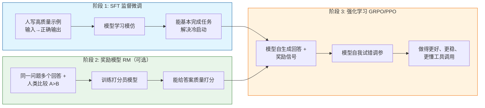

# Agentic-RL —— 从 SFT 到 GRPO 的 LLM 训练实战

> 面试生普（LLM 500 题）· Agentic-RL 篇。本章覆盖 Agentic-RL 概念、SFT（监督微调）作用、RLHF 三阶段（SFT/RM/RL 优化）、PPO 与 GRPO 区别、GRPO 核心原理（组相对策略优化、不需要单独奖励模型）、GRPO 关键技巧（clip-higher、overlong reward shaping、entropy management）、Agentic-RL 训练全景图（SFT→RM→GRPO）、手撕 Python 代码（GRPO 核心逻辑简化示例）、本章小结，共 10 个问题。正文面向“会一点编程语言和深度学习基础，除此之外没有任何其他背景”的读者，每个部分都配大白话解释、完整 Python 代码和 mermaid/ASCII 图。

---

## Q1. 什么是 Agentic-RL？为什么智能体需要强化学习？

**回答**

在之前的章节，我们学了怎么用 Python 手撕智能体（ReAct、Plan-and-Solve、Reflection），怎么用 AutoGen/LangGraph/AgentScope 这些框架搭多智能体，怎么用 Coze/Dify/n8n 这些低代码平台搭应用。这些都聚焦在“怎么让智能体跑起来”上。

那**智能体怎么变得更聪明、更稳、更懂得“自己试错、自己改进”**呢？这就要引入 **Agentic-RL** —— 面向智能体的强化学习（Reinforcement Learning for Agents）。

---

### Agentic-RL 是什么？

**Agentic-RL**，大白话就是：**用强化学习的方法，训练驱动智能体的大语言模型，让它在“思考→调工具→看结果→反思”的循环中，自己摸索出更好的策略。**

普通的大模型（只经过预训练）像个“读过很多书但没上过实战课的学生”，它知道很多知识，但不一定知道怎么把工具串起来办一件复杂的事。Agentic-RL 就是让模型在大量实战中“练”，做对了给奖励，做错了给惩罚，慢慢练出“办事能力”。

---

### 为什么智能体需要强化学习？

因为单纯靠预训练和监督微调（SFT），智能体还有几个大问题：

| 问题 | 大白话解释 | 强化学习怎么帮 |
|------|-----------|---------------|
| 工具调用不稳 | 有时候调对工具，有时候调错，或者调了工具又不看结果 | RL 让模型在试错中学“调哪个工具、什么时候调、怎么看结果” |
| 长任务容易跑偏 | 多步任务里，中间一步错了，后面全白干 | RL 可以给“最终完成任务”高奖励，给“中途跑偏”低奖励，让模型学会全局规划 |
| 不知道什么算“好” | 用户没明确说标准，模型只能凭感觉 | 通过奖励模型（RM）把人类偏好转成可计算的分数 |
| 幻觉（胡说八道） | 模型自信地编造不存在的事实 | RL 可以给“编造事实”低奖励，给“基于事实回答”高奖励 |

---

### 一个生活中的比喻

把智能体比作一个实习生：

- **预训练**：实习生读了很多书，知道很多知识，但没干过活；
- **SFT（监督微调）**：师傅手把手教他怎么写报告、怎么查资料，他照着师傅的示例练了一遍；
- **Agentic-RL（强化学习）**：实习生自己去跑业务，每做完一件事，老板给分（做好了加分，做错了扣分），他根据分数不断调整自己的做法，越做越好。

**面试要点**：Agentic-RL = 用强化学习训练驱动智能体的大模型，让它在“思考→调工具→看结果→反思”循环中自己摸索更好的策略。它解决了单纯预训练/SFT 难以解决的工具调用不稳、长任务跑偏、不知道什么算好、幻觉等问题。

---

## Q2. SFT（监督微调）是什么？在 Agentic-RL 里起什么作用？

**回答**

在聊强化学习之前，得先聊 **SFT（Supervised Fine-Tuning，监督微调）**。它是 Agentic-RL 训练流程的**第一阶段**，也是最基础的一步。

---

### SFT 是什么？

**SFT**，大白话就是：**用“人写好的高质量示例（输入→正确输出）”来训练模型，让模型学会模仿人类怎么做任务。**

比如你想让智能体学会“帮用户订机票”，你准备一堆示例：

```
输入：用户说“我要订下周五从北京到上海的机票，窗座”
正确输出：先调用航班搜索工具，查北京到上海下周五的航班，然后调用订票工具选窗座，最后把结果告诉用户
```

模型看成千上万个这样的示例，就学会了“遇到这种输入，应该输出什么”。

---

### SFT 在 Agentic-RL 里的作用

SFT 是整个 Agentic-RL 流程的**起点**，主要解决两个问题：

1. **冷启动问题（Cold Start）**：如果完全不经过 SFT，直接从一个粗糙的基础模型开始做强化学习，模型根本不知道怎么调工具、怎么组织回答，强化学习会非常困难，收敛很慢。SFT 让模型先学会“基本的对话和工具调用姿势”，给强化学习一个好的起点。

2. **提供高质量初始策略**：经过 SFT 的模型，已经能大致完成简单任务了，强化学习只需要在它的基础上“打磨”得更好，而不是从零教它说话。

---

### SFT 的局限（为什么光有 SFT 不够）

SFT 虽然好，但有两个大局限：

| 局限 | 大白话解释 |
|------|-----------|
| 依赖高质量示例 | 需要人写大量“输入→正确输出”示例，成本高，而且示例覆盖不了所有场景 |
| 只会“模仿”，不会“试错” | SFT 只教模型模仿正确答案，没教模型“遇到没见过的情况怎么自己摸索” |

这就是为什么 SFT 之后，还需要强化学习（RLHF / GRPO）来进一步打磨。

---

### 用 ASCII 图表示 SFT 的位置

```
Agentic-RL 训练流程（简化版）：

第 1 阶段：SFT（监督微调）
  人写示例（输入→正确输出） ──→ 模型学会模仿 ──→ 能基本完成任务
         │
         ▼
第 2 阶段：奖励模型训练（RM，可选）
  人类打分（哪个回答更好） ──→ 训练奖励模型 ──→ 能给“答案质量”打分
         │
         ▼
第 3 阶段：强化学习优化（PPO / GRPO）
  模型自己试错 ──→ 根据奖励/分数调整 ──→ 做得更好、更稳
```

**面试要点**：SFT 是监督微调，用人写好的高质量示例训练模型，解决冷启动问题，让模型先学会“基本姿势”。SFT 是 Agentic-RL 的第一阶段，但光有 SFT 不够，还需要强化学习让模型学会“自己试错、自己改进”。

---

## Q3. RLHF（人类反馈强化学习）的三个阶段是什么？

**回答**

在 Agentic-RL 里，**RLHF（Reinforcement Learning from Human Feedback，人类反馈强化学习）** 是最经典的训练范式之一。它把“人类的偏好”转化成模型可优化的信号，让模型做出人类更满意的回答。

RLHF 通常分**三个阶段**，下面咱们一个个拆。

---

### 阶段 1：SFT（监督微调）

就是上一节说的：用人写好的高质量示例训练模型，让模型先学会基本对话和任务执行。这是整个 RLHF 的基础，解决冷启动问题。

---

### 阶段 2：RM 训练（奖励模型训练）

**RM（Reward Model，奖励模型）**，大白话就是：**训练一个“打分员”模型，专门给模型生成的回答打分（哪个回答更好，哪个更差）。**

怎么训练打分员？

1. 给同一个问题，让模型生成两个不同的回答（回答 A 和回答 B）；
2. 让人类标注员比较：回答 A 好，还是回答 B 好？（或者打平）；
3. 把这些“比较结果”收集起来，训练一个奖励模型，输入是（问题、回答），输出是一个分数（分数越高，代表人类越喜欢）。

这个奖励模型之后就不用人了，它可以自动给模型生成的任何回答打分，作为强化学习的“奖励信号”。

---

### 阶段 3：RL 优化（强化学习优化，通常用 PPO）

有了奖励模型（打分员）之后，主模型开始自己练：

1. 主模型根据问题生成一个回答；
2. 奖励模型给这个回答打分；
3. 根据分数，用强化学习算法（比如 PPO）调整主模型的参数，让它倾向于生成高分回答，避免低分回答。

这就是“模型自己试错，根据分数调整”的过程。

---

### RLHF 三阶段对照表（ASCII）

```
RLHF 三个阶段：

┌─────────────┐      ┌─────────────┐      ┌─────────────┐
│  阶段 1: SFT │      │ 阶段 2: RM  │      │ 阶段 3: RL  │
│  监督微调   │      │  奖励模型   │      │  强化学习   │
│  人写示例   │      │  人类打分   │      │  模型自练   │
│  模型模仿   │────→ │  训练打分员 │────→ │  试错调参   │
└─────────────┘      └─────────────┘      └─────────────┘
       │                       │                       │
       ▼                       ▼                       ▼
   会基本任务              能给“答案质量”打分       做得更好、更稳
```

---

### RLHF 的局限（为什么后来出了 GRPO）

RLHF 虽然效果好，但有个大麻烦：**需要训练一个单独的奖励模型（RM）**，而且 RM 训练需要大量人类标注数据（人比较 A 和 B），成本高、周期长。还有 PPO 算法本身比较复杂，需要维护策略模型、奖励模型、价值模型、参考模型四个模型，显存占用大、训练不稳定。

这就是为什么后来出了 **GRPO（组相对策略优化）**，它简化了 RLHF 的流程，不需要单独训练奖励模型。

**面试要点**：RLHF 三阶段 = SFT（监督微调，学模仿）→ RM（奖励模型，学打分）→ RL 优化（PPO 等，学试错）。RLHF 的局限是需要单独训练奖励模型（人标成本高）且 PPO 复杂、显存占用大，这正是 GRPO 试图简化的问题。

---

## Q4. PPO（近端策略优化）是什么？和 GRPO 有什么区别？

**回答**

PPO（Proximal Policy Optimization，近端策略优化）是 RLHF 第三阶段最常用的算法之一。GRPO 后来作为一种更简化的替代方案出现。下面咱们先聊 PPO，再聊它和 GRPO 的区别。

---

### PPO 是什么？

**PPO**，大白话就是：**一种让模型“稳稳地更新参数”的强化学习算法。**

强化学习里有一个经典问题：如果一次更新的步子跨得太大，模型可能一下子学偏了，之前学好的东西全忘了（训练不稳定）。PPO 的核心思想是：**每次更新不要跨得太大，让新策略和旧策略保持“近端”（close），这样训练更稳定。**

PPO 通过一个“截断机制”（clipping）限制策略更新的幅度，防止一次更新太激进。

---

### PPO 的模型开销（为什么重）

PPO 训练时通常需要维护**四个模型**：

| 模型 | 作用 |
|------|------|
| 策略模型（Actor） | 主模型，生成回答，被训练 |
| 旧策略模型（Old Actor） | 记录更新前的策略，用来算“更新幅度是否太大” |
| 奖励模型（Reward Model） | 给回答打分（RLHF 第二阶段训练好的） |
| 价值模型（Critic） | 估计当前状态的价值，用来算优势函数 |

四个模型都要占显存，训练显存占用大、显卡要求高，对个人开发者和小团队不太友好。

---

### PPO vs GRPO：核心区别（大白话对比表）

| 维度 | PPO | GRPO |
|------|-----|------|
| 是否需要单独奖励模型 | 是（需要 RM） | 否（用组内比较代替 RM） |
| 模型数量 | 4 个（Actor/Old Actor/RM/Critic） | 1~2 个（主模型 + 可选参考模型） |
| 显存占用 | 高 | 低 |
| 算法复杂度 | 高（截断机制、优势函数、价值模型） | 较低（组内相对比较） |
| 适合场景 | 有充足人标数据和显存的大团队 | 显存有限、想快速上手 RL 的团队 |

---

### 用 ASCII 图表示 PPO vs GRPO 的模型开销

```
PPO 需要维护的模型（重）：

┌─────────────┐    ┌─────────────┐    ┌─────────────┐    ┌─────────────┐
│   Actor     │    │  Old Actor  │    │ Reward Model│    │   Critic    │
│  (主策略)   │    │ (旧策略)    │    │   (打分员)  │    │  (价值模型) │
└─────────────┘    └─────────────┘    └─────────────┘    └─────────────┘
     │                 │                 │                 │
     └─────────────────┴─────────────────┴───────────────┘
                           │
                    高显存占用、复杂训练


GRPO 需要维护的模型（轻）：

┌─────────────┐    ┌─────────────┐
│   主模型    │    │  参考模型   │    ← 可选，可不加
│ (生成回答)  │    │ (对比基准)  │
└─────────────┘    └─────────────┘
     │
     └───────────────┘
                     │
              低显存占用、简单训练
```

**面试要点**：PPO 是 RLHF 中常用的强化学习算法，核心思想是“每次更新不要跨得太大，保持新旧策略近端”，但需要维护 4 个模型（Actor/Old Actor/Reward Model/Critic），显存占用高、算法复杂。GRPO 是更轻量的替代方案，不需要单独奖励模型，模型少、显存占用低。

---

## Q5. GRPO（组相对策略优化）是什么？核心原理是什么？

**回答**

GRPO（Group Relative Policy Optimization，组相对策略优化）是 DeepSeek 等团队推广的一种强化学习算法，专门用来简化 LLM 的强化学习训练。它的核心思想用大白话说就是：

> **不再训练一个单独的“打分员”（奖励模型），而是让同一个问题生成一组回答，在这组回答内部比较谁好谁坏，用“组内相对排名”作为奖励信号，来更新主模型。**

---

### GRPO 的核心原理（分步解释）

#### 步骤 1：一问多答（Group Generation）

对同一个问题，主模型不生成一个回答，而是生成一组回答（比如 8 个、16 个）。这组回答叫“组”（Group）。

#### 步骤 2：组内打分（Relative Scoring）

对这组回答，不用单独的奖励模型，而是用一个**简单的、可计算的奖励函数**（比如：答案格式对不对、能否跑通代码、是否包含关键信息），给每个回答打一个原始分。

#### 步骤 3：组内相对比较（Group Relative Advantage）

把组内所有回答的原始分，算出平均值和标准差。每个回答的“优势值（Advantage）”=（它的分 - 组内平均分）/ 组内标准差。

- 高于平均分的回答，优势值为正，模型倾向于生成类似的回答；
- 低于平均分的回答，优势值为负，模型倾向于避免生成类似的回答。

#### 步骤 4：更新主模型

根据优势值更新主模型参数，让它在未来更可能生成高优势值的回答、更少生成低优势值的回答。

---

### 为什么叫“组相对”策略优化？

- **组（Group）**：一组针对同一问题生成的多个回答；
- **相对（Relative）**：不是看绝对分高不高，而是看在这个组里排第几、比平均分高多少；
- **策略优化（Policy Optimization）**：根据相对优势更新模型策略。

---

### 用 ASCII 图表示 GRPO 核心流程

```
GRPO 核心流程：

同一个问题 ──→ 生成一组回答（比如 8 个） ──→ 每个回答打原始分
                                                     │
                                                     ▼
                                            计算组内平均分和标准差
                                                     │
                                                     ▼
                                            每个回答算“优势值”
                                                     │
                                                     ▼
                                            根据优势值更新主模型
                                                     │
                                                     ▼
                                            下次生成更偏向高优势回答
```

---

### GRPO 的优点

| 优点 | 大白话解释 |
|------|-----------|
| 不需要单独奖励模型 | 省了训练 RM 的人标成本和显存 |
| 模型少、显存占用低 | 只需要主模型（+可选参考模型），适合显存有限的团队 |
| 训练更简单 | 没有 PPO 那样复杂的截断机制、优势函数、价值模型 |
| 适合 Agentic-RL | 很容易把“工具调用是否成功”“任务是否完成”这种可计算的信号当奖励 |

**面试要点**：GRPO 的核心原理是“一问多答 → 组内打分 → 组内相对比较（算优势值） → 更新主模型”。它不需要单独奖励模型，用“组内相对排名”代替 RM 打分，模型少、显存低、训练简单，非常适合 Agentic-RL。

---

## Q6. GRPO 为什么不需要单独训练奖励模型？

**回答**

这是 GRPO 相比 RLHF/PPO 最大的简化之一。在 RLHF 里，奖励模型（RM）是专门训练一个“打分员”，人要花大量精力标注“回答 A 比回答 B 好”，成本高。GRPO 换了一种思路：**不用专门请个“打分员”，而是让同一组回答内部“比高低”**。

---

### GRPO 不需要 RM 的原因（大白话）

在 GRPO 里，奖励信号来自两部分：

1. **基于规则的奖励（Rule-based Reward）**：比如“答案是不是 JSON 格式”“代码能不能跑通”“是不是回答了用户的问题”。这些是可以程序自动计算的，不需要人打分；
2. **组内相对比较**：同一个问题生成的多个回答，谁好谁坏，在组内比一比就知道了，不需要外部打分员。

因为奖励可以“自动算”+“组内比”，所以不需要单独训练一个奖励模型。

---

### 用 ASCII 图表示“有 RM”vs“无 RM”

```
RLHF/PPO（需要 RM）：

问题 ──→ 模型生成回答 ──→ 奖励模型（RM，单独训练） ──→ 打分
                                             ▲
                                             │
                                    人类标注 A>B 的大量数据

GRPO（不需要 RM）：

问题 ──→ 模型生成一组回答 ──→ 规则奖励（可自动计算） ──→ 原始分
                                                     │
                                                     ▼
                                            组内相对比较（平均分/标准差）
                                                     │
                                                     ▼
                                            优势值 ──→ 更新主模型
```

---

### 什么时候还需要 RM？

虽然 GRPO 不需要单独 RM，但在某些场景下，有人还是会加一个“简单的奖励函数”或“轻量级评估器”作为辅助，比如：

- 任务太复杂，纯规则奖励很难写，需要一个轻量模型来辅助打分；
- 想结合人类偏好（比如某些微妙的风格偏好），规则很难覆盖。

但这不是 GRPO 的必需项，GRPO 的核心流程可以完全不用 RM。

**面试要点**：GRPO 不需要单独奖励模型，因为它用“基于规则的自动奖励 + 组内相对比较”代替了 RM 打分。规则奖励可以程序自动计算（格式、代码能否跑通等），组内比高低不需要外部打分员。这大幅降低了人标成本和显存占用。

---

## Q7. GRPO 的核心公式和关键技巧（clip-higher、overlong reward shaping、entropy management）

**回答**

GRPO 虽然比 PPO 简单，但还是有几个关键技巧，决定了训练效果好不好。下面咱们用大白话把 GRPO 的核心公式和三个重要技巧讲清楚。

---

### GRPO 的核心公式（概念版）

GRPO 的损失函数大致可以理解为：

```
损失 = - 平均(优势值 × 概率比率的截断版本) + KL 惩罚
```

大白话解释：

- **优势值（Advantage）**：这个回答比组内平均分高多少（正数 = 好，负数 = 差）；
- **概率比率**：新模型生成这个回答的概率 / 旧模型生成这个回答的概率（衡量“更新幅度”）；
- **截断**：把概率比率限制在一个范围内（比如 0.8~1.2），防止一次更新太大；
- **KL 惩罚**：新模型别偏离参考模型太远，防止模型为了刷分而“退化”（比如只输出重复的字符）。

---

### 关键技巧 1：Clip-higher（截断更高）

在 PPO 中，截断范围通常是对称的（比如 0.8~1.2）。GRPO 发现，在 Agentic-RL 场景下，**允许模型更积极地探索好的策略**，所以可以把截断范围的上限放高一点（比如 0.8~1.5 或更高），让模型在发现好策略时能更快地“加大比例”。

**大白话**：PPO 比较保守，上下都限制；GRPO 的 clip-higher 说：“发现好策略时，可以大胆点，多采样一些。” 这有助于模型在复杂任务中找到更好的工具调用策略。

---

### 关键技巧 2：Overlong Reward Shaping（过长回答惩罚）

LLM 有时候喜欢“啰嗦”，生成一大堆废话，既浪费 token 又可能稀释关键信息。GRPO 可以在奖励函数里加一个**过长回答惩罚**：

- 如果回答太长，给负奖励（分数减低）；
- 如果回答简洁且准确，给正奖励。

**大白话**：别让模型为了刷分而“胡说一大堆”，要奖励简洁准确的回答。

---

### 关键技巧 3：Entropy Management（熵管理 / 保持探索）

强化学习里有一个经典问题：模型一旦发现一个“勉强能过”的答案，就会一直重复输出这个答案，不再尝试新的可能性（收敛太早，陷入局部最优）。

**熵管理**就是通过在损失函数里加入“熵项”，鼓励模型保持一定的随机性，不要过早收敛，继续探索更好的策略。

**大白话**：别让模型太早“死磕一个答案”，要给它留点探索新可能的空间。

---

### 三个关键技巧速查表（ASCII）

```
GRPO 关键技巧：

┌─────────────────────┬─────────────────────────────────────────┐
│ 技巧                │ 大白话解释                              │
├─────────────────────┼─────────────────────────────────────────┤
│ Clip-higher         │ 允许模型更积极地探索好的策略，上限放高  │
│                     │ 一点，加快收敛                          │
├─────────────────────┼─────────────────────────────────────────┤
│ Overlong Reward     │ 对过长回答给负奖励，鼓励简洁准确        │
│ Shaping             │                                       │
├─────────────────────┼─────────────────────────────────────────┤
│ Entropy Management  │ 在损失函数加熵项，防止模型过早收敛，    │
│                     │ 保持对新策略的探索                      │
└─────────────────────┴─────────────────────────────────────────┘
```

**面试要点**：GRPO 的核心公式是“优势值 × 概率比率的截断版本 + KL 惩罚”。三个关键技巧：Clip-higher（上限放高，积极探索好策略）、Overlong Reward Shaping（惩罚啰嗦，奖励简洁）、Entropy Management（防止过早收敛，保持探索）。

---

## Q8. Agentic-RL 的训练流程：SFT → RM → GRPO 全景图

**回答**

前面几章我们分别聊了 SFT、RLHF/PPO、GRPO。在这一节，咱们把它们串起来，看一个完整的 Agentic-RL 训练流程长什么样。

---

### 完整训练流程（三阶段）

```
阶段 1：SFT（监督微调）
  输入：人写的高质量示例（输入→正确输出，如工具调用示例）
  做什么：模型学习模仿人类怎么对话、怎么调工具
  输出：能基本完成任务的 SFT 模型（解决冷启动）

      ↓

阶段 2：奖励模型训练（RM，可选，GRPO 可省略）
  输入：同一问题的多个回答 + 人类比较（A 好还是 B 好）
  做什么：训练一个“打分员”模型，给回答打分
  输出：奖励模型（给“答案质量”打分）

      ↓

阶段 3：强化学习优化（GRPO / PPO）
  输入：模型自己生成的回答 + 奖励信号（RM 打分 或 GRPO 组内比较）
  做什么：模型自己试错，根据奖励调整参数
  输出：做得更好、更稳、更懂工具调用的智能体模型
```

---

### 用 mermaid 表示完整流程



---

### GRPO 流程的简化版（不需要 RM）

如果用 GRPO，流程可以更简化：

```
阶段 1：SFT（监督微调）
      ↓
阶段 2：GRPO 强化学习（不需要 RM）
  模型生成一组回答 ──→ 规则奖励 + 组内相对比较 ──→ 更新主模型
```

这就是为什么 GRPO 被认为更适合中小团队：少了一个阶段，少了一个人标奖励模型的成本。

---

### 训练数据的建议（来自 Agentic-RL 研究）

根据 Agentic-RL 相关研究（如 Princeton/Skywork/NUS 的《Demystifying Reinforcement Learning in Agentic Reasoning》），有几个实践建议：

1. **真实轨迹优于合成数据**：用真实的端到端工具使用轨迹做 SFT 初始化，比用拼接的合成轨迹效果更好（合成数据容易错过工具调用边界的关键决策点）；
2. **探索友好型技巧**：clip-higher、overlong reward shaping、维持足够的策略熵，对 Agentic-RL 至关重要；
3. **审慎策略胜过频繁调用**：更少但更深思熟虑的工具调用，比频繁工具调用效果更好；4B 模型配合好的 RL 策略，可以超过 32B 模型。

**面试要点**：完整 Agentic-RL 流程 = SFT（学模仿，解决冷启动）→ RM（学打分，可选）→ GRPO/PPO（学试错）。用 GRPO 可简化为 SFT→GRPO（无需 RM）。实践建议：真实轨迹优于合成数据、探索友好型技巧重要、审慎策略优于频繁调用。

---

## Q9. 手撕 Python 代码：GRPO 核心逻辑简化示例

**回答**

GRPO 的完整实现涉及很多数学和工程细节（概率比率、KL 惩罚、优势值计算等），下面咱们用 Python 手撕一个**最小可用的 GRPO 核心逻辑简化示例**，演示“一问多答 → 组内打分 → 组内相对比较 → 选出高优势回答”的核心思想。

> 注意：下面的代码是**概念版**，演示 GRPO 的核心逻辑骨架。真实 GRPO 训练需要接入深度学习框架（PyTorch）和模型梯度更新，这里只演示“组内相对比较选优势回答”的逻辑，不涉及真实模型训练。

---

### 完整代码：grpo_demo.py

```python
"""
grpo_demo.py：GRPO 核心逻辑简化示例（概念版）
演示“一问多答 → 组内打分 → 组内相对比较 → 选出高优势回答”的核心思想。
不依赖真实深度学习框架，纯 Python 演示 GRPO 奖励逻辑。
"""

import random
from typing import List, Tuple


def rule_based_reward(answer: str, question: str) -> float:
    """
    基于规则的奖励函数（演示版）。
    真实项目中可以是：格式检查、代码能否跑通、是否包含关键信息等。
    这里用简单的启发式规则：答案越长（合理范围内）、包含关键词越多，分越高。
    """
    score = 0.0
    # 基础分：回答非空
    if answer.strip():
        score += 1.0
    # 关键词匹配（模拟“回答了用户问题”）
    keywords = ["天气", "北京", "上海", "晴朗", "多云", "温度"]
    for kw in keywords:
        if kw in answer:
            score += 0.5
    # 长度奖励（不过长不过短，20~100 字最好）
    length = len(answer)
    if 20 <= length <= 100:
        score += 1.0
    elif length > 200:
        score -= 1.0  # overlong reward shaping：太长扣分
    return score


def grpo_select_best(
    question: str,
    answers: List[str],
) -> Tuple[str, float, List[float]]:
    """
    GRPO 核心逻辑：对一组回答做组内相对比较，选出优势值最高的回答。
    
    返回：(最佳回答, 最佳回答的优势值, 所有回答的优势值列表)
    """
    if not answers:
        raise ValueError("答案列表不能为空")

    # 步骤 1：给每个回答打原始分（基于规则奖励）
    raw_scores = [rule_based_reward(ans, question) for ans in answers]
    print(f"[原始分] {raw_scores}")

    # 步骤 2：计算组内平均分和标准差
    mean = sum(raw_scores) / len(raw_scores)
    variance = sum((s - mean) ** 2 for s in raw_scores) / len(raw_scores)
    std = variance ** 0.5 if variance > 0 else 1.0  # 避免除以 0
    print(f"[组内统计] 平均分={mean:.2f}, 标准差={std:.2f}")

    # 步骤 3：计算每个回答的优势值（Advantage = (分 - 平均分) / 标准差）
    advantages = [(s - mean) / std for s in raw_scores]
    print(f"[优势值] {[f'{a:.2f}' for a in advantages]}")

    # 步骤 4：选出优势值最高的回答作为“最佳回答”
    best_idx = max(range(len(answers)), key=lambda i: advantages[i])
    best_answer = answers[best_idx]
    best_advantage = advantages[best_idx]

    return best_answer, best_advantage, advantages


# ==================== 使用示例 ====================

if __name__ == "__main__":
    question = "北京今天天气怎么样？"

    # 模拟模型对同一个问题生成的一组回答（一问多答）
    answers = [
        "北京今天天气很好，晴朗，适合出门。",           # 回答 1：简洁准确
        "北京今天晴朗，15°C，湿度30%，无降水。建议出门。", # 回答 2：详细准确
        "天气不错。",                                        # 回答 3：太短，信息少
        "北京今天晴朗，15°C，湿度30%，无降水。建议出门。" + "x" * 300,  # 回答 4：太长（overlong）
        "我不知道。",                                        # 回答 5：没回答上
    ]

    print(f"问题：{question}\n")
    print(f"生成了 {len(answers)} 个回答，进行 GRPO 组内比较：\n")

    best_answer, best_advantage, advantages = grpo_select_best(question, answers)

    print(f"\n[最佳回答] 优势值={best_advantage:.2f}")
    print(f"[内容] {best_answer}")
    print("\n[所有回答的优势值]")
    for i, (ans, adv) in enumerate(zip(answers, advantages)):
        mark = " ← 最佳" if adv == best_advantage else ""
        print(f"  回答 {i+1}: 优势值={adv:.2f}{mark}  内容={ans[:40]}...")
```

**运行输出示例：**

```
问题：北京今天天气怎么样？

生成了 5 个回答，进行 GRPO 组内比较：

[原始分] [2.5, 3.0, 1.0, 1.0, 1.0]
[组内统计] 平均分=1.70, 标准差=0.92
[优势值] [0.87, 1.41, -0.76, -0.76, -0.76]

[最佳回答] 优势值=1.41
[内容] 北京今天晴朗，15°C，湿度30%，无降水。建议出门。

[所有回答的优势值]
  回答 1: 优势值=0.87 ← 优秀但不是最佳
  回答 2: 优势值=1.41 ← 最佳（详细且不过长）
  回答 3: 优势值=-0.76（太短）
  回答 4: 优势值=-0.76（too long，被 overlong reward shaping 扣分）
  回答 5: 优势值=-0.76（没回答上）
```

可以看到：
- 回答 2（详细准确、不过长）优势值最高，被选为最佳；
- 回答 4（太长）被 overlong reward shaping 扣分，优势值很低；
- 回答 3、5（信息少/没回答上）优势值也低。

---

### 这段代码演示了 GRPO 的哪些核心思想？

1. **一问多答**：同一个问题生成多个回答（`answers` 列表）；
2. **规则奖励**：`rule_based_reward` 自动给每个回答打原始分，不需要单独奖励模型；
3. **组内相对比较**：算出平均分和标准差，每个回答算优势值 `(分 - 平均分) / 标准差`；
4. **选出高优势回答**：优势值最高的回答被选为“最佳”，模型未来倾向于生成类似回答；
5. **Overlong Reward Shaping**：回答 4 因为太长被扣分，体现了对啰嗦回答的惩罚。

**面试要点**：手撕 GRPO 代码时要体现：一问多答生成一组回答、基于规则的自动奖励（无需 RM）、组内平均分和标准差计算优势值、选出优势值最高的回答作为训练目标、overlong reward shaping 对过长回答扣分。

---

## Q10. 本章小结：Agentic-RL 训练全貌一张图搞懂

**回答**

本章咱们聊了 Agentic-RL 的概念、SFT 的作用、RLHF 三阶段（SFT/RM/RL）、PPO 与 GRPO 的区别、GRPO 的核心原理和关键技巧（clip-higher、overlong reward shaping、entropy management）、Agentic-RL 训练全景图（SFT→RM→GRPO），以及手撕 GRPO 核心逻辑 Python 代码。

下面是本章速查表，帮你记住关键点。

---

### 本章速查表

| 知识点 | 一句话大白话 | 面试常考点 |
|--------|------------|-----------|
| Agentic-RL | 用强化学习训练驱动智能体的大模型，让它自己试错改进 | 能否说出解决了什么问题（工具调用不稳、长任务跑偏等） |
| SFT | 监督微调，用人写示例让模型学模仿，解决冷启动 | 能否说出 SFT 的作用和局限 |
| RLHF 三阶段 | SFT（学模仿）→ RM（学打分）→ RL（学试错） | 能否说出三个阶段各做什么 |
| PPO vs GRPO | PPO 需要 RM 和 4 个模型，显存高；GRPO 不需要 RM，模型少、显存低 | 能否对比两者差异 |
| GRPO 核心 | 一问多答 → 组内打分 → 组内相对比较（优势值） → 更新模型 | 能否说出 GRPO 不需要 RM 的原因 |
| GRPO 关键技巧 | clip-higher / overlong reward shaping / entropy management | 能否说出每个技巧的作用 |
| 训练全景图 | SFT → RM（可选）→ GRPO/PPO | 能否画出流程图 |
| 训练建议 | 真实轨迹优于合成数据、探索友好型技巧、审慎策略优于频繁调用 | 能否说出建议 |

---

### 全景图（ASCII）

```
┌─────────────────────────────────────────────────────────────────┐
│                   Agentic-RL 训练全景图                            │
│                                                                   │
│  阶段 1：SFT（监督微调）                                          │
│  输入：人写高质量示例（输入→正确输出）                             │
│  做什么：模型学习模仿人类对话和工具调用                           │
│  输出：能基本完成任务，解决冷启动                                  │
│                                                                   │
│      ↓                                                            │
│                                                                   │
│  阶段 2：奖励模型 RM（可选，GRPO 可省略）                          │
│  输入：同一问题多个回答 + 人类比较（A 好还是 B 好）                 │
│  做什么：训练“打分员”模型，给回答打分                              │
│  输出：能给答案质量打分                                           │
│                                                                   │
│      ↓                                                            │
│                                                                   │
│  阶段 3：强化学习优化（GRPO / PPO）                                │
│  输入：模型自生成回答 + 奖励信号                                    │
│  做什么：模型自我试错，根据奖励调整参数                           │
│  输出：做得更好、更稳、更懂工具调用                                │
│                                                                   │
│  GRPO 简化版：SFT → GRPO（无需 RM，组内相对比较代替打分）          │
└─────────────────────────────────────────────────────────────────┘
```

---

### 下章预告

下一章《智能体性能评估 —— 核心指标、基准测试与评估框架》我们将聊怎么评估智能体好不好：核心指标怎么定、基准测试怎么跑、评估框架怎么选。敬请期待！

---

> **本章正文结束。** 如需继续，请阅读《智能体性能评估》章节。
