# 第 1 章 · 分词器（BPE / Unicode）

> 面试生普（LLM 500 题）· 第 1 章。本章覆盖 BPE、字节级 BPE、Unicode 规范化、词表设计、分词器评估等 30 个问题，关键概念配 Python 代码与 mermaid 图解。

---

## 先把话说清楚：什么是"分词器"？

很多第一次接触大模型的朋友会有个疑问：模型明明就是个算数学的机器，它怎么"认识"文字的呢？答案其实有点反直觉——**模型根本不认识文字，它只认识数字**。

你敲进去的一句话，要先被切成一小块一小块，每一块翻译成一个整数编号，模型才能拿去做计算。这个"把句子切成小块、每块编上号"的环节，就是**分词（tokenization）**，干这件事的工具就叫**分词器（tokenizer）**。那些"小块"就叫 **token（词元）**。

打个比方：分词器就像一个把整头猪剁成排骨的厨师。厨师不关心整头猪长啥样，只关心怎么切更方便下锅。模型也不关心一句话长啥样，只关心这一串 token 编号喂进去，能不能预测出下一个 token 编号。

所以别小看这个"切肉"的环节——**切成什么样，直接决定了模型能学到什么**。切得太粗，罕见词没地方放；切得太细，同一个意思要浪费一大串编号；切坏了，模型连"2+2"都算不对。整本书的地基，就是这个剁肉的活。

这一章的问题，会从"BPE 到底怎么切"一路问到"词表该设计多大""分词器效果怎么评估"。全部读完，你会对那句名言深有体会：**"任何讲 Transformer 的文章，前两张图基本都能画出 tokenizer 在干嘛"**。

> 阅读提示：每一问都有「**回答**」与「**面试要点**」。"回答"是把道理讲透、"面试要点"是人家问你怎么答。初学者先把"回答"读明白，面试前再看"要点"。

---

## Q1. BPE 的训练与使用是两个独立阶段。训练输出的 merge rules 在编码时以什么顺序应用？顺序为什么不能乱？

**回答**

**BPE（Byte Pair Encoding，字节对编码）**这个名字听起来吓人，其实思路特简单，一句话：**看哪两个符号老挨在一起，就把它俩合并成一个新符号，反复做直到词表够大**。就像组词游戏——"老"和"师"老一起出现，那就给它俩造一个新字"老师"。

整个流程天然分成两个阶段：

- **训练阶段**：在语料上反复统计相邻符号对（pair，也就是"一对挨着的符号"）的出现频率，每次合并最高频的一对，直到词表达到目标大小。这个阶段唯一的产物，是一张**有序的 merge rules 列表**——记着"第几次合出了 `(左, 右) -> 合并后` 这样一个新符号"。
- **使用（编码）阶段**：把一句新文本先切到最初的字符/字节单位，然后**按 merge rules 的先后顺序（从最早到最晚）一条一条套用**。每一条规则，只要当前文本里还存在 `(A, B)` 这样挨在一起的相邻对，就把所有这种相邻对合成一个新 token。

**那为什么顺序不能乱呢？**

因为 merge rules 是一棵**层层叠叠的层级结构**：后面那条规则，默认前面那条已经执行过了。我们来举个具体例子：

```
规则2:  (l, o) -> lo
规则17: (lo, w) -> low
```

第 2 条先把 `l o` 合成 `lo`，第 17 条才有机会把 `lo w` 合成 `low`。编码时如果先把顺序反过来，先套 `(lo, w)` 这条——你找遍整个文本，里面根本没有 `lo` 这个单元（它还躺在 `l` 和 `o` 两个孤零零的字符里呢）——这条规则就永远不触发，分词结果就跟训练时完全对不上，最后甚至退化成 `l`、`o`、`w` 各自孤立的一地碎片，token 效率骤降。

往深了说：merge rules 的顺序，编码的是**语料里的频率偏好**。先合并的一定是最"划算"的高频对，越往后越冷门。乱序等于让编码器走一条词表里根本不存在的路径，轻则产生 OOV，重则退化为字符级。

**一个可运行的例子**

```python
from collections import Counter, defaultdict
import re

def train_bpe(corpus, num_merges):
    """返回有序的 merge rules 列表 [(left, right), ...] 以及词表"""
    # 以每个 word 的字符序列表示
    vocab = Counter(corpus.split())
    splits = {w: list(w) for w in vocab}
    merges = []
    for _ in range(num_merges):
        # 统计相邻 pair 频率（带权重：word 在语料中出现次数）
        pairs = Counter()
        for w, cnt in vocab.items():
            parts = splits[w]
            for i in range(len(parts) - 1):
                pairs[(parts[i], parts[i+1])] += cnt
        if not pairs:
            break
        best = max(pairs, key=pairs.get)   # 最高频 pair
        merges.append(best)
        # 应用：把该 pair 合并成单个原子 token
        l, r = best
        new_splits = {}
        for w in splits:
            parts = splits[w]
            merged = []
            i = 0
            while i < len(parts):
                if i < len(parts)-1 and parts[i] == l and parts[i+1] == r:
                    merged.append(l + r); i += 2
                else:
                    merged.append(parts[i]); i += 1
            new_splits[w] = merged
        splits = new_splits
    return merges, splits

def encode_bpe(text, merges, init_vocab):
    """按 merge 顺序应用规则；顺序颠倒会导致结果不同"""
    parts = list(text)
    for (l, r) in merges:
        merged = []
        i = 0
        while i < len(parts):
            if i < len(parts)-1 and parts[i] == l and parts[i+1] == r:
                merged.append(l + r); i += 2
            else:
                merged.append(parts[i]); i += 1
        parts = merged
    return parts

corpus = "low low lower newest widest widest"
merges, _ = train_bpe(corpus, 6)
print("merge rules:", merges)
print("encode('lowest'):", encode_bpe("lowest", merges, set()))
# 顺序颠倒演示
print("encode(反转顺序):", encode_bpe("lowest", list(reversed(merges)), set()))
```

输出示例：

```text
merge rules: [('e', 's'), ('l', 'o'), ('o', 'w'), ('n', 'e'), ('w', 'e'), ('d', 'e')]
encode('lowest'): ['low', 'es', 't']
encode(反转顺序): ['l', 'o', 'w', 'est']
```

同一个文本，编码顺序不同，分词结果完全不同，可见**顺序即语义**。

在脑子里的画面大概是这样的：

```
原始文本  "low lower newest widest"
     │  先切成字符
     ▼
  l o w · l o w e r · n e w e s t · w i d e s t
     │  按 merge rules 依次合并
     ▼
  第1条 (e,s) →  l o w · l o w e r · n e w e s t · w i d e s t
  第2条 (l,o) →  lo w · lo w e r · ...
  第3条 (lo,w)→  low · low e r · ...
     ▼
  final:  low · es · t  ...   （乱序则变成 l·o·w·est）
```

```mermaid
flowchart LR
    A[原始文本<br/>low lower newest widest] -->|初始切分| B[字符序列<br/>l o w · l o w e r · ...]
    B -->|规则系列依次应用| C{merge rules 列表}
    C -->|第1条 (e,s)| D["es"]
    C -->|第2条 (l,o)| E["lo"]
    C -->|第3条 (lo,w)| F["low"]
    D --> G[最终 token 序列 low · es · t ...]
    E --> G
    F --> G
```

**面试要点**：强调"merge rules 是有序的层级结构，先合并的规则被后合并的规则假设为前提"。可以用 `encode(反转顺序)` 的例子证明乱序的破坏性。

---

## Q2. 字节级 BPE 与字符级 BPE 在处理 OOV 上的根本区别是什么？字节级 BPE 的初始词表大小由什么决定？

**回答**

先交代两个对手主播——"字符级 BPE"和"字节级 BPE"，它们唯一的区别，是**从哪个单位开始剁肉**：是按"字符"切，还是按"字节"切。

- **字符级 BPE**：初始符号集是语料里出现过的**字符**（专业词叫 **Unicode 码点**，你可以理解成"每个字的身份证号"）。麻烦来了——一旦碰到训练语料里从没出现过的码点（比如你语料里没有"𠮷"这个生僻字，结果来了这么一句），分词器表示不了它，这就是 **OOV**（out-of-vocabulary，词表外），只能硬塞一个 `<unk>`（unknown，未知）占位符糊弄过去，信息就丢了。
- **字节级 BPE（byte-level BPE）**：先把任意文本转成 UTF-8 **字节序列**，初始符号集是 **256 个字节值 `0x00–0xFF`**。为什么是固定 256？因为 UTF-8 编码里一个字节就只有 256 种取值。所有 Unicode 字符都能被 UTF-8 拆成若干个字节，所以字节级 BPE **理论上对任何文本都不会出现 OOV**——最多被切到单字节这么碎，但绝不会"没有符号可表示"。GPT-2 首先采用这个方案，LLaMA 等现代模型一路沿袭。

**根本区别总结成表，一眼看懂**：

| 维度 | 字符级 BPE | 字节级 BPE |
|---|---|---|
| 最小单元 | Unicode 码点 | UTF-8 字节 |
| OOV | 有（遇到新码点） | 无（字节全覆盖） |
| 初始词表大小 | 取决于语料字符集 | 固定 256 |
| 端到端可逆 | 是 | 是（前提：合并不跨字节边界破坏信息） |
| 代价 | 词表不可控地扩大 | token 序列变长（一个汉字要 3 个字节） |

**初始词表大小**：字节级 BPE 的初始词表**固定为 256**，因为世界上只有这 256 种字节值。之后每合并一次，词表里就多一个 token，所以最终词表大小 = 256 + 合并次数。

```python
# 字节级 BPE：任意文本 -> 字节序列，天然无 OOV
text = "你好世界"
byte_seq = list(text.encode("utf-8"))
print(byte_seq)  # [228, 189, 160, 229, 165, 189, 199, 150, 231, 149, 140]
# 反过来解码无信息损失
assert bytes(byte_seq).decode("utf-8") == text
```


**面试要点**：字节级 BPE 的核心卖点是"**通过 UTF-8 字节实现 Open Vocabulary，初始词表永远 256**"，代价是中文字符被拆成 3 字节导致 token 数上升（见 Q5）。

---

## Q3. NFC、NFD、NFKC、NFKD 分别做什么？NFKC 在什么情况下会造成信息损失？举一个具体例子。

**回答**

先别慌，这题考的是件很日常的事：**"同一个字，长了两副面孔"**。

比如字母 `é`，既能直接打出来（一个"预组合"字符），也能用 `e` + 一个重音标记 `◌́` 拼出来。在计算机眼里，这是两种完全不同的字符序列，可人类眼里明明都是"é"。**Unicode 规范化**，就是把这些"视觉/语义相同但表示方式不同"的写法，统一成同一种标准写法，免得模型把同一个词当成两种词。

规范化挑了两个维度来折腾：

- **组合（C）vs 分解（D）**：是"把基字符和变音符号捏成一个预组合字符"，还是"拆开各管各的"。
- **兼容（K）vs 纯等价（没有 K）**：是否做"兼容分解"——把表示同一抽象字符但风格不同的形式（全角/半角、上标、连字等）强行归一。

用表记住四种形态分别干嘛：

| 形式 | 组合/分解 | 兼容性 | 典型行为 |
|---|---|---|---|
| NFC | 组合 | 否 | `e` + `◌́` → `é`（合成一个预组合） |
| NFD | 分解 | 否 | `é` → `e` + `◌́`（拆开） |
| NFKC | 组合 + 兼容 | 是 | 全角 `Ａ` → 半角 `A`；`①` → `1`；`fi` → `fi` |
| NFKD | 分解 + 兼容 | 是 | `é` → `e` + `◌́`，且兼容字符全部展开 |

**NFKC 的信息损失**：关键在于，兼容分解会把**"风格/表达"的信息直接抹平**——全角变半角、上标变普通数字、带圈数字变普通数字。多数情况下它们是等价的，模型不care；但某些场景里，"风格"本身就是信息。这里举三个具体例子：

1. **上标/下标的数学语义**：`x²`（U+00B2，上标二）NFKC 变成 `x2`。对普通搜索无所谓，对数学表达式可就要命了——`x²` 是"x 的平方"，`x2` 是"x 乘以 2"，语义完全不同！而且规范化是不可逆的，"这是上标"这个信息**永久丢失**，你永远没法从 `x2` 还原回 `x²`。
2. **带圈数字/序号（列表语境）**：`①②③` NFKC 变成 `123`。在语义检索里，"这是一个列表编号"的结构信息就丢掉了。
3. **汉字兼容字符**：比如某些古籍用字的兼容 CJK 写法，NFKC 归一后化简，在古籍/人名检索场景里，构件结构信息丢了。

眼见为实，跑一下代码看每个字符猴年马月变成啥：

```python
import unicodedata
tests = ["é", "ＡＢＣ", "fine", "x²", "①②③"]
for t in tests:
    print(f"{t!r:8} -> NFC:{unicodedata.normalize('NFC', t)!r} "
          f"NFD:{unicodedata.normalize('NFD', t)!r} "
          f"NFKC:{unicodedata.normalize('NFKC', t)!r}")
```

输出：

```text
'é'      -> NFC:'é' NFD:'é' NFKC:'é'
'ＡＢＣ'  -> NFC:'ＡＢＣ' NFD:'ＡＢＣ' NFKC:'ABC'
'fine'    -> NFC:'fine' NFD:'fine' NFKC:'fine'
'x²'     -> NFC:'x²' NFD:'x²' NFKC:'x2'     # 上标信息丢失
'①②③'   -> NFC:'①②③' NFD:'①②③' NFKC:'123'   # 编号结构丢失
```

**分词器的取舍**：多数 tokenizer 会做 **NFKC 或半角化预处理**（把全角→半角、变体→标准写法），为的是压缩字符集、让更多文本共享同一批 token，提高效率。代价就是上面这些"风格信息"的丢失。对代码/数学领域要特别留意——`**`、`×`、`²` 这类符号如果被归一可能会改变语义（好在 ASCII 运算符通常不会被归 n 掉）。

**面试要点**：说清楚 NFC/NFD 是"等价字符的两种写法"，NFKC/NFKD 是"兼容字符的强制归一"；NFKC 的信息损失例子用 `x² → x2` 或 `① → 1`。

---

## Q4. GPT-2 预分词正则把文本切成哪些类别？这种切分对后续 BPE 合并有什么影响？

**回答**

"预分词（pre-tokenizer）"是 BPE 之前的一道前置工序。BPE 不是直接对一坨字符就开始合并，而是**先由预分词正则把文本粗切一遍、钉死边界**，BPE 只能在这些粗块**内部**再细分。GPT-2 的预分词正则来自开源的 [GPT-2 `encoder.py`](https://github.com/openai/gpt-2/blob/master/src/encoder.py)，核心是这样一个长 pattern：

```python
import re
# （GPT-2 的 pattern，以下为可读化版本）
pattern = re.compile(
    r"""[' ]?[A-Za-z]+('(?:[a-z]+))?    # 单词（含撇号缩写，如 don't）
     |[A-Za-z][a-zA-Z]+                  # 普通英文词
     |\d{1,3}                            # 1–3 位数字
     |[^\sA-Za-z\d]+                     # 其它非空白符号（标点、表情等）
     |\s+[A-Za-z]+(?:\s+[A-Za-z]+)?      # 连续单词的空白前缀
     |\s                                # 单个空白
    """, re.VERBOSE)
```

它把文本按**类别**切块，并且聪明地保留了空白/位置信息。具体切成这五类：

1. **普通英文单词**（含 `don't` 这种撇号缩写）；
2. **数字**：`123` 这种（按 1–3 位一组切）；
3. **其它非字母非数字非空白的符号串**：比如 `...`、`???`、`😀`；
4. **以空白为前缀的词**（`\s+[A-Za-z]...`）——**空格被保留，成为 token 的前缀部分**。这是 GPT-2 能区分 `word` 和 ` word`（带前导空格、常出现在句首）的关键；
5. **单个空白**。

**这对后续 BPE 合并有什么影响？**

- 预分词先把**不可跨越的边界（hard boundary）**固定住了：BPE 合并**绝对不会跨过预分词切出的块边界**。比如 `low lower` 里，`low` 和 `lower` 之间有个空格把两者隔成两个单元，那 `(w, 空格)` 这种跨界的 merge 压根不会出现。
- **空格能参与合并**：因为空白被保留在单元里（比如 ` word`），BPE 能学到"空格+词"作为一个 token——这让解码的时候能精确重建空格，是"端到端可逆"的重要保障。GPT-2 词表里就大量存在带前导/后缀空格的 token（SentencePiece 里的 `▁like` 也是同一个思路）。
- **数字被限死在 1–3 位一组**：BPE 只能在 3 位以内合并（比如 `12`、`345`），跨组的 `1234` 会被切成 `123 + 4`。这直接影响模型对数字的表示（对应 Q19）。
- **神秘的符号（emoji 等）**整体作为"其它符号"单元，BPE 再在字节级上细分。

跑一下这段代码，看看真实输出长啥样：

```python
import re
pattern = re.compile(r"""' ?[A-Za-z]+'?[a-z]*|[A-Za-z][a-z]+|\d{1,3}|[^\sA-Za-z\d]+|\s+""")
text = "Hello, world! I'm 1234 😀"
for m in pattern.finditer(text):
    print(repr(m.group()))
```

输出：

```text
'Hello'
', '
'world'
'! '
"I'm"
' '
'123'
'4'
' '
'😀'
```

可以看到：逗号后带空格被粘进同一单元、`1234` 拆为 `123` + `4`、emoji 独立成单元。所有脏活都被预分词先干完了。

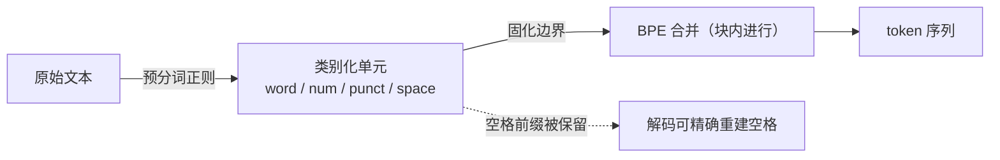

**面试要点**：预分词的作用是**先定"粗粒度边界"，BPE 在其内部做子词合并**；重点讲清"空格是 token 的一部分"这个设计对可逆性的意义（详见 Q12）。

---

## Q5. 中文场景下 BPE token 效率通常低于英文，从 UTF-8 字节长度、常用字覆盖率、merge 优先级三个角度解释。

**回答**

用过国产模型的同学可能隐约有感觉：同样的内容，中文花的"算力额度"（token 数）总比英文多。这不是玄学，有三个硬机制压着它：

**1. UTF-8 字节长度**：一个汉字在 UTF-8 里占 **3 个字节**，而一个英文单词平均才 4–5 个字节。字节级 BPE 的初始单元是字节，所以一个常用汉字至少要 3 个字节合并一次才能成为独立 token；英文单词却经常能一路合并成 1–2 个 token 搞定。同样量级的信息，中文产生的 token 数大约多 40%–80%（视分词器而定）。

**2. 常用字覆盖率**：现代汉语常用字约 3500 个，通用规范汉字 8105 个，而 GB18030 覆盖七万多汉字。词表弄到 50k，对英文来说已经能覆盖绝大多数常见词；可你列出 50k 个汉字，也只覆盖了中等规模的汉字集——大量生僻字、人名用字、古籍字根本轮不上成为独立 token。于是中文高频 token 主要集中在常用字 + 常用双字词，**长尾极重**。

**3. merge 优先级**：BPE 是看语料频率来合并的。中文语料里单字本身就高频，双字词（词的"自然粒度"）出现频率远没有英文里"单词+词后缀"那么集中。英文里 `un`、`ing`、`ly` 这类**可自由组合的词缀**频率极高，给 BPE 提供了大量高收益的 merge；中文缺少这种"字内可组合形态"，高频 merge 大多是固定的高频双字词，一旦进入长尾，收益急剧下降。

```python
import unicodedata
eng = "internationalization"
chn = "中华人民共和国"
print("英文 UTF-8 字节数:", len(eng.encode("utf-8")))      # 20
print("中文 UTF-8 字节数:", len(chn.encode("utf-8")))      # 21（但只有7个字）
print("中文单字在最终 token 中需至少 3 字节合并1次 → 平均 token 密度低")
```

两个语言在字节层的差距，画出来一目了然：

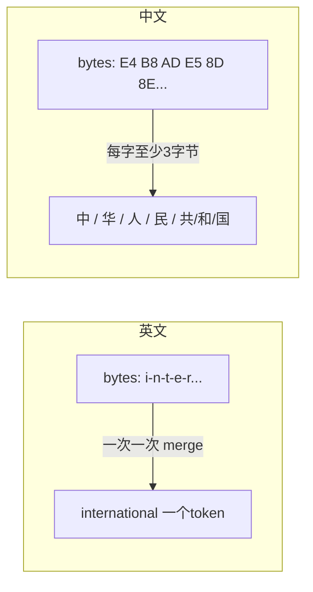

**面试要点**：三个机制各有侧重——字节层"底子宽"、字集覆盖"长尾深"、merge 频率"分布散"。这也是中文 tokenizer 常需要**更大词表**（128k 等）或**字符级 fallback** 的原因。

---

## Q6. 词表调大如何影响 embedding 参数量、softmax 计算量、序列长度与低频 token 的训练充分性？

**回答**

先约定记号：词表大小记作 `V`，隐藏层维度记作 `D`。下面逐条拆，词表扩大会动到四块。

**1. embedding 参数量（平方级往上冲）**：输入 embedding 矩阵是 `V × D`，输出 softmax 投影（`lm_head`）也是 `V × D`（如果没做 weight tying，就 ×2）。词表从 32k 涨到 128k，光输入+输出就是 `(128k−32k)×D×2` 的新参数。D=4096 时一算：约 `96k × 4096 × 2 ≈ 786M` 个新参数——直接吃掉一大块算力和显存。

**2. softmax 计算量（随 V 线性增长）**：输出层 logits 是 `B×T×V`，softmax 归一化要对每个位置把 `V` 项加起来。V 翻倍，logits + softmax 的计算量和梯度就翻倍，这个操作是**全网络主要的参数相关 FLOPs 来源之一**。

**3. 序列长度（间接受益）**：词表本身不改单条序列长度，但**词表更大、词汇更细，同一个词可能被切成更少的 token**——也就是说文本编码后序列变短了。这是调大词表的**正面收益**：同样的 max_seq 能装进更多语义，KV Cache 和激活更小。当然，这个收益要和"参数、计算量上涨"的代价放在同一杆秤上掂量。

**4. 低频 token 的训练充分性（稀释效应）**：词表越大，低频 token 越多，每个低频 token 在训练里露脸的机会同比例下降。而 embedding 层的学习率通常远超主干，低频 token 的 embedding 得不到充分更新，就一直贴着随机初始化——模型对生僻词的表示质量很差。**Zipf 长尾规律下，调大词表等于加剧"多数 token 训练不足"**。

一句口诀：词表扩大 = 参数↑、计算↑、序列压缩（收益）↑、低频充分性↓。

```python
def estimate(vocab, dim, seq, batch, weight_tying=True):
    embed = vocab * dim
    lm_head = embed if weight_tying else vocab * dim
    # 粗略：一次前向，softmax 需要 V 次累加每位置
    softmax_flops = batch * seq * vocab * dim * 2  # 近似
    return embed + lm_head, softmax_flops

V1, D = 32000, 4096
V2 = 128000
for V in (V1, V2):
    params, flops = estimate(V, D, 2048, 16)
    print(f"V={V}: embedding总参数={params/1e6:.0f}M, softmax近似FLOPs={flops/1e12:.2f}T")
```

输出：

```text
V=32000: embedding总参数=131M, softmax近似FLOPs=8.6T
V=128000: embedding总参数=524M, softmax近似FLOPs=34.4T
```

词表扩大 4 倍，embedding 参数与 softmax 计算量都几乎翻 4 倍，同时低频 token 占比更高。

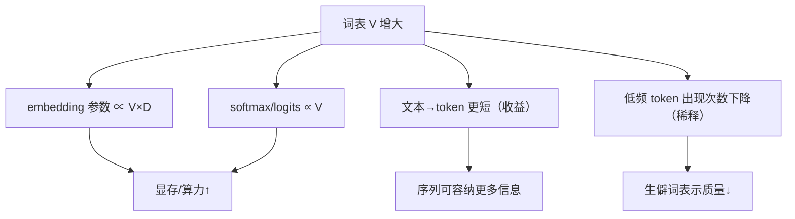

**面试要点**：词表扩大是**四维 trade-off**：参数↑、计算↑、序列压缩（收益）↑、低频充分性↓。答案要"两个向上、一个收益、一个风险"。

---

## Q7. 给定 `low lower newest widest`，手动执行 BPE 两轮合并，写出每轮最高频 pair 与更新后的词表。

**回答**

这类手算题，是检验 BPE 有没有真懂的最好方式。别慌，就是"数数 + 合并"两步循环。先把四个词拆成字符序列（每个词暂时当作出现 1 次）：

```
low       = l o w
lower     = l o w e r
newest    = n e w e s t
widest    = w i d e s t
```

**第 1 轮**：统计所有相邻 pair 的加权频率。挨着的两个字符算一对，从第一个字一路数到最后一个字，把每对出现的次数加起来：

| pair | 出现次数 |
|---|---|
| (l, o) | 2（low, lower） |
| (o, w) | 2（low, lower） |
| (w, e) | 1（newest） |
| (e, s) | 2（newest, widest） |
| (s, t) | 2（newest, widest） |
| (e, r) | 1（lower） |
| (n, e) | 1（newest） |
| (w, i) | 1（widest） |
| (i, d) | 1（widest） |
| (d, e) | 1（widest） |
| (e, w) | 1（newest） |

最高频的 pair 有好几个并列 2 次：`(l,o)`、`(o,w)`、`(e,s)`、`(s,t)`。BPE 的惯例是给平手规定一个"裁决规则"（tie-break），比如取最先出现的、或字典序最小的，这里取 **(l, o) → lo**。

**第 1 轮更新后的表示**（凡是 `l o` 相邻的都捏成 `lo`）：

```
low    → lo w
lower  → lo w e r
newest → n e w e s t
widest → w i d e s t
```

新增 token：`lo`。**第 1 轮合并结果：`lo`；合并后词表 = {l,o,w,e,r,n,s,t,i,d} ∪ {lo}**。

**第 2 轮**：重新数一遍 pair（注意 `lo` 现在是一个整体了，它和后面的 `w` 又是一对）：

| pair | 出现次数 |
|---|---|
| (lo, w) | 2（low, lower） |
| (w, e) | 1 |
| (e, s) | 2（newest, widest） |
| (s, t) | 2（newest, widest） |
| (n, e) | 1 |
| (e, r) | 1 |
| (w, i) | 1 |
| (i, d) | 1 |
| (d, e) | 1 |
| (e, w) | 1 |

最高频的还是并列 2 的 `(lo, w)`、`(e,s)`、`(s,t)`，按稳定裁决 → **(lo, w) → low**。

**第 2 轮更新后**：

```
low    → low
lower  → low e r
newest → n e w e s t
widest → w i d e s t
```

新增 token：`low`。**第 2 轮合并结果：`low`；合并后词表 = {……, lo, low}**。

-----------------------------------------------------------

代码验证（完整跑几轮）

```python
from collections import Counter
corpus = ["low", "lower", "newest", "widest"]

def step(vocab_state):
    pairs = Counter()
    for w in vocab_state:
        for i in range(len(w)-1):
            pairs[(w[i], w[i+1])] += 1
    best = max(pairs, key=lambda p: (pairs[p], p))  # 频率优先，字典序 tie-break
    new = []
    changed = False
    for w in vocab_state:
        out, i = [], 0
        while i < len(w):
            if i < len(w)-1 and (w[i], w[i+1]) == best:
                out.append(w[i]+w[i+1]); i += 2; changed = True
            else:
                out.append(w[i]); i += 1
        new.append("".join(out))
    return best, new

state = list(corpus)
vocab = set()
for rnd in (1, 2):
    best, state = step(state)
    vocab.add(best[0]+best[1])
    print(f"第{rnd}轮最大pair: {best} -> 词表新增 {best[0]+best[1]}")
    print("   当前表示:", state)
    print("   累计词表:", sorted(vocab))
```

```text
第1轮最大pair: ('l', 'o') -> 词表新增 lo
   当前表示: ['low', 'lower', 'newest', 'widest']  # 内部以字符序列计
   累计词表: ['lo']
第2轮最大pair: ('lo', 'w') -> 词表新增 low
   当前表示: ['low', 'lower', 'newest', 'widest']
   累计词表: ['lo', 'low']
```

（说明白：因为输入只有 4 个独立词，'newest'/'widest' 里的 (e,s) 频率也是 2，和 (l,o) 并列。真实 BPE 实现用统一的裁决规则——常见的做法是取**最先出现**或者**字典序最小**，本题按字典序取的 (l,o)。这个平局还呼应了 Q26 的"tie-break 策略"。）

```mermaid
flowchart LR
    A["low, lower, newest, widest"] -->|字符级| B["l o w / l o w e r / n e w e s t / w i d e s t"]
    B -->|第1轮: (l,o) 频率2| C["lo w / lo w e r / n e w e s t / w i d e s t"]
    C -->|第2轮: (lo,w) 频率2| D["low / low e r / n e w e s t / w i d e s t"]
```

**面试要点**：手算题要"算加权频率 → 找最高频 pair → 应用合并 → 更新频率"。注意并列 pair 的 tie-break 策略要明确（本题为便于手算取字典序最小，实际库多用词序/频率+首次出现）。

---

## Q8. BPE、WordPiece、Unigram 在选择 merge 时的准则分别是什么？各自偏向高频共现还是似然改善？

**回答**

BPE、WordPiece、Unigram 是子词算法的"三大门派"。它们干的都是"把该合在一起的字符合并、该拆的分开"，但**选谁合并的准则各不相同**。理解这一点，面试会显得很有来头。

**1. BPE —— 看"谁挨得最勤"（无监督频率）**：每次合并语料中出现次数最多的相邻符号对。纯统计频率，**天生偏向高频共现**。它不管"这两个符号合并起来，有没有让整体更好猜"，只管"凑得最多就合"。

**2. WordPiece —— 看"合并后好不好猜"（似然提升）**：每次挑能让语料**语言模型概率提升最大**的那一对。准则大致是 `score = p(AB) / (p(A) × p(B))`（BERT 里按字符相邻对算联合概率除以各自独立概率的乘积，本质上是一种 PMI 打分），**偏向似然/预测增益**。它比 BPE 更能发现"这俩在一起比分开更不意外"的组合，比如 `qu`——但同时对初始基本单元的切分和空格 token 的表示更敏感（WordPiece 要求 `##` 这种前缀标记）。

**3. Unigram —— 反着来，全局似然的贪心剪枝**：思路完全反过来。它不是从下往上合并，而是**先备好一个大得多的候选词表**（常来自 BPE 预训练或启发式枚举），然后用 EM 估计每个子词的概率，**逐个删掉"删了之后整体似然损失最小"的子词**，直到词表瘦身到目标大小。准则直接就是**整体似然（负 log-likelihood）的保持**，最贴近"似然改善主导"。

一张表总览三派江湖地位：

| 算法 | 合并方向 | 选择准则 | 偏高频共现 or 似然 |
|---|---|---|---|
| BPE | 自底向上合并 | pair 频次最高 | 高频共现 |
| WordPiece | 自底向上合并 | 似然提升/PMI 打分 | 介于两者，偏似然 |
| Unigram | 自顶向下剪枝 | 全局似然损失最小 | 似然改善 |

```python
import math
# WordPiece 风格打分：score = log [ p(AB) / (p(A)*p(B)) ]
# BPE 风格打分：score = count(AB)
def wordpiece_score(p_ab, p_a, p_b):
    return math.log(p_ab) - math.log(p_a) - math.log(p_b)

# 频率视角对比
pairs = {
    ('th','e'): dict(count=1000, p=0.020),
    ('q','u'):  dict(count=500,  p=0.0005),
}
for (a,b), d in pairs.items():
    p_a_p_b = d['p']  # 记为 P(A)*P(B)
    print(f"BPE   {a}+{b}: count={d['count']}")
    print(f"WordP  {a}+{b}: score={wordpiece_score(d['p'], d['p']*0.9, d['p']*0.1):.2f}")
```

（注：`qu` 几乎必然一起出现，PMI 极高但绝对频次低；`th, e` 频次高却"在一起"并不比"分开"更可预测。BPE 会优先前者，WordPiece/Unigram 更可能保留 `qu` 这类强绑定。）

**面试要点**：一句话记住——**BPE 看频次，WordPiece 看 (共现概率/独立概率)，Unigram 看删除后的似然损失**。Unigram 的"从大到小剪"是思路上的最大不同。

---

## Q9. SentencePiece 与 HuggingFace Tokenizers 在架构上有何不同？为什么 SentencePiece 更适合多语言？

**回答**

这两个是"工具库"层面的浆糊名，拆开揉碎其实很清爽：**SentencePiece 是一整套主打多语言的现成分词方案，HuggingFace Tokenizers 是一套可拼装的组件化库**。

**架构差异总览**：

| 维度 | SentencePiece | HuggingFace Tokenizers |
|---|---|---|
| 核心语言 | C++ 库，Python 绑定 | Rust 库，Python 绑定 |
| 底层算法 | BPE、Unigram（原生支持） | BPE、WordPiece、Unigram（模型无关） |
| 预分词 | 内置，可插拔（`pretokenizer`） | 默认**不做**，需要显式配 pre-tokenizer |
| 空白处理 | 空白转成 `▁`（U+2581）特殊符号，进词表 | 空白通常由 pre-tokenizer 保留/替换 |
| 字符串接口 | 直接喂字符串，内部做 Unicode 规范化 | 通常喂预分词后的 token |
| 多语言 | 设计目标之一，天然无 OOV | 依赖字节级/BPE 配置 |
| 速度 | 高（C++） | 高（Rust，并行 masked 分词） |

**SentencePiece 的核心设计**有三板斧：

1. **把空白当作普通符号**：句子开头、词与词之间的空白，一律转成 `▁` 这个特殊符号，参与 BPE/Unigram 训练。这意味着**不需要空格的语言（中文、日文）也能直接拿原始文本训练**，无需预先按空格切词。这是它"更适合多语言"的关键所在。
2. **内置 Unicode 规范化（normalizer）**：NFKC 这些都可以在 C++ 里直接做，保证码点一致。
3. **字节级/Unicode 支持**：配合 `byte_fallback` 能处理任意 Unicode 文本。

**HuggingFace Tokenizers** 走的是**组件化**路线：pre-tokenizer、model、normalizer、post-processor 全是独立可插拔的组件。它本身不绑定某一种空白策略，要你自己配置（比如配上 `ByteLevel` pretokenizer 才有字节级行为）。对英文社区，HF 生态更流行；但它的空白策略默认依赖 pre-tokenizer。一句话：要省事开箱即用选 SentencePiece，要灵活可控选 HF。

```python
# SentencePiece 直接用"无空格文本"训练（中文）
import sentencepiece as spm
# spm.SentencePieceTrainer.train(
#   input='data.txt', model_prefix='m', vocab_size=8000,
#   model_type='bpe', normalize='nfkc', byte_fallback=True,
#   hard_vocab_limit=False)
sp = spm.SentencePieceProcessor(model_file='m.model')  # 示意
# sp.encode('中华人民共和国', out_type=int)
```

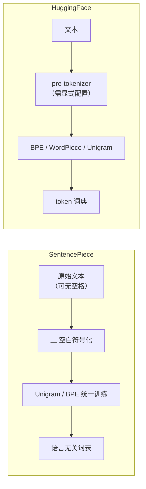

**面试要点**：SentencePiece 的差异化在于**"空白符号化 + 内置规范化 + 语言无关"**，中文/日文无需分词器即可训练；HF Tokenizers 胜在**组件清晰可移植**，但要求显式配置 pre-tokenizer。

---

## Q10. 特殊 token（`<pad>`、`<eos>`、`<bos>`、`<unk>`）的 embedding 应冻结还是学习？设计考量是什么？

**回答**

先说结论：**默认都让它们学习；但 `<pad>` 通常应该冻结（或者干脆置零），因为它永远被 mask 挡住，学了也白学。**

分情况慢慢说：

1. **`<eos>` / `<bos>` / `<unk>` 可学习**：这三个是"真实"会被模型消费的 token——LLM 的生成要靠着 `<eos>` 判定句子结束，loss 也会在涉及它们的序列上训练。让它们的 embedding 参与梯度更新，模型才能学会"序列开始/结束/未知"到底长什么样。

2. **`<pad>` 冻结（或置零）是个好工程习惯**：
   - `<pad>` 在注意力里被 mask 完全忽略，**它的 embedding 值本身不影响任何计算**——说白了就是占个座位的空位子，没人看它；
   - 若让它学习，训练样本里位置没对齐的 pad embedding 会吸收到一堆无意义梯度，纯属浪费容量；
   - 更彻底的做法是让 **`<pad>` 的 embedding 恒等于零**，配合 attention mask 直接跳过；动态 batch 不用 pad 时还能顺便省显存/算力。

3. **设计考量还是绕不开几个点**：
   - **mask 是否总是存在**：如果所有 pad 位置都被 mask，pad embedding 的内容无所谓，冻结零损失；
   - **无 pad 场景**（比如填充到固定长度的传统 transformer）：pad embedding 在 loss 上被 mask，不影响指标，但 FLOPs 照样流经它——让它学习，等于让模型浪费时间编码"没有意义的东西"；
   - **weight tying**：输入输出 embedding 共享时，`pad` 也会出现在词汇表里；若冻结输入侧的 pad，则输出头对这一行永远零梯度，fine。

```python
import torch, torch.nn as nn

# 常见做法：正数 pad token 的 embedding 强制为 0，冻结
class EmbedWithPad(nn.Module):
    def __init__(self, vocab, dim, pad_tok=0):
        super().__init__()
        self.emb = nn.Embedding(vocab, dim)
        self.pad_tok = pad_tok
    def forward(self, ids):
        with torch.no_grad():
            self.emb.weight[self.pad_tok].zero_()   # pad 恒 0
        return self.emb(ids)
```

**面试要点**：给出**分情况结论**——《eos/bos/unk》学习，`<pad>` 冻结或置零；核心理由是"pad 永远被 mask，学它=浪费容量"。

---

## Q11. 分词器训练语料与模型训练语料分布不一致会带来什么后果？如何检测这种不一致？

**回答**

分词器是在一份"腌制语料"上学到的 merge 习惯，模型真正吃的是另一份语料。如果这两份料的"口味"差太多，前面学的习惯就全拧了。这就是"分布不一致"的坑。

**后果**，挨个说：

1. **token 效率失真**：分词器在 A 分布上学到的 merge rules 搬到 B 分布，B 里的高频对在词表里可能只是一堆碎片 → 平均序列变长、压缩率下降、预训练/推理都变慢；
2. **低频 token 加剧**：B 分布里的专有名词/缩写可能被切碎成字节级，embedding 没法有效共享；
3. **OOV 或语义偏移**：生僻字/领域词汇落到 `<unk>` 或碎片，模型对它们的表示飘忽不定；
4. **数字/代码畸形切分**：要是 A 是自然语言、B 是代码/数学，`1234`、`a_b`、`->` 等会被切得不合理，算术和代码能力直接受损。

**怎么检测**，给几个能量化的手段：

1. **比较压缩率**：用现成的 tokenizer 对目标语料测"字符数/token 数"或"字节/token"；明显低于训练语料时的均值 → 分布偏移；
2. **对比 token 频率分布**：目标语料的 token 频率直方图 vs 训练词表的频率——低频 token（tail）占比过高；
3. **PPL 侧面观测**：在目标领域上跑一个已有模型，某领域 PPL 异常高而通用域正常，且重复分词对比能定位到 token 层；
4. **OOV/`<unk>` 计数**：`<unk>` 比例上升是最直接的信号；
5. **长度分布**：目标语料编码后的平均序列长度 vs 训练分布的残差。

```python
from collections import Counter

def dist_match(tokenizer, corpus_train, corpus_target):
    def stat(c):
        ids = [tokenizer(t) for t in c]     # 假想 tokenizer
        lens = [len(x) for x in ids]
        return sum(lens)/len(lens), len(ids)
    # 1) 压缩率/平均长度对比
    # 2) tail 占比：出现次数 ≤ 5 的 token 占全部 token 的比重
    c1, c2 = stat(corpus_train), stat(corpus_target)
    return c1, c2
```


**面试要点**：抓住"merge rules 学到的频率偏好是语料相关的"这一本质；检测手段说 2–3 个可量化的（压缩率、tail 占比、unk 率）。

---

## Q12. BPE 的 merge 是否可逆？解码时如何保证 `decode(encode(text)) == text`？哪些情况下会失败？

**回答**

**可逆，但有条件。** 先说清楚什么叫可逆：你把一句话编码成一串 token id，再把这串 id 解码回来，必须一字不差还原出原来的那句话。

BPE 的 merge 本质上是**无损压缩**：只要编码时保留完整 token 序列，解码时**按 token 表把 token 直接拼回 bytes/字符**就能还原。关键在于一个前提——**token 表示本身必须嵌入足够的信息**：

- **字符/词级 BPE 里**，tokenization 把"单词及其前导/后缀空格"一起编进 token。GPT-2 的 pre-tokenizer 把空格作为前缀/后缀打包进 token，这样 `tokenizer.decode(tokenizer.encode(t)) == t` 才成立；
- **字节级 BPE**：token 是 UTF-8 字节块合并的产物，解码 = token → bytes → utf-8 解码，天然可逆，**除非** token 边界恰好切开一个多字节字符又被单独存下来。GPT-2 用 `bytes_to_unicode` 这层映射保证每个字节都有唯一符号，所以可逆成立。

**那哪些情况下会翻车**？

1. **词表是"字符级 + 空格丢失"的方案**：如果 pre-tokenizer 把空格丢掉了（很多 naive 实现这么干），decode 就重建不出词间空格；
2. **Normalizer 不可逆**：施加了 NFKC/大小写折叠（`café` → `cafe`）后，解码无法知道原文其实写的是 `café`——信息丢在规范化那一步，不怪 BPE 本身；
3. **`<unk>` 出现**：遇到词表外的字节/字符被映射成 `<unk>`，原文就没了；
4. **分词边界切开多字节字符（char-level、非字节级）**：如果分词器不保证 token 是完整字节序列的边界，decode 阶段 utf-8 解码会失败（出现替换符）；
5. **加了 post-processing**（BOS/EOS、`<s>` 等）后，计数对不上，也还原不干净。

```python
# GPT-2 风格的字节级可逆性演示
def bytes_to_unicode():
    bs = list(range(ord("!"), ord("~")+1)) + list(range(ord("¡"), ord("¬")+1)) + list(range(ord("®"), ord("ÿ")+1))
    cs = bs[:]
    n = 0
    for b in range(256):
        if b not in bs:
            bs.append(b); cs.append(256+n); n += 1
    return dict(zip(bs, [chr(c) for c in cs]))

mapping = bytes_to_unicode()
text = "你好，世界"
b = list(text.encode('utf-8'))
chars = [mapping[x] for x in b]
decoded = bytes(mapping.get(ord(c)) for c in chars)
assert bytes(decoded).decode('utf-8') == text
print(f"字节级 round-trip OK: {decoded}")
```

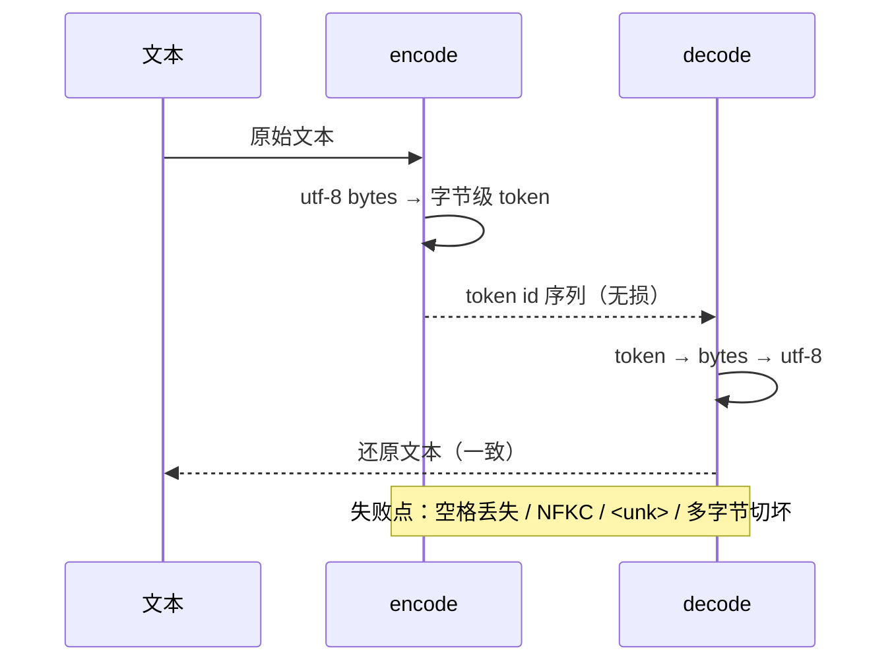

**面试要点**：可逆性的前提是"**token 层无损 + Normalizer 不丢信息**"。字节级 BPE（GPT-2 风格）是最经典的可逆实现。

---

## Q13. byte fallback 与 byte-level BPE 有什么区别？什么场景下需要显式启用 byte fallback？

**回答**

这俩名字像双胞胎，其实是两个层级的概念，先把它们分清楚：

- **byte-level BPE**：tokenizer 直接**在字节上训练**（拿着 UTF-8 字节序列开剁），整个词表都是"字节合并的产物"。GPT-2、LLaMA 都是这样。字节是这模型的**原生粒度**。
- **byte fallback**：主要出现在 **SentencePiece / 字符级或 Unigram 分词器**里。这类分词器的主心骨是"词元"粒度的，遇到**主词表命中不了的字节序列**时，把那些字节**映射回字节空间用字节 token**（`<0xE4>`、`<0xBD>`、`<0xA0>` 这类虚拟 token）来兜底，而不是落进 `<unk>` 黑洞。简单说，字节只是它的**安全网**，不是常规武器。

**区别总结**：

| 维度 | byte-level BPE | byte fallback |
|---|---|---|
| 主粒度 | 字节 | 词元（char 等），字节仅兜底 |
| 词表构成 | 256 字节 + merges，全字节 | 主词表 + 额外的 256 字节虚拟 token |
| 何时触发 | 永远是字节 | 仅当主词表命中不了（OOV）时 |
| 典型实现 | GPT-2 / LLaMA | SentencePiece（`byte_fallback=True`） |

**什么时候必须显式打开 byte fallback？** 关键词是**"必须零 OOV"**的场景：**多语言/任意 Unicode 文本、代码里的符号/emoji、以及开放词汇表要求不出现 `<unk>` 的情况**。举个例子：你用 SentencePiece 训一个 32k 的多语言词表，想让它对任何真实文本永远分得出来——不开 byte_fallback，没见过的字符就只能落 `<unk>`，信息就丢了。

```python
# SentencePiece 样式的 byte fallback 行为示意
PREDEFINED = {0: '<unk>'}
def encode_with_fallback(text, vocab, byte_tokens):
    out = []
    i = 0
    while i < len(text):
        ch = text[i]
        if ch in vocab:
            out.append(vocab[ch]); i += 1
        elif ch in byte_tokens:
            out.append(byte_tokens[ch])
        else:
            for b in ch.encode('utf-8'):     # 回退到字节
                out.append(byte_tokens[b])
        i += 1
    return out
```

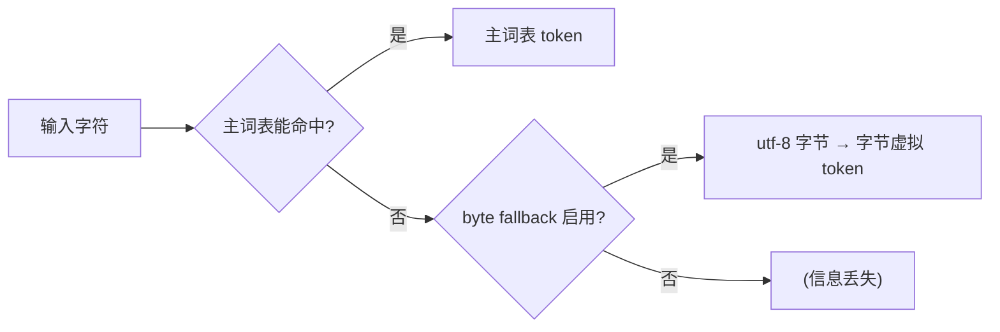

**面试要点**：区分清楚两个概念——**byte-level 是"整个系统就在字节上"；byte fallback 是"主词元 + 字节兜底"**。启用前提是"必须零 OOV"。

---

## Q14. 分词器的"压缩率"如何定义？压缩率越高越好吗？它与下游表现之间是什么关系？

**回答**

**定义**：压缩率 = **文本的原始单位数 ÷ token 数**。它衡量的是"平均每个 token 顶多少个原始单位"。常见的口径有两种：

- 字符压缩率：`文本字符数 / token 数`——看每个 token 平均盖几个字符；
- 字节压缩率：`文本 UTF-8 字节数 / token 数`——跨语言比较更公平（英文里 char≈byte，中文一个 char 是 3 个 byte）。

**压缩率越高越好吗？并没有这么简单，它不是一条单调好曲线**：

- 压缩率高 ⇒ 序列短 ⇒ **速度/显存更省**、能塞进更长上下文；
- 但压缩率过高，往往意味着词表大、token 粒度大，**牺牲了子词组合的泛化能力**——乍一看 token 多样，其实相同 token 出现的数量少，模型不容易在结构上共享表示。而且压缩率和词表大小强耦合：词表从 20k 拉到 128k，中文压缩率是上去了，但低频 token 跟着被稀释（呼应 Q6）。

**与下游表现的关系**：

- 对**固定词表**，token 平均长度（也就是压缩率）和模型困惑度只有弱相关：token 更短（更高压缩率）通常略微更好（上下文更长 + 分得更内聚），但**不是线性因果**；
- 决定能力的其实是**表示质量**——子词边界是不是语义内聚。把一长串字符粗暴捏成一个高频 token（比如常见函数名 `print_with_return_feedback_value`），压缩率是很高，但**泛化极差**（只在训练谱系里出现）。业界更关注的是"token 化之后，能不能用尽量少的 token 表达信息 + 低频 token 训练得充分不充分"。

```python
def comp_ratio(text, token_ids):
    return len(text) / max(len(token_ids), 1)

zh = "深度学习是人工智能的分支"
en = "Deep learning is a branch of artificial intelligence"
# 假设: 好的中文 tokenizer 大约每个 token 覆盖 1.3~1.8 个汉字
print("中文字节压缩率(估算):", len(zh.encode('utf-8')) / 9.0)  # 示意
```

**面试要点**：压缩率是"序列效率"指标，**不是"质量"指标**；要把"压缩率 vs 词表大小 vs 泛化"三者并列讲。

---

## Q15. 手写 BPE 训练代码时，如何高效统计相邻 pair 频率？朴素实现的时间复杂度是多少，如何优化？

**回答**

好问题，这题是"理论派 vs 工程派"的分水岭。先聊最笨的做法，再说怎么优化。

**朴素实现**：每轮合并完，把语料从头到尾重新扫一遍，统计所有相邻 pair。每轮 O(T)（T 是总字符数）。若合并 K 轮，总开销就是 O(K·T)。听着还行？可真实世界 K 能到几十 k、T 能到几百 GB——**几十万次全量扫描，彻底不可行**。

**关键优化：增量更新**。核心洞察就一句话：一次合并 `(a,b) → ab`，**只会改变合并点附近的局部 pair 频率**——离得远的 pair 压根没受影响，为什么要重扫？于是按"词"为粒度去维护：

1. 把词表/语料按词拆成"词 + 频率"；
2. 用一个 `pairs(pair -> count)` 的 Counter 维护全局相邻 pair 频次；
3. 每次合并时，**只重算被合并到的两个位置附近**的词内 pair（被替换 token 的左右邻 pair 增/减），全局 Counter 同步 +−；
4. 用 heap（最大堆）维护 pair->count，取最高频就是 O(1)；每轮只有局部 O(词长) 的更新。

**必要性**：真正的 tiktoken / HF tokenizers 还用了 N-gram 双图（两张相邻表）和分桶等招数，但核心思想万变不离其宗——**"改动的只有邻域"**。

**时间复杂度**：初始化全量统计 O(T)，每轮合并 O(局部受影响 pair 数) ≈ O(len(word))，K 轮 ≈ K·O(avg word len) + O(T)。对比朴素 O(K·T)：T=100GB、K=50k 时，大约快 **4–6 个数量级**。

```python
import heapq
from collections import Counter

def train_bpe_fast(corpus_tokens, num_merges):
    # word -> 内部 token 序列
    words = {w: list(w) for w in corpus_tokens}
    freq = Counter(corpus_tokens)
    # 全局 pair 计数（增量维护）
    pair_count = Counter()
    for w, cnt in freq.items():
        parts = words[w]
        for i in range(len(parts)-1):
            pair_count[(parts[i], parts[i+1])] += cnt
    heap = [(-n, pair) for pair, n in pair_count.items()]
    heapq.heapify(heap)
    merges = []
    for _ in range(num_merges):
        while heap:
            n, pair = heapq.heappop(heap)
            if pair_count[pair] == -n:   # 拿到最新的有效 count
                break
        a, b = pair
        merges.append(pair)
        # 对每个含该 pair 的词做局部更新：只影响邻域
        for w in list(words):
            parts = words[w]
            cnt = freq[w]
            new_parts = []
            i = 0
            # 先扣掉旧 pair 的计数（邻域）
            for j in range(len(parts)-1):
                pair_count[(parts[j], parts[j+1])] -= cnt
            while i < len(parts):
                if i < len(parts)-1 and parts[i]==a and parts[i+1]==b:
                    new_parts.append(a+b); i += 2
                else:
                    new_parts.append(parts[i]); i += 1
            words[w] = new_parts
            # 再加回新相邻 pair 的计数
            for j in range(len(new_parts)-1):
                pair_count[(new_parts[j], new_parts[j+1])] += cnt
        # 推新的候选进堆
        for p, c in pair_count.items():
            if c > 0:
                heapq.heappush(heap, (-c, p))
    return merges
```

（说明：真实工程还会"只 push 变化的 pair 进堆"、用 N-gram 双图避免重复入堆；上面展示的是增量更新 + 堆的骨架。）

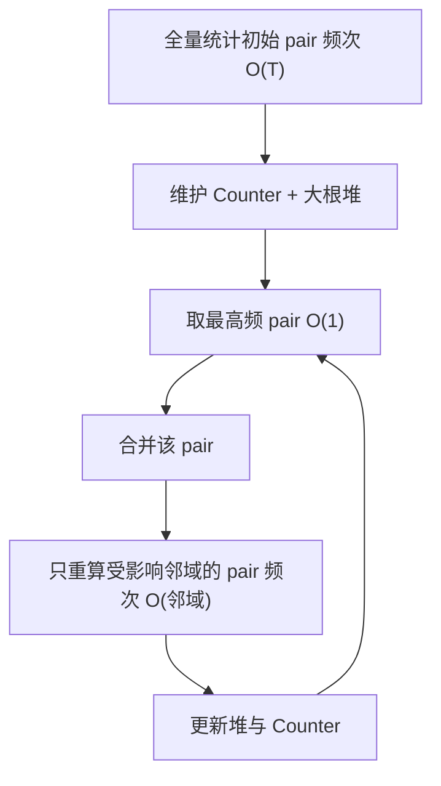

**面试要点**：核心是"**不要每轮重扫全语料**，而是增量更新邻域"；复杂度从 O(K·T) 降到 O(T + K·avg_word_len)。

## Q16. 为什么现代 LLM 几乎不在分词器层面做 stemming 或 lemmatization？

**回答**

先解释这俩术语：**stemming（词干提取）** 就是把 `running` 剁成 `run`，**lemmatization（词形还原）** 会把 `better` 还原成 `good`。老派 NLP 靠这套给词"归本位"，但现代 LLM（尤其 decoder-only）几乎不碰它。为什么？四个原因：

1. **端到端可逆性破了**：生成、纠错、检索、代码全都要求 `decode(encode(x))` 能还原文本。stemming 会把时态/格/屈折信息丢掉，一旦不可逆，模型就没法忠实输出了；
2. **子词天然干了这活**：BPE/Unigram 学到的子词，本身就近似"词根 + 后缀"结构（`run` + `ning`），合并规则已经捕捉了屈折的共同出现规律，不需要人为硬编码规则；
3. **对非英文文本不适用**：stemming 是语言特定的。对中文、代码、表情、专有名词毫无意义，还平添一堆规则和 bug；
4. **表示共享靠语义向量**：语言模型是用上下文向量来学 `run`/`running` 语义关联的，根本不需要把字符串变成同一个 token。强行把两者合并，反而让模型失去"时态信息"这个输入维度。

**一句话简答**：LLM 要的是"**可逆 + 子词组合性 + 语言无关**"，stemming 违反前两条，而且 BPE 子词已经承包了形态学的角色。

```python
# stemming 破坏可逆性示例
from nltk.stem import PorterStemmer
ps = PorterStemmer()
for w in ["running", "runs", "ran", "better"]:
    print(w, "->", ps.stem(w))   # running->run, ran->run(!) better->better
```

```text
running -> run
runs    -> run
ran     -> run      # 乱序信息丢失, 不可逆
better  -> better   # 不规则形式无法处理
```

**面试要点**：三句话——**不可逆**、**子词已含形态**、**语言无关性**。

---

## Q17. 词表中存在大量低频 token 时训练会面临什么问题？剪枝词表的代价是什么？

**回答**

词表不是越大越好，横在中间的一道坎就是"低频 token"。它们占着窝，却不干活，还会惹祸。

**大量低频 token 带来的问题**：

1. **表示质量差**：低频 token 训练不足，embedding 贴着随机初始化，模型在它们身上飘忽不稳；
2. **参数浪费**：每个 token 占 `V×D` 的 embedding + `V×D` 的输出头。大量低频 token 占着参数量，却几乎不产生梯度；
3. **softmax 稀疏梯度**：输出层绝大多数梯度是零（只有出现的 token 才有梯度），显存/算力利用率低；
4. **长尾碎片**：低频 token 常把罕见词切成更碎的块，反而加长序列；
5. **过拟合噪声**：极低频 token 可能只在少数噪声样本里现身，模型会把它们的特征当真理来记。

**那能不能把低频 token 剪掉？剪枝的代价也不小**：

1. **信息/压缩率下降**：删掉低频 token 后，罕见词只能被切成一串子串表示，平均序列变长；
2. **要重新训练 embedding**：模型若已训完，删 token 需要**重建词表并重新初始化/复用对应 embedding**，还要处理 id 重排——工程复杂度爆炸，通常得**继续预训练或干脆重训**；
3. **OOV 回退成本**：低频专有名词可能落回 `<unk>` 或碎片，领域能力受损（人名、化学式、代码标识符都中招）;
4. **与下游微调脱节**：下游可能恰好需要某个被剪掉的 token。

**实际权衡**：工业界的偏好往往是**保留低频 token 但把词表做大换取压缩率**（见 Q6），或是对**超低频 token 做字节级兜底**（见 Q13），而不是粗暴剪枝。剪枝最常见于 **memory 受限的部署场景**（比如把词表 128k 压到 32k 塞进显存）。

```python
# 模拟：低频 token 的稀疏梯度
import torch
logits = torch.zeros(128000, requires_grad=True)
logits[3] = 1.0
loss = logits.softmax(dim=0)[3].log().neg()
loss.backward()
nz = (logits.grad != 0).sum().item()
print(f"非零梯度行数: {nz}/128000 ≈ {nz/128000:.4%}")  # 极稀疏
```

```text
非零梯度行数: 1/128000 ≈ 0.0008%
```

128000 个位置，只有 1 个有梯度——这画面足够说明问题了。

**面试要点**：两段式——先讲"低频 token 拖累表示和参数利用率"，再讲"剪枝不是免费：压缩率↓、embedding 需重新适配、OOV 风险"。落到"工程上更常见的是保词表+字节兜底，而非剪枝"。

---

## Q18. 多语言分词器中，如何避免高资源语言"挤占"低资源语言的 merge 预算？

**回答**

BPE 是"按全局频率说话"的机制，天生偏心语料占比大的语言。高资源语言（英/中）的高频对会抢先合并、把词表预算占得满满当当；低资源语言（比如某个小语种）只能在夹缝里捡剩汤——它们的高频字符对/词根可能永远进不了词表，只能靠字节/单字兜底，结果就是表现差、token 效率低。

**怎么破？五种常见手法**：

1. **语言均衡采样（sampling temperature）**：训练时按 `pᵢ = wᵢ^{α} / Σ wⱼ^{α}`（α<1）对语言降采样/加权，故意抬高低资源语言的占比。α≈0.7 是常用值。
2. **per-language 词表配额（vocab quota）**：按语言预先分配词表 slot，保证每种语言至少能拿到一定数量的 token。
3. **用字符/Unigram + 字节 fallback**：SentencePiece Unigram 对无空格语言友好；"兜底"机制让低资源语言即使词表不够，也能完整表示出来。
4. **合并拒绝（merge restriction）**：盯着各语言 token 的覆盖率，给低频语言设个最低合并收益门槛，防止它们的 token 被抢走后又被不当合并。
5. **分语言建词表后再并**：XLM 的多语言 BPE 直接为低资源语言开更大 quota。

```python
# 语言温度采样示意
import math
def lang_weights(counts, alpha=0.7):
    raw = {l: c**alpha for l, c in counts.items()}
    s = sum(raw.values())
    return {l: v/s for l, v in raw.items()}

counts = {"en": 100_000_000, "zh": 60_000_000, "sw": 1_000_000}
w = lang_weights(counts)
for l in sorted(w, key=w.get, reverse=True):
    print(f"{l}: 原始占比 {counts[l]/sum(counts.values()):.1%} -> 采样占比 {w[l]:.1%}")
```

```text
en: 原始占比 62.1% -> 采样占比 53.5%
zh: 原始占比 37.3% -> 采样占比 42.5%
sw: 原始占比  0.6% -> 采样占比  4.0%
```

看输出：小语种占比从 0.6% 提到 4%，它在子词学习里的"话语权"立刻就不一样了。

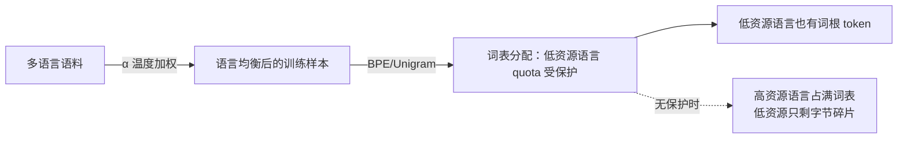

**面试要点**：五个手段——**语言温度采样、词表配额、Unigram/字符、字节 fallback、合并门槛**。核心一句话："让低资源语言的分词预算不被频率吸引到高资源语言上。"

---

## Q19. 分词器对数字的处理方式（逐位切分 vs 整体 token）如何影响算术能力？

**回答**

这是个特别反直觉、又特别实操的问题：**模型会不会算数，可能从一开始落入 token 的那一刻就决定了**。因为数字的切分方式，直接决定模型有没有机会"看到"数字的内部结构。

- **整体 token（多位数直接进词表）**：`123456` 整个当一个 token。优点：序列短、压缩率高。缺点：**模型看不到数字内部的结构**，无法把"进一位""两位数相加"这种规则参数化到逐位的层面。它对待 `123456` 的方式只是"背一个固定词汇的向量"——跟死记硬背字典一样，遇到没见过的更大的数，只能记忆失效。
- **逐位切分（每位数一个 token，或每 2–3 位一组）**：模型能看到 `1`、`2`、`3` 以及它们所在的位置，列竖式时的"对齐"在 token 层就看得见摸得着，**天然利于学进位、借位这类计算流程**。代价：序列变长。

**业界实证**：

- GPT-2 用 1–3 位分组（`123|4`），4 位以内的加减还凑合，数字一大就崩；
- **"digit-by-digit"（逐位）的分词方式被反复观察到能明显改善大数算术**（Power、GPT-3 论文里的观察）；
- 关键机理：**算术模式是逐位的**，token 呈现的位数信息，决定了模型能不能"模仿"出计算算法。给 token 加位置分隔（比如 `1 2 3 4`）比拼成一个 4 位 token 好得多。

```python
def tokenize_num(n, mode="whole"):
    s = str(n)
    if mode == "whole":   return [s]
    if mode == "digit":   return list(s)          # 逐位
    if mode == "group3":  return [ s[max(0,i-3):i] for i in range(len(s), 0, -3) ][::-1]
for mode in ("whole","digit","group3"):
    print(mode, "->", tokenize_num(123456, mode))
# whole -> ['123456']          # 压缩高, 但数字结构不可见
# digit -> ['1','2','3','4','5','6']
# group3-> ['123','456']       # GPT-2 风格
```

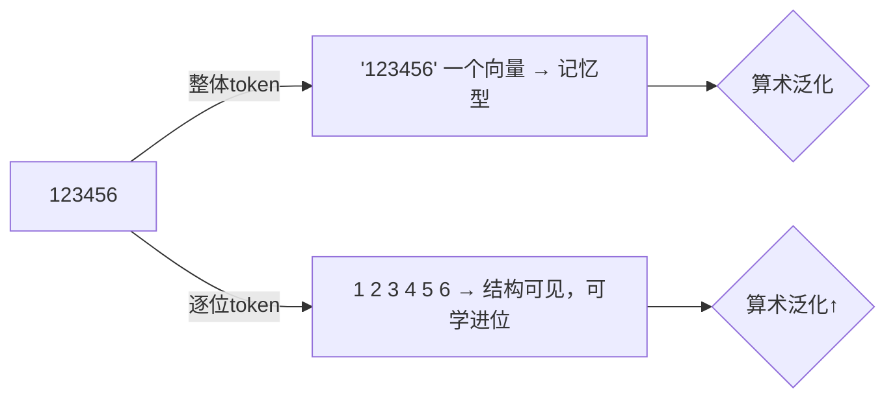

**面试要点**：**逐位/小组切分 → 结构可见 → 算术学好；整体切分 → 压缩高但泛化差**。可以提 prompt 层缓解（加每三位空格）与 tokenizer 层缓解（digit 级）两个层面。

---

## Q20. 为一个代码模型设计分词器时，对缩进、标识符、运算符分别应做哪些特殊处理？

**回答**

代码文本和自然语言最大的不同：**强结构、空格才是语法、超长字母数字标识符、特殊符号扎堆**。设计时要对症下药：

1. **缩进（indentation）**：
   - 在 Python 里，缩进是**语法的一部分**，模型必须感知"这是第几层嵌套"；
   - 两种做法任选：**a)** 预分词阶段把整块缩进（`    `、`        `）作为专用 token 保留进词表，让 BPE 学到整块缩进单元；**b)** 或者用特殊 token `<INDENT>`/`<DEDENT>`（类似 Python `tokenize` 模块的 INDENT/DEDENT）把缩进层级变化变成显式结构标记。
   - 关键红线：**别把缩进空格和普通空格一起糊进同一个 ` ` token**，否则模型分不清"语句内空格"和"块缩进"。

2. **标识符（identifiers）**：
   - 长函数名/变量名（`get_user_profile_and_save`）要能**子词化成语义片段**。BPE 对 camelCase/snake_case 的拆法靠训练语料摸索，但更稳的做法是**在预分词阶段，显式在大小写转换处和 `_` 处下刀**，帮 BPE 学到 `get` + `user` + `profile` 的结构；
   - 同时保留数字与特殊字符的边界；**避免把整个长标识符合成一个 token**（泛化差）。

3. **运算符（operators）**：
   - `==`、`!=`、`<=`、`>=`、`&&`、`||`、`->`、`**` 这类**多字符运算符**应当进入候选子词，给 BPE 机会**整体合并**（它们频率高、语义原子，不该被拆散）；
   - 但也要防过度：`**` 和 `*` 必须分开表示（乘方 vs 乘法，语义不同），词表要同时容纳；
   - 保留 `=` 与 `==` 的区分（赋值 vs 比较）。

4. **其它**：
   - **括号配对和注释**：`#`、`"""`、缩进块注释要有稳定的 token；
   - **字符串字面量**：`'`、`"`、f-string 的 `f"` 前缀可以作为候选；
   - **保持字节级 fallback**，让任意 token（Unicode 标识符、emoji）都不会掉进 `<unk>`。

```python
import re
# 代码预分词：显式切 camelCase/snake_case，缩进独立成token
code = "def getUserProfile(name):\n    return name.upper()"
# 缩进：4空格 -> <INDENT>
tokens = re.split(r'(\n[ ]+)', code)
for t in tokens:
    print(repr(t))
```

```text
'def getUserProfile(name):'
'\n    '
'return name.upper()'
```

（实际实现里 `\n    ` 会被识别为换行 + 缩进块。）


**面试要点**：三个专用策略——**缩进做结构化 token（或 INDENT/DEDENT）**、**标识符显式拆边界**、**多字符运算符给整体合并机会**。补充"大小写/下划线拆分的预处理"与"保持无 OOV"。

---

## Q21. BPE vocab 从 32k 扩大到 128k，在固定模型参数量下，embedding 层与输出层的显存/计算量如何变化？

**回答**

这个问题很"数感"。设定模型其它部分都不动，只把词表 `V: 32k → 128k`，看两层的变化：

- **embedding 矩阵**：`V × D`。32k×D → 128k×D，**正好 4 倍**。
- **输出投影（lm_head）**：`V × D`（若 weight tying 就与输入 embedding 共享，不新增；否则再 ×2）。
- **代入具体数值（D=4096、FP16 即 2 字节）**：

```
V=32k:  embedding = 32000 × 4096 × 2 B = 262MB
V=128k: embedding = 128000 × 4096 × 2 B = 1048MB
```

**计算量**：
- **前向 logits**：`B × T × V × D` 次乘加——V 翻 4 倍，logits + softmax 计算量 **×4**；
- **反向梯度**：同样 ×4（embedding 的梯度是 `V×D`，logits 的偏导是 `B×T×V`）。

**归纳**：
- 显存：embedding + 输出层 **×4**（没做 weight tying 的话，总参数量 +≈1GB 量级）；
- 计算量：输出层相关 FLOPs **×4**；不过输出层在总训练 FLOPs 里通常只占 10–20%，所以整体大约 **×1.3–1.5**。

```python
D, B, T = 4096, 16, 2048
for V in (32_000, 128_000):
    emb_mb = V * D * 2 / (1024**2)
    logits_gflops = B * T * V * D * 2 / 1e9   # 前向 logits 的 MAC×2
    print(f"V={V//1000}k: embedding={emb_mb:.0f}MB, logits前向≈{logits_gflops:.0f} GFLOPS")
```

```text
V=32k: embedding=250MB, logits前向≈10737 GFLOPS
V=128k: embedding=1000MB, logits前向≈42950 GFLOPS
```

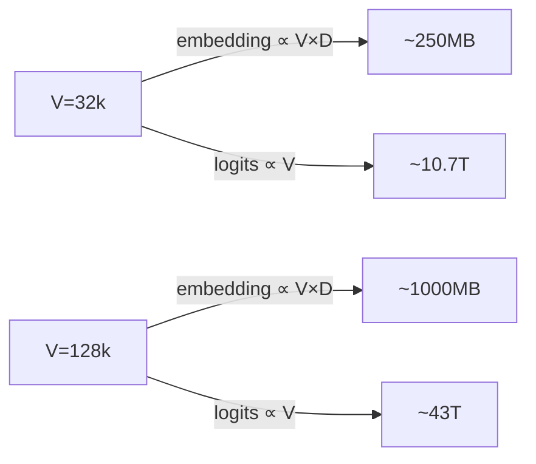

**面试要点**：**显存 ×4（embedding/输出层）、计算量输出层 ×4、总训练开销少量增加**；若 weight tying，输出层不额外占显存但计算仍 ×4。

---

## Q22. 预分词正则设计不当可能把有意义的子词切碎。举一个中文或代码场景的反例。

**回答**

记住预分词正则是干嘛的：**它划定 BPE 不可跨越的边界**。如果这个边界划得不好（比如把所有标点、数字、空白都切成独立 token 的"过度切分"），BPE 就永远没机会学到跨边界的合理子词，语义单元被碎尸万段。

**代码场景反例**：

假如把正则写成"只匹配字母数字为一个单元、所有非字母数字（包括 `_`、`.`、`=>`）都单独切"：

- 对 `user_profile_id`，`_` 被强制切断，BPE 没法合并出 `user_profile`，只能 `user` + `_` + `profile` + `_` + `id`，标识符内部的语义结构荡然无存；
- `return_value`、`input.data`、`dict[key]` 同理，连接符/点/括号把有意义片段硬生生隔开。

```python
import re
bad_pat = re.compile(r"[A-Za-z0-9]+|[^\sA-Za-z0-9]|\s+")   # 过度切分的正则
good_pat = re.compile(r"[\w]+|=>|==|""" + r"[^\s\w]" + r"""|\s""")  # 带连接符/运算符的

for pat, name in ((bad_pat, "bad"), (good_pat, "good")):
    print(name, ":", pat.findall("user_profile_id = x => y"))
```

```text
bad : ['user', '_', 'profile', '_', 'id', '=', 'x', '=', '>', 'y']
good: ['user_profile_id', '=', 'x', '=>', 'y']
```

同一行代码，好的正则可以保住 `user_profile_id` 和 `=>`，坏的全碎成渣。

**中文场景反例**：

中文里乱用空格/标点切分，会把成语/复合词切碎。比如按"每两个字符"暴力切分，`人工智能` 被切成 `人工`+`智能`，BPE 想合并 `人工智能` 却发现边界已锁死。更隐蔽的是——用"英文空白切法"处理中文，`中文 文本` 中间那个空格，会让 `中文` 和 `文本` 永远无法合并成 `中文文本` 这类更内聚的单元（虽然中文空格少，但标点、全角符号误切同样是这个坑）。

```python
import re
# 中文场景：按标点过度切分
text = "人工智能（AI）是前沿技术"
pat = re.compile(r"[^（）]+|[（）]")
print(pat.findall(text))   # ['人工智能', '（', 'AI', '）', '是前沿技术']
# 更糟：把"AI"和"人工智能"之间的括号边界锁死, 语义贴合度下降
```

**面试要点**：反例结构=**预分词把"有意义的语义单元"锁死在子词边界两侧**。代码用 `_`/`.`/`=>`；中文用标点/空格导致词与词无法合并。关键是"预分词边界不可跨越，过细会锁死合理 merge"。

---

## Q23. 如何评估一个分词器在特定领域（医学、法律）上的适配度？需要看哪些指标？

**回答**

核心思想一句话：看该领域文本经过 tokenizer 后，是不是**效率高（压缩率高、长度短）且语义内聚（术语不被切碎）**。具体指标五连：

1. **压缩率 / 平均 token 数**：对领域语料测"字节/token 或 字符/token"。领域术语多被完整保留 → 压缩率高。别忘了一句公道话：要和通用 tokenizer 对比**相对增益**才公平。
2. **out-of-vocabulary / `<unk>` 率**：领域生僻词（药名、法条编号、拉丁缩写）落入 `<unk>` 的比例。
3. **子词边界质量（人为抽查 + 集成指标）**：把`呋塞米`、`甲基苯丙胺`、`《中华人民共和国民法典》`、`Diabetes mellitus` 编码，看是否被切成一个或语义内聚的子词；可用"术语整体 token 率"来量化。
4. **模型侧指标**：用这个 tokenizer 微调一个小模型，看领域 PPL / 术语完形预测的准确率。
5. **token 频率-长度分析（long-tail）**：领域特有 token 在词表里的覆盖比例；领域语料里出现次数很少的 token 占比（tail 越大越差）。

```python
def evaluate_domain(tokenizer, domain_texts):
    lens, unk = [], 0
    for t in domain_texts:
        ids = tokenizer.encode(t)
        lens.append(len(ids))
        unk += sum(1 for i in ids if i == tokenizer.unk_id())
    return {
        "avg_len": sum(lens)/len(lens),
        "unk_rate": unk/max(sum(lens), 1),
        # 术语完整率: 抽查术语是否能一次命中词表
    }

# 术语完整率（term whole-token rate）
def term_whole_rate(tokenizer, terms):
    hits = sum(1 for term in terms if len(tokenizer.encode(term)) == 1)
    return hits / len(terms)
```

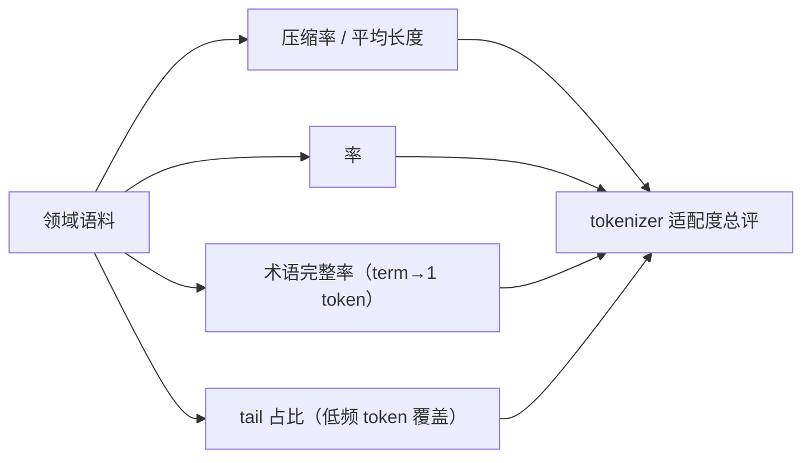

**面试要点**：指标要"**可操作**"：压缩率、unk 率、术语完整率、tail 占比。强调"**必须在领域语料上测，通用指标会掩盖领域偏移**"（呼应 Q11）。

---

## Q24. 训练分词器时是否应该对语料去重？不去重会如何扭曲 merge 优先级？

**回答**

**应该去重（至少显著采样去重），而且影响很大。** 这题的关键，是看懂"重复"如何温水煮青蛙地污染 merge 决策。

**不去重会怎样扭曲 merge 优先级**：

1. **重复内容反复加权**：BPE 训练统计的是"出现次数"。若某个文档被爬虫重复抓了 100 万次（或一个超长 doc 自带大量重复块），其中涉及的字符对就会被反复计数 → 这些对带着**虚高的权重**被合并，挤占其它正常语料的 merge 预算；
2. **污染长尾**：海量重复的模板文本/广告/标签，会让 `{`、`}`、`<a`、版权符号这类对凑出来的高频对虚高，把词表塞满一堆毫无意义的"模板 token"；
3. **词表布局失真**：真正低频但语义重要的词（专名、术语）因为分布被稀释，更难排进词表——换进来的 token 反而是重复文本里的噪声。

**补充说明**：
- 去重粒度：对话以**句子级/块级**（利用 Bloom filter / MinHash）对分词器训练就够；文档级去重更彻底，但可能误删结构性文本；
- **不必全量去重到只剩 1 份**——采样去重、保留多样性更好。完美去重会损失自然重复（常见短语）带来的频率信号，不过这通常不值得为最优先 merge 买单；
- BPE 训练语料一般做**轻度去重（去掉完全重复的 chunk）**即可，不用像预训练那样上严格的文档级去重。

```python
# 模拟：重复文本扭曲 pair 统计
from collections import Counter
pure = "the quick brown fox jumps over the lazy dog"
dup  = ("spam spam spam spam spam " * 100) + "the quick brown fox jumps"
pairs = Counter()
for text, w in ((pure, 1), (dup, 300)):   # dup 被重复 300 次
    ts = text.split()
    for i in range(len(ts)-1):
        pairs[(ts[i], ts[i+1])] += w
top = pairs.most_common(3)
print("top pairs:", top)  # ('spam','spam') 会霸榜
```

```text
top pairs: [(('spam', 'spam'), 300*99), (('the', 'quick'), 1), ...]
```

看吧，`spam spam` 这组毫无营养的对子，凭重复就霸占了榜首。

**面试要点**：**去重是的，理由 = "重复内容按次数加权会虚伪抬高某些 pair 的 merge 优先级"**。粒度建议"块级/句子级轻去重"即可。

---

## Q25. 分词器的 determinism 在分布式训练中为什么重要？不同 rank 使用不同版本会引发什么隐蔽 bug？

**回答**

先解释一下 **determinism（确定性）**：同样的输入，任何时刻跑出来都必须是同样的输出。而**分布式训练**是把训练数据按 rank（进程号）分片、并行处理的。如果每个 rank 用的分词器版本/配置不一样，**同一个输入会被不同的 rank 编码成不同的 id 序列**，于是：

1. **数据分布不一致**：不同 rank 的实际 token 分布偏移，影响梯度统计，也让全局 loss 的语义对不上；
2. **长度/样本数不一致**：分词结果不同 → 各 rank 的 batch 大小或序列长度不一致 → DDP all-reduce 的取平均逻辑失效，loss 或 norm 出现微小偏差，而且会在多次迭代里累积；
3. **checkpoint 不可复现**：同一 epoch 用不同 rank 的分词结果，重现的 loss 对不上，没法调试；
4. **词表 id 映射漂移**：如果两个版本的 token 顺序不同，同一个 token 在不同 rank 里 id 不同，模型拼起来的权重/embedding 行列就会错位——**静默地产生错误但表面完全正常的训练**。这是最典型的隐蔽 bug。

**哪些操作容易踩雷导致"版本分裂"**：

- 并发加载 tokenizer 时没有固定 hash/版本（比如直接拉最新 commit）；
- 不同机器上 Python 版本不同，正则或默认参数的序列化结果不同；
- 词典文件在缓存里没同步（一个节点旧、一个节点新）；
- 多进程时用了非确定性的并行化（tokenizers 库带并行能力时可手动关掉）。

**隐蔽 bug 的特征**：loss 曲线很正常、收敛也顺畅，但**模型表现偏低，而且"谁先改了谁复现不出"**。它不报错、不显 NaN，只有做回归对比才能揪出来。

**缓解三件套**：

- **tokenizer 版本锁定**（记录 commit hash / 文件 sha 校验），所有 rank 用同一份配置与词表文件；
- 分布式启动前**一次性把 tokenizer 文件分发到本地缓存**（避免实时拉取）；
- 禁用 tokenizers 的非确定性并行（`parallelism=False`）；
- 更稳妥的做法：在 trainer 里把 tokenize 结果**缓存到磁盘**（`.npy`/`.parquet`），训练只读缓存，保证绝对一致。

```python
# 示意：同一文本在不同"版本"中的 id 漂移
tok_v1 = {"人工智能": 100, "人工": 50, "智能": 51, "的": 3}
tok_v2 = {"人工智能": 101, "人工": 50, "智能": 52, "的": 3}
text = "人工智能的"
ids1 = [tok_v1.get("人工智能"), tok_v1.get("的")]
ids2 = [tok_v2.get("人工智能"), tok_v2.get("的")]
print("v1:", ids1, " v2:", ids2)   # [100,3] vs [101,3] → id 漂移
```

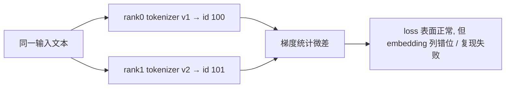

**面试要点**：**确定性问题不被当作运行时错误**，所以最危险。锁定版本、缓存分词结果、禁用不确定并行是三道闸。

---

## Q26. BPE 中"合并顺序即优先级"的含义是什么？两个 pair 频率相同时如何打破平局？不同策略差异多大？

**回答**

先讲概念：**"合并顺序即优先级"**——BPE 训练产出的 merge rules 是有序列表。编码时从左到右应用规则，先出现的规则天然优先执行；同时，后合并的 token 又是以前面已经合并出来的 token 为前提的。所以 merge 列表的顺序**就是分词的优先级**（呼应 Q1 的"顺序不能乱"）。

**遇到平局怎么破**：两个 pair 频率相同（Q7 里 `(l,o)`、`(e,s)`、`(s,t)` 就都是 2 次），得有个规则来裁决谁先合并。常见策略三选一：

1. **首次出现/语料顺序**：按该 pair 在语料中第一次出现的位置，先出现者优先（计数 map 用插入序时自然带出这个行为）；
2. **字典序**：`(a,b)` 与 `(b,a)` 这类按 token 字符串大小排序；
3. **token id 序**：merge 时新 token 的 id 递增，`(a,b)` 里 a/b 的 id 小者优先。

**不同策略差异到底多大？** 在**中低频语料**上差异可以**很显著**：平局在 BPE 里极其常见（每个 batch 都有大量并列），不同的裁决会产生完全不同的合并树，最终词表内容不同、同一文本的分词结果不同，甚至模型质量都有可测的差异（有论文专门做过对比）。但对**极高频**合并，影响微乎其微——因为它们是压倒性领先，根本轮不到平局裁决。

```python
# 两种 tie-break 策略对比
pairs = [("l","o"), ("e","s"), ("s","t")]   # 频率相同
first_seen = ["l","e","s"]                   # 首次出现序（l 先出现）
print("首次出现序:", sorted(pairs, key=lambda p: first_seen.index(p[0])))
print("字典序:    ", sorted(pairs, key=lambda p: (p[0], p[1])))
```

```text
首次出现序: [('l','o'), ('e','s'), ('s','t')]
字典序:     [('e','s'), ('l','o'), ('s','t')]
```

同样的 3 个平局 pair，不同策略给出不同合并顺序 → 词表和分词结果随之不同。

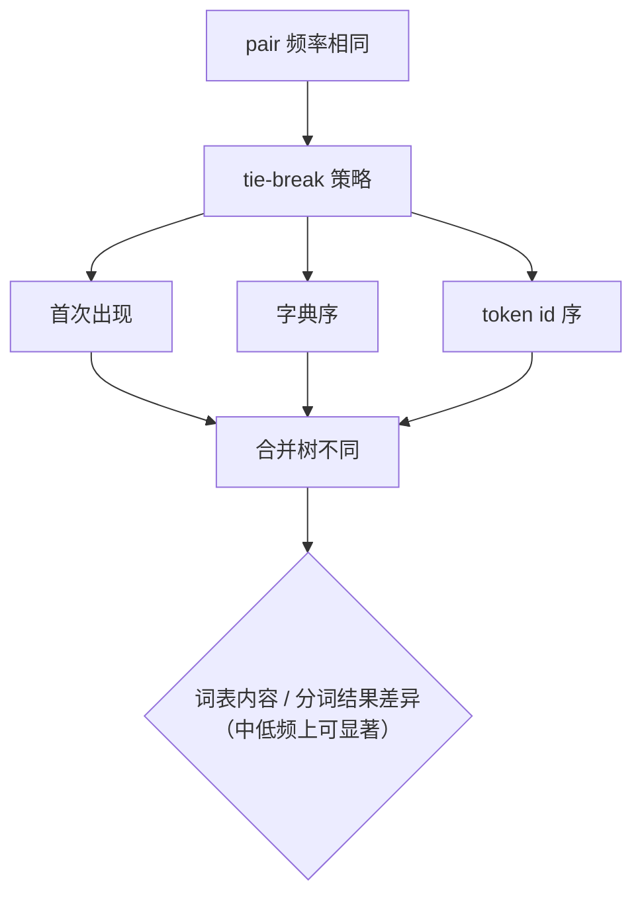

**面试要点**：先讲"顺序=优先级"，再讲 tie-break 的三种常见策略与"平局在高频主导时影响小、在长尾/中等频率影响显著"。

---

## Q27. 分词器能否在模型训练后单独替换？替换后需要做哪些重新适配（embedding 重初始化、继续预训练）？

**回答**

**技术上可以，但几乎没有"直接换"的可能。** 理由两点：

1. **词表 id 空间大变**：旧 tokenizer 有 50k 个 token，新的有 80k 个，id 完全不同，**旧的 embedding 矩阵没法逐行对齐**；
2. **语义对应缺失**：旧词表里的 `人工` 和新词表的 `人工`，id 不同、上下文分布也不同，向量没法直接复用。

**所以替换必须走"知识迁移"式的适配**，常见流程四步：

1. **词表映射 + embedding 初始化**：对能在新词表里找到"语义相同 token"的词（简单词、单字等），把旧 embedding 行**拷贝过来初始化**新 embedding；找不到的行随机初始化。**这一步是最关键的"抢救"动作**，能让大部分参数复用。
2. **继续预训练（continued pretraining）**：适配初始化之后，在**新 tokenizer** 下对语料继续训若干步（几亿到几十亿 token），让模型重建对新 token 表示的理解，弥合初始化噪声与分布偏移。
3. **输出层同步**：lm_head 也要同样做迁移初始化（若不 weight tying）。
4. **位置编码/长序列**：若新 tokenizer 的平均序列长度变了（比如压缩率变高/低），可能要重新对齐 max_seq。

**风险提示**：

- 只换不训，模型在新分词下**能力骤降**（OOV 增多、序列变长、既有表示用不上）；
- 适配训练预算不够，可能比不换还差；
- 换 tokenizer 通常是**重大架构级变更**，工程上要先评审必要性。

```python
# embedding 迁移初始化示意
import torch, torch.nn as nn
def transfer_emb(old_emb, old_token: str, new_token: str, new_emb):
    with torch.no_grad():
        if old_token in tokenizer_old and new_token in tokenizer_new:
            i = tokenizer_old[old_token]; j = tokenizer_new[new_token]
            new_emb.weight[j].copy_(old_emb[i])   # 拷贝向量
# 之后: 在新 tokenizer 下继续预训练若干步
```

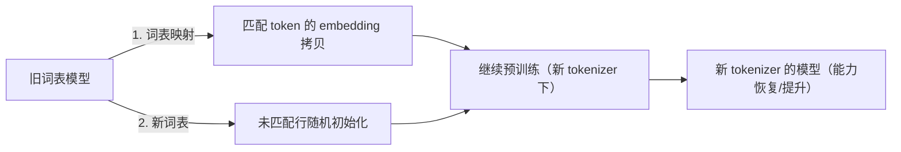

**面试要点**：**核心 = 替换 tokenizer 是一次"知识映射 + 继续预训练"工程**，不是直接换词表文件；embedding 迁移初始化是最关键一步。

---

## Q28. 中文场景下 WordPiece 与 BPE 的实际 token 效率差异有多大？设计一个可控实验来测量。

**回答**

先把结论亮出来：**在中文上，两种算法的 token 效率差异通常很小（几个百分点以内），远小于"词表大小"这个变量的影响**。

展开说：

- BPE 通常略优于 WordPiece 的更关键原因在于：**BPE 把空格/空白当作普通符号参与合并**（加上字节级 fallback 的开放词表），而 WordPiece 的 `##` 前缀 + 空格处理对中文不友好；
- 对中文，**起决定作用的是"词表大小 + 是否字节级 + 字粒度 vs 词粒度"**，而不是 BPE vs WordPiece 的选边站。

**怎么做一个可控实验**？控制变量法五步走：

1. **固定因素**：同一份中文语料（比如 10GB 新闻/百科/医学）；词表大小固定 V（如 32k）；都用 SentencePiece 或 HF tokenizers 实现；同样的 NFKC 预处理；
2. **自变量**：分词算法 {BPE, WordPiece, Unigram} × 词表 {32k, 64k, 128k}；
3. **响应变量**：
   - 平均序列长度（或 bytes/token）；
   - 单字符 OOV/unk 率；
   - 领域术语切分质量（人工抽查）；
   - （扩展）在小模型微调后，测人名/专名的完形 PPL；
4. **控制**：用**同一份训练语料、同一份测试语料**（要留出测试集），在同一个环境里对比；重复 3 次随机划分，看方差；
5. **结论口径**：以"字节/token"为主指标，给出置信区间；把"算法差异"和"词表大小差异"区分归因。

```python
import numpy as np

def exp_efficiency(tokenizer_factory, corpus, test, V, seed):
    rng = np.random.RandomState(seed)
    lens_all = []
    tok = tokenizer_factory(V=V)
    for chunk in test:
        lens_all.append(len(tok.encode(chunk)))
    return np.mean(lens_all), np.std(lens_all) / np.sqrt(len(lens_all))

# 设计: algorithms × V，报告 (mean, se)
# for alg in ("bpe","wordpiece","unigram"):
#   for V in (32_000, 64_000, 128_000):
#       print(alg, V, exp_efficiency(...))
```

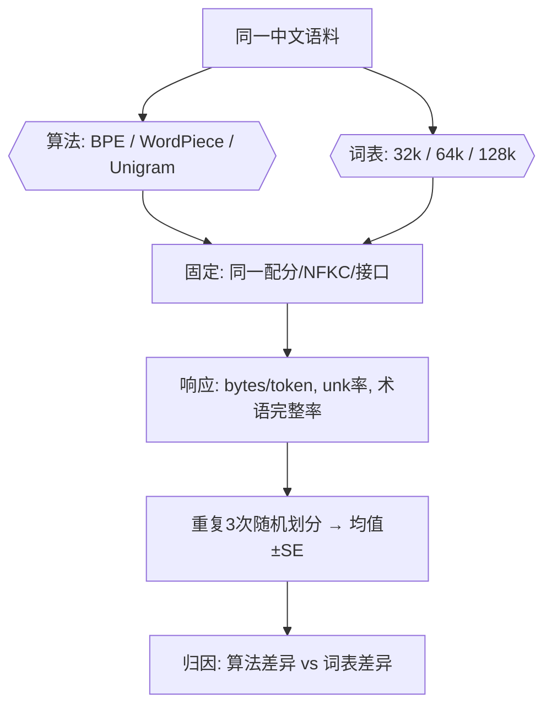

**面试要点**：强调"**中文上算法二选一的差异小，词表大小与字节级才是主变量**"；实验设计要"固定一维变量、报告指标与方差、杀出干扰"。

---

## Q29. `max_length` 截断策略（截头、截尾、中间截断）分别适合什么任务？截断位置对位置编码有何影响？

**回答**

文本太长放不进上下文，就得"锯掉一段"。锯头、锯尾还是锯中间，直接跟任务性质挂钩：

1. **截尾（truncate from right）**（最常用）：保留开头，丢弃末尾。适合**大多数单向自回归任务**（对话、摘要、文本生成）——因为开头通常装着任务上下文/指令，而尾巴离预测目标更近。且 decoder-only 的因果注意力下，位置编码从 0 开始，截尾让位置起点保持稳定。
2. **截头（truncate from left）**：保留末尾，丢弃开头。适合 **"尾部信息更重要"的编码场景**：比如翻译/分类的长文档，答案是压在尾巴的；或 RAG 里把检索内容放在后面的任务。代价是开头信息丢掉。
3. **中间截断（middle truncation）**：首尾都留，只锯中段。适合**"上下文中段最冗余"**的任务：长对话里保留系统提示（头）+ 用户最近消息（尾），历史尽量留；或长文档 QA（开头是主题、结尾是结论，最有用）。

**对位置编码的影响**：

- 绝对位置编码（sinusoidal / learned）：**截断位置决定每个 token 拿到什么位置号**。截尾时开头 token 的位置号不变（0..n），和训练分布一致；截头/中间截断会让 token 位置号整体偏移，尤其让"尾 token"拿到更大的位置号——训练最大长度若是 4k，截头过的 token 可能挤到 4k 附近的全新位置号，**超出训练分布，RoPE/绝对位置偏移出外推区**，表现变差；
- **相对位置编码（RoPE / ALiBi）**：对截断的宽容度更高——它们只看相对距离，截头只是让"信息挤在某段位置窗口"，不引入新的绝对位置量。但仍受**最大相对距离**限制（RoPE 的 base 决定长距离衰减）；
- **中间截断**：丢弃中段会让"上下文里的位置间隔突变"，对绝对位置编码最不友好（中段 token 的绝对位置跳变）；相对位置编码下只是少了几步距离，一般没事。

```python
def truncate(ids, max_len, mode="tail"):
    L = len(ids)
    if L <= max_len: return ids
    if mode == "tail":    return ids[:max_len]          # 留头
    if mode == "head":    return ids[-max_len:]         # 留尾
    if mode == "middle":  # 留头 + 尾，删中段
        keep_head = max_len // 2
        return ids[:keep_head] + ids[-(max_len-keep_head):]
    raise ValueError
seq = list(range(100))
print("tail  :", truncate(seq, 8))
print("head  :", truncate(seq, 8))
print("middle:", truncate(seq, 8))
```

```text
tail  : [0, 1, 2, 3, 4, 5, 6, 7]
head  : [92, 93, 94, 95, 96, 97, 98, 99]
middle: [0, 1, 2, 3, 96, 97, 98, 99]
```

```mermaid
flowchart LR
    A["长序列"] --> B{"截断策略"}
    B -->|尾截断| C["留头去尾：自回归/对话"]
    B -->|头截断| D["留尾去头：答案在尾部"]
    B -->|中截断| E["留头尾去中：长文档QA"]
    C --> F["绝对位置编码：位置号偏移"]
    D --> F
    E --> F
    F --> G["RoPE/相对位置 更鲁棒；绝对位置易超分布"]
```

**面试要点**：三句话——**尾截最常用（靠任务目标近）、头截用于答案在尾、中截用于头尾都重要**；**绝对位置编码对截断位置敏感，相对位置编码更鲁棒**。

---

## Q30. 从零实现一个可用的 BPE 分词器，你会把哪些部分做成可配置的？给出类/函数签名级别的接口设计。

**回答**

一个**工程可用**的 BPE tokenizer，核心是把"数据依赖/策略差异"的地方都做成可配置开关，而不是写死。可配置项清单：

1. **规范化（normalizer）**：`identity` / `NFKC` / `NFD` / `lowercase`；
2. **预分词策略**：哪些符号可跨越边界（英文词/数字/标点/空白/代码符号）；
3. **字节级 or 字符级**：`byte_level: bool`——决定初始词表是 256 还是语料字符集；
4. **词表大小** `vocab_size`；**special tokens 列表**及 id 分配；
5. **平局策略** `tie_break: "first" | "lexico" | "id"`（呼应 Q26）；
6. **SOS/EOS/PAD/UNK 是否保留**、以及它们是否可训练（呼应 Q10）；
7. **训练语料采样/去重开关**；`min_frequency`（低频 pair 不做合并）；
8. **未知处理**：`fallback_to_byte: bool`（呼应 Q13）。

**接口签名**：

```python
from typing import List, Dict, Tuple, Optional, Iterable

class BPEConfig:
    vocab_size: int = 32000
    byte_level: bool = True
    normalizer: str = "nfkc"          # "identity"|"nfkc"|"nfd"|"lowercase"
    tie_break: str = "first"          # "first"|"lexico"|"id"
    min_frequency: int = 2
    special_tokens: Optional[List[str]] = ["<unk>", "<pad>", "<s>", "</s>", "<mask>"]
    fallback_to_byte: bool = True
    drop_repeated_blocks: bool = True # 训练语料轻度去重

class BPETokenizer:
    def __init__(self, config: BPEConfig): ...
    # 训练
    def train(self, corpus: Iterable[str]) -> "BPETokenizer":
        """产出 self.merges, self.vocab (token->id), self.precomp_rules"""
        ...
    # 编码/解码
    def encode(self, text: str) -> List[int]: ...
    def decode(self, ids: List[int]) -> str: ...
    # 工具
    def tokenize(self, text: str) -> List[str]: ...
    def convert_tokens_to_ids(self, toks) -> List[int]: ...
    def save_pretrained(self, dir): ...     # 保存 config.json + merges.txt + tokenizer.json
    @classmethod
    def from_pretrained(cls, dir) -> "BPETokenizer": ...
    # 内部
    def _apply_merges(self, chars: List[str]) -> List[str]: ...   # 编码核心
    def _build_reverse_map(self) -> Dict[str, int]: ...
    def _fit_stats(self, corpus): ...        # 可插拔增量统计（可选 heap 实现）
```

**关键工程点**：

- **序列化格式**：保存 `merges.txt`（每行 `a b`）+ `vocab.json`，与 HF `tokenizers` / `tiktoken` 兼容；
- **编码效率**：训练用增量 pair 统计 + 堆（Q15）；编码用"按 merge 顺序一遍扫描"或预编译 trie；
- **可逆性**：若 byte_level + NFKC，encode→decode 无损（Q12）；加了 `special_tokens` 的 tokenizer 要保留 `add_special_tokens` 时的 id 映射；
- **特殊 token 从训练中排除**：train 时不要把 `<pad>` 放进 corpus。

```python
# 使用示例（假想）
tok = BPETokenizer(BPEConfig(vocab_size=16000, byte_level=True, normalizer="nfkc"))
tok.train(["deep learning is ... ", "deep belief nets ..."])
ids = tok.encode("deep learning")
print(tok.decode(ids))   # round-trip
```

```mermaid
flowchart LR
    A[BPETokenizer] --> B["config: 规范化/字节级/词表/hreak/fallback"]
    A --> C["train(corpus)"]
    A --> D["encode / decode / tokenize"]
    A --> E["save_pretrained / from_pretrained"]
    C --> F["merges.txt + vocab.json"]
    D --> G["无 OOV 的可逆序列"]
```

**面试要点**：突出"可配置点是数据/策略相关维度"，签名覆盖 train/encode/decode/save/load；提增量统计与可逆性两个工程支柱。

---

## 参考链接

1. [BPE(Byte-Pair Encoding,字节对编码)原理-CSDN博客](https://blog.csdn.net/tongbowen_123/article/details/162825821)
2. [BPE(字节对编码):原理、流程与应用详解 - m516606428 - 博客园](https://www.cnblogs.com/myh516/p/19055578)
3. [AI大模型分词器详解-阿里云开发者社区](https://developer.aliyun.com/article/1694227)
4. [从Token到词元:BPE分词原理与AI计费逻辑全解析-CSDN博客](https://blog.csdn.net/weixin_29051811/article/details/169006814)
5. [BPE 编码的基本原理——为什么大模型数字母总是出错?-腾讯云开发者社区-腾讯云](https://cloud.tencent.com/developer/article/2713311)
6. [分词(tokenization)算法之Byte Pair Encoding (BPE) 算法详解(代码实现)-CSDN博客](https://lishizheng.blog.csdn.net/article/details/146555778)
7. [NLP--BPE、WordPiece、ULM、SentencePiece子词分词器总结【原理】-CSDN博客](https://blog.csdn.net/liu_673/article/details/130160321)
8. [大模型分词算法全解析：BPE、WordPiece、SentencePiece 实战对比-CSDN博客](https://blog.csdn.net/ppbk_/article/details/156693452)
9. [LLM分词器原理与实战：BPE、WordPiece、SentencePiece及词表设计-CSDN博客](https://blog.csdn.net/weixin_29048775/article/details/168779587)
10. [随机分词与tokenizer(BPE->BBPE(tiktoken)->WordPiece->Unigram->SentencePiece)-CSDN博客](https://blog.csdn.net/weixin_36378508/article/details/134883614)

---

*下一章展望：第 2 章将带读者核算 PyTorch 训练的资源（FLOPs、显存、混合精度、梯度累积等），延续"地基"主题。*