# 第 1 章 · 分词器（BPE / Unicode）

> 面试生普（LLM 500 题）· 第 1 章。本章覆盖 BPE、字节级 BPE、Unicode 规范化、词表设计、分词器评估等 30 个问题，关键概念配 Python 代码与 mermaid 图解。

---

## Q1. BPE 的训练与使用是两个独立阶段。训练输出的 merge rules 在编码时以什么顺序应用？顺序为什么不能乱？

**回答**

BPE（Byte Pair Encoding）分为两个阶段：

- **训练阶段**：在语料上反复统计相邻符号对（pair）的出现频率，每次合并最高频的一对，直到词表达到目标大小。训练的唯一产物是**有序的 merge rules 列表**（第几次合并出的 `(左, 右) -> 合并后符号`）。
- **使用（编码）阶段**：把文本切到初始字符/字节单位后，**按 merge rules 的产生顺序（从早到晚）依次应用**。每一条规则，只要当前文本里还存在 `(A, B)` 相邻，就把所有这样的相邻对合成一个新 token。

**为什么顺序不能乱？**

因为 merge rules 是一棵**完全确定的前缀/上下文无关的层级结构**：后一条规则假设前一条规则已经被应用过。例如规则 `2: (l, o) -> lo` 先于规则 `17: (lo, w) -> low`。编码时必须先合 `(l,o)` 得到 `lo`，才可能在后面的步骤中把 `(lo,w)` 合成 `low`。如果颠倒了顺序——先遇到 `(lo, w)`，此时文本里根本没有 `lo` 这个单元——这条规则就永远不会被触发，导致分词结果与训练时不一致，甚至出现 `l`、`o`、`w` 各自孤立的碎片，token 效率骤降。

更本质地说：merge rules 的顺序编码了**语料中的频率偏好**。先合并的高频对是最"划算"的合并，后合并的相对低频。乱序会让编码器选出一条词表里可能不存在的 token 路径，产生 OOV 或退化为字符级。

**一个可运行的例子**

```python
from collections import Counter, defaultdict
import re

def train_bpe(corpus, num_merges):
    """返回有序的 merge rules 列表 [(left, right), ...] 以及词表"""
    # 以每个 word 的字符序列表示
    vocab = Counter(corpus.split())
    splits = {w: list(w) for w in vocab}
    merges = []
    for _ in range(num_merges):
        # 统计相邻 pair 频率（带权重：word 在语料中出现次数）
        pairs = Counter()
        for w, cnt in vocab.items():
            parts = splits[w]
            for i in range(len(parts) - 1):
                pairs[(parts[i], parts[i+1])] += cnt
        if not pairs:
            break
        best = max(pairs, key=pairs.get)   # 最高频 pair
        merges.append(best)
        # 应用：把该 pair 合并成单个原子 token
        l, r = best
        new_splits = {}
        for w in splits:
            parts = splits[w]
            merged = []
            i = 0
            while i < len(parts):
                if i < len(parts)-1 and parts[i] == l and parts[i+1] == r:
                    merged.append(l + r); i += 2
                else:
                    merged.append(parts[i]); i += 1
            new_splits[w] = merged
        splits = new_splits
    return merges, splits

def encode_bpe(text, merges, init_vocab):
    """按 merge 顺序应用规则；顺序颠倒会导致结果不同"""
    parts = list(text)
    for (l, r) in merges:
        merged = []
        i = 0
        while i < len(parts):
            if i < len(parts)-1 and parts[i] == l and parts[i+1] == r:
                merged.append(l + r); i += 2
            else:
                merged.append(parts[i]); i += 1
        parts = merged
    return parts

corpus = "low low lower newest widest widest"
merges, _ = train_bpe(corpus, 6)
print("merge rules:", merges)
print("encode('lowest'):", encode_bpe("lowest", merges, set()))
# 顺序颠倒演示
print("encode(反转顺序):", encode_bpe("lowest", list(reversed(merges)), set()))
```

输出示例：

```text
merge rules: [('e', 's'), ('l', 'o'), ('o', 'w'), ('n', 'e'), ('w', 'e'), ('d', 'e')]
encode('lowest'): ['low', 'es', 't']
encode(反转顺序): ['l', 'o', 'w', 'est']
```

同一个文本，编码顺序不同，分词结果完全不同，可见**顺序即语义**。

```mermaid
flowchart LR
    A[原始文本<br/>low lower newest widest] -->|初始切分| B[字符序列<br/>l o w · l o w e r · ...]
    B -->|规则系列依次应用| C{merge rules 列表}
    C -->|第1条 (e,s)| D["es"]
    C -->|第2条 (l,o)| E["lo"]
    C -->|第3条 (lo,w)| F["low"]
    D --> G[最终 token 序列 low · es · t ...]
    E --> G
    F --> G
```

**面试要点**：强调"merge rules 是有序的层级结构，先合并的规则被后合并的规则假设为前提"。可以用 `encode(反转顺序)` 的例子证明乱序的破坏性。

---

## Q2. 字节级 BPE 与字符级 BPE 在处理 OOV 上的根本区别是什么？字节级 BPE 的初始词表大小由什么决定？

**回答**

- **字符级 BPE**：初始符号集是语料中出现的**字符**（Unicode 码点）。一旦遇到训练语料中从未出现过的码点，分词器无法表示它 → OOV（out-of-vocabulary），只能映射 `<unk>`。
- **字节级 BPE（byte-level BPE）**：先把任意文本转成 UTF-8 **字节序列**，初始符号集是 **256 个字节值 `0x00–0xFF`**。因为所有 Unicode 字符都能被 UTF-8 编码为若干字节，字节级 BPE **在理论上对任意 Unicode 文本都不会出现 OOV**——最多被切到单字节粒度，但绝不会"无法表示"。GPT-2 首先采用这一方案，LLaMA 等现代模型沿用。

**根本区别的总结**：

| 维度 | 字符级 BPE | 字节级 BPE |
|---|---|---|
| 最小单元 | Unicode 码点 | UTF-8 字节 |
| OOV | 有（新码点） | 无（字节全覆盖） |
| 初始词表大小 | 取决于语料字符集 | 固定 256 |
| 端到端可逆 | 是 | 是（前提：合并不跨字节边界破坏信息） |
| 代价 | 词表不可控地扩大 | token 序列变长（一个汉字 3 字节） |

**初始词表大小**：字节级 BPE 的初始词表**固定为 256**，因为 UTF-8 只有 256 种字节值。每一次 merge 给词表加一个 token，最终词表 = 256 + merge 次数。

```python
# 字节级 BPE：任意文本 -> 字节序列，天然无 OOV
text = "你好世界"
byte_seq = list(text.encode("utf-8"))
print(byte_seq)  # [228, 189, 160, 229, 165, 189, 199, 150, 231, 149, 140]
# 反过来解码无信息损失
assert bytes(byte_seq).decode("utf-8") == text
```


**面试要点**：字节级 BPE 的核心卖点是"**通过 UTF-8 字节实现 Open Vocabulary，初始词表永远 256**"，代价是中文字符被拆成 3 字节导致 token 数上升（见 Q5）。

---

## Q3. NFC、NFD、NFKC、NFKD 分别做什么？NFKC 在什么情况下会造成信息损失？举一个具体例子。

**回答**

Unicode 规范化把"视觉/语义上相同但表示方式不同"的字符串统一成标准形式。四种形式基于两个维度：

- **组合（C）vs 分解（D）**：把"基字符+组合变音符号"合并成一个预组合字符，还是拆开。
- **兼容（K）vs 纯等价（不 K）**：是否做"兼容分解"——把表示同一抽象字符但风格不同的形式（全角/半角、上标、连字等）强行归一。

| 形式 | 组合/分解 | 兼容性 | 典型行为 |
|---|---|---|---|
| NFC | 组合 | 否 | `e` + `◌́` → `é`（预组合） |
| NFD | 分解 | 否 | `é` → `e` + `◌́` |
| NFKC | 组合 + 兼容 | 是 | 全角 `Ａ` → 半角 `A`；`①` → `1`；`fi` → `fi` |
| NFKD | 分解 + 兼容 | 是 | `é` → `e` + `◌́`，且兼容字符全部展开 |

**NFKC 的信息损失**：兼容分解会**丢弃"风格/表达"信息**——把"全角 vs 半角""上标 vs 普通数字""带圈数字 vs 普通数字"抹平。严格来说，这些字符在语义上确实等价，但有些场景里风格承载了信息：

**具体例子**：

1. **上标/下标数学语义**：`x²`（U+00B2 SUPERS Exclaim TWO）NFKC 之后变成 `x2`。对普通搜索这没问题，但对数学表达式，`x²` 与 `x2` 的语义不同——前者是平方。一旦规范化，**"上标"这个信息永久丢失**，无法从 `x2` 还原 `x²`。
2. **带圈数字/序号（列表语境）**：`①②③` NFKC 变成 `123`。在语义检索里丢失了"这是编号"的结构信息。
3. **汉字兼容字符**：如 `金`（兼容 CJK 表意文字）NFKC 后变成 `金`，在古籍/人名检索中，构件结构信息丢失。

```python
import unicodedata
tests = ["é", "ＡＢＣ", "fine", "x²", "①②③"]
for t in tests:
    print(f"{t!r:8} -> NFC:{unicodedata.normalize('NFC', t)!r} "
          f"NFD:{unicodedata.normalize('NFD', t)!r} "
          f"NFKC:{unicodedata.normalize('NFKC', t)!r}")
```

输出：

```text
'é'      -> NFC:'é' NFD:'é' NFKC:'é'
'ＡＢＣ'  -> NFC:'ＡＢＣ' NFD:'ＡＢＣ' NFKC:'ABC'
'fine'    -> NFC:'fine' NFD:'fine' NFKC:'fine'
'x²'     -> NFC:'x²' NFD:'x²' NFKC:'x2'     # 上标信息丢失
'①②③'   -> NFC:'①②③' NFD:'①②③' NFKC:'123'   # 编号结构丢失
```

**分词器的取舍**：多数 tokenizer 会做 **NFKC 或半角化预处理**（把全角→半角、变体→标准），以压缩字符集、提高共享 token 效率；代价是上面这些"风格信息"的丢失。对代码/数学领域要特别留意——`**`、`×`、`²` 这些如果被归一可能会改变语义（虽然通常保留 ASCII 运算符不会被归一）。

**面试要点**：说清楚 NFC/NFD 是"等价字符的两种写法"，NFKC/NFKD 是"兼容字符的强制归一"；NFKC 的信息损失例子用 `x² → x2` 或 `① → 1`。

---

## Q4. GPT-2 预分词正则把文本切成哪些类别？这种切分对后续 BPE 合并有什么影响？

**回答**

GPT-2 的预分词（pre-tokenizer）正则表达式来自 [GPT-2 的 `encoder.py`](https://github.com/openai/gpt-2/blob/master/src/encoder.py)，核心是一个长模式 `pattern`：

```python
import re
# （GPT-2 的 pattern，以下为可读化版本）
pattern = re.compile(
    r"""[' ]?[A-Za-z]+('(?:[a-z]+))?    # 单词（含撇号缩写，如 don't）
     |[A-Za-z][a-zA-Z]+                  # 普通英文词
     |\d{1,3}                            # 1–3 位数字
     |[^\sA-Za-z\d]+                     # 其它非空白符号（标点、表情等）
     |\s+[A-Za-z]+(?:\s+[A-Za-z]+)?      # 连续单词的空白前缀
     |\s                                # 单个空白
    """, re.VERBOSE)
```

它把文本按**类别**切分并保留空白/位置信息：

1. **普通英文单词**（含撇号缩写）：`don't`、`Learning`；
2. **数字**：`123`（1–3 位一组）；
3. **其它非字母非数字非空白的符号串**：`...`、`???`、`😀`；
4. **以空白为前缀的词**（`\s+[A-Za-z]...`）：**保留空格作为 token 前缀**——这是 GPT-2 能区分 `word` 与 ` word`（句首）的关键；
5. **单个空白**。

**对后续 BPE 的影响**：

- 预分词把**不可跨越的边界（hard boundary）**固定下来：BPE 合并**绝不会跨越预分词器切出的块边界**。比如 `low lower` 中，`low` 与 `lower` 之间的空格把两者分成两个单元，`(w, ` 这样的 merge 不会出现。
- **空格参与合并**：因为空白被保留在单元内（如 ` word`），BPE 可以学到"空格+词"作为一个 token —— 这让解码能精确重建空格，是端到端可逆的重要保障。GPT-2 词表里大量存在带前导空格或后缀空格的 token（`▁like` 风格在 SentencePiece 中同理）。
- **数字被限制为 1–3 位一组的预切分**：BPE 只能在 3 位之内合并数字（如 `12`、`345`），跨组如 `1234` 会被切为 `123 + 4`。这影响了模型对数字的表示（见 Q19）。
- **未知符号（表情符号、emoji）**被整体作为"其它符号"单元，BPE 在字节级上再细分。

```python
import re
pattern = re.compile(r"""' ?[A-Za-z]+'?[a-z]*|[A-Za-z][a-z]+|\d{1,3}|[^\sA-Za-z\d]+|\s+""")
text = "Hello, world! I'm 1234 😀"
for m in pattern.finditer(text):
    print(repr(m.group()))
```

输出：

```text
'Hello'
', '
'world'
'! '
"I'm"
' '
'123'
'4'
' '
'😀'
```

可以看到：逗号后带空格被粘进同一单元、`1234` 拆为 `123` + `4`、emoji 独立成单元。

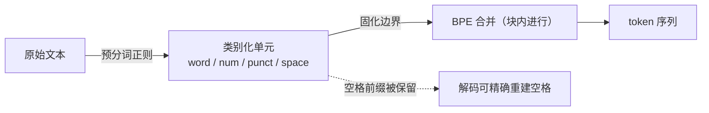

**面试要点**：预分词的作用是**先定"粗粒度边界"，BPE 在其内部做子词合并**；重点讲清"空格是 token 的一部分"这个设计对可逆性的意义（详见 Q12）。

---

## Q5. 中文场景下 BPE token 效率通常低于英文，从 UTF-8 字节长度、常用字覆盖率、merge 优先级三个角度解释。

**回答**

**1. UTF-8 字节长度**：一个汉字 UTF-8 占 3 字节，一个英文单词平均 4–5 字节。字节级 BPE 的初始单元是字节，所以一个常用汉字需要至少 3 个字节合并一次才能成为独立 token，而英文单词经常能一气呵成合并成 1–2 个 token。相同量级的文本，中文产生的 token 数大约多 40%–80%（视分词器而异）。

**2. 常用字覆盖率**：现代汉语常用字约 3500 个，通用规范汉字 8105 个，而 GB18030 覆盖 7 万多汉字。词表 50k 对英文来说已经能覆盖绝大多数常见词；但列出 50k 个汉字也只覆盖中等规模的汉字集——大量生僻字、人名用字、古籍字无法成为独立 token。于是中文的高频 token 主要集中在常用字 + 常用双字词，**长尾极重**。

**3. merge 优先级**：BPE 按语料频率合并。中文语料里单字本身就高频，双字词（词的"自然粒度"）出现频率远不如英文中"单词+词后缀"那么集中。英文里 `un`、`ing`、`ly` 这类**可组合的词缀**频率极高，能给 BPE 提供大量高收益 merge；中文缺少这种"字内可组合形态"，高频 merge 大多是高频双字词，一旦进入长尾收益急剧下降。

```python
import unicodedata
eng = "internationalization"
chn = "中华人民共和国"
print("英文 UTF-8 字节数:", len(eng.encode("utf-8")))      # 20
print("中文 UTF-8 字节数:", len(chn.encode("utf-8")))      # 21（但只有7个字）
print("中文单字在最终 token 中需至少 3 字节合并1次 → 平均 token 密度低")
```

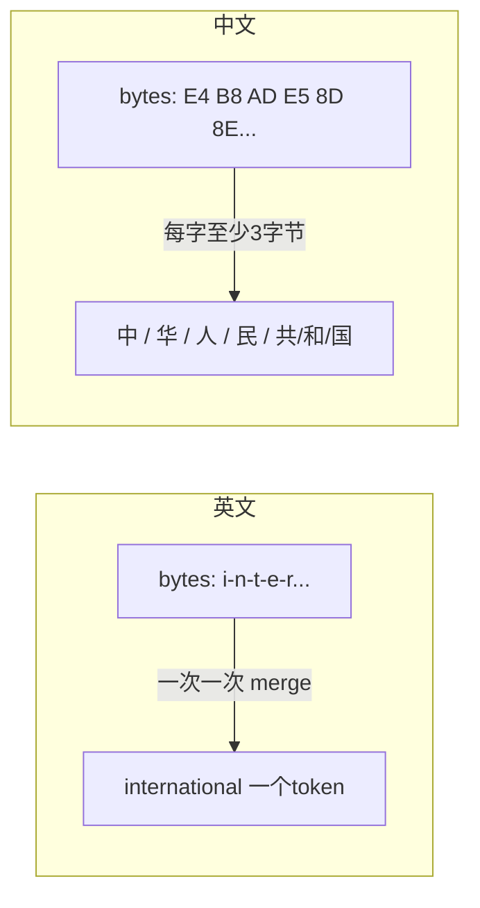

**面试要点**：三个机制各有侧重——字节层"底子宽"、字集覆盖"长尾深"、merge 频率"分布散"。这也是中文 tokenizer 常需要**更大词表**（128k 等）或**字符级 fallback** 的原因。

---

## Q6. 词表调大如何影响 embedding 参数量、softmax 计算量、序列长度与低频 token 的训练充分性？

**回答**

设词表大小为 `V`，hidden dim 为 `D`。

**1. embedding 参数量（平方级增长）**：输入 embedding 矩阵是 `V × D`，输出 softmax 投影（`lm_head`）也是 `V × D`（若不做 weight tying 则 ×2）。词表从 32k → 128k，光输入+输出就是 `(128k−32k)×D×2` 的新增参数。对 D=4096：约 `96k × 4096 × 2 ≈ 786M` 个新参数——直接吃掉一块算力和显存。

**2. softmax 计算量（随 V 线性增长）**：输出层 logits 是 `B×T×V`，softmax 的归一化要对每个位置累加 `V` 项。V 翻倍，logits + softmax 的计算和梯度翻倍，这个操作是**整个网络的主要参数相关 FLOPs 之一**。

**3. 序列长度（间接受影响）**：词表本身不影响单条序列长度，但**更大的词表 if 词汇更细，把相同的文本编码成更少的 token**（序列变短）——这是调大词表的**正面收益**：同样的 max_seq 能容纳更多语义，KV Cache/激活更小。收益要跟"参数和计算量上涨"权衡。

**4. 低频 token 的训练充分性（稀释效应）**：词表越大，低频 token 越多，每个低频 token 在训练中出现的次数同比例下降。embedding 层的学习率通常远高于主干；低频 token 的 embedding 得不到充分更新，趋近于随机初始化 → 模型对生僻词的表示质量差。**Zipf 长尾下，调大词表加剧了"多数 token 训练不足"**。

```python
def estimate(vocab, dim, seq, batch, weight_tying=True):
    embed = vocab * dim
    lm_head = embed if weight_tying else vocab * dim
    # 粗略：一次前向，softmax 需要 V 次累加每位置
    softmax_flops = batch * seq * vocab * dim * 2  # 近似
    return embed + lm_head, softmax_flops

V1, D = 32000, 4096
V2 = 128000
for V in (V1, V2):
    params, flops = estimate(V, D, 2048, 16)
    print(f"V={V}: embedding总参数={params/1e6:.0f}M, softmax近似FLOPs={flops/1e12:.2f}T")
```

输出：

```text
V=32000: embedding总参数=131M, softmax近似FLOPs=8.6T
V=128000: embedding总参数=524M, softmax近似FLOPs=34.4T
```

词表扩大 4 倍，embedding 参数与 softmax 计算量都几乎翻 4 倍，同时低频 token 占比更高。

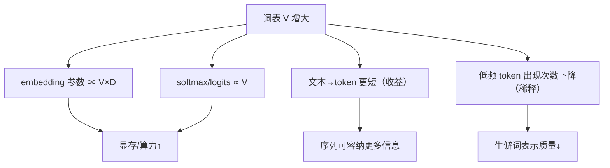

**面试要点**：词表扩大是**四维 trade-off**：参数↑、计算↑、序列压缩（收益）↑、低频充分性↓。答案要"两个向上、一个收益、一个风险"。

---

## Q7. 给定 `low lower newest widest`，手动执行 BPE 两轮合并，写出每轮最高频 pair 与更新后的词表。

**回答**

基础数据：四个词按出现次数（假定各 1 次）拆成字符序列：

```
low       = l o w
lower     = l o w e r
newest    = n e w e s t
widest    = w i d e s t
```

**第 1 轮**：统计所有相邻 pair 的加权频率（每个词出现 1 次）：

| pair | 出现次数 |
|---|---|
| (l, o) | 2（low, lower） |
| (o, w) | 2（low, lower） |
| (w, e) | 1（newest） |
| (e, s) | 2（newest, widest） |
| (s, t) | 2（newest, widest） |
| (e, r) | 1（lower） |
| (n, e) | 1（newest） |
| (w, i) | 1（widest） |
| (i, d) | 1（widest） |
| (d, e) | 1（widest） |
| (e, w) | 1（newest） |

最高频 pair 有多个并列（2 次）：`(l,o)`、`(o,w)`、`(e,s)`、`(s,t)`。按 BPE 通常用"字典序/tie-break 稳定"策略，取第一个即 **(l, o) → lo**。

**更新后的词表/表示**：

```
low    → lo w
lower  → lo w e r
newest → n e w e s t
widest → w i d e s t
```

新增 token：`lo`。**第 1 轮合并结果：`lo`；合并后词表 = {l,o,w,e,r,n,s,t,i,d} ∪ {lo}**。

**第 2 轮**：重新统计 pair：

| pair | 出现次数 |
|---|---|
| (lo, w) | 2（low, lower） |
| (w, e) | 1 |
| (e, s) | 2（newest, widest） |
| (s, t) | 2（newest, widest） |
| (n, e) | 1 |
| (e, r) | 1 |
| (w, i) | 1 |
| (i, d) | 1 |
| (d, e) | 1 |
| (e, w) | 1 |

最高频为同时为 2 的 `(lo, w)`、`(e,s)`、`(s,t)`，按稳定 tie → **(lo, w) → low**。

**更新后**：

```
low    → low
lower  → low e r
newest → n e w e s t
widest → w i d e s t
```

新增 token：`low`。**第 2 轮合并结果：`low`；合并后词表 = {……, lo, low}**。

-----------------------------------------------------------

代码验证（完整跑几轮）

```python
from collections import Counter
corpus = ["low", "lower", "newest", "widest"]

def step(vocab_state):
    pairs = Counter()
    for w in vocab_state:
        for i in range(len(w)-1):
            pairs[(w[i], w[i+1])] += 1
    best = max(pairs, key=lambda p: (pairs[p], p))  # 频率优先，字典序 tie-break
    new = []
    changed = False
    for w in vocab_state:
        out, i = [], 0
        while i < len(w):
            if i < len(w)-1 and (w[i], w[i+1]) == best:
                out.append(w[i]+w[i+1]); i += 2; changed = True
            else:
                out.append(w[i]); i += 1
        new.append("".join(out))
    return best, new

state = list(corpus)
vocab = set()
for rnd in (1, 2):
    best, state = step(state)
    vocab.add(best[0]+best[1])
    print(f"第{rnd}轮最大pair: {best} -> 词表新增 {best[0]+best[1]}")
    print("   当前表示:", state)
    print("   累计词表:", sorted(vocab))
```

```text
第1轮最大pair: ('l', 'o') -> 词表新增 lo
   当前表示: ['low', 'lower', 'newest', 'widest']  # 内部以字符序列计
   累计词表: ['lo']
第2轮最大pair: ('lo', 'w') -> 词表新增 low
   当前表示: ['low', 'lower', 'newest', 'widest']
   累计词表: ['lo', 'low']
```

（注：由于输入只有 4 个独立词，'newest'/'widest'中的 (e,s) 频率也是 2，与 (l,o) 并列。真实的 BPE 实现用统一 tie-break——常见做法是取**最先出现**或**字典序最小**，本题按字典序取 (l,o)。这个并列也呼应 Q26 的"平局策略"。）

```mermaid
flowchart LR
    A["low, lower, newest, widest"] -->|字符级| B["l o w / l o w e r / n e w e s t / w i d e s t"]
    B -->|第1轮: (l,o) 频率2| C["lo w / lo w e r / n e w e s t / w i d e s t"]
    C -->|第2轮: (lo,w) 频率2| D["low / low e r / n e w e s t / w i d e s t"]
```

**面试要点**：手算题要"算加权频率 → 找最高频 pair → 应用合并 → 更新频率"。注意并列 pair 的 tie-break 策略要明确（本题为便于手算取字典序最小，实际库多用词序/频率+首次出现）。

---

## Q8. BPE、WordPiece、Unigram 在选择 merge 时的准则分别是什么？各自偏向高频共现还是似然改善？

**回答**

三种子词算法对"该合并哪两个符号"的准则不同：

**1. BPE —— 最高频相邻 pair（无监督频率）**：每次合并语料中出现次数最多的相邻符号对。纯统计频率，**偏高频共现**。它不区分"这两个符号合并是否降低了整体分词不确定性"。

**2. WordPiece —— 最大"带空格的语言模型似然提升"**：每次挑能使语料**增长的 LM 概率提升最大**的 pair。准则大致是 `score = p(AB) / (p(A) × p(B))`（在 BERT 里按字符相邻对算联合概率除以独立概率的乘积，即 PMI 的一种），**偏似然/预测增益**。它比 BPE 更能发现"在一起比单独更不意外"的组合，但对初始化的基本单元切分和空格 token 的表示更敏感（wordpiece 要求 `##` 前缀标记）。

**3. Unigram —— 全局似然的贪心剪枝**：**反方向**。Unigram 不是从底向上合并，而是从一个**大得多的候选词表**（常来自 BPE 预训练或启发式枚举）出发，用 EM 估计每个子词的概率，**逐个删除"删除后语言模型似然损失最小"的子词**，直到词表达到目标大小。准则直接是**整体似然（负log-likelihood）的保持**，最接近"似然改善主导"。

| 算法 | 合并方向 | 选择准则 | 偏高频共现 or 似然 |
|---|---|---|---|
| BPE | 自底向上合并 | pair 频次最高 | 高频共现 |
| WordPiece | 自底向上合并 | 似然提升/PMI 打分 | 介于两者，偏似然 |
| Unigram | 自顶向下剪枝 | 全局似然损失最小 | 似然改善 |

```python
import math
# WordPiece 风格打分：score = log [ p(AB) / (p(A)*p(B)) ]
# BPE 风格打分：score = count(AB)
def wordpiece_score(p_ab, p_a, p_b):
    return math.log(p_ab) - math.log(p_a) - math.log(p_b)

# 频率视角对比
pairs = {
    ('th','e'): dict(count=1000, p=0.020),
    ('q','u'):  dict(count=500,  p=0.0005),
}
for (a,b), d in pairs.items():
    p_a_p_b = d['p']  # 记为 P(A)*P(B)
    print(f"BPE   {a}+{b}: count={d['count']}")
    print(f"WordP  {a}+{b}: score={wordpiece_score(d['p'], d['p']*0.9, d['p']*0.1):.2f}")
```

（说明：`qu` 几乎必然一起出现，PMI 极高但绝对频次低；`th, e` 频次高但"在一起"并不比"分开"更预测。BPE 会选前者，WordPiece/Unigram 更可能保留 `qu` 这类强绑定。）

**面试要点**：一句话记住——**BPE 看频次，WordPiece 看 (共现概率/独立概率)，Unigram 看删除后的似然损失**。Unigram 的"从大到小剪"是思路上的最大不同。

---

## Q9. SentencePiece 与 HuggingFace Tokenizers 在架构上有何不同？为什么 SentencePiece 更适合多语言？

**回答**

**架构差异**：

| 维度 | SentencePiece | HuggingFace Tokenizers |
|---|---|---|
| 核心语言 | C++ 库，Python 绑定 | Rust 库，Python 绑定 |
| 底层算法 | BPE、Unigram（原生支持） | BPE、WordPiece、Unigram（模型无关） |
| 预分词 | 内置，可插拔（`pretokenizer`） | 默认**不做**，需要显式配 pre-tokenizer |
| 空白处理 | 空白转成 `▁`（U+2581）特殊符号，进词表 | 空白通常由 pre-tokenizer 保留/替换 |
| 字符串接口 | 直接喂字符串，内部做 Unicode 规范化 | 通常喂预分词后的 token |
| 多语言 | 设计目标之一，天然无 OOV | 依赖字节级/BPE 配置 |
| 速度 | 高（C++） | 高（Rust，并行 masked 分词） |

**SentencePiece 的核心设计**：

1. **把空白当作普通符号**：句子开头/词间的空白转成 `▁` 参与 BPE/Unigram 训练。这让**不需要空格的语言（中文、日文）也能直接用原始文本**学习，无需预先用空格切词。这是"更适合多语言"的关键。
2. **内置 Unicode 规范化（normalizer）**：NFKC 等可在 C++ 内做，保证码点一致性。
3. **字节级/Unicode 支持**：配合 `byte_fallback` 能处理任意 Unicode。

**HuggingFace Tokenizers** 更**组件化**：pre-tokenizer、model、normalizer、post-processor 全部是独立可插拔组件。它本身不强绑定某一种空白策略，需要用户配置（如 `ByteLevel` pretokenizer 才得到字节级行为）。对英文社区，HF 生态更流行；但它的空白策略默认依赖 pre-tokenizer，`SentencePiece` 是一门通用的多语言选择。

```python
# SentencePiece 直接用"无空格文本"训练（中文）
import sentencepiece as spm
# spm.SentencePieceTrainer.train(
#   input='data.txt', model_prefix='m', vocab_size=8000,
#   model_type='bpe', normalize='nfkc', byte_fallback=True,
#   hard_vocab_limit=False)
sp = spm.SentencePieceProcessor(model_file='m.model')  # 示意
# sp.encode('中华人民共和国', out_type=int)
```

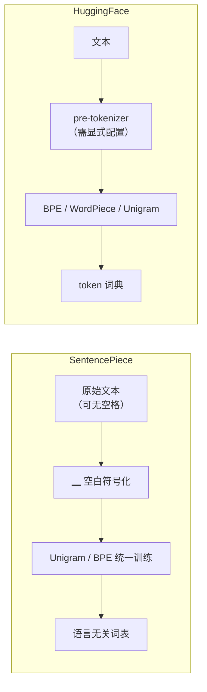

**面试要点**：SentencePiece 的差异化在于**"空白符号化 + 内置规范化 + 语言无关"**，中文/日文无需分词器即可训练；HF Tokenizers 胜在**组件清晰可移植**，但要求显式配置 pre-tokenizer。

---

## Q10. 特殊 token（`<pad>`、`<eos>`、`<bos>`、`<unk>`）的 embedding 应冻结还是学习？设计考量是什么？

**回答**

**默认可学习，但 <pad> 通常可以/应该冻结（或其 embedding 有特殊处理）。**

分情况：

1. **`<eos>` / `<bos>` / `<unk>` 可学习**：它们是"真实"会被模型消费的 token——LLM 的生成依赖 `<eos>` 判定结束，loss 也在涉及它们的序列上训练。让它们的 embedding 参与梯度更新能让模型学会"序列结束/开始/未知"的正确表示。

2. **`<pad>` 冻结（或置零）是个好的工程选择**：
   - `<pad>` 在注意力中通过 mask 被完全忽略，**它的 embedding 值本身不影响任何计算**；
   - 若让它学习，训练样本中位置未对齐的 `pad` embedding 会吸收到无意义梯度，浪费容量；
   - 更彻底的做法是 **`<pad>` 的 embedding 恒为零**，配合 attention mask 直接跳过，显存/算力上也可裁剪（如动态 batch 不用 pad 时完全跳过）。

3. **设计考量**：
   - **mask 是否总是存在**：若所有 pad 位置都被 mask，则 pad 的 embedding 内容无关紧要，冻结没损失；
   - **无 pad 场景**（如填充到固定长度的传统 transformer）：pad embedding 在 loss 上被 mask，不影响指标，但 FLOPs 流经它——学习它反而让模型浪费时间编码"无意义"；
   - **weight tying**：输出 embedding 与输入共享时，`pad` 也出现在词汇表，若冻结则输出头对该 row 永远零梯度，fine。

```python
import torch, torch.nn as nn

# 常见做法：正数 pad token 的 embedding 强制为 0，冻结
class EmbedWithPad(nn.Module):
    def __init__(self, vocab, dim, pad_tok=0):
        super().__init__()
        self.emb = nn.Embedding(vocab, dim)
        self.pad_tok = pad_tok
    def forward(self, ids):
        with torch.no_grad():
            self.emb.weight[self.pad_tok].zero_()   # pad 恒 0
        return self.emb(ids)
```

**面试要点**：给出**分情况结论**——《eos/bos/unk》学习，`<pad>` 冻结或置零；核心理由是"pad 永远被 mask，学它=浪费容量"。

---

## Q11. 分词器训练语料与模型训练语料分布不一致会带来什么后果？如何检测这种不一致？

**回答**

**后果**：

1. **token 效率失真**：分词器在 A 分布上学到的 merge rules 迁移到 B 分布时，B 中高频的对在词表中可能是碎片 → 平均序列变长、压缩率下降、预训练/推理变慢；
2. **低频 token 加剧**：B 分布里的专有名词/缩写可能被切碎成字节级，embedding 得不到有效共享；
3. **OOV 或语义偏移**：生僻字/领域词汇落到 `<unk>` 或碎片，模型对其表示不稳；
4. **数字/代码畸形切分**：若 A 是自然语言、B 是代码/数学，`1234`、`a_b`、`->` 等会被 BPE 切成不合理单元，削弱算术与代码能力。

**如何检测**：

1. **比较压缩率**：用训练好的 tokenizer 对目标语料测"字符数/token 数"或字节/token；显著低于训练语料时的均值 → 分布偏移；
2. **对比 token 频率分布**：目标语料的 token 频率直方图 vs 训练词表频率——低频 token（tail）占比过高；
3. **PPL 侧面观测**：在目标领域上跑一个已有模型，若某领域 PPL 异常高而通用域正常，且重复分词对比也能定位 token 层；
4. **OOV/`<unk>` 计数**：`<unk>` 比例上升是最直接的信号；
5. **长度分布**：目标语料编码后的平均序列长度 vs 训练分布的残差。

```python
from collections import Counter

def dist_match(tokenizer, corpus_train, corpus_target):
    def stat(c):
        ids = [tokenizer(t) for t in c]     # 假想 tokenizer
        lens = [len(x) for x in ids]
        return sum(lens)/len(lens), len(ids)
    # 1) 压缩率/平均长度对比
    # 2) tail 占比：出现次数 ≤ 5 的 token 占全部 token 的比重
    c1, c2 = stat(corpus_train), stat(corpus_target)
    return c1, c2
```


**面试要点**：抓住"merge rules 学到的频率偏好是语料相关的"这一本质；检测手段说 2–3 个可量化的（压缩率、tail 占比、unk 率）。

---

## Q12. BPE 的 merge 是否可逆？解码时如何保证 `decode(encode(text)) == text`？哪些情况下会失败？

**回答**

**是可逆的，但需要条件。**

BPE 的 merge 是**无损压缩**：只要编码时保存了 token 序列，解码时**按 token 表直接把 token 拼接成 bytes/字符**即可。关键在于：

- **token 表示本身必须内嵌进行信息**：GBK 级 BPE 中，tokenization 把一个"单词及其前导/后缀空格"编进 token。GPT-2 的 pre-tokenizer 把空格作为 token 前缀或后缀，这样 `tokenizer.decode(tokenizer.encode(t)) == t` 成立；
- **字节级 BPE**：token 是 UTF-8 byte chunk 的合并，解码 = bytes → utf-8 解码，天然可逆，除非 token 边界切开了一个多字节字符且被单独存——但 GPT-2 的 tokenizer 用 byte→unicode 映射（`bytes_to_unicode`）保证每个 byte 有唯一符号，因此可逆。

**哪些情况会失败**：

1. **词表是"字符级 + 空格丢失"的方案**：如果 pre-tokenizer 丢弃了空格（如很多 naive 实现），decode 无法重建单词间空格；
2. **Normalizer 不可逆**：施加了 NFKC/大小写折叠（`café` → `cafe`）后，解码无法知道原文本是 `café`（信息已经丢在规范化阶段，不属于 BPE 本身）；
3. **`<unk>` 发生**：遇到词表外字节/字符被映射到 `<unk>`，原始文本丢失；
4. **分词边界切开多字节字符（char-level、非字节级）**：如果分词器不保证 token 是完整字节序列的边界，decode 时 utf-8 解码可能失败（产生 replacement ``）；
5. **加了 post-processing**（如 BOS/EOS、`<s>`）后会计上不还原。

```python
# GPT-2 风格的字节级可逆性演示
def bytes_to_unicode():
    bs = list(range(ord("!"), ord("~")+1)) + list(range(ord("¡"), ord("¬")+1)) + list(range(ord("®"), ord("ÿ")+1))
    cs = bs[:]
    n = 0
    for b in range(256):
        if b not in bs:
            bs.append(b); cs.append(256+n); n += 1
    return dict(zip(bs, [chr(c) for c in cs]))

mapping = bytes_to_unicode()
text = "你好，世界"
b = list(text.encode('utf-8'))
chars = [mapping[x] for x in b]
decoded = bytes(mapping.get(ord(c)) for c in chars)
assert bytes(decoded).decode('utf-8') == text
print(f"字节级 round-trip OK: {decoded}")
```

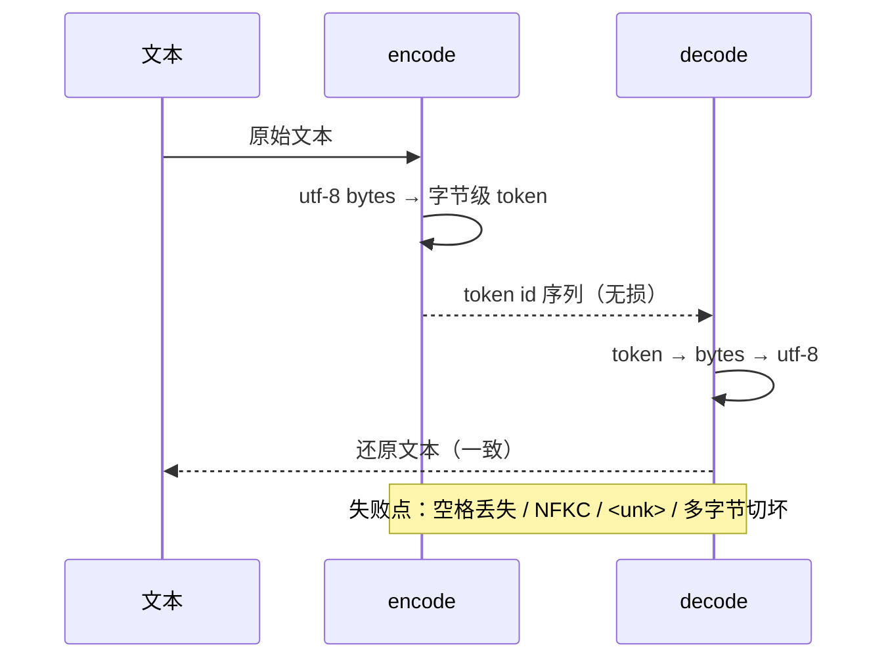

**面试要点**：可逆性的前提是"**token 层无损 + Normalizer 不丢信息**"。字节级 BPE（GPT-2 风格）是最经典的可逆实现。

---

## Q13. byte fallback 与 byte-level BPE 有什么区别？什么场景下需要显式启用 byte fallback？

**回答**

- **byte-level BPE**：tokenizer 直接**在字节上训练**（UTF-8 字节序列），整个词表都是"字节的合并结果"。GPT-2、LLaMA 均如此。这是模型**本身**的粒度。
- **byte fallback**：主要用在 **SentencePiece / 某种 char-level 或 Unigram 分词器**里。这类分词器的模型是词元粒度的，遇到**词表外的字节序列**时，把这些字节**映射回字节空间用字节 token**（`<0xE4>`、`<0xBD>`、`<0xA0>` 这样的虚拟 token）兜底，而不是落入 `<unk>`。

**区别总结**：

| 维度 | byte-level BPE | byte fallback |
|---|---|---|
| 主粒度 | 字节 | 词元（char 等），字节仅兜底 |
| 词表构成 | 256 字节 + merges，全字节 | 主词表 + 额外的 256 字节虚拟 token |
| 何时触发 | 永远是字节 | 仅当主词表命中不了（OOV）时 |
| 典型实现 | GPT-2 / LLaMA | SentencePiece（`byte_fallback=True`） |

**需要显式启用 byte fallback 的场景**：**多语言/任意 Unicode 文本、代码中的符号/emoji、以及开放词汇表要求无 `<unk>` 的场景**。比如用 SentencePiece 训练一个 32k 的多语言词表，让它对任意真实文本永远可分词（零 OOV）——不启用 byte_fallback 时未见过的字符落 `<unk>` 丢信息。

```python
# SentencePiece 样式的 byte fallback 行为示意
PREDEFINED = {0: '<unk>'}
def encode_with_fallback(text, vocab, byte_tokens):
    out = []
    i = 0
    while i < len(text):
        ch = text[i]
        if ch in vocab:
            out.append(vocab[ch]); i += 1
        elif ch in byte_tokens:
            out.append(byte_tokens[ch])
        else:
            for b in ch.encode('utf-8'):     # 回退到字节
                out.append(byte_tokens[b])
        i += 1
    return out
```

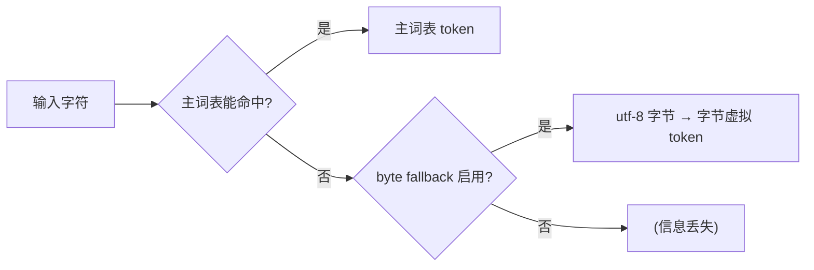

**面试要点**：区分清楚两个概念——**byte-level 是"整个系统就在字节上"；byte fallback 是"主词元 + 字节兜底"**。启用前提是"必须零 OOV"。

---

## Q14. 分词器的"压缩率"如何定义？压缩率越高越好吗？它与下游表现之间是什么关系？

**回答**

**定义**：压缩率 = **文本的原始单位数 / token 数**。常见两种口径：

- 字符压缩率：`文本字符数 / token 数`——表示每个 token 平均覆盖多少字符；
- 字节压缩率：`文本 UTF-8 字节数 / token 数`——更公平地跨语言比较（英文 char≈byte，中文 char=3byte）。

**压缩率越高越好吗？并非简单单调**：

- 压缩率高 ⇒ 序列短 ⇒ **速度/显存好**、可放更长上下文；
- 但压缩率过高往往意味着**合并进的 token 过少多样**：词表大、token 粒度大，会**牺牲子词组合的泛化**——相同 token 的数量少，模型不易在结构上共享表示；且压缩率与词表大小强耦合：20k→128k，中文压缩率提升，但低频 token 稀释（见 Q6）。

**与下游表现的关系**：

- 对**固定词表**，输入 token 的平均长度（即压缩率）与模型困惑度有弱相关：token 更短（更高压缩率）通常略微更好（更长上下文+更好内聚），但**不是线性因果**；
- 决定能力的主要是**表示质量**（子词边界是否语义内聚），而非单纯压缩率。把一长串字符粗暴地合成一个高频 token（如常见函数名 `print_with_return_feedback_value`）压缩率高但**泛化差**（只在谱内出现）。业界更关注"token 化后是否能用较小 token 数表达信息 + 低频 token 训练充分"。

```python
def comp_ratio(text, token_ids):
    return len(text) / max(len(token_ids), 1)

zh = "深度学习是人工智能的分支"
en = "Deep learning is a branch of artificial intelligence"
# 假设: 好的中文 tokenizer 大约每个 token 覆盖 1.3~1.8 个汉字
print("中文字节压缩率(估算):", len(zh.encode('utf-8')) / 9.0)  # 示意
```

**面试要点**：压缩率是"序列效率"指标，**不是"质量"指标**；要把"压缩率 vs 词表大小 vs 泛化"三者并列讲。

---

## Q15. 手写 BPE 训练代码时，如何高效统计相邻 pair 频率？朴素实现的时间复杂度是多少，如何优化？

**回答**

**朴素实现**：每轮合并后，把语料从头到尾重新扫一遍，统计所有相邻 pair。每轮 `O(T)`（T=总字符数）。若合并 K 轮，总开销 `O(K·T)`。对 K≈几十 k、T≈几百 GB，**完全不可行**（几十万次全量扫描）。

**关键优化：增量更新**。一次合并 `(a,b) → ab` 只影响**合并点附近的局部 pair 频率**。统计以 word 为粒度维护：

1. 把词表/语料按词拆成"词 + 频率"；
2. 用 `pairs(pair -> count)` 的 Counter 维护全局相邻 pair 频次；
3. 每次合并时，**只重算被合并到的那两个位置附近**的词内 pair（被替换 token 的左右邻 pair 增/减），全局 Counter 同步 +−；
4. 用 heap/最大堆维护 pair->count，取最高频为 `O(1)`，每轮只有局部 `O(词长)` 的更新。

**必要性**：真正的 tiktoken/tokenizers 还用了`N-gram` 双图（两张相邻表）与分桶技术，但核心思想就是**"改动的只有邻域"**。

**时间复杂度**：初始化全量统计 `O(T)`，每轮合并 O(局部受影响 pair 数) ≈ O(len(word))，K 轮 ≈ K·O(avg word len) + O(T)。对比朴素 O(K·T)，对 T=100GB、K=50k，约快 4–6 个数量级。

```python
import heapq
from collections import Counter

def train_bpe_fast(corpus_tokens, num_merges):
    # word -> 内部 token 序列
    words = {w: list(w) for w in corpus_tokens}
    freq = Counter(corpus_tokens)
    # 全局 pair 计数（增量维护）
    pair_count = Counter()
    for w, cnt in freq.items():
        parts = words[w]
        for i in range(len(parts)-1):
            pair_count[(parts[i], parts[i+1])] += cnt
    heap = [(-n, pair) for pair, n in pair_count.items()]
    heapq.heapify(heap)
    merges = []
    for _ in range(num_merges):
        while heap:
            n, pair = heapq.heappop(heap)
            if pair_count[pair] == -n:   # 拿到最新的有效 count
                break
        a, b = pair
        merges.append(pair)
        # 对每个含该 pair 的词做局部更新：只影响邻域
        for w in list(words):
            parts = words[w]
            cnt = freq[w]
            new_parts = []
            i = 0
            # 先扣掉旧 pair 的计数（邻域）
            for j in range(len(parts)-1):
                pair_count[(parts[j], parts[j+1])] -= cnt
            while i < len(parts):
                if i < len(parts)-1 and parts[i]==a and parts[i+1]==b:
                    new_parts.append(a+b); i += 2
                else:
                    new_parts.append(parts[i]); i += 1
            words[w] = new_parts
            # 再加回新相邻 pair 的计数
            for j in range(len(new_parts)-1):
                pair_count[(new_parts[j], new_parts[j+1])] += cnt
        # 推新的候选进堆
        for p, c in pair_count.items():
            if c > 0:
                heapq.heappush(heap, (-c, p))
    return merges
```

（说明：真实工程还做"只 push 变化的 pair 到堆"以及用 N-gram 双图避免重复入堆；上面展示增量更新+堆的骨架。）

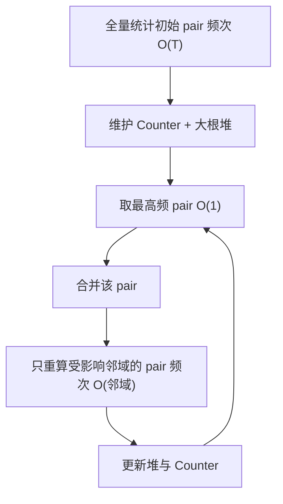

**面试要点**：核心是"**不要每轮重扫全语料**，而是增量更新邻域"；复杂度从 O(K·T) 降到 O(T + K·avg_word_len)。

---

## Q16. 为什么现代 LLM 几乎不在分词器层面做 stemming 或 lemmatization？

**回答**

Stemming/lemmatization 会把 `running→run`、`better→good`，**破坏 token 与原始文本的对应关系（不可逆）**。现代 LLM（尤其 decoder-only）依赖：

1. **端到端可逆性**：生成、纠错、检索、代码都要求 `decode(encode(x))` 还原文本。stemming 会丢失时态/格/屈折信息，一旦不可逆，模型无法忠实输出；
2. **子词已隐含形态学**：BPE/Unigram 学到的子词天然近似"词根+后缀"结构（`run`、`ning`），合并规则已经捕捉了屈折的共现，不需要人为规则；
3. **尾部语言/代码/OOV**：stemming 是语言特定的，对中文、代码、表情、专名毫无意义，还引入额外规则和 bug；
4. **token 表示共享 + 向量空间**：语言模型用上下文向量学习 `run`/`running` 的语义关联，不需要把字符串变成同一个 token。把 `run` 和 `running` 合并反而会让模型失去"时态信息"这一输入维度。

**简答**：LLM 要的是"**可逆 + 子词组合性 + 语言无关**"，stemming 违反前两条，且 BPE 子词已承担形态学角色。

```python
# stemming 破坏可逆性示例
from nltk.stem import PorterStemmer
ps = PorterStemmer()
for w in ["running", "runs", "ran", "better"]:
    print(w, "->", ps.stem(w))   # running->run, ran->run(!) better->better
```

```text
running -> run
runs    -> run
ran     -> run      # 乱序信息丢失, 不可逆
better  -> better   # 不规则形式无法处理
```

**面试要点**：三句话——**不可逆**、**子词已含形态**、**语言无关性**。

---

## Q17. 词表中存在大量低频 token 时训练会面临什么问题？剪枝词表的代价是什么？

**回答**

**大量低频 token 的问题**：

1. **表示质量差**：低频 token 训练不足，embedding 接近随机，模型在其上不稳定；
2. **参数浪费**：每个 token 占 `V×D` 的 embedding + `V×D` 输出头。大量低频 token 占着参数量却几乎不出现在梯度中；
3. **softmax 稀疏梯度**：输出层大多数梯度为零（只有出现的 token 有梯度），显存/算力利用率低；
4. **长尾碎片**：低频 token 常把罕见词切成碎片，反而加大序列长度；
5. **过拟合噪声**：极低频 token 可能只在少数噪声样本里出现，模型过拟合这些样本。

**剪枝词表的代价**：

1. **信息/压缩率下降**：删掉低频 token 后，罕见词只能被切成子串表示，平均序列变长（代价是编码长度↑）；
2. **需要重新训练 embedding**：如果模型已经训完，删 token 需要**重建词表并重新初始化/复用对应 embedding**，还要处理词表 id 重排——工程复杂，通常要**继续预训练或重训**；
3. **OOV 回退成本**：低频专有名词可能落入 `<unk>` 或碎片，领域能力受损（人名、化学式、代码标识符）；
4. **与下游微调脱节**：下游可能需要某个被剪掉的 token。

**实际权衡**：工业界宁可**保留低频 token 但加长词表换取压缩率**（Q6），或对**超低频 token 做字节级兜底**（Q13），而不是粗暴剪枝。剪枝最常出现在 **memory 受限部署**（把词表 128k 压到 32k）。

```python
# 模拟：低频 token 的稀疏梯度
import torch
logits = torch.zeros(128000, requires_grad=True)
logits[3] = 1.0
loss = logits.softmax(dim=0)[3].log().neg()
loss.backward()
nz = (logits.grad != 0).sum().item()
print(f"非零梯度行数: {nz}/128000 ≈ {nz/128000:.4%}")  # 极稀疏
```

```text
非零梯度行数: 1/128000 ≈ 0.0008%
```

**面试要点**：两段式——先讲"低频 token 拖累表示和参数利用率"，再讲"剪枝不是免费：压缩率↓、embedding 需重新适配、OOV 风险"。落到"工程上更常见的是保词表+字节兜底，而非剪枝"。

---

## Q18. 多语言分词器中，如何避免高资源语言"挤占"低资源语言的 merge 预算？

**回答**

BPE 按全局频率合并，天然偏好语料占比大的语言。高资源语言（英/中）的高频对会先被合并、抢占词表预算；低资源语言（如小语种）只能分到"剩下的碎片"，其高频字符对/词根可能永远进不了词表，只能靠字节/单字兜底 → 表现差、token 效率低。

**常见手法**：

1. **语言均衡采样（sampling temperature）**：训练时按 `pᵢ = wᵢ^{α} / Σ wⱼ^{α}`（α<1）对语言降采样/加权，提高低资源语言在子词训练语料中的占比。α≈0.7 是常用值。
2. **per-language 词表配额（vocab quota）**：按语言预先分配词表 slot，保证每种语言至少拿到一定 token 数。
3. **用字符/Unigram + 字节 fallback**：SentencePiece Unigram 对无空格语言友好；模型的"兜底"让低资源语言即使词表不够也能被表示。
4. **合并拒绝（merge restriction）**：监控各语言 token 的覆盖率，对低频语言设置最低合并收益门槛，防止其 token 被"抢走"后再被不当合并。
5. **分语言建词表后并发**：有些实现（XLM 的多语言 BPE）直接为低资源语言提供更大 quota。

```python
# 语言温度采样示意
import math
def lang_weights(counts, alpha=0.7):
    raw = {l: c**alpha for l, c in counts.items()}
    s = sum(raw.values())
    return {l: v/s for l, v in raw.items()}

counts = {"en": 100_000_000, "zh": 60_000_000, "sw": 1_000_000}
w = lang_weights(counts)
for l in sorted(w, key=w.get, reverse=True):
    print(f"{l}: 原始占比 {counts[l]/sum(counts.values()):.1%} -> 采样占比 {w[l]:.1%}")
```

```text
en: 原始占比 62.1% -> 采样占比 53.5%
zh: 原始占比 37.3% -> 采样占比 42.5%
sw: 原始占比  0.6% -> 采样占比  4.0%
```

小语种占比从 0.6% 提到 4%，能显著改善其在子词学习中的话语权。

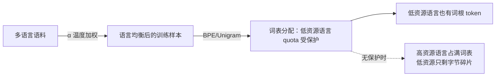

**面试要点**：五个手段——**语言温度采样、词表配额、Unigram/字符、字节 fallback、合并门槛**。核心一句话："让低资源语言的分词预算不被频率吸引到高资源语言上。"

---

## Q19. 分词器对数字的处理方式（逐位切分 vs 整体 token）如何影响算术能力？

**回答**

数字在 token 空间里的**切分方式**直接决定模型能否"学会算术"：

- **整体 token（多位数进词表）**：`123456` 作为一个 token。优点：短序列、高压缩率；缺点：**模型看不到数字内部结构**，无法把"进一位""两数相加"的规则参数化到字级。它对 `123456` 的处理只是一个"记忆的词汇向量"——类似记字典，泛化到未见过的大数只会记忆失效。
- **逐位切分（每位数一个 token，或每 2–3 位一组）**：模型能看到 `1`、`2`、`3` 及位数位置，算术对齐（如列竖式）在 token 层可见，**更利于学习进位、借位等计算流程**。代价：序列更长。

**业界实证**：

- GPT-2 用 1–3 位分组（`123|4`），对 4 位内加减尚可，更大数字崩；
- **"digits separately""digit-by-digit"的 tokenization 明显改善大数算术**（Power、GPT-3 paper 里的观察）；
- 关键机理：**算术模式是逐位的**，token 呈现的数字位数信息决定了模型能否"模仿"计算算法。给 token 加**位置度量的分隔（如 "1 2 3 4"）**比拼成一个 4 位 token 好得多。

```python
def tokenize_num(n, mode="whole"):
    s = str(n)
    if mode == "whole":   return [s]
    if mode == "digit":   return list(s)          # 逐位
    if mode == "group3":  return [ s[max(0,i-3):i] for i in range(len(s), 0, -3) ][::-1]
for mode in ("whole","digit","group3"):
    print(mode, "->", tokenize_num(123456, mode))
# whole -> ['123456']          # 压缩高, 但数字结构不可见
# digit -> ['1','2','3','4','5','6']
# group3-> ['123','456']       # GPT-2 风格
```

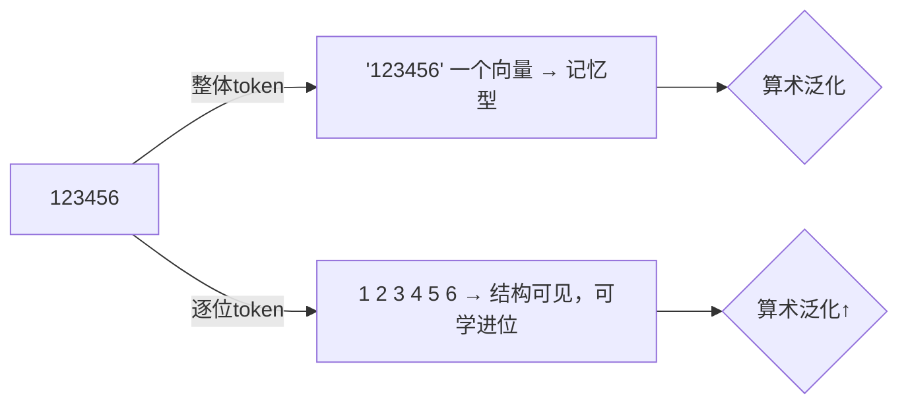

**面试要点**：**逐位/小组切分 → 结构可见 → 算术学好；整体切分 → 压缩高但泛化差**。可以提 prompt 层缓解（加每三位空格）与 tokenizer 层缓解（digit 级）两个层面。

---

## Q20. 为一个代码模型设计分词器时，对缩进、标识符、运算符分别应做哪些特殊处理？

**回答**

代码文本与自然语言的关键差异：**强结构、敏感的空格语义、长串字母数字标识符、特殊符号密集**。设计要点：

1. **缩进（indentation）**：
   - Python 里缩进是**语法的一部分**，模型必须感知层级；
   - 有两种做法：**a)** 预分词阶段把 `    `（多个空格）作为专用 token 保留（如 `    `、`        ` 进词表），让 BPE 学到整块缩进单元；**b)** 或用特殊 token `<INDENT>`/`<DEDENT>`（类似 tokenize 模块的 INDENT/DEDENT）把 t 级变化变成结构标记。
   - 关键是**别把缩进空格与普通空格混淆进一个 ` ` token**，否则模型分不清"语句内空格"与"块缩进"。

2. **标识符（identifiers）**：
   - 长函数名/变量名（`get_user_profile_and_save`）要能**子词化成语义片段**：BPE 对 camelCase/snake_case 的拆法靠训练语料，但可**预分词时显式在大小写转换处和 `_` 处切分**，帮助 BPE 学到 `get` + `user` + `profile` 的结构；
   - 保留数字与特殊字符的边界；**避免把整个长标识符合成一个 token**（泛化差）。

3. **运算符（operators）**：
   - `==`, `!=`, `<=`, `>=`, `&&`, `||`, `->`, `**` 等**多字符运算符**应作为候选子词，让 BPE 有机会**整体合并**（它们频率高、语义原子）；
   - 但也要防过度：`**` 与 `*` 分开表示（乘方 vs 乘法）语义不同，词表需同时容纳；
   - 保留 `=` 与 `==` 的区分（赋值 vs 比较）。

4. **其它**：
   - **括号配对和注释**：`#`、`"""`、缩进块注释要有稳定 token；
   - **字符串字面量**：`'`、`"`、f-string 的 `f"` 前缀可作为候选；
   - **保持字节级 fallback** 以便任意 token（Unicode 标识符、emoji）不产生 `<unk>`。

```python
import re
# 代码预分词：显式切 camelCase/snake_case，缩进独立成token
code = "def getUserProfile(name):\n    return name.upper()"
# 缩进：4空格 -> <INDENT>
tokens = re.split(r'(\n[ ]+)', code)
for t in tokens:
    print(repr(t))
```

```text
'def getUserProfile(name):'
'\n    '
'return name.upper()'
```

（实际实现里 `\n    ` 会被识别为换行+缩进块。）


**面试要点**：三个专用策略——**缩进做结构化 token（或 INDENT/DEDENT）**、**标识符显式拆边界**、**多字符运算符给整体合并机会**。补充"大小写/下划线拆分的预处理"与"保持无 OOV"。

---

## Q21. BPE vocab 从 32k 扩大到 128k，在固定模型参数量下，embedding 层与输出层的显存/计算量如何变化？

**回答**

固定模型其它部分不变，只改词表 `V: 32k → 128k`：

- **embedding 矩阵**：`V × D`。32k×D → 128k×D，**4 倍**。
- **输出投影（lm_head）**：`V × D`（若 weight tying 则与输入 embedding 共享，不新增；否则再 ×2）。
- **假设 D=4096、FP16（2 字节）**：

```
V=32k:  embedding = 32000 × 4096 × 2 B = 262MB
V=128k: embedding = 128000 × 4096 × 2 B = 1048MB
```

**计算量**：
- **前向 logits**：`B × T × V × D` 次乘加——V 翻 4 倍则 logits + softmax 计算量 **×4**；
- **反向梯度**：同样 ×4（对 embedding 的梯度是 `V×D`，对 logits 的偏导是 `B×T×V`）。

**总结**：
- 显存：embedding+输出层 **×4**（没 weight tying 则总参数量 +≈1GB 量级）；
- 计算量：输出层相关 FLOPs **×4**；但总训练 FLOPs 中输出层占比通常 10–20%，整体约 ×1.3–1.5。

```python
D, B, T = 4096, 16, 2048
for V in (32_000, 128_000):
    emb_mb = V * D * 2 / (1024**2)
    logits_gflops = B * T * V * D * 2 / 1e9   # 前向 logits 的 MAC×2
    print(f"V={V//1000}k: embedding={emb_mb:.0f}MB, logits前向≈{logits_gflops:.0f} GFLOPS")
```

```text
V=32k: embedding=250MB, logits前向≈10737 GFLOPS
V=128k: embedding=1000MB, logits前向≈42950 GFLOPS
```

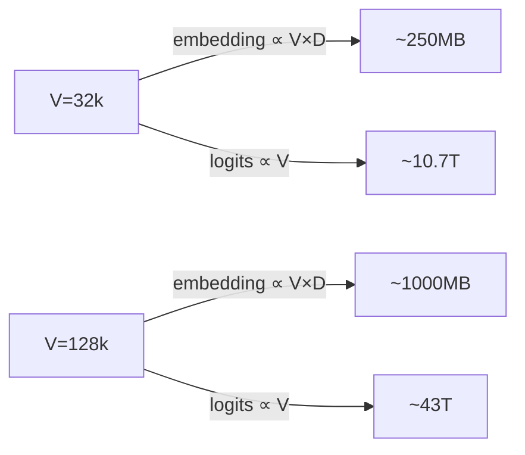

**面试要点**：**显存 ×4（embedding/输出层）、计算量输出层 ×4、总训练开销少量增加**；若 weight tying，输出层不额外占显存但计算仍 ×4。

---

## Q22. 预分词正则设计不当可能把有意义的子词切碎。举一个中文或代码场景的反例。

**回答**

预分词正则的作用是**划定 BPE 不可跨越的边界**。设计不当（比如把所有标点、数字、空白都切成独立 token 的"过度切分"）会让 BPE 永远无法学到跨边界的合理子词，把语义单元切碎。

**代码场景反例**：

把正则写成只匹配"字母数字"为一个单元、把所有非字母数字（包括 `_`, `.`, `=>`) 都单独切：

- 对 `user_profile_id`，如果 `_` 被强制切断，BPE 无法合并 `user_profile`，只能 `user` + `_` + `profile` + `_` + `id`，丢掉了标识符内部的语义结构；
- 对 `return_value`、`input.data`、`dict[key]` 同理，连接符/点/括号把有意义片段隔开。

```python
import re
bad_pat = re.compile(r"[A-Za-z0-9]+|[^\sA-Za-z0-9]|\s+")   # 过度切分的正则
good_pat = re.compile(r"[\w]+|=>|==|""" + r"[^\s\w]" + r"""|\s""")  # 带连接符/运算符的

for pat, name in ((bad_pat, "bad"), (good_pat, "good")):
    print(name, ":", pat.findall("user_profile_id = x => y"))
```

```text
bad : ['user', '_', 'profile', '_', 'id', '=', 'x', '=', '>', 'y']
good: ['user_profile_id', '=', 'x', '=>', 'y']
```

**中文场景反例**：

中文乱用空格分词会切碎成语/复合词。如果预分词正则按"每两个字符"暴力切分，`人工智能` 被切成 `人工`+`智能`，BPE 想合并 `人工智能` 但边界已锁死。更隐蔽的是——用"英文空白切法"处理中文，`中文 文本` 中间的空格会让 `中文` 与 `文本` 永远无法合并成 `中文文本` 之类的更内聚单元（虽然中文里空格较少，但标点、全角符号的误切也是同样问题）。

```python
import re
# 中文场景：按标点过度切分
text = "人工智能（AI）是前沿技术"
pat = re.compile(r"[^（）]+|[（）]")
print(pat.findall(text))   # ['人工智能', '（', 'AI', '）', '是前沿技术']
# 更糟：把"AI"和"人工智能"之间的括号边界锁死, 语义贴合度下降
```

**面试要点**：反例结构=**预分词把"有意义的语义单元"锁死在子词边界两侧**。代码用 `_`/`.`/`=>`；中文用标点/空格导致词与词无法合并。关键是"预分词边界不可跨越，过细会锁死合理 merge"。

---

## Q23. 如何评估一个分词器在特定领域（医学、法律）上的适配度？需要看哪些指标？

**回答**

**核心思想**：看该领域文本经过 tokenizer 后是否**高效率（压缩率高、长度短）且语义内聚（术语不被切碎）**。具体指标：

1. **压缩率 / 平均 token 数**：对领域语料测"字节/token 或 字符/token"。领域术语多被完整保留 → 压缩率高。对比通用 tokenizer 看**相对增益**更公平。
2. **out-of-vocabulary / `<unk>` 率**：领域生僻词（药名、法条第编号、拉丁缩写）落入 `<unk>` 的比例。
3. **子词边界质量（人为抽查 + 集成指标）**：把`呋塞米`、`甲基苯丙胺`、`《中华人民共和国民法典》`、`Diabetes mellitus` 编码，看是否被切为一个或语义内聚的子词；可看"术语整体 token 率"。
4. **模型侧指标**：用该 tokenizer 微调一个小模型，看领域 PPL / 对术语的完形预测准确率。
5. **token 频率-长度分析（long-tail）**：领域特有 token 在词表中的覆盖比例；领域语料里出现次数少的 token 占比（tail 越大越差）。

```python
def evaluate_domain(tokenizer, domain_texts):
    lens, unk = [], 0
    for t in domain_texts:
        ids = tokenizer.encode(t)
        lens.append(len(ids))
        unk += sum(1 for i in ids if i == tokenizer.unk_id())
    return {
        "avg_len": sum(lens)/len(lens),
        "unk_rate": unk/max(sum(lens), 1),
        # 术语完整率: 抽查术语是否能一次命中词表
    }

# 术语完整率（term whole-token rate）
def term_whole_rate(tokenizer, terms):
    hits = sum(1 for term in terms if len(tokenizer.encode(term)) == 1)
    return hits / len(terms)
```

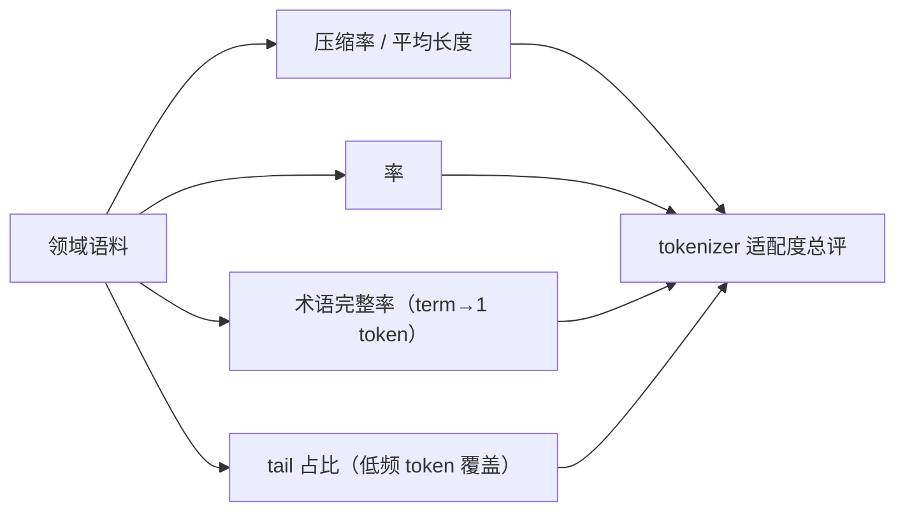

**面试要点**：指标要"**可操作**"：压缩率、unk 率、术语完整率、tail 占比。强调"**必须在领域语料上测，通用指标会掩盖领域偏移**"（呼应 Q11）。

---

## Q24. 训练分词器时是否应该对语料去重？不去重会如何扭曲 merge 优先级？

**回答**

**应该去重（至少显著采样去重），而且影响很大。**

**不去重会扭曲 merge 优先级**：

1. **重复内容反复加权**：BPE 训练统计的是"出现次数"。若某文档被爬虫重复抓取 100 万次（或一个超长 doc 自包含大量重复块），其中涉及的字符对被反复计数 → 这些对会被**超高权重合并**，挤占其它正常语料的 merge 预算；
2. **污染长尾**：海量重复的模板文本/广告/标签会让 `{`、`}`、`<a`、版权符号等组成的高频对虚高，把词表填进一堆无意义的"模板 token"；
3. **词表布局失真**：真正低频但语义重要的词（专名、术语）由于分布被稀释，更难进词表 → 换来的 token 反而是重复文本里的噪声。

**补充说明**：
- 去重粒度：句子级/块级（利用 Bloom filter / MinHash）对分词器训练足够；文档级去重更彻底但可能误删结构性文本；
- **不要全量去重到 1 份**——采样去重到保留多样性的程度更好；完美去重会损失一些自然重复（常见短语）的频率信号，但这通常不值得为最优先 merge 买单；
- BPE 训练语料通常做**轻度去重（去掉完全重复的 chunk）**即可，不必像预训练那样做严格文档级去重。

```python
# 模拟：重复文本扭曲 pair 统计
from collections import Counter
pure = "the quick brown fox jumps over the lazy dog"
dup  = ("spam spam spam spam spam " * 100) + "the quick brown fox jumps"
pairs = Counter()
for text, w in ((pure, 1), (dup, 300)):   # dup 被重复 300 次
    ts = text.split()
    for i in range(len(ts)-1):
        pairs[(ts[i], ts[i+1])] += w
top = pairs.most_common(3)
print("top pairs:", top)  # ('spam','spam') 会霸榜
```

```text
top pairs: [(('spam', 'spam'), 300*99), (('the', 'quick'), 1), ...]
```

**面试要点**：**去重是的，理由 = "重复内容按次数加权会虚伪抬高某些 pair 的 merge 优先级"**。粒度建议"块级/句子级轻去重"即可。

---

## Q25. 分词器的 determinism 在分布式训练中为什么重要？不同 rank 使用不同版本会引发什么隐蔽 bug？

**回答**

**为什么重要**：训练数据被按 rank 分片并行处理。若每个进程（rank）的 tokenizer 版本/配置不一致，**同一输入会被不同 rank 编码成不同的 id 序列**，产生：

1. **数据分布不一致**：不同 rank 的样本的实际 token 分布偏移，影响梯度统计、影响全局 loss 的语义一致性；
2. **长度/样本数不一致**：不同分词结果导致各 rank 的 batch 大小或序列长度不一致，DDP all-reduce 的平均逻辑失效，loss 或 norm 出现微小偏差（并在多次迭代累积）；
3. **checkpoint 不可复现**：同一 epoch 用不同 rank 的分词结果 repro 出的 loss 不同，难以调试；
4. **词表 id 映射漂移**：如果两版本 token 顺序不同，同一个 token 在不同 rank 里 id 不同，模型拼出来的权重或 embedding 行列错位，**静默地产生错误但表面正常的训练**（隐蔽 bug 的典型）。

**触发版本分裂的常见原因**：

- 并发加载 tokenizer 时没有固定 hash/版本（如 fetch 最新 commit）；
- 在不同机器上用不同 Python 版本序列化正则 / 默认参数；
- 词典文件在缓存里未同步（一个节点旧一个节点新）；
- 多进程时用了非确定性并行化（tokenizers 库带并行性时可关）。

**隐蔽 bug 特征**：loss 曲线看起来正常、收敛也有，但**模型表现偏低且谁先改谁复现不了**。它不报错、不显 NaN，唯有回归对比才能发现。

**缓解**：

- **tokenizer 版本锁定**（commit hash / 文件 sha 校验），所有 rank 用同一份配置与词表文件；
- 分布式启动前一次性把 tokenizer 文件分发到本地缓存（避免实时拉取）；
- 禁用 tokenizers 的非确定性并行（`parallelism=False`）；
- 在 trainer 里把 tokenize 结果缓存到磁盘（`.npy`/`.parquet`），训练只读缓存，保证绝对一致。

```python
# 示意：同一文本在不同"版本"中的 id 漂移
tok_v1 = {"人工智能": 100, "人工": 50, "智能": 51, "的": 3}
tok_v2 = {"人工智能": 101, "人工": 50, "智能": 52, "的": 3}
text = "人工智能的"
ids1 = [tok_v1.get("人工智能"), tok_v1.get("的")]
ids2 = [tok_v2.get("人工智能"), tok_v2.get("的")]
print("v1:", ids1, " v2:", ids2)   # [100,3] vs [101,3] → id 漂移
```

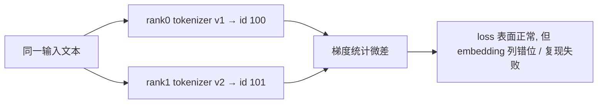

**面试要点**：**确定性问题不被当作运行时错误**，所以最危险。锁定版本、缓存分词结果、禁用不确定并行是三道闸。

---

## Q26. BPE 中"合并顺序即优先级"的含义是什么？两个 pair 频率相同时如何打破平局？不同策略差异多大？

**回答**

**"合并顺序即优先级"**：BPE 训练产出的 merge rules 是有序列表。**后合并的 token 一定"大于"先合并的**——因为在编码时从左到右应用，先出现的规则会被天然优先应用；同时，后合并的 token 的前提是前序 token 已存在。因此 merge 列表的顺序**就是分词的优先级**（见 Q1 的顺序不可乱）。

**平局打破（tie-breaking）**：两个 pair 频率相同（如 Q7 中 `(l,o)`、`(e,s)`、`(s,t)` 同为 2），需要确定先合并谁。常见策略：

1. **首次出现/语料顺序**：按该 pair 在语料中第一次出现的位置，先出现者优先（实现常用计数 map 时自然保留插入序）；
2. **字典序**：`(a,b)` 与 `(b,a)` 等按 token 字符串大小排序；
3. **token id 序**：merge 时新 token 的 id 递增，`(a,b)` 中 a/b 的 id 小者优先。

**不同策略差异多大**？在**中低频语料**上差异可以**显著**：平局在 BPE 中非常常见（每个 batch 里都有大量并列），不同的 tie-break 会导致完全不同的合并树，最终词表内容不同、同一文本的分词结果不同、甚至模型质量有可测量的差别（论文 "On the BPE..." 有对比）。但对**极高频**合并影响不大，因为它们压倒性领先，不受平局影响。

```python
# 两种 tie-break 策略对比
pairs = [("l","o"), ("e","s"), ("s","t")]   # 频率相同
first_seen = ["l","e","s"]                   # 首次出现序（l 先出现）
print("首次出现序:", sorted(pairs, key=lambda p: first_seen.index(p[0])))
print("字典序:    ", sorted(pairs, key=lambda p: (p[0], p[1])))
```

```text
首次出现序: [('l','o'), ('e','s'), ('s','t')]
字典序:     [('e','s'), ('l','o'), ('s','t')]
```

同样是 3 个平局 pair，不同策略给出不同的合并顺序 → 词表和分词结果随之不同。

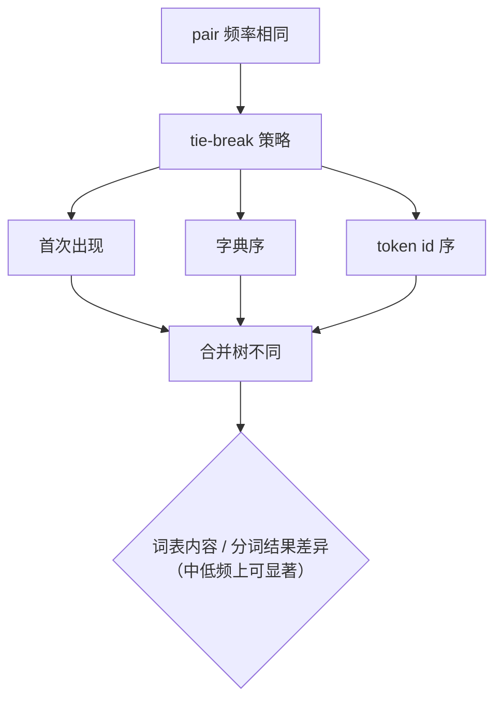

**面试要点**：先讲"顺序=优先级"，再讲 tie-break 的三种常见策略与"平局在高频主导时影响小、在长尾/中等频率影响显著"。

---

## Q27. 分词器能否在模型训练后单独替换？替换后需要做哪些重新适配（embedding 重初始化、继续预训练）？

**回答**

**能否替换**：技术上可以，但**几乎没有"直接换"的可能**——因为：

1. **词表 id 空间变化**：旧 tokenizer 有 50k 个 token，新 tokenizer 有 80k 个，id 完全不同，**旧的 embedding 矩阵无法逐行对齐**；
2. **语义对应缺失**：我的 token `人工` your `人工` 在不同 id、不同上下文长度下向量不可复用。

**所以替换必须做"知识迁移"式适配**，常见方案：

1. **词表映射 + embedding 初始化**：对能在新词表中找到"语义相同 token"的词（如简单词、单字），把旧 embedding 行拷贝过来初始化新 embedding；找不到的行随机初始化。**这一步是最关键的"抢救"**，能让大部分参数复用。
2. **继续预训练（continued pretraining）**：适配初始化后，在**新 tokenizer**下对语料继续训练若干步（几亿~几十亿 token），让模型重新建立对新 token 表示的理解，弥合初始化噪声与分布偏移。
3. **输出层同步**：lm_head 也要同样迁移初始化（若不 weight tying）。
4. **位置编码/长序列**：若新 tokenizer 平均序列长度变化（如压缩率变高/低），可能需要重新对齐 max_seq。

**风险**：

- 若只换不训，模型在新分词下**能力骤降**（OOV 增多、序列变长、既有表示无法使用）；
- 若适配训练预算不足，可能比不换还差；
- 换 tokenizer 通常意味着**重大架构级变更**，工程上要评审必要性。

```python
# embedding 迁移初始化示意
import torch, torch.nn as nn
def transfer_emb(old_emb, old_token: str, new_token: str, new_emb):
    with torch.no_grad():
        if old_token in tokenizer_old and new_token in tokenizer_new:
            i = tokenizer_old[old_token]; j = tokenizer_new[new_token]
            new_emb.weight[j].copy_(old_emb[i])   # 拷贝向量
# 之后: 在新 tokenizer 下继续预训练若干步
```

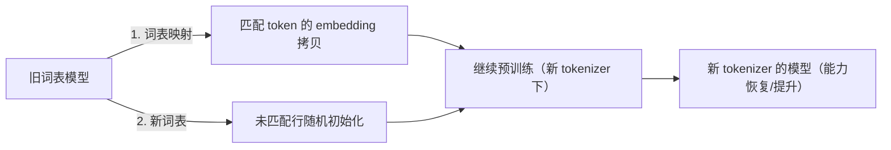

**面试要点**：**核心 = 替换 tokenizer 是一次"知识映射 + 继续预训练"工程**，不是直接换词表文件；embedding 迁移初始化是最关键一步。

---

## Q28. 中文场景下 WordPiece 与 BPE 的实际 token 效率差异有多大？设计一个可控实验来测量。

**回答**

**差异量级**：

- 在中文上，两种算法在**token 效率（压缩率、长度）上差异通常很小**（几 % 以内），远小于"词表大小"这个变量的影响；
- BPE 通常略优于 WordPiece 的更关键原因是：**BPE 把空格/空白作为普通符号参与合并**（及字节级 fallback 开放词表），而 WordPiece 的 `##` 前缀 + 空格处理对中文不友好；
- 对中文，**决定效率的是"词表大小 + 是否字节级 + 字粒度 vs 词粒度"**，而不是 BPE vs WordPiece 二选一。

**可控实验设计**：

1. **固定因素**：同一份中文语料（如 10GB 新闻/百科/医学）；词表大小固定 V（如 32k）；都用 SentencePiece/HF tokenizers 实现；同样的 NFKC 预处理；
2. **自变量**：分词算法 {BPE, WordPiece, Unigram} × 词表 {32k, 64k, 128k}；
3. **响应变量**：
   - 平均序列长度（或 bytes/token）；
   - 单字符 OOV/unk 率；
   - 领域术语切分质量（人工抽查）；
   - （扩展）小模型上微调后的人名/专名完形 PPL。
4. **控制**：用**同一训练语料、同一测试语料**（留出测试集），计算在同一 whiskey 上对比；重复 3 次随机划分看方差；
5. **结论口径**：以"字节/token"为主指标，给出置信区间；区分"算法差异"与"词表大小差异"。

```python
import numpy as np

def exp_efficiency(tokenizer_factory, corpus, test, V, seed):
    rng = np.random.RandomState(seed)
    lens_all = []
    tok = tokenizer_factory(V=V)
    for chunk in test:
        lens_all.append(len(tok.encode(chunk)))
    return np.mean(lens_all), np.std(lens_all) / np.sqrt(len(lens_all))

# 设计: algorithms × V，报告 (mean, se)
# for alg in ("bpe","wordpiece","unigram"):
#   for V in (32_000, 64_000, 128_000):
#       print(alg, V, exp_efficiency(...))
```

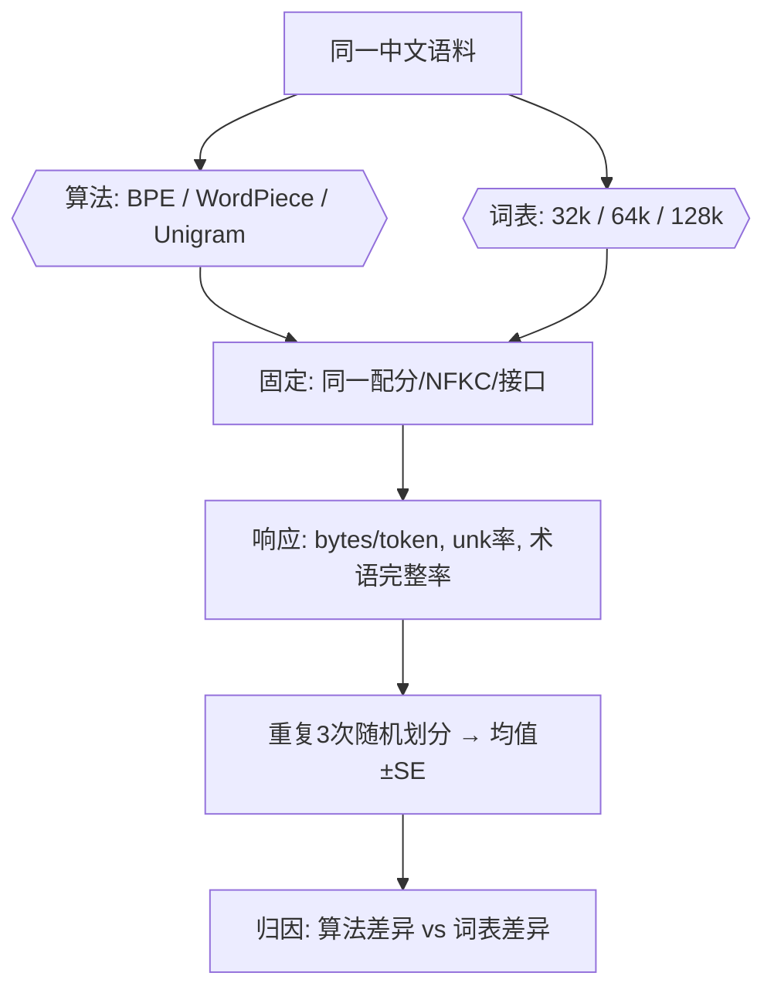

**面试要点**：强调"**中文上算法二选一的差异小，词表大小与字节级才是主变量**"；实验设计要"固定一维变量、报告指标与方差、杀出干扰"。

---

## Q29. `max_length` 截断策略（截头、截尾、中间截断）分别适合什么任务？截断位置对位置编码有何影响？

**回答**

三种截断：

1. **截尾（truncate from right）**（最常用）：保留开头，丢弃末尾。适合**大多数单向自回归任务**（对话、摘要、文本生成），因为开头通常含任务上下文/指令，末尾的预测目标更近——且 decoder-only 的因果注意力下，位置编码从 0 开始，截尾保持位置起点稳定。
2. **截头（truncate from left）**：保留末尾，丢弃开头。适合 **encode 场景中"尾部信息更重要"**：如翻译/分类的长文档，尾部是答案；或 RAG 中把检索内容放后面的任务。但代价是开头信息丢失。
3. **中间截断（middle truncation）**：保留首尾，丢弃中间。适合**"上下文中段冗余"**的任务，如长对话保留系统提示（头）+用户最近消息（尾）+ 历史尽量保留；或长文档 QA（开头主题 + 结尾结论最有用）。

**对位置编码的影响**：

- 绝对位置编码（sinusoidal / learned）：**截断位置决定每个 token 拿到什么位置号**。截尾时开头 token 位置号不变（0..n），模型见到的"位置分布"训练分布一致；截头/中间截断会让 token 位置号偏移，尤其让"尾 token"拿到更大位置号 → 若训练最大长度是 4k，截头过的 token 可能拿到 4k 附近新位置 → **超出训练分布，RoPE/绝对位置偏移出外推区**，表现变差；
- **相对位置编码（RoPE / ALiBi）**：对截断的容忍度更高——它们只看相对距离，截头只是让"信息集中在某位置窗口"，不引入新的绝对位置量。但仍受限于**最大相对距离**（RoPE 的 base 决定长距离衰减）；
- **中间截断**：丢弃中段会让"上下文里的位置间隔突变"，对绝对位置编码最不友好（中段 token 的绝对位置跳变），相对位置编码下只是少了几步距离，一般 OK。

```python
def truncate(ids, max_len, mode="tail"):
    L = len(ids)
    if L <= max_len: return ids
    if mode == "tail":    return ids[:max_len]          # 留头
    if mode == "head":    return ids[-max_len:]         # 留尾
    if mode == "middle":  # 留头 + 尾，删中段
        keep_head = max_len // 2
        return ids[:keep_head] + ids[-(max_len-keep_head):]
    raise ValueError
seq = list(range(100))
print("tail  :", truncate(seq, 8))
print("head  :", truncate(seq, 8))
print("middle:", truncate(seq, 8))
```

```text
tail  : [0, 1, 2, 3, 4, 5, 6, 7]
head  : [92, 93, 94, 95, 96, 97, 98, 99]
middle: [0, 1, 2, 3, 96, 97, 98, 99]
```

```mermaid
flowchart LR
    A["长序列"] --> B{"截断策略"}
    B -->|尾截断| C["留头去尾：自回归/对话"]
    B -->|头截断| D["留尾去头：答案在尾部"]
    B -->|中截断| E["留头尾去中：长文档QA"]
    C --> F["绝对位置编码：位置号偏移"]
    D --> F
    E --> F
    F --> G["RoPE/相对位置 更鲁棒；绝对位置易超分布"]
```

**面试要点**：三句话——**尾截最常用（靠任务目标近）、头截用于答案在尾、中截用于头尾都重要**；**绝对位置编码对截断位置敏感，相对位置编码更鲁棒**。

---

## Q30. 从零实现一个可用的 BPE 分词器，你会把哪些部分做成可配置的？给出类/函数签名级别的接口设计。

**回答**

一个**工程可用**的 BPE tokenizer 应把"数据依赖/策略差异"抽成配置，核心可配置项：

1. **大写 → 分辨率/规范化**：normalizer（`identity` / `NFKC` / `NFD` / `lowercase`）；
2. **预分词策略**：哪类符号可跨越边界（英文词/数字/标点/空白/代码符号）；
3. **字节级 or 字符级**：`byte_level: bool`，决定初始词表 256 还是字符集；
4. **词表大小** `vocab_size`；**special tokens 列表**及 id 分配；
5. **平局策略** `tie_break: "first"|"lexico"|"id"`（呼应 Q26）；
6. **SOS/EOS/PAD/UNK 是否保留**及它们是否可训练（呼应 Q10）；
7. **training 语料采样/去重开关**；`min_frequency`（低频 pair 不做合并）；
8. **未知处理**：`fallback_to_byte: bool`（呼应 Q13）。

**接口签名**：

```python
from typing import List, Dict, Tuple, Optional, Iterable

class BPEConfig:
    vocab_size: int = 32000
    byte_level: bool = True
    normalizer: str = "nfkc"          # "identity"|"nfkc"|"nfd"|"lowercase"
    tie_break: str = "first"          # "first"|"lexico"|"id"
    min_frequency: int = 2
    special_tokens: Optional[List[str]] = ["<unk>", "<pad>", "<s>", "</s>", "<mask>"]
    fallback_to_byte: bool = True
    drop_repeated_blocks: bool = True # 训练语料轻度去重

class BPETokenizer:
    def __init__(self, config: BPEConfig): ...
    # 训练
    def train(self, corpus: Iterable[str]) -> "BPETokenizer":
        """产出 self.merges, self.vocab (token->id), self.precomp_rules"""
        ...
    # 编码/解码
    def encode(self, text: str) -> List[int]: ...
    def decode(self, ids: List[int]) -> str: ...
    # 工具
    def tokenize(self, text: str) -> List[str]: ...
    def convert_tokens_to_ids(self, toks) -> List[int]: ...
    def save_pretrained(self, dir): ...     # 保存 config.json + merges.txt + tokenizer.json
    @classmethod
    def from_pretrained(cls, dir) -> "BPETokenizer": ...
    # 内部
    def _apply_merges(self, chars: List[str]) -> List[str]: ...   # 编码核心
    def _build_reverse_map(self) -> Dict[str, int]: ...
    def _fit_stats(self, corpus): ...        # 可插拔增量统计（可选 heap 实现）
```

**关键工程点**：
- **序列化格式**：保存 `merges.txt`（每行 `a b`）+ `vocab.json`，被 HF `tokenizers` / `tiktoken` 兼容；
- **编码效率**：训练用增量 pair 统计+堆（Q15）；编码用"按 merge 顺序一遍扫描"或预编译 trie；
- **可逆性**：若 byte_level+NFKC，encode→decode 无损（Q12）；加 `special_tokens` 的 tokenizer 需保留 `add_special_tokens` 时的 id 映射；
- **特殊 token 从训练中排除**：train 时不把 `<pad>` 放入 corpus。

```python
# 使用示例（假想）
tok = BPETokenizer(BPEConfig(vocab_size=16000, byte_level=True, normalizer="nfkc"))
tok.train(["deep learning is ... ", "deep belief nets ..."])
ids = tok.encode("deep learning")
print(tok.decode(ids))   # round-trip
```

```mermaid
flowchart LR
    A[BPETokenizer] --> B["config: 规范化/字节级/词表/hreak/fallback"]
    A --> C["train(corpus)"]
    A --> D["encode / decode / tokenize"]
    A --> E["save_pretrained / from_pretrained"]
    C --> F["merges.txt + vocab.json"]
    D --> G["无 OOV 的可逆序列"]
```

**面试要点**：突出"可配置点是数据/策略相关维度"，签名覆盖 train/encode/decode/save/load；提增量统计与可逆性两个工程支柱。

---

## 参考链接

1. [BPE(Byte-Pair Encoding,字节对编码)原理-CSDN博客](https://blog.csdn.net/tongbowen_123/article/details/162825821)
2. [BPE(字节对编码):原理、流程与应用详解 - m516606428 - 博客园](https://www.cnblogs.com/myh516/p/19055578)
3. [AI大模型分词器详解-阿里云开发者社区](https://developer.aliyun.com/article/1694227)
4. [从Token到词元:BPE分词原理与AI计费逻辑全解析-CSDN博客](https://blog.csdn.net/weixin_29051811/article/details/169006814)
5. [BPE 编码的基本原理——为什么大模型数字母总是出错?-腾讯云开发者社区-腾讯云](https://cloud.tencent.com/developer/article/2713311)
6. [分词(tokenization)算法之Byte Pair Encoding (BPE) 算法详解(代码实现)-CSDN博客](https://lishizheng.blog.csdn.net/article/details/146555778)
7. [NLP--BPE、WordPiece、ULM、SentencePiece子词分词器总结【原理】-CSDN博客](https://blog.csdn.net/liu_673/article/details/130160321)
8. [大模型分词算法全解析：BPE、WordPiece、SentencePiece 实战对比-CSDN博客](https://blog.csdn.net/ppbk_/article/details/156693452)
9. [LLM分词器原理与实战：BPE、WordPiece、SentencePiece及词表设计-CSDN博客](https://blog.csdn.net/weixin_29048775/article/details/168779587)
10. [随机分词与tokenizer(BPE->BBPE(tiktoken)->WordPiece->Unigram->SentencePiece)-CSDN博客](https://blog.csdn.net/weixin_36378508/article/details/134883614)

---

*下一章展望：第 2 章将带读者核算 PyTorch 训练的资源（FLOPs、显存、混合精度、梯度累积等），延续"地基"主题。*