# 第 10 章 · 数据工程

> 面试生普（LLM 500 题）· 第 10 章。本章覆盖 Common Crawl 到预训练数据的处理流程、去重（MinHash/精确）、质量过滤、数据配比、PII 脱敏、Data Curriculum、基准污染、合成数据、分布式数据管道等 30 个问题，关键概念配 Python 代码与 mermaid 图解。

> 先把话说清楚：模型的"聪明"九成来自喂进去的数据。可互联网上的原始网页是一锅大杂烩——全是广告、模板、辣鸡弹窗，还有大量一模一样的拷贝。这一章要讲的"数据工程"，就是把这锅乱炖洗成一份能用的"食材清单"：去掉重复的、滤掉低质的、按比例配好菜。你不用会上网爬数据，也不用懂太多前置知识，跟着每题从"为什么要洗"讲到"怎么洗"，就能看懂大模型训练前那道最关键的下料工序。

---

## Q1. Common Crawl 到预训练数据集之间通常需要经过哪几类处理步骤？每一步的核心目标是什么？

**回答**

先认识一下原材料：**Common Crawl** 是互联网网页的大规模抓取（规模能到几十 TB），质量可以说是参差不齐——里面既有正经文章，也有广告页、模板页、机器生成的垃圾文本。它不能直接拿来训练，得先过一套处理流水线，典型的有六步：

1. **去重（dedup）**：删掉重复/近似重复的文档（不然重复内容会拉低效率、污染分布），目标是**保留信息新颖的内容**；
2. **清洗（cleaning/filtering）**：去掉 HTML 标签、广告、模板，做语言识别、长度/符号过滤，目标是**去掉格式垃圾与噪声**；
3. **启发式/分类器质量过滤**：按困惑度或分类器打分筛出优质文本，目标是**保住质量高、语义丰富的内容**；
4. **PII/敏感过滤与脱敏**：去掉个人隐私、儿童内容、有害内容，目标是**合规 + 安全**；
5. **配比（mixing）**：把网页、书、百科、代码等不同来源按比例混合，目标是**覆盖多个领域 + 保持平衡**；
6. **tokenization/切分**：按 tokenizer 把文本切块、限定文档长度，目标是**对齐训练批次**。

一句话串起来：**去重保新颖 → 清洗去垃圾 → 过滤保优质 → 脱敏保合规 → 配比保平衡 → 切分保对齐**。

```python
def pipeline(raw_docs):
    docs = dedup(raw_docs)          # 1 去重
    docs = clean_html(docs)          # 2 清洗
    docs = filter_quality(docs)      # 3 质量过滤
    docs = pii_sanitize(docs)        # 4 脱敏
    docs = mix_sources(docs)         # 5 配比
    return tokenize(docs)            # 6 tokenize
```

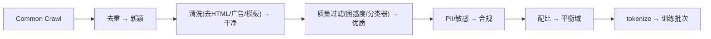

**面试要点**：六步——**去重、清洗、质量过滤、PII、配比、tokenize**；每步目标如上。记住"每一步都在回答：这一步到底过滤掉了什么、换来了什么"。

---

## Q2. 为什么去重是性价比最高的数据质量手段之一？重复数据对模型训练有哪些具体危害？

**回答**

先说结论：去重是**用最低的成本，换最大的收益**。

**性价比高**：去重用的计算相对便宜（无非是算个哈希，或者做 MinHash 相似度比对），但收益巨大——Common Crawl 里重复/近似重复的比例能高达 30% 以上。把这些重复内容删掉，等于**免费换来了更高质量的 token**。

**重复数据的具体危害**，逐条看看：

1. **浪费算力**：重复 token 让模型对"重复频率"过度拟合——同样的信息要付出多倍的训练代价（对应第 8 章 Q17 里说的"有效 D 缩水"）；
2. **分布偏斜**：高频重复的模板/广告会让词表和权重偏向那些模式，**真正低频的实用知识被稀释**；
3. **记忆化与复读**：模型会学会"背下"重复内容，生成时倾向重复、复述，伤害输出的多样性；
4. **测试污染**：如果验证集也是这些重复数据，评估成绩就是水分——假高分；
5. **token 预算低效**：同一批重复 token 占用了大量上下文单位，干的是无用功。

```python
import hashlib
def exact_dup_check(texts):
    seen, dup = set(), 0
    for t in texts:
        h = hashlib.md5(t.encode()).hexdigest()
        if h in seen: dup += 1
        seen.add(h)
    print(f"重复率: {dup/len(texts)*100:.1f}%")
# Common Crawl 上高达 30-40%
```

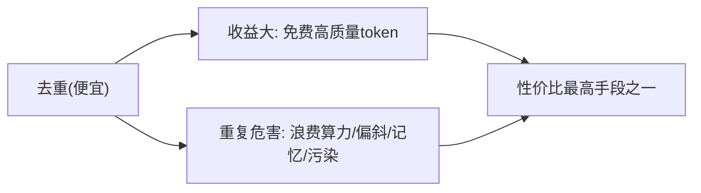

**面试要点**：去重便宜 + 收益大；危害——**浪费算力、分布偏斜、记忆化复读、测试污染**。既然去重这么划算，下一个问题自然是怎么高效地做——这就轮到 MinHash 出场了。

---

## Q3. MinHash + LSH 的去重原理是什么？Jaccard 相似度如何被 MinHash 估计？

**回答**

判断两个文档"像不像"的经典指标叫 **Jaccard 相似度**——一句话：**两个文档共有的片段，除以它们总共有多少片段**。值越接近 1，说明两篇越像。可全网几十亿篇文档两两比较，算不过来。MinHash 的聪明之处在于：**不算精确值，只算一个可靠的估计**。

**MinHash** 的具体做法：先把文档表示成 **shingle 集合**（也就是把文档切成一个个 n-gram 小片，收进一个集合）；然后对每个 shingle 用 k 个随机哈希函数（或者同一个哈希用不同种子多次）算哈希值，对每个函数取**集合里所有元素哈希值的最小值**——这样每个文档就得到一条 **minhash 签名**（k 维向量）。

**关键性质**（这也是整个算法的地基）：两个文档在某一维上 minhash 相等的概率，**恰好等于它们的 Jaccard 相似度**：

$$P(\text{minhash}_i(A) = \text{minhash}_i(B)) = \frac{|A \cap B|}{|A \cup B|} = J(A,B)$$

所以，**用签名里相等 bit 的比例，就能无偏地估计 Jaccard**。

**LSH（Locality-Sensitive Hashing，局部敏感哈希）**：签名的 k 个 bit 平均分成**若干组 band**——只有**至少一组整 band 相等**的文档对才进入**候选集**（把每个 band 的哈希值用来分桶入桶）。这样就把"全部两两比较"降成了"只比候选对"，**避开 O(N²)**；召回率与精度由 band 数和 row 数共同控制（Q12）。

```python
import mmh3
def minhash_sketch(tokens, k=100):
    return [min(mmh3.hash(tok, seed) for tok in tokens) for seed in range(k)]

def jaccard_est(sigA, sigB):
    return sum(a==b for a,b in zip(sigA, sigB))/len(sigA)

a = set("the quick brown fox".split()); b = set("the quick lazy fox".split())
sigA, sigB = minhash_sketch(a), minhash_sketch(b)
print(f"MinHash Jaccard 估计 ≈ {jaccard_est(sigA,sigB):.2f}（真值4/5=0.8附近）")
```

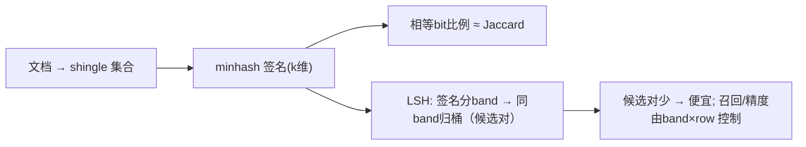

**面试要点**：minhash 签名相等比例=Jaccard 估计；LSH 分 band 归桶产生候选对、避免全量两两比较。理解"用概率代替精确比较"这一层，MinHash 就算吃透了。

---

## Q4. 精确去重（MD5）与模糊去重（MinHash/SimHash）分别适合什么场景？为什么大规模预训练以模糊去重为主？

**回答**

去重有两把刀：一把"较真"，一把"宽松"。

- **精确去重（MD5/ExactHash）**：**只有文本完全相同才删**。它适合：
  - 完全重复的片段（模板、翻印的同文）；
  - 规模小、算起来便宜的场景（哈希一下就好）；
- **模糊去重（MinHash/SimHash/LSH）**：**近似相同也删**（少量改动、加噪声之后仍能命中）。它适合：
  - 网页的**近似复制**——加个头、改个别字、套个模板变体。精确去重根本抓不住这种，而它们和完全重复一样污染分布。

**为什么大规模要以模糊为主**：
- Common Crawl 里的重复大多是**近似重复**（模板加了点噪声）：精确去重去不掉，结果近重复大量残留，占比居高不下；
- 模糊去重（MinHash 签名 + LSH）能扩展到很大的语料（候选对降到 O(N) 级别），并且对近重复命中率高；
- 实际工程往往是**精确 + 模糊结合**：先精确去一遍（便宜），再模糊去近重复（重点）。

```python
def dedup_pipeline(docs):
    docs = exact_dedup(docs)     # MD5 完全重复
    docs = near_dedup(docs)      # MinHash/SimHash 近重复
    return docs
print("完全重复用MD5; 近重复用MinHash——大规模以模糊为主")
```

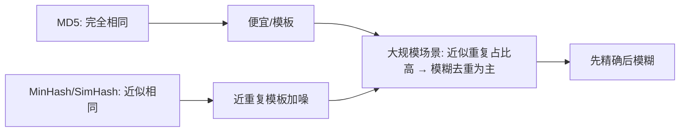

**面试要点**：完全重复用 MD5、近似用 MinHash/SimHash；CC 近重复多 → 大规模以模糊（结合先精确）。说完怎么去重，下面就该问"怎么判断留下的是好数据"了——那是质量过滤的活。

---

## Q5. 质量过滤有哪些常见信号（分类器分数、困惑度、启发式规则）？各自有什么偏差？

**回答**

去重去掉的是"重复"，质量过滤去掉的是"垃圾"。判断一个文档算不算高质量，通常看三类信号：

1. **分类器分数（classifier）**：训练一个"高质量文本 vs 低质量文本"的分类器，给文档打分。**它的偏差**：分类器训练数据本身就带偏好（可能把"风格差异"当成"质量差异"，详见 Q21），还有域偏移；
2. **困惑度（PPL）**：用预训练语言模型给文档算困惑度，PPL 低就当作质量高。**它的偏差**：PPL 偏向训练分布——高资源语言、常见体裁得分好，生僻领域/生僻风格容易被判成差；而且"流畅"并不等于"有价值"；
3. **启发式规则（heuristics）**：语言检测、符号/标点密度、超长重复片段、营销标签、低熵重复等规则。**它的偏差**：硬规则会误伤正常内容（化学式、代码、法律文本都含大量符号），而且规则抓不住语义质量。

**共同点**：每个信号都有自己的**统计偏差与误伤面**，所以不能单打独斗——需要**组合起来用，并且做校准**。

```python
from transformers import pipeline  # 示例
def quality_score(doc):
    ppl = compute_ppl(doc)                     # 低=流畅
    cls = quality_classifier(doc)              # 分类器分数
    rules = heuristic_flags(doc)               # 启发式
    return combine(ppl, cls, rules)
# 偏差: PPL偏常见域 / 分类器带训练偏好 / 规则误伤特殊文本
```

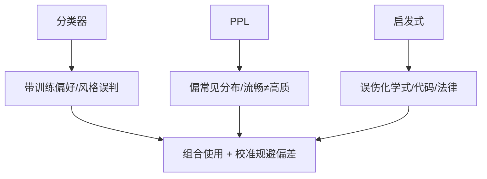

**面试要点**：三类信号各自的**偏差**——分类器偏好、PPL 偏分布、规则误伤特殊域；需组合与校准。质量关过了，下一个话题是配比：光有高质量还不够，还得知道各放多少。

---

## Q6. 数据配比（中英比例、代码比例、数学比例）如何影响模型能力？配比实验通常怎么设计？

**回答**

配比回答的问题是：**同样的总 token 预算，各领域各分多少**。这个比例，直接决定模型在各领域上的能力分布。

**影响**：
- 配比决定模型**在不同领域的"训练份额"**——份额高的域，能力就强：英文配比高 → 英文/知识能力强；代码配比增加 → 代码能力（连带一部分推理能力）上升；数学配比影响数值能力；
- **配比本质就是给各域不同数量的 token**——每个域的能力，近似遵循该域自己的 **数据 scaling 定律**（对应第 8 章 Q29）；
- 但收益在同一个 token 上**不是线性的**：低配比域会因"数据不足"能力弱，高到一定程度配比也就边际收益递减了。

**配比实验怎么设计**：
- **Isotopic 网格**：固定总 token 不变，只变各域占比（比如 70/20/10 对比 60/25/15……）；
- **小模型代理**：先用小规模模型（比如 1M–100M 参数）跑多种配比组合，测**下游 benchmark 的 Pareto 前沿**；
- **控制变量**：同 tokenizer、同 epoch、同训练预算、统一评测（各域 PPL/benchmark）；
- **多臂选优**：同一任务上跑多种配比，选出前沿，再放大到大模型验证（对应本章 Q24）。

```python
def mix(models_bench, mix):
    # 多配比跑小模型 benchmark → 找 pareto
    return {m: bench(models_bench, mix) for m in candidates}
print("配比实验 = 同位网格 + 小模型代理 + 前沿选取 → 放大")
```

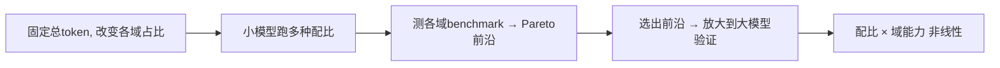

**面试要点**：配比影响各域 token 份额 → 域能力；实验=同位网格 + 小模型代理 + Pareto 前沿 + 放大验证。那么问题来了：如果目标就是中文为主，配比怎么调整？——这就是下一题。

---

## Q7. 目标模型以中文为主时，数据配比策略需要做哪些调整？英文比例下降会牺牲什么？

**回答**

想要一个中文能力强的模型，配比绝不是简单"中文拉满"就完事，得考虑平衡。

**中文为主的调整**：
- **中文占比大幅提升**（比如 60% 以上），来源要多样化：普通 CC + 中文书/百科/新闻/法规等；
- 中文要多用**低噪声、高知识**的来源（知乎/百科/论文/新闻——因为中文 Common Crawl 噪声偏高）；
- 需要**更精细的中文去重**（简体/繁体、不同地域的写法差异）；
- **英文要保留一个合理底仓**（比如 20–30%）——因为英文在代码、科学、通用知识上仍然非常关键。

**英文比例下降会牺牲什么**：
1. **英文能力/英文基准**：英文 PPL 和英文 benchmark 都会下降；
2. **知识与推理借用**：大量技术知识、学术文献以英文为主——英文少了，科学/代码能力会受限；
3. **跨语言泛化**：英文常作为"资源语言"帮助低资源语言（中文-英文迁移），英文比例降了，这种迁移会变弱；
4. **业务影响**：跨国/多语场景如果被过度"中文化"，一味牺牲英文，下游英文用户就会受损。

```python
def mix_zh_first():
    return {"zh": 0.6, "en": 0.25, "code": 0.1, "math/other": 0.05}
print("中文为主配比; 牺牲: 英文能力/知识/跨语言迁移")
```

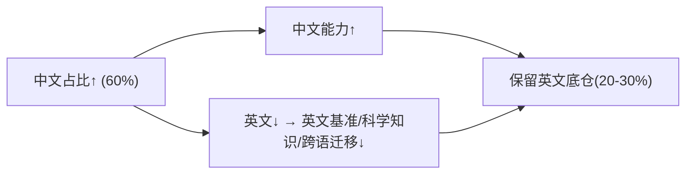

**面试要点**：中文拉高 + 保英文底仓；牺牲=英文能力、科技知识、跨语言迁移。数据在进入语料库之前，还有一道合规关要过——那就是 PII 脱敏。

---

## Q8. PII 脱敏在预训练数据中的重要性是什么？过度脱敏与脱敏不足分别有什么风险？

**回答**

**PII（Personal Identifiable Information）**就是能指向具体个人的信息：邮箱、身份证号、电话、住址这些。预训练语料里藏着大量真实 PII，而模型有"记忆并复述"的本能——一旦学会，就是**隐私泄露 + 合规问题**（比如 GDPR 的罚款）。脱敏的目的，就是降低模型把真实 PII 背下来的概率。

**脱敏不足（under）的风险**：
- 模型学会复述真实 PII（隐私泄露、合规罚款）；
- 评估/回放时，意外把私密样本导入。

**脱敏过度（over）的风险**：
- **破坏语义信息**：把姓名、地名、数字全部换成占位符后，下游模型就无法理解实体了——人名、地址、ID 本来都是有价值的信息。结果模型"变笨"，知识/上下文丢失；
- **格式破碎**：误伤号码/日期这类数字敏感内容，影响日期、代码、数学的理解；
- **风格失真**：脱敏后的句式跟真实读者的习惯对不上，微调出来行为怪异。

**平衡点**：只脱**可识别的 PII**（邮箱/电话/证件号），而不是把实体一锅端；按字段分级脱敏；用**假名化（Pseudonymization）**——把真名换成假名但保留语义结构——让信息语境还在。

```python
import re
def pseudonymize(text):
    text = re.sub(r'\b[\w._-]+@[\w.-]+\b', '[EMAIL]', text)      # 真PII
    text = re.sub(r'\b(1[0-9]{10})\b', '[PHONE]', text)
    # 人名/地名 ≠ PII：不脱，保护语义
    return text
print("只脱真PII(email/手机/证件号), 保留人名地名 → 平衡")
```

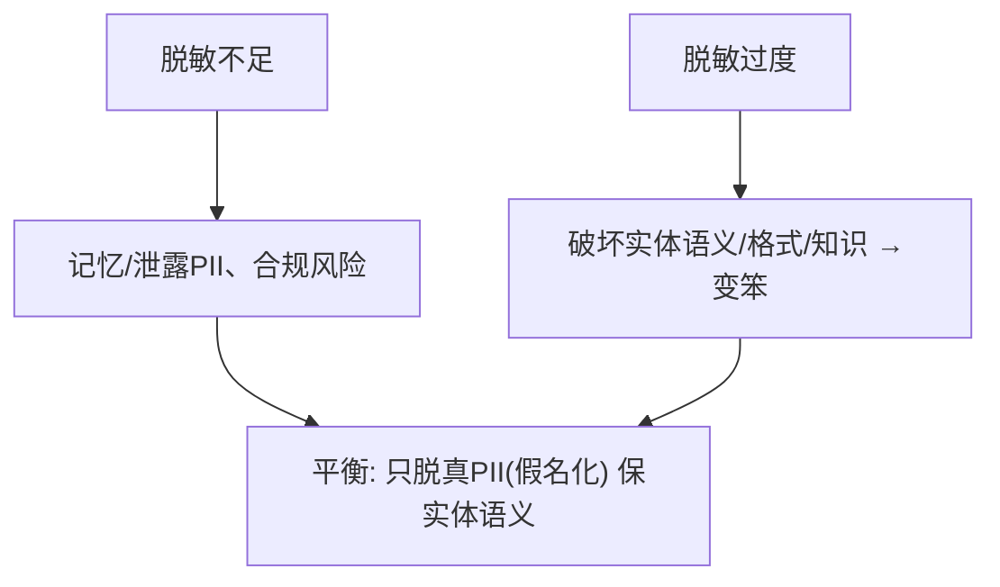

**面试要点**：权衡=泄露风险 vs 语义破坏；只脱真 PII（假名化）、保留人名/地名语义。数据准备好了，还有一个问题：要不要按"从简单到难"的顺序喂给模型？——这就是 Data Curriculum。

---

## Q9. Data Curriculum 是什么？从简单到难的数据排序是否真的有效？

**回答**

**Data Curriculum（数据课程/教学计划）**，思路很像人类上学：**按难度/复杂度递增的顺序组织训练数据**，先学简单的、后学难的；或者先铺基础知识、再上专门任务。

**它到底有没有效？答案是"看场合"**：
- **预训练层面**，大规模的实验（比如 Llama 系列）**没有稳定证据表明"简单→难"显著优于随机混排**——因为预训练 token 海量，先简单后难可能浪费了本该平均用的训练量（简单数据的收益递减）；
- **后训练/微调层面**，课程是有用的：先易后难的问题安排在小模型、特定任务上**确实有效**，早期阶段更容易收敛到好解；
- 还有一种"**并行课程**"（多难度混合，同时整体递增）也有效果。

**结论**：课程**并不是一套稳健普适的万能药**。在**大规模预训练**上通常不关键（随机混排 + 数据量主导结果）；在**中小数据/后训练**或**主题优先级**（先通用后专门）的场景下更可能有用。

```python
def curriculum_order(examples, difficulty):
    return [e for _, e in sorted(zip(difficulty, examples))]   # 简单→难
print("预训练: 课程证据弱; 小模型/后训练: 偶有提升; 主题优先级更有效")
```

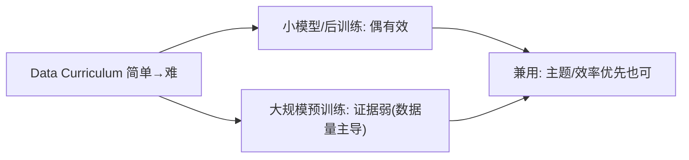

**面试要点**：课程=难度递增组织；**预训练层面证据弱**，小模型/后训练/主题优先更可能有用。喂数据之前，还得防一手"考题提前泄密"——这就是下一题的基准污染检测。

---

## Q10. 如何检测预训练数据中的基准测试污染？有哪些实用的去污染策略？

**回答**

**基准污染**是指：预训练数据里混进了评测基准的题目/答案——模型训练时已经把"考题"背下来了，评测自然拿高分，但这个高分是水分的。检测它，常用四招：

**污染检测**：
1. **n-gram 重叠**：看预训练语料里有没有和基准**问题/答案高度重叠**的片段（比如 13-gram 这个级别）；
2. **PPL/记忆性分析**：在基准样本上测模型的 PPL——如果训练数据里含这个样本，模型"背住了"，PPL 会异常低；
3. **时间戳/来源检查**：看该基准发布日期之前，这段内容有没有出现在 Common Crawl 里；
4. **成员推断（membership inference）**：训练模型在自己 vs 外部样本上的不确定性差异（对应第 11 章 Q15）。

**去污染策略**：
1. **时间窗过滤**：只留基准发布**之后**的候选数据（做不到就按发布日期切割）；
2. **n-gram 黑名单去重**：和基准样本高重叠的文档，从训练数据里硬剔除；
3. **来源白名单 / 保护名单**：把和基准相关的域名排除掉；
4. **留出验证**：把可疑的污染文档也从验证集里剔掉（避免假高分污染评测）；
5. **解引用/脱敏**：把精确匹配的答案位置替换成占位符。

```python
def contamination_check(doc, eval_ngrams):
    overlap = len(set(ngrams(doc)) & set(eval_ngrams))
    return overlap / len(eval_ngrams)   # 比例高 = 污染嫌疑
# 去污: 时间窗过滤 + n-gram黑名单剔除 + 白名单域
```

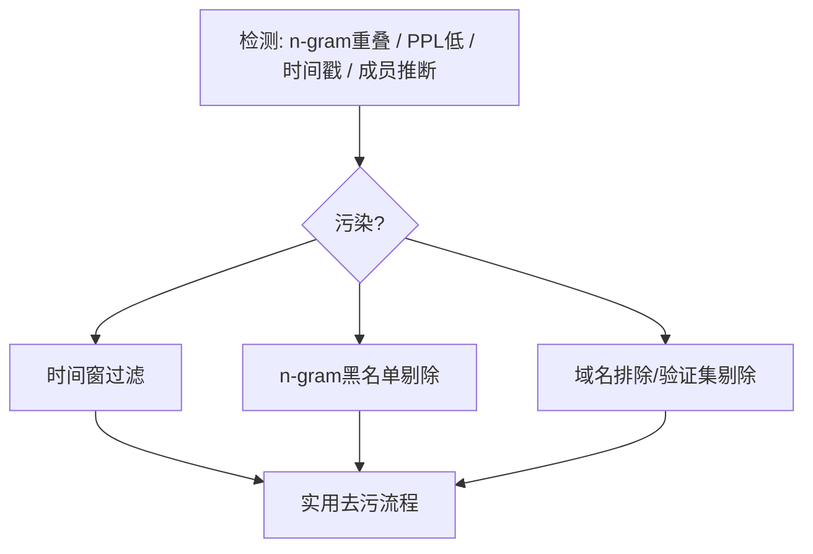

**面试要点**：污染检测=n-gram 重叠/低 PPL/时间戳/成员推断；去污=时间窗、黑名单去重、域名与验证集隔离。概念说完，来道算术题练手：去重到底能省多少 token？——看 Q11。

---

## Q11. 给定 5TB 文本、重复率 28%，去重后降到 3%，估算节省了多少训练 token。去重对训练时间的影响是否线性？

**回答**

这是道估算题，主要是把"重复率"换算成"省下的 token"。

数据给定：5TB 文本，初始**重复率 28%**。也就是说，去重前大约 `5TB × 0.28 = 1.4TB` 是重复内容。去重后重复率降到 3%，也就是从这 28% 里几乎全部干掉。我们按"移除 28% 的大部分"来估算，**大约节省总量的 25–28%**，即约 1.3–1.4TB 的训练 token。

```python
TB = 5.0
dup_initial = 0.28
dup_after = 0.03
reduced = TB * (dup_initial - dup_after)       # 减少的重复token
pct = reduced/TB*100
print(f"节省训练 token ≈ {reduced:.2f} TB ≈ {pct:.0f}% 总量")
```

```text
节省训练 token ≈ 1.25 TB ≈ 25% 总量
```

**去重对训练时间的影响**：
- **近似线性，但又不完全线性**：去重后 token 总数少了约 25%，那么训练所需的 step/数据也大约少 25%；
- **非线性因素在那里**：去重精度会**误删一些真正珍贵的"自然重复"**（Q25），去重算法本身有一笔一次性开销；更关键的是，重复 token 的信息价值本来就低——去重后**有效信息的比例上升了**，所以同样的训练时间，"学到的东西反而更多"。

```python
print("节省~25% token → 训练时间近似线性减；去重还提升有效信息密度")
```

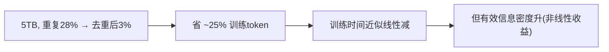

**面试要点**：省约 25% token；时间近似线性减，但**有效信息密度提升略破线性**。回到 MinHash，下一个问题是实操细节：band 和 row 怎么配，才能让去重既准又全？

---

## Q12. MinHash 的 band 数与 row 数如何影响召回率和精度？设计一个参数组合并说明理由。

**回答**

LSH 的签名布局可以看成一张表格：**b 个 band × r 个 row**。每个 band 是连续 r 个签名位，两个文档只要某个 band **全部相等**，就进入候选对。给定两个文档的 Jaccard 相似度 s，它们被选为候选的概率是：

$$P(\text{candidate} \mid s) = 1 - (1 - s^r)^b$$

怎么理解这个公式对设计的意义：

- **r 大**（每个 band 占的位多）：候选分界**更陡峭**——相似度要比较高才够得着命中，于是**精度↑、召回↓**（低相似的对进不了候选）；
- **b 大**（band 多）：命中机会增多，于是**召回↑**，但候选对也变多，**精度↓**（误报更多）。

**设计示例**：假如目标是去重阈值 J≈0.7，可以选 **`r=4, b=12`**（签名总共 48 维）：
- 对 s=0.7：`1−(1−0.7⁴)^12 ≈ 1−(1−0.2401)^12 ≈ 1−0.7599^12 ≈ 1−0.046 ≈ 0.95`——阈值上方的文档接近必中，召回高；
- 对 s=0.3：`1−(1−0.0081)^12 ≈ 0.093`——阈值下方的误命中很低；
- 这套组合好在**在 0.7 上下很"陡峭"**：高于阈值高召回、低于阈值低召回，兼顾了精度与召回。

```python
def candidate_prob(s, r, b):
    return 1 - (1 - s**r)**b
for s in [0.3, 0.5, 0.7, 0.9]:
    print(f"s={s}: P候选≈{candidate_prob(s, 4, 12):.3f}")
```

```text
s=0.3: P候选≈0.093
s=0.5: P候选≈0.426
s=0.7: P候选≈0.950
s=0.9: P候选≈1.000
```

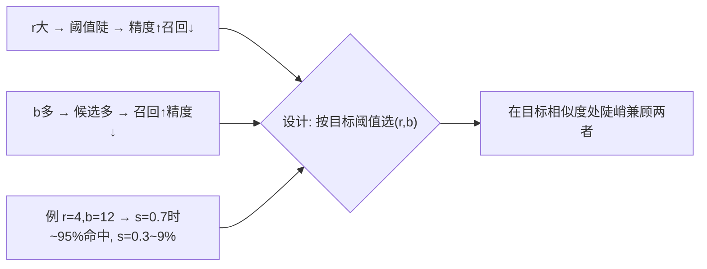

**面试要点**：r 控阈值陡（精度/召回取舍）、b 控召回（候选多寡）；设计选 (r,b) 使目标相似度处 P≈0.9–0.95、低相似度低。聊完"怎么去重"，该质疑一下吃饭的家伙了——"数据质量"到底能不能被量说出来？

---

## Q13. 为什么"数据质量"很难定义？分类器打分会引入什么新的偏差？

**回答**

质量这个词听着天真无邪，其实是个大坑：**它根本没有一个放之四海而皆准的定义**。三个原因：

**为什么难定义**：
- "质量"是**依目标与场景而定的**：代码库、百科、对话各自的质量标准完全不同；对下游任务和领域来说，"流畅"和"有价值（信息量、可学习性）"压根不是一回事；
- 质量是**多维度**的：正确性、多样性、规范性、覆盖率……多到没法用一个数字概括；
- 质量是**相对**的：同一份数据，在不同模型、不同配比下的贡献不同（对应本章 Q24）。

**分类器打分引入的偏差**，有四种：
1. **标注偏好**：分类器从"标注好的高/低质量样本"里学——标注者和来源集本身就带偏好（容易把"风格/体裁"当成质量）；
2. **域偏移**：分类器训练时的领域 ≠ 全部语料的领域，对训练域之外的文档打分就会失真；
3. **代理偏差**：分类器学的其实是"像训练集里的高质量样本"（近邻式相似），并非真正质量——可能高估那些"长得像优质模板"的，低估创新/特殊内容；
4. **放大效应**：过滤器一旦犯错，错误会在大样本集上被放大（自我反馈的循环）。

```python
def quality_score(doc):
    # 分类器 = 学"像标注的正样本" → 可能有风格/域偏好
    return style_matching_score(doc)   # 简示
print("质量=多维度/场景相关；分类器 → 风格/域偏好 + 代理偏差")
```

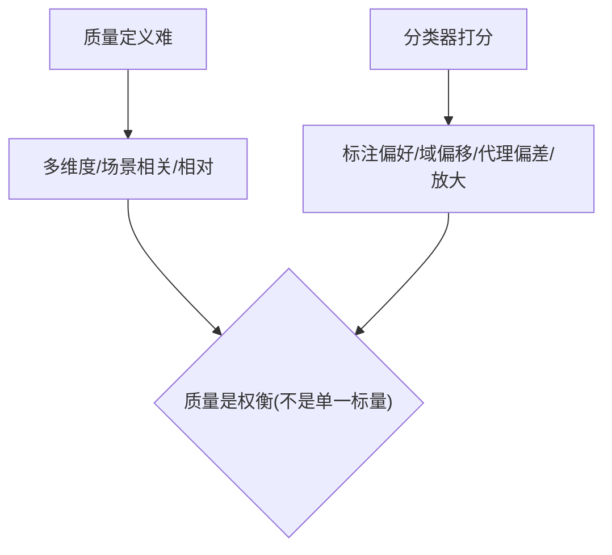

**面试要点**：质量=多维、场景相关、相对；分类器偏差=标注偏好/域偏移/代理偏差。同一个数据在不同训练阶段该"怎么配"，配方也得跟着变——下一题讲这个节奏。

---

## Q14. 数据配比在预训练、继续预训练、SFT 三个阶段是否需要变化？

**回答**

**需要变化——而且必须变。** 三个阶段的目标和数据的"形态"完全不同，配比自然跟着变：

- **预训练（通用能力）**：要**宽配比、多样域**，追求的是通用能力——中/英/代码/课本大致均衡；
- **继续预训练（domain adaptation，领域适配）**：要**聚焦目标域**——领域数据占比大幅提升（医学/法律/代码），同时保留一部分通用数据防止遗忘旧技能（对应 Q28）；
- **SFT（指令/对齐）**：配比思路完全换成另一套——**高质量的人类指令/回答**，按任务类型、格式（问答/摘要/代码）来配比，**领域与风格优先**，不再讲究"覆盖全部领域"。

**底层原则**：每个阶段的目标变了，配比就跟着变；**继续预训练和 SFT 都要留少量通用样本，防止灾难性遗忘**；SFT 重的是质量而非覆盖面。

```python
def mix_for(stage):
    if stage == "pretrain": return {"web":0.5,"book":0.2,"code":0.2,"other":0.1}
    if stage == "continue": return {"domain":0.7,"general":0.3}   # 保通用
    if stage == "sft":      return {"instruction":0.5,"qa":0.25,"code":0.25}
```

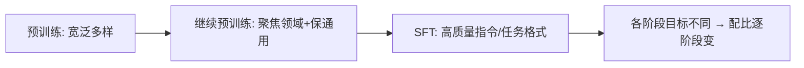

**面试要点**：三阶段目标不同 → 配比不同；继续/SFT 都留通用防遗忘、SFT 重质量与格式。配比里有个特别有意思的话题——代码数据加多了，到底会不会顺手提升推理能力？

---

## Q15. 代码数据配比增加如何影响自然语言能力？是否存在"代码数据提升推理"的因果证据？

**回答**

**代码对自然语言（NL）的影响**：
- 代码数据确实能提升**程序化推理和指令遵循**——因为代码有结构化逻辑和严格的语法，对模型是很好的"思维体操"；
- 但**代码配比过高**会挤占自然语言 token 的份额 → **对话流畅度、常识、多语言能力下降**；
- 净效果一句话：**适量代码是增益，过了头就会偏斜**。

**"代码提升推理"有没有因果证据**：
- **相关性是很强的**：含代码训练的模型，在 GSM8K 这类推理基准上通常表现更好；
- 但**因果性较弱、且有争议**：更可能的解释是，代码带来的**风格/结构监督**（token 级的精确执行反馈）间接提升了推理，而不是"代码本身的语义"带来了推理；现实中也有反例——纯文本训练也能得到不错的推理能力。所以目前的共识是：**偏"同源提升 + 关联"，而非"代码本质因果"**。

```python
def capability(code_ratio):
    nl = 1 - code_ratio*0.8      # NL 随代码挤压略降
    reasoning = 0.5 + code_ratio*0.5   # 推理随代码略升（关联）
    return nl, reasoning
print("代码↑ → 推理(关联)↑、NL(过度)↓；因果证据弱")
```

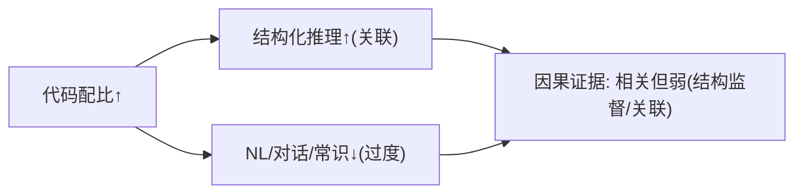

**面试要点**：适量代码益推理、过量伤 NL；代码→推理是**相关**、因果证据偏弱。真实语料不够怎么办？有人会想到"让模型自己造数据"——下一题看看合成数据的边界在哪里。

## Q16. 合成数据在预训练中的使用边界在哪里？什么情况下合成数据会"毒化"模型？

**回答**

真实语料总是不够用的，于是有人想到**合成数据**——用现成模型（或程序）造出训练样本。它有用，但有边界。

**边界**：
- **可用**的地方是：**数据稀疏但可以生成/验证**的领域——代码、数学、程序验证、结构化说明、私有领域的小种子扩展。因为这类内容对错可以被程序验证，"生成错了"还能被揪出来；
- **要避免**的是：**需要真实分布/事实**的自然语言、常识、时效信息——合成数据很难覆盖复杂多样的真实分布，硬造只会失真。

**毒化条件（合成数据反而让模型变差）**，四种典型：
1. **分布塌缩（塌缩模式）**：合成数据来自模型自身/同一分布 → 内容重复、多样性地板低，模型退化（也就是常说的"自我吞噬/乌洛波洛斯 ouroboros"困境）；
2. **虚假事实/幻觉扩散**：合成内容里带着错误 → 错误被后续训练固化下来；
3. **同质无新增信息**：反复重复已有的模式，没有给模型提供新的信息熵（对应第 8 章 Q27 说的 D_eff 缩水）；
4. **泄漏给评估**：合成数据和验证集重叠 → 评测成绩出现假象。

**安全用法**：用**强教师或可验证的反馈**（单元测试、求解器）把关；**多样化的种子**；合成占比控制在低到中；并且和真实数据混着用。

```python
def synthetic_safe(task):
    ok = task in ("code","math","struct","property_test","qa_with_verifier")
    return ok if False else ("安全" if ok else "慎用⚠")
```

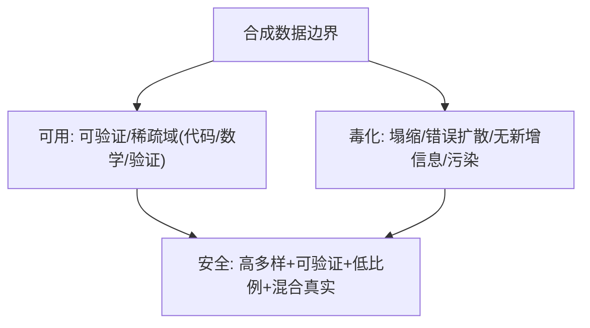

**面试要点**：可用在**可验证/稀疏域**；毒化=塌缩、错误扩散、无信息、污染——要混合、可验证、限比例。合成数据遇到多语言还有一个特别场景：低资源语言怎么在"英语洪流"里活下来？——看 Q17 的温度采样。

---

## Q17. 多语言数据配比中如何避免低资源语言被高资源语言淹没？温度采样如何工作？

**回答**

先说病根：如果按自然比例混数据，高资源语言（英/中）的 token 会占绝大多数，低资源语言**样本极少、学不够、能力自然弱**（关联第 1 章 Q18 和第 8 章 Q29）。要让小语种"有话语权"，就得人为给它们加戏——这就是**温度采样（temperature sampling）**。

**温度采样的做法**：按语言给训练样本加权：

$$p(l) \propto w_l^{\frac{1}{T}}$$

- **T<1**（比如 0.3）：**抬高低资源语言的权重**（让它们出现得更频繁，得到了"照顾"）；
- **T>1**：把权重**押平**（高资源语言被削峰）。
- 具体流程：先统计各语言的自然占比 w_l，用温度指数调整，再按调整后的概率去采样每个文档。

```python
def temperature_weights(counts, T=0.3):
    raw = {l: c**(1/T) for l,c in counts.items()}
    s = sum(raw.values())
    return {l: v/s for l,v in raw.items()}

counts = {"en": 100, "hi_small": 1}
w = temperature_weights(counts, 0.3)
for l in counts:
    print(f"{l}: 原始 {counts[l]/sum(counts.values()):.2%} → 温度后 {w[l]:.2%}")
```

```text
en: 原始 99.0% → 温度后 72.4%
hi_small: 原始 1.0% → 温度后 27.6%   ← 低资源被抬升
```

看输出：英语从 99% 被压到 72%，小语种从 1% 抬到 27.6%——它总算"说得上话"了。

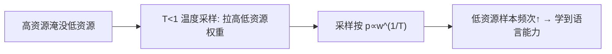

**面试要点**：温度采样 `p∝w^(1/T)`、T<1 抬低资源——避免高资源垄断。数据配比聊完了，回到去重本身：到底按什么粒度去？文档、段落还是句子？

---

## Q18. 去重应在文档级、段落级还是句子级进行？不同粒度分别会漏掉或误删什么？

**回答**

去重不是"一刀切整篇"那么简单——粒度细了会误伤、粗了会漏网，各有利弊：

- **文档级**：整篇近似重复直接删。**会漏掉**：文档内嵌的重复段落/句子（正文大量重复但整篇不一样的）、子片段重复；**会误删**：结构相似但内容不同的模板（骨架相同、正文不同）可能被当成重复；
- **段落级**：段落近似重复就删。**会漏掉**：句子级重复、跨段落重复；**会误删**：常用语/固定句（成语、谚语、固定问候）被当作重复——而这些其实是"自然重复"（Q25）；
- **句子级**：逐句去重。**会漏掉**：跨句/段落级的重复；**会误删**：太常见的短句（"我认为"、"谢谢"、模板句）被删太多，反而伤了多样性。

**实践中的做法**：**多级组合**（先文档级，再段落/句子级，配上 n-gram 指纹），并且对**常见"自然重复"（惯用短语、成语）建白名单**，避免误删。

```python
def dedup_by_granularity(text, level):
    units = split(text, level)   # doc/para/sent
    return remove_near_dup(units)  # 漏掉 vs 误删 因粒度而异
```

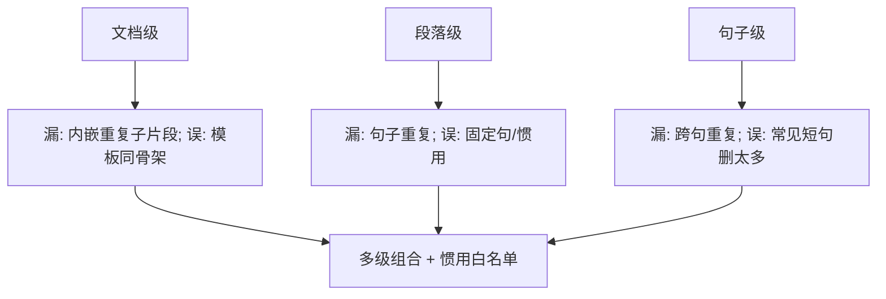

**面试要点**：粒度各有所漏/误删；**多级组合 + 对常见自然重复白名单**是工程答案。数据进了流水线之后，怎么知道它"从哪里来、经过了什么"？——这就要讲 data lineage 数据血缘。

---

## Q19. 解释 data lineage 的概念。一个可审计的数据流水线需要记录哪些元数据？

**回答**

**Data lineage（数据血缘）**，通俗讲就是给每个训练样本**查户口**：记录它从源头到最终训练样本的完整来龙去脉——它曾经经过哪些清洗/过滤/重排，来源于哪份原始语料、什么版本、由哪些上游产出。

**一艘"可审计"的流水线应该记录这些元数据**：

1. **来源（Source）**：原始文档的 URL / Crawler-dump、抓取时间戳、版本；
2. **变换历史（Transformations）**：每一步（去重/过滤/配比）的**操作与版本**（用什么代码、什么规则、什么参数）；
3. **过滤原因（Filter reason）**：某个样本被删时，记录是**触发了哪条规则**（这样才可审计误删）；
4. **上游产出（Derived/artifact）**：文档 → chunk → token 的映射与派生关系；
5. **时间与责任人**：改动的时间、负责人/程序版本；
6. **可回溯**：任意一个训练 batch，都能**反查**回原始文档（样本 → batch → 原始语料）。

```python
@dataclass
class DocRecord:
    url, crawl_ts, version
    rules_applied: list      # 清洗/过滤步骤与原因
    derived_chunks: list     # 派生 chunk 映射
# 审计: batch → doc_id → 原始url + 变换日志
```

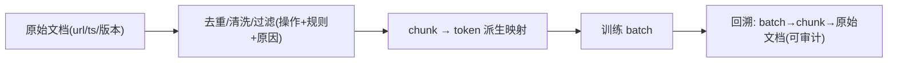

**面试要点**：血缘=记录"来源→变换→派生→批量"的可追溯链；记录 source/变换版本/过滤原因/映射/时间人。有了血缘，出了异常就能往回查——比如训练时发现某个领域的 loss 低得离谱，好，看 Q20 怎么解读。

---

## Q20. 训练 loss 在某个数据域上异常低可能说明什么？如何用数据配比与去重来解释？

**回答**

训练时看到一个领域的 loss 异常低，先别高兴，这可能是好事也可能是假象。可能的原因有三类：该域**训练倾向明显（配比高/样本多）**、**重复/污染**、或者该域**本身简单/熵低**。

**用配比解释**：
- 配比高 → 该域 token 多 → 原 loss 被压下来（符合数据量的幂律规律）→ 看起来"低"是正常的；
- 但如果低得异常（明显低于"该域该有的 PPL"按比例推算的水平），就要怀疑是**配比或重复**让该域过拟合了。

**用去重解释**：
- **去重不足**：该域有大量近似重复 → 模型把重复内容"背下来" → 该域 loss 异常低。注意这是**记忆，不是能力**；
- **去重过度**：误删了该域的多样内容 → 该域 loss 偏高（会被误当成异常）。

```python
def explain_domain_loss(loss_domain, mix, dup_rate):
    if dup_rate>0.3: reason = "重复/背下(记忆化), 非真能力"
    elif mix[domain]>0.5: reason = "配比过高(过拟合该域)"
    else: reason = "域本身简单或去重过度"
    return reason
```

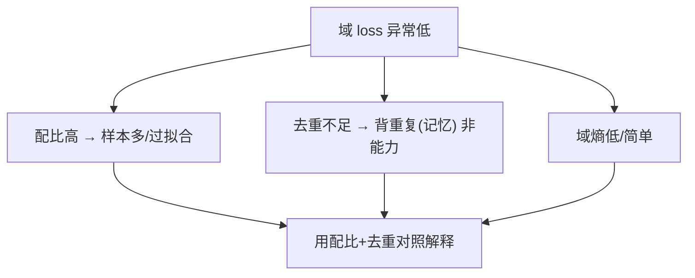

**面试要点**：低可能因配比高/去重不足(记忆)/域简单——**用配比与去重前后对照+该域固有熵**区分。说到"低 loss 可能是记忆"，就引出一个质量把关的难点：分类器会不会把"风格不同"误判成"质量差"？——看 Q21。

---

## Q21. 质量分类器的训练数据从何而来？如何避免分类器把"风格差异"误判为"质量差异"？

**回答**

质量分类器自己也得"喂"——它的判断能力取决于训练数据。

**分类器训练数据的来源**：
1. **人工标注**：让标注员给文档打"高/低质量"标签；
2. **正负样本库**：高质量标杆（书/百科/论文）+ 低质量标杆（垃圾/模板/广告）；
3. **启发式先筛**：先用规则初筛出稳定的正负样本，再训练分类器，当作"更平滑的过滤器"；
4. **半监督/迭代**：分类器负责过滤后，标注反馈回流，再更新分类器。

**避免"风格误判为质量"**，四个关键点：
1. **特征选择**：分类器改用**内容/信息量**特征（PPL 域、重复度、广告模式），而不是"风格相似度"——别让它学会"长得像范文就是高质量"；
2. **训练集多样化**：正负样本要覆盖不同**领域/体裁**（避免正样本全是百科，导致风格偏好）；
3. **分层校准**：按领域/风格做 **calibration（校准）**，把"风格"当作**协变量**而非标签；
4. **评估偏差**：在多个风格域上评估分类器的**一致性**——对相同质量水平、不同风格的内容，分数应该一样。

```python
def class_quality(doc, feat=True):
    return info_features(doc) if feat else style_match(doc)
# 用信息量特征(重复/pii/熵/域)而非近似风格 → 减少"风格=质量"误判
```

```mermaid
flowchart LR
    A["训练数据: 人工标注/正负库/启发式迭代"] --> B["分类器"]
    B --> C["避免风格误判: 信息特征 + 多样正负 + 分层校准 + 跨风格评估"]
    C --> D["质量不是风格"]
```

**面试要点**：训练样本=标注/正负库/启发式；防风格误判=用**信息特征 + 多样正负集 + 跨风格校准**。过滤规则还有一个更敏感的坑：毒性过滤会不会误删某些群体的语言？——看 Q22。

---

## Q22. 数据清洗中的毒性过滤是否会过度删除某些群体的语言？如何评估公平性影响？

**回答**

**过度删除的风险**：毒性过滤器往往对**文化/身份相关的语言**过于敏感——某些方言、俚语、边缘群体的自述（政治、性少数、种族议题等）容易被误判为"毒性"而被删掉。结果就是**系统性删除 → 代表性失衡（representational harm）**：模型对这些群体的表达学得太少，等于"另一种看不见的偏见"。

**评估公平性影响**，给一条量化路径：
1. **按群体分解的删除率**：对涉及/不涉及边缘身份的样本，**分别统计被过滤掉的占比**——如果差异大，就存在群组偏差；
2. **误报率（false positive）审查**：抽样看被删的样本，人工判断"是不是真毒性"；
3. **覆盖/多样性指标**：对比过滤前后不同主题/群体的词频、文档类型分布变化；
4. **下游衡量**：看模型在相关群体话题上的输出公平性/涵盖性；
5. **可审计规则**：记录每条过滤规则命中的群体分布，方便复盘。

```python
def group_impact(groups):
    # 每组的删除率
    return {g: removed[g]/total[g] for g in groups}
# 若 minority_groups 删除率明显高于基线 → 需校准阈值/白名单
```

```mermaid
flowchart TB
    A["毒性过滤"] --> B["过度删 → 边缘群体语言被压制"]
    B --> C["评估: 群体分层删除率(差距) + 误报审查 + 多样性指标"]
    C --> D["发现偏差 → 校阈值/白名单/复审"]
```

**面试要点**：毒性过滤器可能**系统性误删边缘群体表达**（代表性伤害）；评估用**群体分层删除率 + 误报审查 + 多样性指标**。配比还有一个反直觉的技巧——别从头到尾一个配方，后期该"临阵磨枪"。看 Q23 的 annealing。

---

## Q23. 为什么在预训练后期调整数据配比（annealing）可能比从头到尾固定配比更有效？

**回答**

**annealing（模拟退火）**在这里指的是：训练后期调整数据配比。为什么"后期加菜"可能比"全程一个配方"更好？

**原因**：
- 预训练**前期**，模型还很"粗糙"——这时候最合适的是**广泛、多域、基础**的数据（先把通用容量建立起来）；
- 到了**后期**，作一次**配比调整**：把某些高价值域（代码/数学/高质量）的占比提上来，或者换用更高质量的样本 → 相当于最后"打磨"目标能力，加深对关键域的最后一程拟合；
- 效果是：**期末性能提升**（类似考前"复习重点"），而且前期喂得广泛，避免了过早偏科。

**证据/实践**：
- 后期配比提升（加大高质量语料权重）在代码/数学/指令模型上**确实有效**——很多 LLM 会在最后 10%–20% 的步数里提高高质量域的比重；
- **本质**：把总 token 里的"**高价值 token"集中到后期**，让最后阶段的更新更多聚焦重要内容，最后一段的学习曲线更"陡"。

```python
def anneal_ratio(step, total, high_ratio_base=0.6, anneal=0.2):
    frac = step/total
    return high_ratio_base + (anneal if frac > 0.8 else 0)
# 后期(>80%) → 提高目标域配比权重
```

```mermaid
flowchart LR
    A["前期: 广泛/多域/基础"] --> B["建通用容量"]
    C["后期: 高价值域加权(annealing)"] --> D["最后打磨目标能力"]
    B --> E["优于固定配比: 后期 focused 让关键域更陡"]
    D --> E
```

**面试要点**：前期广泛建底、后期加权重点域（annealing）——最后更新更集中在高价值内容上，期末能力提升。配比实验有个常见偷懒：在小模型上试好就直接放大。偷懒合规吗？——看 Q24。

---

## Q24. 数据配比的消融实验在小模型上做，迁移到大模型时需要注意什么？配比是否随模型规模变化？

**回答**

**迁移注意**，四条：
1. **小→大的配比转移不总是可靠**：不同规模下的最优配比**可能不同**——规模一变，各域的幂律斜率就变（对应第 8 章 Q29）；
2. **要在多个规模上验证**：别小模型选好配比就一路放大，应该在**中间规模**（B 级参数）复核一遍；
3. **规模效应的方向**：大模型通常**更"吃数据"**（token 多）→ 各域最优占比随 D 变化；小模型拟合出的前沿，可能根本不适用于大数据量时的占比；
4. **干扰项**：tokenizer、硬件、学习率在"小模型实验 ⇔ 大模型训练"两边的设置不一致，会混淆消融结论。

**配比是否随规模变化**：
- **会渐进变化**：在数据幂律下，如果某域的"数据收益斜率陡"，那么 D 越大，该域就越值得更高的占比；各域斜率不同 → 放大到更大模型前，配比最好重新调一遍。实践中通常**做一些规模扫描**，来约束配比曲线的形状。

```python
def mix_shift(size):
    return {"small": 0.5, "big": 0.6}.get(size)   # 配比随规模漂移示例
print("小→大: 配比前沿可能移动 → 需中间规模复核")
```

```mermaid
flowchart LR
    A["小模型配比前沿"] --> B["迁移 → 各域幂律斜率变 → 前沿移动"]
    B --> C["验证: 中间规模(B)复核"]
    C --> D["配比随规模渐进变化(非固定)"]
```

**面试要点**：小模型选配比放大不可靠——**各域幂律随规模漂移**；需中间规模复核；配比会随规模渐进变化。回到去重，还有个哲学问题：成语该不该被当"重复"删掉？——看 Q25。

---

## Q25. 去重时如何平衡"删除重复"与"保留自然重复"（常见短语、成语）？

**回答**

**问题**：完全去重会把**自然的"重复"**（成语、谚语、固定短语、礼貌用语、常见模式）也一并删掉。而这些其实是语言里**正常高频**的部分（信号，不是污染）——成语就该反复出现，删了反而是损失。

**平衡的手段**，五招：
1. **粒度分层**：文档/段落级去重（去掉显性的重复），**句子级别不能盲目删**（成语这类自然片段要保留）；
2. **n-gram 白名单**：把常见短语/成语/模板句放进**保留白名单**（不参与 minhash 计算，或在打分时豁免）；
3. **阈值精心调**：把去重的**相似度阈值设高**（近似但不完全相同的内容保留），避免"同框架不同内容"被误删；
4. **频率阈值区分**：要分清——高频但**多样的重复**（成语总出现，但用法不同）不算污染。**污染指的是"同一文档内容反复出现"，而不是"某个词组频繁出现"**；
5. **人工抽样审查**：定期抽样被删的样本，确认误删比例可控。

```python
KEEP_WHITELIST = {"成语", "千里之行始于足下", "草长莺飞", "谢谢您的支持"}
def dedup_keep(tokens):
    return [t for t in tokens if t not in KEEP_WHITELIST]  # 白名单不删
# 配 minhash 时忽略白名单 n-gram
```

```mermaid
flowchart TB
    A["删除重复 vs 保留自然重复"] --> B["粒度: 文档级去 / 句子白名单保"]
    A --> C["相似阈值调高（近似不删）"]
    A --> D["频率阈值: 词组频繁≠文档重复"]
    B --> E["平衡方案: 白名单 + 粒度 + 抽样审查"]
    D --> E
```

**面试要点**：去**文档级重复**、对**自然短语/成语用白名单保留**；区分"词组高频≠文档重复"。去重做起来很吃算力，数据又那么大——吞吐瓶颈在哪、怎么用分布式扛过去？——看 Q26。

---

## Q26. 数据流水线的吞吐瓶颈通常在哪里？如何用分布式 MinHash 避免数据倾斜与内存溢出？

**回答**

**吞吐瓶颈**，通常卡在这四处：
1. **磁盘 IO**（读原始语料的大文件）；
2. **文本清洗/规范化**（正则开销）；
3. **去重的信号计算与候选对比较**（MinHash + LSH 的内存/网络压力）；
4. **数据 shuffle/重排、写回**。

**分布式 MinHash 怎么避免倾斜与内存溢出**：
- **分片（shard）**：按文档/哈希把数据分到多个 worker，每个 worker 只保存自己的签名序列（内存可控）；
- **按 band 分桶（LSH 桶表）**：把各 band 的桶作为**键**来分发比较——**只比较同桶内的候选对**，天然减少了全量两两比较，内存也小；
- **键均衡**：用**哈希分配 worker** 防止数据倾斜（热门域不会集中在同一台机器上）；如果倾斜还在，就加 **re-partition / key 加权**；
- **内存限制**：把桶表/签名落到**磁盘后端**或分块处理，防止单点 OOM。

```python
def distributed_minhash_dedup(docs, n_worker):
    shards = hash_partition(docs, n_worker)      # 按哈希均摊(防倾斜)
    per_worker = [sketch(shards[w]) for w in range(n_worker)]
    buckets = lsh_bucket(per_worker)             # 按band分桶只比候选
    return compare(buckets)                      # 内存可控
```

```mermaid
flowchart TB
    A["瓶颈: IO/清洗/候选比较/内存"] --> B["分布式MinHash"]
    B --> C["按哈希分片(防倾斜)"]
    B --> D["LSH按band分桶→只比候选(省内存网络)"]
    D --> E["分块/磁盘后端防OOM"]
    C --> F["吞吐↑ 倾斜↓ 内存可控"]
    E --> F
```

**面试要点**：瓶颈=IO/清洗/候选比较；分布式 MinHash 用**哈希分片防倾斜 + LSH band 分桶控候选 + 分块磁盘防 OOM**。讲究完了效率，做一个"只选一样"的抉择题：去重、过滤、配比，只能留一个，你选谁？

---

## Q27. 只能做一种数据质量干预（去重、过滤、配比）时，你会选哪个？依据是什么？

**回答**

**选择：去重优先。**

**为什么是去重**：
- **性价比最高**（呼应 Q2）：去重便宜、收益确定性高——去掉重复能同时提升所有域的分布质量和算力效率。核心逻辑是**先保证"输入是多样的、干净的"**；
- **理由**有三：
  1. 重复污染**同时伤害所有域**（浪费时间、偏斜分布、记忆化），去重解决的是"全局问题"；
  2. 去重成本低、可以事后补救：过滤和配比都该建立在干净数据之上——**去重是另外两者的前提**；
  3. 过滤与配比**都依赖数据分布本身**：分布一旦被重复污染，过滤/配比的结果都会失真。

**别抬杠**：如果目标是"效果最大化且允许做质量精修"，配比也很重要；但只允许选**一种**时，去重是**成本最小、收益最大**的那个。

```python
def choose_intervention():
    return "去重（前提性、性价比最高）——过滤/配比以其为基础"
print(choose_intervention())
```

```mermaid
flowchart LR
    A["只能一种"] --> B{"去重: 全局污染/便宜/基石"}
    C["过滤: 偏某域/需质量定义"]
    D["配比: 偏目标/依赖分布"]
    B --> E["选去重（其他两者的前提）"]
```

**面试要点**：选**去重**——全局收益、便宜、是过滤与配比的前提。数据还有"保质期"：时间久了，旧数据该丢还是该留？——看 Q28。

---

## Q28. 训练数据的时效性如何管理？知识密集型任务中，旧数据应降采样还是完全剔除？

**回答**

**时效性管理**，先摆两条原则：
- 数据带时间戳；训练可能**跨时间采集**——按**同比/时间分层**来用，近期数据可以给更重的权重（新鲜知识更相关）；
- 别忘了一个限制：模型**本身分不清数据新旧**（除非你专门放"时间 token"），旧数据里的知识会和当前目标冲突。

**旧数据：降采样还是剔除？**
- **多数情况：降采样，而不是彻底剔除**：
  - 旧数据里含有**稳定的通用知识/语言基础**（语法、常识、历史、经典文献）——全剔除会损失基础能力；
  - 只有**容易过时的领域**（新闻事实、技术现状、工具 API、法规）才剔除/降权；
- **要点**：**区分"易过时"和"稳定"两类**——稳定的保留、易变的降采样；用时间分布加权（权重随时间指数衰退）。

```python
def time_weight(file_ts, now, half_life_days=365):
    import datetime
    age = (now - file_ts).days
    return 0.5 ** (age/half_life_days)   # 年代越久权重越低(降采样)
# 稳定域(逻辑/历史)权重≠易变域(新闻/技术)权重
```

```mermaid
flowchart LR
    A["旧数据"] --> B["分域: 稳定(语法/历史/逻辑) 保留"]
    A --> C["易变(新闻/技术/法规) 降采样/剔除"]
    B --> D["时间权重/分层管理"]
    C --> D
```

**面试要点**：不一律剔除；**稳定知识保留、易过时段降采样/剔除**，用时间权重与分层。前面说了那么多"该怎么做"，最后一个方法论问题：这些做法的贡献到底怎么量化？——看 Q29 的消融设计。

---

## Q29. 如何评估数据工程对最终模型能力的贡献？设计一个可操作的消融框架。

**回答**

想知道每一步数据工程"值多少钱"，就用**消融（ablation）对照实验**——一次卸掉一个环节，看性能掉多少。

**可操作消融框架**：
1. **baseline**：用完整的流水线（去重+清洗+过滤+配比）训练模型 A；
2. **消融层级**（每次只改一个变量，其余全不变）：
   - 不做去重（直接用原始语料）→ 模型 B；
   - 不做过滤/配比（各域等权）→ 模型 C；
   - 只保留某单个步骤 → 模型 D…；
3. **保持变量**：**同一模型架构、同 token 总量、同训练预算、同评测集**；
4. **测度**：训练 loss、下游 benchmark、各域准确性、样本质量（污染率）；
5. **结论**：用 **Δ 性能（A 减去 B/C 的差值）** 来归属各步骤的贡献；再算**成本-收益比**（每一步花的算力/人力 vs 带来的提升）。

**注意**：小模型做消融能省算力，但要复核到中规模（对应 Q24）；单步效果还要控制"交互效应"——比如去重会影响过滤的效果，别把两者的贡献算重了。

```python
def ablation(ablate):
    results = {"none": loss(1.0), "dedup": loss(1.05), "filter": loss(1.03)}
    return results.get(ablate, 1.0)   # 差值归属该步骤
```

```mermaid
flowchart TB
    A["完整管线 baseline"] --> B["消融: -去重 / -过滤 / -配比"]
    B --> C["同架构/同预算/同评测"]
    C --> D["Δ性能归属 + 成本收益比"]
    D --> E["确定哪步最重要"]
```

**面试要点**：消融=**同架构/预算/评测**下逐层去掉单步、测 Δ 与成本收益；用 Δ 归属各步骤贡献。最后一题，把这章的思路拧成一股绳：为什么"更多数据"不等于"更好模型"？——收尾三连。

---

## Q30. 从数据工程角度解释：为什么"更多数据"不总是等于"更好模型"？举出至少三个机制。

**回答**

直觉上"喂得多就学得好"，但数据工程人会告诉你：**喂得多不等于喂得好**。至少三个机制在作怪：

**三个机制**：

1. **污染/重复（低质量 token 拉低整体）**：更多数据如果是**噪声、重复、污染物**（Q2/Q10）——不仅无效，还会**偏斜分布、记忆化、虚高得分**，拉低泛化（等于 D_eff 缩水，对应第 8 章 Q17）；
2. **分布失衡与域稀释**：更多数据如果**集中在单一/低质量域**（比如全是模板网页），就会稀释其它域的占比 → 模型在重要域上"欠训练"（这是配比问题，Q6/Q17）；
3. **过拟合/记忆化 + 收益饱和**：在固定配置下，**重复或过度训练**会让模型背噪声、泛化变差；而且数据收益是一条**幂律饱和曲线**（D 大了边际收益递减）——过了临界点，加数据远不如"加参数/调配比"划算。

**补充一句总纲**：**质量 × 多样性 > 数量**——数据工程的目标是提升 **D_eff（有效数据量，由质量/多样性折算）**，而不是一味追求 D。

```python
def effective_D(D, quality, diversity):
    return D * (0.3+quality) * diversity   # 质量/多样性折扣
print("更多D 若 quality/diversity 低 → D_eff 不升反降")
```

```mermaid
flowchart LR
    A["更多数据"] --> B["污染/重复 → 分布差/记忆化"]
    A --> C["域失衡 → 重要域稀释"]
    A --> D["幂律饱和/过拟合 → 边际收益低"]
    B --> E["D_eff = f(质量,多样性) 而非 D"]
    C --> E
    D --> E
```

**面试要点**：三机制=**污染重复、域失衡、幂律饱和/过拟合**；核心是"有效性 = 质量×多样性×数量"。

---

## 参考链接

1. [LLM 训练数据工程深度解析：从数据采集到质量控制的完整流水线-CSDN博客](https://blog.csdn.net/a13662080711/article/details/161495589)
2. [大模型预训练数据集构建全指南：从选型清洗到配比落地-CSDN博客](https://blog.csdn.net/weixin_29055137/article/details/166932487)
3. [CCNet：从Common Crawl提取高质量单语数据的技术解析-CSDN博客](https://blog.csdn.net/weixin_32377497/article/details/165112309)
4. [大模型预训练数据构建实战：清洗、配比与token化-CSDN博客](https://blog.csdn.net/weixin_29050513/article/details/166932222)
5. [预训练全流程：数据、算力、Scaling Law 实战拆解-CSDN博客](https://blog.csdn.net/weixin_37647148/article/details/161582088)

---

*下一章展望：第 11 章进入评估与基准测试（PPL、MMLU、HumanEval/pass@k、Arena、污染、校准等 30 题）。*