# 第 10 章 · 数据工程

> 面试生普（LLM 500 题）· 第 10 章。本章覆盖 Common Crawl 到预训练数据的处理流程、去重（MinHash/精确）、质量过滤、数据配比、PII 脱敏、Data Curriculum、基准污染、合成数据、分布式数据管道等 30 个问题，关键概念配 Python 代码与 mermaid 图解。

---

## Q1. Common Crawl 到预训练数据集之间通常需要经过哪几类处理步骤？每一步的核心目标是什么？

**回答**

Common Crawl（网页抓取，几十 TB，质量参差）→ 可用预训练数据，典型处理链：

1. **去重（dedup）**：删掉重复/近似重复文档（否则重复拖低效率、污染），目标=保留信息新颖；
2. **清洗（cleaning/filtering）**：去 HTML/广告/模板、语言识别、长度/符号过滤，目标=去掉格式垃圾与噪声；
3. **启发式/分类器质量过滤**：按困惑度/分类器打分筛优质文本，目标=保质量高、语义丰富；
4. **PII/敏感过滤与脱敏**：去个人隐私、儿童内容、有害内容，目标=合规 + 安全；
5. **配比（mixing）**：多来源（网页/书/百科/代码）按比例混合，目标=覆盖域 + 平衡；
6. **tokenization/切分**：按 tokenizer 切块、限定文档长度，目标=对齐训练批次。

```python
def pipeline(raw_docs):
    docs = dedup(raw_docs)          # 1 去重
    docs = clean_html(docs)          # 2 清洗
    docs = filter_quality(docs)      # 3 质量过滤
    docs = pii_sanitize(docs)        # 4 脱敏
    docs = mix_sources(docs)         # 5 配比
    return tokenize(docs)            # 6 tokenize
```

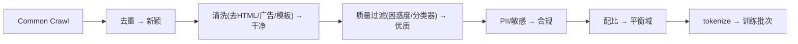

**面试要点**：六步——**去重、清洗、质量过滤、PII、配比、tokenize**；每步目标如上。

---

## Q2. 为什么去重是性价比最高的数据质量手段之一？重复数据对模型训练有哪些具体危害？

**回答**

**性价比高**：去重计算相对便宜（哈希/MinHash），但收益巨大——Common Crawl 中重复/近重复比例高达 30%+，去掉它们等于**免费得到更高质量的 token**。

**重复数据的具体危害**：

1. **浪费算力**：重复 token 让模型"过拟合"重复频率——同样的信息付出多倍训练代价（Q17 第 8 章的有效 D 缩水）；
2. **分布偏斜**：高频重复的模板/广告让词表与权重偏向那些模式，**低频真实知识被稀释**；
3. **记忆化与复读**：模型学会"背下"重复内容，生成时倾向重复/复述，损害多样性；
4. **测试污染**：若验证集是重复数据，评估被水分（假高分）；
5. **token 预算低效**：同一批重复 token 占大量上下文单位。

```python
import hashlib
def exact_dup_check(texts):
    seen, dup = set(), 0
    for t in texts:
        h = hashlib.md5(t.encode()).hexdigest()
        if h in seen: dup += 1
        seen.add(h)
    print(f"重复率: {dup/len(texts)*100:.1f}%")
# Common Crawl 上高达 30-40%
```

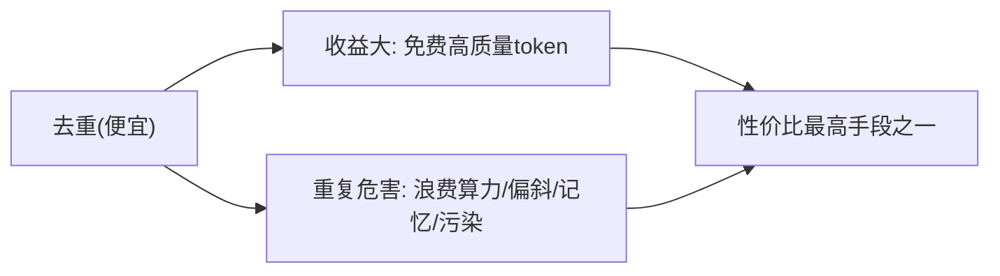

**面试要点**：去重便宜 + 收益大；危害——**浪费算力、分布偏斜、记忆化复读、测试污染**。

---

## Q3. MinHash + LSH 的去重原理是什么？Jaccard 相似度如何被 MinHash 估计？

**回答**

**MinHash**：文档表示为 **shingle 集合（n-gram 集合）**；对每个 shingle 用 k 个随机哈希函数（或一个哈希多次），对每个函数取**集合中所有元素哈希值的最小值**——得到文档的 **minhash 签名**（k 维向量）。

**关键性质**：两个文档的某维 minhash 相等概率 = **Jaccard 相似度**：

$$P(\text{minhash}_i(A) = \text{minhash}_i(B)) = \frac{|A \cap B|}{|A \cup B|} = J(A,B)$$

所以**用签名中相等 bit 的比例估计 Jaccard**（无偏）。

**LSH（Locality-Sensitive Hashing）**：把签名**分成多组 band**——只有至少一组**整 band 相等**的文档对才进入**候选集合**（拼接签名各 band 的哈希值入桶桶）——**减少候选对数**（避开 O(N²)），召回/精度由 band 数×row 数控制（Q12）。

```python
import mmh3
def minhash_sketch(tokens, k=100):
    return [min(mmh3.hash(tok, seed) for tok in tokens) for seed in range(k)]

def jaccard_est(sigA, sigB):
    return sum(a==b for a,b in zip(sigA, sigB))/len(sigA)

a = set("the quick brown fox".split()); b = set("the quick lazy fox".split())
sigA, sigB = minhash_sketch(a), minhash_sketch(b)
print(f"MinHash Jaccard 估计 ≈ {jaccard_est(sigA,sigB):.2f}（真值4/5=0.8附近）")
```

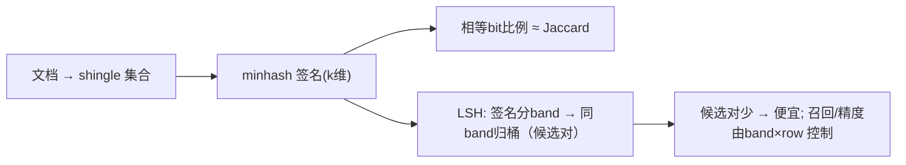

**面试要点**：minhash 签名相等比例=Jaccard 估计；LSH 分 band 归桶产生候选对、避免全量两两比较。

---

## Q4. 精确去重（MD5）与模糊去重（MinHash/SimHash）分别适合什么场景？为什么大规模预训练以模糊去重为主？

**回答**

- **精确去重（MD5/ExactHash）**：完全相同的**文本完全相同才删除**——适合：
  - 完全重复片段（模板、翻印同文）；
  - 体积小、计算便宜（哈希）；
- **模糊去重（MinHash/SimHash/LSH）**：**近似相同也去**（少量改动/加噪声仍命中）——适合：
  - 网页的**近似复制**（加头部/改个别字/模板变体）——精确去重抓不住这种，而它们同样污染分布。

**为什么大规模以模糊为主**：
- CC 中重复多是**近似重复**（模板加 noise）：精确去重去不掉 → 保留大量近重复 → 占比过高；
- 模糊去重（MinHash 签名+ LSH）可扩展到大语料（O(N) 级别候选），且对近重复命中率高；
- **精确 + 模糊结合**：先精确去一次（便宜）、再模糊去近重复（重点）。

```python
def dedup_pipeline(docs):
    docs = exact_dedup(docs)     # MD5 完全重复
    docs = near_dedup(docs)      # MinHash/SimHash 近重复
    return docs
print("完全重复用MD5; 近重复用MinHash——大规模以模糊为主")
```

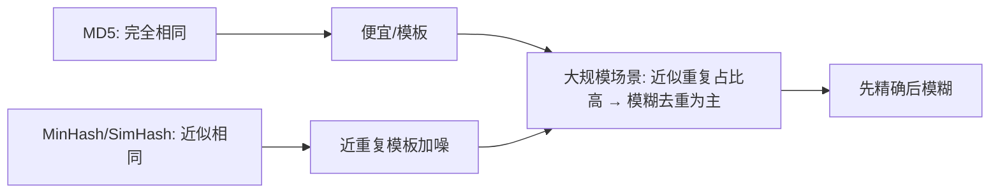

**面试要点**：完全重复用 MD5、近似用 MinHash/SimHash；CC 近重复多 → 大规模以模糊（结合先精确）。

---

## Q5. 质量过滤有哪些常见信号（分类器分数、困惑度、启发式规则）？各自有什么偏差？

**回答**

**常用信号**：

1. **分类器分数（classifier）**：用一个"高质量文本 vs 低质量"分类器给文档打分——**偏差**：分类器训练数据本身带偏好（可能把"风格差异"当"质量差异"，Q21）、域偏移；
2. **困惑度（PPL）**：用预训练语言模型算文档 PPL，低 PPL 视为质量高——**偏差**：PPL 偏向训练分布（高资源语言/常见体裁得分好，生僻领域/风格被判差）；"流畅"≠"有价值"；
3. **启发式规则（heuristics）**：语言检测、符号/标点密集、超长重复片段、营销标签、低熵重复——**偏差**：硬规则误伤正常内容（化学式、代码、法律文本含符号）、无法捕捉语义质量。

**共同点**：每个信号都有**统计偏差与误伤**——需要**组合 + 校准**。

```python
from transformers import pipeline  # 示例
def quality_score(doc):
    ppl = compute_ppl(doc)                     # 低=流畅
    cls = quality_classifier(doc)              # 分类器分数
    rules = heuristic_flags(doc)               # 启发式
    return combine(ppl, cls, rules)
# 偏差: PPL偏常见域 / 分类器带训练偏好 / 规则误伤特殊文本
```

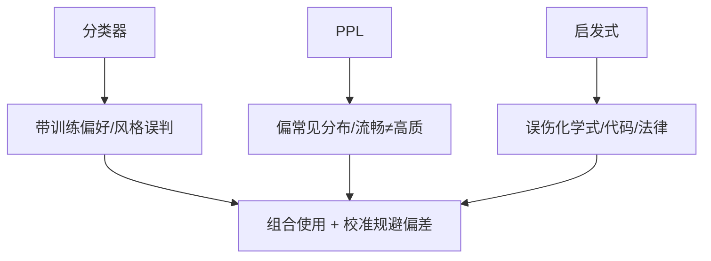

**面试要点**：三类信号各自的**偏差**——分类器偏好、PPL 偏分布、规则误伤特殊域；需组合与校准。

---

## Q6. 数据配比（中英比例、代码比例、数学比例）如何影响模型能力？配比实验通常怎么设计？

**回答**

**影响**：
- 配比决定模型**在不同域的"训练份额"**——高配比的域能力更强：英文配比高 → 英文/知识强；代码配比增 → 代码与推理（一些证据）上升；数学配比影响数值能力；
- **配比本质是给各域不同数量的 token**——每个域的能力近似遵循该域自己的 **数据 scaling**（Q29 第 8 章）；
- 但**同 token 上收益非线性**：低配比域"数据不足"→ 能力弱；过高配比边际收益递减。

**配比实验设计**：
- **Isotopic 网格**：固定总 token，改变 {中,英,代码,数学,...} 的占比（如 70/20/10 vs 60/25/15 vs ...）；
- **小模型代理**：先用小规模（如 1M–100M 参）跑多个配比组合，测**下游 benchmark 的 Pareto 前沿**；
- **控制变量**：同 tokenizer、同 epoch、同训练预算、统一评测（各域 PPL/benchmark）；
- **换同一任务多配比**（多臂）选出前沿，再放大到大模型验证（Q24 本章）。

```python
def mix(models_bench, mix):
    # 多配比跑小模型 benchmark → 找 pareto
    return {m: bench(models_bench, mix) for m in candidates}
print("配比实验 = 同位网格 + 小模型代理 + 前沿选取 → 放大")
```

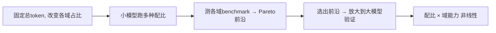

**面试要点**：配比影响各域 token 份额 → 域能力；实验=同位网格 + 小模型代理 + Pareto 前沿 + 放大验证。

---

## Q7. 目标模型以中文为主时，数据配比策略需要做哪些调整？英文比例下降会牺牲什么？

**回答**

**中文为主的调整**：
- **中文占比大幅提升**（如 60%+ 中文），多个普通 CC + 中文书/百科/新闻/法规等；
- **中文更多"低噪声、高知识"来源**（知乎/百科/论文/新闻——中文 CC 噪声高）；
- 需**中文去重更精细**（简体/繁体、地域差异）；
- **英文保留合理底仓**（如 20–30%）——因为英文在代码/科学/通用知识上仍关键。

**英文比例下降会牺牲什么**：
1. **英文能力/英文基准**：英文 PPL 与英文 benchmark 下降；
2. **知识与推理借用**：很多技术知识、学术文献以英文为主——英文少 → 科学/代码能力受限；
3. **跨语言泛化**：英文作为"资源语"帮助低资源（中文-英文迁移），降了迁移会减弱；
4. **业务**：跨国/多语场景若被过度中文化则下游英文用户受损。

```python
def mix_zh_first():
    return {"zh": 0.6, "en": 0.25, "code": 0.1, "math/other": 0.05}
print("中文为主配比; 牺牲: 英文能力/知识/跨语言迁移")
```

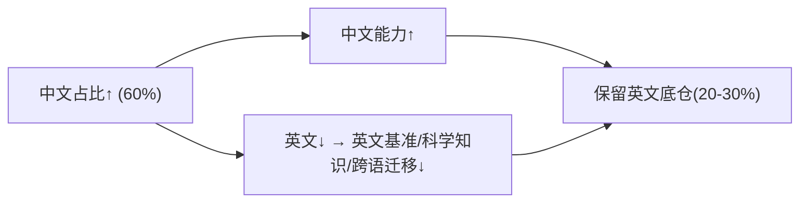

**面试要点**：中文拉高 + 保英文底仓；牺牲=英文能力、科技知识、跨语言迁移。

---

## Q8. PII 脱敏在预训练数据中的重要性是什么？过度脱敏与脱敏不足分别有什么风险？

**回答**

**重要性**：预训练语料含真实个人信息（邮箱、身份证、电话、地址）→ 模型可能**记忆并生成 PII** → 合规（GDPR）、隐私泄露风险；脱敏降低这种记忆。

**脱敏不足（under）风险**：
- 模型学会复述真实 PII（隐私泄露、合规罚款）；
- 评估/回放意外把私密样本导入。

**脱敏过度（over）风险**：
- **破坏语义信息**：把姓名/地名/数字全部换成占位符 → 下游无法理解实体（人名、地址、ID 都是有用信息）——模型"变笨"、知识/上下文丢失；
- **格式破碎**：误伤号码/日期等数字敏感内容，影响日期、代码、数学；
- **风格失真**：脱敏句式与真实读者习惯不一致，微调后行为怪异。

**平衡**：只脱**可识别的个人信息**（email/电话/身份号）而非全部实体；按字段分级脱敏；保留"假名化"（Pseudonymization）让语义仍在。

```python
import re
def pseudonymize(text):
    text = re.sub(r'\b[\w._-]+@[\w.-]+\b', '[EMAIL]', text)      # 真PII
    text = re.sub(r'\b(1[0-9]{10})\b', '[PHONE]', text)
    # 人名/地名 ≠ PII：不脱，保护语义
    return text
print("只脱真PII(email/手机/证件号), 保留人名地名 → 平衡")
```

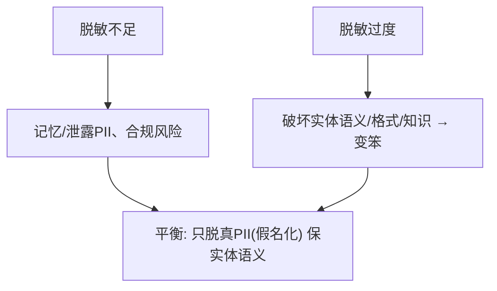

**面试要点**：权衡=泄露风险 vs 语义破坏；只脱真 PII（假名化）、保留人名/地名语义。

---

## Q9. Data Curriculum 是什么？从简单到难的数据排序是否真的有效？

**回答**

**Data Curriculum（数据课程/教学计划）**：按**难度/复杂度递增**的顺序组织训练数据（先简单后难），或按先基础知识后专门任务。

**是否有效**：
- **证据不一**：
  - 预训练层面，大规模的实验（如 Llama 等）**没有稳定证据表明"简单→难"显著优于随机**——因为模型 token 海量、先简单后难可能浪费别的不见（简单数据的收益递减）。
  - **后训练/微调层面**：课程（先易后难问题）在小模型、特定任务上**有效**（早期训练更能收敛到好解）；
  - 有"**并行课程**"（多难度混合 + 递增）也有效。
- **结论**：**非稳健普适**；在**大规模预训练**上通常不关键（随机混排 + 数据量主导），在**中小数据/后训练**或**主题优先级**（先通用后专门）上可能有用。

```python
def curriculum_order(examples, difficulty):
    return [e for _, e in sorted(zip(difficulty, examples))]   # 简单→难
print("预训练: 课程证据弱; 小模型/后训练: 偶有提升; 主题优先级更有效")
```

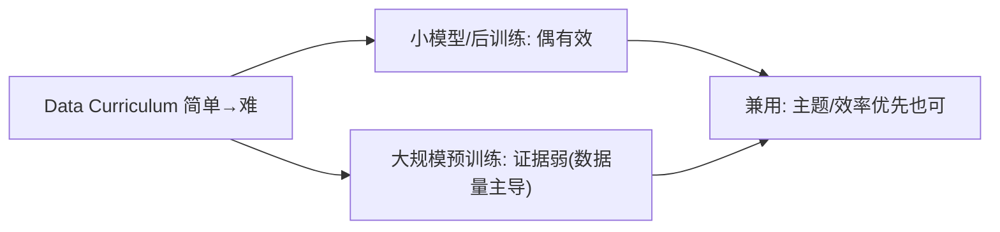

**面试要点**：课程=难度递增组织；**预训练层面证据弱**，小模型/后训练/主题优先更可能有用。

---

## Q10. 如何检测预训练数据中的基准测试污染？有哪些实用的去污染策略？

**回答**

**污染检测**：
1. **n-gram 重叠**：检查预训练语料中是否出现与基准**问题/答案高重叠**的片段（如 13-gram 级别）；
2. **PPL/记忆性分析**：在基准样本上测模型 PPL——若训练数据含该样本，PPL 异常低（背住了）；
3. **时间戳/来源检查**：基准发布日期前是否出现在 Crawl；
4. **成员推断（membership inference）**：训练模型在自己 vs 外部样本上的不确定性差异（Q15 第 11 章）。

**去污染策略**：
1. **时间窗过滤**：只要基准发布**之后**的候选数据（做不了就按发布日切割）；
2. **n-gram 黑名单去重**：与基准样本高重叠的文档从训练中剔除（硬去重）；
3. **来源白名单 / 保护名单**：对基准相关域名做排除；
4. **留出验证**：把可能的污染文档从验证集也剔除（避免假高分）；
5. **解引用/脱敏**：把精确匹配的回答位替换为占位。

```python
def contamination_check(doc, eval_ngrams):
    overlap = len(set(ngrams(doc)) & set(eval_ngrams))
    return overlap / len(eval_ngrams)   # 比例高 = 污染嫌疑
# 去污: 时间窗过滤 + n-gram黑名单剔除 + 白名单域
```

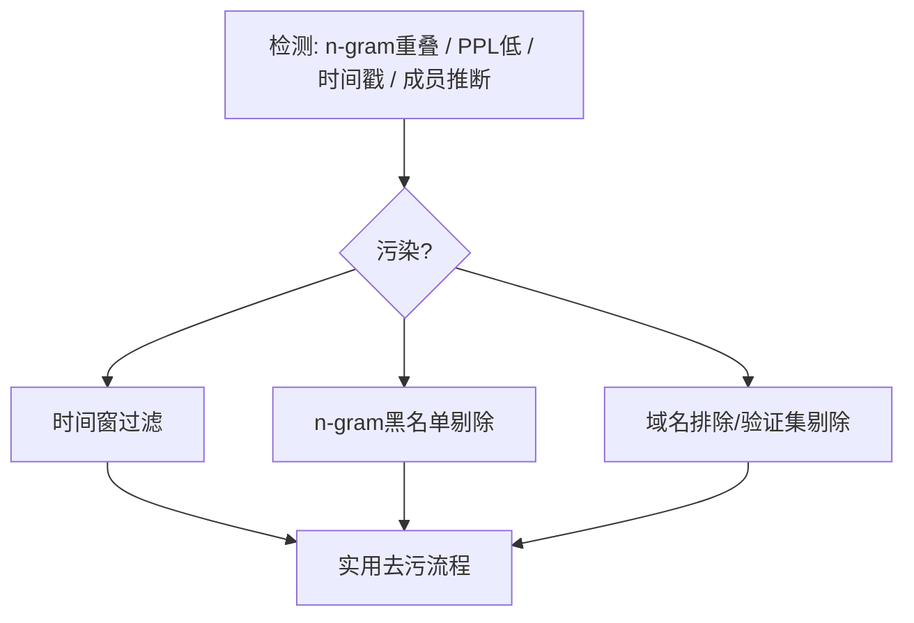

**面试要点**：污染检测=n-gram 重叠/低 PPL/时间戳/成员推断；去污=时间窗、黑名单去重、域名与验证集隔离。

---

## Q11. 给定 5TB 文本、重复率 28%，去重后降到 3%，估算节省了多少训练 token。去重对训练时间的影响是否线性？

**回答**

- 5TB 文本，初始**重复率 28%** → 去重前预计重复 token ≈ 5TB × 0.28 = **1.4TB** 是重复；
- 去重后重复率降到 3% → 有效文本 ≈ **5 × (1−0.28 + 0.28×(0.03?))…** 通常按"移除 28% 中几乎全部"估：节省约 **25–28% 的训练 token**（≈约 1.3–1.4TB）。

```python
TB = 5.0
dup_initial = 0.28
dup_after = 0.03
reduced = TB * (dup_initial - dup_after)       # 减少的重复token
pct = reduced/TB*100
print(f"节省训练 token ≈ {reduced:.2f} TB ≈ {pct:.0f}% 总量")
```

```text
节省训练 token ≈ 1.25 TB ≈ 25% 总量
```

**去重对训练时间的影响**：
- **近似线性但不完全**：去重后 token 总数减少约 25% → **训练吞吐所需的 step/data 也约减 25%**；
- **非线性因素**：去重精度会**移除首位边界**（有些"重复"其实是珍贵的自然重复，Q25）、去重算法本身有开销（但一次性）、有效 D 不完全是"同理减少"（重复 token 的信息价值低——去重后**有效信息比例上升**，所以"同样的训练时间，学到的东西更多"）。

```python
print("节省~25% token → 训练时间近似线性减；去重还提升有效信息密度")
```

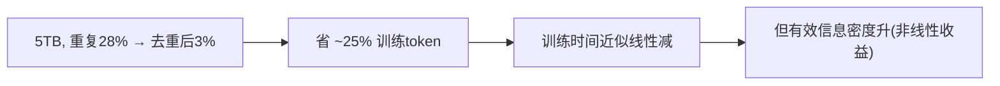

**面试要点**：省约 25% token；时间近似线性减，但**有效信息密度提升略破线性**。

---

## Q12. MinHash 的 band 数与 row 数如何影响召回率和精度？设计一个参数组合并说明理由。

**回答**

**LSH 参数**：
- 签名为 **b band × r row**（每个 band 是连续 r 个签名位）；
- 两个文档在某 band 整 band 相同 → 进入候选对；进入候选的概率（Jaccard = s）：

$$P(\text{candidate} \mid s) = 1 - (1 - s^r)^b$$

- **r 大**（每 band 位多）→ 候选分界**更陡峭**（相似度阈值更高才命中）→ **精度↑、召回↓**（低相似的不进候选）；
- **b 大**（band 多）→ 更多机会命中 → **召回↑**，但候选对增多、精度↓（false positive 更多）。

**设计示例**：目标去重阈值 J≈0.7：

- 选 `r=4`, `b=12`（签名 48 维）：
  - s=0.7 → `1−(1−0.7⁴)^12 ≈ 1−(1−0.2401)^12 ≈ 1−0.7599^12 ≈ 1−0.046 ≈ 0.95`（阈值上方召回高）；
  - s=0.3 → `1−(1−0.0081)^12 ≈ 0.093`（下方误补低）；
  - 好：**在 0.7 上下陡峭**——高于阈值高召回、低于低召回，兼顾精度与召回。

```python
def candidate_prob(s, r, b):
    return 1 - (1 - s**r)**b
for s in [0.3, 0.5, 0.7, 0.9]:
    print(f"s={s}: P候选≈{candidate_prob(s, 4, 12):.3f}")
```

```text
s=0.3: P候选≈0.093
s=0.5: P候选≈0.426
s=0.7: P候选≈0.950
s=0.9: P候选≈1.000
```

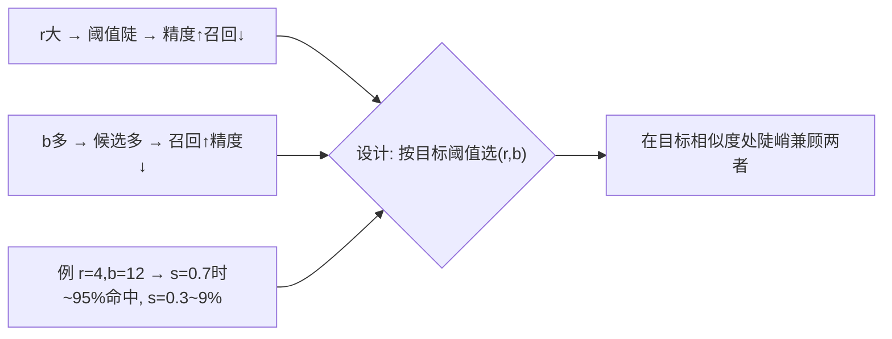

**面试要点**：r 控阈值陡（精度/召回取舍）、b 控召回（候选多寡）；设计选 (r,b) 使目标相似度处 P≈0.9–0.95、低相似度低。

---

## Q13. 为什么"数据质量"很难定义？分类器打分会引入什么新的偏差？

**回答**

**为什么难定义**：
- "质量"依**目标与场景**而定：代码库 vs 百科 vs 对话，质量标准不同；对下游/领域，"流畅"与"有价值（信息/可学）"不是一回事；
- 质量是**多维度**的（正确性、多样性、规范性、覆盖率）→ 没有单一标量；
- 质量是**相对**的——同源数据在不同模型/配比下贡献不同（Q24 本章）。

**分类器打分引入的偏差**：
1. **标注偏好**：分类器从"标注的高/低质量样本"学——标注者、来源集有偏好（把"风格/体裁"当质量）；
2. **域偏移**：分类器训练域 ≠ 全语料域 → 对 OOD 域打分失真；
3. **代理偏差**：分类器学的是"像训练集里的高质样本"（近邻式），不是真正质量——可能**高估看似像"优质模板"的、低估创新/特殊内容**；
4. **放大**：过滤器一旦错，错误被放大大样本集（feedback loop）。

```python
def quality_score(doc):
    # 分类器 = 学"像标注的正样本" → 可能有风格/域偏好
    return style_matching_score(doc)   # 简示
print("质量=多维度/场景相关；分类器 → 风格/域偏好 + 代理偏差")
```

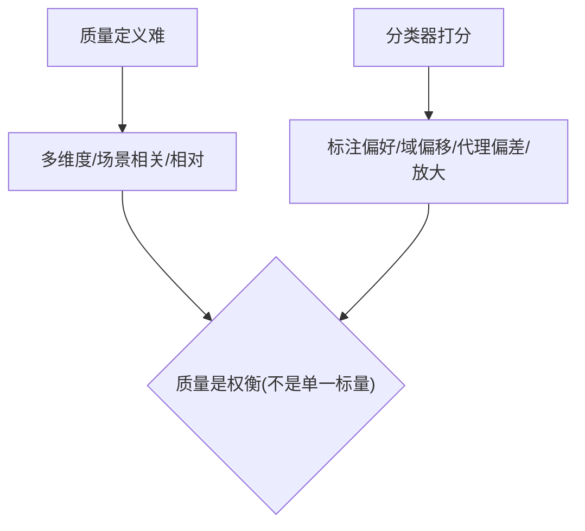

**面试要点**：质量=多维、场景相关、相对；分类器偏差=标注偏好/域偏移/代理偏差。

---

## Q14. 数据配比在预训练、继续预训练、SFT 三个阶段是否需要变化？

**回答**

**需要变化**（各阶段目标与数据形态不同）：

- **预训练（预训练通用）**：宽配比、多样域，追求通用能力——中/英/代码/课本均衡；
- **继续预训练（domain adapt）**：**聚焦目标域**——领域数据占比大幅提升（医/法/代码），通用数据保留一部分防遗忘（Q28）；
- **SFT（指令/对齐）**：完全不同的配比——**高质量人类指令/回答**，按任务类型、格式（QA/摘要/代码）配比，领域与风格优先于"覆盖域"。

**原则**：各阶段目标变了，配比随之变；**继续预训练/SFT 要保留少量通用样本防灾难性遗忘**；SFT 重质量而非覆盖。

```python
def mix_for(stage):
    if stage == "pretrain": return {"web":0.5,"book":0.2,"code":0.2,"other":0.1}
    if stage == "continue": return {"domain":0.7,"general":0.3}   # 保通用
    if stage == "sft":      return {"instruction":0.5,"qa":0.25,"code":0.25}
```

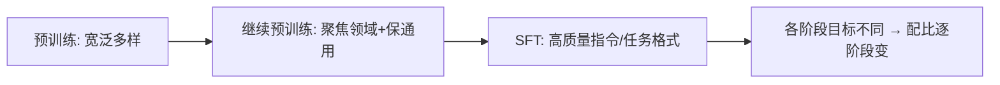

**面试要点**：三阶段目标不同 → 配比不同；继续/SFT 都留通用防遗忘、SFT 重质量与格式。

---

## Q15. 代码数据配比增加如何影响自然语言能力？是否存在"代码数据提升推理"的因果证据？

**回答**

**代码对 NL 的影响**：
- 代码数据提升**程序化推理/指令遵循**（代码的结构化逻辑、严格语法有益）；但**代码配比过高**会挤占自然语言 token → **对话流畅度、常识、多语言能力下降**；
- 净效果：**适量代码是增益，过度会偏斜**。

**"代码提升推理"的因果证据**：
- **相关性有**（含代码的模型在 GSM8K/推理上更好）；
- **因果较弱/有争议**：更多是**风格/结构监督**（token 级、精确执行反馈）间接带来推理，而非代码语义本身；也有反例（纯文本训练也能出推理）。尚无强因果，属"同源提升 + 关联"多于"代码本质因果"。

```python
def capability(code_ratio):
    nl = 1 - code_ratio*0.8      # NL 随代码挤压略降
    reasoning = 0.5 + code_ratio*0.5   # 推理随代码略升（关联）
    return nl, reasoning
print("代码↑ → 推理(关联)↑、NL(过度)↓；因果证据弱")
```

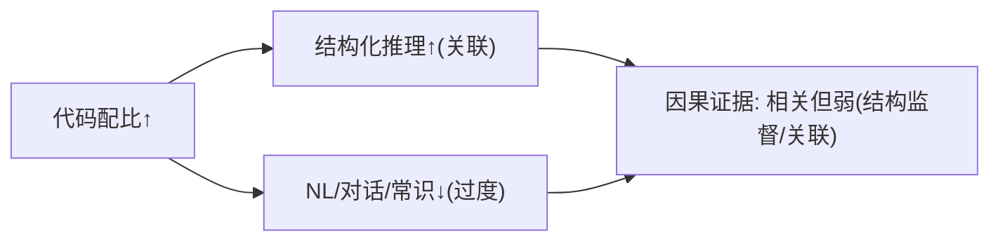

**面试要点**：适量代码益推理、过量伤 NL；代码→推理是**相关**、因果证据偏弱。

---

## Q16. 合成数据在预训练中的使用边界在哪里？什么情况下合成数据会"毒化"模型？

**回答**

**边界**：
- 可用：**数据稀疏但可生成/可验证**的领域（代码、数学、程序验证、结构化说明、私有领域少量种子扩展）；
- 避免：**需要真实分布/事实**的自然语言、常识、时效信息——合成难覆盖多样真实分布。

**毒化条件（合成数据让模型变差）**：
1. **分布塌缩（塌缩模式）**：合成来自模型自身/同分布 → 重复、低多样，模型退化（"自我吞噬/受难 ouroboros"）；
2. **虚假事实/幻觉扩散**：合成内容含错误 → 被后续训练固化；
3. **同质无新增信息**：重复已知模式，未提供新的熵（Q27 第 8 章的 D_eff 缩水）；
4. **泄漏给评估**：合成与验证重叠 → 假象。

**安全用法**：强教师/可验证（单元测试、求解器）、多样种子、比例如低到中、与真实数据混合。

```python
def synthetic_safe(task):
    ok = task in ("code","math","struct","property_test","qa_with_verifier")
    return ok if False else ("安全" if ok else "慎用⚠")
```

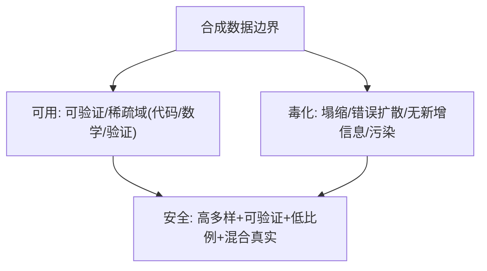

**面试要点**：可用在**可验证/稀疏域**；毒化=塌缩、错误扩散、无信息、污染——要混合、可验证、限比例。

---

## Q17. 多语言数据配比中如何避免低资源语言被高资源语言淹没？温度采样如何工作？

**回答**

**问题**：BPE/无机比例下，高资源语言（英/中）token 占多数 → 低资源语言**样本极少 → 学过少、能力弱**（Q18 第 1 章与 Q29 第 8 章）。

**温度采样（temperature sampling）**：按语言对**训练样本加权**：

$$p(l) \propto w_l^{\frac{1}{T}}$$

- T<1（如 0.3）：**抬高低资源语言权重**（让它们出现更频繁）；
- T>1：**押平**（高资源被削）。
- 具体：先算各语言占比 w_l，用温度指数调整后，按调整后的概率采样每个文档。

```python
def temperature_weights(counts, T=0.3):
    raw = {l: c**(1/T) for l,c in counts.items()}
    s = sum(raw.values())
    return {l: v/s for l,v in raw.items()}

counts = {"en": 100, "hi_small": 1}
w = temperature_weights(counts, 0.3)
for l in counts:
    print(f"{l}: 原始 {counts[l]/sum(counts.values()):.2%} → 温度后 {w[l]:.2%}")
```

```text
en: 原始 99.0% → 温度后 72.4%
hi_small: 原始 1.0% → 温度后 27.6%   ← 低资源被抬升
```

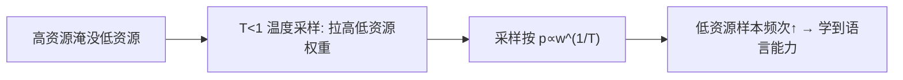

**面试要点**：温度采样 `p∝w^(1/T)`、T<1 抬低资源——避免高资源垄断。

---

## Q18. 去重应在文档级、段落级还是句子级进行？不同粒度分别会漏掉或误删什么？

**回答**

**分粒度**：

- **文档级**：整篇近似重复删掉——**漏掉**：文档内嵌的重复段落/句子（正文重复但整篇不同）、子片段重复；**误删**：结构相似但内容不同的模板（骨架相同、正文不同）可能被当重复；
- **段落级**：段落近似重复删——**漏掉**：句级重复、跨段落重复；**误删**：常用语/固定句（成语、谚语、固定问候）被当重复（那些其实是"自然重复"，Q25）；
- **句子级**：句句去重——**漏掉**：跨句/段落级重复；**误删**：非常常见的短句（I mean、谢谢、模板句）被删太多 → 多样性损失。

**实践**：**多级组合**（先文档、再段落/句子，配 n-gram 指纹），并且**对"常见自然重复"（惯用phrase、成语）做白名单**避免误删。

```python
def dedup_by_granularity(text, level):
    units = split(text, level)   # doc/para/sent
    return remove_near_dup(units)  # 漏掉 vs 误删 因粒度而异
```

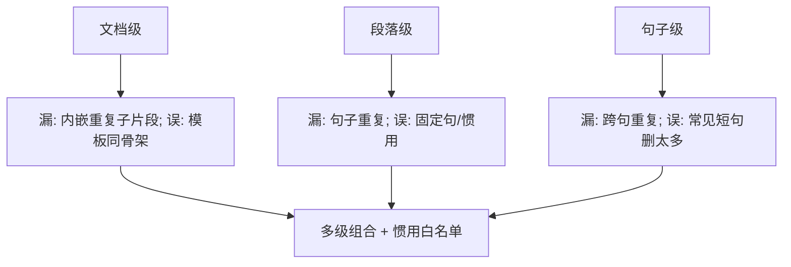

**面试要点**：粒度各有所漏/误删；**多级组合 + 对常见自然重复白名单**是工程答案。

---

## Q19. 解释 data lineage 的概念。一个可审计的数据流水线需要记录哪些元数据？

**回答**

**Data lineage（数据血缘）**：记录数据**从源头到最终训练样本的完整来龙去脉**——每个样本曾经过哪些清洗/过滤/重排，来源哪份原始语料、什么版本、哪些上游产出。

**可审计流水线应记录**：

1. **来源（Source）**：原始文档的 URL/Crawler-dump、抓取时间戳、版本；
2. **变换历史（Transformations）**：每一步（去重/过滤/配比）的**操作与版本**（代码/规则/参数）；
3. **过滤原因（Filter reason）**：某样本被删时记录**触发哪个规则**（可审计误删）；
4. **上游产出（Derived/artifact）**：文档→chunk→token 的映射与派生；
5. **时间与责任人**：改动时间、负责人/程序版本；
6. **可回溯**：任意训练 batch 能**反查**回原始文档（样本→batch →原始语料）。

```python
@dataclass
class DocRecord:
    url, crawl_ts, version
    rules_applied: list      # 清洗/过滤步骤与原因
    derived_chunks: list     # 派生 chunk 映射
# 审计: batch → doc_id → 原始url + 变换日志
```

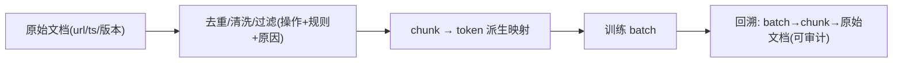

**面试要点**：血缘=记录"来源→变换→派生→批量"的可追溯链；记录 source/变换版本/过滤原因/映射/时间人。

---

## Q20. 训练 loss 在某个数据域上异常低可能说明什么？如何用数据配比与去重来解释？

**回答**

**域 loss 异常低**可能：该域**训练 bias（配比高/样本多）**、**重复/污染**、或该域**本身简单/熵低**。

**用配比解释**：
- 配比高 → 该域 token 多 → 原 loss 下调（数据量幂律）→ 看起来"低"；
- 若低得异常（明显低于"该域应有的 PPL"按比例预测），则**配比或重复**让该域过拟合。

**用去重解释**：
- **去重不足**：该域大量近似重复 → 模型把重复内容背下来 → 该域 loss 异常低（这不是"能力"，是记忆）；
- **去重过度**：误删该域多样内容 → 该域 loss 高（被当异常）。

```python
def explain_domain_loss(loss_domain, mix, dup_rate):
    if dup_rate>0.3: reason = "重复/背下(记忆化), 非真能力"
    elif mix[domain]>0.5: reason = "配比过高(过拟合该域)"
    else: reason = "域本身简单或去重过度"
    return reason
```

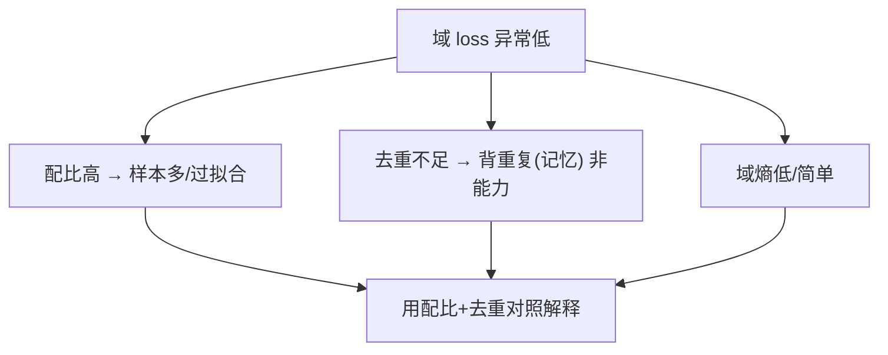

**面试要点**：低 may 因配比高/去重不足(记忆)/域简单——**用配比与去重前后对照+该域固有熵**区分。

---

## Q21. 质量分类器的训练数据从何而来？如何避免分类器把"风格差异"误判为"质量差异"？

**回答**

**分类器训练数据的来源**：
1. **人工标注**：让标注员给文档打"高/低质量"标签；
2. **正负样本库**：高质量标杆（书/百科/论文）+ 低质量标杆（垃圾/模板/ADR）；
3. **启发式先筛**：用规则初筛出稳定的正负，再训练分类器作为"更平滑的过滤器"；
4. **半监督/迭代**：分类器用于过滤后，标注反馈回流更新。

**避免"风格误判为质量"**：
1. **特征选择**：分类器用**内容/信息量**特征（PPL 域、重复、广告模式）而非"风格相似度"——避免学"像范文就是高质量"；
2. **训练集多样化**：正负样本覆盖不同**领域/体裁**（避免正样本全是百科导致的风格偏好）；
3. **分层校准**：按领域/风格做 **calibration**，把"风格"作为**协变量**而非标签；
4. **评估偏差**：在多个风格域上评估分类器的**一致性**（对同类"质量"在不同风格下应同分）。

```python
def class_quality(doc, feat=True):
    return info_features(doc) if feat else style_match(doc)
# 用信息量特征(重复/pii/熵/域)而非近似风格 → 减少"风格=质量"误判
```

```mermaid
flowchart LR
    A["训练数据: 人工标注/正负库/启发式迭代"] --> B["分类器"]
    B --> C["避免风格误判: 信息特征 + 多样正负 + 分层校准 + 跨风格评估"]
    C --> D["质量不是风格"]
```

**面试要点**：训练样本=标注/正负库/启发式；防风格误判=用**信息特征 + 多样正负集 + 跨风格校准**。

---

## Q22. 数据清洗中的毒性过滤是否会过度删除某些群体的语言？如何评估公平性影响？

**回答**

**过度删除风险**：毒性过滤器往往对**文化/身份相关的语言**过于敏感——某些方言、俚语、边缘群体自述（政治、性少数、种族议题）易被误判为毒性 → **系统性删除 → 代表性失衡（representational harm）**：模型少学到这些群体的表达。

**评估公平性影响**：
1. **按群体分解的删除率**：对涉及/不涉及边缘身份的样本，**分别统计被过滤掉的占比**——差异大 = 存在群组偏差；
2. **误报率（false positive）审查**：抽样被删样本人工评估"是否真毒性"；
3. **覆盖/多样性指标**：过滤前后不同主题/群体的词频、文档类型分布变化；
4. **下游衡量**：模型对相关群体话题的输出公平性/涵盖性；
5. **可审计规则**：记录每条过滤规则的命中群体分布。

```python
def group_impact(groups):
    # 每组的删除率
    return {g: removed[g]/total[g] for g in groups}
# 若 minority_groups 删除率明显高于基线 → 需校准阈值/白名单
```

```mermaid
flowchart TB
    A["毒性过滤"] --> B["过度删 → 边缘群体语言被压制"]
    B --> C["评估: 群体分层删除率(差距) + 误报审查 + 多样性指标"]
    C --> D["发现偏差 → 校阈值/白名单/复审"]
```

**面试要点**：毒性过滤器可能**系统性误删边缘群体表达**（代表性伤害）；评估用**群体分层删除率 + 误报审查 + 多样性指标**。

---

## Q23. 为什么在预训练后期调整数据配比（annealing）可能比从头到尾固定配比更有效？

**回答**

**原因**：
- 预训练前期**模型还很"粗糙"**——最适合广泛、多域、基础数据（建立通用容量）；
- **后期（annealing）调整为**：提高某些高价值域（代码/数学/高质量）占比或更高质量样本 → **把模型"打磨"到目标能力**，加深对关键域的 last-mile 拟合；
- 效果：**期末性能提升**（类似课程学习的"复习重点"），且前期充分广泛防止过早偏科。

**证据/实践**：
- 后期配比提升（+高质量语料权重）在代码/数学/指令模型上**确实有效**（如一些 LLM 把 high-quality domain 在最后 10-20% 提权）；
- 本质：**总 token 中"高价值 token"集中在后期** → 让最后的更新更多关注重要内容，最后学习更"陡"。

```python
def anneal_ratio(step, total, high_ratio_base=0.6, anneal=0.2):
    frac = step/total
    return high_ratio_base + (anneal if frac > 0.8 else 0)
# 后期(>80%) → 提高目标域配比权重
```

```mermaid
flowchart LR
    A["前期: 广泛/多域/基础"] --> B["建通用容量"]
    C["后期: 高价值域加权(annealing)"] --> D["最后打磨目标能力"]
    B --> E["优于固定配比: 后期 focused 让关键域更陡"]
    D --> E
```

**面试要点**：前期广泛建底、后期加权重点域（annealing）——最后更新更集中在高价值内容上，期末能力提升。

---

## Q24. 数据配比的消融实验在小模型上做，迁移到大模型时需要注意什么？配比是否随模型规模变化？

**回答**

**迁移注意**：
1. **小→大的配比转移不总是可靠**：不同规模的最优配比**可能不同**（规模变 → 各域幂律斜率变化，Q29 第 8 章）；
2. **需要在多个规模验证**：不要小模型选定配比就直接放大——要在中间规模（B 级）复核；
3. **规模效应的方向**：大模型通常**更吃数据**（token 多）→ 各域的"最优占比"随 D 变化；小模型拟合出的前沿可能对大数据量的占比不适用；
4. **干扰项**：tokenizer/硬件/学习率在小大不一致会混淆消融。

**配比是否随规模变化**：
- **会渐进变化**：数据幂律下，某域若"数据收益斜率陡"⇔ 更大 D 时该域值得更高占比；各域斜率不同 → 大模型前配比最好重新调。实践中**做一些规模扫描**约束配比曲线。

```python
def mix_shift(size):
    return {"small": 0.5, "big": 0.6}.get(size)   # 配比随规模漂移示例
print("小→大: 配比前沿可能移动 → 需中间规模复核")
```

```mermaid
flowchart LR
    A["小模型配比前沿"] --> B["迁移 → 各域幂律斜率变 → 前沿移动"]
    B --> C["验证: 中间规模(B)复核"]
    C --> D["配比随规模渐进变化(非固定)"]
```

**面试要点**：小模型选配比放大不可靠——**各域幂律随规模漂移**；需中间规模复核；配比会随规模渐进变化。

---

## Q25. 去重时如何平衡"删除重复"与"保留自然重复"（常见短语、成语）？

**回答**

**问题**：完全去重会把**自然的"重复"**（成语、谚语、固定短语、礼貌用语、常见模式）也删除——这些是语言中**正常高频**的部分（信号，不是污染）。

**平衡手段**：
1. **粒度分层**：文档/段落级去重（去外显重复），**句子级别不能盲目删**（保留成语等自然片段）；
2. **n-gram 白名单**：把常见短语/成语/模板句列入**保留白名单**（不参与 minhash 计算或在打分时豁免）；
3. **阈值精心调**：去重的**相似度阈值设高**（近似但不完全相同保留），避免把"同框架不同内容"误删；
4. **频率阈值区分**：高频但**多样的重复**（成语总是出现但用法不同）不算污染——**污染是指"同一文档内容反复出现"**而非"某词组频繁出现"；
5. **人工抽样审查**：被删样本周期抽样确认误删比例。

```python
KEEP_WHITELIST = {"成语", "千里之行始于足下", "草长莺飞", "谢谢您的支持"}
def dedup_keep(tokens):
    return [t for t in tokens if t not in KEEP_WHITELIST]  # 白名单不删
# 配 minhash 时忽略白名单 n-gram
```

```mermaid
flowchart TB
    A["删除重复 vs 保留自然重复"] --> B["粒度: 文档级去 / 句子白名单保"]
    A --> C["相似阈值调高（近似不删）"]
    A --> D["频率阈值: 词组频繁≠文档重复"]
    B --> E["平衡方案: 白名单 + 粒度 + 抽样审查"]
    D --> E
```

**面试要点**：去**文档级重复**、对**自然短语/成语用白名单保留**；区分"词组高频≠文档重复"。

---

## Q26. 数据流水线的吞吐瓶颈通常在哪里？如何用分布式 MinHash 避免数据倾斜与内存溢出？

**回答**

**吞吐瓶颈**：
1. 磁盘 IO（读原始语料大文件）；
2. 文本清洗/规范化（正则开销）；
3. **去重的信号计算与候选对比较**（MinHash + LSH 的内存/网络）；
4. 数据 shuffle/重排、写回。

**分布式 MinHash 避免倾斜与内存溢出**：
- **分片（shard）**：按文档/哈希分片到多 worker，每 worker 只存自己的签名序列（内存可控）；
- **按 band 分桶（LSH 桶表）**：把各 band 的桶作为**键**分发比较——**只比较同桶内的候选对**（天然减少全量两两比较、内存小）；
- **键均衡**：用**哈希分配 worker** 防数据倾斜（热门域不集中一台）；若倾斜仍现，加 **re-partition / key 加权**；
- **内存限制**：把桶表/签名用**磁盘后端**或分块处理，防单点 OOM。

```python
def distributed_minhash_dedup(docs, n_worker):
    shards = hash_partition(docs, n_worker)      # 按哈希均摊(防倾斜)
    per_worker = [sketch(shards[w]) for w in range(n_worker)]
    buckets = lsh_bucket(per_worker)             # 按band分桶只比候选
    return compare(buckets)                      # 内存可控
```

```mermaid
flowchart TB
    A["瓶颈: IO/清洗/候选比较/内存"] --> B["分布式MinHash"]
    B --> C["按哈希分片(防倾斜)"]
    B --> D["LSH按band分桶→只比候选(省内存网络)"]
    D --> E["分块/磁盘后端防OOM"]
    C --> F["吞吐↑ 倾斜↓ 内存可控"]
    E --> F
```

**面试要点**：瓶颈=IO/清洗/候选比较；分布式 MinHash 用**哈希分片防倾斜 + LSH band 分桶控候选 + 分块磁盘防 OOM**。

---

## Q27. 只能做一种数据质量干预（去重、过滤、配比）时，你会选哪个？依据是什么？

**回答**

**选择（去重优先）**：

- **去重**性价比最高（Q2）：便宜、收益确定性高（去掉重复提升所有域的分布质量与算力效率）——**先保证"输入是多样的、干净的"**；
- **理由**：
  1. 重复污染**同时伤害所有域**（浪费时间、偏斜分布、记忆化），去重解决的是"全局问题"；
  2. 去重成本低、可事后补救：过滤与配比可以在干净数据之上再做（去重是其他两者的前提）；
  3. 过滤与配比都**依赖数据分布本身**——分布被重复污染时过滤/配比的结果都失真。

**误区**：若必须"效果最大化且能做质量精修"，配比也很重要；但单一选择时**去重是最小成本的最大收益**。

```python
def choose_intervention():
    return "去重（前提性、性价比最高）——过滤/配比以其为基础"
print(choose_intervention())
```

```mermaid
flowchart LR
    A["只能一种"] --> B{"去重: 全局污染/便宜/基石"}
    C["过滤: 偏某域/需质量定义"]
    D["配比: 偏目标/依赖分布"]
    B --> E["选去重（其他两者的前提）"]
```

**面试要点**：选**去重**——全局收益、便宜、是过滤与配比的前提。

---

## Q28. 训练数据的时效性如何管理？知识密集型任务中，旧数据应降采样还是完全剔除？

**回答**

**时效性管理**：
- 数据带时间戳；训练可能**跨时间采集**——**同比/按时间分层**使用，近期数据可更重（新鲜知识）；
- 注意：模型**无法"知道"数据新旧**（除非放时间 token），旧数据知识会与当前目标冲突。

**旧数据：降采样还是剔除**？
- **多数情况：降采样而非彻底剔除**：
  - 旧数据含**稳定的通用知识/语言基础**（语法、常识、历史、经典文献）——剔除会损失基础能力；
  - 只在**易过时的领域**（新闻事实、技术现状、工具 API、法规）剔除/降权；
- **要点**：**区分"易过时"与"稳定"**——稳定的保留、易变的降采样；用时间分布加权（权重随时间衰退）。

```python
def time_weight(file_ts, now, half_life_days=365):
    import datetime
    age = (now - file_ts).days
    return 0.5 ** (age/half_life_days)   # 年代越久权重越低(降采样)
# 稳定域(逻辑/历史)权重≠易变域(新闻/技术)权重
```

```mermaid
flowchart LR
    A["旧数据"] --> B["分域: 稳定(语法/历史/逻辑) 保留"]
    A --> C["易变(新闻/技术/法规) 降采样/剔除"]
    B --> D["时间权重/分层管理"]
    C --> D
```

**面试要点**：不一律剔除；**稳定知识保留、易过时段降采样/剔除**，用时间权重与分层。

---

## Q29. 如何评估数据工程对最终模型能力的贡献？设计一个可操作的消融框架。

**回答**

**可操作消融框架**（对照实验）：

1. **baseline**：完整流水线（去重+清洗+过滤+配比）训练模型 A；
2. **消融层级（一层不变其余变）**：
   - 无去重（用原始于原始语料）→ 模型 B；
   - 无过滤/配比（等权）→ 模型 C；
   - 只有各单步 → 模型 D…；
3. **保持变量**：**同一模型架构、同 token 总量、同训练预算、同评测集**；
4. **测度**：训练 loss、下游 benchmark、各域准确性、样本质量（污染率）；
5. **结论**：用 **Δ 性能（A minus B/C）** 归属各步骤贡献；**成本-收益比率**（每步的算力/人力 vs 提升）。

**注意**：小模型做消融省算力，但要复核到中规模（Q24）；单步效果要控制交互（去重会影响过滤效果）。

```python
def ablation(ablate):
    results = {"none": loss(1.0), "dedup": loss(1.05), "filter": loss(1.03)}
    return results.get(ablate, 1.0)   # 差值归属该步骤
```

```mermaid
flowchart TB
    A["完整管线 baseline"] --> B["消融: -去重 / -过滤 / -配比"]
    B --> C["同架构/同预算/同评测"]
    C --> D["Δ性能归属 + 成本收益比"]
    D --> E["确定哪步最重要"]
```

**面试要点**：消融=**同架构/预算/评测**下逐层去掉单步、测 Δ 与成本收益；用 Δ 归属各步骤贡献。

---

## Q30. 从数据工程角度解释：为什么"更多数据"不总是等于"更好模型"？举出至少三个机制。

**回答**

**三个机制**：

1. **污染/重复（低质量 token 拉差）**：更多数据若是**噪声、重复、污染物**（Q2/Q10）——不仅无效，还会**偏斜分布、记忆化、虚假高分**，拉低泛化（等同 D_eff 缩水，Q17 第 8 章）；
2. **分布失衡与域稀释**：更多数据若集中在**单一/低质量域**（如模板网页），会稀释其它域的占比 → 模型在重要域上"欠训练"（配比问题，Q6/Q17）；
3. **过拟合/记忆化 + 收益饱和**：在一定配置下，**重复或过多次训练**会让模型背噪声、泛化差；且数据收益**幂律饱和**（D 变大边际收益递减）——超出之后"更多数据"相对于"更多参数/更高配比"收益低。

**补充**：**质量×多样性 > 数量**——数据工程的目标是提 D_eff（质/格）而非单纯 D。

```python
def effective_D(D, quality, diversity):
    return D * (0.3+quality) * diversity   # 质量/多样性折扣
print("更多D 若 quality/diversity 低 → D_eff 不升反降")
```

```mermaid
flowchart LR
    A["更多数据"] --> B["污染/重复 → 分布差/记忆化"]
    A --> C["域失衡 → 重要域稀释"]
    A --> D["幂律饱和/过拟合 → 边际收益低"]
    B --> E["D_eff = f(质量,多样性) 而非 D"]
    C --> E
    D --> E
```

**面试要点**：三机制=**污染重复、域失衡、幂律饱和/过拟合**；核心是"有效性 = 质量×多样性×数量"。

---

## 参考链接

1. [LLM 训练数据工程深度解析：从数据采集到质量控制的完整流水线-CSDN博客](https://blog.csdn.net/a13662080711/article/details/161495589)
2. [大模型预训练数据集构建全指南：从选型清洗到配比落地-CSDN博客](https://blog.csdn.net/weixin_29055137/article/details/166932487)
3. [CCNet：从Common Crawl提取高质量单语数据的技术解析-CSDN博客](https://blog.csdn.net/weixin_32377497/article/details/165112309)
4. [大模型预训练数据构建实战：清洗、配比与token化-CSDN博客](https://blog.csdn.net/weixin_29050513/article/details/166932222)
5. [预训练全流程：数据、算力、Scaling Law 实战拆解-CSDN博客](https://blog.csdn.net/weixin_37647148/article/details/161582088)

---

*下一章展望：第 11 章进入评估与基准测试（PPL、MMLU、HumanEval/pass@k、Arena、污染、校准等 30 题）。*