# 第 11 章 · 评估与基准测试

> 面试生普（LLM 500 题）· 第 11 章。本章覆盖 PPL、MMLU、HumanEval/pass@k、Arena/Elo、静态基准饱和、C-Eval、AlpacaEval、污染检测、统计显著性、校准、LLM-as-a-Judge、评估驱动开发等 30 个问题，关键概念配 Python 代码与 mermaid 图解。

---

## Q1. Perplexity 能反映什么、不能反映什么？为什么低 PPL 不等于强推理能力？

**回答**

- **能反映**：**语言建模能力**——模型对文本序列的预测概率（每 token 平均负对数似然的指数）。低 PPL = 对训练分布内的文本"预测得好"；
- **不能反映**：
  - **推理/因果/知识**：PPL 衡量"流利/下一个 token 预测"，与"能否推理、能否答对"是不同能力；
  - **有用性/对齐**：PPL 不关心指令遵循、安全、偏好；
  - **任务表现**：与下游 benchmark **弱关联**——一个能预测好但答错推理的模型很正常。

**为什么低 PPL ≠ 强推理**：
- 推理需要 **组合/逻辑/规划** 能力，不单纯是"预测下一个 token 的统计"；
- 模型可以**背下**训练分布中的常见说法（PPL 低）却在新推理问题上崩；训练目标（next-token）与"推理正确性"之间存在**gap**。

```python
import math
def ppl(logprobs): return math.exp(-sum(logprobs)/len(logprobs))
print("PPL只管流利预测；推理=另一个能力层(gap 存在)")
```

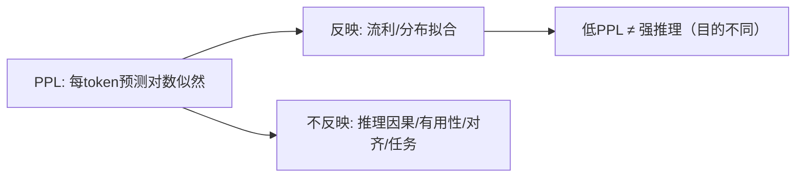

**面试要点**：PPL 测**分布拟合**，不想"推理/对齐"——能力层不同，低 PPL 不保证推理强。

---

## Q2. PPL 按 token 平均与按句子平均对长文本评估有何不同影响？

**回答**

- **按 token 平均（standard）**：`exp(-Σlog p(t)/N_tok)`——**长文本的每个 token 权重相同**；长文本不受"句子数量"影响，表现的是**每 token 的预测难度**；
- **按句子平均**：先算每个句子的平均（或每个句子的 PPL），再对句子求平均——**每句子的权重一样，短句与小句子被放大**。

**对长文本的影响**：
- 按 token：长文本的 PPL = 总对数似然/token——**不偏向句子**，反映"逐 token 的平均难度"；
- 按句子：**短句的高 PPL 被放大**（每句一票）→ 长文本整体评分可能被若干短句拉高；且句子切分方式影响结果。

```python
# 两句: 一句很长但预测好, 一句短但难
tok_ppl = math.exp(-(sum_good + sum_bad) / (n_long + n_short))
sent_ppl = math.exp(-sum_good/n_long) * math.exp(-sum_bad/n_short)
# 取决于打分方式, 结果不同
print("token平均=每token同权; 句子平均=每句同票(短句被放大)")
```

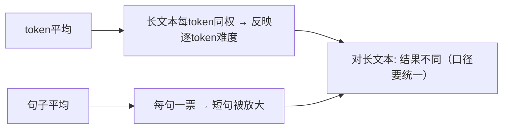

**面试要点**：token 平均=每 token 同权；句子平均=每句同权（短句放大）——长文本评估口径要统一。

---

## Q3. MMLU 的 few-shot 设置如何影响分数？5-shot 与 0-shot 的差距说明了什么？

**回答**

- **MMLU 默认 few-shot（如 5-shot）**：给模型 5 个带答案的示例再问新问题；0-shot 不给示例；
- **影响**：
  - few-shot 让模型**学会任务格式/期望输出形式**（"分类到 A-D"）→ 分数通常更高；
  - 0-shot 更"裸"，依赖内在理解 → 分数通常略低，且**格式漂移**（不遵循 A-D）影响抽取。

**5-shot vs 0-shot 的差距说明**：
- **few-shot 的收益**：模型是否**能在上下文指令/示范**下快速适应任务（元学习/指令遵循能力）；
- **差距大**：模型**强示例依赖**（没有示例就不懂格式/低遵循）——指令遵循弱；
- **差距小**：模型**本身理解任务**（0-shot 也能答对）——内化了任务类别；
- 两者都是**应该跟踪的指标**（常报告 0-shot 与 few-shot 两个数）。

```python
def mmlu_score(fewshot=5):
    # 5-shot 常略高; 差距见说明
    return {"0-shot": base, "5-shot": base + bump}
print("5-shot - 0-shot gap↑ → 示例依赖强/遵循弱; gap小 → 内在任务理解")
```

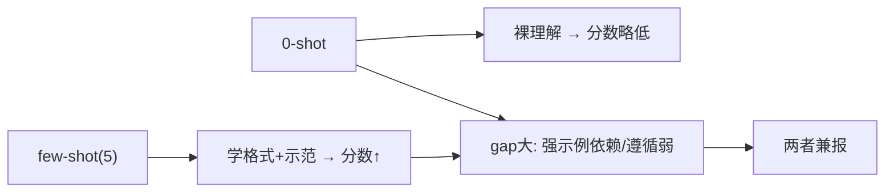

**面试要点**：few-shot 教格式/示范（分高）；gap 大小说明**示例依赖度/指令遵循 vs 内化任务理解**。

---

## Q4. HumanEval 的 pass@k 如何计算？朴素 pass@k 估计为什么有偏？无偏估计量的形式是什么？

**回答**

**pass@k**：模型为每个问题**生成 k 个答案**，只要有**至少 1 个通过测试**就算成功（k 个中至少一个对）——报告"成功问题的占比"。

**朴素估计（有偏）**：直接用"`k 个里至少有 1 个对`"的频率作为 pass@k——**k 越大越偏高**，因为单次生成空间越大越容易碰对（而真实 pass@k 应反映"能力",不是"采样福利"）；且有偏即**低估小 k 的真实通过率**。

**无偏估计量（using all samples）**：用 **`E[1 - C(n-c, k)/C(n, k)]`**（从 n 个采样里随机取 k 个，用超几何概率组合正确数 c）：

$$\text{pass@k} = \mathbb{E}\left[1 - \frac{\binom{n-c}{k}}{\binom{n}{k}}\right]$$

其中 n=每问题采样总数，c=其中通过数（需用**更大的 n 估算**，不能用 k 直接估算，否则有偏）。

```python
import math
def unbiased_pass_at_k(n, c, k):
    if n - c < k: return 1.0
    return 1.0 - math.comb(n - c, k) / math.comb(n, k)

# n=200 采样, c=60 通过
print(f"pass@1 ≈ {unbiased_pass_at_k(200, 60, 1):.3f}")
print(f"pass@10 ≈ {unbiased_pass_at_k(200, 60, 10):.3f}")
```

```text
pass@1 ≈ 0.300
pass@10 ≈ 0.962
```

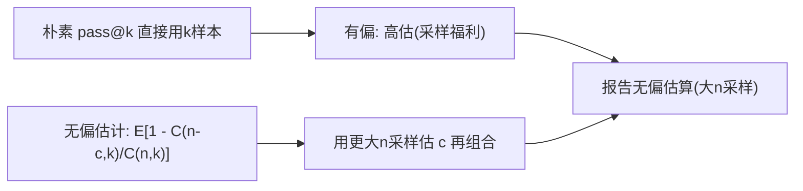

**面试要点**：pass@k=至少一个通过；朴素有偏（用 k 样本直接估）；无偏用 `E[1−C(n−c,k)/C(n,k)]`（大 n 采样）。

---

## Q5. pass@k 与 pass^k 分别适合什么场景？k 增大时两者如何分道扬镳？

**回答**

- **pass@k**：k 个答案**只要 1 个对**就成功——适合**"有就可用"**的场景（代码生成可以从多个候选挑一个对的、AI-assisted 编程）；
- **pass^k**（要求 **全部 k 个都通过**）——适合**"要求全对"**的场景（如必须在有限的尝试内保证质量、批量执行不能有错）。

**k 增大时分道扬镳**：
- pass@k **随 k 单调上升**（更多候选中一个对概率更大，k→∞→1）；
- pass^k **随 k 单调下降**（要所有 k 都对，k 越大越难，k→1 时仅等于 pass@1）；
- 中间交差点因模型质量不同；两者对"采样多样性/质量"的解读相反。

```python
def pass_all_k(p1, k): return p1**k          # pass^k（独立假设）
def pass_at_least_1(p1, k): return 1-(1-p1)**k   # pass@k
p1 = 0.5
for k in (2, 5, 10):
    print(f"k={k}: pass@k={pass_at_least_1(p1,k):.2f}, pass^k={pass_all_k(p1,k):.2f}")
```

```text
k=2: pass@k=0.75, pass^k=0.25
k=5: pass@k=0.97, pass^k=0.03
```

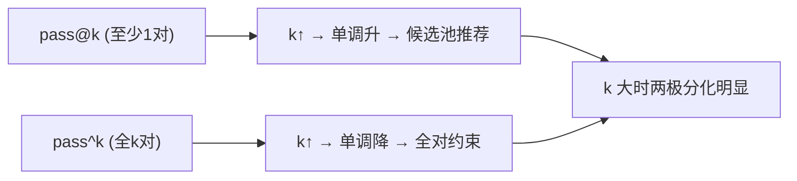

**面试要点**：pass@k=至少一对（候选池）、pass^k=全对（无容错）；k 增大一升一降。

---

## Q6. lm-evaluation-harness 中 prompt 模板与答案抽取规则如何影响分数？如何避免"评测过拟合"？

**回答**

**影响**：
- **prompt 模板**：few-shot 示例数量/措辞/分隔符变 → 模型理解任务的"格式线索"变 → 分数抖动（尤其对格式敏感/遵循弱的模型）；模板与训练数据重合 → 评分偏高；
- **答案抽取**：从生成文本**正则/解析答案**（取 A-D、取数字、去掉格式）——**规则差**会把对的误判错（抽出"乱"的一版）、把错的误当对；规则太"宽容"刷高分。

**避免评测过拟合**：
1. **固定模板与抽取**（不追着分数调）；
2. **多模板/多 few-shot 报告均值与方差**（评估对模板的稳健性）；
3. **答案抽取 UCT 校验**：难以抽取的任务用人工双标注；
4. **公开 & 冻结**基准、不看测试集调参（Q14 本章）；
5. **cross-check**：与真实评估（Arena 等）交叉验证，防"benchmark 游戏化"。

```python
def extract_answer(text, rule):
    # 规则差 → 误判; 规则太宽 → 假高分
    return rule(text)
print("模板=格式线索(分抖); 抽取=误判风险 → 固定+多模板+校验")
```

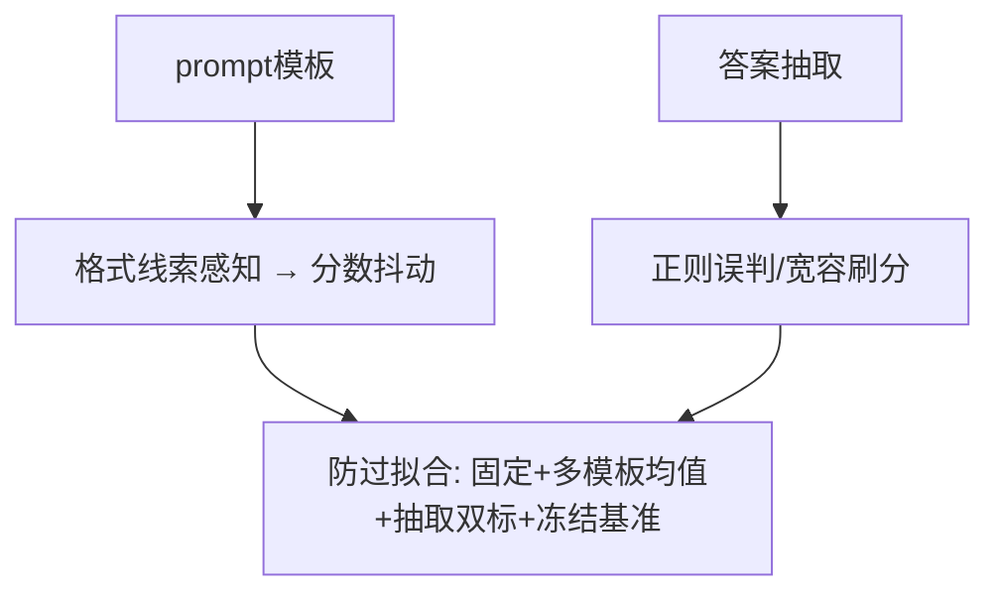

**面试要点**：模板与抽取都影响分数；防过拟合=固定口径、多模板报告、抽取校验、不调测试集。

---

## Q7. HELM 与 MMLU 的评估哲学有何不同？HELM 的多维度评估包含哪些方面？

**回答**

- **MMLU**：单一基准（57 项任务）报告**一个分数**——关注"**模型在这些任务上的表现**"；
- **HELM（Holistic Evaluation）**：**多维、到单模型逐任务的完整评估矩阵**——不是挤一个数，而是**同时报告多个维度**，让用户按场景选。

**HELM 的多维度**：
1. **准确性（accuracy）**：任务正确率；
2. **校准（calibration）**：置信度是否匹配正确率；
3. **鲁棒性（robustness）**：提示措辞/扰动下分数稳定；
4. **公平性（fairness）**：不同群体表现差异；
5. **偏差（bias）**：如毒性、群体刻板；
6. **毒性（toxicity）**：生成有害内容倾向；
7. **效率（efficiency）**：推理成本/延迟（可选）。

**哲学**：MMLU 是"单一综合分"，HELM 是"多轴雷达图/矩阵"——评估场景化、避免单一分数掩盖缺陷。

```python
def helm_report(task):
    return {"accuracy": acc, "calibration": cal, "robustness": rob,
            "fairness": fair, "bias": bias, "toxicity": tox, "efficiency": eff}
```

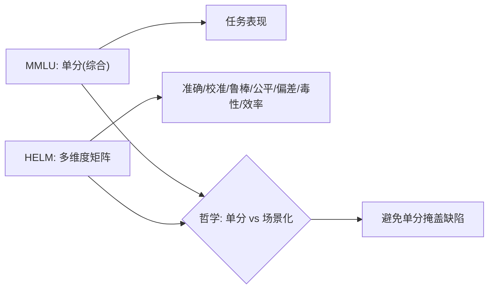

**面试要点**：MMLU 单分数；HELM 多维（准确/校准/鲁棒/公平/偏差/毒性/效率）——场景化、不掩盖缺陷。

---

## Q8. Arena 的 Elo 排名与静态 benchmark 分数分别捕捉了什么、遗漏了什么？

**回答**

- **Arena（Chatbot Arena）Elo**：人类用户**实时两两对比**投票 → Elo 排名——捕捉**真实用户偏好/体验**（有用性、风格、实用性、多轮感受）。
- **静态 benchmark（MMLU/HumanEval）**：自动评估单任务正确率——捕捉**指定能力**（知识/代码/推理）。

**各自遗漏**：
- **Arena 遗漏**：
  - **可复现性**（用户偏好带噪声、易受 UI/多轮顺序影响）；
  - **任务覆盖**（用户样本偏日常、指令，专业/长任务覆盖不足）；
  - **成本/延迟**（不计推理成本）；
- **静态 benchmark 遗漏**：
  - **真实用户偏好**（正确不等于好用）；
  - **多轮/交互风格**（单轮任务式）；
  - **鲁棒性/失败模式**（静态集有限、且易污染/饱和）。

**结论**：二者互补——Arena 测"体验"、benchmark 测"能力"；都用，分别看。

```python
def methods():
    return {"Arena": "感知体验/偏好(但噪声/覆盖有限)",
            "Benchmark": "指定能力(但缺偏好/易饱和)"}
```

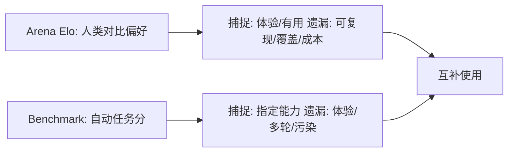

**面试要点**：Arena 测偏好体验（噪声/覆盖差），benchmark 测能力（缺体验/易污染饱和）——互补。

---

## Q9. 静态 benchmark 为什么会"饱和"？饱和后应用什么评估范式替代？

**回答**

**为什么饱和**：
- 静态集**样本有限**且公开；模型能力日益趋顶：
  - **天花板效应**：多数模型都接近满分（区分度消失）；
  - **污染/过拟合**：模型见过/针对性优化过 benchmark 分布 → 分数虚高不再反映真实能力；
- 静态集**不随模型进步更新**：能力越来越细，旧集粒度不够。

**替代范式**：
1. **动态/自适应评估**：**持续生成新题**（动态 benchmark、对抗进化的评测——防污染、永远难）；
2. **人类偏好评估（Arena）**：实时两两对比，防饱和；
3. **挑战集/攀登集**：按模型能力**动态上难度**（只要答对就出更难）；
4. **能力分解+probe**：从"能不能"转向"在什么条件下不能"（鲁棒性/失败分析）。

```python
def saturation(score):
    return score > 0.95   # 接近满分 → 饱和(区分度消失)
print("饱和 → 动态/自适应/人类偏好/难度攀爬 替代静态")
```

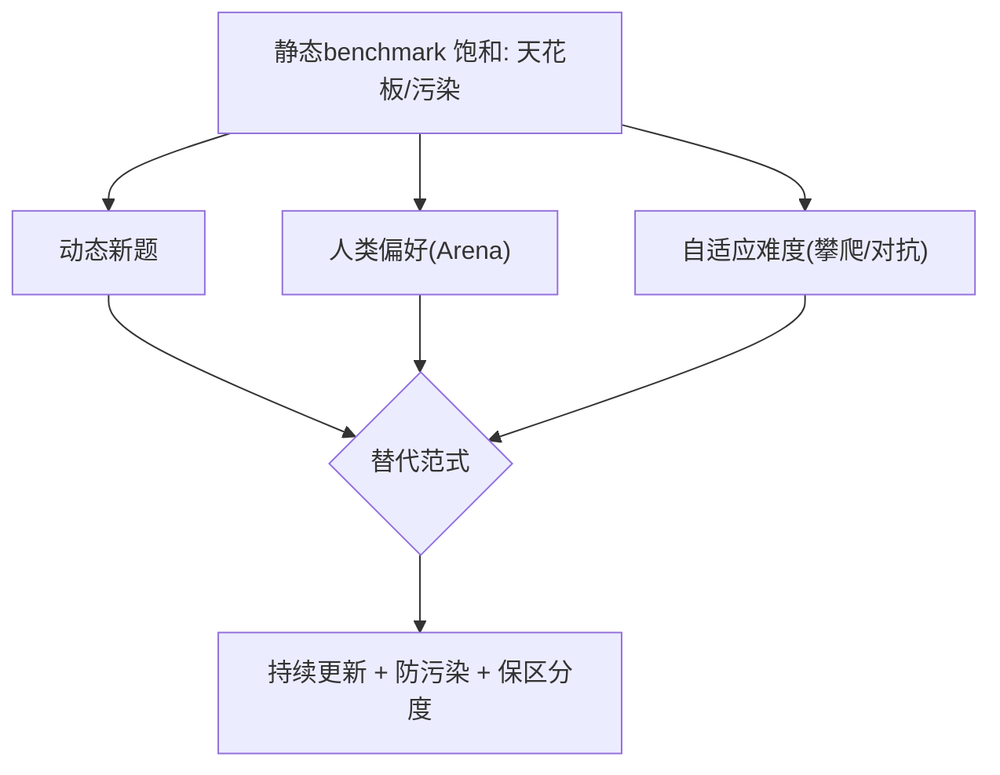

**面试要点**：饱和=天花板+污染+不更新；替代=动态题、人类偏好、自适应难度。

---

## Q10. C-Eval 与 MMLU 在中文场景下的差异是什么？直接用 MMLU 评估中文模型会有什么问题？

**回答**

- **MMLU**：英文（+翻译索多语言版），知识以英文为主、面向英文教育与考试；
- **C-Eval**：中文（中文知识 + 中文题目 + 中文教育），覆盖中国学科/常识/文化。

**直接用 MMLU 评中文模型的问题**：
1. **语言偏移**：中文模型训练以中文为主 → 英文 benchmark 体现的是"英文场景能力"，不是中文能力；
2. **知识域偏差**：MMLU 知识点是西文教育范畴（美国史、西方社会学），中文模型在这上面弱并不代表中文能力弱；
3. **数据分布**：中文模型可能没充分见过英文题格式/表述 → 分数低估；
4. **跨语言迁移**：翻译版 MMLU 的翻译有歧义 → 分数不稳；
5. **结论**：**应该用 C-Eval/中文 benchmark 主要测中文模型**，MMLU 只作参考（英语能力）。

```python
# 中文模型评估矩阵
def chinese_eval_suite():
    return ["C-Eval", "CMMLU", "中文Code/数学/百科", "MMLU(仅英语参考)"]
```

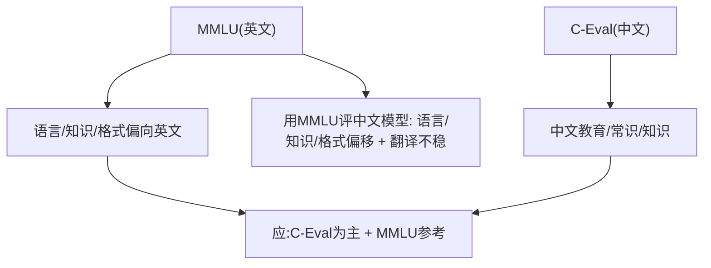

**面试要点**：C-Eval=中文知识/教育；用 MMLU 评中文模型有**语言、知识域、格式偏移**——应中文 benchmark 为主。

---

## Q11. AlpacaEval 的胜率评估与人类评估的相关性如何？它的长度偏差是什么？

**回答**

- **AlpacaEval**：用 **GPT-4 当 judge** 比较模型回答与参考（win-rate）——自动化但**用 LLM 打标签**；
- **与人类评估相关性**：在指令遵循/有用性上有**中等偏好的相关性**（比纯规则好），但**不完美**：judge 对格式/风格/长度的敏感可能偏离人类真实偏好。

**长度偏差**：AlpacaEval 有著名 **"length bias"——回答越长越容易赢**（judge 把"更详细/更冗长"当"更好"）：
- 分支：更长的回答 win-rate 系统性更高，即使内容相同；
- 这导致**模型可以通过加长输出刷分**（Q24 第 12 章的"啰嗦"）。

**缓解**：控长度（对 judge 输入限制）、用更紧凑的 prompt、报告长度-win率 的相关性、用人类样本校验。

```python
def length_bias(wh_pr, l_pr):
    return l_pr - wh_pr   # 长回答 win 差异 >0 → 长度偏差
print("长度偏差: 长回答win率虚高(judge把冗长当好) → 控制/报告")
```

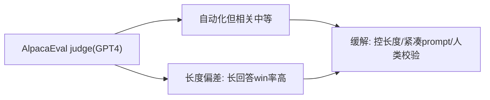

**面试要点**：AlpacaEval 与人类相关中等；**长度偏差**=长回答 win 率高——需控制与报告。

---

## Q12. 代码评估中功能正确性（unit test）与 pass@k 是什么关系？pass@k 高是否一定意味着代码质量好？

**回答**

- **功能正确性（unit test）**：用测试用例判定代码**是否运行正确**——单次生成的正确性；
- **pass@k**：**k 个生成中至少 1 个通过**（Q4）——把正确性扩展到"采样池"。

**关系**：pass@k 建立在**每个候选的 unit test 通过**基础之上（k 候选取并集）；k=1 时 pass@1 = 单次功能正确率。

**pass@k 高 ≠ 代码质量好**：
1. **过拟合测试用例**：代码可能 hack 特定 test（暴力/硬编码）——通过单测但不可扩展/不真实；
2. **不考虑可读性/健壮性/性能/风格**：通过但难维护、有 bug 边界；
3. **覆盖不足**：测试覆盖有限（hidden tests 可能失败，Q18 第 13 章）；
4. **k 大掩盖真实质量**：pass@10 高可能是"候选够多碰对"，单次能力仍弱。

```python
def pass_at_k_from_tests(n_pass, n_total, k):
    # 基于单测通过集合计算
    return 1 - math.comb(n_total - n_pass, k) / math.comb(n_total, k) if n_total-n_pass>=k else 1.0
print("pass@k 好但不代表质量(可hack/覆盖/健壮/性能不足)")
```

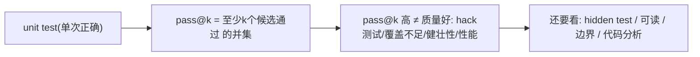

**面试要点**：pass@k 基于 unit test 的采样并集；高不代表好——可 hack、覆盖、健壮性/性能不算。

---

## Q13. 数学评估中精确匹配会漏掉哪些正确但格式不同的答案？如何设计更鲁棒的答案抽取？

**回答**

**精确匹配漏掉的正确但格式不同**：
- 数字等值变体：`1/2` vs `0.5`、`1.0` vs `1`、科学计数；
- LaTeX/数学符号差异：`\frac{1}{2}` vs `0.5`、`\sqrt{4}` vs `2`；
- 单位/前导零：`5 cm` vs `5`、`05`；
- 上下文说明：答案绕在文字里（"答案是 12" vs 只有 `12`）；
- 等价表达式：`2+3` vs `5`。

**更鲁棒的抽取**：
1. **归一/规范化**：去空格、大小写、html、LaTeX→符号化，统一小数/分数格式（用 sympy 化简）；
2. **数学等价性校验**：用 **symbolic 比较**（sympy `equals`）而非文本；
3. **语义解析**：正则抽出"答案"块（"答案是 X"/最后一个等号后），再校验；
4. **数值容差**：浮点比较用 epsilon；
5. **人工校验**难以抽取的样本比例抽核。

```python
import sympy as sp
def math_equiv(a, b):
    try:
        return sp.sympify(a, evaluate=False).equals(sp.sympify(b))
    except Exception:
        return a.strip() == b.strip()
for x, y in [("1/2", "0.5"), ("sqrt(4)", "2"), ("2+3", "5")]:
    print(f"{x!r} ~ {y!r}: {math_equiv(x,y)}")
```

```text
'1/2' ~ '0.5': True（sympy 化简）
'sqrt(4)' ~ '2': True
'2+3' ~ '5': True
```

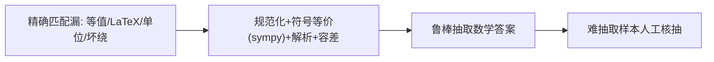

**面试要点**：漏=等值/格式/语义；鲁棒=**规范化 + sympy 等价 + 解析答案块 + 数值容差**。

---

## Q14. 模型在 MMLU 上 90 分但在真实对话中表现很差，可能的原因有哪些？

**回答**

可能原因（"高分数，差对话"的 gap）：

1. **污染/数据泄漏**：MMLU 题早被预训练见过 → 背分，对话面对新问题露馅（Q10 第 10 章）；
2. **评测集过拟合**：针对 benchmark 调优过（few-shot 模板/后训练）→ 分布外对话崩（Q6 本章）；
3. **任务-能力错位**：MMLU 测**知识/单轮选择**；对话测**多轮/指令/推理/对话风格**——能力不重叠；
4. **格式依赖**：依赖 A-D 选项，对话自由文本时不会组织；
5. **后训练差异**：模型在评测的输入格式上不优质（对齐未覆盖对话模式）；
6. **统计差异**：MMLU 单点分高但置信度低/对措辞敏感（Q7 校准）。

```python
def gap_reasons():
    return ["污染/泄漏", "benchmark过拟合", "任务能力错位", "格式依赖", "对齐缺口", "校准差"]
```

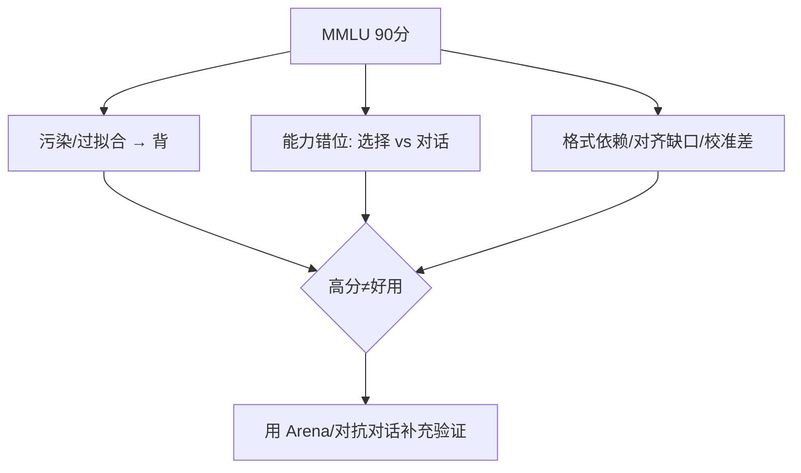

**面试要点**：gap 来自**污染/过拟合、能力错位、格式/校准/对齐缺口**——高分不代表对话好用，需 Arena 补充。

---

## Q15. 如何检测 benchmark 污染？成员推断在污染检测中能起什么作用？

**回答**

**检测 benchmark 污染**：
1. **n-gram 重叠扫描**：在训练语料中找与 benchmark 样本高重叠的片段（Q10 第 10 章）；
2. **困惑度/记忆性**：对 benchmark 样本测模型 PPL——若低得异常（相对其他同分布样本）→ 训练见过；
3. **时间戳检查**：基准发布前是否存在于爬取语料；
4. **成员推断（Membership Inference, MI）**：训练模型 vs 未训练的参考模型**在同一样本上的不确定度差**——如果训练模型对 benchmark 样本的困惑/不确定性显著更低 → 该样本可能**是训练成员（污染）**。

**MI 的作用**：MI 是**检测"该样本是否被用于训练"**的技术——对 benchmark 逐样本做 MI，能把"哪些题可能被污染"标出来；**限制**：MI 对"相似但非相同"的污染（改写、变体）识别弱；小样本/近重复有噪。

```python
def membership_test(model_ref, miss, sample):
    uncertainty_diff = model_ref.entropy(sample) - miss.entropy(sample)
    return uncertainty_diff > threshold      # 差大 → 样本可能是训练成员(污染)
print("MI: 训练模型对样本不确定性明显更低 → 疑似污染样本")
```

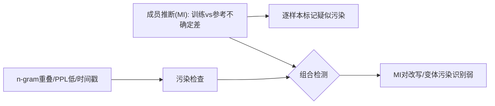

**面试要点**：检测=n-gram/PPL/时间戳/**成员推断**（不确定差）；MI 能逐样本标疑似，但对改写变体弱。

---

## Q16. 多轮对话如何评估？单轮 benchmark 分数能否预测多轮表现？

**回答**

**多轮评估**：
- **任务型**：多轮任务完成率（多轮 RAG/客服/指令，看回合目标达成）；
- **交互型**：多轮有用性/一致性/风格（保留上下文的能力）；
- **指标**：多轮胜率（人类 vs judge），错误累积率（Q19 第 15 章）、上下文利用（早期信息是否被正确使用）、多轮一致性。

**单轮能否预测多轮**：
- **通常弱预测/不预测**：
  - 多轮需要**track 上下文、历史纠错、累积记忆**——单轮基准测不到；
  - 单轮分高的模型，多轮可能因"忘了前面/过度自信/风格漂移"崩；
  - **相关性部分存在**（更强模型多轮通常也更好），但**不可靠**——需要在真实多轮上单独评估。

```python
def multi_turn_score(model, dialog):
    ctx = []
    for turn in dialog:
        out = model(ctx + [turn])
        ctx += [turn] + [out]
    return compute_turn_metrics(ctx)   # 回合达成/一致性/错误累积
print("单轮→多轮: 弱预测; 需真实多轮评测")
```

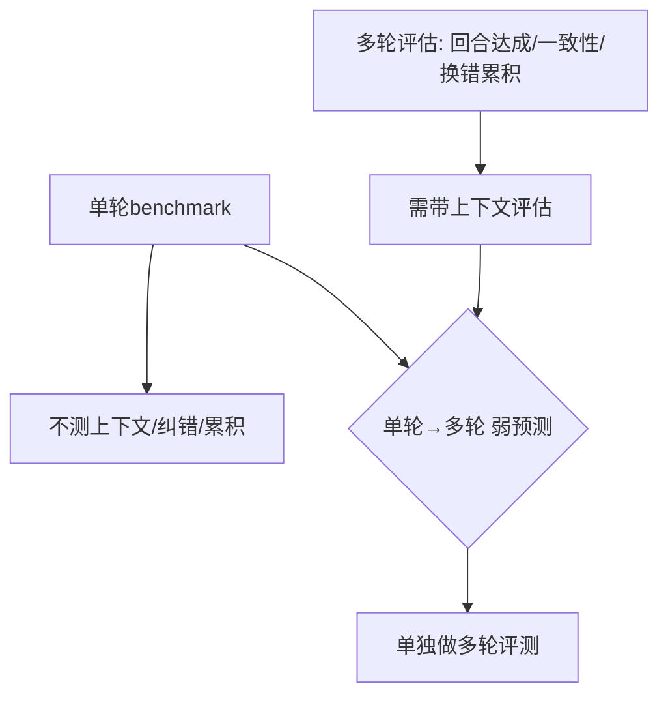

**面试要点**：多轮=回合达成/一致性/错误累积；单轮对多轮是**弱预测**——需独立多轮评测。

---

## Q17. 安全评估应包含哪些维度？红队测试与自动化安全 benchmark 各自的局限是什么？

**回答**

**安全评估维度**：
1. **有害/毒性内容**（仇恨、暴力、自伤）；
2. **恶意指令/Prompt 注入**（越狱、工具滥用）；
3. **隐私泄露**（不要泄露 PII/内部）；
4. **偏见/歧视**（群体刻板）；
5. **可靠性**（幻觉、误导、错误断言）；
6. **越狱鲁棒性**（对抗攻击下的拒绝行为）。

**红队测试局限**：
- 依赖人工、**成本高、样本少**、不可规模化；红队人员主观性强、覆盖不全；测试结果不一定可复现。

**自动化安全 benchmark 局限**：
- **覆盖有限/静态**（新攻击总是超出基准）；
- 搜索空间大、**对抗性不足**（简单 jailbreak 能过基准但新招仍过）；
- 分数**可被游戏化**（模型对基准输出拒绝，但对真实未见的攻击不行）；
- 两者**互补**：红队做深度、自动化做广度。

```python
def safety_suite():
    return ["有害内容", "jailbreak", "隐私", "偏见", "幻觉/误导", "越狱鲁棒"]
print("红队: 深度有限; 自动化: 广度但静态 → 互补")
```

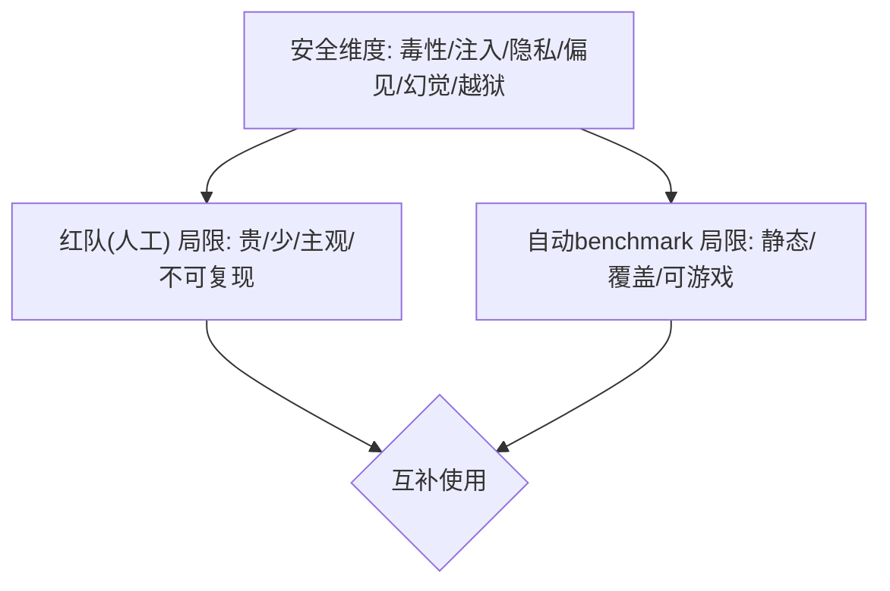

**面试要点**：安全维度列 5–6 项；红队=贵/浅，自动=静态/可游戏——互补。

---

## Q18. 模型只在 A100 上评测，换到 H100 后分数变化说明什么？数值差异与真实能力差异如何区分？

**回答**

**分数变化说明**：
- 若模型逻辑实现相同、评测代码同脚本同 seed，**A100/H100 分数应几乎一致**——微小差异是**数值/库版本/调度**；
- **明显变化（>0.5 分）**则可能存在：
  - 非确定性（并行/原子、不同的 cuBLAS/cuDNN 挑选 kernel）；
  - 精度路径差异（TF32 vs FP32 默认开关）；
  - 实现 bug / 不同环境变量。

**区分数值差异 vs 真实能力差异**：
- **同权重同脚本同 seed** 重跑多次 → 看**方差**；
- 关掉不确定性（`torch.use_deterministic_algorithms`）、固定 TF32/浮点策略 → 若仍差 → 关注代码路径；
- **数值差异 = 可复现的小抖动（多轮均值一致）**；真实能力差异 = **在多种设定下都稳定地差**（换 prompt/多次样本/不同 seed 仍差）。

```python
def num_vs_real(run_a100, run_h100, rep=5):
    var = [run_h100(i)-run_a100(i) for i in range(rep)]
    stable_diff = max(var)-min(var) < 0.3 and abs(sum(var)/len(var)) > 0.5
    return "真实差异" if stable_diff else "数值抖动"
```

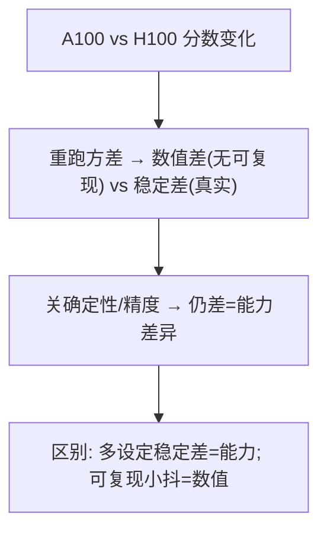

**面试要点**：同脚本重跑看方差；数值差异=可复现抖动；真实差异=**多设定下稳定地差**。

---

## Q19. 两个模型在 MMLU 上差 1 分，需要多少样本才能判断这个差异是统计显著的？

**回答**

**用显著性检验估算**：

- MMLU 有 N 题，每题的 pass/fail（近似独立）；
- 两模型差异 Δ=0.01（1 分），标准误 SE≈√（p·(1−p)/N）（McNemar / 对样本差异 ≈ √(2p(1−p)/N)）；
- 需要 **Δ ≥ 2·SE**（约 95% 置信）：
  `0.01 ≥ 2·√(p(1−p)/N)` → `N ≥ 4p(1−p)/0.0001`。
- 若 p≈0.5（最差情况）：`N ≥ 4·0.25/1e-4 = 10,000` 题——**需要上万样本**才能分辨 1 分差异；p 更极端时需要的仍数千。

```python
import math
for d in (0.01, 0.03):
    N = 4*0.25/d**2
    print(f"1 分差(0.01): 需要≈{N:.0f} 样本")
```

```text
1 分差(0.01): 需要≈10000 样本
3 分差(0.03): 需要≈1111 样本
```


**面试要点**：MMLU 差 1 分要 **上万样本**才显著（SE≈√(pq/N)、Δ≥2SE）；小差异常不显著。

---

## Q20. 为什么"评估集设计"本身是一项研究能力？设计一个能区分"记忆"与"泛化"的评估集。

**回答**

**为什么是研究能力**：评估设计决定结论可信度——**记错**的设计给出误导性结果（高分会掩盖缺陷、低分误判能力）；需要**统计严谨、能力解耦、防污染、抗饱和**——这是评估科学的核心。

**区分"记忆 vs 泛化"的评估集设计**：
1. **分开"见过"与"未见过"**：
   - 见过的：训练分布内（测记忆/拟合）；
   - 未见的：**新组合、新题、新域**（测泛化）；
2. **组合/置换**：把训练里的组件**以新方式组合**（语法/角色/数量变异）——记住只能答见过的，泛化能答新组合；
3. **模板换壳**：相同题型**换人名/数字/名词**，看是否仍会（区分"背答案" vs "会方法"）；
4. **分布外（OOD）**：训练中**刻意留出**一部分结构（禁用某些数字/操瓦）——测试模型是否外推；
5. **难度阶梯**：从记忆型（常见题）到推理型（需要组合）评分出"是从哪一层真正会的"。

```python
def memory_vs_generalize(eval):
    mem = [q for q in eval if q in training]
    gen = [splice(training_components) for ...]   # 新组合
    return {"memory_acc": acc(mem), "generalization_acc": acc(gen)}
# memory_acc >> gen_acc → 记忆多过泛化
```

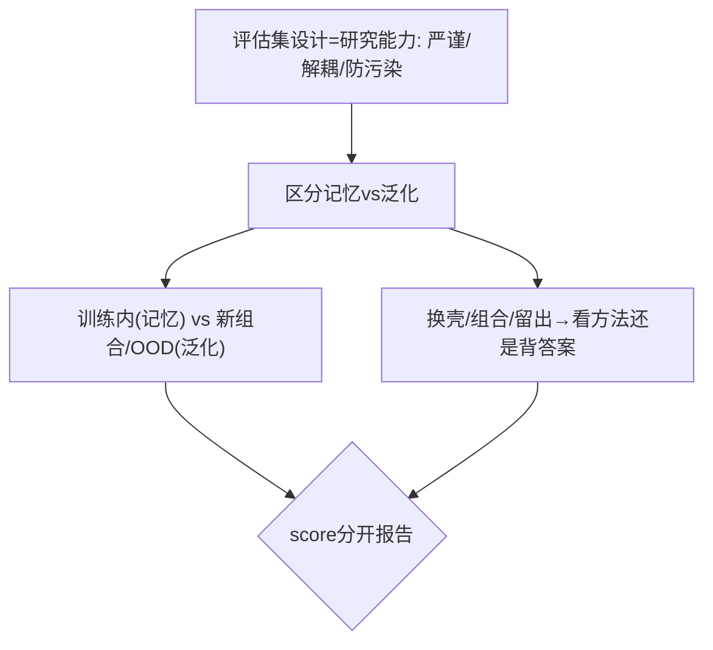

**面试要点**：评估设计影响结论可信度；记忆 vs 泛化=训练内 vs 新组合/OOD、换壳、留出结构。

---

## Q21. PPL 在领域偏移下如何失效？领域内 PPL 低是否意味着领域外也好？

**回答**

**PPL 域偏移失效**：
- PPL 是**相对你训练的分布**衡量；模型在**未见领域**上 PPL 会飙升（数据分布外）；
- 领域偏移 = 词表/句式/主题分布变了 → 模型预测概率变差 → PPL 大幅上升；
- 所以 **"领域内 PPL 低"强烈依赖域间接近度**——跨域不迁移。

**领域内低是否意味领域外好**：
- **否**：PPL 是**拟合指标**，衡量"对这个分布多熟练"，不是"能力的推广"；
- 领域内 PPL 低可能因为**背**，领域外（新任务/新分布）预测差；
- 需要**跨领域评测**（各域分开报 PPL/benchmark）——不能凭单域 PPL 推另一域。

```python
def ppl_ood(in_ppl, ood_ppl):
    gap = ood_ppl - in_ppl
    print(f"域内PPL={in_ppl:.2f}, 域外PPL={ood_ppl:.2f} gap={gap:.2f}→ PPL不迁移")
```

```mermaid
flowchart LR
    A["PPL=拟合指标(相对分布)"] --> B["域偏移 → PPL飙升"]
    B --> C["域内低 ≠ 域外好(背/分布近)")]
    C --> D["需多域分开报 不可单域外推"]
```

**面试要点**：PPL 是**域偏拟合**指标、域偏移会失效；领域内低不能保证域外好——分域报告。

---

## Q22. 用 LLM-as-a-Judge 做评估的偏差来源有哪些（位置偏差、长度偏差、自我偏好）？如何缓解？

**回答**

**LLM-as-a-Judge 偏差**：
1. **位置偏差（position bias）**：judge 对**第几个出现的候选**有偏（如偏好排前/排后的）；
2. **长度偏差（length bias）**：偏好长回答（Q11）；
3. **自我偏好（self-preference）**：judge 模型**偏爱自己/同族**的输出（相似风格）；
4. **格式/语气偏差**：偏好某种措辞、代码格式；
5. **措辞/参考偏差**：judge 对 prompt 措辞敏感。

**缓解**：
- **位置交换（swap）**：两候选左右对调再 judge，取一致才计（或平均）；
- **控长度**：限制生成长度、长度匹配后再比；
- **多 judge 平均 / bias 校准**：用不同家族模型平均；
- **referenceless vs reference**：无参考时才无参考偏差；
- **人工校验子集**：定期对比 judge 与人类。

```python
def judge_with_swap(a, b):
    first  = judge(a, b)
    second = judge(b, a)
    return consistent(first, second)   # 位置交换一致才可信
print("缓解: 位置交换 / 控长度 / 多judge / 人工子集")
```

```mermaid
flowchart TB
    A["Judge 偏差: 位置/长度/自我/语气"] --> B["位置交换校验"]
    A --> C["控长度/匹配"]
    A --> D["多judge平均/人工子集"]
    B --> E{"缓解组合"}
    C --> E
    D --> E
```

**面试要点**：偏差=位置/长度/自我/语气；缓解=交换顺序、控长度、多 judge、人工子集校验。

---

## Q23. 一个模型 pass@1=80%，另一个 pass@10=90%，哪个更强？取决于什么使用场景？

**回答**

**不能直接比**（用了不同的 k，不可比口径）：
- pass@1=80%：**单次即对**——能力"一次就对"；
- pass@10=90%：**10 次里至少一次对**——候选池更大，还好。

**取决于场景**：
- 需要**一次就对**（在线回复、低容错）→ **pass@1 80% 更强**（它不需要多采样）；
- 可以**多采样再来挑选**（代码补全，多条让开发者挑、或执行验证选择）→ **pass@10 更高价值**（累计通过率好）；
- 理想是**比较同一 k 的口径**（都是 pass@1 或 pass@10）。

```python
# 换算成同 k 不可靠 → 明确"使用场景决定用哪个k"
def choose(p1, p10, single_shot_needed):
    return p1 if single_shot_needed else max(p10, p1)
print("pass@1 vs pass@10 不可直接比; 场景=容错/采样预算")
```

```mermaid
flowchart LR
    A["pass@1=80%"] --> B["一次就对 → 在线/低容错"]
    C["pass@10=90%"] --> D["可多采样挑选 → 代码/实验"]
    A --> E{"场景决定"}
    C --> E
    E --> F["比同一k口径才公平"]
```

**面试要点**：口径不同（1 vs 10）不可直接比；场景决定——低容错看 pass@1、可采样看 pass@10。

---

## Q24. 基准测试的天花板效应与地板效应分别是什么？如何设计一个避免两者的评估集？

**回答**

- **天花板效应（ceiling）**：题目太简单 → 多数模型都快满分 → **高分密集、区分度丧失**（无法分辨强者差距）；
- **地板效应（floor）**：题目太难 → 多数模型都接近 0（随机）→ **区分度也丧失**（无法分辨弱者与随机/靠猜）。

**避免两者的评估集设计**：
1. **难度阶梯**：题目难度**均匀覆盖从易到难**（含中间档），避免全易或全难；
2. **校准验证**：评测前在小样本上确认 **得分分布（中位数不要 100 或 0，比如 40–70% 区间）**；
3. **宽度与深度平衡**：既有简单需求又有推理难题；
4. **动态调难度**：根据平均分调整（若 ceiling 加更难、若 floor 加更简单）；
5. **报告分布而非单点**：分难度段分别报（低/中/高难段），保留区分度。

```python
def design_balanced(diffs):
    import numpy as np
    ok = np.median(diffs) > 0.3 and np.median(diffs) < 0.7
    return f"中位数在0.3-0.7 → {'OK 有区分度' if ok else '需要调难度'}"
```

```mermaid
flowchart LR
    A["天花板: 太简单→满分无区分"] --> B["难度阶梯(均匀)")
    C["地板: 太难→全0无区分"] --> D["调难度/分难度段报"]
    B --> E["设计: 覆盖中间档 + 分布校验(40-70%)"]
    C --> E
    D --> E
```

**面试要点**：天花板=太简单（满分）、地板=太难（全 0）都会消区分度；设计=难度阶梯+分布校验+分段报告。

---

## Q25. 如何评估模型的校准？ECE 在 LLM 上如何计算？

**回答**

**校准**：模型的**置信度与正确率匹配**——"说 80% 置信的预测，约 80% 对的"。

**ECE（Expected Calibration Error）**：
- 把预测按置信度分桶（如 10 桶 [0,0.1),[0.1,0.2)...）；
- 每桶内算：`confidence_mean vs accuracy_mean` 的差；
- `ECE = Σ (n_bin/N) · |confidence_bin − accuracy_bin|`。

**在 LLM 上**：
- 常用**多次采样**估计置信（vote entropy / self-consistency）：同一 prompt 采样 N 次，答对比例作为"置信"；
- 或对 token logits **平均/答案概率**作置信；再用结果做校准评估。

```python
import numpy as np
def ece(confs, accs, M=10):
    bins = np.linspace(0,1,M+1)
    tot = 0; N=len(confs)
    for i in range(M):
        m = (confs>=bins[i]) & (confs<bins[i+1])
        if m.any():
            conf = confs[m].mean(); acc = accs[m].mean()
            tot += (m.sum()/N)*abs(conf-acc)
    return tot
confs = [0.9,0.8,0.7,0.4,0.2]; accs = [1,1,0,0,0]
print(f"ECE ≈ {ece(np.array(confs), np.array(accs)):.3f}（越小越校准）")
```

```text
ECE ≈ 0.160
```

```mermaid
flowchart LR
    A["置信度分桶"] --> B["每桶: 平均置信 vs 正确率"]
    B --> C["ECE = Σ n/N·|conf-acc|"]
    C --> D["LLM: 多次采样/self-consistency估计置信"]
    D --> E["ECE 越小越好"]
```

**面试要点**：ECE=分桶算 |置信−正确率| 加权和；LLM 上用**采样/self-consistency** 估计置信再算。

---

## Q26. 多语言评估中，翻译 benchmark 与原生 benchmark 的分数差距说明了什么？

**回答**

**差距说明**：
- **翻译 benchmark（translate-test）**：把英文基准翻译成目标语言评测；
- **原生 benchmark（native）**：直接使用目标语言原生高质量数据评测。

**差距的含义**：
- 原生分数 **> 翻译分数**：模型在目标语言上"原生能力"好（训练到位），翻译题引入翻译噪声/格式损失；
- 翻译分数 > 原生分数：可能**训练数据偏翻译**或原生测试更难/更偏；
- **系统性翻译基准低**表明**翻译引入的格式/OOV/文化差异**让评测失真——翻译基准不是目标语言能力的真实反映；
- 理想是**原生基准为主**（更真实反映语言能力），翻译基准作参考。

```python
def lang_gap(native, translated):
    gap = native - translated
    print(f"原生 - 翻译 = {gap:+.2f}")
    if gap > 0.1: print("原生强（翻译丢信息/格式）")
    elif gap < -0.1: print("翻译路径虚高（需查）")
```

```mermaid
flowchart LR
    A["翻译基准"] --> B["引入翻译噪声/文化差异"]
    C["原生基准"] --> D["真实语言能力"]
    B --> E{"差距: 原生>翻译=真能力; 翻译路径问题"}
    D --> E
```

**面试要点**：差距反映翻译引入的噪声/失真；以**原生基准**为主评估目标语言能力。

---

## Q27. RAG 任务的评估应覆盖哪些维度？检索质量、答案忠实度、引用准确性如何分别度量？

**回答**

**RAG 评估维度**：
1. **检索质量（retrieval quality）**：检索到的文档是否相关/覆盖需求；
2. **答案忠实度（faithfulness）**：答案**只基于检索文档**、不幻觉（不编造文档外）；
3. **答案准确/有用性**：最终答案是否正确/有用；
4. **引用准确性（citation accuracy）**：引用是否**真实对应**支撑内容的文档段落。

**度量**：
- 检索：**Recall@k/Precision@k/NMRR** 对标注的相关文档；
- 忠实度：**FActScore / NLI-based 判定**（答案每句能否被检索文档蕴含），或用 judge 打分；
- 引用：**引用-文档对齐**（引用是否真指向支撑段落）、引用覆盖率（关键句有引用）。

```python
def rag_metrics():
    return {"retrieval": "Recall@k/Prec", "faithful": "FActScore/NLI",
            "answer": "EM/F1", "citation": "引用对齐/覆盖率"}
```

```mermaid
flowchart TB
    A["检索质量"] --> B["Recall@k/Prec 对标注"]
    C["答案忠实度"] --> D["FActScore/NLI判定(不幻觉)"]
    E["引用准确"] --> F["引用-文档对齐/覆盖率"]
    B --> G{"RAG各维度分别度量"}
    D --> G
    F --> G
```

**面试要点**：三维—检索（Recall@k）、忠实（FActScore/NLI）、引用（对齐/覆盖）；分开度量。

---

## Q28. needle-in-a-haystack 测试的局限性是什么？它没有测到什么？

**回答**

**Needle-in-a-haystack（LIHA）**：在长文本中放一个"针"（事实/指令），测模型能否取回——测长上下文的**信息检索/利用率**。

**局限性**：
1. **只测"寻针"**：测的是**局部信息取回**，不测长文的**整体理解/推理**（多段落关联、总结、分层逻辑）；
2. **位置/语域人为**：针放置的人为位置、语言风格与真实任务不符——分数不能推广到真实长文档任务；
3. **信号饱和**：很多模型 high scores 但真实长上下文任务仍差（区分度低）；
4. **不测渐进失败**：不测长文"中间部分"的理解、噪声干扰下的执行、多针交互。

**没测到**：长文推理、上下文保存与渐进利用、真实噪声文档的过滤、跨多段落整合、长文的鲁棒性。

```python
def needle_test_limits():
    return ("只测取针,不测整体理解/推理/整合/渐进利用/真实噪声")
```

```mermaid
flowchart TB
    A["LIHA: 长文取针"] --> B["测局部检索"]
    A --> C["不测: 整体理解/推理/整合/渐进利用"]
    B --> D["真实长任务: 需 summary/QA/引用等补充"]
    C --> D
```

**面试要点**：LIHA 只测"取针"；不测整体理解/推理/整合/渐进失败——需补充真实长上下文任务。

---

## Q29. 为垂直领域（医疗、法律）构建可信评估集时，专家标注的成本与质量如何平衡？

**回答**

**平衡策略**：
1. **分层设计**：核心/难例由**专家标**，普通样本由**受训标注员 + 专家复核**；
2. **专家标核心子集 + adapter/模型辅助**：小规模专家标注 + 半监督扩展（专家标一部分，用模型标后专家审）；
3. **交叉双标注 + 仲裁**：两专家独立标，不一致交由第三人仲裁 → 高质量+可度量一致性（kappa）；
4. **反馈回路**：专家标注用于**校准其他便宜标注**（模型/规则）的质量；
5. **成本控制**：按题目难度分层定价、批量抽检（核心全检、普通抽检）。

**质量保证**：
- **一致性指标**（Cohen's kappa）、**gold set** 校验；
- **盲审/倒查**：专家的行为审计。

```python
def expert_budget(n):
    core = int(n*0.3)          # 核心30% 专家全标
    rest = n-core              # 其余 模型预标+专家复核
    return {"core_expert": core, "rest_model+review": rest}
print("分层: 专家标核心 + 模型辅助复核扩展")
```

```mermaid
flowchart TB
    A["专家贵"] --> B["核心子集专家全标"]
    A --> C["普通样本 模型预标+专家复核"]
    B --> D["交叉双标+仲裁(kappa)"]
    C --> D
    D --> E["核心全检/普通抽检 → 平衡成本质量"]
```

**面试要点**：成本-质量=**核心专家 + 辅助模型 + 双标仲裁 + 分层抽检**；一致性指标保证质量。

---

## Q30. 从"评估驱动开发"角度，你会在预训练、SFT、RL 各阶段引入哪些核心评估？目标有何不同？

**回答**

**各阶段核心评估**：

- **预训练阶段**：
  - PPL/loss（各域）、语言建模基准、few-shot 泛化、知识抽取——**目标：验证学习曲线、发现 data/scale 问题**（早止损）；
- **SFT 阶段**：
  - 指令遵循（IFEval/MMLU 等 few-shot）、格式/多轮、安全基线——**目标：指令能力与格式即席度**，避免过拟合/漂移；
- **RL 阶段**：
  - 奖励/偏好对齐（胜率 vs 参考）、目标基准（代码/数学）、安全/减少 reward hacking、与训练目标一致性——**目标：对齐效果与防 hack、保能力**。

**各阶段目标不同**：预训练看**分布拟合**、SFT 看**任务遵循/格式**、RL 看**偏好对齐与安全泛化**——而且都要**跨阶段回归**（防后训练破坏预训练能力，Alignment Tax Q8 第 12 章）。

```python
def eval_plan(stage):
    return {"pretrain": "PPL/域/loss曲线",
            "sft": "指令遵循/格式/多轮/安全",
            "rl": "对齐胜率/基准/防hack/能力回归"}.get(stage)
```

```mermaid
flowchart LR
    A["预训练"] --> B["PPL/域/few-shot → 学曲线/早止损"]
    C["SFT"] --> D["指令遵循/格式 → 即席度"]
    E["RL"] --> F["对齐/防hack/能力回归"]
    B --> G{"评估驱动开发"}
    D --> G
    F --> G
    G --> H["跨阶段回归(防Alignment Tax)"]
```

**面试要点**：预训看拟合、SFT 看遵循/格式、RL 看对齐/安全；都要跨阶段回归防能力下降。

---

## 参考链接

1. [32、大语言模型评估指标与基准数据集详解-CSDN博客](https://blog.csdn.net/sugar/article/details/152258820)
2. [MindSpeed-LLM 模型评估完全指南：Benchmark 支持列表、评估模式与精度对比-CSDN博客](https://blog.csdn.net/gitblog_00547/article/details/156348795)
3. [理解LLM的基准测试（Benchmark）：MMLU、HumanEval、GSM8K都是什么？-CSDN博客](https://blog.csdn.net/ZXSXJ/article/details/161744532)
4. [从 MMLU 到 HumanEval：为什么评估大型语言模型（LLM）的基准至关重要？-CSDN博客](https://blog.csdn.net/2501_92954090/article/details/151153146)
5. [AI学习笔记整理（67）——大模型的Benchmark（基准测试）-CSDN博客](https://blog.csdn.net/chsy1987/article/details/157617165)

---

*下一章展望：第 12 章进入"对齐与前沿"段，开讲大模型的基本训练流程（预训练/SFT/RLHF/DPO/PPO 等 35 题）。*