# 第 11 章 · 评估与基准测试

> 面试生普（LLM 500 题）· 第 11 章。本章覆盖 PPL、MMLU、HumanEval/pass@k、Arena/Elo、静态基准饱和、C-Eval、AlpacaEval、污染检测、统计显著性、校准、LLM-as-a-Judge、评估驱动开发等 30 个问题，关键概念配 Python 代码与 mermaid 图解。

> 先把话说清楚：模型训完了，怎么知道它到底行不行？这一章讲的就是"给大模型打分"的学问——用什么指标量（PPL、准确率、pass@k）、拿什么题目考（MMLU、HumanEval、Arena）、打出来的分可不可信（污染、饱和、统计显著、judge 偏差）。别以为评估只是"跑个分数"，设计得不好，高分完全可能是在骗自己。你不需要有评估背景，跟着每题从"这个指标衡量的是啥"读到"它会在哪里翻车"，就能明白为什么业内有句话叫"评估本身就是一项研究能力"。

---

## Q1. Perplexity 能反映什么、不能反映什么？为什么低 PPL 不等于强推理能力？

**回答**

先解释一下 **PPL（Perplexity，困惑度）**：它衡量的是模型对一段文本"预测得有多准"，算法是把每个 token 的预测概率取对数、平均后再取指数。你可以把它粗略理解成"模型面对下一句话时有多懵"——越低说明越不懵、预测越准。

**它能反映什么**：主要是**语言建模能力**，也就是模型对训练分布内文本的预测水平。低 PPL，说明模型对这类文本"预测得好"。

**它不能反映什么**：
- **推理、因果、知识**：PPL 量的是"流利不流利、下一个 token 预测得准不准"，跟"会不会推理、能不能答对"是两码事；
- **有用性/对齐**：PPL 根本不关心指令遵循、安全、用户偏好；
- **任务表现**：它和下游 benchmark 只是**弱关联**——一个"预测得很顺但一推理就答错"的模型，PPL 完全可以很低。

**为什么低 PPL 不等于强推理**：推理需要**组合、逻辑、规划**这些能力，不是单纯"按统计规律预测下一个 token"。模型完全可以把训练分布里常见说法**背下来**（于是 PPL 很低），一遇到没见过的推理题就崩；也就是说，next-token 这个训练目标和"推理正确性"之间，本来就存在一道**鸿沟**。

```python
import math
def ppl(logprobs): return math.exp(-sum(logprobs)/len(logprobs))
print("PPL只管流利预测；推理=另一个能力层(gap 存在)")
```

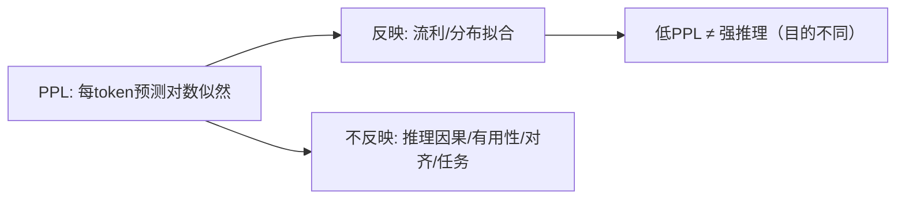

**面试要点**：PPL 测的是**分布拟合**，它压根不管"推理/对齐"——能力层不同，低 PPL 不保证推理强。接下来自然会问：PPL 本身该怎么算平均，长文本上会不会有口径问题？

---

## Q2. PPL 按 token 平均与按句子平均对长文本评估有何不同影响？

**回答**

同一个困惑度，平均方式不同，结果能差不少，关键看你"按什么单位投票"。

- **按 token 平均（标准做法）**：`exp(-Σlog p(t)/N_tok)`。这么算，**长文本里每个 token 的权重都一样**，结果不受"这段有几个句子"影响，反映的是**每个 token 的平均预测难度**；
- **按句子平均**：先算每个句子自己的平均（或每句的 PPL），再对所有句子求平均。这么算，**每个句子都投一票，权重一样**，短句和小句子就被放大了。

**对长文本的具体影响**：
- 按 token：长文本的 PPL 就等于"总对数似然除以 token 数"——**不偏向任何一句**，反映"逐 token 的平均难度"；
- 按句子：**短句偏高的 PPL 会被放大**（每句一票）→ 长文本整体评分可能被几个短句拉高；而且句子怎么切分，也会影响结果。

```python
# 两句: 一句很长但预测好, 一句短但难
tok_ppl = math.exp(-(sum_good + sum_bad) / (n_long + n_short))
sent_ppl = math.exp(-sum_good/n_long) * math.exp(-sum_bad/n_short)
# 取决于打分方式, 结果不同
print("token平均=每token同权; 句子平均=每句同票(短句被放大)")
```

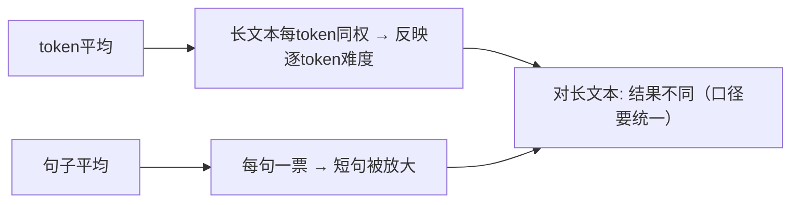

**面试要点**：token 平均=每个 token 同权；句子平均=每句同权（短句被放大）——长文本评估口径一定要统一。说完 PPL，下面就该看具体的"考试"了，先是 MMLU。

---

## Q3. MMLU 的 few-shot 设置如何影响分数？5-shot 与 0-shot 的差距说明了什么？

**回答**

**MMLU** 是一个覆盖面很广的知识选择题基准。它默认用 **few-shot（少样本示例）**的方式考，比如 5-shot：先给模型看 5 个"题目+答案"的示例，再问新问题；**0-shot** 则一个示例都不给。两种设法的分数差，能透露出不少信息。

**影响**：
- few-shot 相当于先教模型"这类题怎么答、要输出成什么样"（比如"分类到 A-D"）→ 分数通常更高；
- 0-shot 更"裸"，全凭模型自己的理解 → 分数通常略低，而且容易出现**格式漂移**（不按 A-D 回答），给答案抽取添麻烦。

**5-shot 与 0-shot 的差距说明了什么**：
- **few-shot 的收益**，体现的是模型能否在上下文里的示范/指令下快速适应任务，也就是元学习和指令遵循能力；
- **差距大**：说明模型**很依赖示例**（不给示例就不懂格式、遵循差）→ 指令遵循较弱；
- **差距小**：说明模型**本身就理解任务**（0-shot 也能答对）→ 已经把任务类别内化了；
- 两者都是**应该跟踪的指标**，所以通常会同时报告 0-shot 和 few-shot 两个数字。

```python
def mmlu_score(fewshot=5):
    # 5-shot 常略高; 差距见说明
    return {"0-shot": base, "5-shot": base + bump}
print("5-shot - 0-shot gap↑ → 示例依赖强/遵循弱; gap小 → 内在任务理解")
```

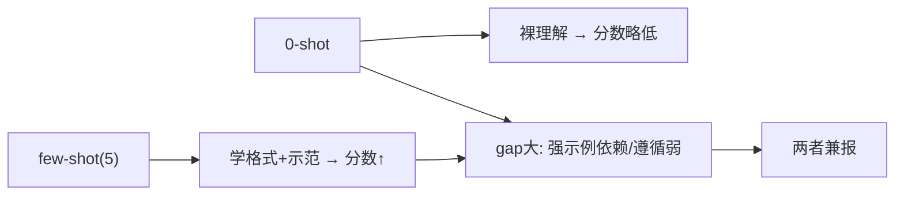

**面试要点**：few-shot 是教格式、给示范（分数高）；差距大小说明了**示例依赖度/指令遵循 vs 内化的任务理解**。接下来看代码能力的经典基准 HumanEval 和它的 pass@k。

---

## Q4. HumanEval 的 pass@k 如何计算？朴素 pass@k 估计为什么有偏？无偏估计量的形式是什么？

**回答**

**pass@k** 是考代码生成能力的经典指标：让模型对每个问题**生成 k 个答案**，只要这 k 个里**至少有 1 个通过测试**，就算这道题成功；最后报告"成功题目的占比"。

**朴素估计为什么有偏**：如果偷懒，直接把"k 个里至少 1 个对"的实测频率当成 pass@k，问题就来了——**k 越大越偏高**，因为采样空间越大，撞对的概率越高。可真实的 pass@k 本该反映"模型能力"，不是"多采几次的福利"；反过来，这种朴素做法还会**低估小 k 的真实通过率**。

**无偏估计量（用全部采样来估）**：正确做法是用 **`E[1 - C(n-c, k)/C(n, k)]`**——也就是从 n 个采样里随机抽 k 个，用超几何分布的组合数来换算正确数 c 的贡献：

$$\text{pass@k} = \mathbb{E}\left[1 - \frac{\binom{n-c}{k}}{\binom{n}{k}}\right]$$

其中 n 是每道题采样的总数，c 是其中通过的数量。注意要**用一个更大的 n 来估**，不能只拿 k 个样本直接算，否则就是有偏的。

```python
import math
def unbiased_pass_at_k(n, c, k):
    if n - c < k: return 1.0
    return 1.0 - math.comb(n - c, k) / math.comb(n, k)

# n=200 采样, c=60 通过
print(f"pass@1 ≈ {unbiased_pass_at_k(200, 60, 1):.3f}")
print(f"pass@10 ≈ {unbiased_pass_at_k(200, 60, 10):.3f}")
```

```text
pass@1 ≈ 0.300
pass@10 ≈ 0.962
```

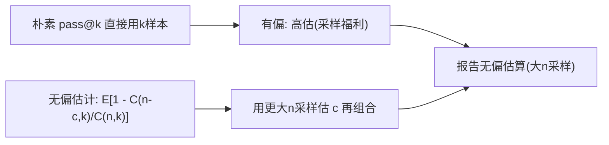

**面试要点**：pass@k 就是"至少一个通过"；朴素算法有偏（拿 k 个样本直接估）；无偏要用 `E[1−C(n−c,k)/C(n,k)]`，并且拿更大的 n 去采。既然有 pass@k，那还有个长得像的 pass^k，它们完全不是一回事——看下一题。

---

## Q5. pass@k 与 pass^k 分别适合什么场景？k 增大时两者如何分道扬镳？

**回答**

这俩名字只差一个符号，含义却正好相反，别搞混了：

- **pass@k**：k 个答案里**只要 1 个对**就算成功——适合"有就行、能用就够"的场景（比如代码生成后可以从多个候选里挑一个对的，人工辅助编程就是这种情况）；
- **pass^k**：要求**k 个全部都对**——适合"必须全对、不能有差错"的场景（比如只能在有限次尝试内保证质量、批量执行不容出错）。

**k 增大时两者会分道扬镳**：
- pass@k 随 k **单调上升**（候选越多，撞上一个对的概率越大，k→∞ 趋近 1）；
- pass^k 随 k **单调下降**（要求 k 个全对，k 越大越难，k→1 时才等于 pass@1）；
- 两者的交点位置取决于模型质量；它们对"采样多样性/质量"的解读也正好相反。

```python
def pass_all_k(p1, k): return p1**k          # pass^k（独立假设）
def pass_at_least_1(p1, k): return 1-(1-p1)**k   # pass@k
p1 = 0.5
for k in (2, 5, 10):
    print(f"k={k}: pass@k={pass_at_least_1(p1,k):.2f}, pass^k={pass_all_k(p1,k):.2f}")
```

```text
k=2: pass@k=0.75, pass^k=0.25
k=5: pass@k=0.97, pass^k=0.03
```

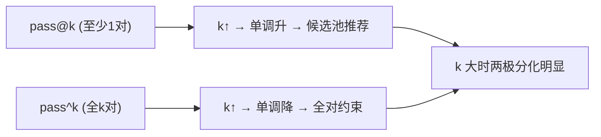

**面试要点**：pass@k=至少一对（适合候选池挑一个）、pass^k=全对（不容错）；k 变大时一个升一个降。分数背后还有个大坑——评测用的模板和抽取规则，下一题就聊这个。

---

## Q6. lm-evaluation-harness 中 prompt 模板与答案抽取规则如何影响分数？如何避免"评测过拟合"？

**回答**

很多人以为评测就是"跑个分"，其实**输入怎么拼、答案怎么抠**，对分数影响巨大。lm-evaluation-harness 这类工具就暴露了这两个变量。

**它们怎么影响分数**：
- **prompt 模板**：少样本示例的数量、措辞、分隔符一变，模型对"任务格式"的感知就变，分数跟着抖（尤其是对格式敏感、指令遵循弱的模型）；如果模板恰好和训练数据重合，评分还会偏高；
- **答案抽取**：评测时通常用正则/解析从生成文本里把答案抠出来（取 A-D、取数字、去格式）。**抽取规则差**，会把对的判错（抠出"乱"的那一版）、把错的当对；规则太"宽容"，则会被拿来刷高分。

**怎么避免"评测过拟合"**（即针对基准调参、把分数刷高）：
1. **固定模板与抽取规则**（不要追着分数去调）；
2. **多模板/多组 few-shot 报告均值和方差**（看评估对模板是否稳健）；
3. **对答案抽取做校验**：难以可靠抽取的任务，用人工双标注兜底；
4. **公开并冻结基准**，不看测试集调参（Q14 会展开）；
5. **交叉验证**：和真实评估（Arena 等）交叉核对，防止"benchmark 游戏化"。

```python
def extract_answer(text, rule):
    # 规则差 → 误判; 规则太宽 → 假高分
    return rule(text)
print("模板=格式线索(分抖); 抽取=误判风险 → 固定+多模板+校验")
```

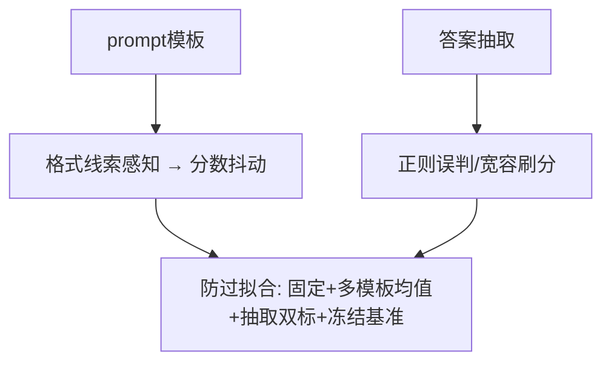

**面试要点**：模板和抽取都会影响分数；防过拟合=固定口径、多模板报告、抽取校验、不拿测试集调参。下面看一个跟 MMLU 思路不同的评估体系——HELM。

---

## Q7. HELM 与 MMLU 的评估哲学有何不同？HELM 的多维度评估包含哪些方面？

**回答**

**MMLU** 走的是"总分"路线：把 57 项任务合起来，报告**一个分数**——它关心的是"模型在这些任务上的整体表现"；
**HELM（Holistic Evaluation）** 走的是"多维"路线：它给单个模型做一张**逐任务的完整评估矩阵**，不挤成一个数，而是**同时报告好几个维度**，让使用者按自己的场景去挑。

**HELM 的多维度**大致包括：
1. **准确性（accuracy）**：任务的正确率；
2. **校准（calibration）**：模型说的置信度和实际正确率是否匹配；
3. **鲁棒性（robustness）**：提示措辞、扰动变化时分数稳不稳；
4. **公平性（fairness）**：不同群体上的表现差异；
5. **偏差（bias）**：比如毒性和群体刻板印象；
6. **毒性（toxicity）**：生成有害内容的倾向；
7. **效率（efficiency）**：推理成本/延迟（可选）。

**哲学差异**：MMLU 是"单一综合分"，HELM 是"多轴雷达图/矩阵"——后者强调把评估场景化，避免一个总分把缺陷盖过去。

```python
def helm_report(task):
    return {"accuracy": acc, "calibration": cal, "robustness": rob,
            "fairness": fair, "bias": bias, "toxicity": tox, "efficiency": eff}
```

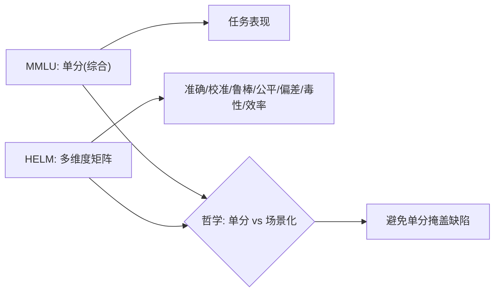

**面试要点**：MMLU 是单一分数；HELM 是多维（准确/校准/鲁棒/公平/偏差/毒性/效率）——更场景化，不容易掩盖缺陷。除了自动跑分，还有靠人投票的 Arena，下一题对比它们。

---

## Q8. Arena 的 Elo 排名与静态 benchmark 分数分别捕捉了什么、遗漏了什么？

**回答**

先解释 **Elo**：它原本是国际象棋用的"棋手等级分"，Arena（Chatbot Arena）借用过来——让真人用户实时两两对比两个模型的回答、投票，再用这些投票算出一个排名。它和 MMLU/HumanEval 这类自动跑分的"静态 benchmark"是两种完全不同的思路。

- **Arena 的 Elo 排名**：靠人类用户**实时两两对比**投票得来 → 捕捉的是**真实用户的偏好和体验**（好不好用、风格舒不舒服、多轮对话感受如何）；
- **静态 benchmark（MMLU/HumanEval）**：自动评估单个任务的正确率 → 捕捉的是**指定的能力**（知识、代码、推理）。

**它们各自遗漏了什么**：
- **Arena 的遗漏**：
  - **可复现性**（用户偏好带噪声，容易受界面、多轮顺序影响）；
  - **任务覆盖**（用户样本偏日常和指令类，专业任务、长任务覆盖不足）；
  - **成本/延迟**（不计算推理成本）；
- **静态 benchmark 的遗漏**：
  - **真实用户偏好**（答得对，不等于好用）；
  - **多轮/交互风格**（它考的是单轮任务式）；
  - **鲁棒性/失败模式**（静态集有限，还容易污染、饱和）。

**结论**：两者是互补关系——Arena 测"体验"，benchmark 测"能力"；两个都用，分开来看。

```python
def methods():
    return {"Arena": "感知体验/偏好(但噪声/覆盖有限)",
            "Benchmark": "指定能力(但缺偏好/易饱和)"}
```

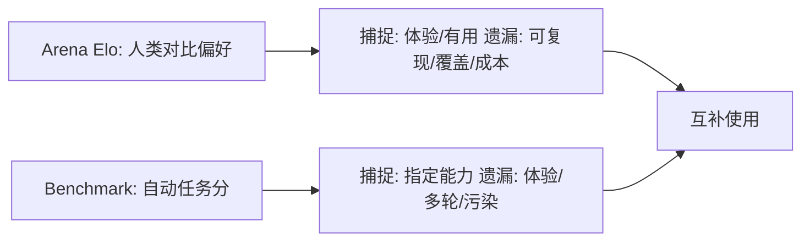

**面试要点**：Arena 测的是偏好体验（有噪声、覆盖有限），benchmark 测的是能力（缺体验、容易污染和饱和）——两者互补。既然静态 benchmark 有短板，它还会"饱和"，下一题就讲饱和是怎么回事。

---

## Q9. 静态 benchmark 为什么会"饱和"？饱和后应用什么评估范式替代？

**回答**

先解释"饱和"：一个基准用的时间久了，大家都快考满分，它就失去区分能力了。

**为什么会饱和**：
- 静态集的**样本有限且公开**，而模型能力又不断往上顶，于是：
  - **天花板效应**：多数模型都接近满分，区分度就没了；
  - **污染/过拟合**：模型见过、或针对性优化过这个 benchmark 的分布 → 分数虚高，不再反映真实能力；
- 静态集**不会随模型进步而更新**：模型能力越来越细，旧集的粒度已经不够看。

**饱和之后用什么范式替代**：
1. **动态/自适应评估**：**持续生成新题**（动态基准、对抗进化的评测——防污染，而且永远够难）；
2. **人类偏好评估（Arena）**：实时两两对比，天然防饱和；
3. **挑战集/攀爬集**：按模型能力**动态上难度**（答对了就换更难的）；
4. **能力分解 + probe**：把问题从"能不能"转向"在什么条件下不能"（鲁棒性、失败分析）。

```python
def saturation(score):
    return score > 0.95   # 接近满分 → 饱和(区分度消失)
print("饱和 → 动态/自适应/人类偏好/难度攀爬 替代静态")
```

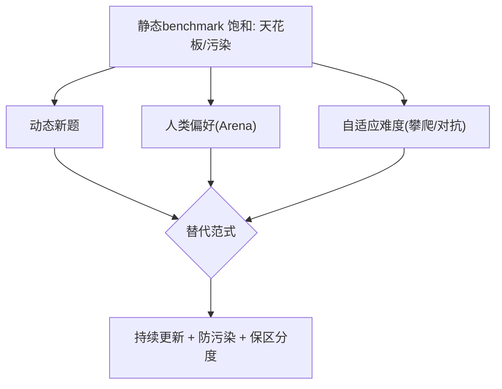

**面试要点**：饱和=天花板+污染+不更新；替代办法=动态题、人类偏好、自适应难度。英文基准之外，中文有自己的基准，下一题对比 C-Eval 和 MMLU。

---

## Q10. C-Eval 与 MMLU 在中文场景下的差异是什么？直接用 MMLU 评估中文模型会有什么问题？

**回答**

- **MMLU**：英文基准（后来又出了翻译成多语言的版本），知识以英文为主，面向的是英文教育和考试；
- **C-Eval**：中文基准（中文知识 + 中文题目 + 中文教育背景），覆盖的是中国的学科、常识和文化。

**直接用 MMLU 评估中文模型，会有什么问题**：
1. **语言偏移**：中文模型的训练以中文为主 → 英文 benchmark 考的其实是"英文场景能力"，不是中文能力；
2. **知识域偏差**：MMLU 的知识点是西文教育那套（美国史、西方社会学等），中文模型在这些上面弱，并不代表它中文能力弱；
3. **数据分布**：中文模型可能没充分见过英文题的格式和表述 → 分数被低估；
4. **跨语言迁移**：翻译版 MMLU 的翻译本身有歧义 → 分数不稳；
5. **结论**：**应该用 C-Eval/中文 benchmark 来主要衡量中文模型**，MMLU 只能作为参考（看英语能力）。

```python
# 中文模型评估矩阵
def chinese_eval_suite():
    return ["C-Eval", "CMMLU", "中文Code/数学/百科", "MMLU(仅英语参考)"]
```

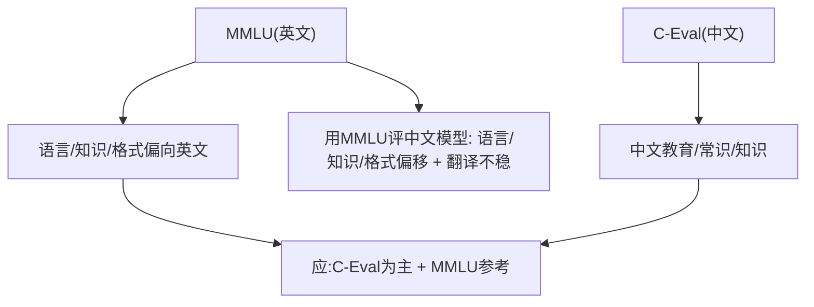

**面试要点**：C-Eval 考的是中文知识/教育；用 MMLU 评中文模型会有**语言、知识域、格式**三重偏移——应该以中文 benchmark 为主。接下来看一个用 LLM 当裁判的胜率评测法——AlpacaEval。

---

## Q11. AlpacaEval 的胜率评估与人类评估的相关性如何？它的长度偏差是什么？

**回答**

- **AlpacaEval**：让 **GPT-4 当裁判（judge）**，把模型回答跟参考回答比，算一个胜率（win-rate）——它自动化程度高，但本质上是"用 LLM 打标签"；
- **和人类评估的相关性**：在指令遵循、有用性这些维度上，它跟人类判断有**中等程度的相关性**（比纯规则打分强），但**不完美**：裁判对格式、风格、长度特别敏感，容易偏离人类的真实偏好。

**长度偏差**：AlpacaEval 有个很出名的 **"length bias"（长度偏差）——回答越长越容易赢**，因为裁判容易把"更详细、更冗长"误当成"更好"：
- 具体表现：长回答的胜率会系统性更高，哪怕内容其实一样；
- 后果：模型可以靠"把话说长"来刷分（也就是第 12 章 Q24 说的"啰嗦"问题）。

**怎么缓解**：控制长度（给裁判的输入限制长度）、用更紧凑的 prompt、报告"长度-胜率"的相关性、用人类样本做校验。

```python
def length_bias(wh_pr, l_pr):
    return l_pr - wh_pr   # 长回答 win 差异 >0 → 长度偏差
print("长度偏差: 长回答win率虚高(judge把冗长当好) → 控制/报告")
```

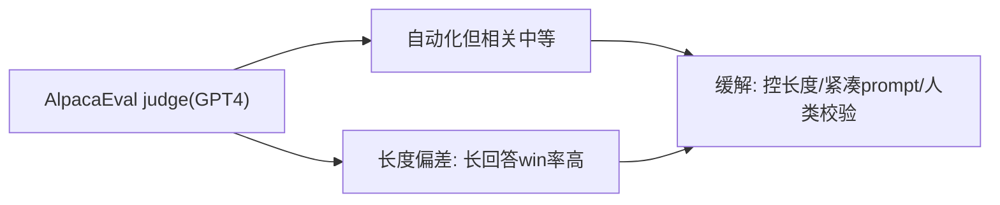

**面试要点**：AlpacaEval 和人类判断的相关性中等；它最大的坑是**长度偏差**——长回答胜率虚高，所以得控制长度并报告出来。代码评估里的 pass@k，跟"功能正确性"是什么关系？下一题说清楚。

---

## Q12. 代码评估中功能正确性（unit test）与 pass@k 是什么关系？pass@k 高是否一定意味着代码质量好？

**回答**

- **功能正确性（unit test）**：用测试用例判断代码**跑起来对不对**——考的是单次生成的正确性；
- **pass@k**：k 个生成里**至少有 1 个通过**（前面 Q4 讲的那种）——相当于把"正确性"扩展到一整个采样池上。

**两者的关系**：pass@k 是建立在"**每个候选都要过 unit test**"的基础上的（k 个候选取并集）；当 k=1 时，pass@1 就等于单次的功能正确率。

**pass@k 高，并不一定代表代码质量好**：
1. **过拟合测试用例**：代码可能专门 hack 那几个 test（暴力枚举、硬编码答案）——通过单测，但不可扩展、不真实；
2. **不考虑可读性/健壮性/性能/风格**：能过测试，却难维护、边界有 bug；
3. **覆盖不足**：测试覆盖有限，换个 hidden tests 就可能挂（第 13 章 Q18 会讲）；
4. **k 大掩盖真实质量**：pass@10 很高，可能只是"候选够多、碰对了"，单次能力其实还很弱。

```python
def pass_at_k_from_tests(n_pass, n_total, k):
    # 基于单测通过集合计算
    return 1 - math.comb(n_total - n_pass, k) / math.comb(n_total, k) if n_total-n_pass>=k else 1.0
print("pass@k 好但不代表质量(可hack/覆盖/健壮/性能不足)")
```

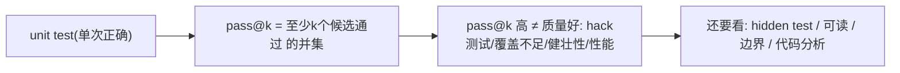

**面试要点**：pass@k 是建立在 unit test 上的采样并集；分高不等于质量好——它可能 hack 测试、覆盖不足、也不管健壮性和性能。数学评估里还有个"精确匹配"的坑，下一题讲。

---

## Q13. 数学评估中精确匹配会漏掉哪些正确但格式不同的答案？如何设计更鲁棒的答案抽取？

**回答**

**精确匹配（exact match）会漏掉哪些"其实正确、只是写法不同"的答案**：只要答案字符串不完全一样，精确匹配就会判错，常见的有：
- 数字的等值变体：`1/2` 对 `0.5`、`1.0` 对 `1`、还有科学计数法；
- LaTeX/数学符号写法不同：`\frac{1}{2}` 对 `0.5`、`\sqrt{4}` 对 `2`；
- 单位/前导零：`5 cm` 对 `5`、`05`；
- 答案绕在文字里（"答案是 12" 对 光秃秃的 `12`）；
- 等价表达式：`2+3` 对 `5`。

**怎样设计更鲁棒的抽取**：
1. **归一化/规范化**：去空格、统一大小写、去 html、把 LaTeX 转成符号，统一小数/分数格式（可以用 sympy 化简）；
2. **数学等价性校验**：用**符号比较**（sympy 的 `equals`）而不是比较字符串；
3. **语义解析**：用正则把"答案"那块抽出来（"答案是 X"/最后一个等号之后），再做校验；
4. **数值容差**：浮点数比较时用一个 epsilon；
5. **人工校验**：对难以抽取的样本，按比例抽样核对。

```python
import sympy as sp
def math_equiv(a, b):
    try:
        return sp.sympify(a, evaluate=False).equals(sp.sympify(b))
    except Exception:
        return a.strip() == b.strip()
for x, y in [("1/2", "0.5"), ("sqrt(4)", "2"), ("2+3", "5")]:
    print(f"{x!r} ~ {y!r}: {math_equiv(x,y)}")
```

```text
'1/2' ~ '0.5': True（sympy 化简）
'sqrt(4)' ~ '2': True
'2+3' ~ '5': True
```

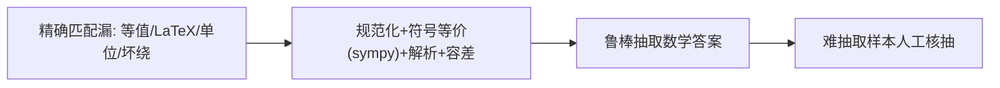

**面试要点**：精确匹配会漏掉等值、格式、语义上的不同；鲁棒做法=**规范化 + sympy 等价 + 解析答案块 + 数值容差**。前面说了这么多指标，下面看一个真实的反差：MMLU 考 90 分、对话却很差。

---

## Q14. 模型在 MMLU 上 90 分但在真实对话中表现很差，可能的原因有哪些？

**回答**

这种"考试高分、实际对话拉胯"的反差很常见，原因通常有这几条：

1. **污染/数据泄漏**：MMLU 的题目早被预训练见过 → 分数是"背"出来的，一到新问题的真实对话就露馅（第 10 章 Q10 会讲）；
2. **评测集过拟合**：专门针对 benchmark 调优过（few-shot 模板、后训练等）→ 一出分布、进对话就崩（本章 Q6）；
3. **任务-能力错位**：MMLU 考的是**知识/单轮选择**，对话考的是**多轮、指令、推理、对话风格**——这两种能力根本不重叠；
4. **格式依赖**：模型太依赖 A-D 选项格式，换成对话的自由文本就不会组织答案了；
5. **后训练差异**：模型在评测用的输入格式上训练得很好，但对齐没覆盖对话模式；
6. **统计差异**：MMLU 单点分高，但置信度低、对措辞敏感（Q7 的校准问题）。

```python
def gap_reasons():
    return ["污染/泄漏", "benchmark过拟合", "任务能力错位", "格式依赖", "对齐缺口", "校准差"]
```

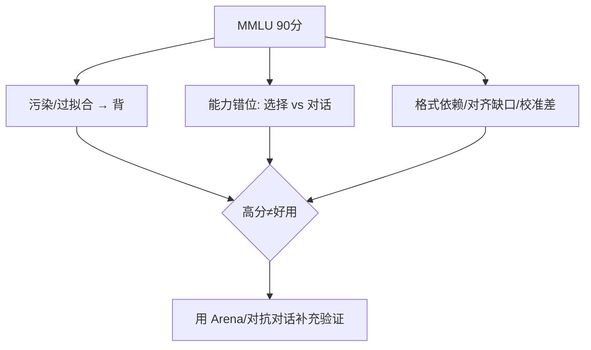

**面试要点**：反差来自**污染/过拟合、能力错位、格式/校准/对齐缺口**——高分不代表对话好用，得靠 Arena 之类的补充验证。高分里面有个隐藏来源叫"污染"，那怎么把污染揪出来？下一题。

---

## Q15. 如何检测 benchmark 污染？成员推断在污染检测中能起什么作用？

**回答**

**检测 benchmark 污染**，常用这几招：
1. **n-gram 重叠扫描**：在训练语料里找和 benchmark 样本高度重叠的片段（第 10 章 Q10 讲过）；
2. **困惑度/记忆性**：拿模型去算 benchmark 样本的 PPL——如果低得异常（相对其它同分布样本），多半是训练时见过；
3. **时间戳检查**：看基准发布之前，样本是否已经出现在爬取的语料里；
4. **成员推断（Membership Inference, MI）**：拿训练过的模型和一个未训练的参考模型对比，看它们**在同一样本上的不确定度差**——如果训练模型对 benchmark 样本的困惑度/不确定性明显更低，那这个样本很可能**是训练集成员（也就是被污染了）**。

**MI（成员推断）的作用**：它是一项**判断"某个样本到底有没有被用于训练"**的技术。对 benchmark 逐样本做 MI，就能把"哪些题可能被污染"标出来。**局限**：MI 对"相似但不完全相同"的污染（改写、变体）识别能力弱；小样本、近重复的情况也有噪声。

```python
def membership_test(model_ref, miss, sample):
    uncertainty_diff = model_ref.entropy(sample) - miss.entropy(sample)
    return uncertainty_diff > threshold      # 差大 → 样本可能是训练成员(污染)
print("MI: 训练模型对样本不确定性明显更低 → 疑似污染样本")
```

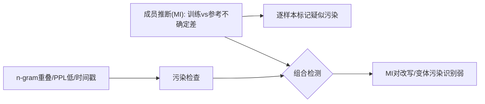

**面试要点**：检测=用 n-gram/PPL/时间戳/**成员推断**（不确定度差）；MI 能逐样本标记疑似污染，但对改写、变体效果弱。

## Q16. 多轮对话如何评估？单轮 benchmark 分数能否预测多轮表现？

**回答**

**多轮对话的评估**，大致分两类：
- **任务型**：看多轮任务完成率（多轮 RAG、客服、指令类任务，看每一回合的目标有没有达成）；
- **交互型**：看多轮的有用性、一致性、风格（也就是保住上下文的能力）；
- **常用指标**：多轮胜率（人类或 judge 打分）、错误累积率（第 15 章 Q19）、上下文利用度（前面的信息有没有被正确用上）、多轮一致性。

**单轮分数能不能预测多轮表现**：**通常只能弱预测，甚至预测不了**——
- 多轮需要**跟踪上下文、纠正历史错误、累积记忆**，单轮基准根本测不到；
- 单轮分高的模型，多轮里可能因为"忘了前面说啥 / 过度自信 / 风格漂移"而崩；
- **存在部分相关性**（更强的模型通常多轮也更好），但**不可靠**——还是得在真实的调多轮上单独测。

```python
def multi_turn_score(model, dialog):
    ctx = []
    for turn in dialog:
        out = model(ctx + [turn])
        ctx += [turn] + [out]
    return compute_turn_metrics(ctx)   # 回合达成/一致性/错误累积
print("单轮→多轮: 弱预测; 需真实多轮评测")
```

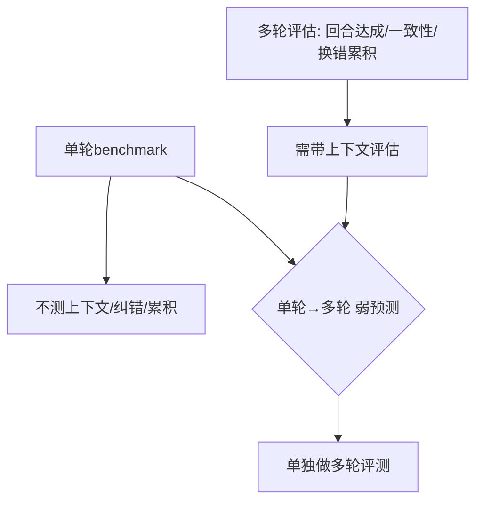

**面试要点**：多轮看回合达成、一致性、错误累积；单轮对多轮只是**弱预测**——必须单独做多轮评测。能力之外，安全也是评估的一大块，下一题看安全评估。

---

## Q17. 安全评估应包含哪些维度？红队测试与自动化安全 benchmark 各自的局限是什么？

**回答**

**安全评估该覆盖哪些维度**：
1. **有害/毒性内容**（仇恨、暴力、自伤）；
2. **恶意指令/Prompt 注入**（越狱、工具滥用）；
3. **隐私泄露**（不能泄露 PII/内部信息）；
4. **偏见/歧视**（群体刻板印象）；
5. **可靠性**（幻觉、误导、错误断言）；
6. **越狱鲁棒性**（对抗攻击下还能不能守住拒绝）。

**红队测试的局限**：它靠人工，**成本高、样本少、不可规模化**；红队人员主观性强、覆盖不全；测试结果也不一定可复现。

**自动化安全 benchmark 的局限**：
- **覆盖有限、而且是静态的**（新攻击总会超出基准）；
- 搜索空间大、**对抗性不足**（简单的 jailbreak 能过基准，但新招数依然能绕过）；
- 分数**容易被游戏化**（模型对基准里的输出假装拒绝，遇到真实的新攻击就不行了）；
- 两者其实是**互补**的：红队做深度，自动化做广度。

```python
def safety_suite():
    return ["有害内容", "jailbreak", "隐私", "偏见", "幻觉/误导", "越狱鲁棒"]
print("红队: 深度有限; 自动化: 广度但静态 → 互补")
```

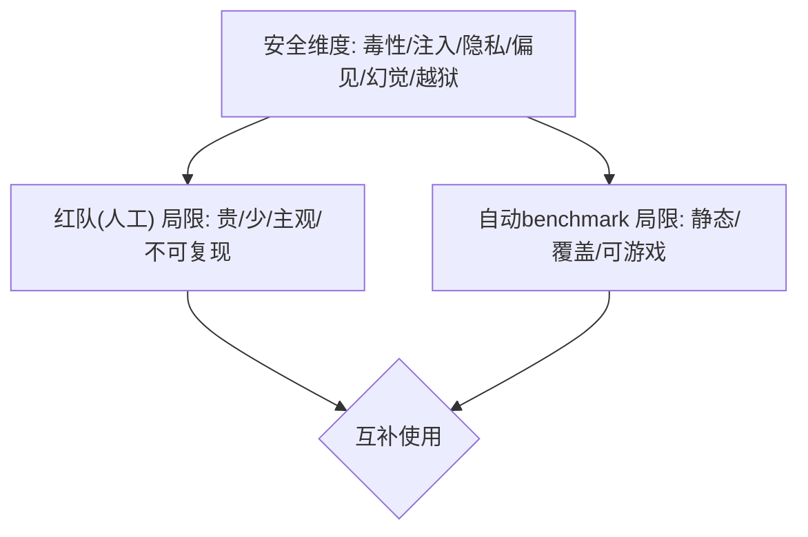

**面试要点**：安全维度列 5-6 项；红队=贵、浅，自动化=静态、可游戏——两者互补。除了评估范式，还有个很现实的问题：换台机器分数就变了，这是能力变了还是数值抖动？下一题。

---

## Q18. 模型只在 A100 上评测，换到 H100 后分数变化说明什么？数值差异与真实能力差异如何区分？

**回答**

**换卡后分数变化说明了什么**：
- 如果模型逻辑一样、评测脚本和 seed 都一样，**A100 和 H100 的分数应该几乎一致**——那点微小差异只是**数值、库版本、调度**造成的；
- 如果**明显变化（比如超过 0.5 分）**，就要怀疑背后有原因：
  - 非确定性（并行/原子操作，cuBLAS/cuDNN 挑了不同的 kernel）；
  - 精度路径变了（TF32 和 FP32 的默认开关不同）；
  - 实现 bug，或者环境变量不同。

**怎么区分数值差异和真实能力差异**：
- **同权重、同脚本、同 seed** 多跑几次 → 看**方差**；
- 把不确定性关掉（`torch.use_deterministic_algorithms`），固定 TF32/浮点策略 → 如果还差，就重点查代码路径；
- **数值差异 = 可复现的小抖动（多轮均值一致）**；**真实能力差异 = 在多种设定下都稳定地差**（换 prompt、多采样本、换 seed 都还是差）。

```python
def num_vs_real(run_a100, run_h100, rep=5):
    var = [run_h100(i)-run_a100(i) for i in range(rep)]
    stable_diff = max(var)-min(var) < 0.3 and abs(sum(var)/len(var)) > 0.5
    return "真实差异" if stable_diff else "数值抖动"
```

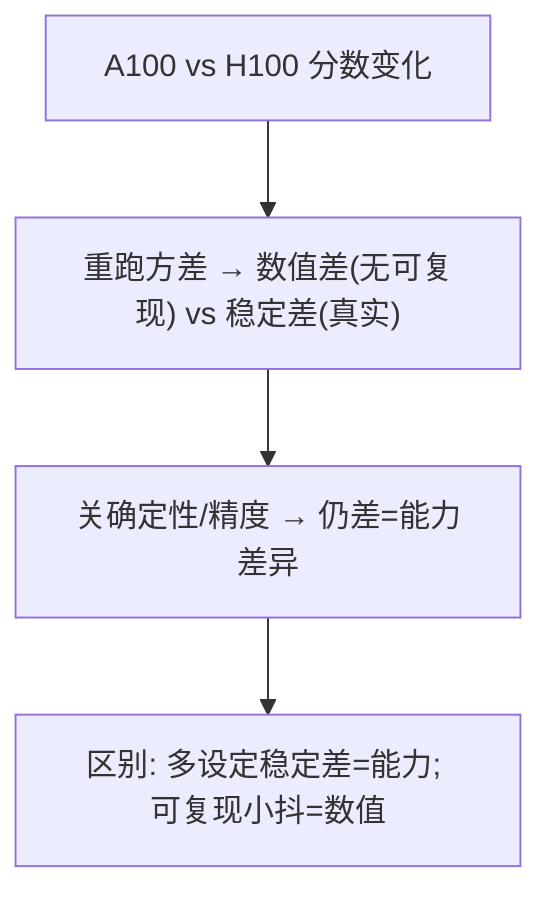

**面试要点**：同脚本多跑看方差；数值差异=可复现的抖动；真实差异=**多种设定下都稳定地差**。再看一个常被忽视的问题：两个模型只差 1 分，这差距到底算不算数？

---

## Q19. 两个模型在 MMLU 上差 1 分，需要多少样本才能判断这个差异是统计显著的？

**回答**

**用显著性检验来估算**：

- MMLU 有 N 道题，每题通过/不通过（可近似看作独立）；
- 两模型相差 Δ=0.01（也就是 1 分），标准误 SE≈√(p·(1−p)/N)（McNemar / 对样本差异近似是 √(2p(1−p)/N)）；
- 要判定显著，需要 **Δ ≥ 2·SE**（大约 95% 置信）：
  `0.01 ≥ 2·√(p(1−p)/N)` → `N ≥ 4p(1−p)/0.0001`。
- 若 p≈0.5（最差情况）：`N ≥ 4·0.25/1e-4 = 10,000` 题——**要上万道样本**才能分辨 1 分的差距；p 更极端时，需要的样本量也要数千。

```python
import math
for d in (0.01, 0.03):
    N = 4*0.25/d**2
    print(f"1 分差(0.01): 需要≈{N:.0f} 样本")
```

```text
1 分差(0.01): 需要≈10000 样本
3 分差(0.03): 需要≈1111 样本
```


**面试要点**：MMLU 差 1 分要**上万样本**才算显著（SE≈√(pq/N)、Δ≥2SE）；小差异经常根本不显著。既然评估集设计这么关键，下一题就聊聊它为什么本身就是一种研究能力。

---

## Q20. 为什么"评估集设计"本身是一项研究能力？设计一个能区分"记忆"与"泛化"的评估集。

**回答**

**为什么说评估集设计本身是研究能力**：设计的质量直接决定结论可不可信——**设计错了**，就会给出误导性的结果（高分会掩盖缺陷，低分会误判能力）。设计一套好评估集，需要做到**统计严谨、能力解耦、防污染、抗饱和**——这正是评估科学的核心。

**怎样设计一个能区分"记忆"和"泛化"的评估集**：
1. **把"见过"和"没见过"分开**：
   - 见过的：训练分布内的题（测记忆/拟合）；
   - 没见过的：**新组合、新题、新领域**（测泛化）；
2. **组合/置换**：把训练里的组件**用新方式重新组合**（改语法、改角色、改数量）——靠记忆的只能答见过的，靠泛化的能答新组合；
3. **模板换壳**：同样的题型**换人名、换数字、换名词**，看模型还会不会（区分"背答案"和"会方法"）；
4. **分布外（OOD）**：训练时**刻意留出**一部分结构（禁用某些数字/操作）——测试模型能不能外推；
5. **难度阶梯**：从记忆型（常见题）排到推理型（需要组合），就能看出它"到底是从哪一层开始真正会了的"。

```python
def memory_vs_generalize(eval):
    mem = [q for q in eval if q in training]
    gen = [splice(training_components) for ...]   # 新组合
    return {"memory_acc": acc(mem), "generalization_acc": acc(gen)}
# memory_acc >> gen_acc → 记忆多过泛化
```

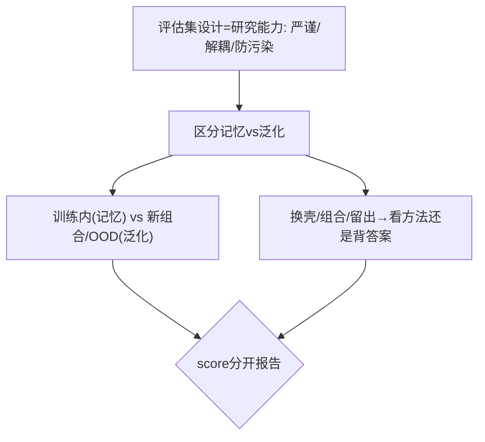

**面试要点**：评估设计影响结论的可信度；区分记忆和泛化=训练内 vs 新组合/OOD、换壳、刻意留出结构。说完设计，回到 PPL 那个指标——它在领域偏移时会怎么失效？

---

## Q21. PPL 在领域偏移下如何失效？领域内 PPL 低是否意味着领域外也好？

**回答**

**PPL 在领域偏移下为什么失效**：
- PPL 是**相对你训练的那个分布**来衡量的；模型跑到没见过的领域上，PPL 会飙升（因为进入了数据分布之外）；
- 领域偏移的意思是词表、句式、主题分布都变了 → 模型预测概率变差 → PPL 大幅上升；
- 所以"**领域内 PPL 低**"这个结论，强烈依赖两个领域有多接近——跨领域根本不会迁移。

**领域内 PPL 低，是否意味着领域外也好**：
- **不是**：PPL 是个**拟合指标**，衡量的是"对这个分布有多熟练"，不是"能力的推广"；
- 领域内 PPL 低，可能是因为**背下来**了；到了领域外（新任务、新分布），预测照样差；
- 需要**跨领域评测**（每个领域分开报 PPL/benchmark）——不能拿单个领域的 PPL 去推另一个领域。

```python
def ppl_ood(in_ppl, ood_ppl):
    gap = ood_ppl - in_ppl
    print(f"域内PPL={in_ppl:.2f}, 域外PPL={ood_ppl:.2f} gap={gap:.2f}→ PPL不迁移")
```

```mermaid
flowchart LR
    A["PPL=拟合指标(相对分布)"] --> B["域偏移 → PPL飙升"]
    B --> C["域内低 ≠ 域外好(背/分布近)")]
    C --> D["需多域分开报 不可单域外推"]
```

**面试要点**：PPL 是**域偏拟合**指标，领域一偏移就会失效；领域内低保证不了领域外好——要分领域报告。下面看用 LLM 当裁判时的一堆偏差，以及怎么缓解。

---

## Q22. 用 LLM-as-a-Judge 做评估的偏差来源有哪些（位置偏差、长度偏差、自我偏好）？如何缓解？

**回答**

**LLM-as-a-Judge（让 LLM 当裁判）的偏差来源**，主要有这么几种：
1. **位置偏差（position bias）**：裁判对"第几个出现的候选"有偏好（比如偏爱排前面的，或偏爱排后面的）；
2. **长度偏差（length bias）**：偏爱长回答（前面 Q11 讲过）；
3. **自我偏好（self-preference）**：裁判模型**偏爱自己或同族的输出**（因为风格相似）；
4. **格式/语气偏差**：偏爱某种措辞、某种代码格式；
5. **措辞/参考偏差**：裁判对 prompt 的措辞很敏感。

**缓解办法**：
- **位置交换（swap）**：把两个候选左右对调后再让裁判判一次，只有两次一致才计入（或者取平均）；
- **控制长度**：限制生成长度、长度匹配之后再比；
- **多裁判平均 / 偏差校准**：用不同家族模型做裁判再取平均；
- **有参考 vs 无参考**：无参考（referenceless）时才会没有参考偏差；
- **人工校验一部分样本**：定期拿人类判断跟裁判对比。

```python
def judge_with_swap(a, b):
    first  = judge(a, b)
    second = judge(b, a)
    return consistent(first, second)   # 位置交换一致才可信
print("缓解: 位置交换 / 控长度 / 多judge / 人工子集")
```

```mermaid
flowchart TB
    A["Judge 偏差: 位置/长度/自我/语气"] --> B["位置交换校验"]
    A --> C["控长度/匹配"]
    A --> D["多judge平均/人工子集"]
    B --> E{"缓解组合"}
    C --> E
    D --> E
```

**面试要点**：偏差=位置/长度/自我/语气；缓解=交换顺序、控长度、多裁判、人工子集校验。回到 pass@k，还有个常被拿来对比的场景题：pass@1 与 pass@10 谁更强？

---

## Q23. 一个模型 pass@1=80%，另一个 pass@10=90%，哪个更强？取决于什么使用场景？

**回答**

**不能直接比较**——因为它们用的 k 不同，口径不可比：
- pass@1=80%：**单次就答对**——能力是"一次就对"；
- pass@10=90%：**10 次里至少有一次对**——候选池更大，难度也自然更低。

**到底谁强，要看使用场景**：
- 需要**一次就对**（在线回复、低容错）→ **pass@1 80% 更强**（它不需要多采样）；
- 可以**多采样再挑选**（代码补全，多生成几条让开发者挑、或者执行验证后选）→ **pass@10 更有价值**（累计通过率好）；
- 理想情况是**在同一个 k 的口径下比较**（要么都用 pass@1，要么都用 pass@10）。

```python
# 换算成同 k 不可靠 → 明确"使用场景决定用哪个k"
def choose(p1, p10, single_shot_needed):
    return p1 if single_shot_needed else max(p10, p1)
print("pass@1 vs pass@10 不可直接比; 场景=容错/采样预算")
```

```mermaid
flowchart LR
    A["pass@1=80%"] --> B["一次就对 → 在线/低容错"]
    C["pass@10=90%"] --> D["可多采样挑选 → 代码/实验"]
    A --> E{"场景决定"}
    C --> E
    E --> F["比同一k口径才公平"]
```

**面试要点**：口径不同（1 对 10）不能直接比；看场景——低容错看 pass@1，可采样看 pass@10。评估集还有两个老对手：天花板效应和地板效应，下一题。

---

## Q24. 基准测试的天花板效应与地板效应分别是什么？如何设计一个避免两者的评估集？

**回答**

- **天花板效应（ceiling）**：题目太简单 → 多数模型都快满分 → **高分扎堆、区分度丧失**（分不出强者之间谁更强）；
- **地板效应（floor）**：题目太难 → 多数模型都接近 0（相当于随机猜）→ **区分度同样丧失**（分不出弱者跟乱猜的差别）。

**怎样设计一个两种效应都避开的评估集**：
1. **难度阶梯**：让题目难度**均匀覆盖从易到难**（中间档也要有），避免全易或全难；
2. **校准验证**：评测前先在小样本上确认**得分分布**（中位数别是 100 或 0，最好落在 40-70% 这个区间）；
3. **宽度与深度平衡**：既有简单需求，也有推理难题；
4. **动态调难度**：根据平均分调整（天花板了就加更难的，地板了就加更简单的）；
5. **报告分布而不是单点**：按难度段分别报（低/中/高难段），把区分度留住。

```python
def design_balanced(diffs):
    import numpy as np
    ok = np.median(diffs) > 0.3 and np.median(diffs) < 0.7
    return f"中位数在0.3-0.7 → {'OK 有区分度' if ok else '需要调难度'}"
```

```mermaid
flowchart LR
    A["天花板: 太简单→满分无区分"] --> B["难度阶梯(均匀)")
    C["地板: 太难→全0无区分"] --> D["调难度/分难度段报"]
    B --> E["设计: 覆盖中间档 + 分布校验(40-70%)"]
    C --> E
    D --> E
```

**面试要点**：天花板=太简单（满分）、地板=太难（全 0），两者都会抹掉区分度；设计=难度阶梯+分布校验+分段报告。再往细里看，模型"说的置信度"到底靠不靠谱？这就引出校准和 ECE。

---

## Q25. 如何评估模型的校准？ECE 在 LLM 上如何计算？

**回答**

先说**校准**是什么：模型的**置信度和正确率要匹配**——它说"我有 80% 置信"的预测，实际就应该大约 80% 是对的。

**ECE（Expected Calibration Error，期望校准误差）**怎么算：
- 先把预测按置信度分桶（比如分 10 个桶：[0,0.1)、[0.1,0.2)……）；
- 每个桶里算一下：**平均置信度**和**平均正确率**差多少；
- `ECE = Σ (n_bin/N) · |confidence_bin − accuracy_bin|`。

**在 LLM 上怎么用**：
- 常用**多次采样**来估置信度（vote entropy / self-consistency）：同一个 prompt 采样 N 次，用答对的比例当作"置信度"；
- 或者拿 token logits 的**平均/答案概率**当置信度；然后用这些结果去做校准评估。

```python
import numpy as np
def ece(confs, accs, M=10):
    bins = np.linspace(0,1,M+1)
    tot = 0; N=len(confs)
    for i in range(M):
        m = (confs>=bins[i]) & (confs<bins[i+1])
        if m.any():
            conf = confs[m].mean(); acc = accs[m].mean()
            tot += (m.sum()/N)*abs(conf-acc)
    return tot
confs = [0.9,0.8,0.7,0.4,0.2]; accs = [1,1,0,0,0]
print(f"ECE ≈ {ece(np.array(confs), np.array(accs)):.3f}（越小越校准）")
```

```text
ECE ≈ 0.160
```

```mermaid
flowchart LR
    A["置信度分桶"] --> B["每桶: 平均置信 vs 正确率"]
    B --> C["ECE = Σ n/N·|conf-acc|"]
    C --> D["LLM: 多次采样/self-consistency估计置信"]
    D --> E["ECE 越小越好"]
```

**面试要点**：ECE=分桶算 |置信−正确率| 的加权和；LLM 上先靠**采样/self-consistency** 估置信，再算 ECE。评估还常跨语言，那翻译版基准和原生基准的分数差说明了什么？

---

## Q26. 多语言评估中，翻译 benchmark 与原生 benchmark 的分数差距说明了什么？

**回答**

**两种基准的区别**：
- **翻译 benchmark（translate-test）**：把英文基准翻译成目标语言来评测；
- **原生 benchmark（native）**：直接用目标语言的高质量原生数据来评测。

**分数差距说明了什么**：
- 原生分 **> 翻译分**：说明模型在目标语言上的"原生能力"好（训练到位），而翻译题引入了翻译噪声和格式损失；
- 翻译分 > 原生分：可能**训练数据偏翻译**，或者原生测试更难、更偏；
- **翻译版基准系统性偏低**，说明**翻译引入的格式/OOV/文化差异**让评测失真——翻译基准并不能真实反映目标语言能力；
- 理想做法是**以原生基准为主**（更真实地反映语言能力），翻译基准只作参考。

```python
def lang_gap(native, translated):
    gap = native - translated
    print(f"原生 - 翻译 = {gap:+.2f}")
    if gap > 0.1: print("原生强（翻译丢信息/格式）")
    elif gap < -0.1: print("翻译路径虚高（需查）")
```

```mermaid
flowchart LR
    A["翻译基准"] --> B["引入翻译噪声/文化差异"]
    C["原生基准"] --> D["真实语言能力"]
    B --> E{"差距: 原生>翻译=真能力; 翻译路径问题"}
    D --> E
```

**面试要点**：分数差反映了翻译引入的噪声/失真；评估目标语言能力，要以**原生基准**为主。再看一个越来越重要的任务：RAG 该怎么评估。

---

## Q27. RAG 任务的评估应覆盖哪些维度？检索质量、答案忠实度、引用准确性如何分别度量？

**回答**

**RAG 评估要覆盖的维度**：
1. **检索质量（retrieval quality）**：检索到的文档是不是相关、有没有覆盖需求；
2. **答案忠实度（faithfulness）**：答案**是不是只基于检索到的文档**、有没有幻觉（不编造文档外的东西）；
3. **答案准确/有用性**：最终答案对不对、有没有用；
4. **引用准确性（citation accuracy）**：引用的是否**真的对应**支撑内容的文档段落。

**各维度怎么度量**：
- 检索：用 **Recall@k / Precision@k / MRR**，对着标注好的相关文档算；
- 忠实度：用 **FActScore / NLI-based 判定**（看答案里每句话能不能被检索文档蕴含），或者用 judge 打分；
- 引用：看**引用-文档对齐**（引用是不是真指向支撑段落）、引用覆盖率（关键句有没有配引用）。

```python
def rag_metrics():
    return {"retrieval": "Recall@k/Prec", "faithful": "FActScore/NLI",
            "answer": "EM/F1", "citation": "引用对齐/覆盖率"}
```

```mermaid
flowchart TB
    A["检索质量"] --> B["Recall@k/Prec 对标注"]
    C["答案忠实度"] --> D["FActScore/NLI判定(不幻觉)"]
    E["引用准确"] --> F["引用-文档对齐/覆盖率"]
    B --> G{"RAG各维度分别度量"}
    D --> G
    F --> G
```

**面试要点**：三个维度——检索（Recall@k）、忠实（FActScore/NLI）、引用（对齐/覆盖），要分开度量。长上下文还有个经典测试叫"大海捞针"，但它有局限，下一题。

---

## Q28. needle-in-a-haystack 测试的局限性是什么？它没有测到什么？

**回答**

先解释 **Needle-in-a-haystack（LIHA，"大海捞针"）**：在一长段文本里藏一个"针"（一个事实或指令），看模型能不能把它找回来——它测的是长上下文里的**信息检索/利用率**。

**它的局限性**：
1. **只测"找针"**：测的是**局部信息取回**，测不了长文的**整体理解/推理**（多段落关联、总结、分层逻辑都没覆盖）；
2. **位置/语域是人为设的**：针放在什么位置、用什么语言风格，都是人为安排的，跟真实任务不符——分数没法推广到真实长文档任务；
3. **信号容易饱和**：很多模型分数很高，但真实的长上下文任务照样差（区分度低）；
4. **不测渐进式失败**：它不测长文"中间部分"的理解、噪声干扰下的执行、多针之间的交互。

**它没测到的**：长文推理、上下文的保存与渐进利用、真实噪声文档的过滤、跨多段落整合、长文的鲁棒性。

```python
def needle_test_limits():
    return ("只测取针,不测整体理解/推理/整合/渐进利用/真实噪声")
```

```mermaid
flowchart TB
    A["LIHA: 长文取针"] --> B["测局部检索"]
    A --> C["不测: 整体理解/推理/整合/渐进利用"]
    B --> D["真实长任务: 需 summary/QA/引用等补充"]
    C --> D
```

**面试要点**：LIHA 只测"找针"；它不测整体理解/推理/整合/渐进失败——得再补真实长上下文任务。垂直领域（医疗、法律）的评估集又该怎么搭？下一题讲专家标注的成本与质量平衡。

---

## Q29. 为垂直领域（医疗、法律）构建可信评估集时，专家标注的成本与质量如何平衡？

**回答**

**平衡的几招**：
1. **分层设计**：核心题、难例由**专家标**，普通样本交给**受训标注员 + 专家复核**；
2. **专家标核心子集 + 辅助扩展**：小规模专家标注，再配合半监督扩展（专家标一部分，模型标完由专家审）；
3. **交叉双标注 + 仲裁**：两位专家独立标，不一致的交给第三人仲裁 → 既保证质量，又能度量一致性（kappa）；
4. **反馈回路**：用专家标注去**校准其它便宜标注**（模型/规则）的质量；
5. **成本控制**：按题目难度分层定价、批量抽检（核心题全检，普通题抽检）。

**质量保证**：用**一致性指标**（Cohen's kappa）、**gold set** 做校验；再配合**盲审/倒查**审计专家行为。

```python
def expert_budget(n):
    core = int(n*0.3)          # 核心30% 专家全标
    rest = n-core              # 其余 模型预标+专家复核
    return {"core_expert": core, "rest_model+review": rest}
print("分层: 专家标核心 + 模型辅助复核扩展")
```

```mermaid
flowchart TB
    A["专家贵"] --> B["核心子集专家全标"]
    A --> C["普通样本 模型预标+专家复核"]
    B --> D["交叉双标+仲裁(kappa)"]
    C --> D
    D --> E["核心全检/普通抽检 → 平衡成本质量"]
```

**面试要点**：成本-质量=**核心专家 + 辅助模型 + 双标仲裁 + 分层抽检**；再用一致性指标兜住质量。最后一题，把这些评估放进整个训练流程里看。

---

## Q30. 从"评估驱动开发"角度，你会在预训练、SFT、RL 各阶段引入哪些核心评估？目标有何不同？

**回答**

**各阶段该引入哪些核心评估**：

- **预训练阶段**：
  - PPL/loss（分领域看）、语言建模基准、few-shot 泛化、知识抽取——**目标是验证学习曲线、尽早发现数据/规模问题**（好及早止损）；
- **SFT 阶段**：
  - 指令遵循（IFEval/MMLU 等 few-shot）、格式/多轮、安全基线——**目标是看指令能力和格式即席度**，避免过拟合和漂移；
- **RL 阶段**：
  - 奖励/偏好对齐（对参考的胜率）、目标基准（代码/数学）、安全、减少 reward hacking、与训练目标的一致性——**目标是看对齐效果、防 hack、保住原有能力**。

**三个阶段的目标并不一样**：预训练看**分布拟合**、SFT 看**任务遵循/格式**、RL 看**偏好对齐与安全泛化**——而且每一步都要做**跨阶段回归**（防止后训练把预训练学到的能力破坏掉，也就是第 12 章 Q8 说的 Alignment Tax）。

```python
def eval_plan(stage):
    return {"pretrain": "PPL/域/loss曲线",
            "sft": "指令遵循/格式/多轮/安全",
            "rl": "对齐胜率/基准/防hack/能力回归"}.get(stage)
```

```mermaid
flowchart LR
    A["预训练"] --> B["PPL/域/few-shot → 学曲线/早止损"]
    C["SFT"] --> D["指令遵循/格式 → 即席度"]
    E["RL"] --> F["对齐/防hack/能力回归"]
    B --> G{"评估驱动开发"}
    D --> G
    F --> G
    G --> H["跨阶段回归(防Alignment Tax)"]
```

**面试要点**：预训练看拟合、SFT 看遵循/格式、RL 看对齐/安全；每一步都要跨阶段回归，防能力下降。

---

## 参考链接

1. [32、大语言模型评估指标与基准数据集详解-CSDN博客](https://blog.csdn.net/sugar/article/details/152258820)
2. [MindSpeed-LLM 模型评估完全指南：Benchmark 支持列表、评估模式与精度对比-CSDN博客](https://blog.csdn.net/gitblog_00547/article/details/156348795)
3. [理解LLM的基准测试（Benchmark）：MMLU、HumanEval、GSM8K都是什么？-CSDN博客](https://blog.csdn.net/ZXSXJ/article/details/161744532)
4. [从 MMLU 到 HumanEval：为什么评估大型语言模型（LLM）的基准至关重要？-CSDN博客](https://blog.csdn.net/2501_92954090/article/details/151153146)
5. [AI学习笔记整理（67）——大模型的Benchmark（基准测试）-CSDN博客](https://blog.csdn.net/chsy1987/article/details/157617165)

---

*下一章展望：第 12 章进入"对齐与前沿"段，开讲大模型的基本训练流程（预训练/SFT/RLHF/DPO/PPO 等 35 题）。*