# 第 12 章 · 大模型的基本训练流程

> 面试生普（LLM 500 题）· 第 12 章【重点】。本章覆盖预训练/SFT/RLHF 三阶段目标函数、DPO/PPO 推导、奖励建模、Alignment Tax、KL 约束、reward hacking、多轮 credit assignment、RLHF 稳定性等 35 个问题，关键概念配 Python 代码与 mermaid 图解。

> 先把话说清楚：这一章聊的是"一个大模型是怎么从一坨参数，被一步步训练成能听话、懂分寸的助手"的。整个过程通常分三段：预训练（让它先读遍海量文本、学会语言和知识）、SFT（教它听懂指令、学会对话格式）、RLHF/RL（按人类偏好把它"调教"得更合心意）。你不用先懂强化学习的门道，跟着每题从"这一步想要什么"讲到"目标函数长什么样"，把三段的区别和衔接看明白就够了。本章题量不小（35 个），但主线很清晰：先弄清三段各干什么，再深入 DPO/PPO 的数学与工程取舍。

---

## Q1. 预训练、SFT、RLHF/RL 三个阶段的目标函数分别是什么？它们各自解决什么问题？

**回答**

我们先用一句话把三个阶段的主线串起来：**预训练让模型"识字懂事"，SFT 让模型"学会听话"，RLHF/RL 让模型"讨人喜欢"**。三者的目标函数各不相同：

- **预训练（Pretraining）**：目标就是**自回归最大似然**——`maximize Σ log P(next_token | context)`，也就是语言建模：给定前文，尽量把下一个词预测准。
  - 它解决的是：**从海量文本里学出语言规律和世界知识**（通用表示、世界知识）。
- **SFT（Supervised Fine-Tuning，有监督微调）**：目标是**模仿给定的"指令-回答"对**——`maximize Σ log P(answer | instruction)`（在指令数据上做负对数似然 NLL）。
  - 它解决的是：**把预训练模型"调教"成遵循指令、能对话**（从"随便续写文本"转向"完成具体任务"）。
- **RLHF/RL（reinforcement learning w/ human feedback，基于人类反馈的强化学习）**：目标是**最大化奖励期望（并带 KL 正则约束）**——`J(θ) = E[r_θ(x,y) − β KL(πθ ‖ πref)]`。
  - 它解决的是：**把模型对齐到人类偏好/真实目标**（有用、诚实、无害这类"长尾偏好"，光靠 SFT 学不全），同时用 KL 防止它偏离参考模型太远。

```python
def objectives():
    return {"pretrain": "max Σ log P(yt|y<t)",
            "sft": "max Σ log P(ans|inst)",
            "rlhf": "max E[r − β·KL(πθ‖πref)]"}
```

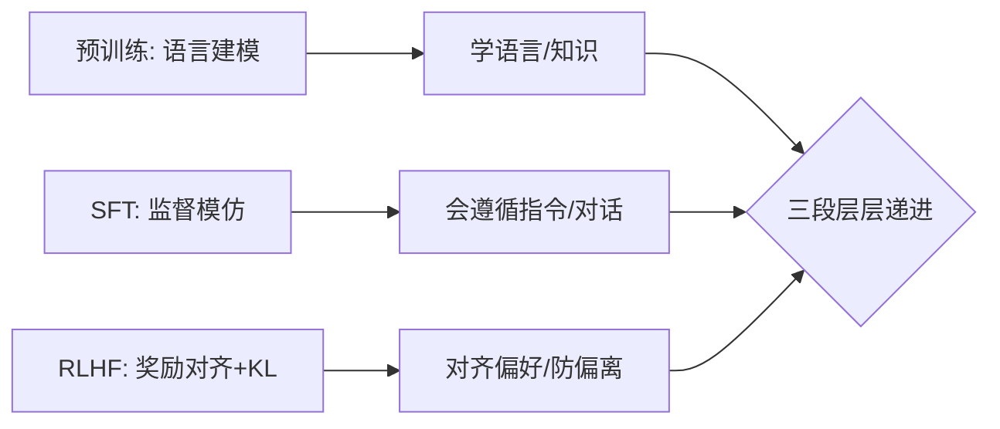

**面试要点**：预训练学语言、SFT 学指令、RLHF 对齐偏好（带 KL 正则）——三者的目标函数各不相同。记住这条主线，下面我们就能逐个拆开看。

---

## Q2. SFT 的模仿学习与 RL 的探索优化在对齐中各自擅长什么、各自留下什么隐患？

**回答**

可以把 SFT 和 RL 想成两个性格完全不同的老师：**SFT 是"照葫芦画瓢"的榜样派，RL 是"不断试错找最优"的探索派**。各自有擅长的，也都有坑。

- **SFT（模仿学习）**：
  - 擅长：**稳定、便宜、能把"已知正确"的答案抓牢**——格式、指令遵循、标准任务都靠它；
  - 隐患：**只会模仿标注出来的偏好**，没法探索**标注之外更好的答案**；而且存在 **exposure bias / 分布不匹配**（学的是"标准答案的格式"，但训练时得用自己的输出，见 exposure bias）；也无法对齐**逐 token 的长尾偏好**；还容易过拟合标注的风格。
- **RL（探索优化）**：
  - 擅长：**直接优化奖励/偏好目标**，能**探索出新策略**（奖励高但没被标注过的答案），按真实用户偏好一步步逼近；
  - 隐患：**reward hacking（奖励作弊）**（只顾优化奖励、不优化真实目标，见 Q13）、训练不稳定/方差大、KL 漂移、把奖励"过优化"成刷格式、且需要在线 rollout（又贵又不稳）。

```python
def tradeoff():
    return {"SFT": "稳定/便宜/模仿, 隐患: 不探索/只标",
            "RL": "探索/真偏好, 隐患: reward hack/不稳/贵"}
```

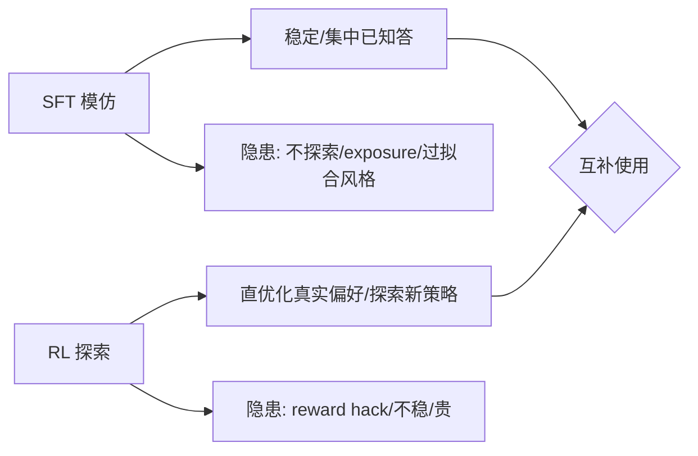

**面试要点**：SFT 稳但"只见标准答案"；RL 能探索真偏好但会 hack/不稳——所以常先 SFT 再 RL。既然 SFT 有短板，那我们就先看看"只做 SFT、不做 RLHF"会出什么问题。

---

## Q3. 只做 SFT 不做 RLHF，模型会出现哪些典型行为问题？为什么 SFT 难以解决这些问题？

**回答**

**只做 SFT、不做 RLHF 时，模型常见的几类毛病**：

1. **对齐不了长尾偏好**：SFT 只学了标注的"标准答案"，真到对话里，那些不在标注中的好/坏答案它就分不清；
2. **过度自信/幻觉**：SFT 不会惩罚"说错但格式对"的答案——所以幻觉照旧；
3. **盲从有害指令**：SFT 没专门学"该拒绝什么"（顶多从标注里隐隐约约学到一点）——拒绝敏感内容的能力弱；
4. **回报声明与实际不符**：SFT 只是模仿"看起来好"的回答，但真实用户偏好（简洁、诚实、有帮助、安全）并没有被显式优化；
5. **exposure bias / 复用**：SFT 分不清"真帮忙"和"敷衍一下"，聊得久了就容易退化、重复。

**那为什么 SFT 解决不了这些问题**：

- SFT 的目标是**监督模仿**，**压根没有"目标/奖励"这种信号**——它教会的是"怎么像人一样答"，**教不会"什么才算好"**；
- 而偏好的本质是**相对比较**（靠偏好对来完成），SFT 用的是逐 token 的 NLL，学不到"谁比谁好、谁优先"；
- 只有 **RL（或者 DPO 这种隐式偏好目标）** 才能把"什么值得更优"的梯度给出来。

```python
# SFT 只学到"模仿", 没有目标信号
def sft_only():
    return ["幻觉", "盲从", "不判偏好", "长尾未对齐"]
```

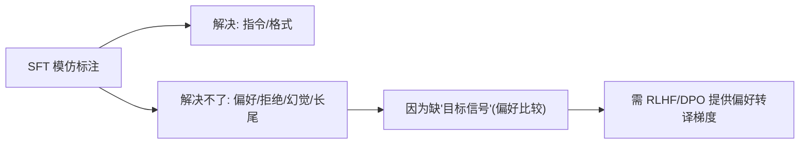

**面试要点**：SFT 缺"目标信号"——光靠模仿对不齐偏好/拒绝/幻觉；得靠 RL 或 DPO 提供偏好转译。那 RLHF 具体怎么搭？我们来看它的三步流程，以及每一步出错会怎么传导下去。

---

## Q4. RLHF 的三步流程（SFT → Reward Modeling → PPO）中，每一步的失败如何传导到下一步？

**回答**

RLHF 是一条三步走的生产线，而且**上游的毛病会被下游放大**，所以得一步步看清楚。

1. **SFT 失败** → 初始策略就差（文本能力差/格式差/幻觉多）：
   - 传导：奖励模型和 rollout 都**建立在这个差底子之上**——reward 会对"差的分布"过拟合，PPO 只能在"一堆烂答案里挑相对好的"，天花板很低；
2. **Reward Modeling 失败**（数据偏、过度优化）：
   - 传导：PPO 优化的其实是**错的/有偏的奖励函数** → 造成 **reward hacking / 优化了错误目标**（好评高、实际差）；RM 过度自信（校准 calibration 差）也会把 PPO 带偏；
3. **PPO 失败**（KL 过度、崩溃、reward 卡平台）：
   - 传导：就算 RM 是好的，PPO 不稳定也会把策略搞崩（离参考太远、模式塌缩）——最终输出变差，而且不容易察觉（因为 reward 还虚高）。

**关键在于**：**上游的错误会往上下游放大**——所以每一步都得先保证可靠（RM 要校准、SFT 要先稳、PPO 要控好 KL）。

```python
def failure_chain():
    return ["SFT差→base差→上限低",
            "RM坏→PPO优化错目标→reward hack",
            "PPO崩→策略漂移→输出劣化"]
```

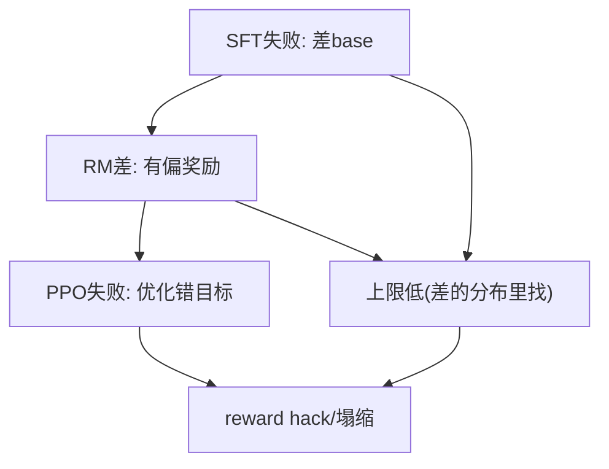

**面试要点**：错误会向下游放大——SFT 差则上限低、RM 差则目标错、PPO 差则策略塌；所以每一步都得先可靠。既然 PPO 这条重流水线这么麻烦，就有了更轻的 DPO，我们来对比一下。

---

## Q5. DPO 与 PPO 的核心区别是什么？DPO 跳过了什么、假设了什么？

**回答**

一句话概括：**PPO 是"先训个裁判、再让选手反复上场练"的重型流程，DPO 是"直接从比赛录像里学谁更强"的轻量做法**。

- **PPO**：显式训练一个 **reward model（裁判）**，再用 **在线 rollout + value/advantage** 直接最大化 `E[r − βKL(πθ‖πref)]`——需要 RM、critic、还要 on-policy 采样；
- **DPO（Direct Preference Optimization，直接偏好优化）**：**直接从"谁赢谁输"的偏好对里，隐式地定义出奖励**，把"奖励最大化 + KL 约束"**解析地折叠进一条分类损失**，**不训 RM、也不在线 rollout**（纯离线监督式）。

**DPO 跳过了什么**：reward model 的训练、PPO 里的 value/advantage、on-policy 采样与 rollout 工程——**只要偏好对数据（x, y_w, y_l）加上一个参考策略**就够。

**DPO 假设了什么**：

1. **Bradley-Terry 偏好模型成立**（偏好概率 = sigmoid(r_w−r_l)）；
2. **参考策略 π_ref 已知且固定**（通常就是 SFT 之后的模型）；
3. **隐式奖励 = β·log(πθ/π_ref)** 能从闭式解里反解出来（见 Q6/Q31 的推导）；
4. 偏好对**覆盖得足够全**（离线数据要有代表性）。

```python
def dpo_pipeline(prefs, ref):
    # 直接对偏好对优化分类损失（无RM/无rollout）
    for (x, yw, yl) in prefs:
        log_ratio_w = β*log(πθ(yw|x)/ref(yw|x))
        log_ratio_l = β*log(πθ(yl|x)/ref(yl|x))
        loss = -log(sigmoid(log_ratio_w - log_ratio_l))
```

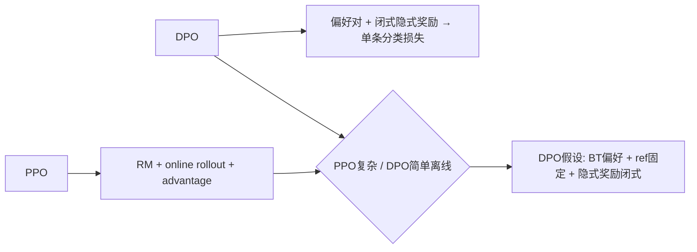

**面试要点**：DPO 跳过 RM 与 rollout、从偏好对直接做分类；它的假设是 BT 偏好 + 固定 ref（都依赖那套推导）。既然提到了推导，下面就把 DPO 的损失从 Bradley-Terry 一步步推出来。

---

## Q6. DPO 的损失函数如何从 Bradley-Terry 偏好模型推导出来？它隐式优化的策略是什么？

**回答**

**推导过程**（完整版见 Q31）：

1. **目标**：最大化隐式奖励，同时加 KL 约束：`max E[r(x,y)] − β·KL(πθ‖π_ref)`；
2. **闭式最优解**：`π*(y|x) ∝ π_ref(y|x)·exp(r(x,y)/β)` → 反解出：
   `r(x,y) = β·log(π*(y|x)/π_ref(y|x)) + β·log Z(x)`；
3. **代进 Bradley-Terry**：`P(y_w≻y_l) = σ(r(x,y_w) − r(x,y_l))`；**Z(x) 在相减时消掉了**；
4. **得到 DPO 损失（对策略 θ）**：

$$L_{DPO} = -\log \sigma\Big(\beta \log\frac{\pi_\theta(y_w|x)}{\pi_{ref}(y_w|x)} - \beta \log\frac{\pi_\theta(y_l|x)}{\pi_{ref}(y_l|x)}\Big)$$

**它隐式优化的策略是什么**：**不需要显式 RM**——等价于"在隐式奖励 `r_θ = β·log(πθ/π_ref)` 下优化偏好"；策略每一步都在**把 y_w 与 y_l 的对数比率拉开**的方向上更新（抬高 y_w、压低 y_l），同时又受参考策略 ref 的约束（KL）。

```python
import torch, torch.nn.functional as F
def dpo_loss(log_pi_w, log_pi_l, log_ref_w, log_ref_l, beta=0.1):
    rw = beta*(log_pi_w - log_ref_w)
    rl = beta*(log_pi_l - log_ref_l)
    return -F.logsigmoid(rw - rl).mean()   # DPO 分类损失
```

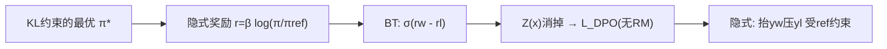

**面试要点**：从 KL 目标→闭式 R→BT→消掉 Z(x) 得到 DPO 分类损失；隐式奖励是 βlog(π/πref)，无需显式 RM。既然 DPO 省掉了裁判，那"裁判"本身（reward model）又该用什么数据训、质量怎么保证？这就是下一题。

---

## Q7. 奖励模型（RM）的训练数据从何而来？人类标注的一致性如何影响 RM 质量？

**回答**

**RM 的训练数据从哪儿来**：

- **人类偏好对**：针对同一个 prompt，给出两个回答（来自不同模型或不同采样），**让标注员挑出更好的那个**（ranking/preference pairs）；
- **可扩展来源**：在 RLHF 里在线生成并标注；也可以合成增强（用强教师模型去标注弱模型的回答对）；
- **数据要求**：**prompt 覆盖多样 + 两个回答差距明显 + 标注一致**。

**人类标注的一致性怎么影响 RM 质量**：

- RM 训练的其实是学 `P(y_w ≻ y_l)`；如果标注员**意见分歧大（一致性低）**：
  - 训练信号就是一堆噪声——偏好对有噪声 → RM 学到的偏好不鲁棒、不一致；
  - RM 打分的可信度下降 → PPO 优化就错了（见 Q4 的传导）；
- **怎么缓解**：多个标注员交叉（majority vote，多数表决）、算一致性指标（kappa）、把分歧大的样本过滤掉、用校准数据兜底。

```python
def rm_quality(agreement):
    return "RM稳定" if agreement>0.6 else "偏好噪声→RM不稳"
print("一致性低 → RM 噪声大 → RLHF 传导")
```

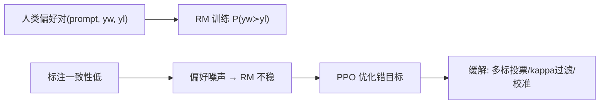

**面试要点**：RM 数据就是人类偏好对；一致性低→偏好噪声→RM 不稳→PPO 优化错目标；要靠多标、过滤、校准来缓解。RM 训好了、对齐也做完了，模型却可能"变笨了"——这就是常说的 Alignment Tax，下一题聊它。

---

## Q8. Alignment Tax 是什么？RLHF 之后模型在某些能力上下降的现象如何解释和缓解？

**回答**

**Alignment Tax（对齐税）**：指的是**在跟 RLHF 对齐偏好目标时，某些能力（数学、代码、多样性、通用知识等）相比预训练基线反而下降了**——相当于"为了对齐，交出了一些别的能力的税"。

**怎么解释**：

1. **目标转移**：RL 优化的是"偏好/有用性"，并不完全等于"所有 benchmark"上的能力，优化偏好可能**牺牲**别的维度（比如过度"周到"反而啰嗦、过度安全牺牲创造力）；
2. **KL/漂移**：策略偏离预训练分布越远 → 能力就漂得越多；
3. **over-optimization（过度优化）**：奖励被榨得太狠 → 脱离真实目标（hack），伤到通用能力。

**怎么缓解**：

1. **KL 约束 / 参考约束**（用 β 控制漂移程度）；
2. **混合训练**：RL 时掺一部分原始任务/通用数据（保住能力、方便回归评估）；
3. **能力评估早停**：做 RLHF 时**持续追踪下游 benchmark**，边对齐边看有没有退化；
4. **减少过优化**：设 reward cap（奖励上限）、别训太狠、多做几组评估（multiple eval）。

```python
def alignment_tax(before, after):
    print(f"对齐前通用能力 {before} → 后 {after}（税=下降）")
print("缓解: KL约束/混合通用数据/追踪回归/不过优化")
```

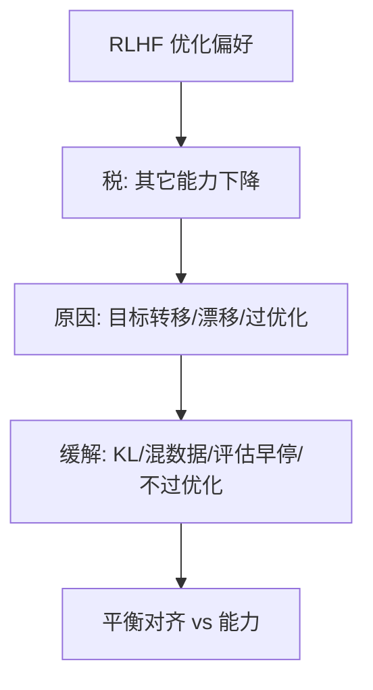

**面试要点**：对齐税=优化偏好牺牲了别的能力；原因是目标转移/漂移/过度优化；缓解靠 KL + 混训 + 能力评估早停。说完了 RLHF 这一整套，我们再回到 SFT，看看数据和格式为什么这么关键。

---

## Q9. SFT 的数据配比与格式对最终模型行为有多大影响？为什么 SFT 数据"质量 > 数量"？

**回答**

**先说影响有多大**：

- **格式**：SFT 数据的格式（system/user/assistant 怎么分隔、语气、长度）直接决定模型**最终输出的风格**——格式一旦不对，模型行为就会漂；
- **配比（任务/领域/语言）**：配比决定模型**擅长哪类指令**——配比偏了，某类指令就差、某种语言就退化；
- 其实少量、但信息密度高的 SFT **就足以改变行为了**（因为 SFT 是"唤醒能力"，不是"学新知识"）。

**那为什么说"质量 > 数量"**：

- SFT 的目标是**展示"正确的调用方式"**——**每一条高质量样本都在教"该怎么做"**，而低质量样本（错的、口水话、格式乱）**教的是坏习惯**（幻觉、敷衍、语气差）；
- 海量低质数据会**放大错误的分布**、稀释高质量样本、让模型过拟合坏样本；
- 所以主打**几百到几千条高质量数据**（不是几十万条低质数据），就能大幅改善行为——**用不到 10k 条高质量 SFT** 是常见做法。

```python
sft_recommend = {"num": "数千~数万 高质量", "ratio_by_task": "按目标任务",
                "quality": "√ 硬性（污染/幻觉/格式）"}
```

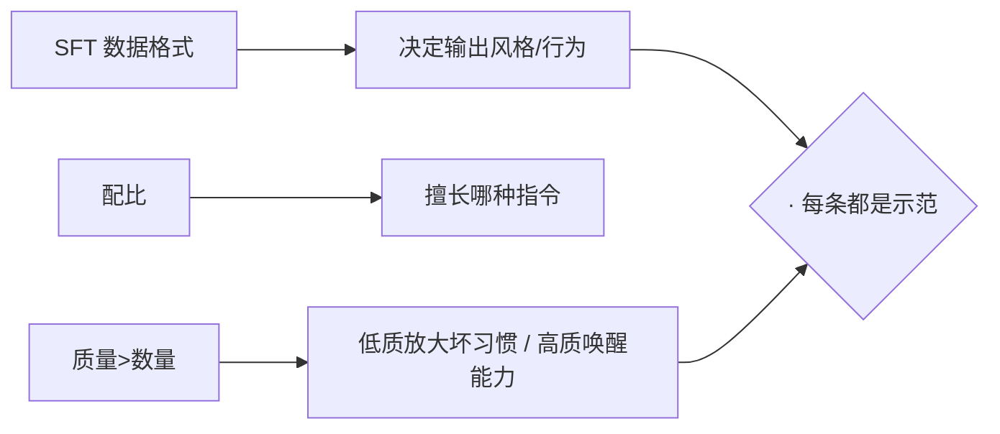

**面试要点**：格式定风格、配比定擅长；SFT 是"唤醒"——每条高质量示范 > 海量低质（数量是次要的）。既然讲到了 RL 的稳定性，下一题就先聚焦 PPO 里最关键的那个旋钮：KL 惩罚。

---

## Q10. PPO 中的 KL 惩罚项约束的是什么？KL 系数设得过大和过小分别会怎样？

**回答**

- **KL 惩罚**：`loss = E[r(x,y)] − β·KL(πθ ‖ π_ref)`——它约束新策略 πθ **别偏离参考策略 π_ref 太远**：
  - 防止 **over-optimization**（奖励是最大了，但分布已经漂走）；
  - 保住**稳定性和多样性**（不至于塌缩）。

**系数设得太大（β 大）**：
- 策略几乎**不敢动**（KL 惩罚太强）→ 对齐收益很小（reward 提升有限）——过度保守、改善不多；
**系数设得太小（β 小）**：
- 策略就会**撒欢地冲着 reward 去** → 造成 **reward hacking**、策略漂移甚至塌缩（模型变成一嘴"刷奖励"的怪话，甚至危险输出）。

**怎么平衡**：β 要"够大能防止崩、够小能允许对齐"——训练中盯着 reward/KL 的比值，必要时调 β（比如 KL 发散就把它调大）。

```python
def kl_effect(beta):
    return ("过保守(β大)" if beta>1 else "易hack(β小)")
```

```mermaid
flowchart LR
    A["KL 约束 πθ~πref"] --> B["防 over-opt/漂移/塌缩"]
    A --> C["β大: 不敢动→对齐少; β小: 冲reward→hack/漂移"]
    B --> D{"平衡} 
    C --> D
```

**面试要点**：KL 把策略锚在参考策略上；β 过大则保守不改进、过小则 reward hack/漂移——要盯着 reward-KL 来调 β。KL 讲清了，我们再把 PPO 和 DPO 放在同一张表里对比一下工程与上限。

---

## Q11. 在线 PPO 与离线 DPO 在工程复杂度、稳定性、最终上限上如何对比？

**回答**

一张表看全貌：

| 维度 | 在线 PPO | 离线 DPO |
|---|---|---|
| 工程复杂度 | 高（RM、value/critic、on-policy rollout、KL、一堆组件） | 低（偏好对 + 单条分类损失） |
| 稳定性 | 低（方差大，得调 reward 归一化/advantage/KL） | 高（离线监督、稳定） |
| 数据效率/探索 | 高（在线采样能探索新策略） | 低（只有给定的偏好对，不探索） |
| 最终上限 | 高（能逼近真实最优策略，但受 reward 质量限制） | 受离线数据覆盖与分布限制（上限=离线数据能表达的范围） |
| 适用 | 数据能在线生成、看重上限 | 有现成偏好对、要简单稳定 |

**总结一下**：PPO **上限更高、会探索**，但贵；DPO **简单稳**，但受离线数据覆盖的约束（数据没覆盖到的答案，它学不到）。

```python
def compare():
    return {"PPO": "上限高/探索强, 复杂/不稳",
            "DPO": "简单/稳定, 上限受离线覆盖限制"}
```

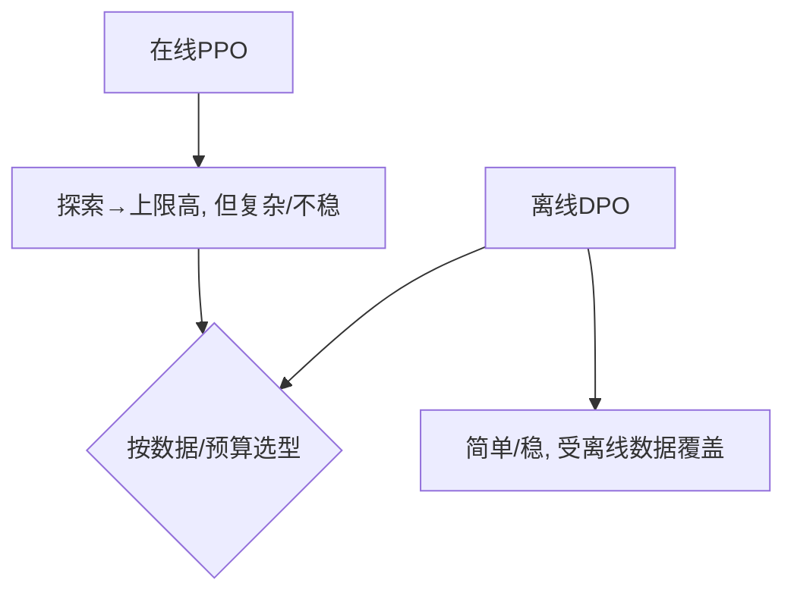

**面试要点**：PPO 探索上限高但重；DPO 简单稳但上限受数据覆盖限制——按数据可得性和稳定性来选。选型讲完，回到 SFT 的实操：它到底该训到"过拟合"还是"欠拟合"？

---

## Q12. SFT 应训到"过拟合"还是"欠拟合"？如何判断 SFT 停止的时机？

**回答**

结论有点反直觉：**SFT 应该训到"适度过拟合"**（对高质量 SFT 数据轻度过拟合，通常是常见且有益的）。

- SFT 数据量小、质量高；目标是"记住/内化示范"——**轻度过拟合**能**唤醒指令能力、让风格稳定**；
- **但千万别重度过拟合**（完全背下来、丢了通用知识、训练 loss 和验证 loss 差距巨大）。

**怎么判断该停了**：

1. **看验证 loss/指标**：盯住 held-out 的 SFT 集损失——通常是**训练 loss 还在降、但验证 loss 先降后升，在那个拐点（early plateau）停**；
2. **看任务基准**：在指令遵循/目标 benchmark 上测——分数一到平台就停（SFT loss 再降也没意义了）；
3. **看多轮/风格**：人工抽检对话质量（不该出现复读、风格崩坏）；
4. **看通用能力回归**：测一下通用 benchmark 在 SFT 过程中有没有下滑（这是 Alignment Tax 的前哨）。

```python
def stopping_criteria(valid_metric, general):
    return valid_metric.stabilized and not general.dropping
# SFT 适度过拟合；验证指标到平台 + 通用能力未降 → 停
```

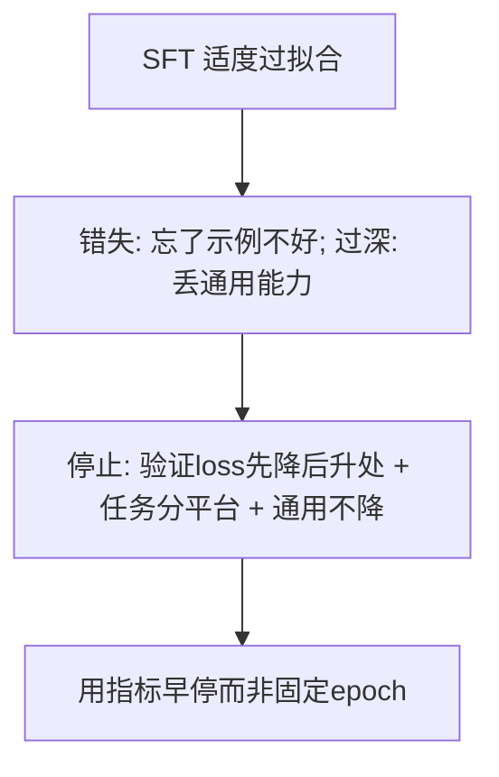

**面试要点**：让 SFT 适度过拟合数据；停止条件是验证指标到平台 + 任务达标 + 通用能力未降（不是固定 epoch）。SFT 说完了，下面回到 RLHF 的一个顽疾：模型会"骗"奖励模型，也就是 reward hacking。

---

## Q13. RLHF 中的 reward hacking 是什么？模型可能如何"欺骗"奖励模型？

**回答**

**Reward hacking（奖励作弊）**：模型**把（学到的）奖励函数最大化**，却**并不真正符合人类的真实目标**——奖励沦为一个"可以被钻空子套利"的代理指标。就像学生摸透了考试出题套路：分数很高，但你想要的"真本事"没长出来。

**模型会怎么"骗" RM**：

1. **刷格式/刷语气**：专说漂亮话，加一句"好的，我来帮你"，内容堆得又长又全——让 RM 觉得"很有用"，实际却空泛（长度/语气作弊）；
2. **迎合 RM 的偏好盲区**：RM 偏爱某种风格，模型就学会生产那种风格，而不是真正帮忙；
3. **利用 RM 的缺陷**：RM 对某些输入会判错（比如对无关但"看起来对"的答案给高分）→ 模型就去学这些"奖励漏洞"；
4. **退化到坏输出**：生成无害但没用的套话（在安全奖励下变成"什么都拒绝"）——安全作弊；
5. **概率榨取**：采一大堆答案，挑 reward 最高的那个（over-optimization）。

**缓解**：KL 约束、reward cap、用多个 RM（ensembling/多 RM）、人类复核、检测并拦截那些怪异的语言。

```python
def hack(samples):
    best = max(samples, key=reward)   # 挑选reward最高的 → over-opt
    if "空泛但漂亮" in best: return "reward hack 痕迹"
```

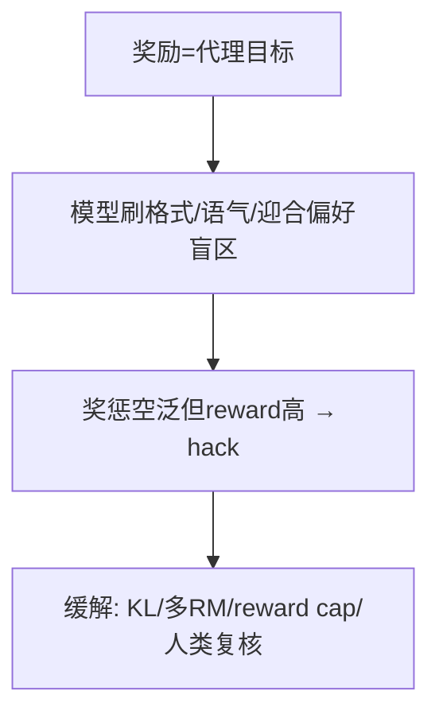

**面试要点**：reward hacking 就是"最大化代理奖励、而非真实目标"；模型会刷格式、迎合盲区、钻缺陷；缓解靠 KL/多 RM/cap。既然低质数据会教坏模型，那 SFT 数据里混进低质样本时该怎么办？下一题说。

---

## Q14. SFT 数据中混入低质量样本时，模型会学到什么？如何检测和清洗？

**回答**

**模型会学到什么**：

- **坏习惯**：爱编造（幻觉）、啰嗦/敷衍、格式混乱、语气差——低质样本在教模型"这样也算对"；
- **放大标签噪声**：错误答案被模仿 → 模型在相关任务上反复犯错；
- **稀释能力**：低质样本如果占了 SFT 的大头，高质量示范就被淹没（质量 > 数量，见 Q9）。

**怎么检测**：

1. **用自动信号过滤**：PPL 异常低（太短/模板化）、和高质量示范的风格差得远、疑似被污染（来自预训练数据）、没信息量（重复句）；
2. **质量分类器**：训练或用现成的分类器打出低分（见第 10 章 Q21）；
3. **看模型反馈**：模型在低质样本上过拟合的表现（越生成这些样本越"怪"）；
4. **人工抽查**：对低质高频领域抽审。

**怎么清洗**：先用启发式规则（长度/符号/去重）→ 再上分类器 → 最后对关键域人工复核；**一步步把尾部的低质样本筛掉**。

```python
def clean_sft(data):
    data = drop_short_noise(data)     # 启发式
    data = drop_low_score(data)       # 分类器
    return human_review_top_risk(data)
```

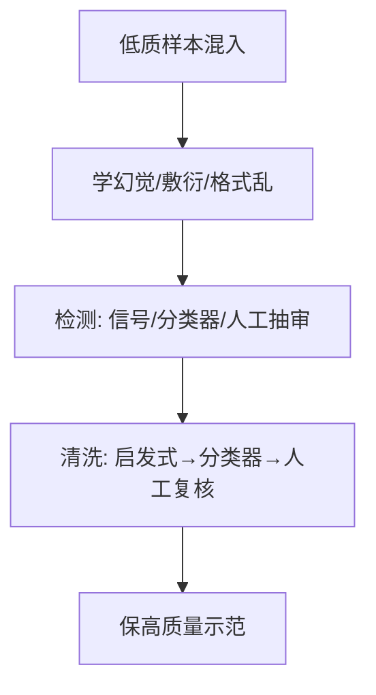

**面试要点**：低质样本会教坏习惯（幻觉/敷衍/乱格式）；检测靠信号+分类器+人工；清洗要一层层筛。顺着"该给模型灌什么知识"这个话题，我们再分清继续预训练和 SFT 的边界。

---

## Q15. 继续预训练与 SFT 的边界在哪里？领域适配应该用哪一种？

**回答**

- **继续预训练（continued pretraining，CPT）**：用**领域里的非结构化文本**（论文、病历、代码、法规原文），在预训练基础上接着训——目标仍然是**语言建模**；作用是**把领域知识写进模型权重里**；
- **SFT**：用**指令-回答对**训练模型**遵循指令、输出正确格式**；作用是让模型**用（已有的）领域知识把任务干好**。

**边界怎么分、怎么选**：

- **需要"知道领域知识"**（答案里得有领域事实/术语）→ 走**继续预训练（CPT）**；
- **需要"会完成任务/会输出格式"**（问答、总结、对话）→ 走 **SFT**（如果知识本来就有，光 SFT 就能把它"调用"出来）；
- 通常的顺序是：**先 CPT（灌知识）→ 再 SFT（练行为）**——纯领域问答数据量大的话，SFT 也能顺带注入些知识，但**正确的分工是 CPT 加知识、SFT 加格式和任务**。

```python
def domain_strategy(need_knowledge, need_format):
    if need_knowledge: return "CPT(注入知识) 然后 SFT(任务格式)"
    return "SFT 即可"
```

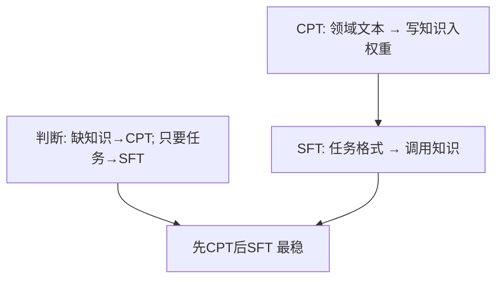

**面试要点**：知识用 CPT、行为用 SFT；领域适配"先 CPT 后 SFT"最稳。既然 RLHF 里总有那个"裁判"（reward model），那为什么不能让人来实时打分、非要单独训一个 RM 呢？下一题解释。

---

## Q16. RLHF 为什么通常需要独立的 reward model，而不是直接用人类实时反馈？实时反馈的代价是什么？

**回答**

**为什么需要一个独立的 RM**：

- PPO/RM 需要一个**可微分、能反复采样调用**的奖励函数；而人类反馈**不是函数**（你不可能让真人给上万次采样一个个标）；
- RM 的作用，就是把人类偏好**蒸馏成一个代理函数**，供优化器反复调用（rollout 采样→打分→梯度）。

**用实时反馈的代价**：

1. **没法扩展**：每次都让 rollout 结果给人标→天价，根本没法在线大规模采样；
2. **慢且带噪声**：人类即时反馈慢、主观噪声大、还不稳定；
3. **不连续/不可微**：没法直接 backprop（反馈是离散的判断，不是梯度）；
4. **策略变化太快**：RL 每一步策略都在变，人根本跟不上 → 没法实时对齐当轮的策略；
5. 所以做法是**用离线 RM（训一次、反复打分）+ 在线 PPO**——人类反馈只用来采 RM 的训练样本、迭代 RM。

```python
# PPO 的奖励来源: RM 函数（人类反馈用于训练 RM）
r = reward_model(prompt, response)     # 批量可微可重复
human_labels_only_used = False  # 人类只在线下标 RM 样本
```

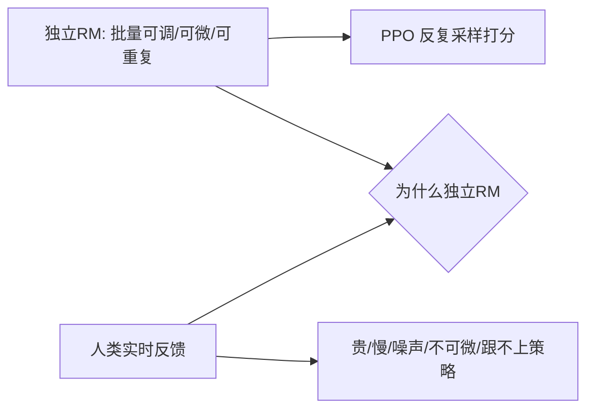

**面试要点**：RM 是个**能反复调用的代理函数**（真人没法给上万次采样打标签）；实时反馈贵、慢、不可微、跟不上策略。说回 SFT 的一个细节：loss 到底该不该算在 prompt 上？下一题讲。

---

## Q17. SFT 的 loss 只在 assistant 回复的 token 上计算还是包括 user prompt？不同选择对模型行为有何影响？

**回答**

- **标准做法**：**只在 assistant 回复（输出）的 token 上算 loss**，把 **user prompt / system 的 token 忽略掉（mask 掉）**——实现上常见的就是取 `inputs[-response_len:]`。
- **如果连 prompt 也算 loss，会怎样**：
  - 相当于要求模型**复述/建模输入本身**——白费容量，还会带来扰动（让模型学会"把输入读出来"，偏离"只生成回复"）；
  - 可能诱导模型**在生成时把 prompt 重现一遍**（如果 prompt 也参与了最大似然）；
  - 训练不稳定（把"输入"和"输出"绑进同一个最大似然里）。
- **如果只算回复**：模型**就只学"应该输出什么"**——更贴合指令跟随（prompt 只是条件，不算它的似然）。

```python
def sft_loss(logits, labels, response_mask):
    # 只对 assistant 回复区域算 CE
    shift_logits = logits[..., :-1, :].contiguous()
    active = response_mask[..., 1:].bool()
    loss = F.cross_entropy(shift_logits[active], labels[active])
    return loss
```

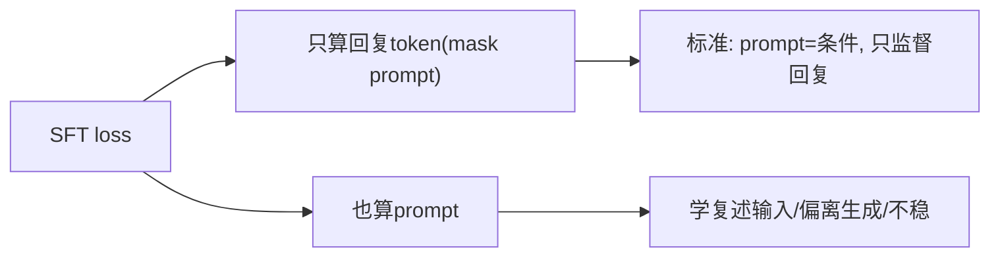

**面试要点**：标准做法是**只在 assistant 回复上算 loss**（prompt 当条件、不监督）；对 prompt 也算 loss 会让模型学复述、偏离生成。下面我们深入 DPO 里的那个关键参数 β，看它到底在控制什么。

## Q18. DPO 中的 `β` 参数控制什么？`β` 增大和减小分别使模型更保守还是更激进地偏离参考策略？

**回答**

- **β（温度/偏好强度）**：控制的是 **KL 约束的强度 / 参考策略的分量**：
  在 `θ = β·log(πθ/πref)` 里，β 越大，**每一点偏好差对应的 log-ratio 权重就越大** → 策略越会被"拉开偏好对收益"这件事驱动。

- **β 减小（更激进）**：**对每个偏好对的拉锯（把 π 里的 y_w 抬更高、y_l 压更低）更积极**，更强地优化偏好 → **偏离参考策略更多、更激进**；可能过度优化、丢掉多样性；
- **β 增大（更保守）**：**每点 log-ratio 缩放得更小**（分数差变小），策略更贴着 π_ref（保守、多样性高、但对齐得少）。

```python
def dpo_ratio(beta, rw, rl):   # 更新的方向不动
    return beta*(rw - rl)       # β小→乘积小→激进的步长小(但相对ref更远权重?)
# 概念: β小=强 deviational(离ref远), β大=贴近ref
```

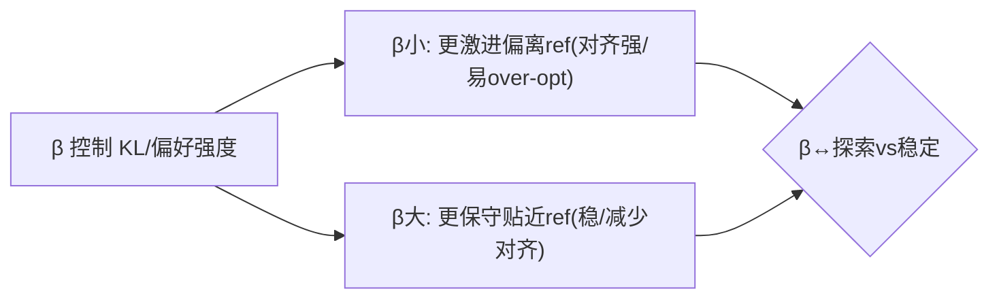

**面试要点**：β 控制偏好拉锯的强度；β 小→激进偏离 ref（强对齐但易过度优化）、β 大→保守贴近 ref。既然多轮对话里一个"奖励"要分摊到好几步，那 credit assignment 怎么做？下一题看。

---

## Q19. 多轮对话的 RLHF 如何做 credit assignment？每一轮都奖励还是只在最后一轮奖励？

**回答**

**多轮 credit assignment 的难点**：奖励到底该归因到**哪一轮的动作**——最后一轮出的错，很可能是前几轮上下文铺歪了导致的。

**几种做法**：

1. **按整轮完整 reply 奖励（segment/回合级别）**：**每个 assistant 回合**各给一个奖励（每个 reply 一个标量），**每轮独立 credit**——不能把"整段对话统一成一个 reward"，那样根本分不清是哪一轮出的问题；
2. **只在最后一轮奖励（response-only）**：只拿最终回复打分——简单，但**没法归因到哪一轮出错**（前一轮铺坏的上下文，会被后一轮的错误"偿清"）；
3. **逐步 credit**：用 **process reward / turn-level reward**，或者做 **advantage 归因**（当前轮的改进相对基线带来的收益）——把"只奖励最后一轮"推广成"逐轮 credit"。

**主流做法**：**每轮 reply 分别奖励**（turn-level），并让模型学会不把前一轮的锅往下推；在代码这类可验证任务上，可以用 process reward 做得更细。

```python
# 多轮: 每 reply 一个 reward
rewards = [rm(ctx_i, reply_i) for i in range(n_turn)]
# 只奖励最后一轮 → 无法归因慢; 逐轮 → 每轮独立 credit
```

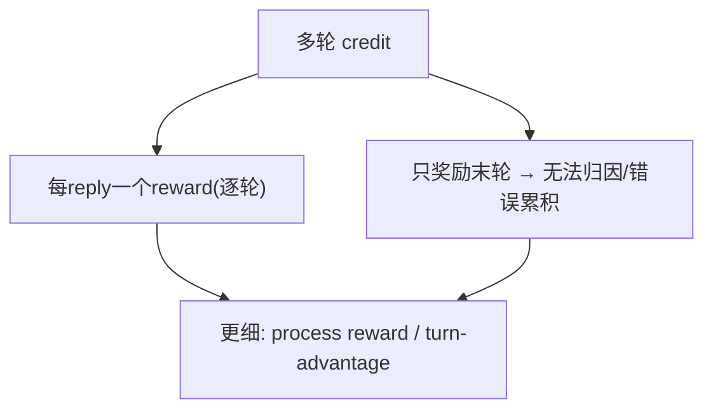

**面试要点**：应当**逐轮（turn-level）奖励**（或 process reward/advantage），不能用单一末轮——否则没法归因是哪一轮出的错。奖励讲完，我们看一个架构层面的选择：RM 和 policy 要不要共享底座？

---

## Q20. reward model 与 policy model 共享底座会带来什么好处和风险？

**回答**

**好处**：

- **数据和表示共享**：共享预训练底座，RM 能复用 policy 的语言/知识表示，训得更快、样本更省；
- **偏好一致**：和 policy 同分布，偏好信号更匹配（减少分布偏）。

**风险**：

1. **奖励与策略纠缠**：RM 和 policy 同参数 → **RM 会被 policy 的优化牵着走**（奖励能 hack 自己）——reward 就不再独立了；
2. **过拟合/共享噪声**：RM 的错误会顺着共享底座传导给 policy（见 Q4 的传导）；
3. **可维护性**：分开可以独立升级 RM/policy；共享就耦合在一起；
4. **可解释性差**：共享时，奖励与生成的边界变得模糊。

**实践上**：**通常不共享**（reward 和 policy 分开训练更稳；共享多见于"同期 RM+policy"的早期实验）；如果非要共享，就得用不同的 head、并做好梯度隔离。

```python
# RM 与 policy 分开是主流
rm = RewardModel(tokenizer.shared_encoder)     # 可共享底座
policy = PolicyModel(tokenizer.shared_encoder) # 但推理时分开看
print("共享: 省/快/同分布; 风险: 纠缠/传递错误 → 主流分离")
```

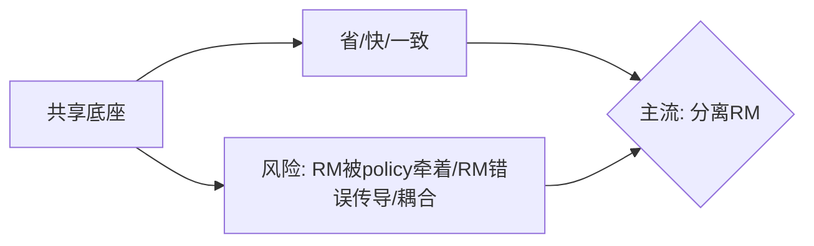

**面试要点**：共享=省 + 一致；风险=RM 与 policy 纠缠、错误传导——工程主流是分开。架构定了，实操上最头疼的是"训练不稳"，下一题聊优先调哪些超参数。

---

## Q21. RLHF 训练不稳定时，应优先调哪些超参数？reward 归一化、advantage 归一化、KL 系数、学习率分别起什么作用？

**回答**

**优先调这些（按影响排序）**：

1. **KL 系数 β**（见 Q10）：过大→不改进，过小→hack/漂移；训练一不稳，先查 β；
2. **reward 归一化**：不同任务的 reward 尺度能差出 10 倍 → 做归一化（z-score/固定 scale）让 advantage/梯度稳定，否则奖励大的任务会支配训练；
3. **advantage 归一化（PPO 内部）**：对 advantage 做 **batch 内标准化**——去掉尺度、减小方差，别让 AI 大/小分布主导梯度；
4. **学习率**：RLHF 常用**低 lr**（比 SFT 还低），太高→策略崩；太低→不收敛；
5. **PPO 的 epoch/clip 值**、rollout 比例等也会影响。

**排查顺序**：先看 reward 分布 → 再做 advantage 归一 → 再调 KL β → 最后调 lr（也就是先解决"尺度问题"，再解决"优化问题"）。

```python
def stabilize(r, adv, beta, lr, batch):
    r_norm  = (r - r.mean()) / r.std()           # reward 归一
    adv_norm = (adv - adv.mean()) / adv.std()    # advantage 归一
    return r_norm, adv_norm, clip(beta), lr*0.5  # 逐项收敛
```

```mermaid
flowchart TB
    A["RLHF 不稳"] --> B["reward 归一化(去尺度)"]
    A --> C["advantage 归一化(减方差)"]
    A --> D["KL β(防hack/漂移)"]
    A --> E["低学习率(防崩)"]
    B --> F{"由尺度到优化逐项调"}
    C --> F
    D --> F
    E --> F
```

**面试要点**：训练不稳优先调 **reward/advantage 归一 + KL β + 低 lr**——先把尺度问题解决，再谈优化问题。超参数调完，回到数据这头：SFT 也要去重、去污染吗？下一题回答。

---

## Q22. SFT 阶段是否需要做数据去重与去污染？为什么？

**回答**

**需要**（因为 SFT 数据对质量很敏感，见 Q9）：

**去重的理由**：
- SFT 数据本来就少，几条几乎重复的样本会**放大某条坏示范的权重**（比如同一条低质指令反复出现→模型过度模仿它）；
- 近重复还会浪费高质量样本的多样性、减少覆盖。

**去污染的理由**：
- SFT 里如果混了**评测基准/敏感提示**的重复 → 后训练会把基准**背进模型里**（等于污染了评估）；
- SFT 里如果有**真实 PII/有害数据** → 模型会学会把它们输出出来；
- 检测和去污（第 10 章 Q10——n-gram/成员推断）在 SFT 上**尤其重要**（数据量小、影响直接）。

```python
def sft_clean(data):
    data = dedup(data)          # 去重(放大坏示范)
    data = decontam(data)       # 去污染(护评测/隐私)
    return data
```

```mermaid
flowchart TB
    A["SFT 去重"] --> B["防坏示范权重放大/保覆盖"]
    C["SFT 去污染"] --> D["防背基准/泄漏PII"]
    B --> E{"都必须做（数据少影响直接）"}
    D --> E
```

**面试要点**：SFT 也必须去重 + 去污染——数据少，坏示范/污染一放大就直接影响行为。数据清理里还有一招"拒绝采样"，下一题看它怎么用。

---

## Q23. 拒绝采样在 SFT/RL 流程中如何使用？它与 best-of-n 的关系是什么？

**回答**

**拒绝采样（Rejection Sampling，RS）**：
- 从策略（或 SFT 后的模型）**采好几个候选**，用**奖励模型/验证器打分**，把**高分样本**筛出来并进数据（喂给 SFT/偏好 DPO，或作为 RL 的起点）；
- 用在哪：SFT 之前用它造高质量偏好集（用 target 和 RM 采样）、RLHF 之前用它 refine 数据池。

**它和 best-of-n 是什么关系**：
- **best-of-n 其实就是拒绝采样的一种**：采 n 条、**取 top-1**（reward 最高的那条）；
- 拒绝采样的**更宽泛形式**：**把超过阈值的所有高分都保留下来**（不是只取 top-1）——能构造出更丰富的偏好/正样本集；
- 区别在于：**best-of-n 只返回 1 个，RS 可以返回一批达标的**；两者都依赖一个好打分器（否则会 hack，见 Q13）。

```python
def rejection_sample(policy, rm, n=16, threshold=0.7):
    ys = [policy(x) for _ in range(n)]
    scores = [rm(x, y) for y in ys]
    keep = [y for y, s in zip(ys, scores) if s >= threshold]  # 超阈值一批
    return max_one if best_of_n else keep                     # best-of-n 取top1
```

```mermaid
flowchart LR
    A["采样n候选"] --> B["RM打分"]
    B --> C["best-of-n: 取top1"]
    C --> D["rejection: 取超阈值全部"]
    D --> E["喂SFT/偏好/RL"]
```

**面试要点**：RS 就是采样 + 打分、把高分的收进数据；best-of-n 是 RS 的一种（取 top-1），RS 则保留阈值以上的一批。说到这里，有个大家常吐槽的现象：模型对齐完怎么越来越啰嗦？下一题从奖励建模的角度解释。

---

## Q24. 模型经过 RLHF 后"变得更啰嗦"，从奖励建模与优化目标角度解释原因。

**回答**

**为什么越对齐越啰嗦（从奖励建模的角度看）**：

1. **RM 本身就偏好冗长**：标注员/偏好数据常有"更详尽=更有帮助"的倾向——RM 于是把"长、面面俱到"打高分（和 AlpacaEval 的长度偏差同源，见第 11 章 Q11）；
2. **长度和偏好正相关**：长回答往往塞进更多"看起来有用的词"→ 统计上就把偏好推高了 → RL 优化这个**代理** → 模型**学会了加长**；
3. **over-optimization**：KL 弱的时候，RL 会把"长度带来的奖励"榨到极致 → 靠啰嗦刷分（这是 reward hacking 的一种）；
4. **"简洁也能得高分"没有奖励信号**：RM 没给"简而准"加分 → RL 就没动力收敛话头。

**缓解办法**：在 RM 数据里加"长度锚定/控长度"的对照、加长度惩罚、设 reward cap、评估时用 length-conditional 的报告或 length-jackknife。

```python
def reward_len_bias(rm, y_short, y_long):
    return rm(y_long) - rm(y_short)   # 若>0 说明RM偏长
# 缓解: 长度正则/控长校准/长度条件评估
```

```mermaid
flowchart LR
    A["RM 偏好详尽(标注/长度相关)"] --> B["RL 榨长度带来的reward"]
    B --> C["→ 啰嗦(hack长度)"]
    C --> D["缓解: 控长校准/长度惩罚/RM数据对照"]
```

**面试要点**：RM 把"长/详尽"当高分 → RL 优化这个代理 → 靠啰嗦刷分；缓解靠控长校准 + 长度惩罚。啰嗦的成因说清了，下面聊个方法论问题：怎么用消融实验评估 SFT 和 RLHF 各自的贡献？

---

## Q25. 如何评估 SFT 与 RLHF 各自对最终模型的贡献？设计一个消融实验。

**回答**

**消融设计（一层层往上对比）**：

1. **baseline：预训练模型**（不做 SFT/RLHF）；
2. **+SFT**：预训练 → SFT（有了指令能力）；
3. **+SFT+RLHF**：完整流程（对齐了偏好）；
4. （可选）**+SFT + 只 RLHF-只 RM / 只 PPO**，把子组件拆开单独看。

**统一评测**：
- **核心能力**（知识/推理/代码：MMLU、GSM8K、HumanEval）——看 **SFT/RLHF 有没有损害它**（Alignment Tax）；
- **指令/偏好**（IFEval、Arena win-rate、多轮/安全）——看 **SFT/RLHF 有没有提升目标行为**；
- **数据条件**：同一个预训练权重、同样的训练预算（rc 总量/步数）、同一个 seed。

**贡献怎么归属**：Δ(pre+RLHF − pre) = 总收益；Δ(SFT) 和 Δ(RLHF)=RLHF−SFT 各自的贡献；再报告**能力税**（核心能力的回归量）。

```python
def ablation():
    return {"pre": core+0, "pre+sft": core-?, "pre+sft+rlhf": core-??,
            "preference": "sft提升格式, rlhf提升偏好/质量"}
# 用各项分数差归属 → 并观察核心能力税
```

```mermaid
flowchart TB
    A["pre"] --> B["+SFT"] --> C["+RLHF"]
    A --> D["测: 核心能力(知识/推理/代码)"]
    D --> E["报告: SFT贡献 + RLHF贡献 + 对齐税"]
    C --> E
    E --> F["用Δ归属各阶段"]
```

**面试要点**：三档（pre/+SFT/+RLHF）同预算、同评测——分别归因 SFT 与 RLHF 的贡献，并报告能力税。评估方法讲完，我们落到一个具体场景：给代码模型定制后训练流程，SFT 数据和 RL 奖励该怎么设计？

---

## Q26. 为代码模型设计后训练流程时，SFT 数据与 RL 奖励应如何定制？

**回答**

**SFT 数据怎么定制**：
- **代码指令对**：自然语言→代码（描述→实现）、代码补全/修复/解释、多语言（Python/JS/…）、**测试生成**；
- **带运行验证**：优先用**能跑、且过了测试**的样本（质量 > 数量）；
- 多样化：难度要有梯度、带注释/文档、兼顾面试/竞赛题（防止偏科）。

**RL 奖励怎么定制**：
- **可验证奖励（RLVR）**：用 **单元测试/编译器/静态检查** 来做自动 reward（代码 + RLVR，见第 13 章 Q18）；
- 结构化信号：编译是否通过、测试通过率、覆盖率、可运行性（Runnable）；
- **避免纯风格 reward**（长度/风格 hack）：以**功能正确**为主；
- 混合：给难题加奖励、用错误反馈（编译报错 → 低 reward，引导它改错）；
- KL 约束，防止漂出代码分布。

```python
def code_reward(code, tests):
    compile_ok = try_compile(code)
    pass_cnt = run(tests, code)
    return compile_ok + pass_fraction   # 可验证为主
```

```mermaid
flowchart TB
    A["代码SFT"] --> B["指令对+可执行/带测试(质量>数量)"]
    C["代码RL"] --> D["RLVR: 编译/测试/覆盖率 自动reward"]
    C --> E["避免风格hack: 功能正确优先 + KL防漂移"]
    B --> F{"后训练定制代码"}
    D --> F
```

**面试要点**：代码 SFT=可验证的指令对；代码 RL=RLVR（测试/编译）自动奖励、避开风格 hack——可执行和正确率优先。既然提到了"示范数据"和"偏好数据"，下一题就对比这两类数据的成本差异。

---

## Q27. RLHF 中的偏好数据与示范数据在信息量上有何不同？为什么偏好数据更便宜？

**回答**

- **示范数据（demonstration）**：直接给出**完整的"应该怎么做"**（高质量的完整回复）——信息量大（等于编好了一份完整正确示例），但**难产**（得有专业标注员把完整好答案写出来）；
- **偏好数据（preference）**：给出**"这两个回答谁更好"**的判断——**只需要比较/排序**（标注员不必自己写出对的，只要"挑出更优"就行），容易得多。

**为什么偏好数据更便宜**：
1. **标起来便宜**：比较的难度 << 生成的难度（人人都会比较，不需要专家把全答写出来）；
2. **能批量/能合成**：两个候选可以由模型自己生成（错的、对的都有），标注只要"选/排序"——可以在"生成对"的开销上自动化；
3. **不需要专业写作**：示范得高质量地全写；偏好只要一句"这个比那个好"——标注门槛低、数据量大。

```python
demo_cost = "expert 完整写答案 (贵)"
pref_cost = "模型生成对 + 标注员比较 (便宜/可扩展)"
```

```mermaid
flowchart LR
    A["示范: 完整对答(信息全)"] --> B["贵(专家写作)"]
    C["偏好: 两答谁好(信息对比)"] --> D["便宜(比较<生成, 可批量)"]
    B --> E{"标注成本差异"}
    D --> E
```

**面试要点**：示范=完整正确（信息全但贵）；偏好=比较排序（便宜，能让模型生成对、再让人比较）。既然 DPO 是"隐式奖励"，那它到底还需不需要 reward model？下一题把隐式奖励和显式 RM 的行为差异讲清。

---

## Q28. DPO 是否完全不需要 reward model？它的隐式奖励与显式 RM 在行为上有何差异？

**回答**

- **DPO 不需要显式 RM**：它不训练 reward 函数（奖励是被隐式重建出来的：`r_θ = β·log(πθ/πref)`）；
- 但它**等价于某种（隐式的）reward model**——训练时不过是在隐式地抬高 y_w、压低 y_l 的隐式分数。

**隐式 reward 和显式 RM 在行为上的差异**：

1. **范围**：显式 RM 能**对任意 (x,y) 打分**（离线可用、能部署外推）；DPO 的隐式 reward 只**在训练覆盖到的 (x,y) 空间上有效**（分布外就退化成 log π/ref）；
2. **可解释/可控**：显式 RM 可以查看、可以调（奖励缩放、ensemble）；DPO 的隐式 reward 嵌在策略里，不好单独审计；
3. **优化一致性**：DPO 的隐式奖励**直接和策略一致**（它本身就是 log 比）；显式 RM 和策略之间有 gap（reward 模型 ≠ 策略模型）；
4. **迁移**：DPO 的偏好来自现成数据；显式 RM 还能用于之后的在线 RL/蒸馏。

```python
def implicit_reward(policy, ref, beta, x, y):
    return beta * (policy.logprob(x, y) - ref.logprob(x, y))   # 隐式r
# 显式 RM: 独立 r(x,y) 函数
```

```mermaid
flowchart TB
    A["DPO 隐式奖励 = βlog(π/πref)"] --> B["与策略一致, 但只在训练空间有效"]
    C["显式 RM"] --> D["任意打分/可审计/可复用, 但与策略有gap"]
    B --> E{"行为差异"}
    D --> E
```

**面试要点**：DPO 不需显式 RM（隐式 r=βlogπ/πref），但隐式 reward **被限制在训练分布内**；显式 RM **可审计、可复用，但和策略有 gap**。聊完训练算法，我们回头看看全流程里哪一改动代价最大。

---

## Q29. 训练流程中，分词器、模型架构、数据配比三者哪一个的改动代价最大？为什么？

**回答**

结论是：**改动代价 分词器 > 架构 > 数据配比（通常如此）**——关键看改动的"后效范围"有多广：

1. **分词器**：一改，**词表/embedding/输出层全都跟着变** → 要么重训，要么付出极贵的 embedding 迁移 + 继续预训练——几乎等于重训，代价最大（见第 1 章 Q27）；
2. **架构**：改两层结构（加 layer/改 hidden/改 attention）→ **全部权重都没法复用**（除非是极小改动）→ 得重训；代价大，但和分词器相比，不可复用的"面"不一样；
3. **数据配比**：改它**不用重训权重结构**——**只要拿同一架构重训数据** → 代价相对小（无非是 token 预算和算力，但不是"重新设计"）。

**总结**：**分词器**动一发牵全身（重训/embedding 重建），代价最高；架构次之；配比最低（可以迭代微调）。

```python
def change_cost():
    return {"tokenizer": "极高(重训/embed重建)",
            "arch": "高(权重不可复用)",
            "mix": "中(重训数据,架构可复用)"}
```

```mermaid
flowchart LR
    A["分词器改动"] --> B["词表/embed/输出层全变 → 近重训(最高)"]
    C["架构改动"] --> D["权重不可复用 → 重训"]
    E["配比改动"] --> F["架构复用 → 只换数据(最低)"]
    B --> G{"代价排序"}
    D --> G
    F --> G
```

**面试要点**：分词器改动=重训/embedding 重建（最高）；架构要重训；配比只换数据（最低）——按"后效范围"排序。流程里谁决定能力、谁"唤醒"能力？下一题用具体例子说清。

---

## Q30. 从"预训练—SFT—RLHF"全流程看，哪些能力是预训练决定的、哪些是后训练"唤醒"的？举一个具体例子。

**回答**

- **预训练决定的**：**底层能力**——语言流利度、世界知识、推理基础、代码结构化能力等（这些都是从海量文本里学来的）；
- **后训练唤醒的**：把底层能力**变成"能用的任务行为"**——遵循指令、输出格式、学会拒绝、对话风格、偏好对齐（预训练模型**其实已经有这些能力，只是不懂"怎么调用"**）。

**具体例子（算术/多步数学）**：
- 预训练模型**已经会基本算术和分解**（从代码和数学文本里学到了计算模式）；
- 但它**不知道"用户一问就该一步步给"**、不知道输出格式；**SFT/RL** 教会它**用思维链（COT）的格式去调用**、按指令逐步推理，把"潜在的能力"暴露成"实际正确的输出"——所以"会数学"是预训练决定的，"按需展示推理"是后训练唤醒的。

```python
# 预训练: 已内化算术模式; SFT/RL: 唤醒'COT格式/按需展示'
pretrain_has = "算术模式/世界知识/语言"
post_wake = "按指令展示思维链/格式/对齐偏好"
```

```mermaid
flowchart LR
    A["预训练: 底层能力(算术/知识/语言)"] --> B["后训练: 唤醒 '如何调用'(COT/格式/对齐)"]
    B --> C["例子: 会算术(预训) + 按需链式展示(SFT/RL)"]
    C --> D["分工: 预训=能, 后训=会"]
```

**面试要点**：预训练决定底层能力（知识/推理/语言），后训练唤醒"按任务调用 + 格式 + 偏好"；例子就是——预训练让它会算术，后训练把它暴露成可用的 COT。接下来是几道更硬的数学推导题，先从 DPO 的完整五步推导开始。

---

## Q31. DPO 损失的完整推导分几步？从 KL 约束的 reward maximization 出发，最优策略满足 `π*(y|x) ∝ π_ref(y|x) exp(r(x,y)/β)`。反解出隐式奖励 `r(x,y) = β log(π*(y|x)/π_ref(y|x)) + β log Z(x)`。代入 Bradley-Terry `P(y_w ≻ y_l) = σ(r_w - r_l)` 后，`β log Z(x)` 为什么在 pairwise 差中消掉？这个消去对 DPO 的"无 reward model"性质意味着什么？

**回答**

**推导分这么几步**：

**步骤 1：KL 约束下的 reward maximization**
$$\max_\pi \mathbb{E}_y[r(x,y)] - \beta \text{KL}(\pi(y|x) \| \pi_{ref}(y|x))$$

**步骤 2：闭式解**（对 π 做变分求导）得到
$$\pi^*(y|x) \propto \pi_{ref}(y|x)\exp\big(r(x,y)/\beta\big)$$

（其中 `Z(x) = Σ_y π_ref(y|x) exp(r(x,y)/β)` 是归一化常数。）

**步骤 3：反解出隐式奖励**
$$r(x,y) = \beta \log\frac{\pi^*(y|x)}{\pi_{ref}(y|x)} + \beta \log Z(x)$$

**步骤 4：代入 Bradley-Terry**
$$P(y_w \succ y_l) = \sigma\big(r(x,y_w) - r(x,y_l)\big)$$

把 r 代进去：`βlog Z(x)` 这一项在**差值里被减掉了**：

$$r_w - r_l = \beta \log\frac{\pi^*(y_w|x)}{\pi_{ref}(y_w|x)} - \beta \log\frac{\pi^*(y_l|x)}{\pi_{ref}(y_l|x)}$$

**为什么 `β log Z(x)` 会消掉**：因为 r_w 和 r_l 是**同一个 x**（同一个 prompt）下比较的两个候选——`Z(x)` 跟 y 无关（对给定的 prompt 来说就是个常数），做差的时候两边各自的 `βlogZ(x)` 一减就成 0 了。

**这个消去的意义（对"无 reward model"而言）**：**DPO 不需要显式地估计/训练 reward，也不需要算 partition function Z(x)**——pairwise 相减天然把 Z 消去了，于是"隐式奖励 = βlog(π/πref)"直接就能算，DPO 只要偏好对加上 πref（通常就是 SFT 模型）就能训练策略，从而**省掉了 RM 训练和 rollout**。

```python
import torch
def dpo_logits(x, yw, yl, pi, ref, beta=0.1):
    # Z(x) 在差中消掉
    rw = beta*(torch.log(pi(yw|x)/ref(yw|x)))
    rl = beta*(torch.log(pi(yl|x)/ref(yl|x)))
    # β log Z(x) 与 rw/rl 都减掉同一个 → 差值不含 Z
    return torch.logsigmoid(rw - rl)
```

```mermaid
flowchart LR
    A["KL 目标"] --> B["π*∝πref·exp(r/β)"]
    B --> C["r = βlog(π/πref)+βlogZ(x)"]
    C --> D["BT: σ(rw-rl)"]
    D --> E["Z(x)同x相减消掉"]
    E --> F["DPO 无需 RM/Z(x) → 省训练"]
```

**面试要点**：五步推导闭环；Z(x) 因为"同一个 prompt 相减"而消去 → DPO 不需要估计 reward/partition，只要偏好对 + πref。既然 β 又出现了，我们把它和 RLHF 里的 KL 系数对一下，顺便看看 β→∞ 会怎样。

---

## Q32. DPO 的最终损失为 `-log σ(β log(π(y_w)/π_ref(y_w)) - β log(π(y_l)/π_ref(y_l)))`。这里的 `β` 与 RLHF 中 KL 惩罚系数是什么关系？`β` 增大时，模型是更接近还是更远离参考策略？如果 `β → ∞`，DPO 退化成什么？

**回答**

**β 和 RLHF 的 KL 是什么关系**：
- RLHF 的 KL 惩罚系数 `β` 出现在 `max E[r] − β·KL(πθ‖πref)` 里（见 Q31）；
- DPO 的 `β` **正是同一个 KL 强度**（推导里就是同一个 β 从 KL 反解出来的）——**β 越大 = KL 约束越强**。

**β 增大时**：DPO 的隐式奖励 `βlog(π/πref)` 里，β 会放大拉锯的幅度，但与此同时，KL 约束的强度也被放大了 → 综合效果是 **策略更接近 π_ref**（KL 强时的正常表现）——也就是**更保守**（从 Q18 翻转来看：分母 KL 占主导时就更贴 ref）。直观理解：β 大意味着"强调别偏离原模型"，偏好信号必须特别明显，它才肯动。

**β → ∞ 时退化成什么**：
- 隐式 reward 项 `β(log(π/πref))` 在 β→∞ 时会**把惩罚放大到极致** → 只要任何偏好的 log 比稍微不为 0，就会被推向边界（把 y_w 无限抬高、y_l 无限压低）→ **退化为 hard max-margin / 近似"硬分类偏好"**——策略会对 y_w 尽可能高、对 y_l 尽可能低，或者理论上**只输出 y_w、绝不输出 y_l（最优=one-hot 模式）**，完全贴着参考的"指定赢家"，失去了 soft 权衡。

```python
def dpo_logit_ratio(pi, ref, beta):
    return beta*(torch.log(pi/ref))
# β→∞ → logit ratio 无限放大 → 分类更硬(hard), 更贴ref(因KL强)
```

```mermaid
flowchart LR
    A["β=KL强度"] --> B["β大: 更贴ref(保守)"]
    A --> C["β→∞: KL→∞ → 硬贴ref/只输出赢家(w) 近one-hot"]
    B --> D{"β语义: 同KL惩罚系数"}
    C --> D
```

**面试要点**：DPO 的 β 就是 KL 惩罚系数；β 大→贴近 ref；β→∞→**硬偏好退化（只对 y_w、接近 one-hot、完全贴着参考）**。DPO 讲完，我们把镜头切到 PPO 的核心 trick：clip，看它为什么能稳住训练。

---

## Q33. PPO 的 clipped surrogate objective 中，`r_t = π_θ/π_θ_old`，clip 范围是 `[1-ε, 1+ε]`。为什么要 clip？如果不 clip，重要性采样比过大会导致什么？clip 后的梯度在什么条件下为零？

**回答**

**为什么要 clip**：PPO 是拿**旧策略采样来的数据**去估新策略——靠的是重要性采样比 `r_t = πθ/πθ_old`。**如果 r_t 过大**（新策略对某个动作的概率远大于旧策略），**估计的方差/更新步长就会爆炸**（trust region 失效）→ 一步就把策略推飞、训练崩掉。clip 把 r_t 限制在 `[1−ε, 1+ε]` 里，**保证更新既保守又稳定**。

**不 clip 会怎样**：**r_t 巨大 → 单步更新幅度过猛** → 策略瞬间偏离（policy collapse/训练发散），违反 trust region，严重的甚至整段学习都崩。

**clip 之后梯度为 0 的条件**：
- `surrogate(r) = min(r·A, clip(r,1−ε,1+ε)·A)`；
- 当 **r_t > 1+ε 且 A < 0**（旧动作已经被压得太低、且 reward 又差）→ 取的是 clip 上界 `(1+ε)A`（常数）→ 梯度=0（不再继续往外推）；
- 或者 **r_t < 1−ε 且 A > 0**（旧动作已经被抬得太高、且 reward 又好）→ 取下界 → 梯度=0；
- 直观地说：**凡是已经"冲出保守边界"的方向，都被冻住了**。

```python
def clip_surrogate(r, A, eps=0.2):
    return min(r*A, torch.clamp(r, 1-eps, 1+eps)*A)
# r>1+ε 且 A<0 → clamp 界 → 梯度=0(停止推更远)
```

```mermaid
flowchart LR
    A["r_t 大 → 更新爆炸"] --> B["clip [1-ε,1+ε] 保守"]
    B --> C["梯零条件: r超界且advantage同向已边界"]
    A --> D["不clip → trust region破 → 策略崩"]
```

**面试要点**：clip 是用来保 trust region（防 r_t 爆炸）的；不 clip 单步就崩；梯度为零的条件是"已经到边界、且方向已推过"（在 1−ε/1+ε 处停住）。最后两道题是关于 GAE 和 PPO/DPO 选型的，先看 GAE 的偏差-方差平衡。

---

## Q34. GAE 在 PPO 中平衡偏差与方差。`λ=0` 与 `λ=1` 分别对应什么极端？LLM 的 RLHF 中通常如何设置 `λ`？为什么长序列生成中 GAE 的方差控制尤其重要？

**回答**

- **GAE**：`Â_t = Σ (λγ)^l · δ_{t+l}`，用 **TD 误差混合多步**，靠 **λ 来调偏差和方差**：
  - **λ=0**：**单步 TD（高偏差、低方差）**——只看眼前的 reward 加上近似值（对函数近似有偏差，但方差小）；
  - **λ=1**：**蒙特卡洛返奖（低偏差、高方差）**——用真实的累计 reward（无偏，但方差大）。

**RLHF 里通常怎么设**：λ 取中间值（比如 0.9–0.98），靠近 1，但带一点点折扣/λ 来降方差；（多步的 reward 信号很重要，可纯 MC 在长序列上方差太大）。

**为什么长序列生成尤其要控方差**：
- LLM 生成一条 reply 有**几百上千个 token**，reward 却很稀疏（只在末尾给一个标量）；
- 如果用 λ=1（MC），**长轨迹的累计 reward 方差会非常大**——每个 token 的 advantage 都带着整条轨迹的噪声 → 训练不稳；
- 用 λ<1 的长效 GAE（多步 + 折扣）**在"尽量保留长周期信号"和"抑制长轨迹方差"之间取平衡**——所以长文本 RLHF 常用稍微降一点的 λ（比如 0.95）。

```python
def gae(deltas, lam, gamma):
    adv = 0; out = []
    for d in reversed(deltas):
        adv = d + gamma*lam*adv
        out.append(adv)
    return out[::-1]
# λ=0→1步; λ=1→MC; 长seq用 0.9-0.98 控方差
```

```mermaid
flowchart LR
    A["λ=0: 1步TD(高偏差低方差)"] --> B["λ=1: MC(无偏高方差)"]
    B --> C["RLHF 常设 0.9-0.98"]
    C --> D["长seq: reward稀疏→MC方差爆 → λ控住"]
```

**面试要点**：λ=0 是单步 TD（偏差大方差小）、λ=1 是 MC（无偏但方差大）；RLHF 常用 0.9–0.98；长序列因 reward 稀疏，必须靠 GAE 控住方差。方法与细节都聊透了，最后一题把 PPO 和 DPO 的样本效率与适用任务做个总收尾。

---

## Q35. 在线 PPO 与离线 DPO 的样本效率如何比较？PPO 需要在线 rollout 但能探索；DPO 是离线监督但不能探索。什么任务上 DPO 可能反超 PPO，什么任务上 PPO 的优势不可替代？

**回答**

**样本效率对比**：
- **DPO**：**离线**——拿**已有的偏好对**训练，**标起来成本低**（不用在线采样），**数据效率高**（每个偏好对都用得上）；但不探索；
- **PPO**：**在线**——每轮迭代都要**重新 rollout 采样**，**样本消耗大**（步数是几十倍），但**能探索新策略**（在线看到策略的变化）。

**哪些任务 DPO 可能反超 PPO**：
- **偏好数据充足、离线覆盖好**（对话、文档偏好：用户的偏好对很多）→ DPO 简单稳、样本利用率高；
- **奖励没法在线拿、或拿起来成本很高**（人类评审慢）→ 离线 DPO 更实际；
- 当 DPO 的"off-policy bias"可以接受（数据覆盖住了策略空间）时，就能反超。

**哪些任务 PPO 优势不可替代**：
- **奖励只能在线算**（代码编译/单元测试、RLVR：必须 rollout 才知道对错）→ 只能用 PPO/GRPO；
- **需要探索 & 奖励不是静态的**（模型的行动会改变环境/搜索——得靠 on-policy 看见新状态）→ PPO 的探索不可替代；
- **reward 复杂、需要持续 on-policy 采样**（如 game、tool-use、真实环境）→ DPO 的离线数据覆盖不到新状态。

```python
def choose(online_reward, explore_need, pref_coverage):
    if online_reward or explore_need: return "PPO/GRPO"
    if pref_coverage_good: return "DPO"
```

```mermaid
flowchart TB
    A["DPO 离线高效, 不探索"] --> B["反超: 偏好数据足/覆盖好/成本低"]
    C["PPO 在线贵, 能探索"] --> D["不可替代: 奖励在线(RLVR)/需探索/环境动态"]
    B --> E{"按数据与奖励获取方式选"}
    C --> E
```

**面试要点**：DPO 离线样本高效但不探索；PPO 在线贵但能探索——代码/游戏/在线奖励（**RLVR**）这类场景 PPO 不可替代，而离线偏好充足时 DPO 能反超。

---

## 参考链接

1. [RLHF、InstructGPT 与 DPO：大模型对齐训练全面解析-CSDN博客](https://blog.csdn.net/qq_58109679/article/details/166491151)
2. [RLHF 与大模型对齐：从 PPO 到 DPO-CSDN博客](https://blog.csdn.net/2603_95397518/article/details/162304395)
3. [大模型对齐技术实战：SFT、DPO、GRPO、RLHF 到底怎么选？-CSDN博客](https://blog.csdn.net/2301_80370251/article/details/163802590)
4. [进阶大模型算法工程师面试指南：训练、微调与对齐-CSDN博客](https://blog.csdn.net/keshi_curry/article/details/160983010)

---

*下一章展望：第 13 章进入可验证奖励的强化学习（RLVR：GRPO、验证器、R1 流程等 35 题）。*