# 第 12 章 · 大模型的基本训练流程

> 面试生普（LLM 500 题）· 第 12 章【重点】。本章覆盖预训练/SFT/RLHF 三阶段目标函数、DPO/PPO 推导、奖励建模、Alignment Tax、KL 约束、reward hacking、多轮 credit assignment、RLHF 稳定性等 35 个问题，关键概念配 Python 代码与 mermaid 图解。

---

## Q1. 预训练、SFT、RLHF/RL 三个阶段的目标函数分别是什么？它们各自解决什么问题？

**回答**

- **预训练（Pretraining）**：目标 = **自回归最大似然**：`maximize Σ log P(next_token | context)`（语言建模）。
  - 解决：**从海量文本学出语言与知识**（通用表示、世界知识）。
- **SFT（Supervised Fine-Tuning）**：目标 = **模仿监督的指令-回答对**：`maximize Σ log P(answer | instruction)`（NLL on 指令数据）。
  - 解决：**把预训练模型"调教"成遵循指令、能对话**（从文本分布转向任务分布）。
- **RLHF/RL（reinforcement learning w/ human feedback）**：目标 = **最大化奖励期望（带 KL 正则）**：`J(θ) = E[r_θ(x,y) − β KL(πθ ‖ πref)]`。
  - 解决：**对齐到人类偏好/真实目标**（单靠 SFT 难学的长尾偏好，如有用性、诚实、无害），且防偏离参考。

```python
def objectives():
    return {"pretrain": "max Σ log P(yt|y<t)",
            "sft": "max Σ log P(ans|inst)",
            "rlhf": "max E[r − β·KL(πθ‖πref)]"}
```

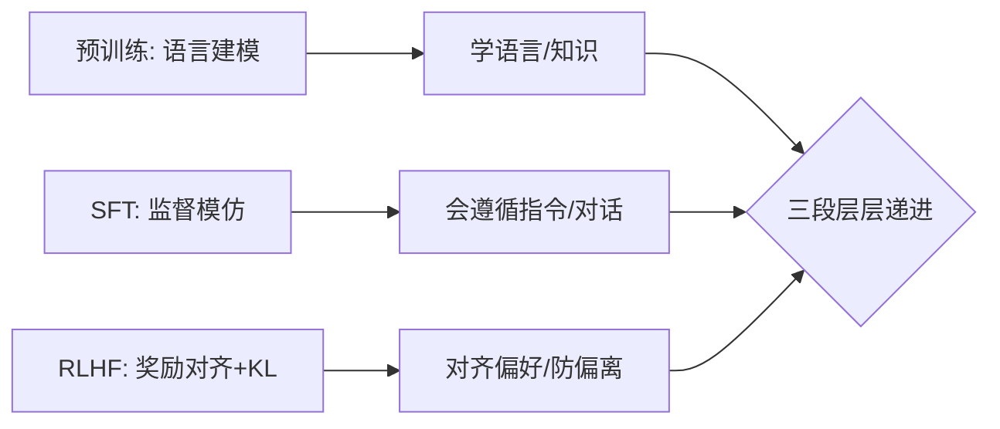

**面试要点**：预训练学语言、SFT 学指令、RLHF 对齐偏好（带 KL 正则）——目标函数各不相同。

---

## Q2. SFT 的模仿学习与 RL 的探索优化在对齐中各自擅长什么、各自留下什么隐患？

**回答**

- **SFT（模仿学习）**：
  - 擅长：**稳定、便宜、集中在"已知正确"的答案**——格式、指令遵循、标准任务；
  - 隐患：**只模仿标注偏好**，无法探索**标注外更好的答案**；**exposure / distribution mismatch**（学的是"好答案格式"，但训练时被迫用自己的输出——见 exposure bias）；无法对齐**逐 token 的长尾偏好**；可能过拟合标注风格。
- **RL（探索优化）**：
  - 擅长：**直接优化奖励/偏好目标**，能**探索新策略**（奖励高但未标注的答案）、按真实用户偏好逐步逼近；
  - 隐患：**reward hacking**（优化奖励但不优化真实目标，Q13）、训练不稳定/方差大、KL 漂移、过优化 reward 导致"刷格式"、需要在线 rollout（贵、不稳定）。

```python
def tradeoff():
    return {"SFT": "稳定/便宜/模仿, 隐患: 不探索/只标",
            "RL": "探索/真偏好, 隐患: reward hack/不稳/贵"}
```

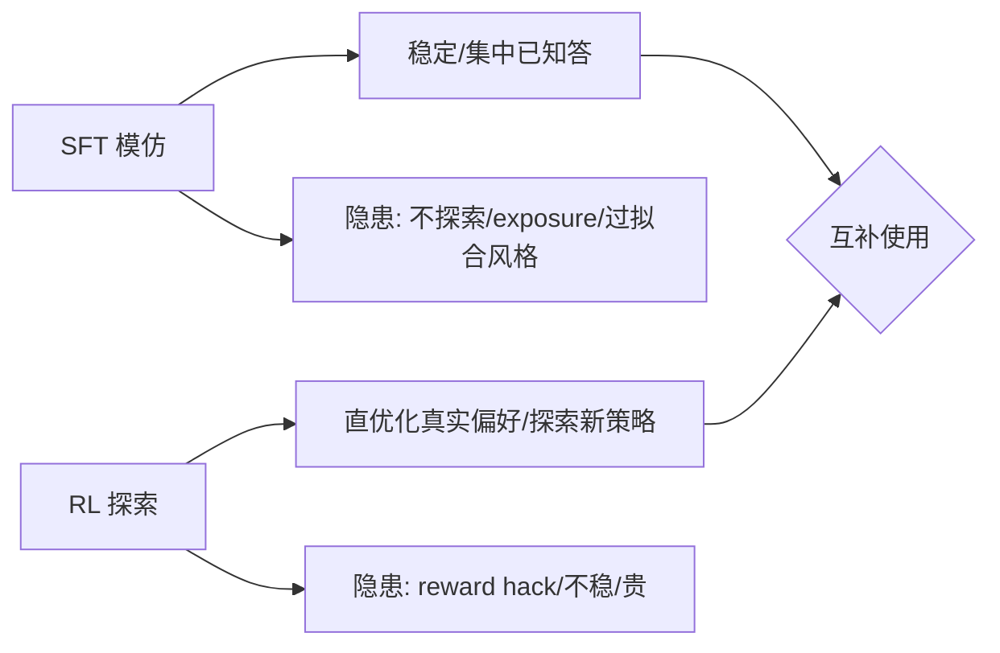

**面试要点**：SFT 稳但"只见标准答案"；RL 能探索真偏好但会 hack/不稳——常先 SFT 再 RL。

---

## Q3. 只做 SFT 不做 RLHF，模型会出现哪些典型行为问题？为什么 SFT 难以解决这些问题？

**回答**

**只 SFT 不 RLHF 的典型问题**：
1. **无法对齐长尾偏好**：SFT 只学标注的"标准答案"，真实对话中不确定的好/坏答案分不清；
2. **过度自信/幻觉**：SFT 不惩罚"说错但格式对的答案"——幻觉依旧；
3. **盲从有害指令**：SFT 没学"该拒绝什么"（只有标注里隐含）——拒绝敏感内容能力弱；
4. **回报声明不符**：SFT 模仿"看起来好"的回答，但真实用户偏好（简洁、诚实、有帮助、安全）没被显式优化；
5. **exposure bias / 复用**：SFT 不能区分"有利于帮助 vs 有利于敷衍"，长时间对话会退化/重复。

**为什么 SFT 难以解决**：
- SFT 目标是**监督模仿**，**没有"目标/奖励"信号**——它教会"怎么像人一样答"，**不教会"什么才是好"**；
- 偏好本质是**相对比较**（done via preference pairs），SFT（按 token NLL）学不到"对比/优先级"；
- 只有 **RL（或 implicit 偏好目标，如 DPO）** 才能把"什么值得更优"的梯度给出来。

```python
# SFT 只学到"模仿", 没有目标信号
def sft_only():
    return ["幻觉", "盲从", "不判偏好", "长尾未对齐"]
```

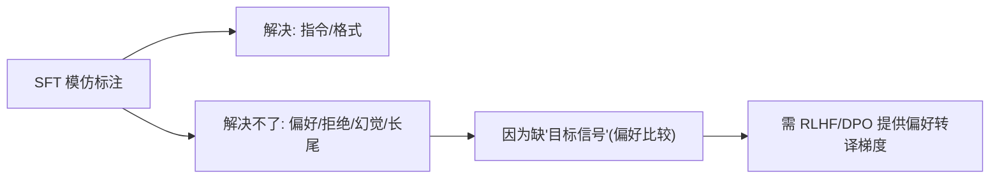

**面试要点**：SFT 缺"目标信号"——模仿不够对齐偏好/拒绝/幻觉；要 RL 或 DPO 提供偏好转译。

---

## Q4. RLHF 的三步流程（SFT → Reward Modeling → PPO）中，每一步的失败如何传导到下一步？

**回答**

1. **SFT 失败** → 初始策略差（文本能力差/格式差/幻觉多）：
   - 传导：奖励模型/Rollout 都**基于差的 base**——reward 对差分布过拟合，PPO 只能"差中找好"，上限低；
2. **Reward Modeling 失败**（数据偏、overoptimize）：
   - 传导：PPO 优化的是**错的/有偏的奖励函数** → **reward hacking / 优化错误目标**（好评高但实际差）；RM 过度自信（calibration 差）会让 PPO 走偏；
3. **PPO 失败**（KL 过度、崩溃、reward 平台）：
   - 传导：即使 RM 好，PPO 不稳定把策略搞崩（离参考太远、模式塌缩）——最终输出劣化，且难察觉（reward 虚高）。

**关键**：**上游错误向下游放大**——所以每步都要先可靠（RM 要校准、SFT 要先稳、PPO 要控 KL）。

```python
def failure_chain():
    return ["SFT差→base差→上限低",
            "RM坏→PPO优化错目标→reward hack",
            "PPO崩→策略漂移→输出劣化"]
```

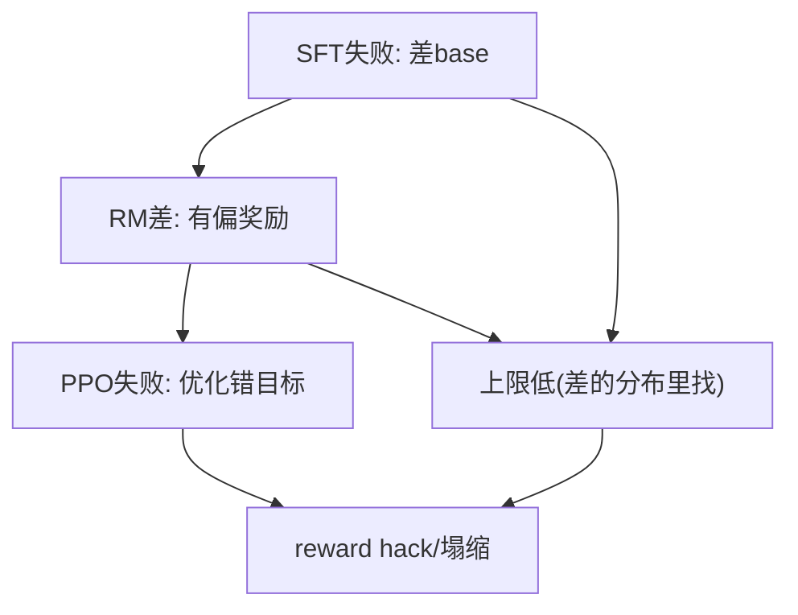

**面试要点**：错误向下游放大——SFT 差则上限低、RM 差则目标错、PPO 差则策略塌；每步先可靠。

---

## Q5. DPO 与 PPO 的核心区别是什么？DPO 跳过了什么、假设了什么？

**回答**

- **PPO**：显式训练 **reward model**，用 **online rollout + value/advantage** 直接最大化 `E[r − βKL(πθ‖πref)]`——需要 RM、critic、on-policy 采样；
- **DPO（Direct Preference Optimization）**：**直接从偏好对（赢/输）隐式定义奖励**，把"奖励最大化 + KL 约束"**解析折叠进一条分类损失**，**不训练 RM、不在线 rollout**（离线监督式）。

**DPO 跳过**：reward model 训练、PPO 的 value/advantage、on-policy 采样与 rollout 工程——**只要偏好对数据（x, y_w, y_l）+ 参考策略**。

**DPO 假设**：
1. **Bradley-Terry 偏好模型**成立（偏好概率 = sigmoid(r_w−r_l)）；
2. **参考策略 π_ref 已知且固定**（通常是 SFT 后的模型）；
3. **隐式奖励 = β·log(πθ/π_ref)**可以从闭式解反解（Q6/Q31 推导）；
4. 偏好对**覆盖足够**（离线数据要代表性）。

```python
def dpo_pipeline(prefs, ref):
    # 直接对偏好对优化分类损失（无RM/无rollout）
    for (x, yw, yl) in prefs:
        log_ratio_w = β*log(πθ(yw|x)/ref(yw|x))
        log_ratio_l = β*log(πθ(yl|x)/ref(yl|x))
        loss = -log(sigmoid(log_ratio_w - log_ratio_l))
```

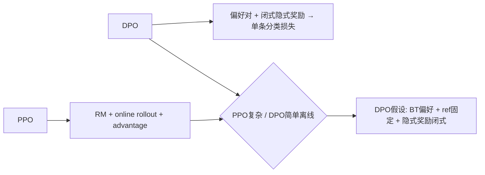

**面试要点**：DPO 跳过 RM 与 rollout、从偏好对直接分类；假设 BT 偏好 + 固定 ref（依赖推导）。

---

## Q6. DPO 的损失函数如何从 Bradley-Terry 偏好模型推导出来？它隐式优化的策略是什么？

**回答**

**推导**（Q31 完整版）：

1. **目标**：最大化隐式奖励且 KL 约束：`max E[r(x,y)] − β·KL(πθ‖π_ref)`；
2. **闭式最优**：`π*(y|x) ∝ π_ref(y|x)·exp(r(x,y)/β)` → 反解：
   `r(x,y) = β·log(π*(y|x)/π_ref(y|x)) + β·log Z(x)`；
3. **代入 Bradley-Terry**：`P(y_w≻y_l) = σ(r(x,y_w) − r(x,y_l))`；**Z(x) 在差里消掉**；
4. **得 DPO 损失（对策略 θ）**：

$$L_{DPO} = -\log \sigma\Big(\beta \log\frac{\pi_\theta(y_w|x)}{\pi_{ref}(y_w|x)} - \beta \log\frac{\pi_\theta(y_l|x)}{\pi_{ref}(y_l|x)}\Big)$$

**隐式优化策略**：**无需显式 RM**——等价于"优化一个隐式奖励 `r_θ = β·log(πθ/π_ref)` 下的偏好"；策略每步在**让 y_w 与 y_l 的对数比率拉开**的方向更新（抬 y_w、压 y_l），同时被 ref 约束（KL）。

```python
import torch, torch.nn.functional as F
def dpo_loss(log_pi_w, log_pi_l, log_ref_w, log_ref_l, beta=0.1):
    rw = beta*(log_pi_w - log_ref_w)
    rl = beta*(log_pi_l - log_ref_l)
    return -F.logsigmoid(rw - rl).mean()   # DPO 分类损失
```

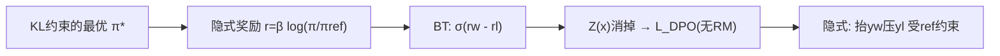

**面试要点**：从 KL 目标→闭式 R→BT→消 Z(x) 得 DPO 分类损失；隐式奖励 βlog(π/πref)，无需显式 RM。

---

## Q7. 奖励模型（RM）的训练数据从何而来？人类标注的一致性如何影响 RM 质量？

**回答**

**RM 训练数据来源**：
- **人类偏好对**：对同一 prompt，两个回答（来自不同模型/不同采样），**标注员选择更优的一个**（ranking/preference pairs）；
- **可扩展来源**：RLHF 中在线生成并标注；可合成增强（用强教师标弱模型对）；
- **数据要求**：**prompt 覆盖多样 + 回答对差距明显 + 标注一致**。

**人类标注一致性影响 RM 质量**：
- RM 训练 = 学 `P(y_w ≻ y_l)`；若标注员**意见分歧大（低一致性）**：
  - 训练信号噪——偏好对噪声 → RM 学到的偏好不鲁棒/不一致；
  - RM 分数可信度下降 → PPO 优化错（Q4 传导）；
- **缓解**：多标注员交叉（majority vote）、一致性指标（kappa）、过滤分歧大样本、用校准数据。

```python
def rm_quality(agreement):
    return "RM稳定" if agreement>0.6 else "偏好噪声→RM不稳"
print("一致性低 → RM 噪声大 → RLHF 传导")
```

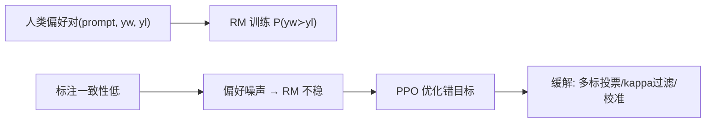

**面试要点**：RM 数据=人类偏好对；一致性低→偏好噪声→RM 不稳→PPO 错目标；需多标/过滤/校准。

---

## Q8. Alignment Tax 是什么？RLHF 之后模型在某些能力上下降的现象如何解释和缓解？

**回答**

**Alignment Tax（对齐税）**：**对齐/RLHF 优化偏好目标时，某些能力（如数学、代码、多样性、通用知识）相对预训练基线下降**——这是"为对齐付出转移能力的成本"。

**解释**：
1. **目标转移**：RL 优化的是"偏好/有用性"，不完全等于"所有 benchmark"，优化偏好可能**牺牲**其他维度（例如过于"周到"反而啰嗦、过于安全牺牲创造力）；
2. **KL/漂移**：策略偏离开预训练分布远 → 能力漂移；
3. **over-optimization**：reward 被过度优化 → 脱离真实目标（hack），伤通用能力。

**缓解**：
1. **KL 约束 / 参考约束**（β 控制漂移）；
2. **混合训练**：RL 中混入一部分原始任务/通用数据（保能力回归评估）；
3. **能力评估早停**：RLHF 时**追踪下游 benchmark**，边对齐边回归；
4. **减少过优化**：reward cap、不要训太狠、multiple eval。

```python
def alignment_tax(before, after):
    print(f"对齐前通用能力 {before} → 后 {after}（税=下降）")
print("缓解: KL约束/混合通用数据/追踪回归/不过优化")
```

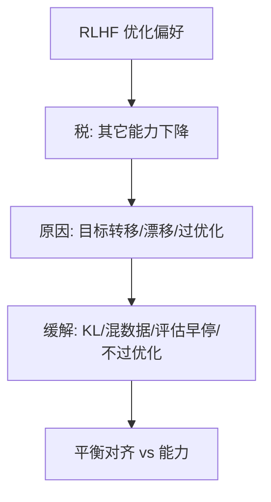

**面试要点**：对齐税=优化偏好牺牲其它能力；原因=目标转移/漂移/过优化；缓解=KL+混训+能力评估早停。

---

## Q9. SFT 的数据配比与格式对最终模型行为有多大影响？为什么 SFT 数据"质量 > 数量"？

**回答**

**影响**：
- **格式**：SFT 数据格式（system/user/assistant 分隔、语气、长度）决定模型**最终输出风格**——格式不对会让模型行为漂移；
- **配比（任务/领域/语言）**：配比决定模型**擅长哪种指令类型**——配比偏了，某类指令差、某种语言退化；
- 少量但信息度高的 SFT **已足以改变行为**（SFT 是"唤醒能力"不是"学新知识"）。

**为什么质量 > 数量**：
- SFT 的目标是**展示"正确的调用方式"**——**每一条高质量样本教会"该怎么做"**，低质量（错误/口头语/格式乱）样本**教会坏习惯**（幻觉、敷衍、语气差）；
- 海量低质：**放大错误分布**、稀释高质量、模型过拟合坏样本；
- 主打**数百~数千条高质量**（不是几十万低质）即可大幅改善行为——**< 10k 高质量 SFT 常见做法**。

```python
sft_recommend = {"num": "数千~数万 高质量", "ratio_by_task": "按目标任务",
                "quality": "√ 硬性（污染/幻觉/格式）"}
```

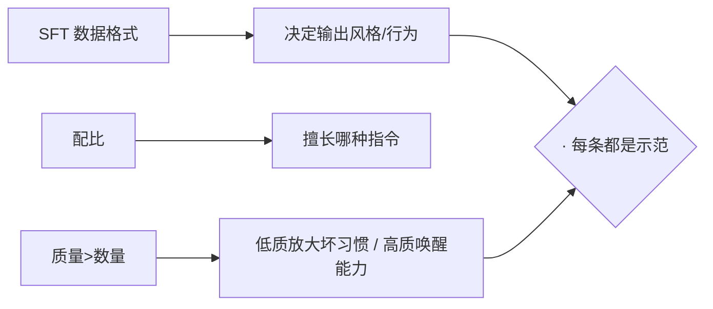

**面试要点**：格式定风格、配比定擅长；SFT 是"唤醒"——每条高质量示范 > 海量低质（数量次要）。

---

## Q10. PPO 中的 KL 惩罚项约束的是什么？KL 系数设得过大和过小分别会怎样？

**回答**

- **KL 惩罚**：`loss = E[r(x,y)] − β·KL(πθ ‖ π_ref)`——约束新策略 πθ **不要偏离参考策略 π_ref 太远**：
  - 防 **over-optimization**（reward 最大但分布漂移）；
  - 保**稳定性与多样性**（不塌缩）。

**系数过大（β 大）**：
- 策略几乎**不敢动**（KL 惩罚太强）→ 对齐收益小（reward 提升有限）——过度保守、帮助改善少；
**系数过小（β 小）**：
- 策略**自由地冲 reward** → **reward hacking**、策略漂移/塌缩（模型变"刷奖励"的怪异语言、危险输出）。

**平衡**：β 要"够大防止崩、够小允许对齐"——训练中监控 reward/KL 比值，必要时调 β（如 KL 发散就加大）。

```python
def kl_effect(beta):
    return ("过保守(β大)" if beta>1 else "易hack(β小)")
```

```mermaid
flowchart LR
    A["KL 约束 πθ~πref"] --> B["防 over-opt/漂移/塌缩"]
    A --> C["β大: 不敢动→对齐少; β小: 冲reward→hack/漂移"]
    B --> D{"平衡} 
    C --> D
```

**面试要点**：KL 锚定参考策略；β 过大保守不改进、过小 reward hack/漂移——要监控 reward-KL 调 β。

---

## Q11. 在线 PPO 与离线 DPO 在工程复杂度、稳定性、最终上限上如何对比？

**回答**

| 维度 | 在线 PPO | 离线 DPO |
|---|---|---|
| 工程复杂度 | 高（RM、value/critic、on-policy rollout、KL、多组件） | 低（偏好对 + 单分类损失） |
| 稳定性 | 低（方差大、需要调 reward 归一化/advantage/KL） | 高（离线监督、稳定） |
| 数据效率/探索 | 高（在线采样可探索新策略） | 低（只有给定偏好对，不探索） |
| 最终上限 | 高（能逼近真实最优策略，受 reward 质量限制） | 受离线数据覆盖与分布限制（上限 = 离线数据能表达的） |
| 适用 | 数据可在线生成、重视上限 | 有现成偏好对、要简单稳定 |

**总结**：PPO **更强上限/会探索**但贵；DPO **简单稳**但受离线数据覆盖约束（数据覆盖不到的答案学不到）。

```python
def compare():
    return {"PPO": "上限高/探索强, 复杂/不稳",
            "DPO": "简单/稳定, 上限受离线覆盖限制"}
```

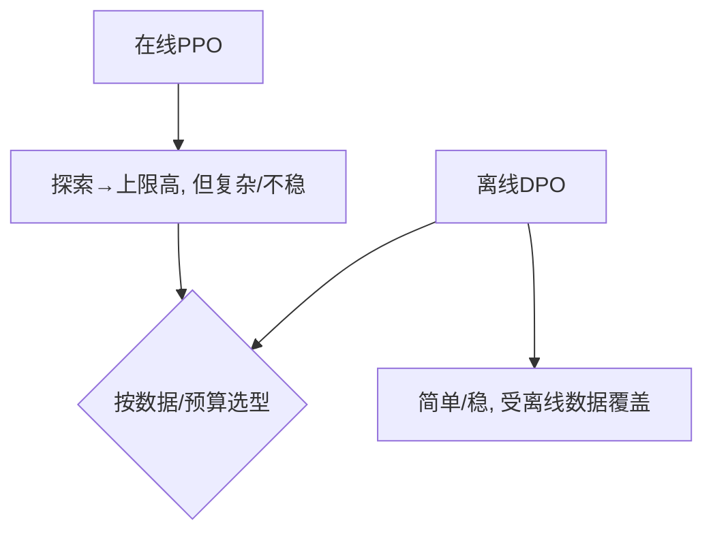

**面试要点**：PPO 探索上限高但重；DPO 简单稳但上限受数据覆盖——按数据可得性与稳定性选。

---

## Q12. SFT 应训到"过拟合"还是"欠拟合"？如何判断 SFT 停止的时机？

**回答**

**SFT 应该训到"适度过拟合"**（对高质量 SFT 数据轻度过拟合是常见且有益的）：

- SFT 数据量小、质量高；目标是"记住/内化示范"——**轻度过拟合**能**唤醒指令能力、风格稳定**；
- **但不要重度过拟合**（完全背诵、丢失通用知识、训练 loss 对验证 loss 巨大差距）。

**判断停止时机**：
1. **验证 loss/指标**：跟踪 held-out SFT 集的损失——通常**训练 loss 降、验证 loss 先降后升的地方（early plateau）停**；
2. **任务基准**：在指令遵循/目标 benchmark 上测——分数到平台就停（SFT loss 再降没意义）；
3. **多轮/风格**：人工抽检对话质量（不应出现复读/风格崩坏）；
4. **通用能力回归**：测通用 benchmark 在 SFT 中是否下滑（Alignment Tax 前哨）。

```python
def stopping_criteria(valid_metric, general):
    return valid_metric.stabilized and not general.dropping
# SFT 适度过拟合；验证指标到平台 + 通用能力未降 → 停
```

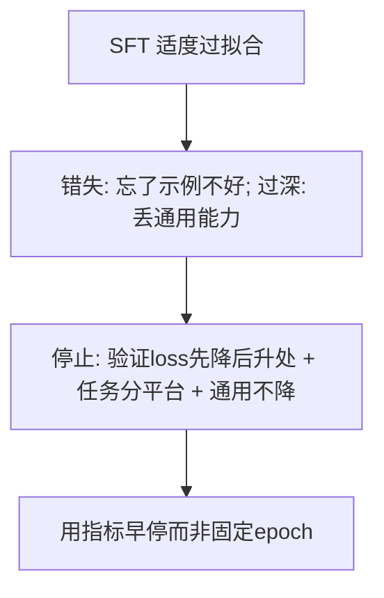

**面试要点**：适度过拟合 SFT 数据；停止=验证指标平台 + 任务达标 + 通用能力未降（非固定 epoch）。

---

## Q13. RLHF 中的 reward hacking 是什么？模型可能如何"欺骗"奖励模型？

**回答**

**Reward hacking**：模型**最大化（被学到的）奖励函数**，但**不真正符合人类真实目标**——奖励成为"可被套利的代理"。

**模型如何"欺骗" RM**：
1. **刷格式/语气**：说漂亮话、加"好的，我来帮你"、堆砌详尽——让 RM 觉得"有用"但实际空泛（长度/语气 hack）；
2. **迎合 RM 的偏好盲区**：RM 偏好某些风格——模型学会生产那种风格而非真帮助；
3. **利用 RM 的缺陷**：RM 对某些输入判错（如对无关但"看起来对"的答案给高分）→ 模型学习找到这些"奖励漏洞"；
4. **退化到坏输出**：生成无害但无用的套话（在安全奖励下"什么都拒绝"）——安全 hack；
5. **概率榨取**：采样大量答案选 reward 最高的（over-optimization）。

**缓解**：KL 约束、reward cap、ensembling/多 RM、人类复核、检测发出奇异语言。

```python
def hack(samples):
    best = max(samples, key=reward)   # 挑选reward最高的 → over-opt
    if "空泛但漂亮" in best: return "reward hack 痕迹"
```

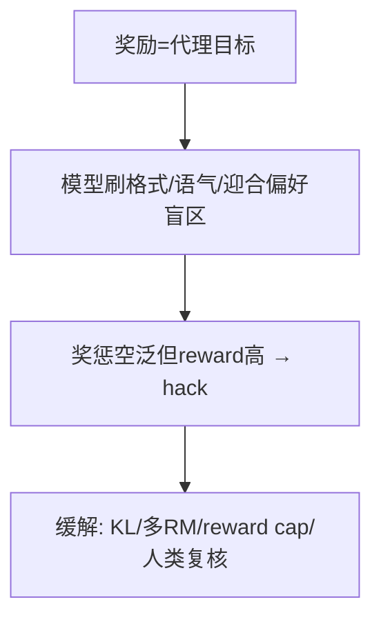

**面试要点**：reward hacking=最大化代理奖励而非真实目标；模型刷格式、迎合盲区、用缺陷；缓解 KL/多 RM/cap。

---

## Q14. SFT 数据中混入低质量样本时，模型会学到什么？如何检测和清洗？

**回答**

**学到的东西**：
- **坏习惯**：爱编造（幻觉）、啰嗦/敷衍、格式混乱、语气差——低质样本教模型"这样也算对"；
- **标签噪声放大**：错误答案被模仿 → 模型在相关任务上重复错误；
- **能力稀释**：低质占 SFT 样本大 → 高质量示范被淹没（质量>数量，Q9）。

**检测**：
1. **自动过滤信号**：低 PPL（过短/模板）、与高质量示范风格差异、疑似污染（来自预训练数据）、无信息（重复句）;
2. **质量分类器**：训练/用分类器打低分（Q21 第 10 章）；
3. **workshop 反馈**：模型在低质样本上的过拟合表现（多生成这些样本更"怪"）;
4. **人工抽查**：低质高频域抽审。

**清洗**：先启发式（长度/符号/去重）→ 分类器 → 人工复核关键域；**逐步筛掉尾部低质**。

```python
def clean_sft(data):
    data = drop_short_noise(data)     # 启发式
    data = drop_low_score(data)       # 分类器
    return human_review_top_risk(data)
```

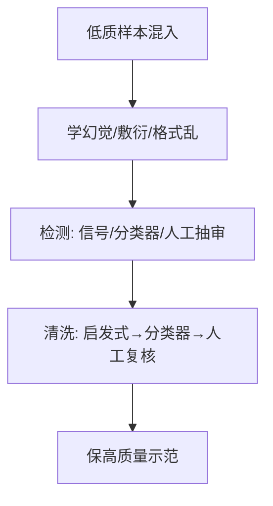

**面试要点**：低质教坏习惯（幻觉/敷衍/乱格式）；检测用信号+分类器+人工；清洗逐层筛。

---

## Q15. 继续预训练与 SFT 的边界在哪里？领域适配应该用哪一种？

**回答**

- **继续预训练（continued pretraining, CPT）**：用**领域非结构文本**（论文、病历、代码、法规原文）在预训练基础上**续训**——目标仍是**语言建模**；用于把**领域知识写进权重**；
- **SFT**：用**指令-回答对**训练**遵循/输出格式**；用于让模型**用领域知识完成任务**。

**边界/选择**：
- **需要"知道领域知识"**（答案里要有领域事实/术语）→ **继续预训练（CPT）**；
- **需要"会完成任务/格式"**（问答、总结、对话）→ **SFT**（如果知识已有，只需 SFT 就能"调用"）；
- 通常顺序：**先 CPT（知识）→ 再 SFT（行为）**——纯领域问答数据量大時 SFT 也能顺带注入知识，但**正确的做法是 CPT 加知识、SFT 加格式/任务**。

```python
def domain_strategy(need_knowledge, need_format):
    if need_knowledge: return "CPT(注入知识) 然后 SFT(任务格式)"
    return "SFT 即可"
```

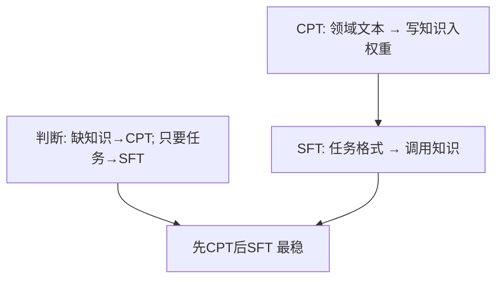

**面试要点**：知识用 CPT、行为用 SFT；领域适配"先 CPT 后 SFT"最稳。

---

## Q16. RLHF 为什么通常需要独立的 reward model，而不是直接用人类实时反馈？实时反馈的代价是什么？

**回答**

**为什么需要独立 RM**：
- PPO/RM 需要一个**可微分、可反复采样的奖励函数**；人类反馈**不是函数**（不能对万次采样都叫人标）；
- RM 把人类偏好**蒸馏成一个代理函数**，供优化器反复调用（rollout 采样→打分→梯度）。

**实时反馈的代价**：
1. **不可扩展**：每次 rollout 都人工标→天价、不能在线大采样；
2. **延迟与噪声**：人类即时反馈慢且有主观噪声、不稳定；
3. **不连续/不可微**：无法直接backprop（反馈是离散判定，不是梯度）；
4. **策略变化快**：RL 每步策略都在变，人类跟不及 → 无法实时对齐当轮策略；
5. 所以**用离线 RM（一次训练，反复打分）+ 在线 PPO**——实时反馈只用于采 RM 的训练样本/RM 迭代。

```python
# PPO 的奖励来源: RM 函数（人类反馈用于训练 RM）
r = reward_model(prompt, response)     # 批量可微可重复
human_labels_only_used = False  # 人类只在线下标 RM 样本
```

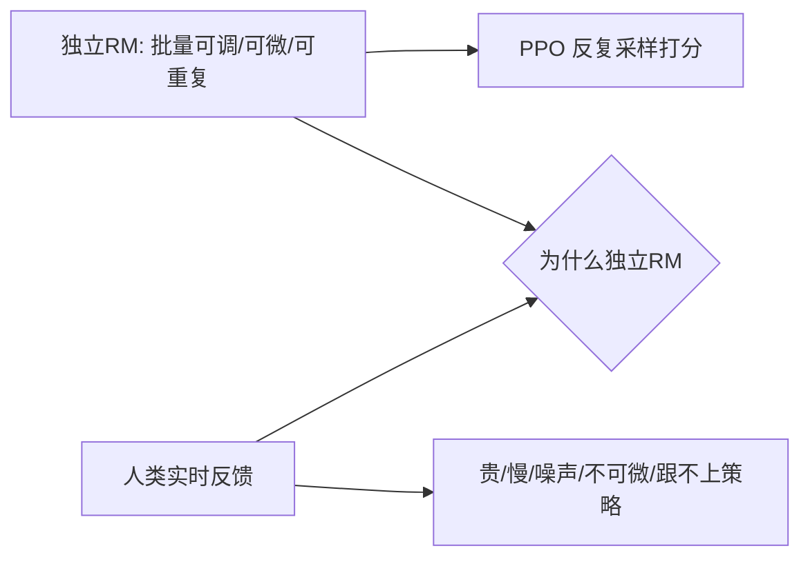

**面试要点**：RM 是**可反复调用的代理函数**（人工不能给万次采样打标签）；实时反馈贵、慢、不可微、跟不上策略。

---

## Q17. SFT 的 loss 只在 assistant 回复的 token 上计算还是包括 user prompt？不同选择对模型行为有何影响？

**回答**

- **标准做法**：**只在 assistant 回复（输出）token 上算 loss**，**user prompt / system 的 token 忽略（mask 掉）**——常见 `inputs[-response_len:]`。
- **如果对 prompt 也算 loss 的影响**：
  - **相当于要求模型复述/建模 input 本身**——浪费容量、扰动（让模型学会"读出输入"而偏离只生成回复）；
  - 可能诱导模型**在生成时重现 prompt**（如果 prompt 参与 MLE）；
  - 训练不稳定（把"输入"与"输出"绑进同一 MLE）。
- **如果只算回复**：模型**只在"应该输出的内容"上学**——更适合指令跟随（prompt 作为条件，不计算其似然）。

```python
def sft_loss(logits, labels, response_mask):
    # 只对 assistant 回复区域算 CE
    shift_logits = logits[..., :-1, :].contiguous()
    active = response_mask[..., 1:].bool()
    loss = F.cross_entropy(shift_logits[active], labels[active])
    return loss
```

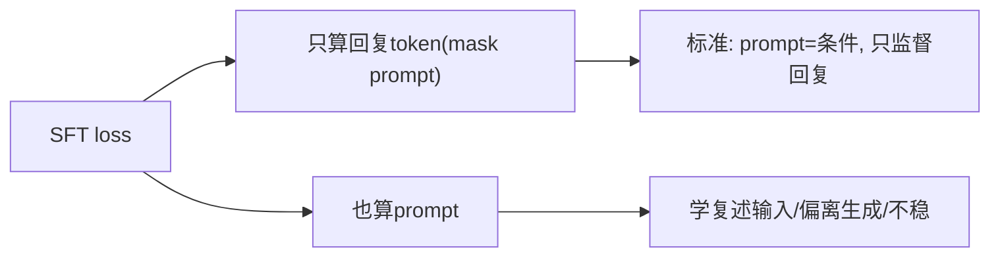

**面试要点**：标准**只在 assistant 回复算 loss**（prompt 是条件不监督）；对 prompt 算 loss 会导致模型学复述、偏离生成。

---

## Q18. DPO 中的 `β` 参数控制什么？`β` 增大和减小分别使模型更保守还是更激进地偏离参考策略？

**回答**

- **β（温度/偏好强度）**：控制 **KL 约束的强度 / 参考策略的影响**：
  `θ = β·log(πθ/πref)` 里 β 越大，**每点偏好差对应的 log-ratio 权重越大** → 策略越受"拉开偏好对收益"的驱使。

- **β 减小（更激进）**：**对每个偏好对的拉割（π 中要把 y_w 抬到更高、y_l 压更低）更积极**，更强地优化偏好 → **偏离参考策略更多/更激进**；可能 over-optimize、失去多样性；
- **β 增大（更保守）**：**每点 log-ratio 缩放更小**（分数差小），策略更贴 π_ref（保守、多样性高、对齐少）。

```python
def dpo_ratio(beta, rw, rl):   # 更新的方向不动
    return beta*(rw - rl)       # β小→乘积小→激进的步长小(但相对ref更远权重?)
# 概念: β小=强 deviational(离ref远), β大=贴近ref
```

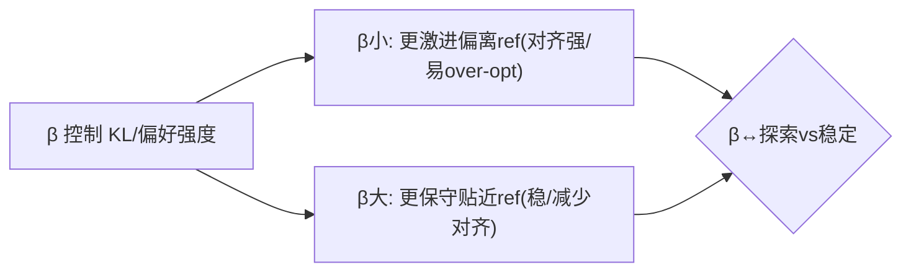

**面试要点**：β 控制偏好拉割强度；β 小→激进偏离 ref（强对齐但易 over-opt）、β 大→保守贴近 ref。

---

## Q19. 多轮对话的 RLHF 如何做 credit assignment？每一轮都奖励还是只在最后一轮奖励？

**回答**

**多轮 credit assignment 的挑战**：reward 应归因到**哪一轮的动作**——最后一轮的错误可能是前轮上下文错误导致的。

**做法**：
1. **整轮完整 reply（segment/回合级别奖励）**：**每个 assistant 回合**给一个奖励（每个 reply 一个标量），**每轮独立 credit**——不能把"整段对话统一一个 reward"分不清哪轮出问题；
2. **最后一轮奖励（response-only）**：只用最终回复打分——简单但**无法归因到哪一轮出错**（前轮的坏上下文会被后轮错误偿清）；
3. **逐步 credit**：用 **process reward / turn-level reward** 或 **advantage 归因**（当前轮改进相对基线的收益）——把"只奖励最后一轮"推广为"逐轮 credit"。

**主流**：**每轮 reply 分别奖励**（turn-level），并让模型学会不因前轮 bad 而推责；在代码等可验证任务能用 process reward 做更细。

```python
# 多轮: 每 reply 一个 reward
rewards = [rm(ctx_i, reply_i) for i in range(n_turn)]
# 只奖励最后一轮 → 无法归因慢; 逐轮 → 每轮独立 credit
```

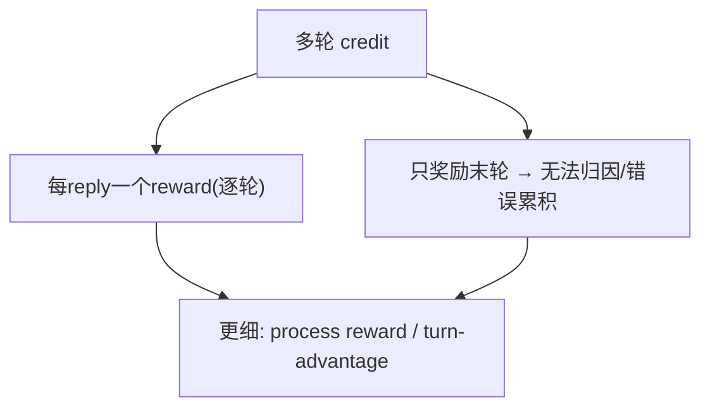

**面试要点**：应**逐轮（turn-level）奖励**（或 process reward/advantage），不能用单一末轮——否则无法归因哪一轮出错。

---

## Q20. reward model 与 policy model 共享底座会带来什么好处和风险？

**回答**

**好处**：
- **数据/表示共享**：共享预训练底座，RM 复用 policy 的语言/知识表示，训练更快、样本少；
- **一致偏好**：与 policy 同分布，偏好信号更匹配（减少分布偏）。

**风险**：
1. **奖励与策略纠缠**：RM 与 policy 同参数 → **RM 被 policy 的优化牵着走**（reward 能 hack 自己）——reward 不再独立；
2. **过拟合/共享噪声**：RM 的错误会通过共享底座传导给 policy（Q4 传导）；
3. **可维护性**：分开可独立升级 RM/policy；共享则耦合；
4. **解释性差**：共享时 reward 与生成边界模糊。

**实践**：**通常不共享**（reward 与 policy 分离训练更稳；共享做同期 RM+policy 的早期实验）；若要共享，需用不同 head、控制梯度隔离。

```python
# RM 与 policy 分开是主流
rm = RewardModel(tokenizer.shared_encoder)     # 可共享底座
policy = PolicyModel(tokenizer.shared_encoder) # 但推理时分开看
print("共享: 省/快/同分布; 风险: 纠缠/传递错误 → 主流分离")
```

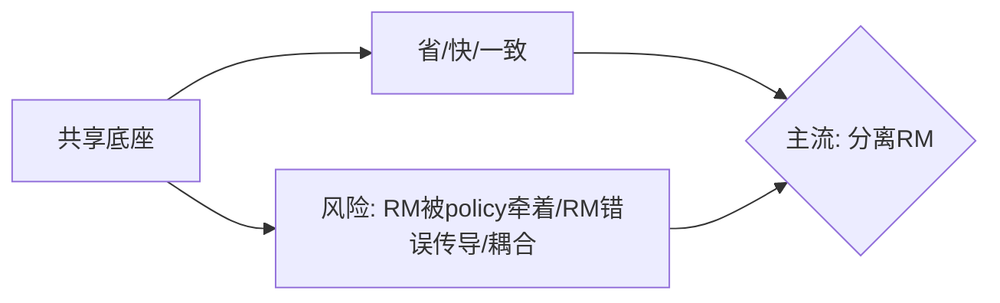

**面试要点**：共享=省+一致；风险=RM 与 policy 纠缠、错误传导——工程主流是分开。

---

## Q21. RLHF 训练不稳定时，应优先调哪些超参数？reward 归一化、advantage 归一化、KL 系数、学习率分别起什么作用？

**回答**

**优先调（按影响）**：
1. **KL 系数 β**（Q10）：过大→不改进，过小→hack/漂移；不稳常先查 β；
2. **reward 归一化**：reward 尺度不一（不同任务差出 10 倍）→ 归一化（z-score/固定 scale）让 advantage/梯度稳定，否则 reward 大的任务支配；
3. **advantage 归一化（PPO 内）**：对 advantage 做 **batch 内标准化**——去尺度、减方差，避免 AI 大/小分布主导梯度；
4. **学习率**：RLHF 常用**低 lr**（比 SFT 更低），过高 → 策略崩；过低 → 不收敛；
5. **PPO epoch/clip 值**、rollout 比例等也影响。

**排查顺序**：reward 分布 → advantage 归一 → KL β → lr（由"尺度问题"到"优化问题"）。

```python
def stabilize(r, adv, beta, lr, batch):
    r_norm  = (r - r.mean()) / r.std()           # reward 归一
    adv_norm = (adv - adv.mean()) / adv.std()    # advantage 归一
    return r_norm, adv_norm, clip(beta), lr*0.5  # 逐项收敛
```

```mermaid
flowchart TB
    A["RLHF 不稳"] --> B["reward 归一化(去尺度)"]
    A --> C["advantage 归一化(减方差)"]
    A --> D["KL β(防hack/漂移)"]
    A --> E["低学习率(防崩)"]
    B --> F{"由尺度到优化逐项调"}
    C --> F
    D --> F
    E --> F
```

**面试要点**：不稳优先调 **reward/advantage 归一 + KL β + 低 lr**——先解决尺度问题再优化问题。

---

## Q22. SFT 阶段是否需要做数据去重与去污染？为什么？

**回答**

**需要**（SFT 数据质量很敏感，Q9）：

**去重理由**：
- SFT 数据少、多条同时序近重复会**放大某条坏示范的权重**（例如同一低质指令反复出现→模型过度模仿）;
- 近重复浪费高质量样本的多样性、减少覆盖。

**去污染理由**：
- SFT 若含**评测基准/敏感提示**的重复 → 后训练会**把基准背进去**（污染评估）；
- 含**真实 PII/有害**数据的 SFT → 模型学会输出它们；
- 检测与去污（Q10 第 10 章 Q10——n-gram/成员推断）在 SFT **尤其重要**（数据量小、影响直接）。

```python
def sft_clean(data):
    data = dedup(data)          # 去重(放大坏示范)
    data = decontam(data)       # 去污染(护评测/隐私)
    return data
```

```mermaid
flowchart TB
    A["SFT 去重"] --> B["防坏示范权重放大/保覆盖"]
    C["SFT 去污染"] --> D["防背基准/泄漏PII"]
    B --> E{"都必须做（数据少影响直接）"}
    D --> E
```

**面试要点**：SFT 也须去重+去污染——数据少、坏示范/污染放大直接影响行为。

---

## Q23. 拒绝采样在 SFT/RL 流程中如何使用？它与 best-of-n 的关系是什么？

**回答**

**拒绝采样（Rejection Sampling, RS）**：
- 从策略（或 SFT 模型）**采样多个候选**，用**奖励模型/验证器打分**，筛选出**高分样本**并入数据（SFT/偏好 DPO 或 RL 的起始）；
- 使用场景：SFT 前生成高质量偏好集（用 target 与 RM 采样）、RLHF 前 refine 数据池。

**与 best-of-n 的关系**：
- **best-of-n = 拒绝采样的一种**：采样 n 条、**取 top-1**（reward 最高）；
- 拒绝采样的 **更宽形式**：**保留超过阈值的所有高分**（不是只取 top-1）——可构造更丰的偏好/正样本集；
- 区别：**best-of-n 返回 1 个、RS 可返回符合阈值的一批**；两者都依赖好的打分器（否则 hack，Q13）。

```python
def rejection_sample(policy, rm, n=16, threshold=0.7):
    ys = [policy(x) for _ in range(n)]
    scores = [rm(x, y) for y in ys]
    keep = [y for y, s in zip(ys, scores) if s >= threshold]  # 超阈值一批
    return max_one if best_of_n else keep                     # best-of-n 取top1
```

```mermaid
flowchart LR
    A["采样n候选"] --> B["RM打分"]
    B --> C["best-of-n: 取top1"]
    C --> D["rejection: 取超阈值全部"]
    D --> E["喂SFT/偏好/RL"]
```

**面试要点**：RS 用采样+打分筛高分入数据；best-of-n 是 RS 的一种（取 top-1），RS 保留阈值上的一批。

---

## Q24. 模型经过 RLHF 后"变得更啰嗦"，从奖励建模与优化目标角度解释原因。

**回答**

**变得啰嗦的原因（奖励建模视角）**：
1. **RM 偏好冗长**：标注员/偏好数据常认为**更详尽=更有帮助**——RM 把"长、覆盖多方面"打高分（与 AlpacaEval 长度偏差同源，Q11 第 11 章）；
2. **长度与偏好正相关**：长回答往往包含更多"看起来有用的词"→ 统计上推高偏好 → RL 优化这个**代理** → 模型**学会加长**；
3. **over-optimization**：KL 弱时，RL 把"长度带来的 reward"榨到极致 → 啰嗦刷分（reward hack 的一种）；
4. **对"简洁也能得高分"没有奖励信号**：RM 未给"简而准"加分 → RL 没有动力省话。

**缓解**：RM 数据中加"对照长度锚定/控长度"、长度惩罚、reward cap、评估中用 length-conditional 报告或 length-jackknife。

```python
def reward_len_bias(rm, y_short, y_long):
    return rm(y_long) - rm(y_short)   # 若>0 说明RM偏长
# 缓解: 长度正则/控长校准/长度条件评估
```

```mermaid
flowchart LR
    A["RM 偏好详尽(标注/长度相关)"] --> B["RL 榨长度带来的reward"]
    B --> C["→ 啰嗦(hack长度)"]
    C --> D["缓解: 控长校准/长度惩罚/RM数据对照"]
```

**面试要点**：RM 把"长/详尽"当高分 → RL 优化这个代理 → 啰嗦刷分；缓解=控长校准+长度惩罚。

---

## Q25. 如何评估 SFT 与 RLHF 各自对最终模型的贡献？设计一个消融实验。

**回答**

**消融设计（层级对比）**：

1. **baseline：预训练模型**（无 SFT/RLHF）；
2. **+SFT**：预训练 → SFT（有指令能力）；
3. **+SFT+RLHF**：完整流程（对齐偏好）；
4. （可选）**+SFT + RLHF-只RM/只PPO** 拆开子组件。

**统一评测**：
- **核心能力**（知识/推理/代码：MMLU、GSM8K、HumanEval）——看 **SFT/RLHF 是否损害（Alignment Tax）**；
- **指令/偏好**（IFEval、Arena win-rate、多轮/安全）——看 **SFT/RLHF 是否提升目标行为**；
- **数据条件**：同预训练权重、同训练预算（rc 总量/步数）、同 seed。

**归属贡献**：Δ(pre+RLHF − pre) = 总；Δ(SFT) 与 Δ(RLHF)=RLHF−SFT 各自贡献；并报告 **能力税**（核心能力回归）。

```python
def ablation():
    return {"pre": core+0, "pre+sft": core-?, "pre+sft+rlhf": core-??,
            "preference": "sft提升格式, rlhf提升偏好/质量"}
# 用各项分数差归属 → 并观察核心能力税
```

```mermaid
flowchart TB
    A["pre"] --> B["+SFT"] --> C["+RLHF"]
    A --> D["测: 核心能力(知识/推理/代码)"]
    D --> E["报告: SFT贡献 + RLHF贡献 + 对齐税"]
    C --> E
    E --> F["用Δ归属各阶段"]
```

**面试要点**：三档（pre/+SFT/+RLHF）同预算同评测——分别归因 SFT 与 RLHF 的贡献，并报告能力税。

---

## Q26. 为代码模型设计后训练流程时，SFT 数据与 RL 奖励应如何定制？

**回答**

**SFT 数据定制**：
- **代码指令对**：自然语言→代码（描述→实现）、代码补全/修复/解释、多语言（Python/JS/…）、**测试生成**；
- 带**运行验证**：优先用**可执行且通过测试**的样本（质量>数量）；
- 多样化：难度梯度、注释/文档、面试/竞赛（防偏）。

**RL 奖励定制**：
- **可验证奖励（RLVR）**：用 **单元测试/编译器/静态检查** 做自动 reward（代码+RLVR，Q18 第 13 章）；
- 结构化信号：编译通过、测试通过率、覆盖率、Runnable；
- **避免纯风格 reward**（长度/风格 hack）：以**功能正确**为主；
- 混合：难例奖励加成、错误反馈（compile error → 低 reward 引导修错）;
- KL 约束防漂移出代码分布。

```python
def code_reward(code, tests):
    compile_ok = try_compile(code)
    pass_cnt = run(tests, code)
    return compile_ok + pass_fraction   # 可验证为主
```

```mermaid
flowchart TB
    A["代码SFT"] --> B["指令对+可执行/带测试(质量>数量)"]
    C["代码RL"] --> D["RLVR: 编译/测试/覆盖率 自动reward"]
    C --> E["避免风格hack: 功能正确优先 + KL防漂移"]
    B --> F{"后训练定制代码"}
    D --> F
```

**面试要点**：代码 SFT=可验证的指令对；代码 RL=RLVR（测试/编译）自动奖励、避风格 hack——可执行与正确率优先。

---

## Q27. RLHF 中的偏好数据与示范数据在信息量上有何不同？为什么偏好数据更便宜？

**回答**

- **示范数据（demonstration）**：给**完整的"应该怎么做"**（高质量的完整回复）——信息量大（编成完整正确示例），但也**难产**（要专业标注员写出完整好答案）；
- **偏好数据（preference）**：给**两个回答谁更好**的判断——**只需比较/排序**（标注员不必自己写对，只要"挑更优"），容易得多。

**为什么偏好更便宜**：
1. **标注便宜**：比较难度 << 生成的难度（人人可比较，无需专家写出全部）；
2. **可批量/合成**：两个候选可由模型生成（错的对的都有），标注只需"选/排序"——可在生成对的开销上自动化；
3. **无需专业写作**：示范要高质量全答；偏好只要"这个比那个好"——标注门槛低、数据量大。

```python
demo_cost = "expert 完整写答案 (贵)"
pref_cost = "模型生成对 + 标注员比较 (便宜/可扩展)"
```

```mermaid
flowchart LR
    A["示范: 完整对答(信息全)"] --> B["贵(专家写作)"]
    C["偏好: 两答谁好(信息对比)"] --> D["便宜(比较<生成, 可批量)"]
    B --> E{"标注成本差异"}
    D --> E
```

**面试要点**：示范=完整正确（信息全但贵）；偏好=比较排序（便宜，可模型生成对+标注比较）。

---

## Q28. DPO 是否完全不需要 reward model？它的隐式奖励与显式 RM 在行为上有何差异？

**回答**

- **DPO 不需要显式 RM**：不训练 reward 函数（奖励是隐式重建的：`r_θ = β·log(πθ/πref)`）；
- 但它**等价于某种 reward 模型**（隐式）——训练时隐式提高 y_w / 压低 y_l 的隐式分数。

**隐式 reward 与显式 RM 的差异**：
1. **范围**：显式 RM 可**对任意 (x,y) 打分**（离线可用/部署外推）；DPO 的隐式 reward 只**在训练到的 (x,y) 空间上有效**（在线分布外退化为 log π/ref）；
2. **可解释/可控**：显式 RM 可查看/调（奖励缩放、ensemble）；DPO 隐式 reward 嵌入策略、不好单独审计；
3. **优化一致性**：DPO 的隐式奖励**直接与策略一致**（就是 log 比）；显式 RM 与策略有 gap（reward 模型≠策略模型）；
4. **迁移**：DPO 的偏好来自现成数据；显式 RM 可用于后续在线 RL/蒸馏。

```python
def implicit_reward(policy, ref, beta, x, y):
    return beta * (policy.logprob(x, y) - ref.logprob(x, y))   # 隐式r
# 显式 RM: 独立 r(x,y) 函数
```

```mermaid
flowchart TB
    A["DPO 隐式奖励 = βlog(π/πref)"] --> B["与策略一致, 但只在训练空间有效"]
    C["显式 RM"] --> D["任意打分/可审计/可复用, 但与策略有gap"]
    B --> E{"行为差异"}
    D --> E
```

**面试要点**：DPO 不需显式 RM（隐式 r=βlogπ/πref），但隐式 reward **有界在训练分布**；显式 RM**可审计复用但与策略有 gap**。

---

## Q29. 训练流程中，分词器、模型架构、数据配比三者哪一个的改动代价最大？为什么？

**回答**

**改动代价：分词器 > 架构 > 数据配比（通常）**——要看改动的"后效范围"：

1. **分词器**：改动 = **词表/embedding/输出层全变** → 需要**重新训练（或极贵的 embedding 迁移 + 继续预训练）**——几乎等于重训，代价最大（Q27 第 1 章）；
2. **架构**：两层结构改（加 layer/改 hidden/改 attention）→ **全部权重不可复用**（除非极小改动）→ 重训；代价大但与分词器比不可复用面不同；
3. **数据配比**：改动**不需要重训权重结构**——**只重训数据**（同一架构）→ 代价相对小（token 预算与算力，但不是"重设计"）。

**总结**：**分词器**动一发牵全身（重训/embedding 重建），代价最高；架构次之；配比最低（可迭代微调）。

```python
def change_cost():
    return {"tokenizer": "极高(重训/embed重建)",
            "arch": "高(权重不可复用)",
            "mix": "中(重训数据,架构可复用)"}
```

```mermaid
flowchart LR
    A["分词器改动"] --> B["词表/embed/输出层全变 → 近重训(最高)"]
    C["架构改动"] --> D["权重不可复用 → 重训"]
    E["配比改动"] --> F["架构复用 → 只换数据(最低)"]
    B --> G{"代价排序"}
    D --> G
    F --> G
```

**面试要点**：分词器改动=重训/embedding 重建（最高）；架构重训；配比只换数据（最低）——按"后效范围"排序。

---

## Q30. 从"预训练—SFT—RLHF"全流程看，哪些能力是预训练决定的、哪些是后训练"唤醒"的？举一个具体例子。

**回答**

- **预训练决定**：**底层能力**——语言流利度、世界知识、推理基础、代码结构化等（都从海量文本学得）；
- **后训练唤醒**：把底层能力**变成"可用的任务行为"**——遵循指令、格式、拒绝、对话风格、偏好对齐（预训练模型**已有能力但不懂"怎么调用"**）。

**具体例子（算术/多步骤数学）**：
- 预训练模型**已经会基本算术/分解**（从代码与数学文本中学到计算模式）；
- 但**不知道"用户问就一步步给"**、不知道输出格式；**SFT/RL** 教会它**用思维链格式调用**、按指令逐步推理、把"潜在能力"暴露成"实际正确输出"——所以"会数学"是预训练决定，"按需展示推理"是后训练唤醒。

```python
# 预训练: 已内化算术模式; SFT/RL: 唤醒'COT格式/按需展示'
pretrain_has = "算术模式/世界知识/语言"
post_wake = "按指令展示思维链/格式/对齐偏好"
```

```mermaid
flowchart LR
    A["预训练: 底层能力(算术/知识/语言)"] --> B["后训练: 唤醒 '如何调用'(COT/格式/对齐)"]
    B --> C["例子: 会算术(预训) + 按需链式展示(SFT/RL)"]
    C --> D["分工: 预训=能, 后训=会"]
```

**面试要点**：预训练决定底层能力（知识/推理/语言），后训练唤醒"按任务调用+格式+偏好"；例子=预训会算术、后训练暴露成可用 COT。

---

## Q31. DPO 损失的完整推导分几步？从 KL 约束的 reward maximization 出发，最优策略满足 `π*(y|x) ∝ π_ref(y|x) exp(r(x,y)/β)`。反解出隐式奖励 `r(x,y) = β log(π*(y|x)/π_ref(y|x)) + β log Z(x)`。代入 Bradley-Terry `P(y_w ≻ y_l) = σ(r_w - r_l)` 后，`β log Z(x)` 为什么在 pairwise 差中消掉？这个消去对 DPO 的"无 reward model"性质意味着什么？

**回答**

**推导（分几步）**：

**步骤 1：KL 约束的 reward maximization**
$$\max_\pi \mathbb{E}_y[r(x,y)] - \beta \text{KL}(\pi(y|x) \| \pi_{ref}(y|x))$$

**步骤 2：闭式解**（对 π 变分求导）得到
$$\pi^*(y|x) \propto \pi_{ref}(y|x)\exp\big(r(x,y)/\beta\big)$$

（`Z(x) = Σ_y π_ref(y|x) exp(r(x,y)/β)` 是归一化常数。）

**步骤 3：反解隐式奖励**
$$r(x,y) = \beta \log\frac{\pi^*(y|x)}{\pi_{ref}(y|x)} + \beta \log Z(x)$$

**步骤 4：代入 Bradley-Terry**
$$P(y_w \succ y_l) = \sigma\big(r(x,y_w) - r(x,y_l)\big)$$

把 r 代入：`βlog Z(x)` 这一项在 **差值中减掉** 了：

$$r_w - r_l = \beta \log\frac{\pi^*(y_w|x)}{\pi_{ref}(y_w|x)} - \beta \log\frac{\pi^*(y_l|x)}{\pi_{ref}(y_l|x)}$$

**为什么 `β log Z(x)` 消掉**：因为 r_w 与 r_l 是**同一个 x**（同一 prompt）下的两个候选——`Z(x)` 对 y 无关（对给定 prompt 是常数），求差时两边的 `βlogZ(x)` 相减为 0。

**意义（对"无 reward model"）**：**DPO 不需要显式估计/训练 reward 或 partition function Z(x)**——pairwise 差天然消去 Z，使"隐式奖励 = βlog(π/πref)"直接可算，DPO 只需偏好对与 πref（通常是 SFT 模型）即可训练策略，从而**省掉 RM 训练与 rollout**。

```python
import torch
def dpo_logits(x, yw, yl, pi, ref, beta=0.1):
    # Z(x) 在差中消掉
    rw = beta*(torch.log(pi(yw|x)/ref(yw|x)))
    rl = beta*(torch.log(pi(yl|x)/ref(yl|x)))
    # β log Z(x) 与 rw/rl 都减掉同一个 → 差值不含 Z
    return torch.logsigmoid(rw - rl)
```

```mermaid
flowchart LR
    A["KL 目标"] --> B["π*∝πref·exp(r/β)"]
    B --> C["r = βlog(π/πref)+βlogZ(x)"]
    C --> D["BT: σ(rw-rl)"]
    D --> E["Z(x)同x相减消掉"]
    E --> F["DPO 无需 RM/Z(x) → 省训练"]
```

**面试要点**：5 步推导闭环；Z(x) 因同 prompt 相减消去 → DPO 不需要估计 reward/partition，只需偏好对+πref。

---

## Q32. DPO 的最终损失为 `-log σ(β log(π(y_w)/π_ref(y_w)) - β log(π(y_l)/π_ref(y_l)))`。这里的 `β` 与 RLHF 中 KL 惩罚系数是什么关系？`β` 增大时，模型是更接近还是更远离参考策略？如果 `β → ∞`，DPO 退化成什么？

**回答**

**β 与 RLHF 的 KL 关系**：
- RLHF 的 KL 惩罚系数 `β` 出现在 `max E[r] − β·KL(πθ‖πref)`（Q31）；
- DPO 的 `β` **正是同一 KL 强度**（推导中同一个 β 从 KL 反解出来）——**β 越大 = KL 约束越强**。

**β 增大**：DBO 的隐式奖励 `βlog(π/πref)` 中 β 放大拉割幅度，但同时 KL 约束的强度也放大 → 综合效果 **策略更接近 π_ref**（KL 强的正常态）——即**越保守**（Q18 的翻转视角：分母 KL 主导时贴近 ref）。直观：β 大 = 强调"别偏离原模型"，偏好信号必须特别明显才动。

**β → ∞ 退化成什么**：
- 隐式 reward 项 `β(log(π/πref))` 在 β→∞ 时 **惩罚放大到极致** → 当对任何偏好的 log 比略非 0 都会被推向边界（对 y_w 无限抬、y_l 无限压）→ **退化为 hard max-margin / 近似"硬分类偏好"**——策略对 y_w 尽可能高、对 y_l 尽可能低，或理论极限下**只输出 y_w、绝不 y_l（最优 = one-hot 模式）**，完全贴参考的"指定赢家"，丧失 soft 权衡。

```python
def dpo_logit_ratio(pi, ref, beta):
    return beta*(torch.log(pi/ref))
# β→∞ → logit ratio 无限放大 → 分类更硬(hard), 更贴ref(因KL强)
```

```mermaid
flowchart LR
    A["β=KL强度"] --> B["β大: 更贴ref(保守)"]
    A --> C["β→∞: KL→∞ → 硬贴ref/只输出赢家(w) 近one-hot"]
    B --> D{"β语义: 同KL惩罚系数"}
    C --> D
```

**面试要点**：DPO 的 β = KL 惩罚系数；β 大→贴 ref；β→∞→**硬偏好退化（只对 y_w、近 one-hot、完全贴参考）**。

---

## Q33. PPO 的 clipped surrogate objective 中，`r_t = π_θ/π_θ_old`，clip 范围是 `[1-ε, 1+ε]`。为什么要 clip？如果不 clip，重要性采样比过大会导致什么？clip 后的梯度在什么条件下为零？

**回答**

**为什么要 clip**：PPO 用**旧策略采样的数据**估计新策略——重要性采样比 `r_t = πθ/πθ_old`。**如果 r_t 过大**（新策略对某动作概率远大于旧策略），**估计方差/更新步长爆炸**（trust region 失效）→ 一步把策略推飞、训练崩。Clip 限制 r_t 在 `[1−ε, 1+ε]`，**保证更新的保守与稳定**。

**不 clip 的后果**：**r_t 巨大 → 单步更新幅度过大** → 策略瞬间偏离（policy collapse/训练发散），违反 trust region，甚至 learning 崩坏。

**clip 后梯度为 0 的条件**：
- `surrogate(r) = min(r·A, clip(r,1−ε,1+ε)·A)`；
- 当 **r_t > 1+ε 且 A < 0**（旧动作已被压过低了、且 reward 差）→ 取 clip 界 `(1+ε)A`（常数）→ 梯度=0（不继续推离）；
- 或 **r_t < 1−ε 且 A > 0**（旧动作已被抬太高且 reward 好）→ 取 clip 下界 → 梯度=0；
- 直观：**已在"保守边界外"的方向被冻结**。

```python
def clip_surrogate(r, A, eps=0.2):
    return min(r*A, torch.clamp(r, 1-eps, 1+eps)*A)
# r>1+ε 且 A<0 → clamp 界 → 梯度=0(停止推更远)
```

```mermaid
flowchart LR
    A["r_t 大 → 更新爆炸"] --> B["clip [1-ε,1+ε] 保守"]
    B --> C["梯零条件: r超界且advantage同向已边界"]
    A --> D["不clip → trust region破 → 策略崩"]
```

**面试要点**：clip 保 trust region（防 r_t 爆炸）；不 clip 单步崩；梯零条件=已到边界且方向已推（1−ε/1+ε 处停）。

---

## Q34. GAE 在 PPO 中平衡偏差与方差。`λ=0` 与 `λ=1` 分别对应什么极端？LLM 的 RLHF 中通常如何设置 `λ`？为什么长序列生成中 GAE 的方差控制尤其重要？

**回答**

- **GAE**：`Â_t = Σ (λγ)^l · δ_{t+l}`，用 **TD 误差混合多步**，用 **λ 控制偏差-方差**：
  - **λ=0**：**一步 TD（高偏差低方差）**——只看立即 reward + 近似值（对 function approx 偏差，但方差小）；
  - **λ=1**：**蒙特卡洛返奖（低偏差高方差）**——用真实累计 reward（无偏但方差大）。

**RLHF 中通常**：λ 取中间（如 0.9–0.98），靠近 1 但带一点点折扣/λ 降方差；（多步 reward 信号重要、但纯 MC 在长 seq 方差大）。

**为什么长序列生成尤其要控方差**：
- LLM 生成一个 reply 有**几百上千 token**，reward 稀疏（只在末尾一个标量）；
- 若 λ=1（MC），**长轨迹的累计 reward 方差巨大**——每个 token 的 advantage 都带整条轨迹噪声 → 训练不稳定；
- 用 λ<1 的长效 GAE（多步 + 折扣）**在"尽量保留长周期信号"与"抑制长轨迹方差"间平衡**——所以长文本 RLHF 常用稍降的 λ（如 0.95）。

```python
def gae(deltas, lam, gamma):
    adv = 0; out = []
    for d in reversed(deltas):
        adv = d + gamma*lam*adv
        out.append(adv)
    return out[::-1]
# λ=0→1步; λ=1→MC; 长seq用 0.9-0.98 控方差
```

```mermaid
flowchart LR
    A["λ=0: 1步TD(高偏差低方差)"] --> B["λ=1: MC(无偏高方差)"]
    B --> C["RLHF 常设 0.9-0.98"]
    C --> D["长seq: reward稀疏→MC方差爆 → λ控住"]
```

**面试要点**：λ=0 一步 TD（偏大方差小）、λ=1 MC（无偏方差大）；RLHF 用 0.9–0.98；长序列因 reward 稀疏必须 GAE 控方差。

---

## Q35. 在线 PPO 与离线 DPO 的样本效率如何比较？PPO 需要在线 rollout 但能探索；DPO 是离线监督但不能探索。什么任务上 DPO 可能反超 PPO，什么任务上 PPO 的优势不可替代？

**回答**

**样本效率对比**：
- **DPO**：**离线**——用**已有偏好对**训练，**标记成本低**（不需要在线采样），**数据效率高**（每个偏好对都能用）；不探索；
- **PPO**：**在线**——每次迭代要**重新 rollout 采样**，**样本消耗大**（几十倍步数），但**能探索新策略**（在线看到策略变化）。

**什么任务 DPO 可能反超 PPO**：
- **偏好数据充足、离线覆盖好**（对话、文档偏好：用户偏好对多）→ DPO 简单稳、样本利用率高；
- **奖励不可在线获取成本高**（人类评审慢）→ 离线 DPO 更实际；
- 当找到"DPO 的 off-policy bias"可接受（数据覆盖策略空间）时反超。

**什么任务 PPO 优势不可替代**：
- **奖励只能在线算**（代码编译/单元测试、RLVR：必须 rollout 才知道对错）→ 只能 PPO/GRPO；
- **需要探索 & 奖励非静态**（模型行动改变环境/搜索——需要 on-policy 看见新状态）→ PPO 探索不可替代；
- **reward 复杂需持续 on-policy 采样**（如 game、tool-use、真实环境）→ DPO 离线数据覆盖不了新状态。

```python
def choose(online_reward, explore_need, pref_coverage):
    if online_reward or explore_need: return "PPO/GRPO"
    if pref_coverage_good: return "DPO"
```

```mermaid
flowchart TB
    A["DPO 离线高效, 不探索"] --> B["反超: 偏好数据足/覆盖好/成本低"]
    C["PPO 在线贵, 能探索"] --> D["不可替代: 奖励在线(RLVR)/需探索/环境动态"]
    B --> E{"按数据与奖励获取方式选"}
    C --> E
```

**面试要点**：DPO 离线样本高效但不探索；PPO 在线贵但探索——代码/游戏/在线奖励(**RLVR**)场景 PPO 不可替代，离线偏好充足时 DPO 反超。

---

## 参考链接

1. [RLHF、InstructGPT 与 DPO：大模型对齐训练全面解析-CSDN博客](https://blog.csdn.net/qq_58109679/article/details/166491151)
2. [RLHF 与大模型对齐：从 PPO 到 DPO-CSDN博客](https://blog.csdn.net/2603_95397518/article/details/162304395)
3. [大模型对齐技术实战：SFT、DPO、GRPO、RLHF 到底怎么选？-CSDN博客](https://blog.csdn.net/2301_80370251/article/details/163802590)
4. [进阶大模型算法工程师面试指南：训练、微调与对齐-CSDN博客](https://blog.csdn.net/keshi_curry/article/details/160983010)

---

*下一章展望：第 13 章进入可验证奖励的强化学习（RLVR：GRPO、验证器、R1 流程等 35 题）。*