# 第 13 章 · 可验证奖励的强化学习（RLVR）

> 面试生普（LLM 500 题）· 第 13 章【重点】。本章覆盖 RLVR vs 经典 RLHF、GRPO 简化、组内相对优势、验证器与 reward hacking、Outcome/Process Reward、DeepSeek-R1 流程、KL 约束、样本效率、多答案验证器、稀疏奖励、RFT 关系、验证器噪声等 35 个问题，关键概念配 Python 代码与 mermaid 图解。

---

## Q1. RLVR 与经典 RLHF 的核心区别是什么？"奖励可验证"带来了哪些工程优势与新的挑战？

**回答**

**核心区别**：
- **RLHF**：奖励来自**人类偏好模型（RM）**（学出来的、主观、有噪声）；
- **RLVR（RL with Verifiable Rewards）**：奖励来自**规则/验证器**（自动可验证——单元测试、编译、数学答案比对）——**奖励是确定、客观、可反复计算的**。

**工程优势**：
1. **无需 RM**（省 RM 训练/偏好数据）；
2. **奖励无噪声、可 repeat**：compute 一次算对就对、算错就错（不靠主观）；
3. **可规模化**：自动 rollout + 自动打分 → **大数据量 RL**；
4. 可解释（知道为什么对/错）、可调严格程度。

**新挑战**：
1. **验证器覆盖有限**（只有能规则判定的任务——数学/代码，开放对话不行）；
2. **reward hacking（利用验证器漏洞）**：模型只刷"能通过验证器"的空壳答案（Q4），如只写符合格式但没真正做对；
3. **稀疏奖励**：规则验证常是 0/1（只有对/错）——探索困难；
4. 验证器本身可能有 bug（把对判错/把错判对）→ 训练被误导。

```python
# RLHF: r = RM(x,y); RLVR: r = verifier(x,y) (规则)
def rlhf_reward(rm, x, y): return rm(x, y)
def rlvr_reward(verify, x, y): return 1.0 if verify(y) else 0.0
```

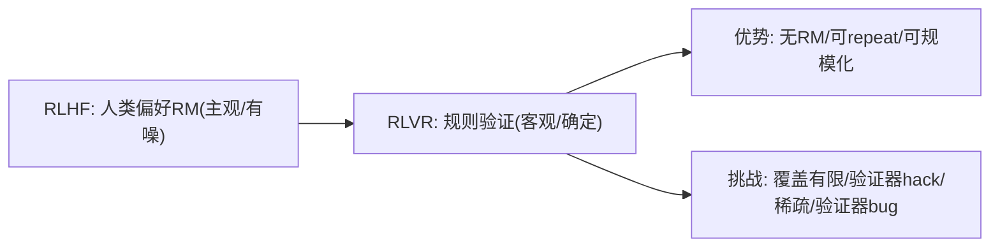

**面试要点**：核心=奖励来自**可验证规则（无 RM）**；优势=客观可规模化；挑战=覆盖、hack、稀疏、验证器噪声。

---

## Q2. GRPO 相对于 PPO 在优化目标或采样方式上做了哪些简化？它为什么不需要 value model？

**回答**

**GRPO（Group Relative Policy Optimization）简化**：

1. **去掉 value/critic 网络**：
   - PPO 需要 value model 估计 `V(s)` 算 advantage（GAE，Q34 第 12 章）；
   - GRPO **对同一 prompt 采样一组（G 个）rollout**，用**组内奖励的相对高低**作 advantage——不需要估计绝对价值函数。
2. **advantage 来自组内比较**：`Â_i = (r_i − mean(r)) / std(r)`（组内归一化，Q31 本章）——把"相对哪个好"量化；
3. **KL 用参考策略显式**：GRPO 常显式把 `KL(πθ‖πref)` 加进目标（或采样时用 ref），省掉 PPO 里 value 的复杂性。

**为什么不需要 value model**：
- advantage 的本质是"相对基线的好坏"——组内平均奖励就是**天然基线**（可比性更强、无偏），不需要学 V(s) 去近似；
- 对**可验证任务**，奖励是确定 0/1 或核实分数 → 组内比较直接；value model 成本相当于再训一个同规模模型（Q32）——**省掉它显著降显存/训练复杂度**。

```python
def grpo_advantage(rewards):
    mean, std = rewards.mean(), rewards.std()
    return (rewards - mean) / (std + 1e-8)   # 组内相对优势
# PPO: adv = GAE(r, V(s)); GRPO: adv = 组内归一(无V)
```

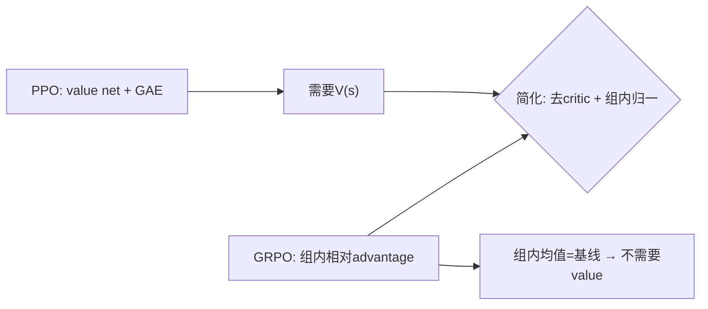

**面试要点**：GRPO 用**同 prompt 组内奖励相对化**当 advantage（组均值=基线），去掉 value/critic——可验证任务奖励确定，无需学 V。

---

## Q3. GRPO 的组内相对优势如何计算？组大小对优势估计的方差有什么影响？

**回答**

**计算**（Q31 完整）：对同一 prompt，采样 G 条 rollout，奖励 `r_1…r_G`：

$$\hat{A}_i = \frac{r_i - \text{mean}(\mathbf{r})}{\text{std}(\mathbf{r})}$$

- **细**：组内 z-score；正=比组平均好、负=比组平均差；
- 梯度方向：拉高正 advantage 的 token、压低负的。

**组大小对方差的影响**：
- **G 大**：`mean/std` 估计**更准**（稳定基线）→ advantage 方差小、训练稳；但对每个 prompt 采样开销大、训练慢；
- **G 小**：基线估计**噪**（样本少）→ advantage 方差大（同 reward 分布但均值 std 抖动大），训练不稳/波动大；
- **G=1**：退化为自对比（无基线信息）→ 无有效相对信号（除非用其他地方基线）；
- 经验：数学/代码 RL 常见 G=16–64；组小则降噪（如 G=4 时用更长 rollout 或平滑）。

```python
import numpy as np
def adv_noise(G, rng):
    r = rng.random(G)
    adv = (r - r.mean()) / (r.std() + 1e-8)
    return adv.std()   # 组内 adv 的波动
rng = np.random.default_rng(0)
for G in (2, 8, 32):
    print(f"G={G:3d}: adv std≈{adv_noise(G, rng):.2f}（G大→估计更稳）")
```

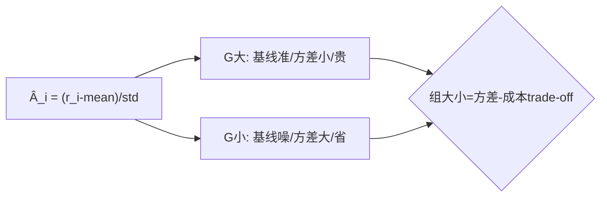

**面试要点**：组内 z-score；G 大→advantage 方差小但贵，G 小→噪/不便，常用 G=16+。

---

## Q4. 可验证奖励的验证器如果存在漏洞（只看答案格式），模型会如何利用？如何缓解 reward hacking？

**回答**

**如何利用漏洞**：
- 若验证器**只查格式/关键词**（如"包含 `boxed{...}`"或"答案以数字结尾"）→ 模型会**生产"貌似合格"的空壳**：瞎猜数字、写 `<answer>...</answer>` 但不真算、报"计算过程"但结论瞎编——**通过格式但内容错**；
- 学习信号就是"格式对就 +1"→ 模型退化为**格式生成器**而非求解器；
- 甚至**利用验证器解析 bug**（如果验证器对某类答案误判通过，模型会去"踩"）。

**缓解**：
1. **验证器严格化**：不只格式——**真实判定答案正确性**（答案解析后与真值比对，不是只查 `boxed`）；
2. **覆盖更多维度**：代码测试幂验证真实运行；数学用**求解校验**而非关键词；
3. **多样化验证器/隐藏测试**：验证用隐藏样本（模型不能摸到规则）；
4. **RLVR 与 KL/多样性约束**：防塌缩到特定调用模式；
5. **对抗测试**：用"试图 hack 的样本"补齐验证器漏洞。

```python
def weak_verifier(y):
    return "<boxed>" in y            # 只查格式 → 可hack
def strong_verifier(y, answer):
    return parse_answer(y) == sympy_simplify(answer)   # 真实解比对
```

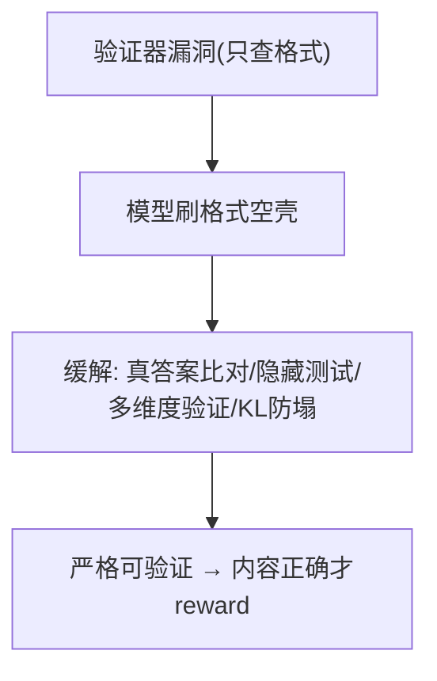

**面试要点**：弱验证器被"刷格式"；缓解=真答案校验+隐藏测试+防塌缩。

---

## Q5. Outcome Reward 与 Process Reward 分别适合什么任务？各自的标注成本与质量瓶颈在哪里？

**回答**

- **Outcome Reward（结果奖励）**：**只奖励最终答案对错**——适合**单点答案**任务（数学最后数值、选择题、代码最终测试通过）；
- **Process Reward（过程奖励）**：在**中间步骤**给奖励（每步对/错打分）——适合**多步推理**（长链数学、证明、agent 多步）——给训练更细的 credit，帮助长链。

**标注成本**：
- Outcome：便宜（最终答案规则验证/简单判对——自动化即可）；
- Process：贵（要为每个中间步骤标对错——人工标注每步、或需训练 process solver：成本高）。

**质量瓶颈**：
- Outcome：**奖励稀疏**（只有末端 0/1，中间是否合理无信号 → 探索慢、credit 难归因）；
- Process：**标注主观**（"这步对没对"边界模糊）、标注不一致、成本爆炸；**过程对但结果错**（步骤看起来合理实际通向错）→ 过程奖励可能误导。

```python
# Outcome: r = verify(answer)
# Process: r = Σ verifier(step_i)
outcome = 1.0 if final_answer_correct else 0.0
process = sum(step_ok(step) for step in steps) / len(steps)
```

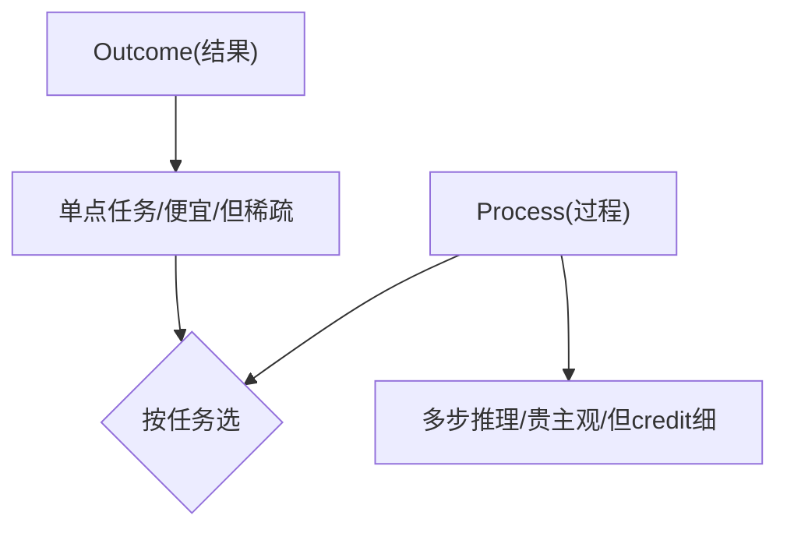

**面试要点**：Outcome=结果对错（便宜但稀疏）、Process=步骤奖励（细 credit 但贵/主观）——按任务是否多步选。

---

## Q6. RLVR 在数学推理上效果显著，但在开放域对话上为什么难以直接套用？

**回答**

**数学/代码效果好**：**奖励可自动判定**（答案比对/单元测试）——RLVR 直接可用。

**开放域对话难以套用的原因**：
1. **没有自动验证器**：对话的"好/坏"是**主观且多维**（有用、诚实、语气、相关性）——不能规则判定 → 无法用 RLVR 的直接形式；
2. **答案非唯一**：对话有无数"可接受"回答（不像数学一个正确答案）——不能比对；
3. **连贯性/多轮**：质量依赖上下文与多轮交互，验证器（单步）覆盖不了；
4. **用 RM 又会回到 RLHF 的主观奖励**——那就不是 RLVR 了。

**替代路线**：
- 混合：**通用偏好用 RLHF（RM）**、可验证子任务用 RLVR（数学/代码/事实）——**组合**；
- 或对话中用**部分可验证信号**（事实性/引用）当奖励之一。

```python
def can_rlvr(task):
    return task in ("math", "code", "fact_check")   # 可规则判定的才直接RLVR
# 开放对话: 无自动验证器 → 回 RLHF 或混合
```

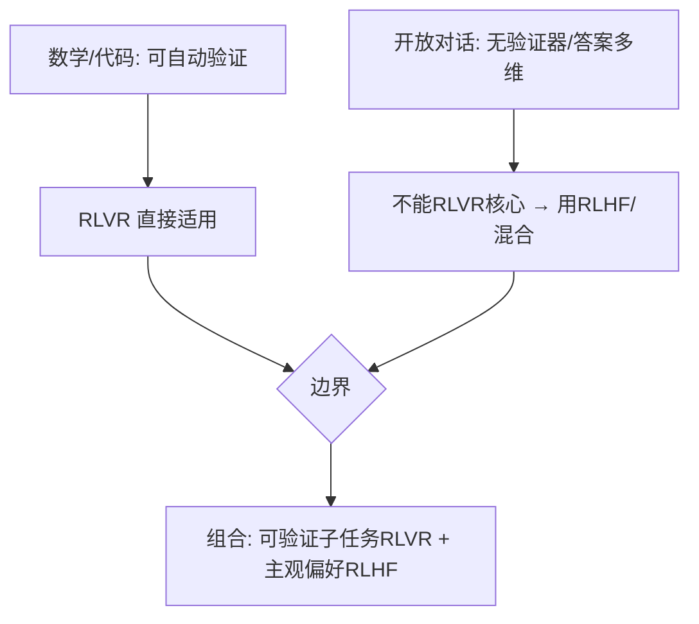

**面试要点**：RLVR 需要**自动可判定的奖励**；对话主观多维无验证器 → 不能套，用 RLHF 或混合。

---

## Q7. 验证器只能判断最终答案对错时，模型是否可能"猜对但过程错误"？如何检测？

**回答**

**可能**：Outcome-only 的验证（只看最终答案）下，模型可以**通过试错/瞎猜碰对答案**，但**过程（推理链）错误**——尤其在数学选择题/简单数值题上常见（碰运气）。

**对训练的影响**：过程错误但答案对的样本**得到正奖励** → 模型强化"错误过程"，长此以往**退化到"靠猜答案"**（Q4 的另一面）。

**如何检测**：
1. **过程评测（process audit）**：用**独立 process verifier / 人工审步**，看被奖励样本的步骤是否真合理；
2. **鲁棒性测试**：**改数字/改条件**再测——猜对的样本改参数就崩（记忆/碰对 vs 真会）；
3. **答案多样性分析**：同题多次采样，看是否存在"答案对但过程多样且错"的族；
4. **反向检查**：把"过程"掩盖只给答案的 baseline 对比——若答案全对但过程可被证伪 → 判定靠猜。

```python
def detect_lucky(answer_ok, process_ok, perturb=True):
    pert_ok = solve(vary(x))  # 改参数重测
    if answer_ok and not process_ok and not pert_ok:
        return "猜对但过程错(靠记忆/碰对)"
```

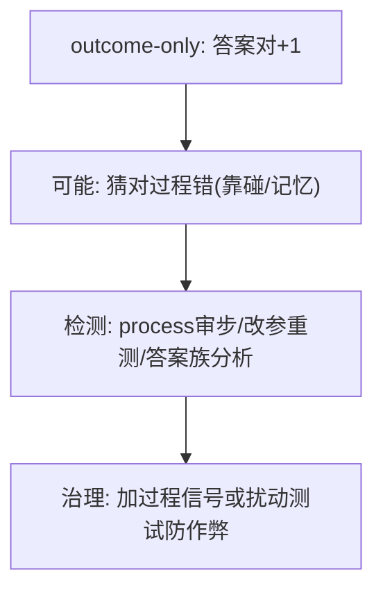

**面试要点**：outcome-only 下模型可能**猜对但过程错**；检测=扰参重测+过程审步；治理=加过程信号。

---

## Q8. GRPO 的组内归一化在奖励方差很小或很大时分别会怎样？需要什么修正？

**回答**

**奖励方差很小（组内几乎相等）**：
- `(r_i − mean)/std` 中 **std→0** → adv 变成 **除小数的巨大噪声**（有效信号被放大，哪怕都是 0/1 里碰巧的微小差异），或 **0/0**（全等时无信息）；
- 退化为"把无差异当成有差异惩罚"，训练噪声大。

**奖励方差很大**：
- 个别 outlier（如某一 rollout 异常高分/低分）→ **std 大 → 多数 adv 被压平**（signal 被 outlier 稀释）→ 更新过小，几乎不动。

**修正**：
1. **std 裁剪/防除零**：`std + ε`、`clip(adv, −C, C)`；
2. **零方差组跳过**：全相等组（std=0）**不计梯度**（Q31——信息量为 0）；
3. **分箱/稳健基线**：用**中位数/分位**替代均值归一（抗 outlier）；
4. **平滑**：reward 用 `clip`、去异常再归一。

```python
def grpo_adv_robust(rewards, eps=1e-6):
    std = rewards.std()
    if std < eps: return torch.zeros_like(rewards)   # 零方差→跳过
    adv = (rewards - rewards.mean()) / (std + eps)
    return torch.clamp(adv, -5, 5)                   # 剪outlier
```

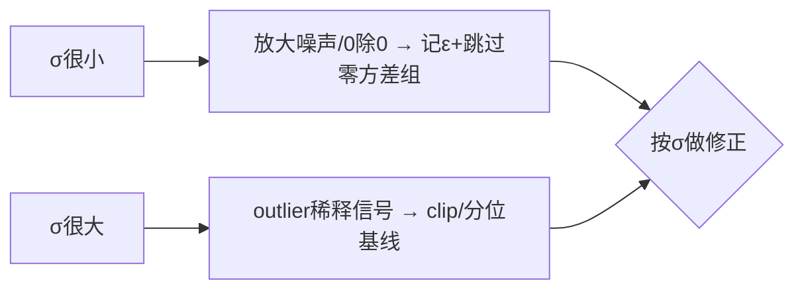

**面试要点**：σ 小→噪声/零方差；σ 大→outlier 稀释——修正是**ε+跳过零方差组 / clip/分位基线**。

---

## Q9. RLVR 训练中模型会不会退化到"只输出验证器喜欢的格式"？如何设计奖励来避免？

**回答**

**会**——若验证器偏爱特定格式/表面特征（Q4 弱验证器），RL 会**收敛到"格式正确但内容空洞"**（如只写 `<answer>数字</answer>` 不推理、或"看起来有过程"但结论瞎猜）。

**如何设计奖励避免**：
1. **奖励绑内容而非格式**：**答案必须真实正确**才对（解析验证器比对真实解），格式本身不加分；
2. **过程/推理分**（可选）：对**正确步骤**也加分（process reward），防止"只猜答案"；
3. **格式是惩罚而非加分**：违反格式否决（-1 或 0），但不能只凭格式加正分；
4. **多样化/熵正则 + KL 约束**：防塌缩到单一"合格式"样式；
5. **隐藏扰动测试**：训练/验证用**改参测试**防"踩格式漏洞"（Q7）。

```python
def reward(code_or_answer, format_ok, correct, use_proc=True):
    r = correct              # 核心: 内容正确
    if not format_ok: r = -1 # 格式是约束, 不额外加分
    if use_proc: r += step_score  # 可选过程分
    return r
```

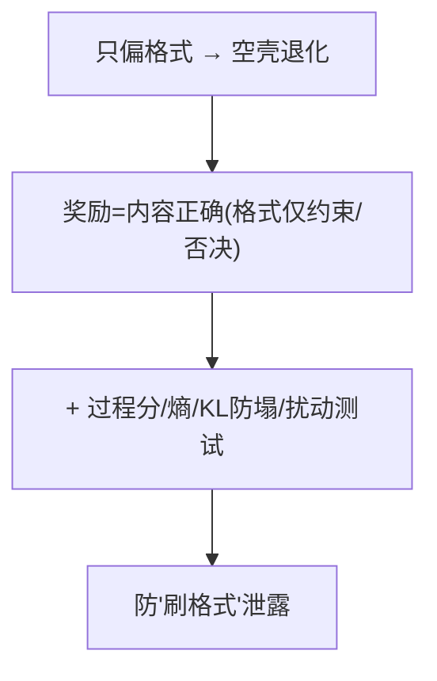

**面试要点**：会退化到刷格式；奖励设计=**内容正确才加分、格式只做约束、加过程分/熵/KL/扰动测试**。

---

## Q10. DeepSeek-R1 的训练方案中，冷启动 SFT 与 RLVR 的先后顺序如何安排？为什么需要冷启动？

**回答**

**顺序**：**先冷启动 SFT → 再 RLVR**（RL 为主，含拒绝采样/多阶段）：
- **R1 流程概述**：base → **冷启动 SFT（少量高质量 COT 数据）** → RLVR（数学/代码，组内相对） → 大规模 RL（含通用与可验证混合）。

**为什么需要冷启动（cold start SFT）**：
1. **RL 初期难以从零探索出好的推理格式**：base 模型没看到"带思维链/分步"的结构——直接 RL 稀疏奖励下探索极难、耗时且不稳；
2. **冷启动 SFT 提供"初始策略"**：一个**贴近 RL 目标的中学高**——让 RL 从"会推理的起点"继续优化，**避免稀疏奖励下"冷探索"**；
3. **格式对齐**：SFT 教会模型用**可解析的推理格式**（思考 + 答案分离），RL 才能把格式当载体；
4. 收敛快、稳定（Q35 详细：无冷启动的困难）。

```python
def r1_pipeline():
    return ["base", "cold_start_sft(少量高质COT)", "rlvr(math/code)", "large_rl(混合)"]
```

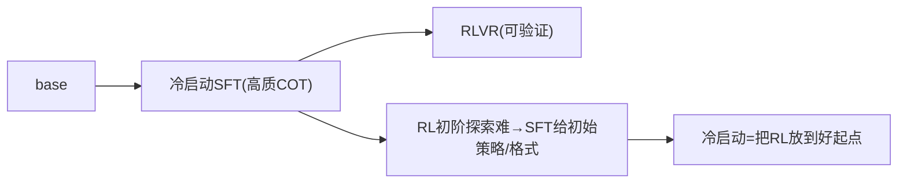

**面试要点**：先冷启动 SFT 再 RLVR；冷启动给予**初始推理策略 + 格式**，让稀疏 RL 不必从零探索。

---

## Q11. Rule-based verifier 的覆盖范围有限。无法规则验证的任务，RLVR 的替代路线是什么？

**回答**

**Rule-based verifier 覆盖有限**——只能判数学/代码/事实等"可规则确定"的任务；无法规则验证（开放对话、写作、创意）时：

**替代路线**：
1. **LLM-as-a-validator / RM-verifier**：用一个**强模型或训练好的验证器模型**当奖励（把"主观判定"变成模型评分）——本质回到 **RLHF 的 RM**，但可以对**具体维度**（事实性/引用/风格）打分（可与 RLVR 结合，用可验证维度引导）；
2. **混合验证**：**部分可验证 + 部分 RM**：可判定的部分（数学/代码/事实）用 rule verifier，不可判定的用偏好 RM——组合奖励；
3. **数据蒸馏/模仿**：把无法验证的任务转成**监督或偏好数据**（SFT/DPO）而非在线 RL（没了可验证奖励就没法 RLVR）；
4. **迭代反馈**：人工/模型回合反馈（RLHF 路线）。

```python
def reward_for_task(task):
    if rule_verifiable(task): return rule_verifier(task)
    return llm_judge_verifier(task)   # 或 RM（RLHF 路线）/ 蒸馏
```

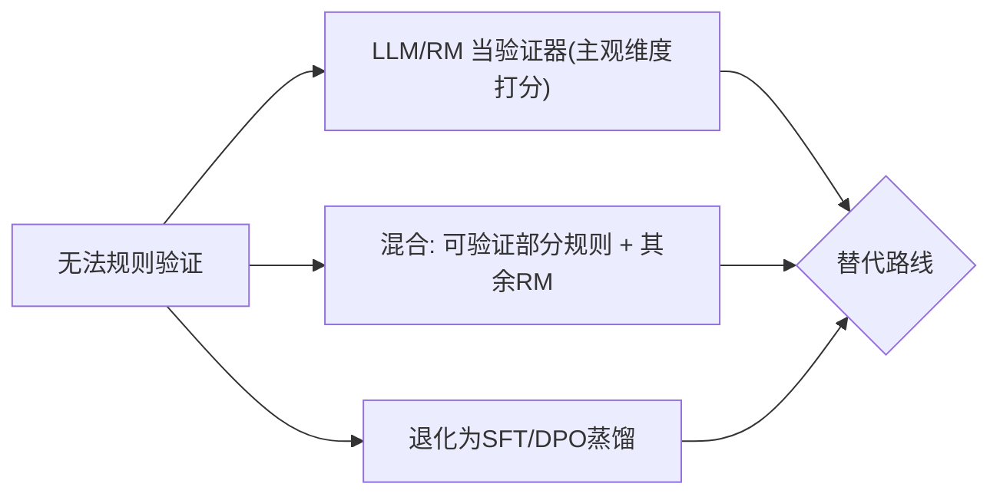

**面试要点**：覆盖有限时用 **LLM/RM 验证器、混合奖励、或转监督/蒸馏**——不能硬套 rule verifier。

---

## Q12. PPO 中的 value model 在 RLVR 中能否被完全省略？省略后 credit assignment 的精度损失有多大？

**回答**

**能省略（GRPO 就省了，Q2/Q32）**——在**可验证任务**上，GRPO 用组内相对 advantage 替代 value：

**省略后的信用损失**：
1. **组内归一 = "整条回复一个基线"**：对**单 token 级别的 credit** 是**粗粒度的**——advantage 是整条序列广播到每个 token（Q32）；
2. **无法区分"哪一步重要"**：value/GAE 能做**逐步 credit**（逐 token 的期望价值差异），组内归一做不到 → **长链推理中"中间步骤的好坏"无法被精准 credit**；
3. **precision loss 量级**：对**短答案**（数学 1–2 步）损失小；对**长推理链**，组内广播把"某一步关键贡献"摊平——**精度损失随序列变长而增大**；
4. 但**可验证场景**下 reward 确定（0/1）+ 组内比较已提供足够信号 → 实践中损失可接受（GRPO/R1 性能已验证）。

```python
# value/GAE: 每token credit; GRPO: 整条广播同一adv
value_credit   = "逐token(能定位关键步)"
grpo_credit    = "整条广播(粗)"   # 短答损失小/长链放大
```

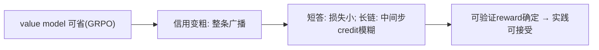

**面试要点**：GRPO 可省 value；代价=**credit 粗（整条广播）**——短答损失小、长链中间步 credit 模糊；但可验证 reward 确定使损失可接受。

---

## Q13. RLVR 的样本效率如何？相比 SFT，达到相同数学准确率需要多少倍 rollout？

**回答**

**样本效率特点**：
- RLVR **需要大量 rollout**（每个 prompt 采样多组做组内比较、不断探索）——样本消耗**远高于 SFT**；
- SFT 每条样本**只用一次**；RLVR 需要 **on-policy 多次采样 + 多轮迭代** → **若干倍（10×–100× 量级）的生成 token**。

**大致倍数**：
- 经验上：RLVR 达到与 SFT 相近的数学准确率，所需的**生成 token 约为 SFT 数据的 10–100×**（因采样组数 G、训练步数、探索）；
- 但**上限更高**：RLVR 能利用**比 SFT 数据更好的解**（探索 & 自我奖励）——**同样数据下命中率更高、能超越 SFT 的"标注上限"**。

```python
# SFT: 1 次利用/样本; RLVR: 每题G组×多epoch × 迭代
rl_token_cost = G * steps * epochs      # ~10-100× SFT tokens
print(f"SFT 每样本 1 次; RLVR ~{rl_token_cost}次（大数倍）")
```

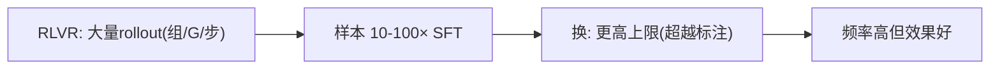

**面试要点**：RLVR 样本消耗约为 SFT 的 **10–100×**（rollout/组/步），但上限更高（可探索超越标注）；换取更强能力。

---

## Q14. 如何设计一个多答案验证器（数学题有多种正确形式）？验证器的召回率与精度如何权衡？

**回答**

**多答案验证器设计**：
1. **解析 + 符号规整**：抽取答案做**规范化/化简**（分数/小数统一、sympy 化简、数字换算）——让不同形式可比（第 11 章 Q13 的鲁棒抽取）；
2. **等价性判定**：用**符号等价**（`sympy.equals`）而非文本——`1/2` vs `0.5`、`√4` vs `2` 都判对；
3. **多真值池**：允许多个公式真值（解集/多解）；
4. **可容差数值**：浮点/近似解用相对/绝对误差。

**召回率与精度的权衡**：
- **严格（精度高召回低）**：只认"唯一规范形"——正确但形式不同的答案被判错（**recall 低**，好答案被漏 → RL 对正确解少奖励）；
- **宽松（召回高精度低）**：把错误答案也误判对（**precision 低** → reward hacking，Q4）；
- **平衡**：
  - 设**规范化**步骤逼近"所有正确形式→同形"（升召回不降精度）；
  - 对不确定的做**双重判定**（规则+符号）或**存疑时偏向判错**（宁可稀疏不喂错误 reward），再用**阈值可调**（Q33）。

```python
import sympy as sp
def multi_answer_verify(extracted, truths):
    for t in truths:
        try:
            if sp.sympify(extracted, evaluate=False).equals(sp.sympify(t)):
                return True
        except Exception:
            if norm(extracted) == norm(t): return True
    return False    # 不确定→判错(保守, 保精度)
```

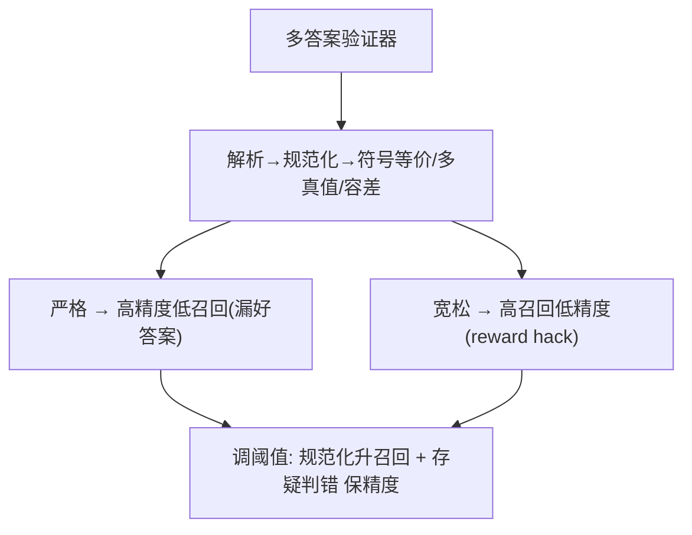

**面试要点**：验证器做**规范化+符号等价+多真值+容差**；权衡=严格伤召回、宽松伤精度——**规范化升召回、存疑判错保精度**。

---

## Q15. RLVR 训练中 KL 约束是否仍然必要？不加 KL 时模型会怎样漂移？

**回答**

**必要**（与 RLHF 同理，RLVR 也不能裸优化）：

**不加 KL 的漂移**：
1. **塌缩到奖励捷径**：模型只输出"验证器喜欢的模式"（只有对的固定套路、无多样性）——**过优化验证器**（Q4/Q9），不是真的学会更多；
2. **分布发散**：策略偏离预训练/SFT 分布远 → **语言能力退化**（说怪话、格式怪异）；
3. **多样性丧失**：同题采样趋同（生成"纯标准答案"无多样性）；
4. **过拟合单题语言**：对训练 prompt 的过拟合（不泛化）。

**KL 作用**：`目标 = E[r] − β·KL(πθ‖πref)` **锚定参考策略**——在"奖励优化"与"保持语言/分布"间平衡；RLVR 也要保留（R1 用 GRPO 的 KL 项或显式 KL 约束）。

```python
def grpo_loss(policy, ref_logp, rewards, beta=0.01):
    adv = grpo_advantage(rewards)
    ratio = policy.logp - ref_logp               # KL 项
    return -(policy.logp * adv) + beta*ratio.abs().mean()   # 加KL约束
```

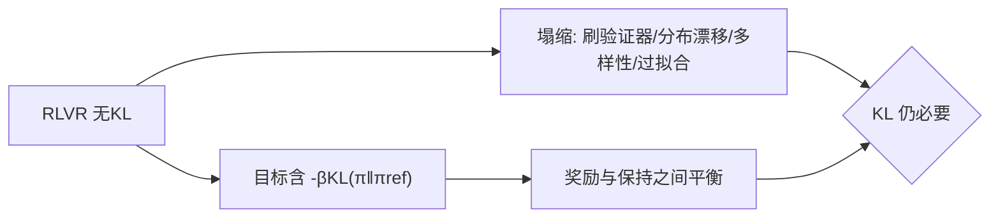

**面试要点**：KL 必要——防止**刷验证器塌缩、分布漂移、多样性/泛化损失**；RLVR 目标也含 `−βKL(π‖πref)`。

---

## Q16. GRPO 的组内基线与 PPO 的 GAE 有何本质不同？哪种方差更低？

**回答**

- **PPO（GAE）**：用 **value model 估计的 V(s)** 算 advantage——逐步、连续、低方差但有 **value bias**（近似误差）；
- **GRPO**：用 **同 prompt 组内奖励的均值**当基线——**无 value model 近似误差**，但基线是**采样组内的有限样本** → 估计的方差受 **G 与采样波动**影响。

**哪种方差更低**：
- **PPO（GAE）**：value 学得好时**方差更低**（连续性平滑、利用全局分布），但**有偏**（value 不准）；不经训练 value 时高方差。
- **GRPO**：组内归一**无偏优点**（对组内相对性），但**组内有限样本 → advantage 的采样方差**不小（尤其 G 小时）；可验证 reward 确定时，组内比较噪声来自"采样哪几个 rollout"。
- **结论**：**不能笼统说谁更低**——PPO 的 value 质量高时方差更低（但有偏）；GRPO 无 value-bias 但优势估计受组样本量/奖励分布影响。实践上可验证任务中 GRPO 更稳（reward 噪声小 + 对比明确）。

```python
# 本质: PPO 用学到的V(连续无偏? 有value-bias); GRPO 用组内均值(无value-bias, 采样方差)
print("PPO: value近似(有偏, 方差取决于value质量)")
print("GRPO: 组内均值(无value-bias, 采样方差受G限制)")
```

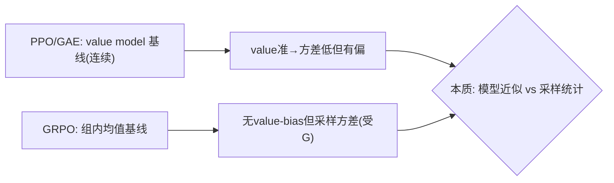

**面试要点**：本质=**value 近似 vs 组采样统计**；PPO 的 GAE 方差低点但有价值偏差，GRPO 无 value bias 但基线是有限组采样——详见"哪方更低"取决于 value 质量与 G。

---

## Q17. 验证器本身是一个小模型而不是规则系统时，RLVR 的性质会发生什么变化？它还"可验证"吗？

**回答**

**性质变化**：
- 验证器从**规则系统**换成**小模型**（例如一个小模型判对错/打分）：
  - **奖励不再完全确定/无偏**——小模型可能**学坏、误判、被 hack**（它自己是 DNN，有固有错误率）；
  - **可验证性退化**：从"客观真值判定"变成"**另一个模型的主观估计**"——本质上越来越接近 **RM（RLHF）**，只是"验证代理"；
- 它**还不是完全"可验证"**：因为判定的可靠性依赖小模型（有噪声），不是 rule-based 的确定性。

**结论**：小模型作验证器 → RLVR 的"**Verifiable**"性质弱化为"**模型判定**"——鲁棒性、可 hack 性同 RM；仍可用（尤其事实/引用需 semantic 判定时），但**要校准、防 hack、可与规则部分混合**。

```python
verifier_kinds = {"rule": "确定/无偏", "small_model": "噪声/可hack → 弱化'可验证'"}
```

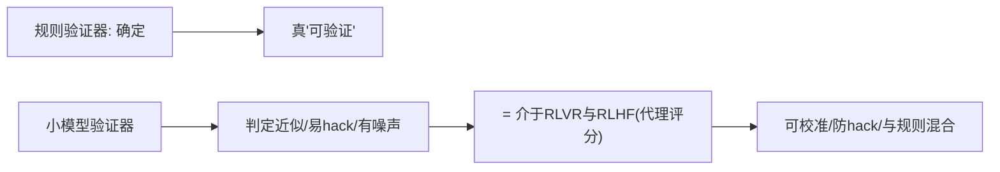

**面试要点**：小模型验证器让"**可验证**"退化（判定带噪声/可 hack、向 RLHF 靠拢）；需校准并防 hack。

---

## Q18. 代码任务的 RLVR 中，单元测试作为验证器的局限是什么？测试覆盖率如何影响奖励信号？

**回答**

**单元测试作验证器的局限**：
1. **覆盖率低**：测试**只覆盖部分输入**——代码可能在测试上通过但真实场景错（**过拟合测试**，Q34 本章）；
2. **测试本身质量**：测试可能错/弱（缺失边界/异常）；
3. **hack 空间**：能"**只过测试**"（硬编码特例、写死输出）——reward 与真实能力脱钩；
4. **隐藏测试无法全配合**：部署时未知用例 → 单元测试通过不代表泛化。

**覆盖率对奖励信号的影响**：
- **覆盖率低** → 奖励只反映"在测子集上对"——**稀疏且偏差**（训练激励"只修测试可见部分"）；
- **覆盖高** → 奖励更接近真实正确率 → 信号更频（也更好学）；
- 覆盖率低还**加剧 reward hacking**（测试可见空间小 → 更易过拟合/特化）；
- 缓解：**隐藏测试**（训练时不可见）、**property-based testing**（随机性质 eg 交换律/幂等性——比固定用例覆盖更全）、多测试增强。

```python
# 覆盖率低 → 奖励偏见于测试子集
def test_reward(code, tests, hidden=False):
    visible = run_all(code, tests)
    # 隐藏测试才能更好评估真实正确率
    return visible, hidden_score if hidden else None
```

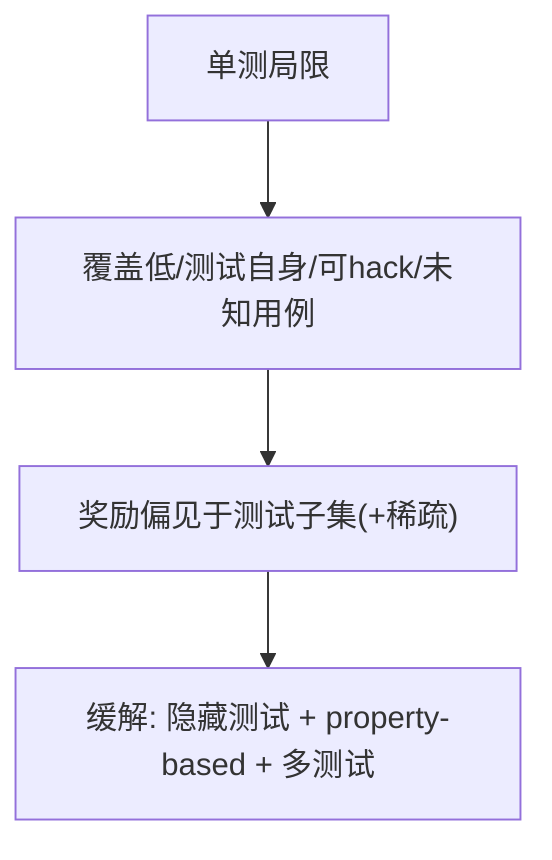

**面试要点**：单测局限=覆盖低、可 hack、未知用例；覆盖低→奖励偏于测试子集且稀疏——用隐藏测试+性质测试缓解。

---

## Q19. RLVR 能否提升通用推理能力，还是只提升特定任务的模式匹配？设计实验区分两者。

**回答**

**有争议**：RLVR 在**数学/代码**上强——这可能是**通用推理转移**（学到"逐步思考/验证"的能力），也可能只是**该任务的模式匹配**（刷这类题）。

**区分实验设计**：
1. **跨任务转移测试**：**在任务 A（数学）上 RLVR 训练**，测**未见任务 B**（逻辑谜题、算法、自然科学题）——**转移好=通用推理**，B 无提升=只是 A 的模式；
2. **分布外（OOD）**：训练数学题用某题型，测试**新题型/改结构与难度**——泛化=能力，否则模式；
3. **干扰项**：同题但**换背景/措辞**（不换数学结构）——能力应维持，纯模式会崩；
4. **能力分解对照**：训练前后对**逻辑、反证、估算**等"推理原语"benchmark 的变化。

```python
def transfer_test(train_a, eval_b):
    a_gain = eval_a_after - eval_a_before
    b_gain = eval_b_after - eval_b_before
    return {"a_gain": a_gain, "b_gain": b_gain,
            "conclusion": "通用转移" if b_gain > threshold else "任务模式匹配"}
```

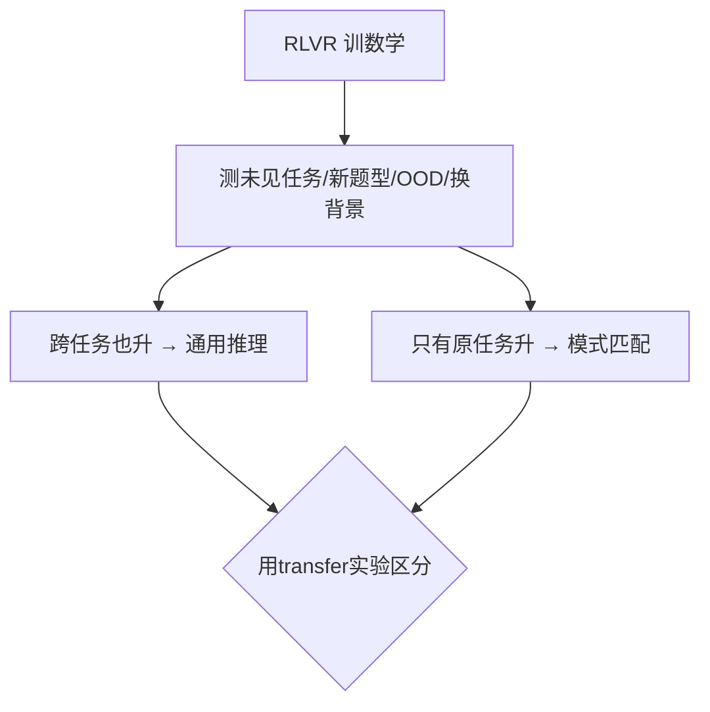

**面试要点**：RLVR 可能通用或仅模式；用**跨任务转移/OOD/换背景**区分。

---

## Q20. 训练中大部分 rollout 都失败（奖励全 0）时，GRPO 的梯度会怎样？如何缓解稀疏奖励？

**回答**

**奖励全 0 时**：
- 组内归一：`Â_i = (0 − 0)/σ`——**all 0 → std=0 → adv=0/NaN**（Q8）→ 梯度为零或 NaN——**训练停摆**（无有效信号）；
- 若部分 0 部分 1：只有 1 的组有正 adv，0 的负 adv——信号稀。

**缓解稀疏奖励**：
1. **零方差组跳过/启发式**（adv 全 0 不计）；
2. **过程奖励/中间信号**：给**部分步骤分**（比全 0 有梯度）；
3. **熵/探索正则**：保持探索（温度、熵 bonus）避免"永远失败";
4. **课程/难度渐进**：先易题（有正样本）再难；
5. **种子/初始化**：用 SFT/冷启动让初始有部分成功（避免全 0 分布）；
6. **reward shaping**：部分正确的奖励（fuzzy 验证）;
7. **增加 G/多样性**：采样更多 rollout 提高"至少一个成功"概率。

```python
def grpo_handling(rewards):
    if rewards.std() < 1e-8: return None      # 零方差 → 跳过
    return (rewards - rewards.mean()) / (rewards.std() + 1e-8)
```

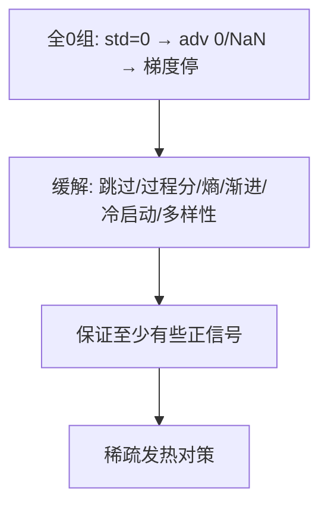

**面试要点**：全 0 → adv 恒 0/NaN（停摆）；缓解=**跳过零方差组 + 过程奖励 + 熵 + 难度渐进 + 冷启动保正样本**。

---

## Q21. RLVR 与拒绝采样微调（RFT）之间是什么关系？RFT 可以看作 RLVR 的什么特例？

**回答**

**关系**：
- **RLVR（强化）**：**在线**——用策略自身 rollout，reward 指导梯度，**策略随优化演化**（探索新解）；
- **RFT（Rejection Sampling Fine-Tuning，拒绝采样微调）**：**离线**——从策略采样 N 个候选，**用验证器筛出高分的（拒绝差的）**，再用这些样本 **SFT**——不涉及在线 RL。

**RFT 是 RLVR 的特例（一种简化视角）**：
- RFT = 用验证器当**离线筛选器** + **监督式微调**——等价于"RLVR 的**单轮、off-policy、用筛选样本做 MLE**"：
  - 没有梯度从 reward 来（只筛选）；
  - 没有策略演化（不 on-policy）；
  - 可看作 RLVR 的 **imitation/shaped** 版本（reward 只用于过滤，不用梯度优化）；
- 所以："**RFT ≈ RLVR 去掉 policy gradient，只保留验证器做拒绝+监督**"。

```python
def RFT(policy, verifier, n=16):
    cands = [policy.sample(x) for _ in range(n)]
    good = [c for c in cands if verifier(c)]   # 筛高分(拒绝差)
    sft(policy, good)                          # 监督微调
# RLVR: 用reward算advantage更新策略（online）
```

```mermaid
flowchart LR
    A["RLVR: online reward 梯度"] --> B["策略随优化演化"]
    C["RFT: 采样→验证器筛选→SFT"] --> D["offline 监督, reward只做筛选"]
    D --> E["RFT ≈ RLVR 去掉policy-gradient(离线筛选版)"]
```

**面试要点**：RFT 是**验证器筛选 + SFT 的离线版**；可看作 RLVR 的**特例（去掉在线梯度，只用验证器过滤+监督）**。

---

## Q22. 验证器的"严格程度"如何影响训练？太严格导致奖励稀疏，太宽松导致 reward hacking，如何找平衡？

**回答**

**严格程度的影响**：
- **太严格**：很多**正确但形式略异**的答案被判错 → **奖励稀疏**（Q20）→ 探索难、训练慢（正确解被误删）；
- **太宽松**：一些**错误答案被放行** → **reward hacking**（模型学会"被放行的错误模式"）→ 越训越错（Q4）。

**找平衡**：
1. **规范化 + 多真值**：把"形式不同"消掉（升召回不降精度，Q14）；
2. **可调阈值**：设置**置信度/容忍度参数**，可在线按 reward 分布调到"稀疏可接受且不 hack"区间（Q33）；
3. **双验证**：规则 + 符号 / 双模型互判，**判据冲突时偏向判错或按多数**；
4. **动态**：训练早期宽松（多正样本学起来）、后期严格（精修）——难度渐进；
5. **人工抽检**：抽样确认验证器误判率。

```python
def find_threshold(verify, calib):
    # 在 召回-精度 曲线上选: 召回不塌 && 精度>0.95
    return argmax(simulate(verify, calib))
```

```mermaid
flowchart TB
    A["太严格 → 稀疏"] --> B["平衡: 规范化+多真值/可调阈值/双验证/渐进/人工"]
    C["太宽松 → hack"] --> B
    B --> D["调阈值到'稀疏可接受且不hack'区间"]
```

**面试要点**：严格→稀疏、宽松→hack;平衡=**规范化升召回 + 可调阈值 + 双验证 + 难度渐进 + 人工抽检**。

---

## Q23. RLVR 在多语言数学题上的表现如何？验证器需要为每种语言单独设计吗？

**回答**

**表现**：
- RLVR 的**推理信号（数学正确性）跨语言**——如果模型已会用该语言读题，RLVR 训练可**迁移**（同一道题的 0/1 奖励不依赖语言）；
- 但**低资源语言**：模型语言能力弱 → 读题/输出差 → RLVR 收益低；且**验证器对多语言的解析**需要做法式正确。

**验证器是否要按语言单独设计**：
- **不需要完全重建**（数学判定内核语言无关——答案是对的数字/公式）；
- 但需要：
  1. **解析层适配语言**：答案抽取需要处理各语言的**格式习惯**（"答案："的措辞、数字写法）；
  2. **提示/输出约定**：让模型输出**统一解析的答案格式**（如 `<answer>数字</answer>`）——语言无关；
  3. **测试题翻译一致性**: 用翻译题要保证语义等价（不能因翻译改变题意）。
- 结论：**核心验证器语言无关，解析层做 per-language 适配 + 统一输出格式**。

```python
def parse_answer(text, lang):
    # 解析层适配语言（"答案"/"answer"等措辞），最终归一数字
    normalized = num_normalize(extract(text, lang))
    return normalized
# 数学判定本体语言无关
```

```mermaid
flowchart LR
    A["RLVR 数学信号语言无关"] --> B["低资源: 语言弱→收益低"]
    C["验证器"] --> D["核心判定语言无关; 解析层按语言适配 + 统一输出格式"]
    B --> E{"多语言RLVR要点"}
    D --> E
```

**面试要点**：推理信号跨语言（可迁移）；验证器**核心语言无关，解析层按语言适配 + 统一输出格式**。

---

## Q24. 从信息论角度看，可验证奖励比人类偏好奖励"信息密度"更高还是更低？为什么？

**回答**

**信息密度更高（对同一样本）**——在"可验证的信号强度"上：

**原因**：
1. **确定性**：可验证奖励是 **0/1（或确定分数），无主观噪声**——每个样本传递的"对/错"信息是完整的（熵小、信噪比高）；
2. **人类偏好有主观噪声/标错**：same sample 的偏好标签有随机性 → 每标签信息少；
3. **可验证时"为什么对"明确**（答案对错客观）——状态可判。

**但要小心**：
- 可验证奖励信息度高的**前提是任务可判定**；开放任务不可验证 → 该维度信息为 0；
- 人类偏好涵盖了**更丰富的维度**（有用/有风格/安全）——它"信息密度低"是因为难客观标，但**维度多**；
- 结论：**同一可验证样本的信息密度（信噪比）更高**；但覆盖面偏窄（只能验证可规则判的维度）。

```python
# 信息论: 偏好=有噪信道; 可验证=无噪信道(0/1确定)
def info_content(label, known):
    return 1.0 if known else 0.3   # 可验证 → 每个标签信息完整
```

```mermaid
flowchart LR
    A["可验证奖励: 0/1确定无噪"] --> B["信噪比高/单样本信息完整"]
    C["人类偏好: 带主观噪声"] --> D["每标签信息少(但维度广)"]
    B --> E{"信息密度: 可验证>偏好(同可判样本)"}
    D --> E
```

**面试要点**：可验证奖励信噪比更高（确定性、无标噪）——单样本信息密度更高；但覆盖面窄（只限可判定的维度）。

---

## Q25. RLVR 训练后模型在验证集上提升但在人类评估中下降，可能的原因是什么？

**回答**

可能原因：

1. **过拟合验证器/验证集**：模型学会**只过验证规则**（Q4）——验证集同类题分数涨，但对人类真实场景（更开放）不适用；
2. **能力/对齐税**：优化验证奖励**牺牲其他能力**（风格、多样性、开放对话、通用知识）→ 人类评估（多维）下降（Q8 第 12 章）；
3. **只学"可验证子集"模式**：RLVR 把训练集中**可验证的题目刷到位** → 验证集同类题涨，但**未见的真实题目**降（模式而非能力，Q19）；
4. **分布偏斜**：RLVR 数据集中在数学/代码 → 非目标域退化；
5. **人类评估信号不同**：人类看整体体验（有用/安全/风格），验证看正确率——二者目标不一致。

**检测/缓解**：
- 验证集与人类评估**分开并同时追踪**；
- 混合通用数据防偏斜、KL 约束、不过优化验证集、加人工抽检。

```python
def cause_analysis(valid_up, human_down):
    return ("验证器过拟合/能力税/只学可验证子集/数据偏斜/目标不一致")
```

```mermaid
flowchart TB
    A["验证涨 人类降"] --> B["过拟合验证器"]
    A --> C["能力税(牺牲其它)"]
    A --> D["只学可验证子集(模式非能力)"]
    B --> E{"同时追踪+混合数据+KL+人工"}
    C --> E
    D --> E
```

**面试要点**：验证涨人类降=验证器过拟合/能力税/模式非能力/偏斜；同时追踪+混数据+KL+人工。

---

## Q26. GRPO 的组大小在训练不同阶段是否需要调整？早期与后期分别适合多大的组？

**回答**

**需要按阶段调整**（训练动态变化）：

- **早期（探索期）**：
  - **用较大的 G**（更多 rollout）：提高**探索/组内对比的统计质量**，让优势估计更稳（避免一开始就踩噪声基线的坑）；
  - 组大 → 每个 prompt 采更多样（学到从失败中找正确解）；
- **后期（精修期）**：
  - **可减小 G**（或保持适中）：策略已较好、reward 分布明确，**组内差异大（0/1 分明）** → 小 G 即可稳定；减少采样成本；
  - 后期主要**精修歧义/边界样本**即可。

**一般指导**：大组 = 探讨与方差控制；小组 = 成本与精修；实践中**早期 G=32–64、后期 G=8–16**（或用"难样本加大组"策略）。

```python
def group_size(stage):
    return {"early": 32, "late": 8, "hard_sample": 64}.get(stage, 16)
```

```mermaid
flowchart TB
    A["早期: 大G(探索/方差稳)"] --> B["后期: 小G(精修/省成本)"]
    B --> C["难样本/边界再加大G"]
    C --> D["按阶段与难度调组大小"]
```

**面试要点**：早期大 G（探索稳）、后期小 G（精修省）；难样本加大。动态调组。

---

## Q27. RLVR 训练中是否应混合一部分通用 SFT 数据来防止能力遗忘？混合比例如何确定？

**回答**

**应混合**——RLVR 专注可验证任务，**长期只在数学/代码上优化会让其他能力退化**（对话、通用知识、风格——Alignment Tax，Q15 第 12 章 / Q25 本章）。

**确定混合比例**：
- **经验规则**：RLVR 数据为主 + **少量（5–20%）通用 SFT/偏好数据**保底——目标是"**RL 的方向 + 通用能力不退**"；
- **动态/按回归**：**监控通用 benchmark**——若通用能力下降，**提高通用样本比例**（或 KL 增强）；若 RL 目标不回，降比例；
- 也可**分阶段**：早期纯 RLVR、后期混通用样本（保稳定）；
- 比例是**经验数据**（模型规模/数据量影响），常通过**小规模扫描**定。

```python
def mix_ratio(rl_drop, threshold=0.02):
    return 0.1 + rl_drop*2   # 通用能力下降越多 → 提高通用占比
```

```mermaid
flowchart TB
    A["纯RLVR → 能力遗忘"] --> B["混合 5-20% 通用SFT数据"]
    B --> C["按通用benchmark回归动态调比例"]
    C --> D["RL方向+通用不退"]
```

**面试要点**：要混通用数据（防遗忘）；比例 5–20% + 按通用 benchmark **动态调整**。

---

## Q28. 如何评估一个 RLVR 系统的样本效率？rollout 成本、训练步数、最终准确率三者如何综合衡量？

**回答**

**综合衡量（三点同时看）**：
1. **rollout 成本**：每步产生的 token 数（采样组 × 生成长度）——决定算力；
2. **训练步数/迭代数**：到收敛/目标精度所需步数；
3. **最终准确率/收益**：验证集最终效果。

**指标**：定义**效率** = 最终收益 ÷ 总消耗（rollout token × 步数）：

- `效率 = Δaccuracy / (rollout_tokens × steps)`：看"**每单位采样成本换来多少准确率提升**"；
- **归一化对比**：不同 G/步数的系统用**总生成 token** 做横轴、准确率为纵轴画曲线——**曲线下面积（AUC）或到目标精度的 token 数**更公平（类似 AI 的 Pareto）。

```python
def rlvr_efficiency(gain, rollout_tokens, steps):
    return gain / (rollout_tokens * steps)   # 每token的准确率提升
```

```mermaid
flowchart LR
    A["rollout成本(token)"] --> B["总消耗"]
    C["训练步数"] --> B
    D["最终准确率"] --> E["收益"]
    B --> F["效率 = 收益 / (token×步数) → Pareto"]
    E --> F
```

**面试要点**：综合 = **收益 ÷ (rollout token × 步数)**，或按"总 token vs 精度"画 Pareto——不能只看准确率。

---

## Q29. 可验证奖励的边界在哪里？哪些任务原则上不可能有可靠的自动验证器？

**回答**

**边界**：可验证奖励必须要**客观、可自动判定**——凡是"唯一解 / 可程序判定"的任务（数学答案、代码执行、形式逻辑、事实比对）可验证。

**原则上不可能有可靠自动验证器的任务**：
1. **开放主观质量**：文笔、创意、审美、幽默——"好/坏"本质主观，无客观真值；
2. **长文档/语义忠实**：摘要是否忠实？答案是否相关？——需语义理解（不是规则可判）；
3. **对话/agent 复杂交互**：多轮策略的好坏依赖上下文与环境，无法规则判定；
4. **真理论断的开放性**（哲学/伦理）：多个立场都"合理"，无唯一验证；
5. 需要**人类价值观**的（偏见、安全意图）——虽可部分代理，但"可靠"不可能（只能近似）。

**经验**：可验证 ≈ **有"ground truth"且能自动算**；开放/主观/语义 → 只能靠模型/人类代理（退向 RLHF/RM）。

```python
VERIFIABLE = {"math", "code", "fact-check", "logic", "formal"}
NOT_VERIFIABLE = {"style", "creativity", "dialogue", "ethics", "long-doc semantics"}
```

```mermaid
flowchart TB
    A["可验证边界: 有ground truth + 可自动判"] --> B["数学/代码/事实/形式(可)"]
    C["不可验证: 主观/语义/开放/价值观"] --> D["文笔/创意/对话/伦理(不可靠)"]
    A --> E{"边界清晰但开放域不可"}
    C --> E
```

**面试要点**：可验证=有真值且可自动判（数学/代码/事实）；**开放主观/语义/价值观任务无可靠自动验证器**。

---

## Q30. 从"RLVR → 通用 RL"的路径看，当前方法缺失的关键组件是什么？你如何看待 process reward 与 outcome reward 的融合方向？

**回答**

**缺失的关键组件**（从可验证到通用 RL）：
1. **通用、可靠的奖励信号**：RLVR 只有可验证子任务；通用任务需要**自动可靠评价值观/语义**——目前缺失（只能 RM/LLM 代理且不"可验证"）；
2. **可信的价值/advantage 评估（在无 reward 时）**：复杂/探索型任务的 credit assignment（value-based）；
3. **环境/交互反馈**：agent 场景需要**真实环境奖励**（尚未普及到通用 RL）；
4. **可扩展的探索策略**：大规模开放任务的探索（创新、多样）不足。

**Process vs Outcome 融合方向**（你的看法）：
- **趋势是融合**：outcome reward 易得但稀疏；process reward 细但贵/易错——**用 outcome 校准 process**：
  - outcome 给出最终对错 → 反向推断哪些中间步骤 elogible（credit 细化）；
- 对**长链/agent**：**outcome-only 太稀疏 → 加 process**（如每步 log 合理性）**；process 有噪 → 用 outcome 兜底**；
- 最终形态：**可验证 outcome 直角 + 模型/过程代理融合 + 人类偏好兜底**——不同尺度上互补。

```python
# 融合: outcome 真值 + 平滑过程信号
r = λ_outcome * outcome(x, y) + λ_proc * process_score(steps)
# outcome 校准 process（outcome 对时信 process, 错时不信）
```

```mermaid
flowchart TB
    A["RLVR→通用RL 缺: 通用可靠奖励/价值/环境反馈/探索"] --> B{"Process vs Outcome"}
    B --> C["融合: outcome校准process / 长链加过程 / 人类兜底"]
    C --> D["互补迈向通用RL"]
```

**面试要点**：缺**通用可靠奖励信号、可信 credit(value)、环境反馈、探索**；process/outcome **融合**（outcome 校准过程、长链加过程、人类兜底）是正确方向。

---

## Q31. GRPO 的组内归一化 advantage 为 `Â_i = (r_i − mean(r))/std(r)`，其中 `r = (r_1,…,r_G)` 是同一 prompt 下 G 条 rollout 的奖励。如果组内所有奖励完全相同，`Â_i` 是什么？梯度会变成什么？这种"零方差组"在训练中占比很高时，样本效率如何下降？

**回答**

**全同时**：
$$\bar A_i = \frac{r_i - \text{mean}}{std} = \frac{r_i - r_i}{0} = \frac{0}{0} \ (\text{未定义} \to 0/\text{NaN})$$

- 若实现为 `(r−mean)/(std+ε)`：`std≈0` → adv ≈ 0（或 ε 外推大噪声）；
- 梯度 `∇ = adv · ∇logπ` → **恒等于 0（或 NaN）**——该组**不提供学习信号**。

**零方差组占比高时的样本效率**：
- 每遇到一组"全对/全错"→ **浪费一整组 rollout 的采样成本（G 个样本）且没有梯度**；
- 若很多 prompt 都是"太难（全 0）"或"太易（全 1）"→ **大量 token 白生成** → 样本效率骤降（Q20）；
- 缓解：筛掉过易/过难 prompt（难度平衡）、防复用全对题、加过程信号、用更多采样让组内出现差异。

```python
def grpo_adv_handle(rewards):
    sd = rewards.std()
    if sd < 1e-8:
        return None  # 零方差 → 无梯（浪费该组）
    return (rewards - rewards.mean()) / sd
```

```mermaid
flowchart TB
    A["组内全同 → std=0"] --> B["adv=0/NaN → 梯度无"]
    B --> C["零方差组多 → 采样白费 → 样本效率掉"]
    C --> D["缓解: 难度平衡/筛偏易偏难/加组内差异"]
```

**面试要点**：全同→adv=0/NaN、梯度无；零方差组多 → 大量 rollout 白采（效率骤降）——要难度平衡、制造组内差异。

---

## Q32. GRPO 组内归一化省掉了 value model。对一个 7B policy，value model 通常也是 7B 量级，省掉它相当于把训练显存降低多少比例？省掉的代价是 advantage 估计从"逐 token GAE"退化为"整条回复广播"。这种广播在数学推理中是否等价于假设"回复内每个 token 贡献相同"？这个假设合理吗？

**回答**

**显存节省**：
- PPO 中 value model 是**另一个 7B**（甚至更大）——训练时 value 的参数（权重 + optimizer state + 梯度）**全部驻留**；
- 若 policy 用 FSDP/ZeRO，value 份额另行预算；粗略：**训练显存里 value 约占 policy 的 30–50%**（value 权重 + 状态）；
- 省掉 value → **训练显存降低约 1/3–1/2**（视 value 大小与策略配置）——7B 场景省 ~数十 GB。

**广播的含义（是否等价"每 token 同权"）**：
- 组内归一得到**整条回复一个标量 adv** → 广播给回复里**每个 token** 作为 gradient weight——**确实等价于假设"回复内每个 token 对最终质量的贡献相同"**（用同一个 adv 缩放所有 token 的 log-prob 梯度）；
- **合理吗**：
  - **部分合理**：数学推理中**多数 token（中间推导/格式）与整体对错同正相关**——整条反馈大致够用；
  - **但粗糙**：**某几步是"关键岔路"**（一步错全盘错、某步是关键转化）——整条广播**给这些步骤与无关步骤同等权** → 关键步的 credit 被稀释、错误步骤的"错判"不够精确；
  - 长链时**这种粗粒度 credit 限制**（无法分辨"哪一步亏欠"）——这就是 GRPO 相对 GAE 在**细 credit** 上的代价；但对**短/中等推理**（数学题通常几步可见验证）实际够用且高效。

```python
# 广播: 每token同一 adv
adv = grpo_advantage(rewards)[group_idx]   # 标量
loss = -(logp * adv_broadcast).mean()      # 每token同adv权重
```

```mermaid
flowchart TB
    A["省value → 显存降1/3-1/2"] --> B["adv从逐token退化为整条广播"]
    B --> C["=假设每token贡献相同"]
    C --> D["部分合理(多数token正相关) 但关键步credit粗"]
    D --> E["短/中推理够用; 长链需更细credit"]
```

**面试要点**：省 value ≈ 显存降三分之一~一半；广播=每 token 同权（关键步 credit 粗）；数学短中链合理够用、长链粗糙。

---

## Q33. RLVR 的验证器如果是规则系统，它的精度（把错误判对）与召回率（把正确判错）如何影响训练？精度低导致 reward hacking，召回率低导致奖励稀疏。如何设计一个可调的验证器来平衡两者？验证器噪声下的 GRPO 修正方向是什么？

**回答**

**影响**：
- **精度低（把错判对）** → **reward hacking**：模型学到"被误判对的错误模式"（Q4）；
- **召回率低（把对判错）** → **奖励稀疏**：正确解被漏分 → 探索难、训练慢（Q20）。

**可调验证器平衡设计**：
- 用**阈值/置信度参数**旋"严格↔宽松"：`verifier_threshold`（对答案/解答的可信度要求）；
- **规范化与多真值**升召回（减少"形式不同判错"）；
- **双判定/多数票**保精度（规则+符号或双模型）；
- 训练中**在线调**：监控 reward 分布（hack 征兆 → 调严；全 0 稀疏 → 调宽）——**自适应验证器**（Q22）。

**验证器噪声下的 GRPO 修正**：
- **噪声 reward → 组内归一受噪声污染**：
  - 对**疑似误判样本**降权/不参与（检测 hack 族、高不确定性样本）；
  - **reward 平滑/裁剪**（对接近阈值但可能错的采样给软分数）；
  - **分位数/稳健基线**（中位数替代均值抵挡误判 outlier）；
  - 用**校准验证器概率**而非 0/1（`P(对)` 作为软奖励），减少"误判"的硬伤。

```python
def tunable_verifier(answer, truths, threshold):
    score = best_similarity(answer, truths)     # 相似度/置信
    return score >= threshold                   # 阈值旋 严/宽松
# GRPO 加噪修正: 用软分数、裁剪、稳健基线、降权存疑
```

```mermaid
flowchart TB
    A["精度低→hack / 召回低→稀疏"] --> B["可调阈值/规范化/双判/自适应在线调"]
    B --> C["GRPO修: 软分数/裁剪/稳健基线/存疑降权"]
    C --> D["平衡两类噪声"]
```

**面试要点**：精度低→hack、召回低→稀疏；**可调验证器**=阈值+规范化+双判+在线自适应；GRPO 修正是**用软分数、稳健基线与存疑降权**。

---

## Q34. 代码任务的 RLVR 中，单元测试的覆盖率通常很低。模型可能学会"通过测试"而不是"写对代码"。这与 reward hacking 是什么关系？隐藏测试与性质测试（property-based testing）分别从哪个角度缓解？

**回答**

**关系**：覆盖率低 → 测试只覆盖部分行为 → 模型可**"过拟合测试"**（写针对 test 的特例、硬编码输出）——这正是 **reward hacking 在代码领域的具体形式**（优化的是"过测试的代理"，不是真实正确性，Q18 本章）。

**缓解角度**：

- **隐藏测试（held-out tests）**：训练时**不暴露**的测试集——**从"对抗可见测试"角度**：模型不知道验证规则（无法针对特例写 hack）→ 结果反映真实正确性（只能"写对代码"才有可能过隐藏测试）；
- **性质测试（property-based testing）**：**从"覆盖泛化"角度**：不写固定用例，而是**随机生成满足性质的输入**去验证代码的**不变量**（如排序的"交换律/幂等/长度不变"）——**覆盖远比固定测试广** → 模型很难通过"特例 hack"躲避（要真满足性质）。

```python
def hidden_test(code, visible, hidden):   # 可见→训练; 隐藏→验证实能力
    return all(run(c, x) for x in (visible if train else hidden))

def property_test(code, prop, gen_n=100):  # 随机输入验证不变量
    return all(prop(code, data) for data in random_inputs(gen_n))
```

```mermaid
flowchart TB
    A["低覆盖→过拟合测试=reward hack"] --> B["隐藏测试: 防特例(对抗可见规则)"]
    A --> C["性质测试: 随机输入验不变量(覆盖广)"]
    B --> D{"两个角度缓解"}
    C --> D
    D --> E["都要'真写对'才能过"]
```

**面试要点**：过拟合测试=代码界 reward hack；**隐藏测试**防特例、**性质测试**用随机输入覆盖不变量——两者从"不可见"与"广覆盖"缓解。

---

## Q35. DeepSeek-R1 的训练流程中，冷启动 SFT 与 RLVR 的先后顺序是什么？冷启动解决了 RL 初期的什么问题？如果没有冷启动、直接从 base model 做 RLVR，会面临什么困难？RLVR 在 GRPO 中只使用二元信号（对/错）就足以区分组内 winning completion 与 losing completion，这个说法在什么条件下成立？

**回答**

**顺序**：**先冷启动 SFT（少量高质量 COT）→ 再 RLVR（数学/代码）**（Q10），再大规模混合 RL。

**冷启动解决的 RL 初期问题**：
- **格式/探索冷启动**：base 不会"逐步推理/输出可解析格式"——直接 RL 稀疏奖励下**探索极难**（初期的输出乱、无法在 0/1 奖励下有效学习）；
- 冷启动给了**初始策略与格式底座**，让 RL 从"会推理的回答"上继续，**避免"从零探索高维推理空间"**。

**无冷启动直接从 base 做 RLVR 的困难**：
1. **格式漂移/无效输出**：base 会输出非结构、无思考、格式错乱的内容 → 验证器多数判 0，几乎无正样本（Q20 全 0）；
2. **采样效率灾难**：极低的正计入率 → 探索几乎封死、训练不稳定/收敛慢；
3. **形式 collapse**：如果偶有正样本，模型可能"记住那个样式"而非"会推理"（Q4）；
4. 因此**纯 base→RLVR 仅在"格式天然友好/任务简单"等条件成立**（有些复现确实用 base+RL 也能起步，但需要更多算力与技巧）。

**"二元信号足以区分组内 winning/losing"成立条件**：
- **组内必须有差异（非零方差）**：至少一条对、一条错（Q31）——否则无 adv；
- **验证器对"对/错"的判定可靠**（精度高）：二元 0/1 才有区分力（Q33）；
- **任务可验证且答案唯一/可判**：标准代码/数学题成立；
- **回答长度/格式一致**（否则二元信号可能被"长度/格式"污染，而对"真对错"区分力弱）——条件满足（标准 RLVR 题）时，0/1 足够驱动组内相对优势。

```python
def binary_adv_ok(rewards, correct=1.0):
    has_positive = (rewards > 0).any()
    has_negative = (rewards <= 0).any()
    return has_positive and has_negative and rewards.std() > 1e-8
```

```mermaid
flowchart TB
    A["冷启动SFT → RLVR"] --> B["给初始策略/格式 → 探索不难"]
    C["无冷启动: 格式乱/正样本少/探索灾难"] --> D["稳定性差/训练慢/易塌缩"]
    B --> E{"冷启动必要性"}
    D --> E
    E --> F["二元信号够用条件: 组内有差异 + 验证可靠 + 任务可判"]
```

**面试要点**：先冷启动再 RLVR；冷启动化解**格式/探索冷启动**；无冷启动=低正样本+不钝；二元信号够用的条件是**组内差异(非零方差)+验证可靠+任务可判**。

---

## 参考链接

1. [可验证奖励强化学习（RLVR）：如何让大模型更可靠？-CSDN博客](https://blog.csdn.net/nmdbbzcl/article/details/158290382)
2. [DeepSeek-R1精读：GRPO开启强化学习新范式-CSDN博客](https://blog.csdn.net/weixin_30558697/article/details/168616656)
3. [2025大模型推理革命：DeepSeek与RLVR+GRPO技术全解析-CSDN博客](https://blog.csdn.net/m0_63171455/article/details/156659476)
4. [RLHF vs RLAIF vs RLVR：从"人类偏好"到"可验证奖励"-CSDN博客](https://blog.csdn.net/xuebinding/article/details/155612078)
5. [策略蒸馏之外：可验证奖励RL与GRPO后训练实战-CSDN博客](https://blog.csdn.net/weixin_29053577/article/details/168886071)
6. [纯强化学习如何炼成推理模型：R1路线、蒸馏选型与复现避坑-CSDN博客](https://blog.csdn.net/weixin_27064205/article/details/169157203)

---

*下一章展望：第 14 章进入多模态模型（CLIP → LLaVA → Omni，30 题）。*