# 第 14 章 · 多模态模型（CLIP → LLaVA → Omni）

> 面试生普（LLM 500 题）· 第 14 章。本章覆盖 CLIP 对比学习、LLaVA 架构与两阶段训练、projector、视觉 token 设计、Qwen-VL 位置编码、Chameleon 原生多模态、视觉指令数据、幻觉、视频、多模态评测、模态遗忘等 30 个问题，关键概念配 Python 代码与 mermaid 图解。

---

## Q1. CLIP 的对比学习目标为什么能让图文表征对齐？InfoNCE 损失如何工作？

**回答**

**为什么对比学习能对齐**：
- CLIP 用**图文对**训练——同一对（image, text）应更相似、不同对（image, 另一个 text）应更不相似；
- 通过**拉近配对、推远非配对**，编码器**学会把"语义相同的图文"映射到相近的向量空间**——于是图文表征对齐（同一语义接近）。

**InfoNCE 损失**（batch 内对比）：

$$L = - \sum_i \log \frac{\exp(sim(I_i, T_i)/\tau)}{\sum_j \exp(sim(I_i, T_j)/\tau)}$$

（或多模态对称形式，batch 中正的 `(I_i, T_i)` vs 负的 `(I_i, T_{j≠i})`。）

- 分子拉近**对应 pair**；分母把**该图对所有文本的相似度**做 softmax 归一——**让正确文本胜出**；
- 温度 τ 控制分布尖锐程度。

```python
import torch, torch.nn.functional as F
def info_nce(img, txt, tau=0.07):
    sim = img @ txt.t() / tau            # (B,B)
    labels = torch.arange(len(img))
    loss_i = F.cross_entropy(sim, labels)           # 图→文
    loss_t = F.cross_entropy(sim.t(), labels)       # 文→图
    return (loss_i + loss_t)/2
```

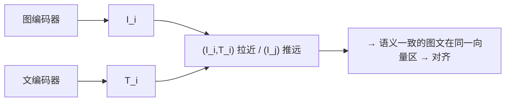

**面试要点**：对比学习=配对拉近/非配对推远 → 对齐；InfoNCE=图文 softmax 对比（配对照 win、其余当负样本）。

---

## Q2. CLIP 的零样本分类能力从何而来？边界在哪里？

**回答**

**零样本分类能力来源**：
- 预训练把**图像与文本语义对齐**到**同一空间**（Q1）；
- 零样本时：**用文本模板把类别名编码**（"a photo of a {class}"），把**图像嵌入与所有类别文本嵌入**做余弦相似度 → 取 argmax——**不需要看过训练图片**（类别由语义文本描述，靠对齐空间迁移）。

**边界**：
1. **细粒度/专业视觉**：视觉差异小（同物种、同品牌、工况）文本区分不开 → 弱；
2. **抽象/多模态组合推理**：复杂指代（"左边的红球右边的蓝球"）CLIP 无法组合理解 → 弱；
3. **文本编码本身能力**：类别描述词若不在它理解范围 → 失效；
4. **领域偏移**：训练分布外（医学影像、卫星图）的视觉 → 不迁移；
5. 迄今**不能做生成式 VQA/视觉推理**（只是对齐分类器，不是 multi-turn 推理模型）。

```python
def clip_zeroshot(img_em, text_em_classes):
    scores = img_em @ text_em_classes.T    # 图像 vs 各类文本模板
    return scores.argmax(dim=-1)           # 零样本: 取最相似文本
```

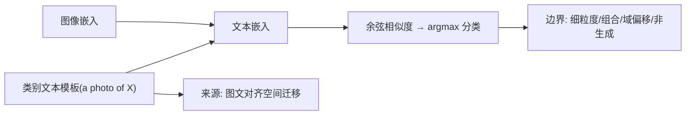

**面试要点**：零样本来自**图文对齐空间的语义迁移**（类别=文本描述）；边界=细粒度、组合/推理、域偏移、非生成式。

---

## Q3. LLaVA 类模型将视觉编码器输出接入 LLM 时，projector（MLP）的关键工程权衡是什么？

**回答**

**projector（MLP 投影层）的工程权衡**：

1. **维度对齐 vs 信息压缩**：
   - 把视觉 patch 特征（如 4096 维）**映射到 LLM hidden 维**（如 4096+——若不同需降/升）；**MLP 太浅**（线性）可能信息不足，**太深**参数量/过拟合；
   - 主流用 **2 层 MLP**（LLaVA 1.5）——在"表达能力"与"简单性/过拟合"之间的平衡，比线性好、比深 MLP 稳。
2. **保留空间结构 vs token 数**：
   - projector 输出是 **每个 patch → 一个 visual token**：patch 多→token 太多（上下文 cost），patch 少/池化→丢空间细节（Q7）；
   - 权衡：**压缩视觉信息为 token 的代价**（细粒度视觉需要更多 token,但 LLM 序列更长）；LLaVA 1.5 用 CLIP-336 的 **576 patch → 576 token**（略池化）。
3. **学习速率/冻结策略（Q11）与初始化**：projector 要与视觉+LLM 同步学（别太快崩）。

```python
class LLaVAProjector(nn.Module):       # 2 层 MLP 投影
    def __init__(self, in_dim, hidden, out_dim):
        self.mlp = nn.Sequential(
            nn.Linear(in_dim, hidden), nn.GELU(),
            nn.Linear(hidden, out_dim))   # 2层：表达与简单的平衡
    def forward(self, vision_emb): return self.mlp(vision_emb)  # per-patch
```

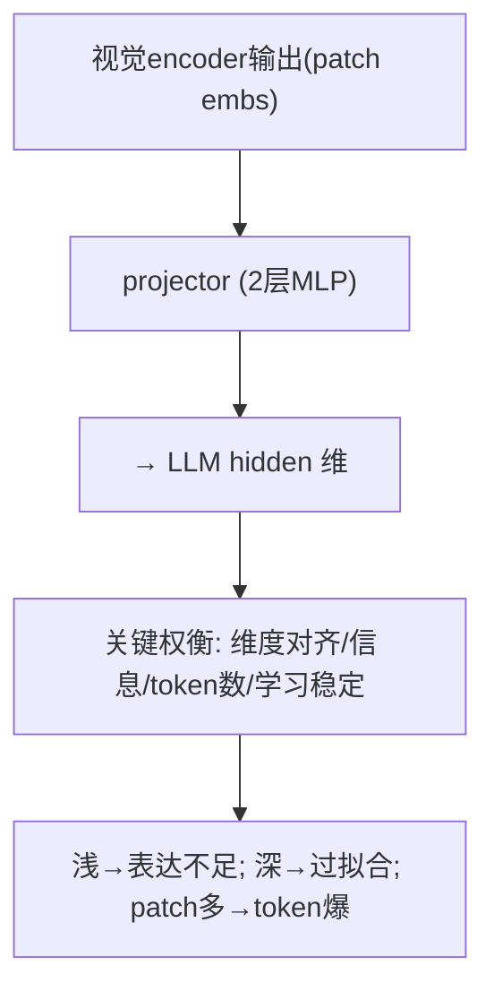

**面试要点**：projector 权衡=**2 层 MLP 平衡表达与简单、维度对齐、patch→token 数量（空间细节 vs 上下文）**。

---

## Q4. 直接取 CLIP 的 pooled 输出（单个向量）而不是 patch tokens，会丢失什么信息？

**回答**

**pooled（全局单向量）丢失**：
- **空间位置/布局**：单向量把"哪里有什么"抹平——无法知道"猫在左上、狗在右下"；
- **局部细节/细粒度**：小的物体、纹理、区域差异被全局平均稀释；
- **多对象/关系**：一个向量无法表达"多个对象及其关系"（含位置/大小）；
- **局部特征与任务对齐**：无局部 token，无法做**指代/检测/VQA 细粒度**（问"左边那只猫的颜色"就崩）。

**为什么 LLaVA 用 patch tokens**：保留**每 patch 的空间 token 序列**→ LLM 能以视觉 token 为"视觉语言"逐 patch 推理（细粒度、可指代、可组合），代价是 token 多。pooled 只适合**全局描述/分类**，不适合多模态推理。

```python
# pooled: 一向量(全局) vs patch tokens(序列/空间)
pooled    = vision_enc.forward(x).pooled          # (D,)
patch_tok = vision_enc.forward_features(x)        # (N_patch, D) 空间保留
print("pooled 丢: 位置/局部/多对象; patch tokens 保细粒度")
```

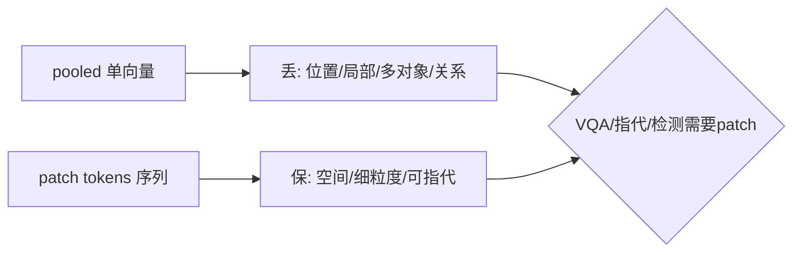

**面试要点**：pooled 丢**空间位置/局部细节/多对象关系**；patch tokens 保留空间细节以供细粒度/指代/推理。

---

## Q5. LLaVA 的两阶段训练分别冻结/解冻哪些部分？第二阶段为什么通常要解冻 LLM？

**回答**

**两阶段**：
- **阶段一（feature alignment / projector 预训练）**：**冻结 vision encoder 与 LLM**，**只训练 projector**——大量图文对让投影对齐（vision token 与 LLM 词表对齐）；
- **阶段二（instruction tuning）**：**解冻 LLM（+projector）**，在**视觉指令数据**上微调（vision encoder 通常仍冻结或学习率极低）——LLM 学会用视觉 token 完成 VQA/对话。

**为什么第二阶段解冻 LLM**：
- 第一阶段只对齐了"视觉特征的表示"，**LLM 还不懂怎么"使用"视觉信息回答问题**（推理/结合指令）；
- 解冻 LLM + 指令数据 → **LLM 学习"从视觉 token 推理、遵循视觉指令、生成答案"**——这是把"能看图"变成"会办事"的关键；
- 视觉 encoder 冻结/低 LR：避免破坏 CLIP 的视觉语义（视觉知识昂贵），只让 LLM 适配。

```python
# Stage1: 只训 projector
for p in vision_enc.parameters(): p.requires_grad = False
for p in llm.parameters():       p.requires_grad = False
train(projector, image_caption_pairs)

# Stage2: 解冻 LLM (+projector), vision 冻结
for p in llm.parameters():       p.requires_grad = True
train([llm, projector], vqa_data)
```

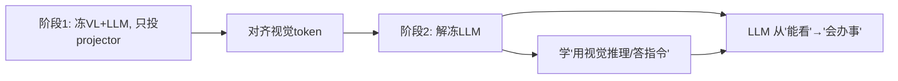

**面试要点**：阶段 1 只训 projector 对齐；阶段 2 解冻 LLM 学视觉指令推理（vision 冻结）——第二阶段是"把视觉变成可推理功能"的关键。

---

## Q6. 视觉编码器用 CLIP ViT 与 SigLIP 有何区别？SigLIP 的 sigmoid 损失相比 softmax 对比学习有何优势？

**回答**

- **CLIP ViT**：标准的 **ViT**，用 **InfoNCE/softmax 对比损失**（Q1）训练；
- **SigLIP**：SigLIP（Sigmoid loss for Language-Image Pretraining）——把对比学习改成 **sigmoid 二分类损失**：`-log σ(θ·sim(x,y)) - Σ log σ(−θ·sim(x,y'))`（每个图文 pair 独立二分类，不需要 batch 内对比）。

**SigLIP 的 sigmoid 损失优势**：
1. **可扩展/分布式友好**：不需要**全 batch 内的所有负样本**（softmax 要整 batch 内对比）——sigmoid 每对独立，**batch 可切小也能训**（大 batch 不再是必要条件，省显存）；
2. **不依赖大规模负样本**：softmax 的性能依赖"足够难的负样本"；sigmoid 自带 pair 级对比，对负样本质量依赖低；
3. **计算/内存效率**：不需要 `B×B` 的矩阵 softmax 归一（节省大 batch 的多项式资源）；
4. 某些任务（细粒度/长尾）上更稳健。

```python
def siglip_loss(sim, label, theta):
    # 每对独立 sigmoid 二分类: 正对接近1、负对接近0
    loss_pos = -torch.log(torch.sigmoid(theta*sim[label==1]))
    loss_neg = -torch.log(torch.sigmoid(-theta*sim[label==0]))
    return loss_pos.mean() + loss_neg.mean()
```

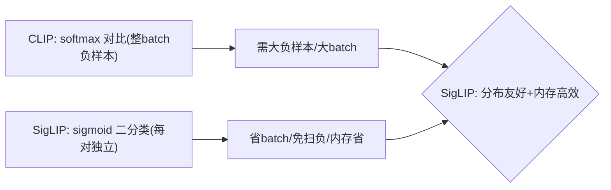

**面试要点**：SigLIP 用 sigmoid 二分类替代 softmax 全 batch 对比 → **不需要大 batch/负样本质量、内存省、分布式容易**。

---

## Q7. 一张图片在 LLaVA 中通常被编码为多少个 visual token？token 数量过多和过少分别有什么后果？

**回答**

**数量**：
- 典型：CLIP ViT 把图打成 **patch**（如 336×336 → 14×14=196~576 patch），每个 patch → 1 个 visual token；
- LLaVA-1.5 常见 **576 token**（336 尺寸，含 CLS 略），或降采（如 stride 池化到 144/196/576）。

**token 过多**：
- **上下文变长**：LLM 序列 = visual token + 文本 token，visual token 多 → 序列长、attention 计算与 KV 显存涨、效率低；
- 相对挤占文本上下文（一卷图就吃掉预算）。

**token 过少**：
- **空间细节丢失**（Q4）：小物体/细粒度/局部位置信息被池化稀释 → VQA/检测/指代变差；
- 无法支持"需要高分辨率细节"的任务。

**权衡**：**视觉 token = 分辨率/细节 ↔ LLM 上下文成本**——现代方案用**多尺度/动态 token**（能多则多、能少则少，Q9），或高分辨率区域重点采样。

```python
def visual_tokens(size, patch, stride):
    return ((size//patch)**2) if stride==patch else ((size//stride)**2)
print(f"336 尺寸: patch14→576 tok; stride8→~1600 tok(更多细节/更长序列)")
```

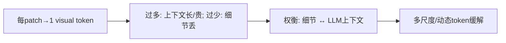

**面试要点**：LLaVA 典型 576 visual token；过多~上下文贵、过少~细节丢——现代用多尺度动态解。

---

## Q8. 视觉 token 与文本 token 在序列中如何排列？放在文本前面、后面、交错放置分别有什么影响？

**回答**

**排列方式**：
1. **visual 在前（image tokens 后 text）**：最常见（LLaVA/Qwen-VL 默认）——让 **LLM 先"看"完整图再读文字**，也便于 "以图为首" 的 VQA/template；
2. **visual 在后**：少用；可能适合"先读题再找图"（文档定位），但多数推理模型倾向前置；
3. **交错（interleaved）**：图表文交错——适合 **多图/长文档/图文叙述**（每段配图），模型能按"就近图+文"关联。

**影响**：
- **前置**：模型先编码全部视觉 → 生成时视觉上下文稳定、文字是"指令"；但对"要在文本后找图"的任务不自然；
- **截断风险**：若视觉前置且超限，**尾文本可能被截断**（现实 bug）——需平衡按任务摆放；
- **交错**：为多图关联最强，但实现复杂（对齐每段图与文、多图注意力）。

```python
def concat_sequence(vis_toks, text_toks, mode):
    if mode == "front": return vis_toks + text_toks     # 最常见
    if mode == "back":  return text_toks + vis_toks
    if mode == "interleave": return interleave(vis_toks, text_toks)
```

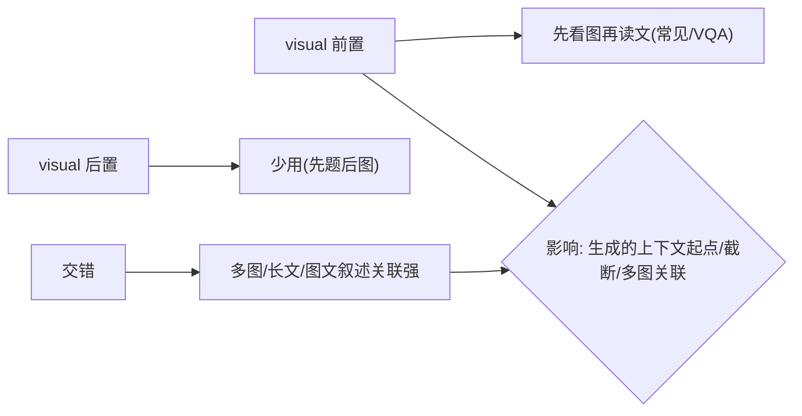

**面试要点**：前置=先视后文（常见）；交错适合多图长文；排列影响生成上下文起点、截断与多图关联。

---

## Q9. Qwen-VL 的视觉位置编码与 LLaVA 有何不同？它如何支持不同分辨率？

**回答**

- **LLaVA**：把图像**缩放/裁剪成固定尺寸**（336），用 CLIP 的固定 patch 网格 → **固定 visual token 数**；不同分辨率通过**resize 到固定**处理（简单但容易失真/细节丢）。

- **Qwen-VL 的编码**：
  - 用 **ViT 位置编码按图像尺寸缩放**（**位置编码插值到实际分辨率**）：不把图缩到固定，而是**保留多种分辨率**（多尺度/动态）。
  - 视觉特征经过 **M-RoPE/2-D RoPE**（把 2D 位置信息编码进视觉 token）——不像 LLaVA 用固定网格坐标；**支持任意分辨率下的精确空间定位**（指代/检测要 2D 位置）。
- **支持不同分辨率**：通过 **M-RoPE（multi-resolution RoPE）+ 尺寸随图编码**，视觉 token 数随分辨率变（小图少 token、大图多 token）——用**动态 token + 缩放的位置编码**保留细节且控制成本（Q7 权衡的工程解决）。

```python
# LLaVA: resize→固定patch
image = resize(img, 336, 336)
tok = grid_patch(image, 14)              # 固定 24x24=576
# Qwen-VL: 按原尺寸 + 位置编码缩放(M-RoPE)
tok2 = patch_native(img)                 # token数随分辨率
src2 = m_rope_position(tok2, image.size) # 2D位置编码
```

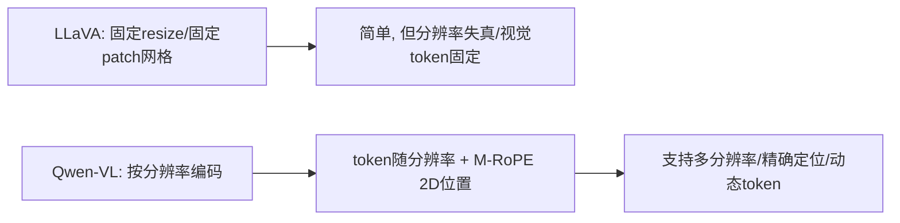

**面试要点**：Qwen-VL 用 **M-RoPE（2D 位置编码按尺寸缩放）+ 分辨率自适应 token**，不像 LLaVA 固定 resize——支持多分辨率与精确定位。

---

## Q10. Chameleon / Omni Model 与"视觉编码器 + projector + LLM"拼接路线在架构哲学上有何根本不同？

**回答**

- **拼接路线（LLaVA 等）**：**视觉编码器（CLIP）+ project + LLM**——视觉是"旁挂"的（视觉编码器是**独立预训练**的、图片被"翻译"成 token 塞给 LLM）；视觉与文本的表示**不是同一体系**；
- **Chameleon / Omni（原生多模态）**：把**图像也当 token**（image token 就是词表的一部分），用**同一个 tokenizer/transformer 统一建模图文**——**图像与文本共享同一 Transformer 流**（early fusion），无独立视觉编码器；**从零/统一预训练**（图文 causeal/alternate 混合目标）。

**哲学根本不同**：
- **拼接=late-to-early fusion（视觉靠投影桥接，保留独立视觉编码器）**：**实现容易、复用 CLIP 视觉能力、训练便宜**；但**视觉与文本表示分离、无法真正联合建模**（长尾视觉细节弱、跨模态推理受限于 projector）；
- **原生=early fusion（统一 token 流）**：**视觉语义与文本真正在一个表示空间**（跨模态推理更自然、无信息瓶颈），但**训练贵、要先学图像 tokenizer/VQ、稳定性难**（Q28 本章）。

```python
# 拼接: 视觉经CLIP/projector 注入LLM (两套表示)
                      # 原生: 图像 token 进入同一 transformer (一套表示)
legacy = f"CLIP→projector→LLM（视觉旁挂）"
native = "图像token+文本token 同一流（early fusion）"
```

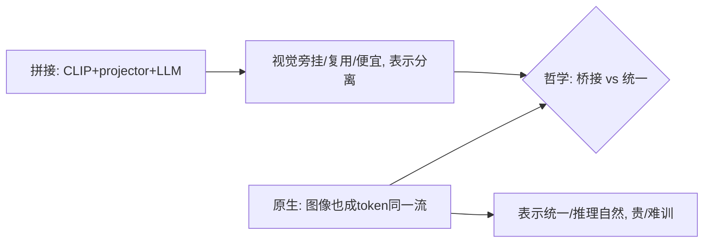

**面试要点**：拼接=视觉旁挂（复用便宜但表示分离）；Chameleon 原生=图像与文本**同一 token/Transformer 流**（统一表示、early fusion）——哲学=桥接 vs 统一，后者贵但更自然。

---

## Q11. 多模态训练中，视觉编码器与 LLM 的学习率通常如何设置？为什么不能相同？

**回答**

**通常设置**：**vision encoder 使用低很多的学习率（或冻结）**；LLM 与 projector 用正常 LR（或用 LoRA/低 rank）。

**为什么不能相同**：
1. **视觉编码器已预训练且专业**：CLIP 的视觉语义是**昂贵预训练**得来的——高 LR 微调会**破坏视觉特征**（灾难性遗忘、视觉能力退化）；要**极小步长保护**；
2. **LLM 需要学"注册视觉 token"**：LLM 是**新模态的适配者**，需要较快 LR 去学习"如何理解视觉 token 序列"——它与 vision 的"保留/适应"需求相反；
3. **跨度差异**：两个模块的**损失尺度/梯度尺度不同**——统一 LR 导致一个过冲一个欠冲；
4. 视觉 encoder 的**粒度任务**（CLIP 对齐）与 LLM 的**生成任务**目标不同——不是"学习率越大越好"。

```python
optim = param_groups([
    {"params": vision_enc.parameters(), "lr": 1e-6},   # 低/冻结
    {"params": projector.parameters(), "lr": 2e-4},
    {"params": llm.parameters(),        "lr": 1e-4},   # 正常/LoRA
])
```

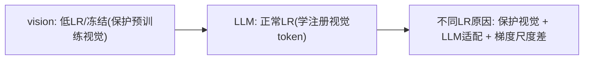

**面试要点**：vision 低 LR/冻结、LLM 正常；不同因——**视觉保护预训练、LLM 适配新模态、二者梯度/任务不同**。

---

## Q12. 视觉指令微调数据从何而来？合成多模态数据的质量如何保证？

**回答**

**数据来源**：
1. **真实图文对 + 模板化 QA**：用场景图/描述 + 模板生成 QA（最简单）；
2. **LLM 生成标注**：对图像用强 VLM 生成 description/QA——**LLM-augmented**（大量构建视觉指令）；
3. **现有 VQA/字幕数据集**：COCO、Visual Genome、detection→QA 转换；
4. **开源图-文指令集**（LLaVA-Instruct 等）。

**合成多模态数据质量保证**：
1. **源质量**：模型/模板引入**幻觉、错误、bias** → 需**筛选**（VLM 自审、交叉校验）；
2. **多样性/防同质**：同 prompt 差异、场景多样（否则模型过拟合模板）；
3. **难易配比**：加细粒度/推理型 QA（不只是"这是什么"）；
4. **人类抽检校准**：合成集合用**人工抽检**评估正确率与幻觉率。

```python
def synth_vqa(image, template, llm):
    desc = strong_vlm(image)
    qa = llm.generate(template.format(desc))
    return filter(qa)   # 用自审/交叉/人工抽检保质量
```


**面试要点**：来源=真实对+模板+LLM 生成+VQA 集；质量保障=**筛选幻觉、保多样性、难易配比、人工抽检**。

---

## Q13. 多模态模型中的"幻觉"（描述图片中不存在的内容）如何检测和缓解？

**回答**

**检测**：
1. **物体级一致性**：用**检测模型**（ground-truth objects）对照——模型提到的 object 是否真在图中（object hallucination benchmark，如 POPE）；
2. **人工/LLM 审查**：描述与图不符（属性/计数/关系幻觉）；
3. **反例测试**：问"图中是否有 X"在无 X 图上——看是否误答有。

**缓解**：
1. **训练数据去幻觉**：指令微调时**添加负样本**（"图中没有猫"）让模型学会"没有就说没有"；
2. **对比/校正训练**：幻觉检测器信号辅助（POPE 分数当作损失或过滤）；
3. **解码/生成约束**：**gate 对象提示**（先检测再生成，只描述检测到 objects）、采用 object grounding 约束；
4. **推理时校验**：生成后与视觉实体核对（cross-check）；
5. **减少 blur**：高分辨率/细节不足时易幻觉 → 提升视觉质量。

```python
def detect_hallucination(caption, detections):
    mentioned = extract_objects(caption)
    return [m for m in mentioned if m not in detections]   # 提到但图中没有
```

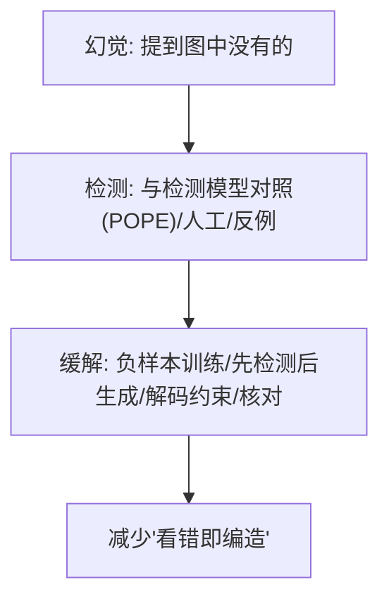

**面试要点**：检测=物体与检测器对照（POPE）、人工、反例；缓解=负样本训练、先检测后生成、解码约束、核对。

---

## Q14. 图片分辨率很低时视觉编码器应如何处理？直接 resize 会丢失什么？

**回答**

**直接 resize 的问题**：
- 把低分辨率图上采样（小图放大）会**引入模糊与伪影**；把高分辨率下采样则**丢细节**——但问题在低分辨率时：**直接 resize 放大没有真实信息**（插值产生的"平滑"是编造的像素），且**长宽比拉伸失真**（非等比 resize 变形）。
- **丢失**：真实结构（边缘是糊的）、小物体、文字细节（OCR 不可读）、空间关系（压缩后）。

**更好的处理**：
- **保留原生分辨率 + 位置编码缩放**（Qwen-VL/M-RoPE）：不 resize，按原尺寸编码；
- **超分辨率/特征增强**：用能力更强的编码器特征做细节增强；
- **多尺度/分辨率分支**：多个分辨率同时过编码器，集合信息；
- **LPU/网格拼接**：低分辨率图先裁多块，再做动态组合。
- **实际原则**：**宁可用原生低分辨率 + 高质特征，也不要强行放大**（放大无信息）。

```python
# 直接 resize 放大 → 插值糊/丢真实细节
upscaled = resize(tiny_img, 336, 336)   # 插值伪像素
# 更好: 保留原生/位置编码缩放/多尺度
feat = encode_native(tiny_img)           # 或 patch 网格按分辨率缩放
```

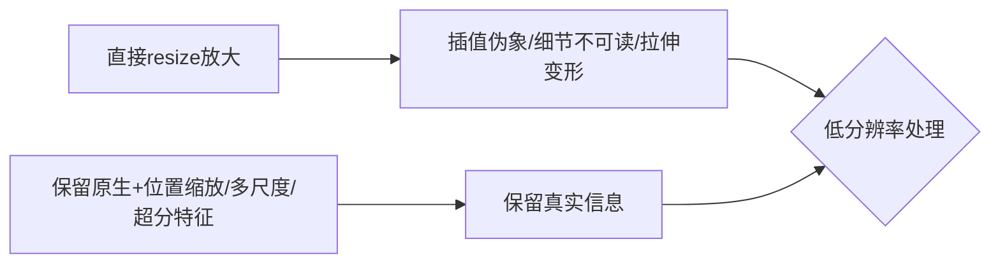

**面试要点**：直接 resize 丢**真实细节/变形**；应保留原生 + 位置编码缩放 / 多尺度——放大不加信息。

---

## Q15. 视频理解中帧采样策略如何影响模型能力？时间位置编码需要特殊设计吗？

**回答**

**帧采样策略影响**：
- **帧率/间隔**：采稀疏帧（如每秒 1 帧）→ 省 token 但漏**运动/时序**；密集采 → 上下文爆炸；
- **均匀 vs 关键帧**：均匀采样简单但可能错过关键瞬间；关键帧（场景切换）信息密度高；
- **数量**：token 预算一定下，帧数↔每帧分辨率权衡（Q7）；抽样策略决定**是否捕捉动作/事件时序**。

**时间位置编码**：
- **需要特殊设计**：视频有**时间维度**——把时间信息嵌入：
  - 用 **时间位置编码（temporal PE）** 叠加帧序（sinusoidal/learned）；
  - 或用 **3D/时空 M-RoPE**（Qwen-VL 的 M-RoPE 沿时间轴扩展）——给每帧 token **2D 空间 + 1D 时间**的位置；
  - 不做时间 PE → 模型**无法区分帧先后**（时序/因果乱）→ 动作/事件理解崩。

```python
def sample_frames(video, n, mode):
    if mode == "uniform": return video[::len/n]
    if mode == "keyframe": return scene_switch(video)   # 关键帧
# 时间位置: 每帧 token 加 temporal PE / 3D-RoPE
tok = concat([frame_tokens(f) for f in frames])
tok += temporal_pe(frame_idx)   # 时间维编码
```

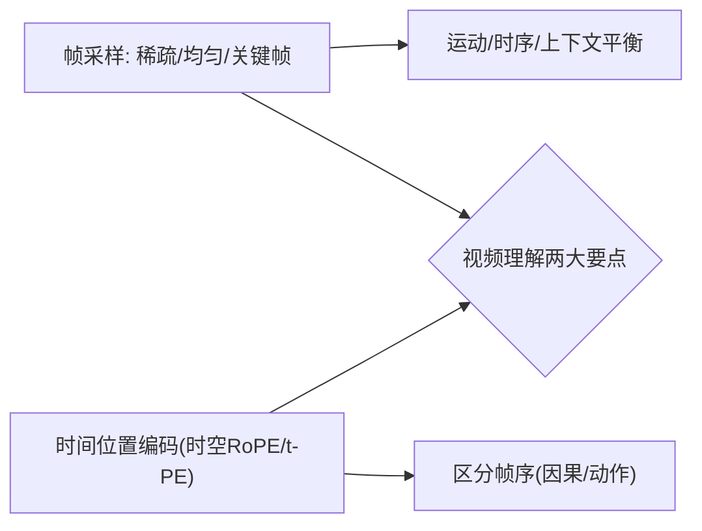

**面试要点**：采样=帧率/均匀vs关键帧（运动、上下文）；时间位置编码**必要**（区分帧序/时空 RoPE）。

---

## Q16. CLIP 的对比学习为什么需要大 batch？batch 内负样本的质量如何影响表征？

**回答**

**为什么需要大 batch**：
- InfoNCE 的**负样本是 batch 内的其他图文对**（Q1）——**batch 越大 → 负样本越多 → 对比越充分**（同一个小 batch 里负样本太少，容易退化成"死记搭配"）；
- 大 batch 提供**更难的负样本**（跨类别/跨域），让表征**学到更判别性的语义**（不是简单分成"陪跑"）。

**负样本质量影响**：
- **质量好的负样本（真相似但不同语义——难负例）** → 模型被迫**学到细粒度区别**（边缘案例里区分语义）→ 表征更强；
- **质量差的负样本（简单/无关）** → 每对损失基本一样，**判别力学不到**（模型可"靠频率/全局"取巧）；
- **噪声/错误配对的负样本** → 误导（把该对齐的关系当无关）→ 表征退化。

```python
def contrastive_batch_quality(batch):
    # 大batch: 负样本多/难 → 判别性好
    return "大batch提供硬负例→强表征; 负样本差→弱/误导"
```

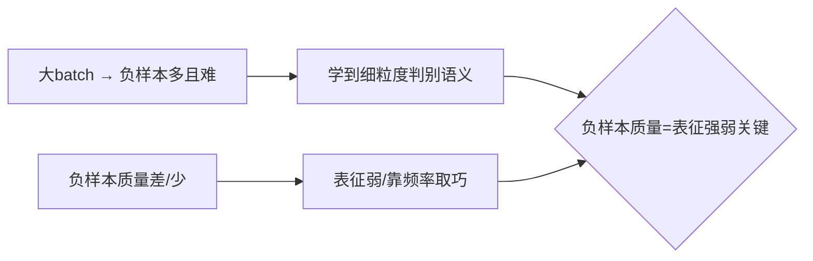

**面试要点**：InfoNCE 负样本来自 batch 内 → **大 batch 提供多/难负例**；负样本质量决定判别性（难负例强、简单弱）。

---

## Q17. 多模态评估中，VQA accuracy 与生成式评估（CIDEr）分别适合什么场景？

**回答**

- **VQA accuracy（精确匹配/答案正确率）**：判断答案是否**与标注答案一致**（或经逻辑等价）——
  - 适合：**客观、单一答案的 VQA**（"Is there a cat?"、"What color?"、"count"）——可自动判（精确/浮点/逻辑）；
  - 局限：**主观/开放**答案（"为什么""怎么描述"）无法精确匹配。
- **生成式评估（CIDEr/ROUGE/BLEU/LLM-judge）**：比较生成文本与参考的质量——
  - 适合：**开放描述/总结/caption**（多种合法表达）——比如 caption 生成用 **CIDEr**（n-gram 与参考的 TF-IDF 加权重叠）、图像描述质量；
  - 局限：CIDEr 偏"跟参考重叠"（多种好表达会被惩罚），且对语义不敏感。

```python
def eval_choice(task):
    if task in ("yes_no","color","count"):  return "VQA accuracy(自动判)"
    if task in ("caption","summary","open"):return "CIDEr/LLM-judge(生成)"
```

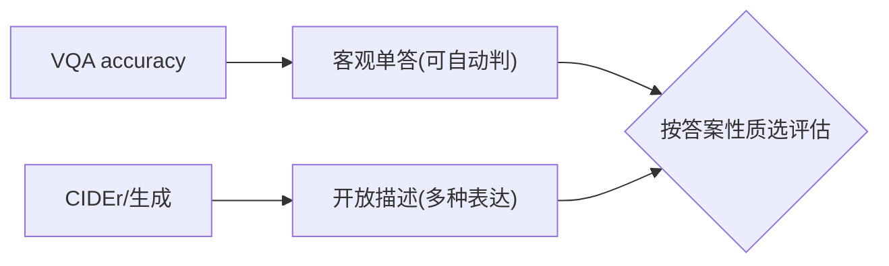

**面试要点**：VQA accuracy=客观单一答案；CIDEr 生成=开放描述——按答案是否单一/可判选。

---

## Q18. 视觉编码器输出维度与 LLM hidden dim 不匹配时，projector 除了维度对齐还承担什么角色？

**回答**

**projector 的角色（不止对齐维度）**：
1. **维度对齐**：把 vision 特征 `d_vis` 映射到 LLM `d_llm`（升维/降维）；
2. **语义重标/适配**：把**视觉表示转换成 LLM 可理解的语义空间**（视觉特征 ≠ 语言 token 语义，projector 学"翻译"）；
3. **信息压缩/结构整理**：把 patch 特征改造成**LLM 想要的结构**（如加全局/学习 token、尺度整合）；
4. **正则/可学习参数**：作为一个**浅层适配器**承载视觉→语言的映射（早 fusion 中 projector 的学习率/容量很关键）；
5. 简而言之：**projector = 视觉到语言的"典"**（不只是维度张量变换）。

```python
class Projector(nn.Module):     # 角色: 对齐 + 语义翻译 + 压缩
    def __init__(self, d_vis, d_llm):
        # 先降维 + 语义映射（非线性）
        self.map = nn.Sequential(nn.Linear(d_vis, d_vis), nn.GELU(),
                                 nn.Linear(d_vis, d_llm))
        # 可加全局对齐 token / 缩放
    def forward(self, vis): return self.map(vis)
```

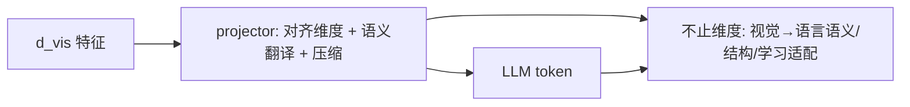

**面试要点**：projector 不只对齐——**语义翻译、信息压缩与结构、可学习适配**是同等重要角色。

---

## Q19. 只解冻 projector 而冻结视觉编码器与 LLM 时，模型能学到什么、学不到什么？

**回答**

**学得到**：
- **视觉→语言的投影/映射**：projector 学会把视觉特征"翻译"进 LLM token 空间（简单适配）；
- **基础对齐**：vision 特征与 LLM 词表的**粗对应**（能"看图说话"的雏形）。

**学不到**：
- **LLM 如何"用"视觉推理**：LLM 冻结 → 不会学 VQA/指令/对话（不能把视觉 token 用于复杂推理——那是第二阶段解冻的原因，Q5）；
- **visual encoder 适配**：视觉特征仍是 CLIP 的（不与任务交互）；细粒度/特定域视觉能力不加；
- **复杂行为融合**：多模态指令跟随、多轮视觉对话——要 LLM 参与才学得。

**结论**：单解 projector **只够做轻量对齐/初对齐（阶段一）**，真正 VQA/指令需要第二阶段解 LLM。

```python
# 只投projector → 仅对齐; 不学推理
freeze(vision); freeze(llm); train(projector)
# 效果: 配对标预训练（阶段一）; 不能做复杂VQA
```

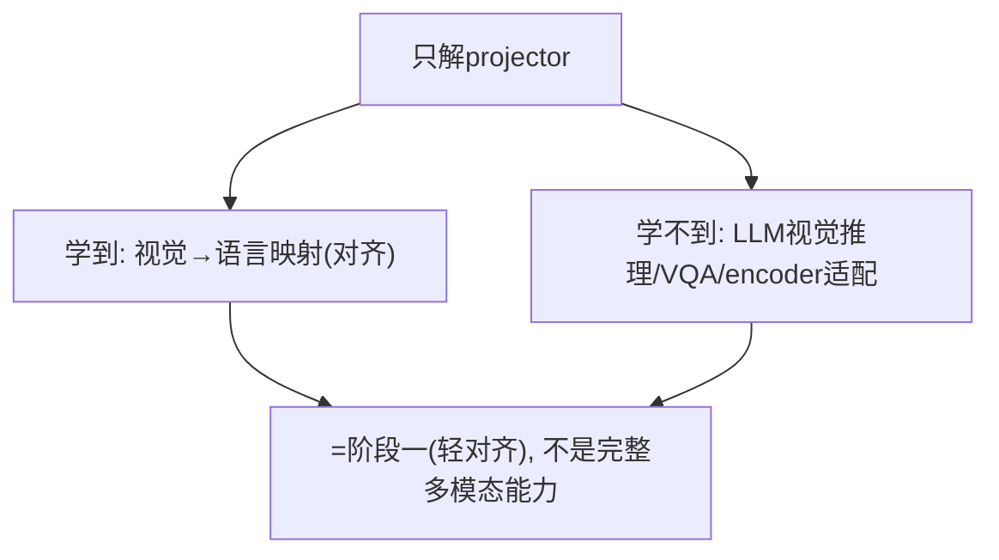

**面试要点**：只解 projector=学到对齐映射，**学不到视觉推理/指令**（那是第二阶段解 LLM 的活）。

---

## Q20. 多模态模型如何处理图中文字（OCR）？视觉编码器本身能识别文字吗，还是需要额外模块？

**回答**

**现状**：视觉编码器（CLIP）本身**不是专门 OCR**——它对大字/整体文字有一定识别，但**长文/模糊/小而密**的文字识别差。

**主流处理方式**：
1. **专门 OCR/文本检测识别器（detector + recognizer）**：先用 OCR 引擎**检测文字区域并识别为文本**，再把**文字内容注入 LLM 作为文本 token**（常见做法：把 OCR 文本混入 prompt/序列）；
2. **高分辨率 + 细 patch**：高质量图片 + 细 patch 让 CLIP/ViT 能读更多（但还不是光 OCR）；
3. **端到端视觉+语言**：用**更强的视觉 + PaddleOCR/公式识别**融合；或让视觉 token 同时承载文字（Qwen 系列在 GS 高分辨率 + 模型内做 OCR 能力提升）。

**结论**：多模态模型**通常依赖专门的 OCR/文本模块**或**高分辨率视觉**，把识别出的文字转成可读文本给 LLM——**视觉编码器自身 OCR 能力有限**。

```python
def mm_ocr(image):
    boxes, texts = ocr_detect(image)         # 检测+识别
    return prompt_with_ocr(texts)            # 文字以文本token注入LLM
# 或 用高分辨率patch增强视觉读字；纯CLIP对长文OCR弱
```

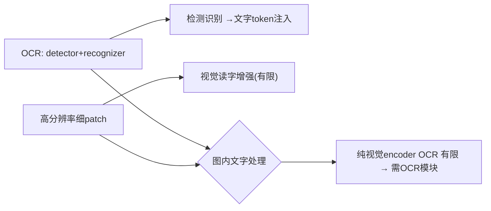

**面试要点**：视觉编码器 OCR 有限；主流=专门 **OCR 模块接入 + 高分辨率**，把识别文字注入 LLM。

---

## Q21. 交错图文数据的训练目标与纯图文对训练有何不同？

**回答**

- **纯图文对（image-text pair）**：每个样本是 "1 图 + 1 文"（caption）——训练目标是**caption→图 的匹配/生成或对比**（对齐单图文）；
- **交错图文（interleaved image-text）**：每个样本是 **图-文交替的长序列**（如网页/教材：`text, img1, text, img2, ...`）——训练目标是**同一序列上的自回归/因果建模**（LLM 对图文 token 混合预测）。

**具体差异**：
1. **任务粒度**：纯配对标侧重**全局对齐**；交错侧重**按位置/区域的局部图文关联**（"这段文字讲这幅图"）；
2. **上下文**：交错让模型**在不同图之间、图与文之间做长程关联**（多图推理）；
3. **数据形态**：纯配对标场景简单；交错更像真实网页/文档/教材。
4. 都让模型具备"看图+读文"，但**交错训练得到更强的上下文多模态关联与长文能力**（LLaVA-Next、InternVL 等采用交错数据）。

```python
# 纯对: (image, text) 对齐 loss
# 交错: [tok_i, tok_img1, tok_j, tok_img2, ...] 自回归预测全部
seq = [tok("第一段"), img_tok(1), tok("第二段"), img_tok(2)]
loss += causal_lm(seq)   # 图/文都预测
```

```mermaid
flowchart LR
    A["纯图文对"] --> B["全局对齐(单图文)"] 
    C["交错图文"] --> D["局部/长程关联(多图文/文档)"]
    B --> E{"目标/能力差异"}
    D --> E
```

**面试要点**：纯对=全局对齐；交错=同一序列上**图文混合自回归**（局部关联/多图/文档能力）。

---

## Q22. 音频、视频、图像统一到同一个 LLM 时，各自的 tokenizer 设计有什么共性挑战？

**回答**

**共性挑战**：
1. **连续→离散 token（离散化）**：图像 patch、音频帧、视频块都是连续信号 → 都要**离散化成 token**（VQ-VAE/词表），且**离散化质量影响下游**（信息损失可控性）；
2. **时空结构编码**：视觉有 2D 位置、视频有 3D（时间）、音频有时间轴——**都要把位置/时间编码进 token**（M-RoPE 时空扩展）；
3. **token 预算/长度**：音频/视频天然**长 token 流**（秒级音频数百帧）→ **上下文与效率压力**（需要压缩/多级 token）；
4. **分辨率/采样率对齐**：各模态的时间/空间粒度不同 → **统一 token 分辨率/采样**需要协调；
5. **表示一致性**：各模态的 token 要在**同一语义空间**（才能跨模态推理）。

```python
# 共性: 离散化(tok) + 时空位置 + token预算 + 粒度对齐
def unify_modality(x, kind):
    tokens = discrete_encode(x)          # VQ/VQ-VAE → token
    tokens = add_pos(tokens, kind)       # 图像2D / 音频t / 视频3D
    return compress(tokens)              # 控制长度
```

```mermaid
flowchart LR
    A["图像/音/视频→token"] --> B["离散化(VQ)"]
    A --> C["时空位置编码"]
    A --> D["token预算/长度(长流)"]
    A --> E["粒度对齐/同一语义空间"]
    B --> F{"共性挑战"}
    C --> F
    D --> F
    E --> F
```

**面试要点**：共性=**离散化、时空位置编码、token 长度预算、粒度对齐、统一语义空间**。

---

## Q23. 多模态模型中的"模态遗忘"是什么？加入视觉训练后语言能力下降如何缓解？

**回答**

**模态遗忘（modality forgetting）**：加入视觉（或其他模态）训练后，**语言能力下降**——因为多模态微调**破坏/挤占语言的预训练能力**（只盯着视觉数据训、语言退化，类似 Alignment Tax 的多模态版）。

**缓解**：
1. **混合语言数据**：训练时**混入原始纯语言数据**（caption/文本）——保语言能力（最直接）；
2. **低学习率/冻结**：语言部分用低 LR 或 LoRA，视觉适配时才动语言权重较少；
3. **渐进/多阶段**：先轻量视觉对齐，再分阶段增加视觉数据占比，跟踪语言回归；
4. **专家/门的分离**：视觉与语言路径部分隔离；
5. **持续监控**：训练中追踪语言 benchmark（MMLU/GSM8K），发现回归就回调混合比。

```python
def multimodal_train(batch_vis, batch_lang, llm):
    for step in ...:
        mix = batch_vis if step%10 else batch_lang   # 混语言数据
        step_llm(mix)                                  # 保语言
        monitor(lang_benchmark)                        # 跟踪回归
```

```mermaid
flowchart LR
    A["加视觉训练 → 语言下降(模态遗忘)"] --> B["缓解: 混纯语言数据/低LR或LoRA/渐进/监控"]
    B --> C["保语言不退化"]
    C --> D["类对齐税: 多模态版的Alignment Tax"]
```

**面试要点**：模态遗忘=多模态训练使语言退化；缓解=**混原始语言数据、低 LR/LoRA、渐进、跟踪语言回归**。

---

## Q24. CLIP 的 zero-shot 与 linear probe 分别评估了什么？两者差距说明了什么？

**回答**

- **zero-shot（零样本）**：**不微调**，直接用文本模板与图像嵌入的相似度分类（Q2）——评估**CLIP 的图文对齐空间能否直接把类别用文本表达**（表示是否能零样本迁移）；
- **linear probe（线性探测）**：在**冻结的 CLIP 图像特征**上**训练一个线性分类头**（用训练集图像特征）——评估**CLIP 特征本身的可分性（表征质量）**（不管文本对齐）。

**差距说明**：
- **linear probe 高、zero-shot 低**：CLIP 的**视觉特征很好（可分）**，但**文本侧未对齐**（类别文本模板没学好）→ 对齐空间表达能力弱——可能文本编码/模板问题；
- **两者都高**：视觉特征与文本对齐都好；
- **zero-shot ≈ linear probe**：对齐已经饱和（文本表达等价于学到的分类头）；
- **分析价值**：用 linear probe 隔离"视觉特征质量"，用 zero-shot 看"图文对齐质量"——定位瓶颈在视觉还是文本。

```python
zs = clip_zeroshot(); lp = train_linear_probe(freeze(vision))
print(f"zero-shot={zs:.2f} linear probe={lp:.2f}")
print("lp>zs → 视觉特征好但图文对齐弱(文本侧问题)")
```

```mermaid
flowchart LR
    A["zero-shot: 图文对齐(文本表达)"] --> B["linear probe: 视觉特征可分性"]
    B --> C{"差距 → 定位瓶颈(视觉 or 文本对齐)"}
    A --> C
    C --> D["lp高zs低=文本对齐弱; 双高=都好"]
```

**面试要点**：zero-shot 测图文对齐、linear probe 测视觉特征可分性；差距帮助**定位瓶颈在文本对齐还是视觉特征**。

---

## Q25. 视觉编码器的感受野与图片分辨率之间是什么关系？ViT 的 patch size 如何影响细粒度理解？

**回答**

- **感受野（receptive field）**：每个视觉 token 看到的**输入像素范围**；**分辨率 ↑ → 相同 patch 下 patch 覆盖的真实像素更少（更细）**，但绝对感受野（patch+attention）不变；
- **patch size 影响**：
  - **patch 小（如 14×14）** → token 数多 → **每个 token 覆盖像素少、细粒度好**（能读小物体/小字），但**序列长/贵**；
  - **patch 大（如 32×32）** → token 少 → 全局效率高但**细节丢失**（小物体被池化）。
- **关系**：**高分辨率 × 小 patch = 细粒度好（用 resolve/token 换细节）**；低分辨率 × 大 patch = 粗糙。模型的**细粒度能力由"分辨率 + patch size"共同决定**（每 token 覆盖的像素数）。

```python
def per_token_pixels(res, patch):
    return (res//patch)**2
print(f"336/14 → {per_token_pixels(336,14)}px/token  vs  336/32 → {per_token_pixels(336,32)}")
# 小patch/高分辨率 → 每token覆盖像素少 → 细
```

```mermaid
flowchart LR
    A["分辨率↑ 或 patch↓"] --> B["每token覆盖像素少 → 细粒度好"]
    C["patch↑"] --> D["token少/全局快/细节丢"]
    B --> E{"细节由 分辨率×patch 决定"}
    D --> E
```

**面试要点**：细粒度=**分辨率 × patch 共同决定（每 token 像素）**；高分辨率+小 patch → 细节强但 token 贵。

---

## Q26. 为文档理解任务设计多模态架构，你会选高分辨率 ViT + 更多 visual token，还是先 OCR 再走纯文本？

**回答**

**判断**（取决于文档类型与目标）：

- **先 OCR → 纯文本（OCR→text 路线）**：
  - 适合：**版面规整的文字密集型文档**（扫描书、合同、报表——主要信息是文字）；
  - 优点：token 少（文本 token 远少于视觉）、text 语义好、LLM 文本能力直接用；
  - 缺点：**丢版面/表格/图表/公式结构、OCR 错误累积、无格式信息**（对复杂版面不足）。

- **高分辨率 ViT + 更多 visual token**：
  - 适合：**布局重要/图文混排/表格/图表/公式**（版面承载信息）；
  - 优点：保留**布局/结构**与视觉细节（表格、流程图、公式）；
  - 缺点：token 多（上下文贵）、视觉特征对长文识别效率低。

**工程建议**：**混合（基于版面）**——先**版面分析**，文本块 OCR+注入文本、结构块（表/图/公式）用高分辨率视觉 token；或用"**OCR+视觉双通道**"（文本走 OCR、结构走视觉）。主流文档模型（DocLLM、LayoutLM-3D 等）走"布局+Dual"路线。

```python
def doc_strategy(page):
    layout = analyze_layout(page)         # 版面分析
    text_part = ocr(layout.text_blocks)  # 文本→token
    visual_part = vision(layout.figures/tables)   # 结构→视觉token
    return concat(text_part, visual_part)  # 混合（可再走布局PE)
```

```mermaid
flowchart TB
    A["纯文本OCR"] --> B["文字文档/省token, 丢版面/表/公式"]
    C["高分辨率视觉"] --> D["保留布局/结构, token贵"]
    B --> E{"混合: 版面分析 → 文本OCR + 结构视觉"}
    D --> E
```

**面试要点**：文字文档走 OCR（省）；版面/表/图走视觉；主流=**版面分析做适混合（OCR + 视觉双通道）**。

---

## Q27. 多模态 RLHF 的奖励如何设计？视觉忠实度与文本有用性如何联合优化？

**回答**

**多模态 RLHF 奖励设计**：
- **多维度奖励组合**：
  1. **视觉忠实度（faithfulness）**：生成的描述/回答**与图像内容一致**（不幻觉、不漏）——用**视觉事实核验**（与检测器/grounding 对照，或 VLM 判"是否图文一致"）；
  2. **文本有用性（helpfulness）**：回答有帮助、清晰、遵循指令——用**偏好/Judge/RM**；
- **联合优化**：`R = λ_vis·R_faithful + λ_text·R_helpful`（加权和），或成对偏好数据在其上做多目标 RL（trade-off λ）。

**联合优化的注意**：
- **reward hacking（视觉部分）**：模型可能"既过视觉核验又刷文本风格"——要两个信号都严格（Q13 第 12 章）；
- **λ 平衡**：视觉忠实 vs 文本有用（模型若"太忠实但不帮"或"有用但幻觉"）——按任务调整权重；
- 用 **多维度 verifier/RM** 分开打分并组合，比单一 reward 更稳。

```python
def mm_reward(text, image, vision_checker):
    vis_faith = vision_checker(text≈image)     # 图文一致分
    help_score = reward_model(text)            # 有用性
    return λ_vis*vis_faith + λ_text*help_score # 联合
```

```mermaid
flowchart LR
    A["视觉忠实: 与图核验(不幻觉)"] --> B["R = λ_vis·faith + λ_text·help"]
    C["文本有用: 偏好/RM"] --> B
    B --> D["联合优化(权重λ平衡/防hack)"]
    D --> E["多模态对齐"]
```

**面试要点**：多模态奖励=**视觉忠实 + 文本有用**的加权和；联合优化=权重平衡、双信号防 hack。

---

## Q28. Chameleon 类"原生多模态"模型在训练稳定性上面临什么额外挑战？

**回答**

**Chameleon 原生多模态（统一图文 token 流）的额外训练挑战**：

1. **图像 tokenizer/离散化训练难**：要训练**好的 image VQ tokenizer**——离散化误差、重建质量、token 语义稳定性直接影响训练；
2. **多模态序列的建模不稳定**：**图文混合的因果建模**（图像 token 与文本 token 同序列预测）训练曲线更难收敛（模态间梯度对抗）；
3. **输入分布/长度**：图 token 序列长（大量 image token）→ 长序列 attention 训练（内存/效率）、长度分布复杂；
4. **模式坍塌/模态失衡**：模型可能**偏向文本而忽略视觉**（或反之）——一模态"吃"掉另一模态（模态学习失衡，学习率/数据配比难配）；
5. **缺少成熟 CLIP 视觉先验**：没有独立视觉底座，**视觉表示要从零学** → 收敛更慢、初始不稳。

**缓解**：稳的学习率调度、图文数据配比、tokenizer 预训练、视觉 token 压缩、风味 loss/梯度平衡。

```python
# 原生：统一序列 + 自回归(图文全部)
seq = [img_tok1..n, txt_tok1..m]
loss = causal_mle(seq)   # 图文同目标 → 模态间梯度容易失衡
# 缓解: 图/文损失分开加权 + tokenizer预训练 + 稳定LR
```

```mermaid
flowchart LR
    A["原生多模态训练"] --> B["image tokenizer难/图文建模不稳/长度"]
    A --> C["模态失衡/无CLIP底座收敛慢"]
    B --> D{"额外不稳定来源"}
    C --> D
    D --> E["缓解: 分模态loss加权/预训练tokenizer/稳定LR"]
```

**面试要点**：原生多模态难在**图像 tokenizer、图文混合建模不稳定、模态失衡、无 CLIP 底座收敛慢**——需分模态加权与稳定策略。

---

## Q29. 多模态模型的推理延迟主要花在哪里？视觉编码、projector、LLM prefill 各占多少？

**回答**

**主要开销分解**：

- **视觉编码**：对图像过 CLIP/ViT ——是**较大的计算**（相对单张图费时，尤其高分辨率/多图），通常**在 prefill 阶段一次完成**；（本发明视觉编码几千 ms 量级，但远小于 LLM 长推理的总 token 时。）
- **projector**：单层/浅 MLP——只做**一次小线性变换**，**开销可忽略**；
- **LLM prefill（视觉 token 的高额部分）**：视觉 token **通常占序列大头**（如 576 visual token + 少量文本）→ **LLM 对 visual token 的 prefill 计算**（Qⁱ long attention）是**推理耗时的大头**（尤其多图/高分辨率 → token 多）；后续 decode 同文本。

**总结**：**视觉编码+LLM 对大量 visual token 的 prefill 是延迟主体**；projector 极小。优化点=**压缩视觉 token（dynamic/减少 token）、视觉编码并行/缓存、FlashAttention 长序列**。

```python
# 精确: prefill 中 visual token 占大头
visual_tok = 576        # 一张图
llm_prefill = visual_tok * cost_per_tok    # 主体
print("延迟≈视觉编码 + LLM prefill(visual token 大头) + 投影(≈0)")
```

```mermaid
flowchart LR
    A["视觉编码"] --> B["中等(=prefill)"
    C["projector"] --> D["≈0"]
    E["LLM prefill(visual tokens 大头)"] --> F["延迟主体"]
    B --> F
    D --> F
    F --> G["优化: 压visual token/编码缓存/Flash"]
```

**面试要点**：延迟大头=**视觉编码 + LLM 对大量 visual token 的 prefill**；projector 忽略；优化=压 token/并行/缓存。

---

## Q30. 从 CLIP 到 LLaVA 到 Omni，多模态架构的演进主线是什么？每个阶段解决了前一个阶段的什么根本局限？

**回答**

**演进主线**：从"**对齐**"到"**桥接**"到"**统一**"：

1. **CLIP（对齐）**：
   - 解决：把**图文表征对齐到同一空间**（对比学习）；
   - 根本局限：**只对齐、不做生成/推理**（分类/检索可以，不能 VQA/对话）。

2. **LLaVA（桥接 / 拼接）**：
   - 解决：用 **projector 把 CLIP 视觉特征桥接到 LLM**，加视觉指令微调 → **能做满足 VQA/对话**（生成 + 推理）；
   - 根本局限：**视觉是"旁挂"**（独立 CLIP + 投影，视觉-语言表示分离），跨模态细粒度/长尾推理受限；视觉能力被 projector 卡住。

3. **Omni/Chameleon（统一 / 原生）**：
   - 解决：**把图像做成 token 与文本在同一 Transformer 流建模**（early fusion / 统一词表）→ **真正统一的表示、端到端跨模态推理**（无投影瓶颈）；
   - 遗留挑战（待解决）：**训练稳定性、图像 tokenizer、视觉预训练成本**（Q28）——"统一"是方向但还需成熟。

**一句话主线**：**对齐空间 → 桥接给 LLM → 统一成同一种语言**（三阶段各有要突破的根本局限）。

```python
def lineage():
    return [("CLIP","对齐图文"),("LLaVA","投影桥接给LLM"),
            ("Omni","图文同一流(统一)")]
```

```mermaid
flowchart LR
    A["CLIP: 对齐"] --> B["→ 不能生成/推理"]
    B --> C["LLaVA: 桥接(投影)"] --> D["→ 会VQA但视觉旁挂"]
    D --> E["Omni: 统一(token同一流)"] --> F["→ 真正统一, 但难训"]
    A --> G{"主线: 对齐→桥接→统一"}
    C --> G
    E --> G
```

**面试要点**：主线=**对齐（CLIP）→ 桥接（LLaVA）→ 统一（Omni）**；每阶段突破上一阶段的根本局限（对齐不做生成、桥接表示分离、统一则难训）。

---

## 参考链接

1. [多模态大模型——完整实战指南-CSDN博客](https://blog.csdn.net/gedonshen/article/details/162549217)
2. [多模态大模型: 盘点&Highlights part2——Qwen-VL系列-CSDN博客](https://blog.csdn.net/baidu_25854831/article/details/142036789)
3. [多模态大模型架构深度解析：从 CLIP 对齐到 LLaVA、Qwen-VL 的视觉语言模型演进-CSDN博客](https://blog.csdn.net/m0_50709695/article/details/163909202)
4. [多模态大模型技术深度解析：从 CLIP 到 LLaVA 的视觉语言融合原理-CSDN博客](https://blog.csdn.net/a13662080711/article/details/161429950)
5. [视觉语言模型VLM入门与实战：从架构原理到微调部署全路径解析-CSDN博客](https://blog.csdn.net/weixin_34175509/article/details/89831284)
6. [ARIS VLM 多模态教程深度解析：从 CLIP 对称 InfoNCE 到 Qwen2-VL M-RoPE 的完整视觉-CSDN博客](https://blog.csdn.net/gitblog_00077/article/details/160095781)
7. [AI进阶 | 多模态视觉：从 CLIP 到 LLaVA —— 它是如何看懂这个世界的？-CSDN博客](https://blog.csdn.net/ipython_fool/article/details/158936540)

---

*下一章展望：第 15 章进入扩展内容（系统推理、Agent、世界模型、未来范式等 30 题）。*