# 第 14 章 · 多模态模型（CLIP → LLaVA → Omni）

> 面试生普（LLM 500 题）· 第 14 章。本章覆盖 CLIP 对比学习、LLaVA 架构与两阶段训练、projector、视觉 token 设计、Qwen-VL 位置编码、Chameleon 原生多模态、视觉指令数据、幻觉、视频、多模态评测、模态遗忘等 30 个问题，关键概念配 Python 代码与 mermaid 图解。

> 先把话说清楚：前十几章聊的都是"文字模型"，可我们生活的世界不只有文字，还有图片、视频、声音。这一章讲的就是怎么让大模型"长出一双眼睛"——把图像也塞进模型，让它能看图说话、看视频回答问题。主线其实很清楚：先要让图和文"对上号"（CLIP 的图文对齐），再把视觉信息"翻译"进语言模型（LLaVA 的桥接），最后干脆把图和文当成同一种 token 一起建模（Omni 的统一）。你不需要有太多视觉或深度学习的底子，跟着每题从"它为什么这么设计、代价是什么"看下去，就能把这条演进路线摸清楚。

---

## Q1. CLIP 的对比学习目标为什么能让图文表征对齐？InfoNCE 损失如何工作？

**回答**

先讲个大白话的道理。所谓"对齐"，就是让模型把**意思相同**的图和文，映射到向量空间里**挨得很近**的位置。

**为什么对比学习能对齐**：
- CLIP 是拿**图文对**来训练的——同一对（image, text）应该更像，不同对（image, 另一个 text）应该更不像；
- 训练时反复**把配对的拉近、把不配对的推远**，编码器慢慢就**学会了把"语义相同的图文"映射到相近的向量空间**，图文表征也就对齐了（同一个意思，向量也靠得近）。

**InfoNCE 损失**（在一批 batch 内部做对比）：

$$L = - \sum_i \log \frac{\exp(sim(I_i, T_i)/\tau)}{\sum_j \exp(sim(I_i, T_j)/\tau)}$$

（也可以写成多模态对称的形式：batch 里把真正配对的 `(I_i, T_i)` 当正样本，把 `(I_i, T_{j≠i})` 当负样本。）

- 分子负责把**对应的那一对**拉近；分母则把**这张图对 batch 里所有文本的相似度**做 softmax 归一——**逼着正确的那个文本胜出**；
- 温度 τ 控制分布的"尖锐程度"：τ 越小，softmax 越倾向于只认最像的那一个。

```python
import torch, torch.nn.functional as F
def info_nce(img, txt, tau=0.07):
    sim = img @ txt.t() / tau            # (B,B)
    labels = torch.arange(len(img))
    loss_i = F.cross_entropy(sim, labels)           # 图→文
    loss_t = F.cross_entropy(sim.t(), labels)       # 文→图
    return (loss_i + loss_t)/2
```

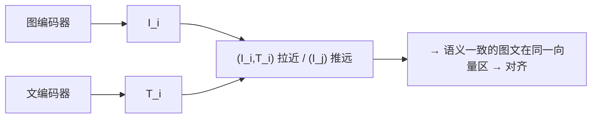

**面试要点**：对比学习就是配对拉近、非配对推远，最终实现对齐；InfoNCE 就是把图文做 softmax 对比（配对的当正样本、其余都当负样本）。答完这题，下一个自然要问：既然对齐了，它怎么就能做零样本分类？这就是 Q2。

---

## Q2. CLIP 的零样本分类能力从何而来？边界在哪里？

**回答**

**零样本分类的能力从哪来**：
- 预训练已经把**图像和文本的语义对齐到了同一个空间**（见 Q1）；
- 到了零样本分类时，**用文本模板把类别名编码成句子**（比如"a photo of a {class}"），再拿**图像嵌入去和所有类别的文本嵌入**算余弦相似度，取最大的那个当答案——整个过程**不需要看过这张类别的训练图**。原因很简单：类别本身就是一段文字描述，靠的是那个已经对齐好的空间，把语义"迁移"过去。

**边界（也就是它搞不定的地方）**：
1. **细粒度/专业视觉**：视觉差异太小（同物种、同品牌、同工况），光靠文本描述区分不开，就弱；
2. **抽象/多模态组合推理**：复杂指代（"左边的红球、右边的蓝球"）CLIP 没法做组合理解，弱；
3. **文本编码本身的能力**：如果类别描述里的词它压根没理解，就失效；
4. **领域偏移**：训练分布之外的东西（医学影像、卫星图）不迁移；
5. 到今天它仍**做不了生成式 VQA/视觉推理**——它只是个对齐好了的分类器，不是能多轮推理的模型。

```python
def clip_zeroshot(img_em, text_em_classes):
    scores = img_em @ text_em_classes.T    # 图像 vs 各类文本模板
    return scores.argmax(dim=-1)           # 零样本: 取最相似文本
```

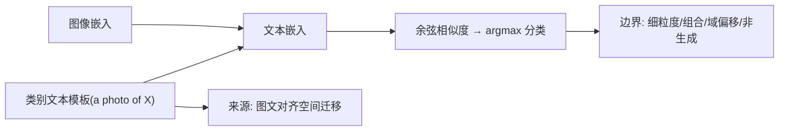

**面试要点**：零样本来自**图文对齐空间的语义迁移**（类别就是一段文本描述）；边界是细粒度、组合/推理、域偏移、非生成式。既然 CLIP 只会对齐、不会推理，下一个问题就聊聊怎么把视觉真正接进 LLM——也就是 LLaVA 的 projector。

---

## Q3. LLaVA 类模型将视觉编码器输出接入 LLM 时，projector（MLP）的关键工程权衡是什么？

**回答**

projector 这个"投影层"，其实就是一座把视觉侧和语言侧连起来的桥。它在设计上要权衡几件事：

1. **维度对齐 vs 信息压缩**：
   - 得把视觉 patch 特征（比如 4096 维）**映射到 LLM 的 hidden 维**（如果两边维度不同，就要降维或升维）；**MLP 太浅**（比如只用线性层）可能表达力不够，**太深**又参数多、容易过拟合；
   - 主流做法是 **2 层 MLP**（LLaVA 1.5 就是这么干的）——在"表达能力"和"简单、抗过拟合"之间取平衡，比线性强、比深 MLP 稳。
2. **保留空间结构 vs token 数量**：
   - projector 的输出是 **每个 patch 对应一个 visual token**：patch 多，token 就多（吃上下文成本）；patch 少或用池化，就会丢掉空间细节（见 Q7）；
   - 本质上是在权衡"**把视觉信息压成 token 的代价**"（要细粒度视觉就得多 token，但 LLM 序列也更长）；LLaVA 1.5 用的是 CLIP-336 的 **576 个 patch → 576 个 token**（略有池化）。
3. **学习速率/冻结策略与初始化**：projector 要和视觉模型、LLM 一起配合着学，别学太快把自己弄崩（见 Q11）。

```python
class LLaVAProjector(nn.Module):       # 2 层 MLP 投影
    def __init__(self, in_dim, hidden, out_dim):
        self.mlp = nn.Sequential(
            nn.Linear(in_dim, hidden), nn.GELU(),
            nn.Linear(hidden, out_dim))   # 2层：表达与简单的平衡
    def forward(self, vision_emb): return self.mlp(vision_emb)  # per-patch
```

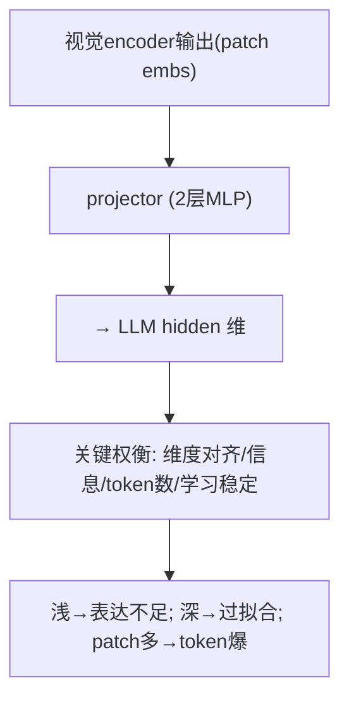

**面试要点**：projector 的权衡是——**2 层 MLP 平衡表达与简单、维度对齐、patch 到 token 的数量（空间细节 vs 上下文）**。既然有了 projector 把每个 patch 变成一个 token，那下一个问题就是：为什么不用 CLIP 那种"整张图压成一个向量"的池化输出呢？

---

## Q4. 直接取 CLIP 的 pooled 输出（单个向量）而不是 patch tokens，会丢失什么信息？

**回答**

如果把整张图压成**一个全局向量（pooled）**，会丢掉很多有用的东西：

- **空间位置/布局**：一个向量把"哪里有什么"全抹平了——没法知道"猫在左上、狗在右下"；
- **局部细节/细粒度**：小物体、纹理、区域间的差异，会被全局平均稀释掉；
- **多对象/关系**：一个向量表达不了"多个对象以及它们之间的关系"（包括位置、大小）；
- **局部特征与任务对齐**：没有局部 token，就做不了**指代/检测/细粒度 VQA**（比如问"左边那只猫什么颜色"就直接崩）。

**那为什么 LLaVA 坚持用 patch tokens**：因为它保留了**每个 patch 的空间 token 序列**，LLM 就能把这些视觉 token 当成一种"视觉语言"逐 patch 地推理（细粒度、可指代、可组合），代价只是 token 变多。pooled 只适合**全局描述/分类**，不适合需要推理的多模态任务。

```python
# pooled: 一向量(全局) vs patch tokens(序列/空间)
pooled    = vision_enc.forward(x).pooled          # (D,)
patch_tok = vision_enc.forward_features(x)        # (N_patch, D) 空间保留
print("pooled 丢: 位置/局部/多对象; patch tokens 保细粒度")
```

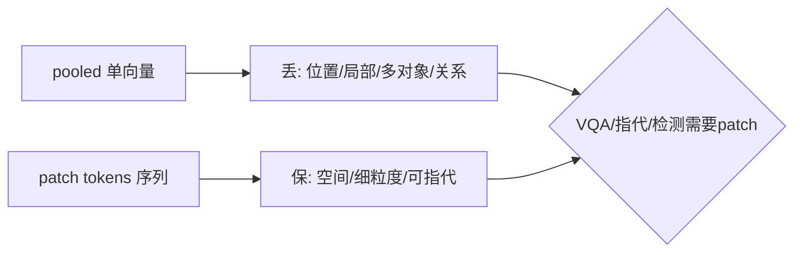

**面试要点**：pooled 会丢掉**空间位置、局部细节、多对象关系**；patch tokens 则保留空间细节，好做细粒度/指代/推理。那这些视觉 token 是怎么一步步接进去、还要分阶段训练的呢？这就引出了 Q5 的两阶段训练。

---

## Q5. LLaVA 的两阶段训练分别冻结/解冻哪些部分？第二阶段为什么通常要解冻 LLM？

**回答**

LLaVA 的训练分两步走，各自冻结、解冻的部分不一样：

- **阶段一（feature alignment，projector 预训练）**：**冻结视觉编码器和 LLM**，**只训练 projector**——用大量图文对，让投影层先把视觉 token 对齐到 LLM 的词表空间；
- **阶段二（instruction tuning，指令微调）**：**解冻 LLM（连同 projector）**，在**视觉指令数据**上微调（视觉编码器通常仍然冻结，或者给极低的学习率）——让 LLM 学会用视觉 token 完成 VQA、对话这类任务。

**为什么第二阶段要解冻 LLM**：
- 第一阶段只是把"视觉特征的表示"对齐了，**LLM 还不会"用"这些视觉信息去回答问题**（不会推理、也不会结合指令）；
- 解冻 LLM 再加上指令数据，**LLM 才能学会"从视觉 token 推理、听懂视觉指令、生成答案"**——这才是把"能看图"变成"会办事"的关键；
- 视觉编码器冻结或用低学习率，是为了不破坏 CLIP 好不容易学来的视觉语义（视觉知识很贵），只让 LLM 去做适配。

```python
# Stage1: 只训 projector
for p in vision_enc.parameters(): p.requires_grad = False
for p in llm.parameters():       p.requires_grad = False
train(projector, image_caption_pairs)

# Stage2: 解冻 LLM (+projector), vision 冻结
for p in llm.parameters():       p.requires_grad = True
train([llm, projector], vqa_data)
```

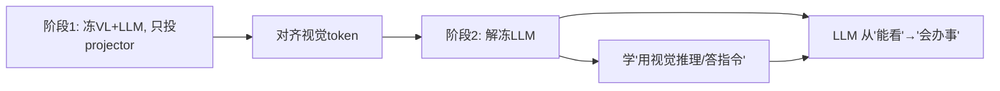

**面试要点**：阶段 1 只训 projector 做对齐；阶段 2 解冻 LLM 来学视觉指令推理（视觉仍冻结）——第二阶段才是"把视觉变成能推理的功能"的关键。既然两阶段都离不开视觉编码器，下一个问题就看看 CLIP ViT 和 SigLIP 有什么区别。

---

## Q6. 视觉编码器用 CLIP ViT 与 SigLIP 有何区别？SigLIP 的 sigmoid 损失相比 softmax 对比学习有何优势？

**回答**

- **CLIP ViT**：就是一个标准的 **ViT**，用的是 **InfoNCE/softmax 对比损失**（见 Q1）来训练的；
- **SigLIP**（Sigmoid loss for Language-Image Pretraining）：它把对比学习改成了 **sigmoid 二分类损失**：`-log σ(θ·sim(x,y)) - Σ log σ(−θ·sim(x,y'))`（每个图文对单独做一次二分类，不需要在 batch 内部互相比较）。

**SigLIP 这个 sigmoid 损失好在哪里**：
1. **好扩展、分布式友好**：它不需要**整个 batch 里所有的负样本**（softmax 要拿整批做对比），sigmoid 是每对独立的，**batch 切小也能训**（不用非得靠大 batch，省显存）；
2. **不依赖大规模负样本**：softmax 的效果很吃"足够难的负样本"；sigmoid 自带 pair 级的对比，对负样本质量的依赖低；
3. **计算/内存更省**：不用做 `B×B` 那么大矩阵的 softmax 归一，省掉大 batch 带来的那笔计算和内存开销；
4. 在某些任务（细粒度/长尾）上还更稳。

```python
def siglip_loss(sim, label, theta):
    # 每对独立 sigmoid 二分类: 正对接近1、负对接近0
    loss_pos = -torch.log(torch.sigmoid(theta*sim[label==1]))
    loss_neg = -torch.log(torch.sigmoid(-theta*sim[label==0]))
    return loss_pos.mean() + loss_neg.mean()
```

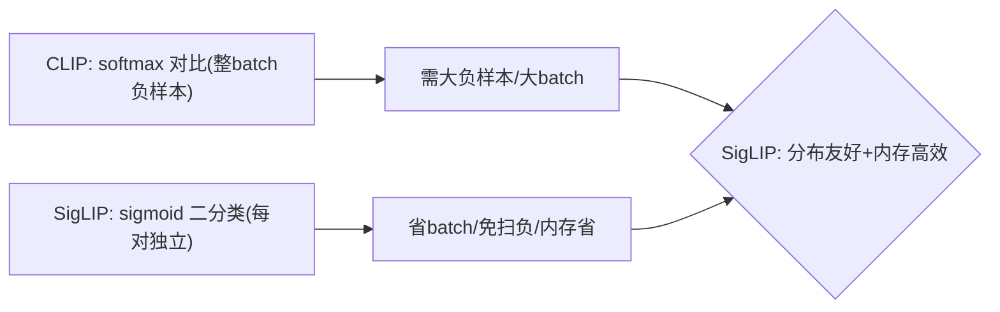

**面试要点**：SigLIP 用 sigmoid 二分类替代了 softmax 的全 batch 对比，于是**不依赖大 batch 和负样本质量、内存省、分布式更容易**。聊完编码器本身，接着就得问：一张图到底被编成多少个视觉 token？多了少了各有什么问题？

---

## Q7. 一张图片在 LLaVA 中通常被编码为多少个 visual token？token 数量过多和过少分别有什么后果？

**回答**

**数量**：
- 典型做法：CLIP ViT 把图打成 **patch**（比如 336×336 → 14×14，也就是 196~576 个 patch），每个 patch 变成 1 个 visual token；
- LLaVA-1.5 常见是 **576 个 token**（336 尺寸，算上 CLS 略有出入），也可以降采（比如用 stride 池化到 144/196/576）。

**token 太多**：
- **上下文变长**：LLM 的输入序列 = visual token + 文本 token，视觉 token 一多序列就长，attention 计算和 KV 显存都涨，效率变低；
- 还会相对挤占文本的上下文空间（一张图就把额度吃掉不少）。

**token 太少**：
- **空间细节丢失**（见 Q4）：小物体、细粒度、局部的位置信息会被池化稀释，导致 VQA/检测/指代都变差；
- 也就撑不起"需要高分辨率细节"的任务。

**权衡**：**视觉 token 数量 = 分辨率/细节 ↔ LLM 上下文成本**。现在的方案一般用**多尺度/动态 token**（能多则多、能少则少，见 Q9），或者对高分辨率区域重点采样。

```python
def visual_tokens(size, patch, stride):
    return ((size//patch)**2) if stride==patch else ((size//stride)**2)
print(f"336 尺寸: patch14→576 tok; stride8→~1600 tok(更多细节/更长序列)")
```

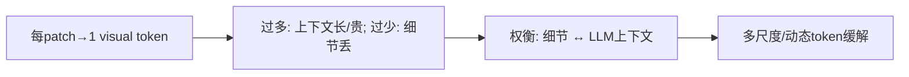

**面试要点**：LLaVA 典型是 576 个 visual token；过多会撑大上下文、过少会丢细节——现代方案用多尺度动态来解决。token 切好了，下一个问题是：这些视觉 token 和文字 token 在序列里怎么排？

---

## Q8. 视觉 token 与文本 token 在序列中如何排列？放在文本前面、后面、交错放置分别有什么影响？

**回答**

**三种排列方式**：
1. **visual 在前（图像 token 跟在文本前面）**：最常见（LLaVA、Qwen-VL 默认都是这样）——让 **LLM 先把整张图"看"完，再去读文字**，也方便"以图为首"的 VQA/模板；
2. **visual 在后**：用得少；可能适合"先读题、再找图"（文档定位）这类场景，但多数推理模型倾向把图放在前面；
3. **交错放（interleaved）**：图与文交替——适合**多图/长文档/图文叙述**（每段文字配一张图），模型能按"就近的图文"去关联。

**各自的影响**：
- **前置**：模型先编码完所有视觉信息，生成时视觉上下文是稳定的，文字更像是"指令"；但对那种"要在文字后面找图"的任务就不自然；
- **截断风险**：如果视觉在前又超了长度上限，**尾部的文字可能被截断**（这是现实里真实存在的 bug）——所以得按任务去平衡摆放；
- **交错**：对多图关联最强，但实现复杂（要对齐每段图与文、还要处理多图之间的注意力）。

```python
def concat_sequence(vis_toks, text_toks, mode):
    if mode == "front": return vis_toks + text_toks     # 最常见
    if mode == "back":  return text_toks + vis_toks
    if mode == "interleave": return interleave(vis_toks, text_toks)
```

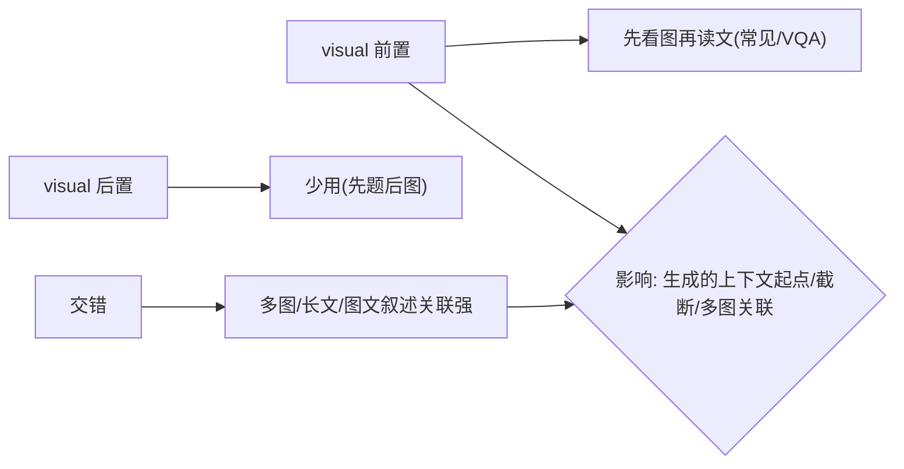

**面试要点**：前置就是先视后文（最常见）；交错适合多图长文；排列方式会影响生成时的上下文起点、截断风险和多图关联。既然有固定尺寸的 LLaVA，也有更灵活的 Qwen-VL，下一个问题就对比它们的位置编码。

---

## Q9. Qwen-VL 的视觉位置编码与 LLaVA 有何不同？它如何支持不同分辨率？

**回答**

- **LLaVA**：把图像**缩放/裁剪成固定尺寸**（336），走 CLIP 的固定 patch 网格，于是**visual token 数是固定的**；不同分辨率靠**resize 到固定尺寸**来处理（简单，但容易失真、丢细节）。

- **Qwen-VL 的编码**：
  - 它的 **ViT 位置编码会随图像尺寸缩放**（**把位置编码插值到实际分辨率**）：不把图缩到固定尺寸，而是**保留多种分辨率**（多尺度/动态）；
  - 视觉特征还会经过 **M-RoPE/2-D RoPE**（把 2D 位置信息编进视觉 token）——不像 LLaVA 只用固定网格坐标；于是它**能在任意分辨率下做精确的空间定位**（指代/检测本来就依赖 2D 位置）。
- **怎么支持不同分辨率**：靠 **M-RoPE（multi-resolution RoPE）+ 尺寸随图编码**，视觉 token 数会随分辨率变化（小图少 token、大图多 token）——用**动态 token + 缩放的位置编码**，既保住细节又控制成本（也就是 Q7 那个权衡的工程解法）。

```python
# LLaVA: resize→固定patch
image = resize(img, 336, 336)
tok = grid_patch(image, 14)              # 固定 24x24=576
# Qwen-VL: 按原尺寸 + 位置编码缩放(M-RoPE)
tok2 = patch_native(img)                 # token数随分辨率
src2 = m_rope_position(tok2, image.size) # 2D位置编码
```

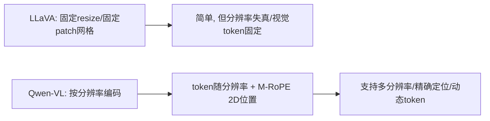

**面试要点**：Qwen-VL 用 **M-RoPE（2D 位置编码按尺寸缩放）+ 分辨率自适应的 token**，不像 LLaVA 那样固定 resize——所以支持多分辨率和精确定位。前面这些都是"拼接"路线，下一个问题就跳到完全不同的另一种哲学：Chameleon 那种原生多模态。

---

## Q10. Chameleon / Omni Model 与"视觉编码器 + projector + LLM"拼接路线在架构哲学上有何根本不同？

**回答**

- **拼接路线（比如 LLaVA）**：**视觉编码器（CLIP）+ projector + LLM**——视觉是"旁挂"上去的（视觉编码器是**独立预训练**的，图片先被"翻译"成 token 再塞给 LLM）；视觉和文本的表示**根本不是同一套体系**；
- **Chameleon / Omni（原生多模态）**：**把图像也当成 token**（image token 就是词表的一部分），用**同一个 tokenizer/transformer 统一建模图文**——**图像和文本共享同一条 Transformer 流**（early fusion，早融合），不需要独立的视觉编码器；**从零开始/统一预训练**（图文用统一的因果/交替混合目标）。

**哲学上的根本不同**：
- **拼接=late-to-early fusion（视觉靠投影桥接，保留独立视觉编码器）**：**实现容易、能复用 CLIP 的视觉能力、训练便宜**；代价是**视觉和文本的表示是分离的、没法真正联合建模**（长尾视觉细节弱，跨模态推理也被 projector 卡着）；
- **原生=early fusion（统一 token 流）**：**视觉语义和文本真正处在同一个表示空间**（跨模态推理更自然、没有信息瓶颈），代价是**训练贵、得先学图像 tokenizer/VQ、还不好稳定**（详见 Q28）。

```python
# 拼接: 视觉经CLIP/projector 注入LLM (两套表示)
                      # 原生: 图像 token 进入同一 transformer (一套表示)
legacy = f"CLIP→projector→LLM（视觉旁挂）"
native = "图像token+文本token 同一流（early fusion）"
```

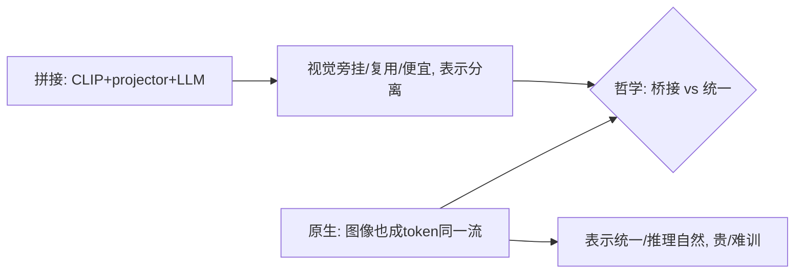

**面试要点**：拼接就是视觉旁挂（复用方便、便宜，但表示分离）；Chameleon 这种原生路线让图像和文本处在**同一个 token/Transformer 流**里（统一表示、early fusion）——哲学上就是"桥接 vs 统一"，后者贵但更自然。既然两条路线都涉及多个模块一起训，下一个问题就看它们的学习率怎么设。

---

## Q11. 多模态训练中，视觉编码器与 LLM 的学习率通常如何设置？为什么不能相同？

**回答**

**通常的设置**：**视觉编码器用低很多的学习率（或者干脆冻结）**；LLM 和 projector 用正常学习率（或者用 LoRA、低秩）。

**为什么不能一刀切用同一个学习率**：
1. **视觉编码器已经预训练过、而且很专业**：CLIP 的视觉语义是**花大价钱预训练**出来的——用高学习率微调会**把视觉特征破坏掉**（灾难性遗忘、视觉能力退化），必须用**很小的步长去保护**；
2. **LLM 需要学"如何读懂视觉 token"**：LLM 是**适配新模态的那一方**，得用较快的学习率去学"怎么理解视觉 token 序列"——这跟视觉侧"要保留、少动"的需求正好相反；
3. **尺度差异**：两个模块的**损失尺度/梯度尺度不一样**，统一学习率会导致一个冲过头、一个欠训练；
4. 视觉编码器干的是**粒度对齐**（CLIP 那种任务），LLM 干的是**生成**，目标本来就不同——不是"学习率越大越好"。

```python
optim = param_groups([
    {"params": vision_enc.parameters(), "lr": 1e-6},   # 低/冻结
    {"params": projector.parameters(), "lr": 2e-4},
    {"params": llm.parameters(),        "lr": 1e-4},   # 正常/LoRA
])
```

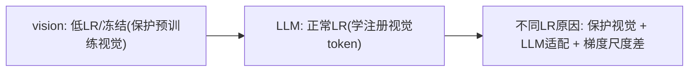

**面试要点**：视觉用低学习率/冻结，LLM 用正常学习率；原因是——**视觉要保护预训练成果、LLM 要适配新模态、两者梯度和任务也不同**。接下来一个很实际的问题：这些视觉指令数据到底从哪来、质量怎么保？

---

## Q12. 视觉指令微调数据从何而来？合成多模态数据的质量如何保证？

**回答**

**数据来源**：
1. **真实图文对 + 模板化 QA**：拿场景图/描述，套模板生成 QA（最简单）；
2. **LLM 生成标注**：对图像用强 VLM 生成 description/QA——也就是 **LLM-augmented**（能批量造视觉指令）；
3. **现成的 VQA/字幕数据集**：COCO、Visual Genome，或者把检测数据转换成 QA；
4. **开源图/文指令集**（比如 LLaVA-Instruct）。

**合成多模态数据的质量怎么保证**：
1. **把关源头**：模型/模板很容易引入**幻觉、错误、偏见**——得做**筛选**（VLM 自审、交叉校验）；
2. **保证多样性、防同质化**：同一个 prompt 要有差异、场景要多样（否则模型会过拟合模板）；
3. **难易配比**：多加点细粒度/推理型的 QA（不能只有"这是什么"）；
4. **人工抽检校准**：合成的数据集要用**人工抽检**来评估正确率和幻觉率。

```python
def synth_vqa(image, template, llm):
    desc = strong_vlm(image)
    qa = llm.generate(template.format(desc))
    return filter(qa)   # 用自审/交叉/人工抽检保质量
```


**面试要点**：来源是真实对、模板、LLM 生成、VQA 集；质量保障靠**筛掉幻觉、保证多样性、难易配比、人工抽检**。说到幻觉，这正是多模态模型最头疼的问题之一——下一个问题就专门聊它。

---

## Q13. 多模态模型中的"幻觉"（描述图片中不存在的内容）如何检测和缓解？

**回答**

**检测方法**：
1. **逐物体核对一致性**：用**检测模型**（比如有 ground-truth objects）来对照——模型嘴里提到的物体，是不是真的在图里（这就是 object hallucination benchmark，比如 POPE 干的事）；
2. **人工/LLM 审查**：看描述和图像对不对得上（属性、计数、关系上的幻觉）；
3. **反例测试**：在一张没有 X 的图上问"图里有没有 X"——看它会不会误答"有"。

**缓解方法**：
1. **训练数据去幻觉**：指令微调时**加负样本**（"图中没有猫"），让模型学会"没有就说没有"；
2. **对比/校正训练**：拿幻觉检测器的信号来辅助（把 POPE 分数当损失、或者做过滤）；
3. **解码/生成约束**：**先做对象提示再做生成**（先检测，再只描述检测到的物体），或者用 object grounding 来约束；
4. **推理时校验**：生成之后，再和视觉实体核对一遍（cross-check）；
5. **减少模糊**：分辨率/细节不够时容易产生幻觉，那就把视觉质量提上去。

```python
def detect_hallucination(caption, detections):
    mentioned = extract_objects(caption)
    return [m for m in mentioned if m not in detections]   # 提到但图中没有
```

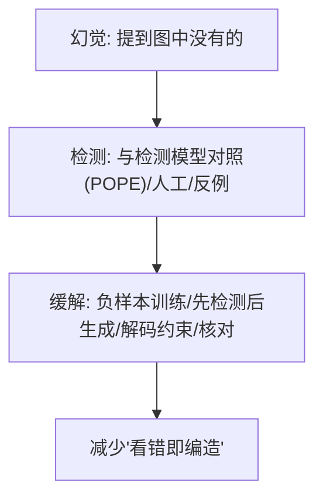

**面试要点**：检测靠物体与检测器对照（POPE）、人工、反例；缓解靠负样本训练、先检测后生成、解码约束、核对。如果图本身分辨率就低，问题只会更严重——下一个问题就看低分辨率该怎么处理。

---

## Q14. 图片分辨率很低时视觉编码器应如何处理？直接 resize 会丢失什么？

**回答**

**直接 resize 的问题**：
- 把低分辨率图**硬上采样放大**，会**引入模糊和伪影**；把高分辨率图缩下来，又**丢细节**——低分辨率这个场景更麻烦：**直接 resize 放大并没有带来真实信息**（插值出来的"平滑"其实是编造的像素），而且**长宽比一拉伸就变形**（非等比 resize 会失真）。
- **具体丢什么**：真实结构（边缘变糊）、小物体、文字细节（OCR 读不出来）、空间关系（一压缩就乱）。

**更好的处理方式**：
- **保留原生分辨率 + 位置编码缩放**（Qwen-VL/M-RoPE 的做法）：干脆不 resize，按原尺寸编码；
- **超分辨率/特征增强**：用更强的编码器特征补细节；
- **多尺度/分辨率分支**：同一张图同时过多个分辨率，把信息合起来；
- **网格拼接**：低分辨率图先裁成多块，再做动态组合；
- **一条实际原则**：**宁可保留原始的低分辨率 + 高质量特征，也不要强行放大**（放大不会凭空造出信息）。

```python
# 直接 resize 放大 → 插值糊/丢真实细节
upscaled = resize(tiny_img, 336, 336)   # 插值伪像素
# 更好: 保留原生/位置编码缩放/多尺度
feat = encode_native(tiny_img)           # 或 patch 网格按分辨率缩放
```

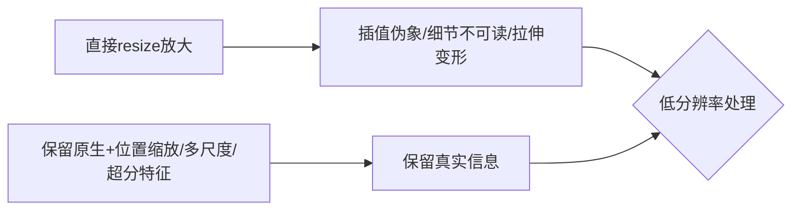

**面试要点**：直接 resize 会丢**真实细节、还容易变形**；应该保留原生分辨率 + 位置编码缩放 / 多尺度——放大并不能增加信息。从单张图往上走到动态影像，下一个问题就聊聊视频里的帧采样和时间位置编码。

---

## Q15. 视频理解中帧采样策略如何影响模型能力？时间位置编码需要特殊设计吗？

**回答**

**帧采样策略的影响**：
- **帧率/间隔**：抽稀疏帧（比如每秒 1 帧）能省 token，但会漏掉**运动/时序**信息；抽得密，上下文又会爆；
- **均匀 vs 关键帧**：均匀采样简单，但可能正好错过关键瞬间；关键帧（场景切换处）信息密度更高；
- **数量**：在 token 预算一定时，帧数和每帧分辨率此消彼长（见 Q7）；抽样策略直接决定了模型**能不能抓住动作/事件的先后顺序**。

**时间位置编码要不要特殊设计**：
- **要的**：视频多了一个**时间维度**，得把时间信息编进去：
  - 用**时间位置编码（temporal PE）**叠到帧序上（正弦式或可学习的）；
  - 或者用 **3D/时空 M-RoPE**（Qwen-VL 的 M-RoPE 沿时间轴扩展）——给每帧的 token 配上**2D 空间 + 1D 时间**的位置；
  - 如果不做时间 PE，模型就**分不清帧的先后**（时序/因果全乱），动作、事件理解跟着崩。

```python
def sample_frames(video, n, mode):
    if mode == "uniform": return video[::len/n]
    if mode == "keyframe": return scene_switch(video)   # 关键帧
# 时间位置: 每帧 token 加 temporal PE / 3D-RoPE
tok = concat([frame_tokens(f) for f in frames])
tok += temporal_pe(frame_idx)   # 时间维编码
```

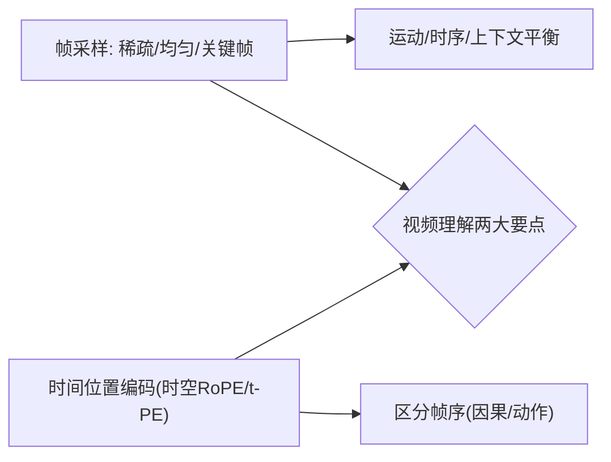

**面试要点**：采样要看帧率、以及均匀 vs 关键帧（权衡运动信息和上下文）；时间位置编码是**必要的**（用来区分帧序，可用时空 RoPE）。前面 CLIP 老提要"大 batch"，下一个问题就把这个原因讲透。

## Q16. CLIP 的对比学习为什么需要大 batch？batch 内负样本的质量如何影响表征？

**回答**

**为什么非得大 batch**：
- InfoNCE 的**负样本就是从 batch 里其他的图文对里来的**（见 Q1）——**batch 越大，负样本就越多，对比就越充分**（如果 batch 太小、负样本太少，很容易退化成"把配对的死记下来"）；
- 大 batch 还能提供**更难的负样本**（跨类别/跨域的），逼着表征去学**更有判别力的语义**（而不是简单分个"陪跑"）。

**负样本质量怎么影响表征**：
- **质量好的负样本（看着像但语义其实不同——也就是难负例）**，会逼模型去**学细粒度的区别**（边缘案例也能分清）→ 表征更强；
- **质量差的负样本（太简单/无关）**，每对的损失都差不多，**模型压根学不到判别力**（它可能靠频率或全局信息取巧）；
- **噪声/错配的负样本**会误导模型（把本该对齐的关系当成无关）→ 表征反而退化。

```python
def contrastive_batch_quality(batch):
    # 大batch: 负样本多/难 → 判别性好
    return "大batch提供硬负例→强表征; 负样本差→弱/误导"
```

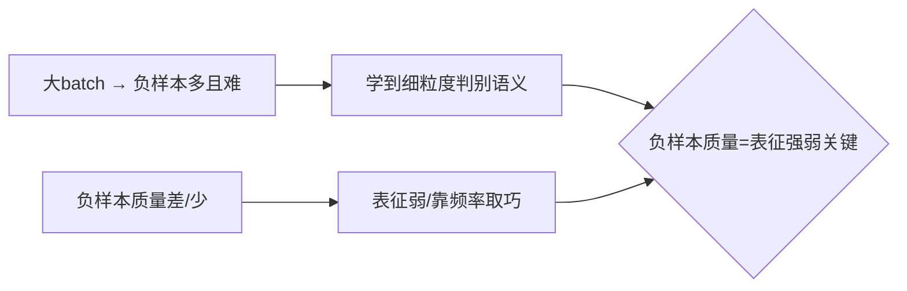

**面试要点**：InfoNCE 的负样本来自 batch 内部，所以**大 batch 能提供又多又难的负例**；负样本质量直接决定判别性强弱（难负例强、简单例弱）。前面这些理论铺垫完了，下一个问题就聊怎么把模型的多模态能力"考"出来。

---

## Q17. 多模态评估中，VQA accuracy 与生成式评估（CIDEr）分别适合什么场景？

**回答**

- **VQA accuracy（精确匹配/答案正确率）**：看答案是否**和标注答案一致**（或者经过逻辑等价判断）——
  - 适合：**客观、答案唯一**的 VQA（"Is there a cat?"、"What color?"、"count"这种），可以自动判（精确匹配/浮点比较/逻辑判断）；
  - 局限：**主观/开放**的答案（"为什么""怎么描述"）没法靠精确匹配。
- **生成式评估（CIDEr/ROUGE/BLEU/LLM-judge）**：比较生成的文本和参考答案的质量——
  - 适合：**开放描述/总结/caption**（合法表达很多种）——比如 caption 生成常用 **CIDEr**（看 n-gram 和参考在 TF-IDF 加权下重叠多少）、评图像描述的质量；
  - 局限：CIDEr 偏向"跟参考重叠得多"（很多同样好的表达反而会被扣分），而且对语义不敏感。

```python
def eval_choice(task):
    if task in ("yes_no","color","count"):  return "VQA accuracy(自动判)"
    if task in ("caption","summary","open"):return "CIDEr/LLM-judge(生成)"
```

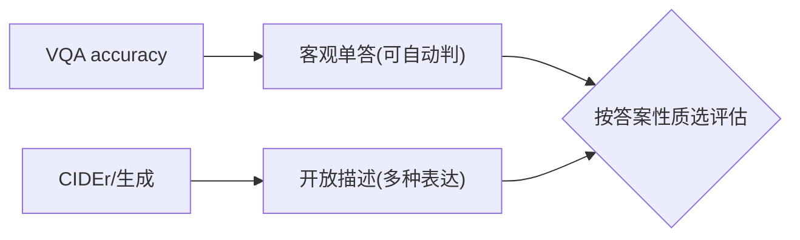

**面试要点**：VQA accuracy 适合客观单一答案；CIDEr 生成适合开放描述——按答案是否单一、能不能自动判来选。评估聊完，再回到架构细节：projector 除了对齐维度，还干了哪些活？

---

## Q18. 视觉编码器输出维度与 LLM hidden dim 不匹配时，projector 除了维度对齐还承担什么角色？

**回答**

**projector 的角色可不止"把维度对上"**：
1. **维度对齐**：把视觉特征 `d_vis` 映射到 LLM 的 `d_llm`（升维或降维）；
2. **语义重标/适配**：把**视觉表示转成 LLM 能理解的语义空间**（视觉特征和语言 token 的语义本来不一样，projector 学的是"翻译"）；
3. **信息压缩/结构整理**：把 patch 特征改造成**LLM 想要的结构**（比如加全局/可学习的 token、做尺度整合）；
4. **正则/可学习参数**：它作为一个**浅层适配器**，承载从视觉到语言的映射（在 early fusion 里，projector 的学习率和容量非常关键）；
5. 一句话总结：**projector 就是视觉到语言的"翻译官"**（不只是把维度张量换个形状）。

```python
class Projector(nn.Module):     # 角色: 对齐 + 语义翻译 + 压缩
    def __init__(self, d_vis, d_llm):
        # 先降维 + 语义映射（非线性）
        self.map = nn.Sequential(nn.Linear(d_vis, d_vis), nn.GELU(),
                                 nn.Linear(d_vis, d_llm))
        # 可加全局对齐 token / 缩放
    def forward(self, vis): return self.map(vis)
```

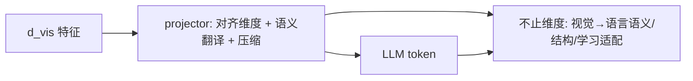

**面试要点**：projector 不只是对齐维度——**语义翻译、信息压缩与结构整理、可学习适配**是同等重要的角色。那么如果只解冻 projector、别的全冻着，模型到底能学到什么？这就引出 Q19。

---

## Q19. 只解冻 projector 而冻结视觉编码器与 LLM 时，模型能学到什么、学不到什么？

**回答**

**能学到的**：
- **视觉到语言的投影/映射**：projector 学会把视觉特征"翻译"进 LLM 的 token 空间（是那种比较简单的适配）；
- **基础对齐**：视觉特征和 LLM 词表之间的**粗对应**（也就是"能看图说话"的雏形）。

**学不到的**：
- **LLM 怎么"用"视觉去推理**：LLM 冻着，它不会学 VQA/指令/对话（没法把视觉 token 拿去做复杂推理——这正是第二阶段要解冻 LLM 的原因，见 Q5）；
- **视觉编码器的适配**：视觉特征还是 CLIP 那份（不跟任务互动），细粒度/特定领域的视觉能力提不上去；
- **复杂行为融合**：多模态指令跟随、多轮视觉对话这些，都得让 LLM 参与才学得会。

**结论**：只解 projector **只够做轻量对齐/初步对齐（也就是阶段一）**，真要 VQA/指令，必须到第二阶段解冻 LLM。

```python
# 只投projector → 仅对齐; 不学推理
freeze(vision); freeze(llm); train(projector)
# 效果: 配对标预训练（阶段一）; 不能做复杂VQA
```

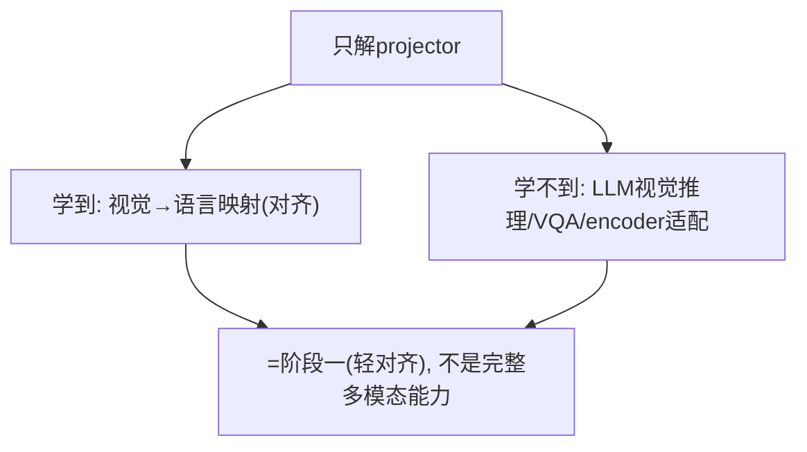

**面试要点**：只解 projector，就只学到对齐映射，**学不到视觉推理和指令能力**（那是第二阶段解冻 LLM 才能干的活）。说完视觉信息怎么进来，下一个问题看一个很具体的任务：图里的文字怎么读（OCR）？

---

## Q20. 多模态模型如何处理图中文字（OCR）？视觉编码器本身能识别文字吗，还是需要额外模块？

**回答**

**先说现状**：视觉编码器（CLIP）并不是专门做 OCR 的——它对大字、整体文字有点识别能力，但面对**长文本/模糊/又小又密**的字，识别就很差。

**主流的处理方式**：
1. **专门的 OCR/文本检测识别器（detector + recognizer）**：先用 OCR 引擎**把文字区域检测出来、识别成文本**，再把**文字内容作为文本 token 注入 LLM**（常见做法就是把 OCR 结果混进 prompt/序列里）；
2. **高分辨率 + 细 patch**：用高清图配上细 patch，让 CLIP/ViT 能多读一些（但还谈不上是纯 OCR）；
3. **端到端视觉+语言**：用**更强的视觉 + PaddleOCR/公式识别**做融合；或者让视觉 token 同时承载文字（Qwen 系列靠高分辨率和模型内部能力来提升 OCR）。

**结论**：多模态模型**通常依赖专门的 OCR/文本模块**，或者**高分辨率的视觉**，把识别出的文字转成可读文本喂给 LLM——**视觉编码器自身的 OCR 能力是有限的**。

```python
def mm_ocr(image):
    boxes, texts = ocr_detect(image)         # 检测+识别
    return prompt_with_ocr(texts)            # 文字以文本token注入LLM
# 或 用高分辨率patch增强视觉读字；纯CLIP对长文OCR弱
```

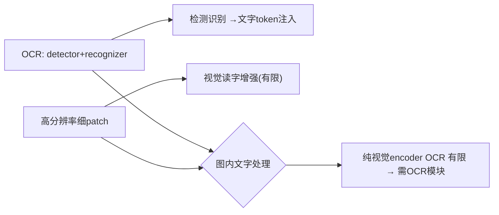

**面试要点**：视觉编码器的 OCR 有限；主流做法是**接入专门的 OCR 模块 + 高分辨率**，把识别出来的文字注入 LLM。单图聊完了，下一个问题看图文交错的复杂数据怎么训。

---

## Q21. 交错图文数据的训练目标与纯图文对训练有何不同？

**回答**

- **纯图文对（image-text pair）**：每个样本都是"1 张图 + 1 段文"（caption）——训练目标是**图文匹配/生成或对比**（把单组图文对齐起来）；
- **交错图文（interleaved image-text）**：每个样本都是**图文交替的长序列**（比如网页/教材：`text, img1, text, img2, ...`）——训练目标是在**同一条序列上做自回归/因果建模**（LLM 对图文 token 混在一起做预测）。

**具体差在哪**：
1. **任务粒度**：纯配对更侧重**全局对齐**；交错则侧重**按位置/区域的局部图文关联**（"这段文字讲的是这幅图"）；
2. **上下文**：交错让模型能在**不同图之间、图与文之间做长程关联**（多图推理）；
3. **数据形态**：纯配对场景简单；交错更像真实的网页/文档/教材；
4. 两者都能让模型"看图+读文"，但**交错训练能得到更强的上下文多模态关联和长文能力**（LLaVA-Next、InternVL 这些都用交错数据）。

```python
# 纯对: (image, text) 对齐 loss
# 交错: [tok_i, tok_img1, tok_j, tok_img2, ...] 自回归预测全部
seq = [tok("第一段"), img_tok(1), tok("第二段"), img_tok(2)]
loss += causal_lm(seq)   # 图/文都预测
```

```mermaid
flowchart LR
    A["纯图文对"] --> B["全局对齐(单图文)"] 
    C["交错图文"] --> D["局部/长程关联(多图文/文档)"]
    B --> E{"目标/能力差异"}
    D --> E
```

**面试要点**：纯对是全局对齐；交错是在同一条序列上做**图文混合的自回归**（带来局部关联、多图、文档能力）。既然图像、视频、音频都能进模型，下一个问题就找它们的共性。

---

## Q22. 音频、视频、图像统一到同一个 LLM 时，各自的 tokenizer 设计有什么共性挑战？

**回答**

**几个共性挑战**：
1. **连续信号要变成离散 token（离散化）**：图像 patch、音频帧、视频块本来都是连续信号，都得**离散化成 token**（VQ-VAE/词表），而且**离散化的质量直接影响下游**（信息损失能不能控住）；
2. **时空结构编码**：图像有 2D 位置、视频有 3D（多一维时间）、音频有时间轴——**都得把位置/时间编进 token**（M-RoPE 做时空扩展）；
3. **token 预算/长度**：音频/视频天生就是**一长串 token**（一秒钟的音频就几百帧），上下文和效率压力很大，需要做压缩/多级 token；
4. **分辨率/采样率对齐**：各模态在时间和空间上的粒度不一样，要统一 token 分辨率/采样就得协调；
5. **表示一致性**：各模态的 token 得落在**同一个语义空间**里（这样才能跨模态推理）。

```python
# 共性: 离散化(tok) + 时空位置 + token预算 + 粒度对齐
def unify_modality(x, kind):
    tokens = discrete_encode(x)          # VQ/VQ-VAE → token
    tokens = add_pos(tokens, kind)       # 图像2D / 音频t / 视频3D
    return compress(tokens)              # 控制长度
```

```mermaid
flowchart LR
    A["图像/音/视频→token"] --> B["离散化(VQ)"]
    A --> C["时空位置编码"]
    A --> D["token预算/长度(长流)"]
    A --> E["粒度对齐/同一语义空间"]
    B --> F{"共性挑战"}
    C --> F
    D --> F
    E --> F
```

**面试要点**：共性是**离散化、时空位置编码、token 长度预算、粒度对齐、统一语义空间**。多模态加进来常常会拖累纯语言能力，下一个问题就聊这个"模态遗忘"。

---

## Q23. 多模态模型中的"模态遗忘"是什么？加入视觉训练后语言能力下降如何缓解？

**回答**

**什么是模态遗忘（modality forgetting）**：加入视觉（或其他模态）训练之后，**语言能力反而下降了**——因为多模态微调**破坏或挤占了原本的语言预训练能力**（光盯着视觉数据训，语言就退化了，有点像 Alignment Tax 的多模态版）。

**怎么缓解**：
1. **混合语言数据**：训练时**掺入原始的纯语言数据**（caption/文本）——这是保住语言能力最直接的办法；
2. **低学习率/冻结**：语言部分用低学习率或 LoRA，只在做视觉适配时少动语言权重；
3. **渐进/多阶段**：先做轻量的视觉对齐，再分阶段加大视觉数据占比，同时盯着语言能力有没有回退；
4. **专家/门的分离**：把视觉和语言的处理路径部分隔开；
5. **持续监控**：训练中追踪语言 benchmark（MMLU/GSM8K），一旦发现回退就调整混合比例。

```python
def multimodal_train(batch_vis, batch_lang, llm):
    for step in ...:
        mix = batch_vis if step%10 else batch_lang   # 混语言数据
        step_llm(mix)                                  # 保语言
        monitor(lang_benchmark)                        # 跟踪回归
```

```mermaid
flowchart LR
    A["加视觉训练 → 语言下降(模态遗忘)"] --> B["缓解: 混纯语言数据/低LR或LoRA/渐进/监控"]
    B --> C["保语言不退化"]
    C --> D["类对齐税: 多模态版的Alignment Tax"]
```

**面试要点**：模态遗忘就是多模态训练把语言能力带退化了；缓解靠**混进原始语言数据、低学习率/LoRA、渐进训练、跟踪语言回退**。能力聊完，下一个问题回到评估方法：怎么区分"视觉特征好不好"和"图文对齐好不好"？

---

## Q24. CLIP 的 zero-shot 与 linear probe 分别评估了什么？两者差距说明了什么？

**回答**

- **zero-shot（零样本）**：**不做微调**，直接用文本模板和图像嵌入算相似度来分类（见 Q2）——它评估的是**CLIP 的图文对齐空间，能不能直接把类别用一段文本表达出来**（也就是这个表示能不能零样本迁移）；
- **linear probe（线性探测）**：在**冻结的 CLIP 图像特征**上**训练一个线性分类头**（用训练集图像的特征）——它评估的是**CLIP 特征本身的可分性（表征质量）**（跟文本对齐无关）。

**两者的差距说明了什么**：
- **linear probe 高、zero-shot 低**：说明 CLIP 的**视觉特征很好（可分）**，但**文本侧没对齐**（类别文本模板没学好）→ 对齐空间的表达能力弱——问题可能出在文本编码/模板上；
- **两者都高**：视觉特征和文本对齐都不错；
- **zero-shot ≈ linear probe**：对齐已经饱和了（文本表达等价于学出来的分类头）；
- **分析价值**：用 linear probe 单独隔离出"视觉特征质量"，用 zero-shot 看"图文对齐质量"——这样就能定位瓶颈到底在视觉还是文本。

```python
zs = clip_zeroshot(); lp = train_linear_probe(freeze(vision))
print(f"zero-shot={zs:.2f} linear probe={lp:.2f}")
print("lp>zs → 视觉特征好但图文对齐弱(文本侧问题)")
```

```mermaid
flowchart LR
    A["zero-shot: 图文对齐(文本表达)"] --> B["linear probe: 视觉特征可分性"]
    B --> C{"差距 → 定位瓶颈(视觉 or 文本对齐)"}
    A --> C
    C --> D["lp高zs低=文本对齐弱; 双高=都好"]
```

**面试要点**：zero-shot 测的是图文对齐，linear probe 测的是视觉特征可分性；两者的差距能帮你**定位瓶颈是在文本对齐还是视觉特征**。评估说完了，下一个问题钻到视觉编码器内部，看分辨率和 patch 大小的影响。

---

## Q25. 视觉编码器的感受野与图片分辨率之间是什么关系？ViT 的 patch size 如何影响细粒度理解？

**回答**

- **感受野（receptive field）**：指每个视觉 token 能看到的那片**输入像素范围**；**分辨率升高时，同样的 patch 覆盖的真实像素反而更少（更细）**，但绝对的感受野（patch+attention 范围）没变；
- **patch size 的影响**：
  - **patch 小（比如 14×14）** → token 多 → **每个 token 覆盖的像素少、细粒度好**（能看清小物体/小字），但**序列长、开销大**；
  - **patch 大（比如 32×32）** → token 少 → 全局效率高，但**细节会丢**（小物体被池化掉）。
- **两者的关系**：**高分辨率 × 小 patch = 细粒度好**（用更多 token 换细节）；低分辨率 × 大 patch = 粗糙。模型的**细粒度能力，是由"分辨率 + patch size"共同决定的**（本质是每个 token 覆盖多少像素）。

```python
def per_token_pixels(res, patch):
    return (res//patch)**2
print(f"336/14 → {per_token_pixels(336,14)}px/token  vs  336/32 → {per_token_pixels(336,32)}")
# 小patch/高分辨率 → 每token覆盖像素少 → 细
```

```mermaid
flowchart LR
    A["分辨率↑ 或 patch↓"] --> B["每token覆盖像素少 → 细粒度好"]
    C["patch↑"] --> D["token少/全局快/细节丢"]
    B --> E{"细节由 分辨率×patch 决定"}
    D --> E
```

**面试要点**：细粒度是**分辨率 × patch 共同决定的（看每个 token 覆盖多少像素）**；高分辨率 + 小 patch 能做到细节强，但 token 也贵。把理论落到实战，下一个问题就是一个具体的架构选型：文档理解到底该走 OCR 还是视觉？

---

## Q26. 为文档理解任务设计多模态架构，你会选高分辨率 ViT + 更多 visual token，还是先 OCR 再走纯文本？

**回答**

**先看怎么判断**（取决于文档类型和目标）：

- **先 OCR → 纯文本（OCR 到文本的路线）**：
  - 适合：**版面规整、文字密集**的文档（扫描书、合同、报表——主要信息就是文字）；
  - 优点：token 少（文本 token 远少于视觉 token）、文本语义好、LLM 的文本能力直接就能用；
  - 缺点：**丢掉版面/表格/图表/公式的结构、OCR 错误会累积、没有格式信息**（面对复杂版面就不够用）。

- **高分辨率 ViT + 更多 visual token**：
  - 适合：**布局很重要、图文混排、有表格/图表/公式**的文档（版面本身承载信息）；
  - 优点：能保留**布局/结构**和视觉细节（表格、流程图、公式）；
  - 缺点：token 多（上下文贵）、视觉特征面对长文本时识别效率低。

**工程建议**：做**混合（基于版面）**——先做**版面分析**，文本块走 OCR 后注入文本，结构块（表格/图/公式）用高分辨率视觉 token；或者走"**OCR + 视觉双通道**"（文字走 OCR、结构走视觉）。主流的文档模型（DocLLM、LayoutLM-3D 等）基本都走"布局 + 双通道"这条路。

```python
def doc_strategy(page):
    layout = analyze_layout(page)         # 版面分析
    text_part = ocr(layout.text_blocks)  # 文本→token
    visual_part = vision(layout.figures/tables)   # 结构→视觉token
    return concat(text_part, visual_part)  # 混合（可再走布局PE)
```

```mermaid
flowchart TB
    A["纯文本OCR"] --> B["文字文档/省token, 丢版面/表/公式"]
    C["高分辨率视觉"] --> D["保留布局/结构, token贵"]
    B --> E{"混合: 版面分析 → 文本OCR + 结构视觉"}
    D --> E
```

**面试要点**：文字文档走 OCR（省 token）；版面/表格/图走视觉；主流做法是**先做版面分析再混合（OCR + 视觉双通道）**。架构选完，下一个问题聊怎么用强化学习调好多模态模型。

---

## Q27. 多模态 RLHF 的奖励如何设计？视觉忠实度与文本有用性如何联合优化？

**回答**

**多模态 RLHF 的奖励怎么设计**：
- **多维度奖励组合**：
  1. **视觉忠实度（faithfulness）**：生成的描述/回答要**和图像内容一致**（不瞎编、不遗漏）——用**视觉事实核验**（跟检测器/grounding 对照，或者让 VLM 判断"图文是否一致"）；
  2. **文本有用性（helpfulness）**：回答要有帮助、清晰、听指令——用**偏好/Judge/RM**；
- **联合优化**：`R = λ_vis·R_faithful + λ_text·R_helpful`（加权和），或者在成对偏好数据上用多目标 RL 去调（trade-off 靠调 λ）。

**联合优化要注意的点**：
- **reward hacking（视觉部分）**：模型可能"既过了视觉核验、又刷了文本风格"——所以两个信号都得严格（见 Q13）；
- **λ 的平衡**：视觉忠实和文本有用之间要权衡（模型要是"太忠实但不帮忙"，或者"有用但瞎编"就都不行）——按任务去调权重；
- 用**多个维度的 verifier/RM 分开打分再组合**，比单一 reward 更稳。

```python
def mm_reward(text, image, vision_checker):
    vis_faith = vision_checker(text≈image)     # 图文一致分
    help_score = reward_model(text)            # 有用性
    return λ_vis*vis_faith + λ_text*help_score # 联合
```

```mermaid
flowchart LR
    A["视觉忠实: 与图核验(不幻觉)"] --> B["R = λ_vis·faith + λ_text·help"]
    C["文本有用: 偏好/RM"] --> B
    B --> D["联合优化(权重λ平衡/防hack)"]
    D --> E["多模态对齐"]
```

**面试要点**：多模态奖励就是**视觉忠实 + 文本有用**的加权和；联合优化要权重平衡、用双信号来防 hack。聊完训练和评估，下一个问题揭开原生多模态（Chameleon）到底难在哪。

---

## Q28. Chameleon 类"原生多模态"模型在训练稳定性上面临什么额外挑战？

**回答**

**Chameleon 这种原生多模态（统一图文 token 流）额外的训练挑战**：

1. **图像 tokenizer/离散化难训**：得训练一个**好的 image VQ tokenizer**——离散化误差、重建质量、token 语义稳不稳定，都直接影响训练；
2. **多模态序列建模不稳定**：**图文混合的因果建模**（图像 token 和文本 token 放在同一序列里预测），训练曲线更难收敛（模态之间的梯度会互相打架）；
3. **输入分布/长度**：图 token 序列很长（一堆 image token）→ 长序列 attention 训练成本高（内存/效率）、长度分布也复杂；
4. **模式坍塌/模态失衡**：模型可能**偏向文本而忽略视觉**（或者反过来）——一个模态把另一个"吃掉"（模态学习失衡，学习率和数据配比都不好调）；
5. **缺少成熟的 CLIP 视觉先验**：没有独立的视觉底座，**视觉表示得从零学** → 收敛更慢、起步更不稳。

**缓解办法**：稳定的学习率调度、调好图文数据配比、预训练 tokenizer、压缩视觉 token、用分模态的 loss 或梯度平衡。

```python
# 原生：统一序列 + 自回归(图文全部)
seq = [img_tok1..n, txt_tok1..m]
loss = causal_mle(seq)   # 图文同目标 → 模态间梯度容易失衡
# 缓解: 图/文损失分开加权 + tokenizer预训练 + 稳定LR
```

```mermaid
flowchart LR
    A["原生多模态训练"] --> B["image tokenizer难/图文建模不稳/长度"]
    A --> C["模态失衡/无CLIP底座收敛慢"]
    B --> D{"额外不稳定来源"}
    C --> D
    D --> E["缓解: 分模态loss加权/预训练tokenizer/稳定LR"]
```

**面试要点**：原生多模态的难处在于**图像 tokenizer、图文混合建模不稳定、模态失衡、没有 CLIP 底座导致收敛慢**——需要分模态加权以及稳定策略。难训归难训，下一个问题看它实际跑起来时，时间都花在哪。

---

## Q29. 多模态模型的推理延迟主要花在哪里？视觉编码、projector、LLM prefill 各占多少？

**回答**

**把开销拆开看**：

- **视觉编码**：让图像过一遍 CLIP/ViT——算是**比较大的一块计算**（单张图就挺费时，高分辨率/多图更甚），通常**在 prefill 阶段一次性做完**；（粗略说，视觉编码是几千毫秒的量级，但跟 LLM 长推理的总 token 时间比还是小。）
- **projector**：一层/浅层 MLP——只做**一次小小的线性变换**，**开销基本可以忽略**；
- **LLM prefill（视觉 token 占大头的那部分）**：视觉 token **往往占了序列的大头**（比如 576 个 visual token + 少量文本）→ **LLM 对这些 visual token 的 prefill 计算**（长 attention）就是**推理耗时的主体**（尤其多图/高分辨率时 token 更多）；之后的 decode 和纯文本一样。

**总结**：**视觉编码 + LLM 对大量 visual token 的 prefill，是延迟的大头**；projector 极小。优化点就是：**压缩视觉 token（dynamic/减少 token）、视觉编码并行/缓存、长序列用 FlashAttention**。

```python
# 精确: prefill 中 visual token 占大头
visual_tok = 576        # 一张图
llm_prefill = visual_tok * cost_per_tok    # 主体
print("延迟≈视觉编码 + LLM prefill(visual token 大头) + 投影(≈0)")
```

```mermaid
flowchart LR
    A["视觉编码"] --> B["中等(=prefill)"
    C["projector"] --> D["≈0"]
    E["LLM prefill(visual tokens 大头)"] --> F["延迟主体"]
    B --> F
    D --> F
    F --> G["优化: 压visual token/编码缓存/Flash"]
```

**面试要点**：延迟大头是**视觉编码 + LLM 对大量 visual token 的 prefill**；projector 可以忽略；优化靠压 token、并行、缓存。最后用一个总结性的问题收尾：从 CLIP 到 LLaVA 再到 Omni，这条演进主线到底是什么。

---

## Q30. 从 CLIP 到 LLaVA 到 Omni，多模态架构的演进主线是什么？每个阶段解决了前一个阶段的什么根本局限？

**回答**

**演进主线**：从"**对齐**"到"**桥接**"再到"**统一**"：

1. **CLIP（对齐）**：
   - 解决了什么：把**图文表征对齐到同一个空间**（靠对比学习）；
   - 根本局限：**只会对齐，不会生成/推理**（分类、检索可以，但做不了 VQA/对话）。

2. **LLaVA（桥接/拼接）**：
   - 解决了什么：用 **projector 把 CLIP 的视觉特征桥接到 LLM**，再加上视觉指令微调 → **能完成 VQA/对话**（会生成、会推理）；
   - 根本局限：**视觉是"旁挂"的**（独立的 CLIP + 投影，视觉和语言表示分离），跨模态的细粒度/长尾推理受限，视觉能力被 projector 卡住。

3. **Omni/Chameleon（统一/原生）**：
   - 解决了什么：**把图像也做成 token，和文本在同一条 Transformer 流里建模**（early fusion/统一词表）→ **真正统一的表示、端到端的跨模态推理**（没有投影瓶颈）；
   - 遗留挑战（还没完全解决）：**训练稳定性、图像 tokenizer、视觉预训练成本**（见 Q28）——"统一"是方向，但还需要成熟。

**一句话主线**：**先对齐空间 → 再桥接给 LLM → 最后统一成同一种语言**（三个阶段各突破了一个根本局限）。

```python
def lineage():
    return [("CLIP","对齐图文"),("LLaVA","投影桥接给LLM"),
            ("Omni","图文同一流(统一)")]
```

```mermaid
flowchart LR
    A["CLIP: 对齐"] --> B["→ 不能生成/推理"]
    B --> C["LLaVA: 桥接(投影)"] --> D["→ 会VQA但视觉旁挂"]
    D --> E["Omni: 统一(token同一流)"] --> F["→ 真正统一, 但难训"]
    A --> G{"主线: 对齐→桥接→统一"}
    C --> G
    E --> G
```

**面试要点**：主线就是**对齐（CLIP）→ 桥接（LLaVA）→ 统一（Omni）**；每个阶段都在突破上一阶段的根本局限（对齐不会生成、桥接表示分离、统一则难训）。

---

## 参考链接

1. [多模态大模型——完整实战指南-CSDN博客](https://blog.csdn.net/gedonshen/article/details/162549217)
2. [多模态大模型: 盘点&Highlights part2——Qwen-VL系列-CSDN博客](https://blog.csdn.net/baidu_25854831/article/details/142036789)
3. [多模态大模型架构深度解析：从 CLIP 对齐到 LLaVA、Qwen-VL 的视觉语言模型演进-CSDN博客](https://blog.csdn.net/m0_50709695/article/details/163909202)
4. [多模态大模型技术深度解析：从 CLIP 到 LLaVA 的视觉语言融合原理-CSDN博客](https://blog.csdn.net/a13662080711/article/details/161429950)
5. [视觉语言模型VLM入门与实战：从架构原理到微调部署全路径解析-CSDN博客](https://blog.csdn.net/weixin_34175509/article/details/89831284)
6. [ARIS VLM 多模态教程深度解析：从 CLIP 对称 InfoNCE 到 Qwen2-VL M-RoPE 的完整视觉-CSDN博客](https://blog.csdn.net/gitblog_00077/article/details/160095781)
7. [AI进阶 | 多模态视觉：从 CLIP 到 LLaVA —— 它是如何看懂这个世界的？-CSDN博客](https://blog.csdn.net/ipython_fool/article/details/158936540)

---

*下一章展望：第 15 章进入扩展内容（系统推理、Agent、世界模型、未来范式等 30 题）。*