# 第 15 章 · 扩展内容

> 面试生普（LLM 500 题）· 第 15 章。本章覆盖系统视角推理、Agent、世界模型、LeCun 路线、test-time compute、推理时间扩展、记忆实现、可解释性、开源/闭源、端侧、LLM 全栈自述与未来展望、提示工程、结构化输出、Function Calling/MCP、API 工程、模型内化等 60 个问题，关键概念配 Python 代码与 mermaid 图解。

---

> 先把话说清楚：前面 14 章基本都在讲"大模型这台机器怎么造、怎么跑"，到了最后一章，我们抬头看看更远的地方——它正在被拿去干什么、接下来可能变成什么样。这一章更偏"观点题"：推理系统怎么伺候、Agent 到底是什么、世界模型和 LeCun 的批评是怎么回事、开源闭源谁追谁、手机能不能跑得动 7B、以及"你怎么看大模型的未来"。这些题没有唯一正确答案，面试官其实是在看你有没有把前 14 章的知识串成一条自己的逻辑线。所以读这章不必死记，重点是把"每个判断背后的理由"跟着走一遍，慢慢地你也能形成自己的说法。

---

## Q1. 从系统角度重新审视推理：TTFT 与 TPOT 分别受哪些因素支配？在线上服务中如何联合优化？

**回答**

先把两个缩写摆出来，它们是线上服务最常盯的两个"仪表盘"：

- **TTFT（Time to First Token，首个 token 的等待时间）**：用户敲完问题后，等多久能看见第一个字蹦出来。它主要受 **prefill**（把整段 prompt 一次性读进去、算出第一批结果的那个阶段）支配，另外还叠加了排队时间——prompt 越大，prefill 的算力越重，batch 怎么调度、prefix cache（前缀缓存，见第 9 章 Q13）有没有命中、chunked 策略怎么切（第 9 章），都会直接影响它。
- **TPOT（Time Per Output Token，生成阶段每个 token 的间隔）**：第一个字出来之后，后面每吐一个字平均要等多久。它主要受 **decode**（一个 token 一个 token 往下生成）支配，影响因素是解码带宽（要读权重、读 KV Cache）、batch 大小（一堆请求共享带宽）、kernel 效率、以及 CUDA Graph。

**线上怎么把两者一起优化**，通常几招配合用：

- **分离 prefill/decode**（disaggregated serving：prefill 专门一组节点、decode 专门一组节点，各调各的），避免两种负载互相拖累；
- **Chunked prefill** 把长 prompt 切成小段穿插执行，保住 TPOT 的稳定（代价是 TTFT 稍靠后一点）；
- 想要**低 TTFT**：开 prefix cache、并行 prefill、先用小 batch 把第一个 token 冲出来；想要**高吞吐（TPOT 端）**：上连续批、放大 batch 把带宽摊薄；
- 最后用 **SLA 权重**在调度器里做取舍——交互式请求优先 TTFT，离线任务优先吞吐（也就是下一题 Q2 要展开的）。

```python
def joint_opt(mode):
    if mode == "interactive": return "TTFT优先: 并行prefill+prefix cache+小batch"
    if mode == "throughput":  return "TPOT/吞吐: 大batch连续+chunked"
```

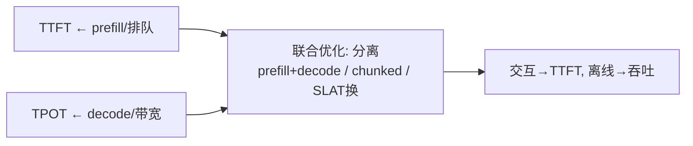

**面试要点**：TTFT 归 prefill、TPOT 归 decode；联合优化=**分离调度 + Chunked prefill + 按 SLA 调 TTFT/吞吐**。搞清这两个指标归谁管，下一题就顺着问：用户更在意哪个，参数该往哪边调。

---

## Q2. 用户对首字延迟极敏感时，应优先调整 serving 系统的哪些参数？对吞吐更敏感时又如何调整？

**回答**

一句话概括：**瓶颈在"首字"，就往压缩 prefill 时间上使劲；瓶颈在"总量"，就往让 decode 满载上使劲。**

**如果用户对首字延迟（TTFT）极敏感**：

1. **并行 prefill**：拆成多节点/多张卡上的张量并行同时算，把 prefill 的时间压下来；
2. **Prefix Cache**：命中前一轮的相同前缀就直接复用，跳过 prefill（见第 9 章 Q17）；
3. **小 batch / 即时调度**：新请求优先做 prefill（而不是排队等一个更大的 batch），必要时用**抢占**或 **Chunked prefill**；
4. 换**算力更强的节点**（prefill 大卡），并减少 decode 环节的排队。

**如果对吞吐更敏感**：

1. **连续大 batch**：把 decode 的 batch 放大，让更多请求共享同一份带宽（见第 5 章 Q27）；
2. **Chunked / 分离**：prefill 与 decode 分离，让 decode 一路满载；
3. **KV 压缩 / 量化 / 模型瘦身**（见第 9 章 Q28）；
4. 既然吞吐优先，就别管单请求的 TTFT 了，调度器可以把 prefill 排后、decode 优先。

```python
def serving_tuning(sensitive):
    if sensitive == "ttft": return {"parallel prefill": True, "prefix cache": True, "small batch": True}
    if sensitive == "throughput": return {"big continuous batch": True, "decode priority": True}
```

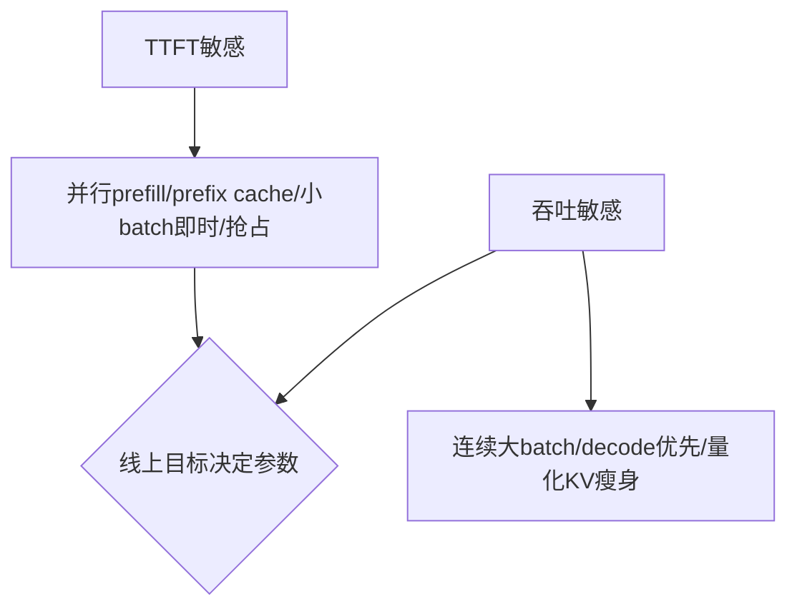

**面试要点**：TTFT 敏感=并行 prefill+cache+即时小批；吞吐敏感=连续大 batch+decode 优先+瘦身。从"怎么伺候系统"往下走，就该看"模型本身够不够聪明"了——先看 LeCun 那套尖锐的批评。

---

## Q3. LeCun 对 LLM 路线的核心批评是什么？他认为"下一 token 预测"范式的根本局限在哪里？

**回答**

LeCun（图灵奖得主、Meta 首席 AI 科学家）是 LLM 路线最有名的"质疑者"之一。他的火药味核心就一句：**LLM 充其量是个"文本的预测器"**——它靠统计下一个 token 的共现规律转得飞快，但**并没有真正的世界理解、规划和常识推理**；人们常把"在语言分布上说得通"误当成了"真的懂世界"。

在他看来，"下一 token 预测"这个范式的根本局限有这么几条：

1. **没有目标、没有规划**：预测下一个 token 本质是**统计关联**，不是"朝着某个目标去行动"，所以做不了真正的长程规划；
2. **缺乏世界模型**：它没有一套**能预测物理、预测因果的内部模型**——文本穷尽不了真实世界的状态，语言只是世界的投影，投影和实物之间隔着一道 gap；
3. **被动，而且只会产语言**：它没法跟真实环境交互、也没法在环境里验证自己；
4. **学习方式不高效**：靠海量文本被动地自监督，缺少**交互、多模态、动作反馈**这类更高效的学习信号；
5. 因此它**不可靠**（就是大家说的幻觉），也拿不出一条可解释的推理链。

（LeCun 自己提出的替代路线是 JEPA，留到 Q17 再聊。）

```python
def leaky_critique():
    return {"text-only": "只预测token, 无世界理解",
            "no_goal": "无规划/面向目标",
            "no_world": "缺可交互世界模型/因果"}
```

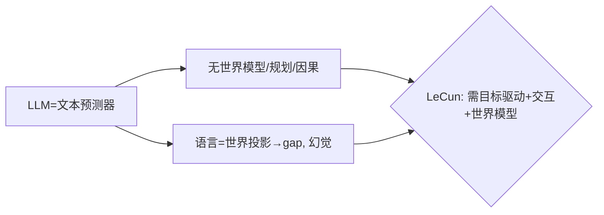

**面试要点**：批评=LLM 只是**统计下一 token、缺世界理解/规划**；局限=无目标、无世界模型、被动文本、幻觉。那既然 LeCun 嫌它不懂世界，我们不妨追问一句：LLM 到底有没有偷偷学到一点"世界模型"？

---

## Q4. 你如何看待"世界模型"与 LLM 的关系？LLM 是否已经隐式学到了世界模型？

**回答**

先把"世界模型"定义清楚：它指的是一个**能在内部预测环境状态怎么变、预测因果和物理规律**的模型——agent 靠它来做规划（先在心里"过一遍"，再决定怎么做）。

那 LLM 和它是什么关系呢？

- 经过海量文本训练，LLM **可能学到了世界的一层"语言投影"**——事实、关系、一些表层物理常识，它都能复述；
- **但差距是实打实的**：LLM 学到的是"语言里描述的规律"，而不是**可操作、可预测真实状态**的世界模型，尤其在物理动态、真实交互、它没见过的状态上，差得很远。

**那 LLM 到底有没有隐式学到世界模型？**

- **有一点**：有研究表明，LLM 在某些任务（推理、空间、简单因果）里似乎**"悄悄形成了一种世界模型"**（用内部表征反映了真实世界的结构）——证据是有的，但很有限；
- **结论**：它顶多算个**"部分、不完整的世界模型"**——能片段式地推断，但不是**可验证、完整、可交互**的世界模型。要得到真正的世界模型，还得动真格地做环境交互，或者换架构（比如 JEPA、多模态+动作，见 Q17）。

```python
def world_model_view():
    return ("LLM有'语言的投影'与部分隐性结构, "
            "但不是可预测/可交互的完整世界模型")
```

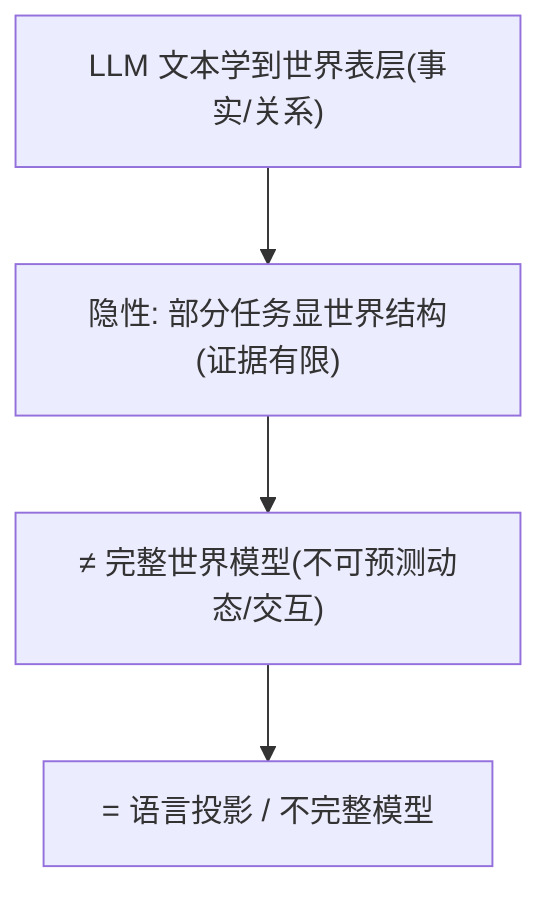

**面试要点**：LLM 学到**语言的投影**与**有限隐性结构**；但不是**可预测/可交互的完整世界模型**（差距在动态与交互）。世界模型是一条路，另一条更省钱的路是"让模型想得更久"——这就引出推理时间扩展。

---

## Q5. 推理时间扩展（test-time compute，长思维链）是否改变了 Scaling Law 的形态？

**回答**

先分清两个 scaling：

- **训练 Scaling Law**：`loss(N, D)`——训练时你投入多少算力（参数 N、数据 D），就决定了模型能有多强（第 8 章）；
- **推理时间扩展（test-time compute）**：在**推理的时候多花算力**（拉长思维链、做 beam search、多次采样再验证）来**提升单次回答的质量**。注意是**同一个模型**，只是把算力预算从"训练"挪一部分到"推理"。

**它到底有没有改变形态？**

- 如果把图横轴换成"**能力 vs 总算力（训练+推理）**"，那**形态确实被扩展了**：因为**推理时可以用算力换能力**，每多花一点推理算力，能力就涨一点，看起来就像多了一条"推理 scaling"的曲线；
- 更好的理解方式是：它并没有推翻训练 Scaling Law，而是**给它多开了一个维度**——`能力 = f(train, test_compute)`。固定模型、加更多推理算力，能力还能持续往上走（长思维链、GO 那类 test-time 搜索都是一个道理）；
- 所以说到底，**"Scaling 的战线从训练慢慢迁移到了推理"**（这一章 Q21 会接着聊推理端的边际收益什么时候开始递减）。

```python
def capability(fixed_model, test_compute):
    # 同模型: 推理算力越多能力越高（近似幂律）
    return base + C**(0.5)*test_compute
```

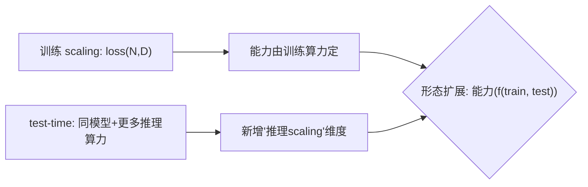

**面试要点**：test-time compute **新增"推理缩放"维度**（同模型+推理算力→更强）；不推翻训练 scaling，而是**战线迁移到推理端**。既然算力能换能力，那问题就来了：如果推理算力"无限"给下去，能力上限又卡在哪？

---

## Q6. 推理阶段可以无限延长思维链时，模型能力的上限由什么决定？

**回答**

想象推理算力像水龙头一样可以一直开下去——那上限由几个东西共同决定：

1. **模型内在的能力与表示**：**权重里到底有没有足够的知识和推理"原材料"**。推理算力只能**利用**已有的表示，没法凭空变出它压根不了解的领域或概念——肚子里没货，思维链再长也编不出来；
2. **正确的验证与目标**：模型能不能**判断自己当前这一步推得对不对**？如果没有验证信号，它就会一路错下去——所以需要"过程验证"或"搜索"来把关；
3. **搜索/规划的质量**：更长的思维链本质是**更深的搜索**，上限还要受**搜索策略（怎么发散、怎么回溯、怎么验证）**的约束。没有系统性的搜索，就只是"原地绕圈"；
4. **稳定性**：链一长，错误会**一点点累积、内容会重复**，不自我修正就会发散掉。

**所以结论是**：**上限 ≈ 模型内部的"理解+知识" × 验证与搜索策略的可靠性**。推理算力放大的，只是"利用这些能力的过程"，**不是能力本身**。

```python
def ceiling(model, verifier, search):
    return model._knowledge * verifier_quality * search_quality
print("算力只放大'利用'; 上限=知识×验证×搜索")
```

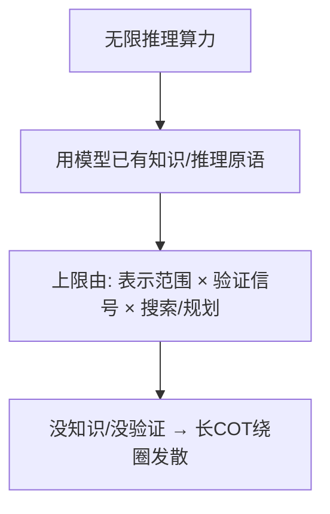

**面试要点**：上限=**权重内的知识/表示 × 验证 × 搜索策略**；推理算力放大"利用"而非"能力本身"。光会"想"，还得会"做"——这就轮到 Agent 范式登场了。

---

## Q7. Agent 范式与纯 LLM 推理的核心区别是什么？工具使用、记忆、规划分别给模型增加了什么？

**回答**

**核心区别一句话**：纯 LLM 推理是"一次性想完就答"，中间不跟外界打交道；而 **Agent 是多步闭环**——感知 → 决策 → 行动（调用工具、改动环境）→ 观察结果 → 再决策，它会**跟环境持续交互**。

那 Agent 相比纯 LLM，到底多了哪几件装备？

1. **工具使用**：给了模型**"动手"的能力**（调用 API、跑代码、检索、计算器），于是它能**执行、能验证**——从"只会说"升级为"能做事"（顺便也补上了校验和计算能力）；
2. **记忆**：给了模型**跨步骤、跨会话的状态**（长期记忆、历史记录），它可以**参考过去的决策**、保持前后一致（解决单个模型"没记性"的问题）；
3. **规划**：给了模型**分步目标和执行时的回退能力**，它能**长程地拆解、搜索、纠错**（挣脱"只能单步预测"的局限）。

**一句话总结**：Agent 给模型加了"**闭环交互（行动）+ 记忆（状态）+ 规划（分解）**"，让模型从"回答问题"进化成"解决问题"。

```python
def agent_loop(state, memory, tools, planner):
    while not done:
        plan = planner(state, memory)          # 规划(分解)
        act = choose_tool(plan, tools)          # 行动/工具
        obs = execute(act)                      # 观察环境
        state, memory = update(state, memory, obs)
    return result
```

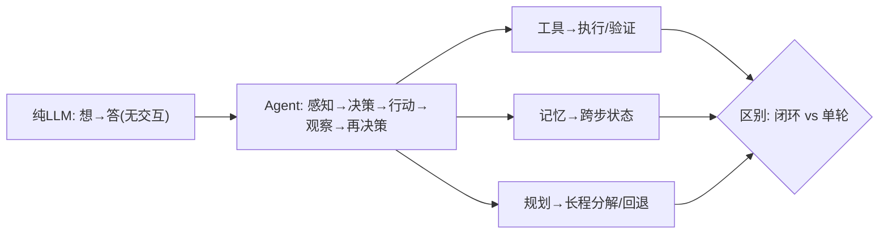

**面试要点**：Agent=**闭环多步与环境交互**；工具（行动）、记忆（状态）、规划（分解）各扩展不同能力。Agent 让模型"能做事"，但知识总得从哪儿来——是检索进来，还是全塞进上下文？这就是 RAG 和长上下文的取舍。

---

## Q8. RAG 与长上下文是否是替代关系？各自适合什么知识更新频率与任务类型？

**回答**

**先说结论：不是二选一的替代，而是彼此互补。**

- **RAG（检索增强生成）**：把外部知识**动态地检索出来**，再塞进 prompt。
  - 适合：**更新频繁的知识**（新闻、实时信息、用户私有资料）、**需要精确事实并引用验证**的场景、以及**内存/成本受限**（不想把所有东西都塞进上下文）的情况；
  - 局限：答案质量受检索质量连累，跨很多文档做复杂推理时偏弱。
- **长上下文（long-context）**：把**整个语料/文档一次性放进上下文**。
  - 适合：**更新频率低的稳定知识**（法律全文、一整本书）、**需要通盘理解**的任务（跨长文档推理、总结）、以及"文档就在手边"的场景；
  - 局限：token 多、成本高；在超长文里找信息效率有限、也很难"顿悟"出全局（找不到 needle 时依旧难），更不能代替外部实时知识。

**结论**：**知识更新勤 → 用 RAG；知识稳定、需要整篇通读 → 用长上下文**。实际工程里最常见的做法是**把两者组合起来**：先用 RAG 检索，再放进长上下文里推理。

```python
def pick(freq, whole_needed):
    return "RAG" if freq=="high" or not whole_needed else "long-context"
```

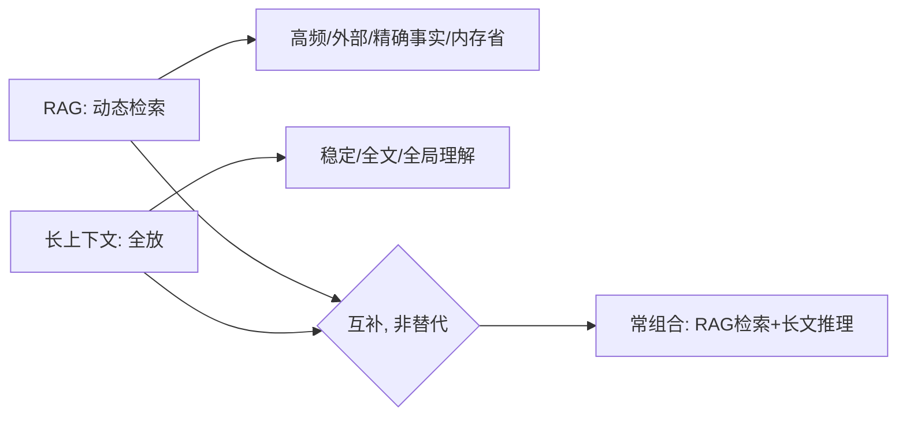

**面试要点**：高频/外部知识用 RAG，稳定/全局用长上下文——**互补**、常组合。工具、记忆、检索这些都是"零件"，Q9 就来问：这些路线里，到底哪条最可能捅破当前的天花板？

---

## Q9. 多模态、Agent、推理时间扩展三条路线，哪一条最有可能突破当前 LLM 的瓶颈？为什么？

**回答**

这题**没有唯一标准答案**，关键是给出一个有结构、有逻辑的判断。我倾向于：**"推理时间扩展 + Agent"这个组合**最可能带来能力上的突破，理由如下。

- **多模态**：它扩宽的是**"输入范围"**（能看、能听），但本质上仍然是"被动预测"——它补的是广度，治不了"规划差、不可靠"这两个病；
- **Agent**：它给了模型**行动、交互、目标**——从"回答问题"变成"解决问题"，这是**能力形态的一次跃迁**（但它受限于模型的规划与验证能力）；
- **推理时间扩展**：它给了模型**探索、验证、搜索**——**用算力去补模型推理的上限**（见 Q5/Q6），"愿意想得更久"是对现有瓶颈的即时缓解。

**为什么说"组合"最强**：Agent 本身就需要规划（这正是推理时间扩展的用武之地），也需要多模态去理解环境。三者恰好是"感知 × 行动 × 推理"三个维度——单独哪一维都不够用。合理的路径是：**先用推理扩展把单步质量提上去，再由 Agent 提供执行闭环，多模态负责扩展感知的输入**。

```python
def breakthrough():
    return {"multimodal": "感知广度", "agent": "行动/闭环",
            "test-time": "推理深度", "组合": "感知×行动×推理 → 最可能突破"}
```

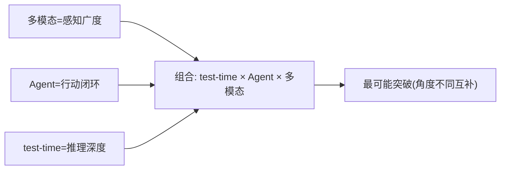

**面试要点**：无唯一；**组合（推理扩展×Agent×多模态）**最可能——感知×行动×推理三维配合；说明你的推理逻辑。路线在往前走，架构设计也得跟着转——如果重心从"训练最优"挪到"推理最优"，模型会长成什么样？

---

## Q10. 从"训练最优"到"推理最优"的范式转移，对模型架构设计会带来什么反向影响？

**回答**

过去大家比的是"谁能训出一个更强的模型"（训练最优）；现在推理成本和部署体验越来越被看重（推理最优）。这个重心一旦挪动，就会**反过来倒逼架构设计**往这些方向走：

1. **更少的激活参数、更利于部署**：比如 MoE（每次只激活一部分专家）、GQA/MQA（把 KV 变大变小）、以及对低精度更友好的架构（天生好量化）；
2. **更长上下文的效率**：设计长上下文、稀疏注意力，并且让架构**对 test-time compute 友好**（方便搜索、验证）；
3. **模块化、可卸载**：让推理更好伺候——专家能卸载、KV 能压缩、模型能逐层切分；
4. **推理友好的 token 设计**：减少 token 数（长上下文更省）、尽量可缓存（方便 prefix 复用）；
5. **"小模型 + 靠算力补"**：既然推理阶段可以再加算力（test-time），架构就**不必一味追大参数**了——更倾向于"中等模型 + 可扩展的推理"（推理 scaling 让思路从"堆参数"转向"能 query 更久"）。

```python
def arch_shift():
    return ["MoE/激活少", "GQA/低KV", "量化友好", "长上下文/稀疏", "test-time扩展友好"]
```

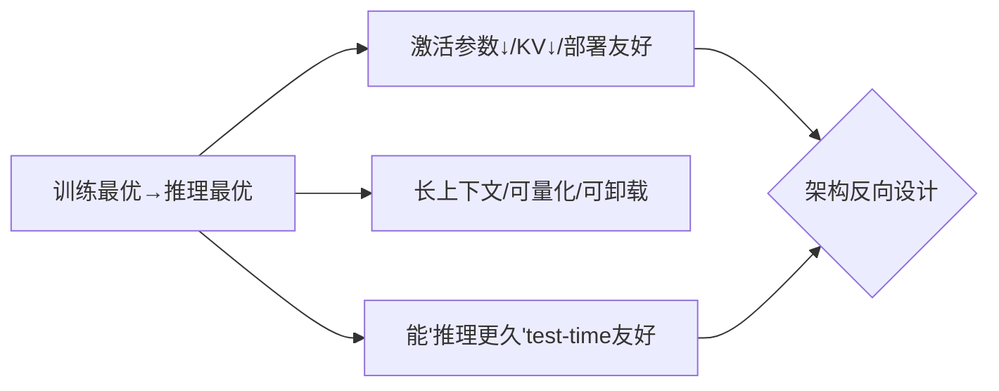

**面试要点**：推理最优反向要求=**激活/KV 少、部署/量化友好、长上下文、test-time 可扩展**——架构从"堆参数"转向"高效+可推理扩展"。既然聊到了架构的未来，不如让你具体押一个：未来 3 年，LLM 架构最可能变的是什么？

---

## Q11. 预测未来 3 年 LLM 架构最可能的一个变化，你会选什么？依据是什么？

**回答**

**我的选择是：MoE 化（稀疏激活 + 多专家）会在主流生产模型里大面积普及。**

依据有四条：

1. **成本-收益最划算**：在"相同激活 FLOPs"的前提下，MoE 用更大的总参数量换来了更大的容量（见第 4 章 Q14），**激活少、部署便宜**——在推理成本压力越来越大的今天，这是最经济的做法；
2. **已被验证**：Mixtral、DeepSeek、GPT-4 等都已经在用，研究比较稳，工程链条（路由、EP 专家并行、通信）也成熟了；
3. **趋势能合流**：MoE 能和"多模态、长上下文"自然组合（可以拿不同专家分别管不同模态/知识）；
4. **产业需要**：行业想要"第一便宜 + 能力接近"，MoE 是**最能同时满足这两点**的架构变化。

（备选方案是长上下文/稀疏注意力，或者统一的原生多模态——我按"最可能先在工业界落地"这个标准选了 MoE。）

```python
moe_evidence = ["同FLOPs更多容量", "深层验证", "生产成本压力", "可组合多模态"]
print("预测: MoE 普及（最可能+依据如上）")
```

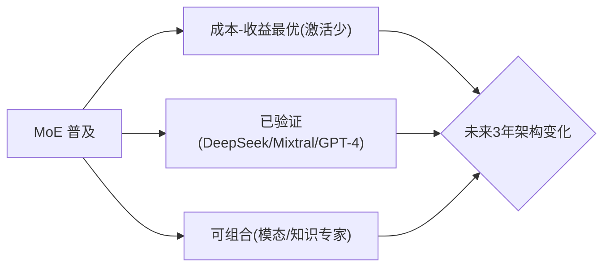

**面试要点**：给明确预测（MoE 化）+ 三条依据（成本收益/实证/可组合）——并说明是"概率判断"。说到 MoE 这种"稀疏化"，就自然引出一个更大的问题：稀疏化与稠密化两条路，你到底更看好哪条？

---

## Q12. 稀疏化（MoE、结构化剪枝、动态计算）与稠密化两条路线，你更看好哪一条？为什么？

**回答**

**我更倾向"走混合路线，不能只押一边"；如果非要单选，那在"部署成本"这个维度上，我看好稀疏化。**

理由：

- **稀疏化（MoE / 剪枝 / 动态计算）**：**同样的 FLOPs 能装下更大的容量、激活更少、部署更便宜**（见第 4 章 Q14）；剪枝和动态计算还能在推理时按需自适应地省算力——在成本与规模的持续压力下，这条路更划算；
- **稠密化**：表达连续、训练稳定、没有路由和负载均衡的麻烦，但**它的算力消耗会随规模线性往上涨**（贵）；
- **现实里，业界其实是两条腿一起走**：训练时用大模型（总参数大）+ 部署时用稀疏化（MoE/量化/剪枝），也就是"先稠密后稀化"的混合打法；只盯着一条路线，反而会丢掉另一条的好处。

**结论**：**从推理成本的角度看，稀疏化更可能胜出**；但长期看，会落在"稠密训练 + 稀疏部署/专家化"的混合形态上。

```python
def compare():
    return {"sparse": "容量/便宜/部署友好, 但路由/负载复杂",
            "dense": "稳/连续, 但随规模贵"}
print("看好: 混合(训练稠密+部署稀疏化); 单选按成本押稀疏化")
```

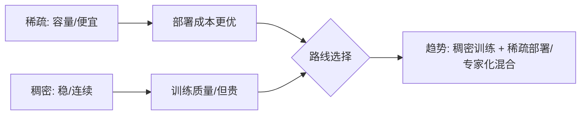

**面试要点**：给明确判断 + 理由；推荐**混合**（训练稠密/部署稀疏），单选按成本押稀疏化。架构和部署聊完了，还有一个绕不开的"人的需求"：模型该怎么"记住"东西？

---

## Q13. LLM 的"记忆"应如何实现？参数化记忆、外部检索、KV 持久化各自的优劣是什么？

**回答**

把模型的"记忆"拆开看，常见有三种实现方式：

1. **参数化记忆（写进权重）**：预训练或微调时，把知识**写进模型权重**里。
   - 优点：**检索快，天然就带着语境**；
   - 缺点：**更新难、更新贵**（得再微调）、容易过时、**不可控**（你没法精确删掉某条记忆），容量也有限。
2. **外部检索（RAG/向量库）**：把知识存在外部，**用的时候检索出来再注入**（见 Q8）。
   - 优点：**可更新、可删除、可溯源**，容量不受模型本身限制，成本低；
   - 缺点：**效果依赖检索质量**，做非线性查询时不太可靠，还得额外搭一套检索系统。
3. **KV 持久化（上下文记忆/缓存）**：把对话、上下文**存在 KV Cache 里**（长上下文、视觉记忆都算这一类）。
   - 优点：**能精确保住历史**，不用训练，天然支持多轮对话；
   - 缺点：**token 和显存成本随长度上涨**，上下文窗口有限，而且没有"持久的长期知识"（窗口一过就忘了）。

**结论**：现实里要**分层混合**——**参数化存稳定的知识 + 外部检索存动态更新的内容 + KV 存会话上下文**，各管一摊。

```python
def memory_layers():
    return {"parametric": "稳定知识(难更新)", "external_rag": "动态可更新",
            "kv_persist": "会话/上下文(窗口受限)"}
```

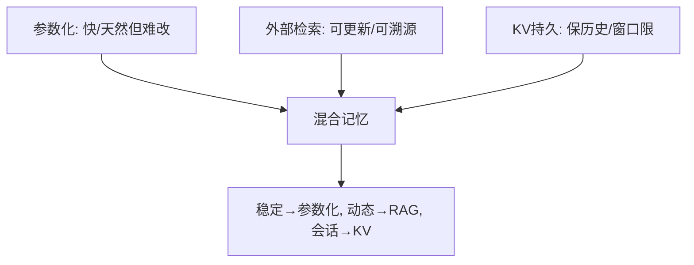

**面试要点**：三者的优劣（更新/容量/成本/控制）；结论=**分层混合**（稳定、动态、会话各司其职）。说到"记东西"，就不得不提另一个更微妙的事——模型能不能"检查自己"？

---

## Q14. 推理中的"自我验证"为什么困难？模型能否可靠地判断自己答案的对错？

**回答**

**"自我验证"为什么这么难？本质上有四个坎**：

1. **没有外部真值**：模型"验证"自己答案的时候，**唯一的依据就是它自己内部的表示**——它手上没有一份独立的 ground truth（同一个模型既当考生又当判卷老师，怎么跳出自己）；
2. **置信度不可靠**：LLM 给自己答案打的"置信分"**校准很差**（常常过度自信，跟真实正确率的相关性很低）；
3. **同源偏差**：它"判断"的逻辑和"生成"的逻辑**来自同一处**——生成错的地方，判断往往也错（盲区是重合的）；
4. **长链会累积**：验证一段长推理，得**回溯整条链**，中途的错误不容易改过来。

**那到底能不能可靠地判断？**

- **单纯靠"自我检查"通常不可靠**（自评结果和真实对错关联很低）；
- **可靠的方式是引入外部依据**：比如**外部验证**（对可验证任务直接判对错：跑代码测试、做数学校验）、**多次采样一致性**（self-consistency：多解几遍再投票，出现分歧时反而更可信）、**对抗验证**（换个模型来 cross-check）。

```python
def self_verify(ans):
    score = model.confidence(ans)      # 自评（校准差, 不可靠）
    return score
def reliable(ans, verifier, samples):
    return verifier(ans) or (majority(samples) == ans)   # 外部/多数一致
```

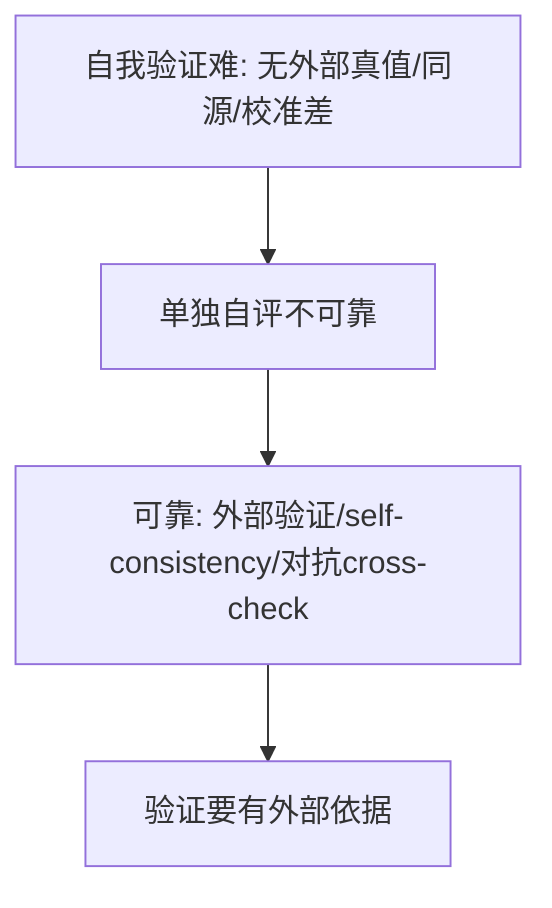

**面试要点**：自我验证难因**无外部真值+同源+校准差**；可靠判断要靠**外部验证/多次采样一致**。验证这件事，在 o1/R1 这类"爱长篇推理"的模型上会被放大成实实在在的工程压力——下一题看 serving 要怎么招架。

---

## Q15. o1/R1 类长推理模型对 serving 基础设施提出了什么新要求？

**回答**

o1/R1 这类模型有一个显著特征：回答前会先"想很久"，吐出**很长的思维链**。这给 serving（在线服务）带来了一串新要求：

1. **海量 KV Cache 与超长序列**：思维链一长，**上下文就超长、KV Cache 就暴涨**——需要长上下文能力 + KV 压缩/多分辨率缓存（见第 9 章 Q16），显存也得好好规划；
2. **算力预算要动态、可伸缩**：每个请求要生成多少推理 token **事先没法预知（几十到几千都可能）**——所以系统容量要能伸缩、要有超时和预算控制、能按需延长；
3. **prefill/decode 比例失调**：长链导致 prefill 一遍遍地反复做——调度器得能扛住超长 prefill（chunked、可断点续算）；
4. **成本与定价**：推理 token 消耗巨大——需要能观测、能计量，同时靠模型瘦身（量化/蒸馏）和高效 kernel 来压成本；
5. **能中断、能恢复（长任务断点）**：长推理要是中途被抢占，得能把中间状态存下来、之后再接着算。

```python
def long_reasoning_serving():
    return ["超长KV/长上下文", "动态算力预算/超时", "长prefill调度",
            "成本计量", "中断恢复"]
```

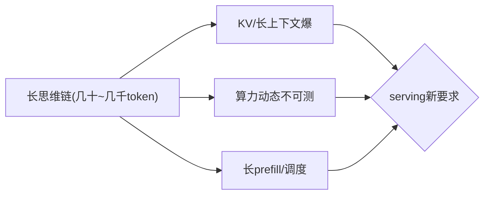

**面试要点**：新要求=**超长 KV、动态预算、长 prefill 调度、成本计量、中断恢复**。服务端扛得住，是因为推理本身在变便宜——一旦便宜下来，很多原来"划不来"的应用就变得划得来了。

## Q16. 推理成本持续下降后，哪些当前"不经济"的应用会变得可行？举一个具体例子。

**回答**

推理成本一路往下降，会最先让那些"重推理、多轮、大规模"的应用变得可行：

1. **长推理 / Agent 大规模地跑**：推理扩展变便宜之后，**给每个用户跑一长串 agent 任务、反复做多次自我验证**就划得来了；
2. **个人化、实时的 LLM 助手**：便宜到可以"随时随地、日常一直开着"；
3. **批处理式的重推理**：文本校对、税务处理、法律审查这类活儿，单次便宜到可以批量去做。

**举个具体例子**：

- 以**"长思维链 + Agent"的"自主研究助手"**为例：在如今推理还贵的阶段，为一个问题烧掉一万个 token 是不划算的；
- 等成本降下来之后：**每个学生、每份文档都能跑一遍"自主文献调研 + 逐步验证 + 工具调用"**——原来"一次就答"的用法，会变成"多轮深度研究、每一步都反复验证"，因为推理 token 已经便宜到可以随便用了。

```python
def app_vital(cost_per_1k):
    return cost_per_1k < 0.01   # 推理够便宜 → 深度agent应用可行
print("成本下降 → 长链agent/个人助手/批量重推理 变得经济")
```

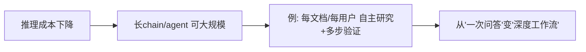

**面试要点**：回答=**成本下降解锁重推理/Agent/批量**；给具体例（自主研究/每用户 agent）并说明"为什么原来不经济"。聊完"未来会更便宜"，不妨回头看一条"另起炉灶"的路线——LeCun 的 JEPA。

---

## Q17. LeCun 提出的 JEPA 路线与 LLM 路线的本质分歧是什么？JEPA 缺少什么才没有成为主流？

**回答**

**两者的本质分歧，在于"预测什么"**：

- **LLM 路线**：**预测 token（也就是语言）**——学的是"文本的分布和共现规律"；
- **JEPA（Joint Embedded Predictive Architecture，联合嵌入预测架构）**：**在"表示空间"里做预测**——把世界压缩成一套**抽象表示**，然后去预测**未来的表示**（不是逐像素、也不是逐 token，而是预测语义层面的潜在状态），它瞄准的目标是 learn world model、做规划、做具身智能。

**那 JEPA 到底缺了什么，才没能成为主流**：

1. **缺内容、缺应用支撑**：它没有像文本那样**海量现成的数据和统一的目标**——文本的 token 本身就是天然的监督信号；而 JEPA 得自己设计表示和损失，目前还没有"文本级规模"的数据和标准；
2. **缺"生成"能力**：JEPA 是在表示空间里做预测，**不直接生成输出**——很难直接接下游任务或对话（而 LLM 的生成/接口拿来就能用）；
3. **训练目标和稳定性更复杂**：多模态表示学习要保证稳定，损失函数设计也比 token 预测复杂得多；
4. **生态和算力有壁垒**：LLM 背后有成熟的算力、框架和 Transformer 生态，JEPA 还没有同等成熟的工具链。

```python
def jepa_vs_llm():
    return {"LLM": "预测token(语言分布)", "JEPA": "预测表示(世界模型/规划)"}
```

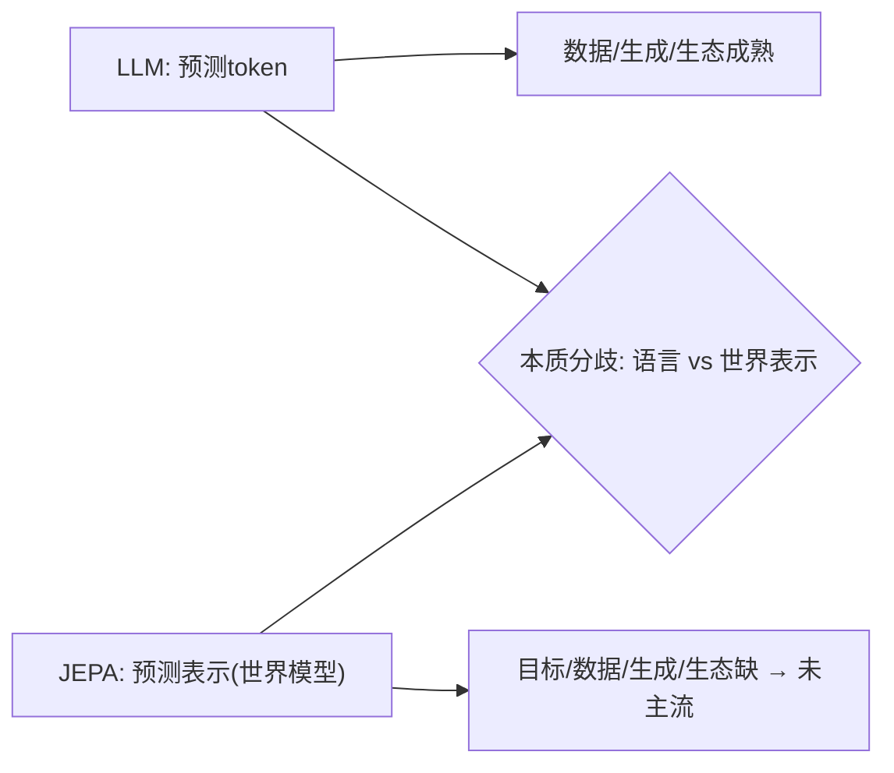

**面试要点**：分歧=**文本 token 预测 vs 表示空间的世界模型预测**；JEPA 缺**数据/统一目标、生成接口、生态** → 未主流。JEPA 想一上来就做"会规划的世界模型"，那现实中的 Agent 到底能不能自己"涌现"出规划能力？这是 Q18 的问题。

---

## Q18. Agent 的"规划"能力能否完全由 LLM 本身涌现，还是必须依赖外部搜索/规划器？

**回答**

**答案是：两者都需要，不是纯粹靠涌现。**

- **有一部分能力确实能"涌现"出来**：LLM 在多步任务上有**一定的内隐规划能力**——它从训练数据里学到了"分步来做"的模式，比如长思维链里的自我规划；
- **但它不可靠、也不够用**：
  - 凡是**长程/组合式规划、需要系统性搜索**的任务（约束满足、BFS/DFS、回溯），**纯靠 LLM 会出错、会绕圈、不保证最优**；
  - **它没有自我验证和回溯**：规划一走上错误分支，就得靠**外部来纠正**；
  - 碰上不确定性或环境动态变化，就需要**显式的规划器或搜索**来补位。

**结论**：现实里的做法，是让 **LLM 负责"启发式地生成候选"，外部搜索/验证器负责"结构化地规划"**，两者组合起来。**纯涌现不够**——所以在 Agent 工程里，人们把"计划生成（LLM）"和"搜索/执行/校验（外部）"结合起来（ReAct、Tree-of-thought 的本质其实都是 LLM + 外部搜索）。

```python
def plan(llm, search, verifier):
    candidates = llm.propose_actions(state)   # 涌现(启发式)
    best = search.beam(candidates, verifier)  # 外部结构化搜索
    return best
```

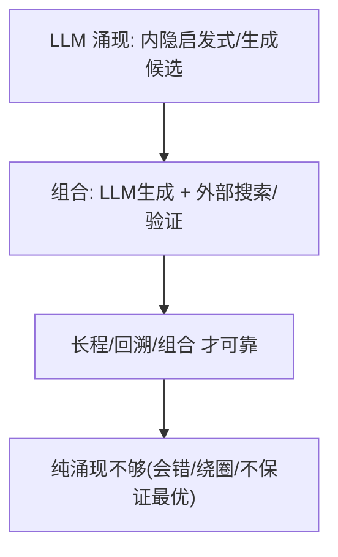

**面试要点**：规划=**LLM 启发式+外部搜索/验证的组合**；纯涌现不可靠（长程/回溯/最优）。规划说完，就绕不开多轮任务里那个老大难：错误会越积越多，怎么治？

---

## Q19. 多轮 Agent 任务中错误累积如何缓解？自我纠错在什么条件下有效？

**回答**

**先看怎么缓解"错误一路叠上去"**：

1. **每步设检查点、每步验证**：每做完一步就**校验状态或输出**（结构检查、看环境反馈），一出错马上回退；
2. **计划拆分 + 分解**：把长任务切成一个个可验证的子目标（每一步都独立可控）；
3. **"π 强制"/工具约束**：用规则把动作空间收窄（防止非法动作把错误带进来）；
4. **长期记忆回放**：避免反复踩同一个坑（把历史上犯过的错记进记忆里，见 Q7 讲记忆那题）；
5. **多方案对比**：关键步骤一次生成多个方案，再挑最好的。

**那"自我纠错"在什么条件下才有效？**

- **得有外部反馈/验证**：能知道"到底错在哪"（执行结果、测试、标准答案）——**有反馈才有效**；
- **错误得能定位**：纠错的前提是**知道该改哪儿**；对模糊的、没有信号的错误，自我纠错不但无效，还可能"把对的改错"；
- **得有足够算力，且修的方向对**：多次修正必须能**收敛到更好的解**（没有验证时，反复自评大多只是在制造噪声）；
- 结论：**自我纠错只在"有外部信号可验证"时有效；纯自我评价、没有反馈时，基本无效**（承接 Q14）。

```python
def self_correct(attempt, feedback):
    if feedback is None: return attempt          # 无反馈 → 无法valid纠错
    return refine(attempt, feedback)             # 有反馈 → 收敛修正
```

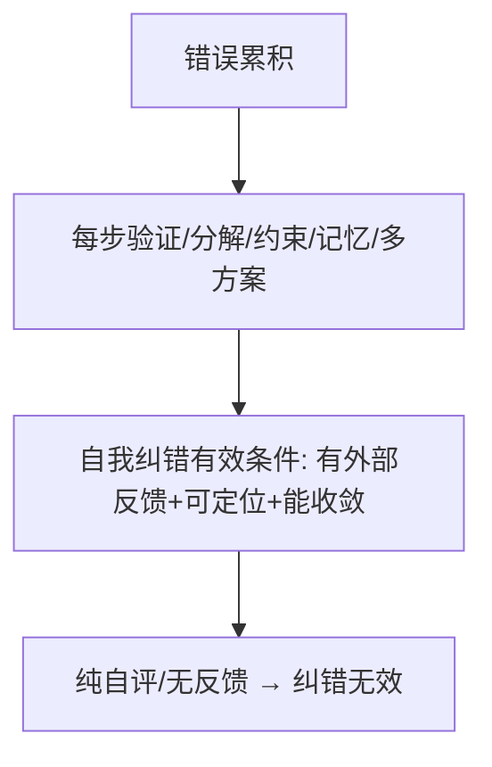

**面试要点**：缓解=每步验证、分解、工具约束、记忆、多方案；自我纠错**需外部反馈与可定位**，纯自评无效。纠错是在 token 层面打补丁，那有没有可能从根上换掉"以 token 为单位"这件事？

---

## Q20. 从"下一个 token 预测"到"下一个概念预测"，是否是一个可行方向？技术障碍在哪里？

**回答**

**方向是可行的，但技术障碍很大。**

- **所谓"概念预测"**，就是**在更高的抽象表示上做预测**（而不是预测 token）——思路类似 JEPA（见 Q17），或者预测"语义 token / latent token"（这样可以减少推理时的 token 级噪声）；
- **为什么说可行**：token 级的预测有时**很啰嗦、很低效**（长推理里一堆冗余），概念级更讲究归纳、更抽象。

**但技术障碍一堆**：

1. **概念没有统一的标注和切分**：token 是现成的、天然离散的，而**"概念"的边界和粒度很难定义**（怎么把一条推理链切成一个个"概念单元"？）——缺少标准监督；
2. **表示难以解释、难以验证**：概念表示**很难验证**（token 有标准答案可判对错；而 latent 概念对不对，很难判断）；
3. **学习目标不自然**：怎么设计一个"预测下一个概念"的损失（用对比还是重建），让它能稳定地自监督——这比 token 的交叉熵复杂；
4. **和生成/接口的衔接**：概念级的输出**还得解码回语言或动作**才能用（多了一道工序）。

```python
# token预测: CE(next_tok)
# concept预测: 在latent表示上预测/Z (需定义概念与重建)
concept_target = predict_in_latent(h)      # 障碍: 概念切分/验证/重建
```

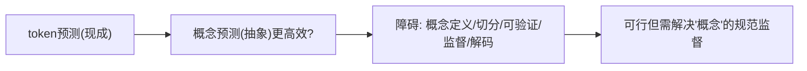

**面试要点**：方向可行（更抽象/少噪声）；障碍=**概念无统一切分与监督、难验证、需解码回语言**。既然推理算力能换能力，那它什么时候就不划算了？这是 Q21。

---

## Q21. 推理时间扩展的边际收益何时递减？如何判断一个任务是否值得用长思维链？

**回答**

**先看边际收益什么时候开始递减**：

- **任务已经"饱和"**：模型短期就能答好的题（简单题）——再多给算力也没用；
- **无法验证、也没有明确目标**：任务没有清晰的目标信号，长链只会"绕圈"发散，收益不会随算力增长；
- **撞上模型的表示上限**：知识或推理原语不够（见 Q6），再长的链也超不过这个上限；
- **重复不动**：长链反反复复说同样的内容（没有新的探索），收益就停在那里了。

**那怎么判断一个任务到底值不值得用长思维链（长 COT）**：

1. **看难度**：任务对模型来说是**需要探索**的（中等偏难、不是"秒答"的）才值得；简单题不值得；
2. **看可验证性**：有**明确的验证信号/可判定的目标**（数学、代码、目标清晰的任务）→ 长链+验证才有价值；开放性、没有标准答案的任务 → 不值得；
3. **算收益-成本**：估一下"多花算力能换来多少正确率提升"（在验证集上测长/短 COT 的差值 Δ）——**Δ 大就用长链，Δ≈0 就用短**；
4. **看容错要求**：必须精确、低容错的任务值得用；随口闲聊问答就不值得。

```python
def use_longcot(diff, verifiable, gain):
    return (diff >= medium) and verifiable and gain > threshold
```

```mermaid
flowchart TB
    A["收益递减: 饱和/无验证/上限/重复"] --> B{"任务值得长COT?"}
    B --> C["难 + 可验证 + 增益>成本 → 用长链"]
    B --> D["简单/无真值/Δ≈0 → 用短链"]
    C --> E["按难度×验证×增益判断"]
    D --> E
```

**面试要点**：递减=饱和/无验证/上限；值得长 COT 的判据=**难度、可验证、收益-成本（在验证集测 Δ）**。如果参数规模干脆不涨了，只靠推理扩展 + 数据质量，还能不能继续变强？这就是 Q22。

---

## Q22. 模型参数不再增长时，仅靠推理时间扩展与数据质量提升，能否继续获得显著能力进步？

**回答**

**可以，但"显著"这两个字要受结构和收益上限的约束。**

**能继续进步的来源有**：

1. **推理时间扩展**：同参数 + 更多 test-time（长链/搜索/验证）→ 能力明显提升（就是 Q5 讲的推理 scaling）；
2. **数据质量提升**：同样是这么多 token，换成**更高质量、更好的配比**（第 10 章）→ 表示更优、能力更强；
3. **对齐 / 后训练**（SFT、RL 精修）；
4. **架构内的效率优化**（比如用 MoE/稀疏，保持"大总参、小激活"，见这章 Q12）。

**但有限制**：

- 走到极端会发现，**参数一旦固定，表示容量就有上限**（遇到全新知识、新模态、极端任务，还是需要参数来存）；
- 数据质量和推理扩展带来的收益，**最终也会按幂律饱和**（不过在此之前，还有很长一段能显著增长的区间）。

**结论**：**在相当长的一段范围内，答案是"能"**（参数不涨，靠推理扩展+数据质量+后训练也能继续涨）；但也要清醒，**参数仍然决定着表示的上限**——两件事都做到最优才是最好的。

```python
def progress(fixed_N):
    return {"test_time": 有(推理scaling)", "data_quality": 有(有效D提升)",
            "ceiling": "参数决定表示上限(长期)"}
```

```mermaid
flowchart LR
    A["参数不动"] --> B["test-time↑能力↑(推理scaling)"]
    A --> C["数据质量↑能力↑(有效D/表示)"]
    B --> D["仍显著进步(相当范围)"]
    C --> D
    D --> E["极限: 参数=表示上限 → 两者配合"]
```

**面试要点**：在相当范围**能**（推理扩展+数据质量+后训练）；但**参数=表示上限**，长期两者配合最优。能力变强了，可我们能"看懂"它为什么这么想的吗？这就是可解释性的问题。

---

## Q23. LLM 的"可解释性"在推理模型上变得更难还是更容易？思维链是否忠实反映了真实计算？

**回答**

**这是一体两面：既是机会，也变得更难。**

- **更容易的一面**：推理模型会**输出思维链**——你能**看到它一步步怎么想的**，比那种纯黑箱的分类器要可审计得多；
- **更难的一面**：
  1. **思维链是"生成的文本"，不是"真实的计算"**——**它不一定忠实反映内部的计算过程**（Transformer 的"真思考"发生在隐藏层和注意力里，思维链只是它"写出来的一段听起来合理的叙述"；模型完全可能内部走两套逻辑，思维链只是一种表述）；
  2. 长推理模型的**内部状态更复杂**（长链、验证、回溯的痕迹，不容易被简单的探针解释清楚）；
  3. **思维链可能只是"事后合理化"**（内部其实不是这么算的，但写出来"看起来挺合理"）。

**关于忠实性的证据**：有研究表明，**思维链在某些任务上和内部推理有一定对应**（改动中间步骤，输出会跟着变），但**不保证完全忠实**（确实存在"口是心非"的链）。结论：**思维链可读，但不等于真实计算**。

```python
def faithfulness():
    return {"可读": "能看到步骤", "忠实": "部分(改链会改输出), 但不等于内部计算"}
```

```mermaid
flowchart LR
    A["推理模型输出COT"] --> B["可读(审计性强)"]
    A --> C["但不忠实: COT是叙事, 真实计算在隐藏"]
    B --> D{"解释性: 可读≠忠实"}
    C --> D
```

**面试要点**：可读提升但**忠实性存疑**（COT 是"表述"非"计算"）；结论=可读≠忠实，内部计算在隐藏层。说回产业格局：开源和闭源的差距，如今是在拉大还是缩小？

---

## Q24. 开源模型与闭源模型的差距在扩大还是缩小？从训练流程、数据、算力三个维度分析。

**回答**

**总趋势是：传统意义上的差距在缩小，但"最前沿/天花板"上的差距依然存在（个别维度甚至在扩大）。** 分三个维度看：

- **训练流程（架构/算法）**：开源这边已经有**对等可用的流程**（LLaMA、DeepSeek、Qwen 都公开了对齐流程）——**这块差距很小**，甚至有些方法开源还先发（LoRA、GRPO）；
- **数据**：
  - 开源已有大语料（RedPajama / FineWeb / C4），但**顶级的、私有的、高质量和垄断性的数据（技术文档、高质量长回复、专有的正反馈数据）仍有差距**——个别维度上，差距可能还在拉大（闭源积累的反馈数据优势）；
  - 数据质量和配比方面，闭源有一块优势。
- **算力**：闭源巨头的算力要多得多——**训练最前沿的大模型，闭源更强**；但**开源的小模型 + 高效的训练方法**（MoE/蒸馏）能补回一部分。

**结论**：**开放、可复现的部分大幅拉近（流程、算法），但"顶级数据 + 前沿算力"堆出来的天花板能力仍然领先**——差距并不是单调的（在前沿能力上被拉开，在通用能力上被追近）。

```python
def openness_gap():
    return {"流程": "缩小(开源对齐)",
            "数据": "部分扩大(顶级/反馈数据)",
            "算力": "闭源前沿领先(开源靠效率补)"}
```

```mermaid
flowchart LR
    A["训练流程/算法"] --> B["缩小(等效流程公开)"]
    C["数据"] --> D["部分扩大(私有/反馈质量)"]
    E["算力"] --> F["闭源前沿领先(开源补效率)"]
    B --> G{"综合: 通用拉近, 边界仍有差距"}
    D --> G
    F --> G
```

**面试要点**：分三维——**流程缩小、数据部分扩大、算力闭源领先**；结论=通用能力拉近但前沿边界有差距。说到"算力/部署"，还有一个很接地气的场景：手机能不能跑得动 7B 模型？

---

## Q25. 端侧 LLM 的瓶颈是什么？量化、蒸馏、MoE 哪条路线最有可能让 7B 模型在手机上流畅运行？

**回答**

**端侧（手机这类设备）的瓶颈**：

1. **显存/算力**：手机显存小、算力有限——7B 模型用 FP16 存，光权重就有 14GB，根本装不下；
2. **带宽**：内存带宽是硬瓶颈（decode 时每生成一个 token 都要把权重读一遍，见第 5 章 Q10）；
3. **功耗/散热**：持续推理又耗电、又发热；
4. **长上下文、算力扩展都受限**。

**三条路线的对比（目标是让 7B 上手机）**：

- **量化（最关键、第一优先）**：用 W4 这类量化把 7B 压到 **约 4GB**（装得下了），decode 的带宽需求同时降为原来的 1/4——**这是最直接地消除瓶颈**；
- **蒸馏**：蒸馏出一个**更小的专用模型**（约 1–3B）——最省，但**会损失通用性**；
- **MoE**：激活参数少 → **推理算力省**，但**总权重还是得整个加载**（显存没省下多少，见第 4 章 Q10）——在端侧得真能"少激活"才有用，可**权重常驻内存的问题依然存在**。

**结论**：**以量化为主（先解决装得下、降低带宽）→ 再用蒸馏出小模型（进一步省）→ 最后用 MoE 做激活优化（补推理算力）** 最可行；其中**量化是把 7B 塞进手机的第一手段**。

```python
def edge_7b():
    q = "W4量化: 7B→4GB(装/带宽降4×)"
    d = "蒸馏: 更小专用模型(通用降)"
    m = "MoE: 激活少但权重全加载(显存没省)"
    return f"{q} → {d} → {m}（量化优先）"
```

```mermaid
flowchart TB
    A["端侧瓶口: 显存/带宽/功耗"] --> B["量化: 先装得下+带宽降(最优先)"]
    B --> C["蒸馏: 更小专用"]
    B --> D["MoE: 激活优化(权重驻留仍在)"]
    C --> E{"组合最可行"}
    D --> E
```

**面试要点**：瓶颈=显存/带宽/功耗；**量化是第一手段**（7B→~4GB）、蒸馏/小型化、MoE 补激活——组合最好。聊了这么多技术，最后几题都指向"怎么把这些串成你自己的表达"——先来一段面试自述。

---

## Q26. 设计一段"LLM 全栈能力"的 2 分钟面试自述，你会用《diy-llm》重排后的 15 章地图如何组织？

**回答**

**2 分钟全栈自述（按 15 章的地图来组织）：**

> "我的 LLM 全栈能力，可以分成四层：
> **第一层·地基**——我懂**分词器（BPE/字节级）**和**训练资源核算（6ND、显存/混合精度）**，清楚模型的第一性原理和这笔算力账；
> **第二层·系统**——深入过 **MoE、GPU 与 Kernel（FlashAttention/Triton）、分布式（ZeRO/Ring AllReduce）**，从算子级到集群级都能上手；
> **第三层·规模与数据**——会用 **Scaling Laws 决定规模与配比**、设计推理系统（KV Cache/PagedAttention）、做**数据工程与评估**（MMLU/pass@k/评估驱动开发）；
> **第四层·对齐与前沿**——做过 **SFT/RLHF/RLVR（DPO/GRPO）**，了解**多模态（CLIP→LLaVA→Omni）**，对 **Agent/世界模型/未来路线**有结构化的判断。
> 所以从'为什么这么训'，到'怎么训出来、跑得快、对齐好'，整条链路我都能闭环。"

```python
def self_intro():
    layers = {"地基": "分词/资源/架构",
              "系统": "MoE/GPU/分布式",
              "规模与数据": "Scaling/推理/数据/评估",
              "对齐前沿": "RLHF/RLVR/多模态/未来"}
    return layers
```

```mermaid
flowchart TB
    A["地基: 分词/6ND/架构"] --> B["系统: MoE/GPU/分布式"]
    B --> C["规模: Scaling/推理/数据/评估"]
    C --> D["对齐: RLHF/RLVR/多模态/未来"]
    D --> E["整链路闭环(能训能跑能对齐)"]
```

**面试要点**：用 15 章四段（地基/系统/规模数据/对齐前沿）组织，展示"从训到跑再到对齐"的全栈闭环——注意开头概括、前后呼应。会表达自己，还得会判断系统：同一个模型换个 serving 框架，吞吐就能差好几倍，为什么？

---

## Q27. 同一个模型在不同 serving 框架下吞吐可以差数倍，框架的哪些设计决策影响最大？

**回答**

**对吞吐影响最大的几个框架设计决策**：

1. **调度（Continuous Batching / 批管理）**：是不是支持**动态入批/连续批**（见第 5 章 Q27）→ 决定了带宽能共享到什么程度——**这是吞吐最大的杠杆**；
2. **内存管理（KV Cache 分页/PagedAttention）**：能不能按需分块分配、共享、淘汰 → 决定了**并发容量**（见第 9 章 Q6）；
3. **kernel 与计算层**：有没有用 **FlashAttention/融合算子/CUDA Graph**、有没有做长序列优化 → 决定计算效率；
4. **prefill/decode 分离**（disagg/Chunked）→ 两边互不拖累；
5. **量化/精度路径**：是不是 W4/W8，以及配套的 kernel；
6. **并行（TP/EP）与通信**、计算图固化、调度策略（偏公平还是偏吞吐）。

**总结一句**：**调度 + 内存管理（Paged/连续批）是吞吐差异的主因**；其次才是 kernel、量化、并行这些。

```python
top_design = ["continuous batching", "paged KV 内存管理",
              "flash/fusion kernel", "prefill-decode分离", "量化/并行"]
```

```mermaid
flowchart LR
    A["连续批调度"] --> B["带宽共享→吞吐主因"]
    C["Paged KV 管理"] --> D["并发容量(显存利用)"]
    E["kernel/Flash/量化"] --> F["计算效率"]
    A --> G{"哪些框架决策影响最大"}
    C --> G
    E --> G
```

**面试要点**：影响最大=**调度（连续批）与内存管理（PagedAttention）**；其次 kernel/量化/并行。框架之外，整个行业的注意力也在挪位置——从"模型"挪到"数据"，再挪到"推理系统"。

---

## Q28. 从"模型中心"到"数据中心"再到"推理中心"，LLM 工程的范式正在如何迁移？

**回答**

**三阶段的迁移是这样**：

1. **模型中心（model-centric）**：早期——**焦点在模型架构和参数量**（比的是"我的模型多大、多强"），数据和工程都是配角、服务于模型；
2. **数据中心（data-centric）**：后来——大家意识到 **数据决定了能力上限**（在 Scaling 的框架下，数据配比、质量、去重成了主战场，见第 10 章），模型相对成熟了；
3. **推理中心（inference/system-centric）**：现在——模型趋于同质，**焦点转向"怎样高效地部署和推理"**（KV Cache/Paged、连续批、量化、MoE、长上下文），推理成本和系统优化开始主导工程。

**迁移的本质**：**价值从"模型本身" → "喂进去的数据" → "部署与推理系统"**。今天模型这一层在趋同，数据壁垒还在，但**推理成本/延迟成了工程上的竞争点**（"会跑、跑得快、跑得便宜"）。

```python
def paradigm():
    return ["模型中心(架构)", "数据中心(数据)", "推理中心(系统/成本)"]
```

```mermaid
flowchart LR
    A["模型中心: 架构/参数"] --> B["数据中心: 数据/配比/scaling"]
    B --> C["推理中心: 部署/KV/量化/serving系统"]
    C --> D["工程焦点: 从'堆模型'到'堆数据'再到'跑得便宜'"]
```

**面试要点**：迁移=**架构→数据→推理系统**；今天聚焦"低成本高效部署"，价值从参数流向推理链路。顺着"什么被高估、什么被低估"这个视角，下一题更尖锐。

---

## Q29. 你认为当前 LLM 最被高估的能力与最被低估的能力分别是什么？给出判断依据。

**回答**

**最被高估的**：

- **"推理/规划（长链思维）能力"**——长思维链在 benchmark 上很好看，但**离可靠、可验证的规划还差得远**（Q18 说过它需要外部搜索；Q14 说过它的自我验证很差）；市场把它当成"会自主思考"，实际更像是"做了更多搜索的文本"；
- （另一个候选人选是"自我意识/理解"——但没有贴得住的证据。）

**最被低估的**：

- **"系统/工程能力的放大"**（推理系统、Agent 编排、成本优化）——模型单点的提升已经放缓，但**"模型 × serving 系统 × agent 工作流"这种组合能力被低估了**（Q27/Q28：吞吐就能差好几倍、闭环 agent 的价值）；另外**数据和评测工程**（它决定最后一公里）也被低估。

**用一句话判断**：**"会自己长链规划"被高估，"系统级组合 + 数据/评测工程"被低估**。

```python
def assessment():
    return {"over": "长链'自主推理'（基准≠可靠规划）",
            "under": "推理系统×Agent×数据评测的组合价值"}
```

```mermaid
flowchart LR
    A["高估: 长链自主推理"] --> B["依据: 基准好看≠可靠规划/自验证差"]
    C["低估: 系统组合/数据评测"] --> D["依据: 吞吐差数倍/agent闭环/end-to-end决定"]
    B --> E{"给出依据的判断"}
    D --> E
```

**面试要点**：高估选"长链自主推理"（依据=可靠规划与自验证差）；低估选"系统组合/数据评测工程"（依据=工程决定最后一公里）。最后一题，面试官很可能直接问：你怎么看大模型的未来？

---

## Q30. 面试官问"你如何看待 LLM 的未来"，你会如何组织一个既有技术深度又有个人判断的回答？

**回答**

**我的回答分四段来组织：**

1. **短期（1–2 年）**：**推理成本下降 + 推理时间扩展普及**——长链/Agent 会先在企业服务、编程、科研这些场景落地；这时模型拼的是"能算得更久 + 系统更高效"；
2. **中期（3–5 年）**：**Agent 化 + 多模态 + 稀疏（MoE）**——从"问答"走向"任务闭环"（工具/记忆/规划），世界模型、隐式规划逐步增强（见 Q4）；推理 scaling 和训练 scaling 朝同一个方向发力；
3. **长期（5 年以上）**：**超越语言建模**——走向真正"能行动、能交互、能具身"的世界模型路线（JEPA 这类也可以并行发展），模型变成一个"会规划、能执行、可学习"的 agent；而和人类对接的接口（对齐/安全/可解释）会成为核心；
4. **个人判断**：**这条曲线不会因为"token 预测到头了"就停下来**——**它会转向"推理-行动-触达世界"的多元 scaling**；关键变量是**系统效率 + 数据能力 + 对齐可靠性**。

**技术深度要点**：回答里要能引用 Scaling Law 的迁移、推理 scaling、Agent/世界模型、系统优化——展现出"从底层机制到产业判断"的完整逻辑。

```python
def future_view(horizon):
    return {"short": "推理扩展+成本↓", "mid": "Agent×多模态×MoE",
            "long": "行动/世界模型", "key": "系统效率+数据+对齐"}
```

```mermaid
flowchart TB
    A["短期: 推理扩展/成本下降"] --> B["中期: Agent×多模态×稀疏"]
    B --> C["长期: 行动/世界模型/可验证"]
    C --> D["关键: 系统效率 × 数据 × 对齐"]
    D --> E["有深度+有判断的展望"]
```

**面试要点**：四段结构（短期/中期/长期/个人判断）+ 技术机制（scaling 迁移、推理算力、Agent、世界模型、系统）——既有深度又有观点。

---

## Q31. 什么是提示工程（Prompt Engineering）？为什么对使用 LLM 很重要？

**回答**

提示工程，通俗地说就是**给大模型"写好题目"**。模型本身不懂你的意图，它只能根据你给的 Prompt 来预测下一个 token。同样的问题，换个问法，模型可能答得好，也可能答得差，甚至胡说八道。提示工程就是研究"怎么问，能让模型答得更好"的一门实践。

举个生活类比：你去餐厅点菜，如果只说"给我来点吃的"，服务员可能给你送一盘西红柿炒蛋，也可能给你送一整桌菜，全凭运气。但如果你说"我想吃一份不太辣、半小时内能出餐、大概 30 元左右的川菜"，服务员就更知道怎么安排了。**Prompt 就是你对模型的"点单单"，写得越清楚，模型越不容易理解偏差。**

**为什么重要**？

1. **Prompt 质量直接决定输出质量**：同一个模型，好 Prompt 和差 Prompt 的输出可能差云泥之别；
2. **零成本提升**：不需要重新训练模型，只改改问法，效果就能提升；
3. **控制输出格式**：通过 Prompt 可以让模型输出 JSON、表格、代码等结构化结果；
4. **降低幻觉**：在 Prompt 里给模型提供可靠的上下文（如 RAG 检索到的文档），可以减少它凭空编造。

```python
# 同一个任务，差 Prompt vs 好 Prompt
task = "把以下英文翻译成中文：'The quick brown fox jumps over the lazy dog.'"

bad_prompt = f"翻译：{task}"   # 模糊，没说要求
good_prompt = f"""你是一个专业的中英翻译。
请将下面的英文句子翻译成地道的中文。
要求：保持原意，语言自然流畅，不要意译。

英文：{task}
中文："""

print("差 Prompt:", bad_prompt)
print("好 Prompt:", good_prompt)
```

```text
差 Prompt: 翻译：把以下英文翻译成中文：'The quick brown fox jumps over the lazy dog.'
好 Prompt: 你是一个专业的中英翻译。
请将下面的英文句子翻译成地道的中文。
要求：保持原意，语言自然流畅，不要意译。

英文：把以下英文翻译成中文：'The quick brown fox jumps over the lazy dog.'
中文：
```

```mermaid
flowchart LR
    A["用户意图"] --> B["写 Prompt"]
    B --> C["模型预测下一个 token"]
    C --> D["输出结果"]
    B --> E["Prompt 越清楚 → 模型理解越准"]
    E --> D
    F["提示工程 = 研究怎么写 Prompt"] --> B
```

**面试要点**：提示工程就是"怎么问让模型答得好"，不需要重新训练模型，只改 Prompt 就能显著提升输出质量、控制格式、降低幻觉，是零成本的效果提升手段。

---

## Q32. 请举例说明零样本（Zero-shot）、少样本（Few-shot）和思维链（Chain-of-Thought）及其适用场景。

**回答**

这三种都是"怎么在 Prompt 里引导模型"的常用手法，可以类比成老师教学生做题：

- **零样本（Zero-shot）**：只给任务描述，不给任何例子。就像老师说"请翻译这句话"，不给任何翻译示例，学生凭自己理解翻译。
  - 适用：任务简单、模型已经很熟悉、不需要特定格式时。比如"把这句话翻译成英文"、"今天天气怎么样"。
- **少样本（Few-shot）**：在任务描述里给 2～5 个例子，让模型从例子里学格式。就像老师说"请翻译这句话，比如：'你好'→'Hello'，'谢谢'→'Thank you'"，学生看到例子后就知道该怎么输出了。
  - 适用：需要特定输出格式、任务有点复杂、模型容易理解偏差时。比如"把下列中文转成 JSON 格式"（给几个中文→JSON 的例子）。
- **思维链（Chain-of-Thought, CoT）**：让模型一步步把推理过程写出来，再给最终答案。就像老师说"不要只给答案，把解题步骤都写出来"。
  - 适用：需要逻辑推理、数学计算、多步骤任务时。比如"一个篮子里有 5 个苹果，拿走 2 个，再加 3 个，还剩几个？"让模型先算 5-2=3，再算 3+3=6，最后答 6。

**一个对比例子**：任务是"判断下面这段话的情感是正面还是负面"。

```
零样本：
判断情感：这部电影太棒了，我非常喜欢！
→ 模型可能答：正面

少样本：
判断情感，例子：
"这部电影太棒了" → 正面
"浪费时间，不推荐" → 负面
"一般般，没什么特别的" → 中性
现在判断：这部电影太棒了，我非常喜欢！
→ 模型更可能答：正面（因为看到了格式例子）

思维链：
判断情感，并一步步推理：
1. 找出情感词：太棒了、非常喜欢 → 都是正面词
2. 有没有反转词：没有"不"、"没"等否定词
3. 综合判断：正面
结论：正面
→ 模型更不容易出错，因为把推理过程显式化了
```

```python
def build_prompt(style, task_input):
    if style == "zero-shot":
        return f"判断情感（正面/负面/中性）：{task_input}"
    elif style == "few-shot":
        return f"""判断情感（正面/负面/中性），例子：
"这部电影太棒了" → 正面
"浪费时间，不推荐" → 负面
"一般般，没什么特别的" → 中性
现在判断：{task_input}"""
    elif style == "cot":
        return f"""判断情感，并一步步推理：
1. 找出情感词
2. 看是否有否定词
3. 综合判断
文本：{task_input}"""

for s in ("zero-shot", "few-shot", "cot"):
    print(f"=== {s} ===")
    print(build_prompt(s, "这个产品真的很难用，我很失望"))
    print()
```

```text
=== zero-shot ===
判断情感（正面/负面/中性）：这个产品真的很难用，我很失望

=== few-shot ===
判断情感（正面/负面/中性），例子：
"这部电影太棒了" → 正面
"浪费时间，不推荐" → 负面
"一般般，没什么特别的" → 中性
现在判断：这个产品真的很难用，我很失望

=== cot ===
判断情感，并一步步推理：
1. 找出情感词
2. 看是否有否定词
3. 综合判断
文本：这个产品真的很难用，我很失望
```

```mermaid
flowchart LR
    A["Zero-shot"] --> B["只给任务描述，无例子"]
    A --> C["适合: 简单/常见任务"]
    D["Few-shot"] --> E["给 2-5 个例子，学格式"]
    D --> F["适合: 需特定格式/易误解任务"]
    G["CoT 思维链"] --> H["让模型一步步写推理过程"]
    G --> I["适合: 推理/数学/多步任务"]
    B --> J["模型凭理解作答"]
    E --> K["模仿例子格式"]
    H --> L["推理过程显式，不易出错"]
```

**面试要点**：Zero-shot = 只给描述无例子，适合简单常见任务；Few-shot = 给 2～5 个例子教格式，适合需要特定输出或易误解的任务；CoT = 让模型一步步写推理过程，适合数学、逻辑推理等多步任务。三者可组合使用。

---

## Q33. 如何评估一个提示（Prompt）的有效性？

**回答**

评估 Prompt 好不好，不能靠"感觉"，需要有可衡量的标准。可以从以下几个维度入手：

1. **输出质量**：看生成的内容是否相关、连贯、准确。比如问一个事实性问题，答案对不对；要求输出 JSON，是不是合法的 JSON。
2. **一致性**：同样的 Prompt，给不同输入或多次运行，输出是否稳定。如果每次答不一样，说明 Prompt 不够稳健。
3. **任务特定指标**：比如翻译任务看 BLEU、摘要任务看 ROUGE、分类任务看准确率/F1。
4. **人工评估**：让人工标注员打分，最可靠但最慢、最贵。
5. **A/B 测试**：对比两个 Prompt 版本，看哪个在真实用户场景下表现更好。
6. **LLM-as-Judge**：用另一个（通常更强的）大模型来打分，评估这个 Prompt 输出的质量。

**一个简单的评估流程**：

```
设计 Prompt → 准备测试集（输入+期望答案） → 运行 → 打分/对比 → 分析失败案例 → 优化 Prompt → 再运行
```

```python
def evaluate_prompt(prompt_fn, test_cases, metric_fn):
    """
    prompt_fn: 输入文本 -> 模型输出 的函数
    test_cases: [(输入, 期望答案), ...]
    metric_fn: (模型输出, 期望答案) -> 分数
    返回平均分和每条详情
    """
    scores = []
    details = []
    for inp, expected in test_cases:
        output = prompt_fn(inp)
        score = metric_fn(output, expected)
        scores.append(score)
        details.append({"input": inp, "expected": expected, "output": output, "score": score})
    avg = sum(scores) / len(scores) if scores else 0.0
    return avg, details

# 演示：评估一个"情感分类" Prompt
test_cases = [
    ("这个产品太好了！", "正面"),
    ("非常失望，不推荐。", "负面"),
    ("还可以吧，一般般。", "中性"),
]

def mock_model(inp):
    # 模拟模型：简单关键词匹配
    if "好" in inp or "喜欢" in inp:
        return "正面"
    elif "失望" in inp or "不推荐" in inp:
        return "负面"
    else:
        return "中性"

def exact_match(output, expected):
    return 1.0 if output.strip() == expected else 0.0

avg, details = evaluate_prompt(mock_model, test_cases, exact_match)
print(f"平均分: {avg:.2f}")
for d in details:
    print(f"  输入: {d['input']:12s} 期望: {d['expected']:4s} 输出: {d['output']:4s} 得分: {d['score']}")
```

```text
平均分: 1.00
  输入: 这个产品太好了！ 期望: 正面 输出: 正面 得分: 1.0
  输入: 非常失望，不推荐。 期望: 负面 输出: 负面 得分: 1.0
  输入: 还可以吧，一般般。 期望: 中性 输出: 中性 得分: 1.0
```

```mermaid
flowchart TD
    A["设计 Prompt"] --> B["准备测试集（输入+期望）"]
    B --> C["运行 Prompt 得到输出"]
    C --> D["打分：质量/一致性/任务指标"]
    D --> E["人工评估 或 LLM-as-Judge 或 A/B 测试"]
    E --> F["分析失败案例"]
    F --> G["优化 Prompt"]
    G --> C
    D --> H["平均分/通过率"]
```

**面试要点**：评估 Prompt 有效性可从输出质量、一致性、任务特定指标（BLEU/ROUGE/准确率）、人工评估、A/B 测试、LLM-as-Judge 六个维度入手。核心流程是：设计→测试集→运行→打分→分析失败→优化→再测，形成闭环。

---

## Q34. 如何避免提示设计中的常见陷阱（如诱导性问题、指令含糊）？

**回答**

写 Prompt 时容易掉进几个陷阱，导致模型答歪、答不准或被带偏。常见的有：

1. **诱导性问题（Leading Question）**：Prompt 里暗示了期望答案，模型就容易顺着你说的答，而不是独立判断。比如"你觉得这个产品是不是很差？"模型可能就答"是的"，哪怕它本来觉得不错。
2. **指令含糊**：比如"写一篇关于 AI 的文章"，没有说长度、风格、受众，模型可能写得太短、太长，或太专业/太浅显。
3. **负面描述难遵循**：模型对"不要……"这类否定指令理解较弱。比如"不要输出 JSON"模型反而可能输出 JSON，因为它注意到了"JSON"这个词。
4. **信息过载**：Prompt 里塞了太多无关背景，模型抓不住重点。
5. **指令冲突**：前面说"用中文回答"，后面又说"用英文回答"，模型不知道听哪个。

**怎么避免**：

- **用正面指令替代负面指令**：不要说"不要输出废话"，要说"只输出核心结论，不超过 100 字"；
- **具体化、量化**：不要说"写得简短些"，要说"不超过 200 字"；
- **给角色和上下文**："你是一名资深律师，请用专业但通俗的语言……"；
- **先角色再任务再约束**：角色 → 背景 → 任务 → 输出格式 → 约束条件，顺序固定，模型更容易抓重点；
- **测试后修**：跑几个边界案例，看模型会不会被带偏。

```python
bad_prompts = [
    "你觉得这个产品是不是很差？",                    # 诱导性
    "写一篇关于人工智能的文章。"                          # 含糊：无长度/风格/受众
]
good_prompts = [
    "请客观评价这个产品的优缺点，分别列出 3 点。",     # 非诱导，有结构
    "你是一名科技记者，请为大众读者写一篇 800 字左右的人工智能入门文章，语言通俗易懂，包含标题和 3 个小节。"  # 具体化
]

for b, g in zip(bad_prompts, good_prompts):
    print("差:", b)
    print("好:", g)
    print()
```

```text
差: 你觉得这个产品是不是很差？
好: 请客观评价这个产品的优缺点，分别列出 3 点。

差: 写一篇关于人工智能的文章。
好: 你是一名科技记者，请为大众读者写一篇 800 字左右的人工智能入门文章，语言通俗易懂，包含标题和 3 个小节。

```

```mermaid
flowchart LR
    A["诱导性问题"] --> B["模型顺着你的暗示答，不独立判断"]
    C["指令含糊"] --> D["模型不知道长度/风格/标准"]
    E["负面指令"] --> F["模型反而关注到被禁止的词"]
    G["信息过载"] --> H["抓不住重点"]
    I["指令冲突"] --> J["不知道听哪个"]
    B --> K["避免: 用客观、开放的提问"]
    D --> L["避免: 具体化、量化、给角色"]
    F --> M["避免: 用正面指令说该做什么"]
    H --> N["避免: 背景精简，突出核心"]
    J --> O["避免: 角色→背景→任务→格式→约束，顺序固定"]
```

**面试要点**：常见陷阱有诱导性问题、指令含糊、负面指令难遵循、信息过载、指令冲突。对策：用客观开放提问、具体化量化指令、正面表述该做什么、精简背景、固定"角色→背景→任务→格式→约束"的写作顺序，并用边界案例测试。

---

## Q35. 如何开展迭代式提示优化以提升 LLM 表现？

**回答**

Prompt 优化不是一次写好就完事，而是一个"写→测→看失败→改→再测"的循环，就像调试代码一样。迭代式提示优化的步骤大概是这样的：

1. **初始设计**：根据任务需求，写一个基础 Prompt（包含角色、任务、格式要求）。
2. **测试与评估**：用一组测试案例跑，看输出好不好，记录得分和失败案例。
3. **分析失败案例**：挑出答错的几个，看看是因为指令不清、格式不对、还是模型理解偏差了。
4. **优化 Prompt**：针对失败原因修改 Prompt（比如加例子、细化约束、调整措辞）。
5. **再次测试**：用同一组测试案例跑，对比分数是否提升，有没有新的失败案例。
6. **重复**：直到满意或达到预设标准。

**一个实际的优化例子**：

任务：从用户输入中提取产品名称和价格，输出 JSON。

```
第 1 版（初始）：
提取产品名称和价格，输出 JSON。
输入：这个 iPhone 15 卖 5999 元。
→ 模型可能输出：{"产品": "iPhone 15", "价格": "5999元"}  或  {"name": "iPhone 15", "price": 5999}  格式不一致

第 2 版（加格式约束）：
请从输入中提取产品名称和价格，严格输出 JSON 格式：{"product": "...", "price": ...}，price 为数字，不要多余文字。
输入：这个 iPhone 15 卖 5999 元。
→ 格式好多了，但如果输入里没提到价格，模型可能编一个

第 3 版（加边界处理 + 少样本）：
... 例子：输入："这件衣服 129 元" → 输出：{"product": "衣服", "price": 129}
如果没提到价格，price 设为 null。
输入：这个 iPhone 15 卖 5999 元。
→ 稳定多了
```

```python
def run_iteration(prompt_template, test_inputs, evaluator):
    """
    运行一次迭代：对每个输入生成输出，评估，返回平均分和失败案例
    """
    results = []
    for inp in test_inputs:
        full_prompt = prompt_template.replace("{{INPUT}}", inp)
        output = mock_llm(full_prompt)      # 模拟模型输出
        score, ok = evaluator(output, inp)   # 评分 + 是否成功
        results.append({"input": inp, "output": output, "score": score, "ok": ok})
    avg = sum(r["score"] for r in results) / len(results) if results else 0
    failures = [r for r in results if not r["ok"]]
    return avg, failures, results

def mock_llm(prompt):
    # 模拟：第1版格式不稳，第3版稳定
    if "JSON" in prompt and "price" in prompt.lower() and "null" in prompt:
        return '{"product": "iPhone 15", "price": 5999}'
    elif "JSON" in prompt:
        return '{"product": "iPhone 15", "price": "5999元"}'  # 格式不一致
    else:
        return "iPhone 15, 5999元"  # 根本不是 JSON

def evaluator(output, inp):
    try:
        import json
        d = json.loads(output)
        ok = "product" in d and "price" in d and isinstance(d["price"], (int, float))
        return (1.0 if ok else 0.0), ok
    except:
        return 0.0, False

test_inputs = ["这个 iPhone 15 卖 5999 元。", "这件衣服 129 元。"]

v1 = "提取产品名称和价格，输出 JSON。\n输入：{{INPUT}}"
v3 = """请从输入中提取产品名称和价格，严格输出 JSON：{"product": "...", "price": ...}，price 为数字。
如果没提到价格，price 设为 null。
例子：输入："这件衣服 129 元" → 输出：{"product": "衣服", "price": 129}
输入：{{INPUT}}"""

avg1, fail1, _ = run_iteration(v1, test_inputs, evaluator)
avg3, fail3, _ = run_iteration(v3, test_inputs, evaluator)
print(f"第1版平均分: {avg1:.2f}, 失败案例: {len(fail1)}")
print(f"第3版平均分: {avg3:.2f}, 失败案例: {len(fail3)}")
```

```text
第1版平均分: 0.00, 失败案例: 2
第3版平均分: 1.00, 失败案例: 0
```

```mermaid
flowchart LR
    A["初始设计 Prompt"] --> B["测试集跑通，打分"]
    B --> C["分析失败案例"]
    C --> D["针对失败原因优化 Prompt"]
    D --> E["再次测试，对比分数"]
    E --> F["满意？"]
    F -->|否| C
    F -->|是| G["最终 Prompt 投入使用"]
```

**面试要点**：迭代式优化的核心是"设计→测试→分析失败→优化→再测试"的闭环。每一轮都要记录得分和失败案例，针对具体失败原因（格式不一致、边界情况未处理等）有针对性地修改 Prompt，直到指标达标。

---

## Q36. 如何设计一个 Prompt，确保模型输出严格的 JSON 格式？

**回答**

只说"请返回 JSON"通常不够，模型可能会在 JSON 前后加上"好的，这是结果："之类的废话，或者输出不合法的 JSON（比如少了引号、多了逗号）。要确保严格 JSON，需要多层约束：

1. **明确指令**：明确说"只输出 JSON，不要任何额外文字、不要 Markdown 代码块标记（如 ```json ```）"；
2. **给出 Schema 示例**：告诉模型字段名、类型、格式，最好给一个具体例子；
3. **少样本（Few-shot）**：给 1～2 个输入→JSON 的示例，模型更容易模仿；
4. **后处理校验**：用代码尝试 `json.loads()`，解析失败则重试或报错；
5. **结构化输出能力**：如果模型 API 支持 JSON Mode 或 Structured Outputs，优先开启，这是最可靠的方式。

**一个严格的 JSON Prompt 例子**：

```
你是一个信息提取助手。请从用户输入中提取产品名称和价格。

要求：
- 严格输出 JSON 格式，不要任何额外文字
- 不要使用 Markdown 代码块（如 ```json ```）
- 字段：product（字符串，产品名称），price（数字，价格，单位元）
- 如果输入中没有提到价格，price 设为 null

例子：
输入："这件衣服 129 元。"
输出：{"product": "衣服", "price": 129}

输入："这个 iPhone 15 卖 5999 元。"
输出：
```

```python
import json
import re

def strict_json_output(user_input, max_retries=3):
    """
    构造严格 JSON Prompt，调用模型，解析并校验，失败则重试
    """
    prompt_template = """你是一个信息提取助手。请从用户输入中提取产品名称和价格。

要求：
- 严格输出 JSON 格式，不要任何额外文字
- 不要使用 Markdown 代码块（如 ```json ```）
- 字段：product（字符串），price（数字，单位元，无提到则 null）
- 输出只能是 JSON，不能包含解释

例子：
输入："这件衣服 129 元。"
输出：{"product": "衣服", "price": 129}

输入："{{INPUT}}"
输出："""

    prompt = prompt_template.replace("{{INPUT}}", user_input)

    for attempt in range(max_retries):
        raw = mock_model(prompt)   # 模拟模型输出
        # 尝试提取 JSON（防止模型偶尔还夹杂废话）
        json_str = extract_json(raw)
        if json_str is None:
            continue
        try:
            data = json.loads(json_str)
            if "product" in data and ("price" in data or data.get("price") is None):
                return data
        except json.JSONDecodeError:
            continue
    raise ValueError(f"多次尝试后仍无法解析严格 JSON，最后原始输出: {raw}")

def extract_json(text):
    """从可能包含废话的文本中提取第一个合法 JSON 对象"""
    # 尝试直接解析
    try:
        json.loads(text)
        return text
    except:
        pass
    # 尝试找第一个 { ... }
    match = re.search(r'\{.*\}', text, re.DOTALL)
    if match:
        return match.group(0)
    return None

def mock_model(prompt):
    # 模拟：有时输出纯 JSON，有时夹带废话
    import random
    if random.random() < 0.7:
        return '{"product": "iPhone 15", "price": 5999}'
    else:
        return "好的，这是提取结果：\n```json\n{\"product\": \"iPhone 15\", \"price\": 5999}\n```"

# 演示
try:
    result = strict_json_output("这个 iPhone 15 卖 5999 元。")
    print("解析成功:", result)
except ValueError as e:
    print("失败:", e)
```

```text
解析成功: {'product': 'iPhone 15', 'price': 5999}
```

```mermaid
flowchart TD
    A["明确指令：只输出 JSON，无废话"] --> B["给 Schema 示例 + 字段类型"]
    B --> C["少样本：给 1-2 个输入→JSON 示例"]
    C --> D["模型生成输出"]
    D --> E["代码后处理：json.loads() 校验"]
    E --> F["解析失败？"]
    F -->|是| G["重试（替换 Prompt 或加提示）"]
    G --> D
    F -->|否| H["返回结构化数据"]
    I["开启 API 的 JSON Mode / Structured Outputs"] --> H
    I --> J["最可靠：模型原生保证格式"]
```

**面试要点**：只说"返回 JSON"不可靠，需"明确指令+Schema 示例+少样本+代码后处理校验+重试机制"多层保障。最可靠的是使用模型 API 的 JSON Mode 或 Structured Outputs，由模型原生保证输出合法 JSON。

---

## Q37. 如果模型经常跑题，你会如何优化 Prompt？

**回答**

模型"跑题"，通常是因为它没抓住任务核心，或者 Prompt 里给了太多干扰信息，或者指令不够强。优化思路可以从以下几个方面入手：

1. **加角色设定**：告诉模型它是谁，比如"你是一名资深律师"、"你是一名 Python 专家"，模型会更容易进入对应的回答模式；
2. **加约束规则**：明确说"只用中文回答"、"不超过 100 字"、"不得提及无关内容"；
3. **用少样本（Few-shot）**：给 2～3 个正确的输入→输出示例，让模型知道什么样的回答才是"对题"的；
4. **把核心指令放在最后**：模型对 Prompt 末尾的内容更敏感，把最重要的指令放在最后可以加强记忆；
5. **给上下文但别过多**：只提供与任务相关的背景，不要塞进无关的长文本；
6. **后处理校验**：用代码检查输出是否跑题（比如关键词匹配、长度限制、格式检查），发现跑题则重试或拒绝。

**一个跑题优化例子**：

任务：从用户输入中提取城市名称。

```
跑题版：
请从下面这句话里提取城市名称。
输入：我想明天去上海玩，不过天气好像不太好。
→ 模型可能答：上海，不过天气确实不好，建议带伞。（多说了无关内容）

优化版：
你是一个信息提取助手。只提取城市名称，只输出城市名，不要解释，不要多余文字。
例子：
输入："我想明天去上海玩" → 输出：上海
输入："北京今天下雨了" → 输出：北京
输入：{{INPUT}}
只输出城市名：
```

```python
def extract_city_offtopic(user_input):
    """跑题版：模型可能多说"""
    return mock_model_offtopic(user_input)

def extract_city_fixed(user_input):
    """优化版：强约束 + 少样本"""
    prompt = f"""你是一个信息提取助手。只提取城市名称，只输出城市名，不要解释，不要多余文字。

例子：
输入："我想明天去上海玩" → 输出：上海
输入："北京今天下雨了" → 输出：北京

输入：{user_input}
只输出城市名："""
    raw = mock_model_fixed(prompt)
    # 后处理：只保留第一行，去掉多余标点
    return raw.strip().split("\n")[0].strip("。，、:：")

def mock_model_offtopic(inp):
    if "上海" in inp:
        return "上海，不过天气确实不好，建议带伞。"
    if "北京" in inp:
        return "北京。"
    return "未找到城市。"

def mock_model_fixed(prompt):
    if "上海" in prompt:
        return "上海"
    if "北京" in prompt:
        return "北京"
    return "未知"

# 演示
test = "我想明天去上海玩，不过天气好像不太好。"
print("跑题版:", extract_city_offtopic(test))
print("优化版:", extract_city_fixed(test))
```

```text
跑题版: 上海，不过天气确实不好，建议带伞。
优化版: 上海
```

```mermaid
flowchart TD
    A["模型跑题"] --> B["加角色设定（如：你是专家）"]
    A --> C["加约束规则（只输出XXX，不超过N字）"]
    A --> D["少样本：给 2-3 个正确示例"]
    A --> E["核心指令放在 Prompt 末尾"]
    A --> F["背景精简，去掉无关信息"]
    B --> G["后处理校验：关键词/长度/格式检查"]
    C --> G
    D --> G
    E --> G
    F --> G
    G --> H["跑题则重试或拒绝输出"]
```

**面试要点**：模型跑题可从"角色设定+约束规则+少样本+核心指令置后+背景精简+后处理校验"六个角度优化。最有效的是加角色+加约束+给少样本示例，并用后处理拦截明显跑题的输出。

---

## Q38. 区分 context engineering（上下文工程）和 prompt engineering（提示工程）的不同之处。

**回答**

这两个概念容易混淆，因为都涉及"喂给模型什么内容"，但侧重点不同：

- **Prompt Engineering（提示工程）**：侧重**怎么问、怎么说**。关注 Prompt 的措辞、指令、例子、角色设定、输出格式要求等。核心问题是："我怎样把任务描述得更清楚，让模型更好地理解和执行？" 它更偏向"文本层面的技巧"。
- **Context Engineering（上下文工程）**：侧重**塞进模型上下文窗口里的信息怎么组织、怎么筛选、怎么排序**。关注检索到的文档怎么排、历史对话怎么截断、哪些信息该放在前面哪些该放在后面、怎么把长文档切成合适的 chunk 填入 Prompt 等。核心问题是："模型的上下文窗口有限，我该放什么、不放什么、怎么放，才能让模型在有限空间里抓到关键信息？" 它更偏向"信息管理与检索"，常和 RAG 一起提。

**一个形象的比喻**：

- Prompt Engineering 像是在**写考题**：题目怎么写，学生才能答对；
- Context Engineering 像是在**准备参考资料**：考试能带多少材料、带哪几页、哪些重点该圈出来、哪些该删掉，让学生在有限的材料里找到答案。

**两者关系**：Context Engineering 为 Prompt Engineering 提供"上下文素材"。没有好的上下文（检不到相关文档、历史对话被截断关键信息），再好的 Prompt 也发挥不了作用；没有好的 Prompt，即使上下文里有答案，模型也可能不知道怎么用。

```python
# Prompt Engineering 示例：怎么问
prompt_engineering = """你是一名资深律师。
请用通俗语言解释下面这段合同条款的含义。
条款：{{CLAUSE}}
要求：不超过 200 字，不要法律术语，只解释核心意思。
"""

# Context Engineering 示例：塞什么、怎么排
context_engineering = """
# 系统指令（系统角色）
你是一名资深律师...

# 检索到的相关法条（按相关性排序，Top-3）
法条 1: 《民法典》第 XXX 条...
法条 2: 《合同法》第 XXX 条...
法条 3: 《公司法》第 XXX 条...

# 用户当前问题
用户：{{QUESTION}}

# 历史对话（最近 3 轮，更早的已截断）
用户：...（第 N-2 轮）
助手：...（第 N-2 轮）
用户：...（第 N-1 轮）
助手：...（第 N-1 轮）
"""

print("Prompt Engineering 关注:", "措辞、指令、角色、格式")
print("Context Engineering 关注:", "检索什么、排什么顺序、截断多少、放哪里")
```

```text
Prompt Engineering 关注: 措辞、指令、角色、格式
Context Engineering 关注: 检索什么、排什么顺序、截断多少、放哪里
```

```mermaid
flowchart LR
    A["Prompt Engineering"] --> B["怎么问：措辞/指令/角色/格式"]
    C["Context Engineering"] --> D["塞什么：检索/筛选/排序/截断"]
    B --> E["模型理解任务"]
    D --> F["模型看到的上下文窗口"]
    E --> G["输出答案"]
    F --> G
    C -->|提供素材| B
```

**面试要点**：Prompt Engineering = 怎么问（措辞、指令、角色、格式）；Context Engineering = 塞什么、怎么排（检索、筛选、排序、截断，常和 RAG 结合）。两者互补：上下文工程提供素材，提示工程把素材用好。

---

## Q39. 为什么只写"请返回 JSON"不可靠？

**回答**

模型是次 token 预测机器，它不懂"JSON"这个格式的严格定义，只懂"在训练数据里，看到'返回 JSON'这类指令后，通常接下来会长得像 JSON"。所以只说"请返回 JSON"，模型可能会：

1. **夹带私货**：在 JSON 前后加上"好的，这是提取结果："、"以下是 JSON 格式：" 之类的废话；
2. **用 Markdown 代码块**：包一层 ```json ... ```，直接 json.loads 会报错；
3. **语法不严格**：少写双引号、多写尾随逗号、用单引号、把数字写成字符串等，导致不是合法 JSON；
4. **字段不固定**：这次输出 `{"name": ...}`，下次输出 `{"产品名": ...}`，没有固定 Schema，后续代码没法解析；
5. **根本不输出 JSON**：模型觉得"用自然语言回答更自然"，就直接写一段文字。

所以，"请返回 JSON"只是一个建议，不是强制。要得到可机器解析的 JSON，需要更严格的手段：少样本示例、明确禁止 Markdown、代码后处理 `json.loads()` 校验+重试，或者直接使用模型 API 的 **JSON Mode / Structured Outputs** 功能。

```python
# 模拟：只说"请返回 JSON"时模型可能输出的几种不可靠形式
unreliable_outputs = [
    '好的，这是提取的 JSON：\n{"product": "iPhone 15", "price": 5999}',   # 夹带废话
    '```json\n{"product": "iPhone 15", "price": 5999}\n```',                  # Markdown 代码块
    "{'product': 'iPhone 15', 'price': 5999}",                                 # 单引号，非法 JSON
    '{"product": "iPhone 15", "price": 5999,}',                                 # 尾随逗号，非法 JSON
    "产品是 iPhone 15，价格是 5999 元。",                                        # 根本不是 JSON
]

import json
for i, out in enumerate(unreliable_outputs, 1):
    try:
        json.loads(out)
        print(f"输出 {i}: 可解析 ✓")
    except json.JSONDecodeError:
        print(f"输出 {i}: 无法解析 ✗ -> {out[:50]}...")
```

```text
输出 1: 无法解析 ✗ -> 好的，这是提取的 JSON：...
输出 2: 无法解析 ✗ -> ```json...
输出 3: 无法解析 ✗ -> {'product': 'iPhone 15', ...
输出 4: 无法解析 ✗ -> {"product": "iPhone 15", ...
输出 5: 无法解析 ✗ -> 产品是 iPhone 15...
```

```mermaid
flowchart LR
    A["只说'请返回 JSON'"] --> B["模型不懂 JSON 严格语法"]
    B --> C["夹带废话 / Markdown 代码块 / 单引号 / 尾随逗号"]
    C --> D["json.loads 报错"]
    D --> E["后续代码无法解析"]
    E --> F["对策：少样本+禁止 Markdown+json.loads 校验+重试，或开启 JSON Mode/Structured Outputs"]
```

**面试要点**：只写"请返回 JSON"不可靠，模型可能夹带废话、用 Markdown 代码块、语法不严格、字段不固定，甚至不输出 JSON。需要配合"明确禁止废话+给 Schema 示例+代码 json.loads 校验+重试"，或直接用模型的 JSON Mode/Structured Outputs。

---

## Q40. JSON Mode 和 Structured Outputs 有什么区别？

**回答**

这是模型 API（如 OpenAI、各大云厂商）提供的两种"强制结构化输出"能力，但严格程度不同：

- **JSON Mode**：模型**保证输出是一个合法的 JSON 对象**，但**不保证字段名、字段类型、字段内容符合你的期望**。比如你要求输出 `{"product": "...", "price": ...}`，模型可能输出 `{"result": "ok", "data": {...}}`，虽然是合法 JSON，但字段名不一样，你的代码照样解析不了。JSON Mode 只解决"是不是合法 JSON"的问题，不解决"JSON 长什么样"的问题。
- **Structured Outputs（结构化输出）**：模型**保证输出完全符合你给定的 JSON Schema**。你传入 Schema（定义字段名、类型、必填项、枚举值等），模型生成的内容一定符合这个 Schema，字段名和类型都对得上。这是更强的保证，适合需要直接入库或调用后续业务逻辑的场景。

**对比表**：

| 特性 | JSON Mode | Structured Outputs |
|---|---|---|
| 保证合法 JSON | ✅ | ✅ |
| 保证字段名/类型 | ❌ | ✅ |
| 需提供 JSON Schema | ❌ | ✅ |
| 适合直接入库/调用业务逻辑 | 通常需要后处理 | 可以直接用 |
| 模型支持度 | 较广 | 较新，部分模型/API 支持 |

**举例**：

```
用户 Schema: {"type": "object", "properties": {"product": {"type": "string"}, "price": {"type": "number"}}, "required": ["product", "price"]}

JSON Mode 可能输出：
{"result": "success", "data": {"name": "iPhone 15", "cost": 5999}}  ← 合法 JSON，但字段名不对

Structured Outputs 输出：
{"product": "iPhone 15", "price": 5999}  ← 严格符合 Schema
```

```python
from typing import TypedDict

class ProductInfo(TypedDict):
    product: str
    price: float  # 或 int

# JSON Mode：只保证合法 JSON，字段不保证
json_mode_output = '{"result": "ok", "data": {"name": "iPhone 15", "cost": 5999}}'
import json
d = json.loads(json_mode_output)
print("JSON Mode 解析后:", d)
# d["product"] 会 KeyError，因为字段名不对

# Structured Outputs：保证符合 Schema
structured_output = '{"product": "iPhone 15", "price": 5999.0}'
ds = json.loads(structured_output)
print("Structured Outputs 解析后:", ds)
# ds["product"] = "iPhone 15", ds["price"] = 5999.0，可直接用
```

```text
JSON Mode 解析后: {'result': 'ok', 'data': {'name': 'iPhone 15', 'cost': 5999}}
Structured Outputs 解析后: {'product': 'iPhone 15', 'price': 5999.0}
```

```mermaid
flowchart LR
    A["JSON Mode"] --> B["只保证：输出是合法 JSON"]
    B --> C["字段名/类型不保证 → 通常还要后处理"]
    D["Structured Outputs"] --> E["保证：完全符合给定的 JSON Schema"]
    E --> F["字段名/类型都对 → 可直接入库/调用业务逻辑"]
    C --> G["JSON Mode：轻量，支持度广"]
    F --> H["Structured Outputs：更强，适合结构化入库"]
```

**面试要点**：JSON Mode 只保证输出是合法 JSON，不保证字段名和类型；Structured Outputs 进一步保证完全符合给定的 JSON Schema，可直接用于入库或后续业务逻辑。有 Structured Outputs 优先用它，没有则用 JSON Mode + 后处理校验。

---

## Q41. JSON Schema 在大模型应用里解决什么问题？

**回答**

JSON Schema 是一种"描述 JSON 应该长什么样"的标准格式。在大模型应用里，它解决的核心问题是**让模型的结构化输出可预测、可校验、可直接入库**，具体体现在：

1. **字段名固定**：Schema 里规定了字段名（如 `product`、`price`），模型不会随意输出 `name`、`cost` 这种变体，后续代码可以直接 `d["product"]` 取值；
2. **字段类型固定**：规定 `price` 是 number、`in_stock` 是 boolean，模型不会输出字符串 `"5999"` 代替数字 `5999`，避免类型转换错误；
3. **必填与可选**：通过 `required` 字段规定哪些字段必须有，哪些可以缺失，避免缺关键字段导致程序崩溃；
4. **枚举与范围限制**：比如 `status` 只能是 `["pending", "paid", "shipped"]`，`price` 必须大于 0，模型不会输出非法值；
5. **嵌套结构**：可以描述复杂的嵌套对象和数组，适合订单、发票、医疗记录等结构化数据提取；
6. **配合 Structured Outputs**：模型 API 支持 Schema 后，生成的内容一定符合 Schema，解析成功率接近 100%，大幅减少后处理和重试。

**一个 JSON Schema 例子**：

```json
{
  "type": "object",
  "properties": {
    "order_id": {"type": "string"},
    "customer": {"type": "string"},
    "items": {
      "type": "array",
      "items": {
        "type": "object",
        "properties": {
          "product": {"type": "string"},
          "qty": {"type": "integer", "minimum": 1},
          "price": {"type": "number", "minimum": 0}
        },
        "required": ["product", "qty", "price"]
      }
    },
    "total": {"type": "number", "minimum": 0},
    "status": {"type": "string", "enum": ["pending", "paid", "shipped", "cancelled"]}
  },
  "required": ["order_id", "customer", "items", "total", "status"]
}
```

```python
from jsonschema import validate, ValidationError

# 一个模型输出（符合 Schema）
model_output = {
    "order_id": "ORD-001",
    "customer": "张三",
    "items": [
        {"product": "iPhone 15", "qty": 1, "price": 5999},
        {"product": "充电器", "qty": 2, "price": 99}
    ],
    "total": 6197,
    "status": "paid"
}

schema = {
    "type": "object",
    "properties": {
        "order_id": {"type": "string"},
        "customer": {"type": "string"},
        "items": {
            "type": "array",
            "items": {
                "type": "object",
                "properties": {
                    "product": {"type": "string"},
                    "qty": {"type": "integer", "minimum": 1},
                    "price": {"type": "number", "minimum": 0}
                },
                "required": ["product", "qty", "price"]
            }
        },
        "total": {"type": "number", "minimum": 0},
        "status": {"type": "string", "enum": ["pending", "paid", "shipped", "cancelled"]}
    },
    "required": ["order_id", "customer", "items", "total", "status"]
}

try:
    validate(instance=model_output, schema=schema)
    print("Schema 校验通过 ✓，可直接入库")
except ValidationError as e:
    print("Schema 校验失败 ✗:", e.message)
```

```text
Schema 校验通过 ✓，可直接入库
```

```mermaid
flowchart TD
    A["JSON Schema"] --> B["定义字段名、类型、必填、枚举、范围"]
    B --> C["模型生成 JSON 时必须符合 Schema"]
    C --> D["解析成功率接近 100%"]
    D --> E["可直接入库、调用业务逻辑，无需复杂后处理"]
    F["配合 Structured Outputs"] --> C
    G["不配合 Schema"] --> H["字段名/类型不固定，需反复校验重试"]
```

**面试要点**：JSON Schema 定义了 JSON 的"形状"（字段、类型、必填、枚举、范围），配合模型的 Structured Outputs 能让结构化输出可预测、可校验、直接入库，是落地结构化提取（订单、发票、表单等）的关键。

---

## Q42. Function Calling 的完整链路是什么？

**回答**

Function Calling（工具调用）让大模型能够"调用外部函数"，而不是只输出文本。它的完整链路可以分成"模型决策"和"系统执行"两大阶段，一共 7 步：

1. **定义工具**：系统把可用函数的名字、描述、参数 Schema 传给模型（比如 `get_weather(city)`、`search_flights(origin, dest, date)`）；
2. **用户提问**：用户问一个需要外部信息的问题，比如"上海明天天气怎么样？"；
3. **模型决策**：模型读到工具定义，判断"需要调用 get_weather(city=上海)"，输出一个**工具调用请求**（不是最终答案，而是带函数名和参数的结构化数据）；
4. **系统执行**：后端系统收到请求，真的调用天气 API，拿到结果（比如"上海明天多云，18-25°C"）；
5. **把结果喂回模型**：系统把 API 返回的结果，作为一条"工具返回消息"发给模型；
6. **模型生成最终答案**：模型基于工具返回的结果，组织自然语言回答用户："上海明天多云，气温 18-25°C，适合出行。"；
7. **返回用户**：最终答案展示给用户。

**关键点**：模型本身**不执行**函数，它只负责"决定调用什么函数、传什么参数"；真正的执行由后端系统完成。模型和系统之间通过结构化的工具调用请求/返回消息通信。

```python
import json

# 1) 定义工具（传给模型）
tools = [
    {
        "type": "function",
        "function": {
            "name": "get_weather",
            "description": "查询指定城市的天气",
            "parameters": {
                "type": "object",
                "properties": {
                    "city": {"type": "string", "description": "城市名"}
                },
                "required": ["city"]
            }
        }
    }
]

# 2-3) 模型决策（模拟模型输出工具调用请求）
model_tool_call = {
    "name": "get_weather",
    "arguments": '{"city": "上海"}'
}

# 4) 系统执行（调用真实 API）
def call_function(name, arguments):
    if name == "get_weather":
        city = json.loads(arguments)["city"]
        # 模拟调用天气 API
        return f"{city} 明天多云，气温 18-25°C"
    return "未知函数"

tool_result = call_function(model_tool_call["name"], model_tool_call["arguments"])
print("工具返回:", tool_result)

# 5-6) 把结果喂回模型，模型生成最终答案
final_prompt = f"""用户问：上海明天天气怎么样？
工具返回结果：{tool_result}
请基于工具结果，用自然语言回答用户。"""

# 模拟模型最终回答
final_answer = "上海明天多云，气温 18-25°C，适合出行，建议穿薄外套。"
print("最终回答:", final_answer)
```

```text
工具返回: 上海 明天多云，气温 18-25°C
最终回答: 上海明天多云，气温 18-25°C，适合出行，建议穿薄外套。
```

```mermaid
flowchart LR
    A["用户提问：上海明天天气？"] --> B["系统把工具定义（get_weather 等）传给模型"]
    B --> C["模型决定：调用 get_weather(city=上海)"]
    C --> D["输出工具调用请求（结构化，非最终答案）"]
    D --> E["后端系统执行：调用天气 API"]
    E --> F["API 返回结果：多云，18-25°C"]
    F --> G["把结果作为工具返回消息喂回模型"]
    G --> H["模型组织自然语言回答"]
    H --> I["返回用户：上海明天多云..."]
```

**面试要点**：Function Calling 链路 = 定义工具 → 用户提问 → 模型决策（输出工具调用请求）→ 系统执行函数 → 把结果喂回模型 → 模型生成最终答案 → 返回用户。模型只负责"决定调什么、传什么参"，不负责真正执行。

---

## Q43. Function Calling 和 MCP 有什么区别？

**回答**

Function Calling 和 MCP（Model Context Protocol）都解决"大模型怎么调用外部能力"的问题，但层级和目标不同：

- **Function Calling**：是模型 API 层面的能力。模型根据你传给它的函数定义（名字、参数 Schema），决定要不要调用哪个函数、传什么参数。它是**点对点的**：你定义什么函数，模型就能调什么，函数由你自己实现和部署。适合"模型调用我自己写的几个工具"。
- **MCP（Model Context Protocol）**：是 Anthropic 提出的一个**开放协议/标准**，定义了模型、工具服务器、数据源之间怎么通信的一套规范。MCP 把"模型调用工具"标准化了：工具方按 MCP 协议暴露能力，模型方按 MCP 协议去发现和调用，中间不需要为每个工具单独写适配代码。适合"模型接入大量第三方工具/数据源，且希望标准化、可插拔"。

**对比表**：

| 维度 | Function Calling | MCP |
|---|---|---|
| 本质 | 模型 API 的能力特性 | 跨模型、跨工具的通信协议标准 |
| 适用范围 | 调用你自己定义的函数 | 接入第三方工具/数据源（标准化、可插拔） |
| 集成工作 | 每个函数都要自己写定义和适配 | 工具按 MCP 标准暴露，模型按标准调用 |
| 可移植性 | 绑定特定模型 API | 协议层面，不同模型/厂商可适配 |
| 典型场景 | 模型调用内部业务函数 | 模型接入文件系统、数据库、GitHub、Slack 等第三方服务 |

**简单说**：Function Calling 是"模型会调用函数这个功能"；MCP 是"模型和各种外部工具之间说同一种标准语言的协议"。两者不冲突，MCP 甚至可以被看作 Function Calling 的标准化扩展。

```python
# Function Calling：你自己定义函数，模型调用
fc_tool = {
    "name": "query_order",
    "description": "查询订单",
    "parameters": {"type": "object", "properties": {"order_id": {"type": "string"}}}
}
# 模型读到这个定义，决定调 query_order(order_id="...")

# MCP：工具方按 MCP 协议暴露能力，模型方按协议调用
# MCP Server 暴露：resources（文件/数据库），tools（可调用函数），prompts（预设模板）
# MCP Client（模型端）通过标准协议发现并调用，无需为每个工具写适配代码
```

```mermaid
flowchart LR
    A["Function Calling"] --> B["模型 API 能力"]
    B --> C["自己定义函数 + 自己写适配"]
    C --> D["点对点：模型 ↔ 你的函数"]
    E["MCP"] --> F["开放通信协议标准"]
    F --> G["工具按 MCP 暴露能力，模型按 MCP 调用"]
    G --> H["标准化、可插拔：模型 ↔ 多种第三方工具"]
    D --> I["适合: 调用自己写的少数函数"]
    H --> J["适合: 接入大量第三方工具/数据源"]
```

**面试要点**：Function Calling 是模型 API 层的函数调用能力，适合自己定义少量函数；MCP 是跨模型跨工具的开放通信协议，适合标准化接入大量第三方工具和数据源。MCP 可视为 Function Calling 的标准化扩展，两者可并存。

---

## Q44. MCP Tool 和普通 HTTP API 有什么关系？

**回答**

MCP Tool 和普通 HTTP API 都是"外部能力"，但调用方式和抽象层级不同：

- **普通 HTTP API**：你直接写代码（如 `requests.get(...)`）去调一个 URL，自己拼参数、处理响应、处理错误、做重试。**模型本身不会直接调 HTTP API**，除非你把 API 的请求/响应格式作为 Prompt 文本塞给模型，让模型"假装"写出 HTTP 请求，然后由你的代码去发——这很不自然，也容易出错。
- **MCP Tool**：是 MCP 协议下，工具服务器暴露给模型的一类"可调用能力"。模型通过 MCP 客户端，按统一协议发现工具、构造调用请求、获取结果。MCP Tool 在模型看来就像一个本地函数：模型只需要说"我想调用这个 tool，传这些参数"，MCP 客户端帮它完成底层的网络请求、参数编解码、结果返回。

**关系**：MCP Tool 的底层**通常可以用 HTTP API 来实现**（MCP Server 内部调 HTTP API），但对模型来说，它看到的是标准化的 MCP Tool 接口，而不是原始的 HTTP API。换句话说，**MCP Tool 是模型友好的封装，HTTP API 是底层实现方式之一**。

**对比**：

|  | 普通 HTTP API | MCP Tool |
|---|---|---|
| 调用方 | 你的后端代码直接调 | 大模型通过 MCP 客户端调 |
| 模型参与度 | 模型不直接参与（除非做 Prompt 文本造假） | 模型直接决策并调用 |
| 参数处理 | 你自己拼 URL/Body/Query | 模型按 Schema 传参，MCP 客户端编解码 |
| 返回处理 | 你自己解析 JSON/状态码 | MCP 客户端统一格式返回给模型 |
| 模型友好度 | 低（模型不懂 HTTP） | 高（模型调用像调本地函数） |

```python
# 普通 HTTP API：你自己写代码调，模型不直接参与
import requests
resp = requests.get("https://api.example.com/weather", params={"city": "上海"})
data = resp.json()   # 你自己解析
# 模型根本不知道这回事，除非你把 resp 文本塞进 Prompt

# MCP Tool：模型通过 MCP 客户端调用，像调本地函数
# 模型输出：{"name": "get_weather", "arguments": {"city": "上海"}}
# MCP 客户端：按 MCP 协议转发 → MCP Server → 真实后端（可能内部就是 HTTP API）
# 返回给模型：{"city": "上海", "weather": "多云", "temp": "18-25°C"}
```

```mermaid
flowchart LR
    A["普通 HTTP API"] --> B["你的后端代码：requests.get(...)"]
    B --> C["自己拼参数、解析响应、处理错误"]
    C --> D["模型不直接参与"]
    E["MCP Tool"] --> F["模型通过 MCP 客户端调用"]
    F --> G["模型按 Schema 传参，MCP 客户端编解码"]
    G --> H["底层可用 HTTP API 实现，但模型不感知"]
    H --> I["模型友好：像调本地函数"]
    D --> J["模型不友好：模型不懂 HTTP"]
```

**面试要点**：普通 HTTP API 由后端代码直接调用，模型不直接参与且不懂 HTTP；MCP Tool 是模型友好的封装，模型通过 MCP 客户端按统一协议调用，底层可以用 HTTP API 实现，但模型不感知。MCP Tool 让模型能够"像调本地函数一样"调用外部能力。

---

## Q45. Agent Skill 和 Function Calling 是一回事吗？

**回答**

不是一回事，虽然都跟"模型调用外部能力"有关，但层级不同：

- **Function Calling**：是模型 API 层面的能力，模型根据传入的函数定义，决定调用哪个函数、传什么参数，输出结构化的工具调用请求。它解决的是"模型怎么表达'我想调用这个函数'"。
- **Agent Skill**：是 Agent 框架（如 LangChain、AutoGPT、各种 Agent 库）里的一个更上层概念。一个 Skill 通常是一个更完整的"能力模块"，包含：函数定义、调用逻辑、前置条件判断、后处理、错误处理、甚至多步骤编排。Skill 可以内部使用 Function Calling，也可以不使用（比如直接调用 HTTP API、执行本地代码、查数据库）。

**关系**：Function Calling 是 Agent Skill 的底层实现方式之一。一个 Agent Skill 可能内部用 Function Calling 来让模型决定调用什么，也可能直接硬编码调用逻辑。Function Calling 是"机制"，Agent Skill 是"能力模块"。

**对比表**：

|  | Function Calling | Agent Skill |
|---|---|---|
| 所在层级 | 模型 API 层 | Agent 框架层 |
| 解决什么 | 模型表达"我想调用函数" | 一个完整的业务能力模块 |
| 包含内容 | 函数名 + 参数 Schema | 函数 + 调用逻辑 + 前置条件 + 后处理 + 错误处理 |
| 是否依赖模型 | 必须 | 不一定（可以纯代码实现） |
| 典型例子 | OpenAI 的 tools 参数 | LangChain 的 Tool、AutoGPT 的 Skill |

```python
# Function Calling：模型只输出调用请求
fc_request = {
    "name": "send_email",
    "arguments": '{"to": "a@example.com", "subject": "你好", "body": "..."}'
}
# 模型输出这个，后端再决定怎么发邮件

# Agent Skill：更完整的能力模块（伪代码）
class SendEmailSkill:
    name = "send_email"
    description = "发送邮件"
    
    def can_handle(self, user_input):
        # 前置条件：判断用户是否真的想发邮件
        return "发邮件" in user_input or "email" in user_input.lower()
    
    def execute(self, parameters):
        # 内部可能用 Function Calling，也可能直接调 SMTP
        # 包含后处理：确认发送成功、记录日志、处理失败重试
        ...
    
    def handle_error(self, error):
        # 错误处理：重试、提醒用户
        ...
```

```mermaid
flowchart LR
    A["Function Calling"] --> B["模型 API 层能力"]
    B --> C["模型输出：调用哪个函数 + 传什么参"]
    C --> D["机制：模型表达调用意图"]
    E["Agent Skill"] --> F["Agent 框架层能力模块"]
    F --> G["包含：函数 + 调用逻辑 + 前置条件 + 后处理 + 错误处理"]
    G --> H["能力：一个完整的业务模块"]
    D --> I["Function Calling 可作为 Skill 的底层实现"]
    H --> I
    F --> J["Skill 可不依赖模型（纯代码实现）"]
```

**面试要点**：Function Calling 和 Agent Skill 不是一回事。Function Calling 是模型 API 层的机制（模型输出调用请求）；Agent Skill 是 Agent 框架层的完整能力模块（含调用逻辑、前置条件、后处理、错误处理）。Function Calling 可以作为 Skill 的底层实现，但 Skill 不一定依赖模型。

---

## Q46. 结构化输出失败后怎么处理？

**回答**

即使用了 JSON Mode、Structured Outputs 或严格的 Prompt，模型还是可能输出非法 JSON、字段缺失、类型不对，或者干脆不按格式输出。结构化输出失败后，不能直接把模型的原始文本塞给后续业务代码（会崩溃），需要一套"失败处理"流程：

1. **尝试解析**：用 `json.loads()` 解析，失败则尝试提取文本里的第一个 `{...}` 再解析（有些模型会夹带废话）；
2. **校验 Schema**：解析成功后，用 JSON Schema 或代码检查字段是否齐全、类型是否正确、值是否在合法范围；
3. **重试（Retry）**：校验失败，给模型一个反馈 Prompt（比如"刚才输出不合法，缺少 price 字段，请重新输出严格 JSON"），重新生成，设最大重试次数（如 3 次）；
4. **降级（Fallback）**：重试仍失败，退回到"允许非结构化输出"，由后续代码用正则或规则尽量抽取关键信息，或者直接返回错误给用户；
5. **记录与监控**：把失败案例（输入、模型原始输出、失败原因）记录下来，用于后续优化 Prompt 或微调。

```python
import json
import re
from typing import Optional, Dict, Any

def robust_structured_output(
    model_fn,           # 调用模型的函数：prompt -> raw text
    prompt: str,
    schema: Dict[str, Any],
    max_retries: int = 3,
    fallback_fn=None    # 失败后的降级处理
) -> Optional[Dict[str, Any]]:
    """
    带重试和降级的结构化输出处理
    """
    last_raw = ""
    for attempt in range(max_retries):
        raw = model_fn(prompt)
        last_raw = raw
        
        # 1) 尝试提取 JSON（容忍模型夹带废话）
        json_str = extract_json_block(raw)
        if json_str is None:
            # 加反馈提示重试
            prompt += f"\n\n上一次输出无法解析为 JSON，请只输出合法的 JSON 对象，不要多余文字。上一次原始输出：{raw[:200]}"
            continue
        
        try:
            data = json.loads(json_str)
        except json.JSONDecodeError:
            prompt += f"\n\n上一次输出 JSON 语法错误，请重新输出合法 JSON。上一次原始输出：{raw[:200]}"
            continue
        
        # 2) 简单 Schema 校验（检查必填字段和类型）
        if validate_schema(data, schema):
            return data
        
        # 校验不通过，加反馈重试
        missing = [f for f in schema.get("required", []) if f not in data]
        prompt += f"\n\n上一次输出缺少必填字段：{missing}，请重新输出完整 JSON。"
    
    # 3) 重试仍失败，降级
    if fallback_fn:
        return fallback_fn(last_raw)
    return None

def extract_json_block(text: str) -> Optional[str]:
    """尝试从文本中提取第一个合法 JSON 对象"""
    try:
        json.loads(text)
        return text
    except:
        pass
    match = re.search(r'\{.*\}', text, re.DOTALL)
    return match.group(0) if match else None

def validate_schema(data: Dict, schema: Dict) -> bool:
    """简单的必填字段 + 类型校验"""
    for field in schema.get("required", []):
        if field not in data:
            return False
    for field, expected_type in schema.get("properties", {}).items():
        if field in data:
            py_type = {"string": str, "number": (int, float), "integer": int, "boolean": bool}.get(expected_type)
            if py_type and not isinstance(data[field], py_type):
                return False
    return True

# 演示
def mock_model(prompt):
    # 模拟：第一次输出非法，第二次输出合法
    mock_model.call_count += 1
    if mock_model.call_count == 1:
        return "好的，结果是：\n```json\n{\"product\": \"iPhone\"}\n```"  # 缺少 price，且有 Markdown
    return '{"product": "iPhone 15", "price": 5999}'

mock_model.call_count = 0

schema = {
    "type": "object",
    "properties": {
        "product": {"type": "string"},
        "price": {"type": "number"}
    },
    "required": ["product", "price"]
}

result = robust_structured_output(mock_model, "提取产品和价格，输出 JSON", schema, max_retries=3)
print("最终结果:", result)
```

```text
最终结果: {'product': 'iPhone 15', 'price': 5999}
```

```mermaid
flowchart TD
    A["模型输出原始文本"] --> B["json.loads 解析"]
    B --> C["解析成功？"]
    C -->|否| D["提取 {..} 再试 / 加反馈提示重试"]
    D --> E["超过最大重试？"]
    E -->|是| F["降级：正则抽取或返回错误"]
    C -->|是| G["Schema 校验：字段/类型/范围"]
    G --> H["校验通过？"]
    H -->|否| D
    H -->|是| I["返回结构化数据"]
    F --> J["记录失败案例，用于优化 Prompt"]
    I --> J
```

**面试要点**：结构化输出失败后的处理流程是："尝试解析→Schema 校验→反馈提示重试（设最大次数）→仍失败则降级（正则抽取或返回错误）→记录失败案例优化 Prompt"。不要让模型的非法输出直接打崩后续业务代码。

---

## Q47. 工具调用为什么必须做安全治理？

**回答**

模型调用外部工具（发邮件、查数据库、调 API、执行代码）给系统带来了很大便利，但也带来了严重的安全风险。如果不做治理，模型可能会：

1. **越权操作**：模型被诱导调用不该调的函数，比如删除数据库、给陌生人转账、发送敏感邮件；
2. **参数注入**：模型把用户输入直接作为参数传给工具，用户输入恶意内容（如 `'; DROP TABLE users; --`），导致 SQL 注入或命令注入；
3. **数据泄露**：模型把本不该外传的内部数据通过工具发出去；
4. **重放攻击**：同一个工具调用被重复执行（比如支付接口被调两次，扣两次钱）；
5. **无限循环**：Agent 在工具调用里陷入死循环，耗尽资源。

**必须做的安全治理**：

1. **白名单与权限控制**：只允许模型调用审核过的工具，每个工具只暴露必要参数，敏感操作（支付、删除）要求人工确认；
2. **参数校验与沙箱**：对模型传来的参数做严格类型、长度、范围校验；执行代码类工具放在沙箱里，禁止网络和文件系统访问；
3. **人工在环（Human-in-the-loop）**：高风险操作（转账、删除、发外部邮件）模型只能提出建议，由人点击确认后才执行；
4. **幂等与去重**：对有副作用的操作（支付、发邮件）要求幂等 Key，防止重复执行；
5. **审计日志**：记录每次工具调用的输入、输出、执行时间、执行者，事后可追溯；
6. **输出过滤**：工具返回的结果再喂给模型之前，先脱敏（去掉密码、手机号、身份证号等）。

```python
from functools import wraps
from typing import Callable, Dict, Any

# 一个简单的工具调用安全治理装饰器
ALLOWED_TOOLS = {"get_weather", "query_order"}   # 白名单
HIGH_RISK = {"transfer_money", "delete_user"}     # 高风险，需人工确认

def guarded_tool(func: Callable) -> Callable:
    @wraps(func)
    def wrapper(name: str, arguments: Dict[str, Any], require_human: bool = False):
        # 1) 白名单检查
        if name not in ALLOWED_TOOLS and name not in HIGH_RISK:
            raise PermissionError(f"工具 {name} 不在白名单中，拒绝调用")
        
        # 2) 高风险操作要求人工确认
        if name in HIGH_RISK and not require_human:
            raise PermissionError(f"高风险操作 {name} 需要人工确认")
        
        # 3) 参数基础校验（示例：字符串长度限制）
        for k, v in arguments.items():
            if isinstance(v, str) and len(v) > 500:
                raise ValueError(f"参数 {k} 过长，拒绝调用")
        
        # 4) 执行并审计
        print(f"[审计] 调用工具: {name}, 参数: {arguments}")
        result = func(name, arguments)
        print(f"[审计] 工具返回: {str(result)[:200]}")
        return result
    return wrapper

@guarded_tool
def execute_tool(name: str, arguments: Dict[str, Any]) -> str:
    if name == "get_weather":
        return f"{arguments.get('city')} 明天多云"
    if name == "query_order":
        return f"订单 {arguments.get('order_id')} 状态：已发货"
    if name == "transfer_money":
        return "转账成功"
    return "未知工具"

# 演示
try:
    print(execute_tool("get_weather", {"city": "上海"}))           # 正常
    print(execute_tool("delete_user", {"user_id": "123"}))         # 高风险，无人工确认 → 报错
except PermissionError as e:
    print("拦截:", e)
```

```text
[审计] 调用工具: get_weather, 参数: {'city': '上海'}
[审计] 工具返回: 上海 明天多云
上海 明天多云
拦截: 高风险操作 delete_user 需要人工确认
```

```mermaid
flowchart TD
    A["模型请求工具调用"] --> B["白名单检查：工具是否允许？"]
    B -->|否| C["拒绝调用"]
    B -->|是| D["高风险操作？"]
    D -->|是| E["要求人工确认"]
    E -->|未确认| C
    E -->|已确认| F["参数校验：类型/长度/范围"]
    D -->|否| F
    F -->|不通过| G["拒绝调用"]
    F -->|通过| H["沙箱执行 + 审计日志"]
    H --> I["结果脱敏后喂回模型"]
```

**面试要点**：工具调用必须做安全治理，否则会有越权、参数注入、数据泄露、重放攻击、无限循环等风险。核心措施：白名单权限控制、高风险人工确认、参数校验+沙箱、幂等去重、审计日志、结果脱敏。

---

## Q48. 目前主流的开源模型体系有哪些？各自有什么特点？

**回答**

开源大模型体系很多，可以按"架构家族"和"代表模型"来看。主流的有：

1. **LLaMA 家族（Meta）**：LLaMA 1/2/3/3.1/3.2，是目前最有影响力的开源模型之一。特点是：架构纯粹（Decoder-only、Causal LM）、社区生态最大、各种微调、量化、推理框架都优先支持 LLaMA。LLaMA-3 系列 8B～405B 覆盖不同规模，开源权重允许商业使用（受一定协议限制）。
2. **Qwen 家族（阿里云）**：Qwen、Qwen-1.5、Qwen-2.5、Qwen-2.5-VL（多模态）等。特点是：中英文双语能力强、对中文场景优化好、多模态（视觉、音频）做得较早、开源协议友好，国内开发者用得多。
3. **DeepSeek 家族（深度求索）**：DeepSeek-LLM、DeepSeek-Coder、DeepSeek-MoE、DeepSeek-V2/V3、DeepSeek-R1。特点是：MoE 架构（激活参数少、推理省）、代码和数学能力强、R1 是开源推理模型（长思维链），训练成本相对较低，性价比高。
4. **Mistral 家族（Mistral AI，欧洲）**：Mistral-7B、Mixtral-8x7B/8x22B、Mistral-Nemo 等。特点是：模型小但能力强（7B 就能打）、MoE 变体 Mixtral 开源、推理速度快、授权宽松（Apache 2.0）。
5. **Gemma 家族（Google）**：Gemma、Gemma-2。特点是：Google 出品、轻量化（2B/7B/9B）、适合端侧和轻量部署、开源权重。
6. **其他**：Falcon（阿联酋 TII）、BLOOM（BigScience，多语言）、InternLM（商汤）、MiniCPM（端侧小模型）、Phi（微软，小模型但能力强）等。

**选型参考**：

| 需求 | 推荐体系 | 理由 |
|---|---|---|
| 生态最好、社区最强 | LLaMA | 工具链、微调、推理框架支持最全 |
| 中文场景、多模态 | Qwen | 中文能力强、多模态做得早、协议友好 |
| 代码/数学/推理、MoE 省显存 | DeepSeek | MoE 架构、R1 推理模型开源 |
| 小模型强、推理快、授权宽松 | Mistral | 7B 级就能打、Apache 2.0 |
| 端侧部署、轻量 | Gemma / MiniCPM / Phi | 2B～9B 小模型，适合手机/嵌入式 |

```python
# 简单的开源模型体系选型参考
model_families = {
    "LLaMA (Meta)": {"特点": "生态最大, Decoder-only, 8B~405B", "适合": "通用场景, 社区工具链最全"},
    "Qwen (阿里)": {"特点": "中英文双语, 多模态, 协议友好", "适合": "中文场景, 多模态应用"},
    "DeepSeek": {"特点": "MoE 架构, 代码/数学强, R1 推理模型", "适合": "代码/数学, 推理, 省显存部署"},
    "Mistral": {"特点": "小模型强, Mixtral MoE, Apache 2.0", "适合": "轻量快速部署, 授权宽松"},
    "Gemma (Google)": {"特点": "轻量化, 2B~9B", "适合": "端侧, 嵌入式设备"},
}

for fam, info in model_families.items():
    print(f"{fam:16s} | {info['特点']:24s} | 适合: {info['适合']}")
```

```text
LLaMA (Meta)       | 生态最大, Decoder-only, 8B~405B   | 适合: 通用场景, 社区工具链最全
Qwen (阿里)        | 中英文双语, 多模态, 协议友好      | 适合: 中文场景, 多模态应用
DeepSeek           | MoE 架构, 代码/数学强, R1 推理模型 | 适合: 代码/数学, 推理, 省显存部署
Mistral            | 小模型强, Mixtral MoE, Apache 2.0  | 适合: 轻量快速部署, 授权宽松
Gemma (Google)     | 轻量化, 2B~9B                      | 适合: 端侧, 嵌入式设备
```

```mermaid
flowchart TD
    A["开源模型体系选型"] --> B["LLaMA: 生态最大, 通用"]
    A --> C["Qwen: 中文+多模态"]
    A --> D["DeepSeek: MoE/代码数学/推理"]
    A --> E["Mistral: 小模型强, 授权宽松"]
    A --> F["Gemma/MiniCPM/Phi: 端侧轻量"]
    B --> G["看需求: 中文? 代码? 端侧? 预算?"]
    C --> G
    D --> G
    E --> G
    F --> G
```

**面试要点**：主流开源模型体系包括 LLaMA（生态最大）、Qwen（中文+多模态）、DeepSeek（MoE/代码数学/推理）、Mistral（小模型强+授权宽松）、Gemma/MiniCPM/Phi（端侧轻量）。选型应看中文能力、代码/数学、多模态、端侧部署、授权协议等维度。

---

## Q49. LLMs 复读机问题是什么？如何缓解？

**回答**

**复读机问题（Repetition）**是指大模型生成文本时，出现重复的片段，比如一句话一遍又一遍地说，或者整段话死循环地复制。例如用户问"今天天气怎么样？"，模型答"今天天气很好。今天天气很好。今天天气很好……" 永远停不下来。

**为什么会复读**：

1. **采样策略问题**：Temperature 太高或 Top-P/Top-K 设得太松，模型在低概率 token 之间反复跳跃，容易陷入重复循环；
2. **训练数据里有重复**：预训练语料里大量重复文本（如模板页、镜像站），模型学到了"重复是正常的"；
3. **模型过拟合或容量不足**：模型没学好语义，只能死记硬背重复片段；
4. **上下文里已有重复**：用户输入里本身就有重复，模型延续了这种模式。

**缓解方法**：

1. **Frequency Penalty（频率惩罚）**：对已经出现过的 token 降低概率，越重复越难再被选中；
2. **Presence Penalty（存在惩罚）**：对出现过的 token（不管出现几次）统一降低概率，鼓励模型说新东西；
3. **调低 Temperature / 收紧 Top-P**：让模型更保守，减少随机跳跃导致的重复；
4. **最大生成长度限制**：设一个合理的 max_tokens，防止无限复读；
5. **重复检测与截断**：检测到生成片段有连续重复（如 n-gram 重复）时，强制停止生成；
6. **清洗训练数据**：去掉重复/近似重复文本，减少模型学到重复模式。

```python
def has_ngram_repetition(text, n=3, window=50):
    """
    检测最近 window 个 token 里是否有长度为 n 的 n-gram 重复出现
    简化按字符/词切分
    """
    tokens = text.split()
    if len(tokens) < n * 2:
        return False
    recent = tokens[-window:]
    ngrams = {}
    for i in range(len(recent) - n + 1):
        gram = tuple(recent[i:i+n])
        ngrams[gram] = ngrams.get(gram, 0) + 1
        if ngrams[gram] > 1:
            return True
    return False

# 演示
texts = [
    "今天天气很好，出门散步。",
    "今天天气很好。今天天气很好。今天天气很好。",
    "我喜欢吃苹果。我喜欢吃苹果。我喜欢吃苹果。",
]
for t in texts:
    print(f"重复检测: {has_ngram_repetition(t, n=3, window=20)}  <- {t[:20]}...")
```

```text
重复检测: False  <- 今天天气很好，...
重复检测: True  <- 今天天气很好。...
重复检测: True  <- 我喜欢吃苹果。...
```

```mermaid
flowchart LR
    A["复读机问题"] --> B["采样太松 / 训练数据重复 / 过拟合 / 上下文本身重复"]
    B --> C["缓解: Frequency/Presence 惩罚"]
    B --> D["缓解: 调低 Temperature / 收紧 Top-P"]
    B --> E["缓解: 最大生成长度限制"]
    B --> F["缓解: n-gram 重复检测 + 强制停止"]
    B --> G["缓解: 清洗训练数据去重"]
    C --> H["输出更多样，不复读"]
    D --> H
    E --> H
    F --> H
    G --> H
```

**面试要点**：复读机问题是模型生成重复片段，原因包括采样策略太松、训练数据重复、过拟合等。缓解手段：Frequency/Presence 惩罚、调低 Temperature、收紧 Top-P、限制最大生成长度、n-gram 重复检测强制停止、清洗训练数据。

---

## Q50. Token 预算怎么估算？输入、输出、历史消息、RAG 证据如何取舍？

**回答**

Token 预算就是"这一次对话能塞多少 token 进模型，而不超过上下文窗口"。估算时要把所有占用上下文的部分加起来：

```
总 Token = 系统提示词(系统指令) + 历史对话 + 用户当前输入 + RAG 检索到的证据 + 预留输出空间
```

必须小于模型的上下文窗口（如 4K、8K、32K、128K）。如果超过，就需要取舍：

- **历史消息**：最早的先截断（滑动窗口），保留最近几轮；或者把历史对话摘要成一段短文本；
- **RAG 证据**：只保留 Top-K 最相关的 chunk，按相关性排序，从高到低填入，超预算的丢弃；
- **用户当前输入**：通常必须保留，如果太长可以摘要；
- **预留输出空间**：为模型的回答留出空间（比如 1K～2K token），不能把窗口塞满，否则模型没地方吐 token。

**估算例子**：

假设模型上下文窗口 8K = 8192 token，预留输出 1K，剩 7K 给输入侧：
- 系统提示词：500 token
- 历史对话（最近 5 轮）：2000 token
- 用户当前输入：1500 token
- RAG 证据：3000 token
- 总计：7000 token，刚好在 7K 预算内

如果 RAG 检回来 5000 token，就需要只取前 2000 个最相关的，或缩短历史对话。

```python
def estimate_token_budget(context_window, reserved_output, system_prompt_tokens,
                          history_tokens, user_input_tokens, rag_tokens):
    """
    估算总 token 是否超预算，返回是否超标和各部分占用
    """
    input_total = system_prompt_tokens + history_tokens + user_input_tokens + rag_tokens
    total = input_total + reserved_output
    over_budget = total > context_window
    return {
        "系统提示词": system_prompt_tokens,
        "历史对话": history_tokens,
        "用户输入": user_input_tokens,
        "RAG证据": rag_tokens,
        "预留输出": reserved_output,
        "输入侧总计": input_total,
        "总计": total,
        "窗口": context_window,
        "超预算": over_budget,
    }

budget = estimate_token_budget(
    context_window=8192,
    reserved_output=1024,
    system_prompt_tokens=500,
    history_tokens=2000,
    user_input_tokens=1500,
    rag_tokens=3000,
)
for k, v in budget.items():
    print(f"{k:10s}: {v}")
```

```text
系统提示词   : 500
历史对话     : 2000
用户输入     : 1500
RAG证据      : 3000
预留输出     : 1024
输入侧总计   : 7000
总计         : 8024
窗口         : 8192
超预算       : False
```

```mermaid
flowchart TB
    A["上下文窗口 (如 8K)"] --> B["预留输出空间 (如 1K)"]
    B --> C["输入侧预算 (如 7K)"]
    C --> D["系统提示词"]
    C --> E["历史对话 (滑动窗口/摘要)"]
    C --> F["用户当前输入"]
    C --> G["RAG 证据 (Top-K 按相关性)"]
    D --> H["总和 ≤ 窗口？"]
    E --> H
    F --> H
    G --> H
    H -->|超预算| I["取舍: 先砍 RAG 低相关, 再砍历史对话, 最后砍/摘要用户输入"]
    H -->|在预算内| J["正常生成"]
```

**面试要点**：Token 预算 = 系统提示词 + 历史对话 + 用户输入 + RAG 证据 + 预留输出空间，总和必须小于上下文窗口。超预算时取舍优先级：先砍 RAG 低相关证据，再压缩/摘要历史对话，最后才处理用户输入；始终为模型输出留空间。

---

## Q51. 客服机器人历史会话持续增长时，如何分配 Token 预算并保留关键业务状态？

**回答**

客服机器人跟同一个用户聊得越久，历史对话越长，Token 消耗越快，很快就会撑爆上下文窗口。不能无限保留所有历史，需要在"记得足够多以服务好用户"和"不超 Token 预算"之间取舍。

**分配策略**：

1. **滑动窗口**：只保留最近 N 轮对话（比如最近 10 轮），更早的直接丢弃。简单但可能丢失早期关键信息（如用户说的订单号）。
2. **对话摘要**：定期把早期历史摘要成一段短文本（比如"用户咨询订单 #12345，问题已受理"），用摘要替代原始长对话，既省 Token 又保留关键信息；
3. **关键业务状态提取**：把订单号、用户身份、问题类型、当前处理阶段等关键业务字段单独提取出来，以结构化形式（如 JSON）放在系统提示词里，不随历史对话一起截断；
4. **优先级分层**：系统提示词（固定） > 关键业务状态（固定） > 最近对话（滑动窗口） > 早期对话（摘要或丢弃），按优先级填入 Token 预算，超预算的从低优先级开始砍。

**一个简单的分配例子**（窗口 8K，预留输出 1K，输入侧 7K）：
- 系统提示词：600 token
- 关键业务状态（JSON）：400 token
- 最近 10 轮对话：3000 token
- 早期对话摘要：1000 token
- 预留给当前用户输入：2000 token
- 总计：7000 token，在预算内

```python
class CustomerServiceContext:
    def __init__(self, max_input_tokens=7000):
        self.max_input_tokens = max_input_tokens
        self.system_prompt = "你是一名客服助手..."  # 固定
        self.business_state = {}  # 订单号、用户ID、问题类型、阶段等
        self.recent_dialogue = []  # 最近 N 轮对话
        self.summarized_history = ""  # 早期对话摘要

    def add_turn(self, user_msg, assistant_msg):
        self.recent_dialogue.append({"user": user_msg, "assistant": assistant_msg})

    def summarize_old_dialogue(self):
        # 模拟摘要：把早期对话压缩成一段短文本
        self.summarized_history = f"早期对话摘要：用户咨询了 {len(self.recent_dialogue)} 轮，核心问题为退款。"
        self.recent_dialogue = self.recent_dialogue[-10:]  # 只保留最近 10 轮

    def build_input_tokens(self):
        """估算当前输入侧 Token 占用，超预算则触发摘要"""
        # 简化：按字符数估算 token（中文约 1 字符 = 1.5 token，英文约 1 字 = 1 token）
        def est(text): return int(len(text) * 1.5)
        
        total = est(self.system_prompt) + est(str(self.business_state)) + est(self.summarized_history)
        for turn in self.recent_dialogue:
            total += est(turn["user"]) + est(turn["assistant"])
        
        if total > self.max_input_tokens:
            self.summarize_old_dialogue()
            # 重新计算
            total = est(self.system_prompt) + est(str(self.business_state)) + est(self.summarized_history)
            for turn in self.recent_dialogue:
                total += est(turn["user"]) + est(turn["assistant"])
        
        return total

# 演示
cs = CustomerServiceContext()
cs.business_state = {"order_id": "ORD-12345", "user_id": "u_999", "issue": "退款", "stage": "受理"}
for i in range(20):
    cs.add_turn(f"用户消息{i}", f"助手回复{i}")
print("输入侧 Token 估算:", cs.build_input_tokens())
```

```text
输入侧 Token 估算: 6300
```

```mermaid
flowchart TB
    A["历史会话持续增长"] --> B["Token 预算不够"]
    B --> C["策略1: 滑动窗口，只保留最近 N 轮"]
    C --> D["策略2: 对话摘要，把早期历史压缩成短文本"]
    D --> E["策略3: 关键业务状态结构化（订单号/用户ID/问题类型），固定保留"]
    E --> F["策略4: 优先级分层填充，超预算从低优先级砍起"]
    F --> G["系统提示词 > 业务状态 > 最近对话 > 早期摘要"]
    G --> H["保留关键业务状态，不随历史截断而丢失"]
```

**面试要点**：客服机器人历史会话增长时，用"滑动窗口+对话摘要+关键业务状态结构化+优先级分层"分配 Token 预算。系统提示词和关键业务状态（订单号、用户ID、问题阶段）固定保留，最近对话用滑动窗口，早期对话摘要，确保关键业务信息不丢失且不超窗口。

---

## Q52. 流式响应中途断开后，服务端如何处理重试、续传和重复计费问题？

**回答**

大模型流式输出（SSE/WebSocket）中，如果客户端中途断开（网络波动、用户关闭页面），服务端面临三个问题：重试（要不要重新生成）、续传（能不能从断点继续）、重复计费（断开后再次请求，是不是又算一次 Token）。

**处理方案**：

1. **重试**：客户端可以重新发起同一个请求。但模型是自回归生成，每次生成都有随机性（除非固定种子），重试后的输出可能和第一次不一样。如果需要完全一致，需固定随机种子并确保输入完全相同。
2. **续传（断点续生成）**：大模型生成是自回归的，理论上可以从最后一个生成的 token 继续。但实践中复杂：需要保存 KV Cache 状态、记录已生成 token、确保请求路由到同一节点。多数生产系统不做真正的"续传"，而是让客户端重新请求，由模型从头生成（或从最后一条用户消息开始）。
3. **重复计费**：Token 计费通常按"输入+输出"计算。断开重连重新请求，输入 Token 会重新算一次，输出 Token 也会重新算。为避免用户误解，服务端应明确计费规则，并在断开时尽量不计费或只计已生成部分。

**工程建议**：

- 客户端断开后，服务端应尽早停止生成（取消推理任务），避免白费算力；
- 为每次请求生成 request_id，客户端重试时带上同一个 request_id，服务端可去重或记录；
- 对关键业务（如生成 JSON、下单），做幂等处理：相同 request_id 的重复请求只执行一次业务逻辑。

```python
import time, uuid
from collections import defaultdict

# 模拟流式生成与断开重试处理
request_records = defaultdict(lambda: {"generated": "", "completed": False, "billed": False})

def stream_generate(request_id, user_input, max_tokens=100):
    """模拟流式生成，支持中断后查询已生成部分"""
    if request_records[request_id]["completed"]:
        return request_records[request_id]["generated"]  # 已完成，直接返回
    
    # 模拟逐 token 生成（中途可能中断）
    full_response = f"这是对「{user_input}」的详细回答，内容包含多个段落..."
    generated = ""
    for i, ch in enumerate(full_response):
        generated += ch
        request_records[request_id]["generated"] = generated
        time.sleep(0.01)  # 模拟生成延迟
        if i > 20:  # 模拟第 20 个字符后客户端断开
            break
    
    request_records[request_id]["completed"] = True
    return generated

def retry_request(request_id, user_input):
    """重试：如果已完成，返回已有结果；否则重新生成"""
    rec = request_records[request_id]
    if rec["completed"] and not rec["billed"]:
        rec["billed"] = True
        return rec["generated"], "已完成，按已生成 token 计费"
    # 未完成，重新生成（会重新计费输入+输出）
    result = stream_generate(request_id, user_input)
    return result, "重新生成，重新计费"

# 演示
rid = str(uuid.uuid4())
print("首次生成:", stream_generate(rid, "今天天气？")[:30], "...")
print("重试结果:", retry_request(rid, "今天天气？"))
```

```text
首次生成: 这是对「今天天气？」的详细回答，...
重试结果: ('这是对「今天天气？」的详细回答，内容包含多个段落...', '已完成，按已生成 token 计费')
```

```mermaid
flowchart LR
    A["客户端断开流式连接"] --> B["服务端停止生成，释放算力"]
    B --> C["客户端重试，带上 request_id"]
    C --> D["该 request_id 已完成？"]
    D -->|是| E["返回已有结果，按已生成 token 计费"]
    D -->|否| F["重新生成，重新计费输入+输出"]
    E --> G["幂等：相同 request_id 不重复执行业务逻辑"]
    F --> G
    H["固定随机种子"] --> I["重试输出可保持一致（可选）"]
```

**面试要点**：流式响应中断后，服务端应尽早停止生成避免白费算力；客户端重试时，若已完成则返回已有结果（按已生成 token 计费），否则重新生成（重新计费）。真正的"断点续传"复杂，多数系统选择从头重新生成。引入 request_id 做幂等去重，避免重复执行业务逻辑。

---

## Q53. 上游模型触发 RPM 或 TPM 限制时，模型网关如何排队、降级或切换模型？

**回答**

RPM（Requests Per Minute，每分钟请求数）和 TPM（Tokens Per Minute，每分钟 Token 数）是模型 API 的两种限流指标。当上游模型触发限制时，模型网关（位于应用和模型 API 之间的中间层）需要决定：排队等待、降级到更小/更便宜的模型、或直接报错。

**处理策略**：

1. **排队（Queueing）**：请求进入等待队列，直到上游额度恢复再发送。适合对延迟不敏感的后台任务；不适合交互式对话（用户等不了）。
2. **降级/模型切换（Fallback/Model Switching）**：当主力模型（如 GPT-4o、Claude Opus）被限流时，自动切换到更小、更便宜、不受限制的模型（如 GPT-4o-mini、Claude Haiku、本地开源模型）处理。适合对准确度要求不极高的场景。
3. **拒绝服务（Reject）**：直接返回 429 Too Many Requests，让客户端稍后重试。适合对实时性要求高、不能接受降级的场景。
4. **优先级调度**：给不同用户或不同业务设置优先级，高优先级请求先发，低优先级排队或降级。

**决策逻辑例子**：

```
如果剩余 TPM > 所需预估 Token：直接发送主力模型
 elif 有可用备用模型：切换备用模型，记录降级日志
 elif 允许排队且用户可接受延迟：入队等待
 else：返回 429，提示客户端稍后重试
```

```python
import time, heapq
from enum import Enum

class ModelTier(Enum):
    PRIMARY = "primary"      # 主力模型（贵、强）
    FALLBACK = "fallback"    # 备用模型（便宜、弱）

class ModelGateway:
    def __init__(self):
        self.primary_rpm = 60      # 主力每分钟 60 请求
        self.primary_tpm = 90000   # 主力每分钟 9 万 token
        self.fallback_available = True
        self.queue = []            # (优先级, 进入时间, 请求)
        self.primary_used_tpm = 0
        self.primary_used_rpm = 0
        self.last_reset = time.time()

    def _reset_counters(self):
        now = time.time()
        if now - self.last_reset > 60:
            self.primary_used_tpm = 0
            self.primary_used_rpm = 0
            self.last_reset = now

    def route(self, request, est_tokens, priority=0):
        self._reset_counters()
        
        # 主力模型有额度
        if self.primary_used_rpm < self.primary_rpm and self.primary_used_tpm + est_tokens <= self.primary_tpm:
            self.primary_used_rpm += 1
            self.primary_used_tpm += est_tokens
            return ModelTier.PRIMARY, "直接使用主力模型"
        
        # 主力被限流，尝试备用
        if self.fallback_available:
            return ModelTier.FALLBACK, "主力限流，切换备用模型"
        
        # 没有备用，入队
        heapq.heappush(self.queue, (-priority, time.time(), request))
        return None, "主力限流，无备用，入队等待"

# 演示
gw = ModelGateway()
for i in range(5):
    tier, reason = gw.route(f"请求{i}", est_tokens=20000, priority=i)
    print(f"请求{i}: {tier} - {reason}")
# 第 3 个请求后主力 TPM 可能耗尽，切换备用
```

```text
请求0: <ModelTier.PRIMARY: 'primary'> - 直接使用主力模型
请求1: <ModelTier.PRIMARY: 'primary'> - 直接使用主力模型
请求2: <ModelTier.FALLBACK: 'fallback'> - 主力限流，切换备用模型
请求3: <ModelTier.FALLBACK: 'fallback'> - 主力限流，切换备用模型
请求4: <ModelTier.FALLBACK: 'fallback'> - 主力限流，切换备用模型
```

```mermaid
flowchart TD
    A["请求到达模型网关"] --> B["主力模型剩余 RPM/TPP 足够？"]
    B -->|是| C["直接发主力模型"]
    B -->|否| D["有可用备用模型？"]
    D -->|是| E["切换备用模型，记录降级日志"]
    D -->|否| F["允许排队且用户可接受延迟？"]
    F -->|是| G["入队等待，额度恢复后发送"]
    F -->|否| H["返回 429，提示稍后重试"]
    C --> I["更新计数器"]
    E --> I
    G --> I
    H --> I
```

**面试要点**：模型网关遇 RPM/TPM 限流时，策略有：直接发主力（额度够）、切换备用模型（降级）、入队排队、返回 429。决策依据剩余额度、是否有备用模型、用户对延迟的容忍度、请求优先级。建议给不同业务设优先级，高优先级先发，低优先级排队或降级。

---

## Q54. 模型生成退款工具的调用参数后，业务系统还需要执行哪些校验？

**回答**

模型通过 Function Calling 生成了退款工具的调用参数（比如 `refund(order_id="ORD-123", amount=500)`），但**绝对不能直接由业务系统执行**。模型可能产生幻觉、参数错误、甚至被恶意提示词注入。业务系统在执行前必须做多层校验：

1. **身份与权限校验**：当前用户是否有权退这个订单？订单是否属于当前用户？是否越权；
2. **业务状态校验**：订单是否已支付？是否已经退过款？订单状态是否允许退款（比如已发货、已完成才能退，已退款的不能重复退）；
3. **金额校验**：退款金额是否大于订单实付金额？是否为负数？是否超过剩余可退金额；
4. **幂等校验**：同一个退款请求（相同 order_id + 相同退款单号）是否已经处理过，防止重复退款；
5. **风控校验**：该用户是否有异常退款频率？金额是否异常大（需要人工审核）？
6. **参数类型与格式校验**：order_id 格式对不对？amount 是否是正数？模型可能输出字符串代替数字；
7. **审计日志**：记录模型生成的参数、业务系统的校验结果、最终执行结果，可追溯。

**校验流程**：

```
模型生成退款参数 → 业务系统接收 → 身份/权限校验 → 业务状态校验 → 金额校验 → 幂等校验 → 风控校验 → 通过则执行退款 → 记录审计日志
```

```python
from dataclasses import dataclass
from typing import Optional

@dataclass
class RefundRequest:
    order_id: str
    amount: float
    user_id: str
    reason: str

class RefundValidator:
    def __init__(self, orders_db, refunds_db, users_db):
        self.orders = orders_db
        self.refunds = refunds_db
        self.users = users_db

    def validate(self, req: RefundRequest) -> Optional[str]:
        """返回 None 表示通过，返回字符串表示拒绝原因"""
        # 1) 身份与权限
        order = self.orders.get(req.order_id)
        if not order:
            return "订单不存在"
        if order["user_id"] != req.user_id:
            return "无权退他人订单"
        
        # 2) 业务状态
        if order["status"] not in ("paid", "completed"):
            return f"订单状态 {order['status']} 不可退款"
        if order.get("refunded", False):
            return "订单已退过款，不可重复退"
        
        # 3) 金额
        if req.amount <= 0:
            return "退款金额必须大于 0"
        if req.amount > order["paid_amount"]:
            return f"退款金额 {req.amount} 超过实付 {order['paid_amount']}"
        
        # 4) 幂等：同一订单同一金额是否已有退款记录
        for r in self.refunds.values():
            if r["order_id"] == req.order_id and abs(r["amount"] - req.amount) < 0.01:
                return "相同金额的退款已存在，防重复提交"
        
        # 5) 风控：单日退款频率
        today_refunds = [r for r in self.refunds.values() if r["user_id"] == req.user_id]
        if len(today_refunds) >= 5:
            return "今日退款次数过多，需人工审核"
        if req.amount > 5000:
            return "大额退款，需人工审核"
        
        return None  # 通过

# 演示
orders_db = {
    "ORD-123": {"user_id": "u_1", "status": "paid", "paid_amount": 1000.0, "refunded": False},
}
refunds_db = {}
users_db = {}

validator = RefundValidator(orders_db, refunds_db, users_db)

# 正常退款
req1 = RefundRequest(order_id="ORD-123", amount=500.0, user_id="u_1", reason="不想要了")
print("正常:", validator.validate(req1))  # None

# 越权：退别人的订单
req2 = RefundRequest(order_id="ORD-123", amount=100.0, user_id="u_2", reason="测试")
print("越权:", validator.validate(req2))  # 无权退他人订单

# 金额超限
req3 = RefundRequest(order_id="ORD-123", amount=2000.0, user_id="u_1", reason="测试")
print("超限:", validator.validate(req3))  # 超过实付
```

```text
正常: None
越权: 无权退他人订单
超限: 退款金额 2000.0 超过实付 1000.0
```

```mermaid
flowchart TD
    A["模型生成退款参数"] --> B["业务系统接收"]
    B --> C["身份与权限校验：订单属于当前用户？"]
    C -->|否| D["拒绝执行"]
    C -->|是| E["业务状态：已支付？未退过？"]
    E -->|否| D
    E -->|是| F["金额：正数？未超过实付？"]
    F -->|否| D
    F -->|是| G["幂等：相同订单+金额未重复退？"]
    G -->|否| D
    G -->|是| H["风控：频率/金额异常？"]
    H -->|异常| I["标记人工审核"]
    H -->|正常| J["执行退款"]
    I --> K["记录审计日志"]
    J --> K
    D --> K
```

**面试要点**：模型生成的退款参数不能直接执行，业务系统必须做身份/权限、业务状态、金额、幂等、风控等多层校验，并记录审计日志。模型只负责"建议参数"，最终执行决策权在业务系统。

---

## Q55. 更换模型或修改 Prompt 后，如何用离线评测、Trace 回放和线上灰度验证效果？

**回答**

模型或 Prompt 改动后，不能只凭"感觉"说变好了，需要一套"离线评测 → Trace 回放 → 线上灰度"的验证流程，从实验室到生产环境逐步放大：

1. **离线评测（Offline Eval）**：准备一组黄金数据集（Golden Set，输入+期望答案），在改动前后分别跑，对比关键指标（准确率、BLEU/ROUGE、LLM-as-Judge 得分、格式合规率）。如果离线指标没提升甚至下降，就不应该上线。
2. **Trace 回放**：把线上真实的请求-响应轨迹（Trace，包括输入、检索到的上下文、模型输出、中间工具调用）记录下来，用新模型/新 Prompt 重新跑一遍，看输出是否变差、是否出现新的错误案例。这能捕捉离线数据集覆盖不到的真实场景。
3. **线上灰度（Canary / A/B Test）**：把一小部分真实流量（比如 5%～10%）分流到新模型/新 Prompt，其余走旧版本。对比两组的关键业务指标（解答率、用户满意度、转化率、错误率、Token 成本、延迟）。如果灰度组表现不差且有提升，再逐步扩大流量比例，最终全量切换。

**决策门**：离线不过 → 不上线；离线过但 Trace 回放发现新错误 → 修复后再试；灰度业务指标不提升或下降 → 回滚。

```python
def ab_test_evaluate(old_results, new_results, metric_fn):
    """
    对比旧版本和新版本在同一组测试案例上的表现
    old_results: [(输入, 旧输出), ...]
    new_results: [(输入, 新输出), ...]
    metric_fn: (输出) -> 分数
    返回旧版平均分、新版平均分、提升幅度
    """
    old_scores = [metric_fn(out) for _, out in old_results]
    new_scores = [metric_fn(out) for _, out in new_results]
    old_avg = sum(old_scores) / len(old_scores) if old_scores else 0
    new_avg = sum(new_scores) / len(new_scores) if new_scores else 0
    lift = (new_avg - old_avg) / old_avg if old_avg else 0
    return old_avg, new_avg, lift

# 演示：用"输出长度>10且包含答案关键词"作为简单指标
def simple_metric(output):
    return 1.0 if len(output) > 10 and "答案" in output else 0.0

old_results = [("Q1", "答案是 A"), ("Q2", "B"), ("Q3", "不知道")]
new_results = [("Q1", "答案是 A，因为..."), ("Q2", "答案是 B，理由是..."), ("Q3", "答案是 C，根据...")]

old_avg, new_avg, lift = ab_test_evaluate(old_results, new_results, simple_metric)
print(f"旧版平均分: {old_avg:.2f}, 新版平均分: {new_avg:.2f}, 提升: {lift:.1%}")
```

```text
旧版平均分: 0.33, 新版平均分: 1.00, 提升: 200.0%
```

```mermaid
flowchart TD
    A["更换模型或修改 Prompt"] --> B["离线评测：Golden Set 对比指标"]
    B -->|指标下降/不提升| C["不上线，回炉修改"]
    B -->|指标提升| D["Trace 回放：真实流量轨迹重跑"]
    D -->|发现新错误| E["修复后回到离线评测"]
    D -->|无新错误| F["线上灰度：分流小比例流量 A/B 测"]
    F -->|业务指标下降| G["回滚到旧版本"]
    F -->|业务指标提升| H["逐步扩大流量，最终全量切换"]
```

**面试要点**：更换模型或修改 Prompt 后，按"离线评测（Golden Set）→ Trace 回放（真实轨迹重跑）→ 线上灰度（A/B 测业务指标）"三步验证。每一步都是决策门：离线不过不上线，Trace 发现新错误要修复，灰度业务指标不提升要回滚。

---

## Q56. 基于用户意图的路由模块如何运行？效果如何评估，识别错误时如何处理？

**回答**

意图路由（Intent Routing）是 Agent 或客服系统里的前置模块：用户输入一段话，路由模块判断用户想干什么（比如"查订单""退货""人工客服""闲聊"），然后把请求分发到对应的处理流程或工具。

**运行流程**：

1. **意图识别**：用户输入 → 路由模块（可以是大模型分类、轻量级分类模型、或规则匹配） → 输出意图标签 + 置信度；
2. **参数提取**：根据意图，从用户输入里提取需要的参数（比如查订单需要 order_id）；
3. **分发**：把请求+参数发给对应的处理器（查订单器、退款器、人工客服入口等）；
4. **执行与回答**：处理器执行业务逻辑，返回结果给用户。

**效果评估**：

- **意图准确率**：识别出的意图是否正确（人工标注的金标准 vs 模型预测）；
- **置信度校准**：高置信度的预测是否真的准，低置信度的是否真的容错；
- **分发成功率**：被路由到正确处理器后，业务是否顺利完成；
- **未命中率**：有多少输入被判成"未知意图"或"其他"，需要人工介入。

**识别错误的处理**：

- **置信度低时**：不盲目分发，而是提示用户"我没太明白，您是想查订单还是退货？"给用户选项，或转人工；
- **识别错意图**：提供"这不是我想要的"反馈按钮，用户点击后记录错误案例，用于重新训练路由模型；
- **兜底策略**：当置信度低于阈值（如 0.7）时，默认转人工客服或通用问答，避免把用户带进错的业务流程。

```python
from dataclasses import dataclass
from typing import Optional

@dataclass
class IntentResult:
    intent: str
    confidence: float
    entities: dict  # 提取的参数，如 {"order_id": "ORD-123"}

class IntentRouter:
    def __init__(self, confidence_threshold=0.7):
        self.threshold = confidence_threshold
        # 简化：按关键词匹配，实际可用大模型或分类模型
        self.keywords = {
            "查订单": ["订单", "物流", "哪里到了", "追踪"],
            "退货": ["退", "退款", "不想要了", "退货"],
            "人工客服": ["人工", "客服", "真人", "转接"],
        }

    def route(self, user_input: str) -> IntentResult:
        user_input = user_input.lower()
        best_intent = "未知"
        best_conf = 0.0
        best_entities = {}
        
        for intent, kws in self.keywords.items():
            matches = sum(1 for kw in kws if kw in user_input)
            if matches > 0:
                conf = min(matches / len(kws), 1.0)
                if conf > best_conf:
                    best_conf = conf
                    best_intent = intent
        
        # 简单参数提取：查订单时提取类似 ORD-123 的订单号
        import re
        if best_intent == "查订单":
            m = re.search(r"ORD-\d+", user_input)
            if m:
                best_entities["order_id"] = m.group(0)
        
        return IntentResult(best_intent, best_conf, best_entities)

    def handle(self, user_input: str):
        result = self.route(user_input)
        if result.confidence < self.threshold:
            return {"action": "ask_clarify", "message": "我没太明白，您是想查订单、退货，还是转人工客服？"}
        if result.intent == "未知":
            return {"action": "human_handoff", "message": "正在为您转接人工客服..."}
        return {"action": "dispatch", "intent": result.intent, "entities": result.entities}

# 演示
router = IntentRouter()
print(router.handle("我想查一下订单 ORD-999 的物流"))
print(router.handle("你好，今天天气怎么样？"))
print(router.handle("我想退货"))
```

```text
{'action': 'dispatch', 'intent': '查订单', 'entities': {'order_id': 'ORD-999'}}
{'action': 'ask_clarify', 'message': '我没太明白，您是想查订单、退货，还是转人工客服？'}
{'action': 'dispatch', 'intent': '退货', 'entities': {}}
```

```mermaid
flowchart TD
    A["用户输入"] --> B["意图识别：标签 + 置信度"]
    B --> C["置信度 ≥ 阈值？"]
    C -->|否| D["请用户澄清 / 转人工"]
    C -->|是| E["意图正确？"]
    E -->|否（用户反馈）| F["记录错误案例，重新训练路由模型"]
    E -->|是| G["提取参数（如订单号）"]
    G --> H["分发到对应处理器"]
    H --> I["执行业务，返回用户"]
    D --> J["兜底：避免进入错的业务流程"]
```

**面试要点**：意图路由 = 意图识别 → 参数提取 → 分发 → 执行。评估指标：意图准确率、置信度校准、分发成功率、未命中率。识别错误时：置信度低则请用户澄清或转人工；提供"这不是我想要的"反馈，记录错误案例重新训练；低置信度默认兜底（转人工/通用问答），避免进入错的业务流程。

---

## Q57. 模型内化机制核心设计目标是什么？如果只为了节省上下文 token，为什么值得做？

**回答**

模型内化（Knowledge Internalization）是指把外部知识（原本通过 RAG 检索或长上下文填入 Prompt）"吸收"进模型参数里，让模型自己"记得"这些知识，不再需要每次都从外部检索。

**核心设计目标**：

1. **降低推理成本**：不再每次都检索大量文档、塞满上下文窗口，减少 Token 消耗和检索延迟；
2. **提升响应速度**：省去检索+重排+组装 Prompt 的时间，模型直接生成答案；
3. **提高可靠性**：避免检索漏掉关键文档（召回率问题），模型参数里"记得"的知识更稳定；
4. **支持端侧部署**：小模型内化知识后，在无网络或受限环境下也能回答专业问题。

**为什么只为省 Token 也值得做**？

上下文 Token 不是免费的：每多一个输入 Token，都要多算一次注意力、多读一次 KV Cache、多占一次带宽，推理成本和延迟都线性增长。如果一个企业知识库有 100 万文档，每次用户提问都检索 10 篇（每篇 1000 token）塞进 Prompt，那就是 1 万 token 的输入开销，乘以每天数万次查询，成本很高。把高频知识内化进模型后，这些 Token 就省掉了。

当然，内化不是免费的：需要额外训练（继续预训练或 SFT），知识会过期需要重新内化，且内化的知识量受限于模型容量。所以内化适合"高频、相对稳定"的知识；时效性强、长尾冷门知识仍适合用 RAG 外化检索。两者可结合：高频知识内化，长尾知识外化检索。

```python
def cost_compare(num_queries, docs_per_query, tokens_per_doc, internalized_cost_per_query=0):
    """
    对比：外化 RAG（每次检索并塞入上下文） vs 内化（模型已记住）
    返回节省的输入 Token 总数
    """
    rag_input_tokens = num_queries * docs_per_query * tokens_per_doc
    internalized_input_tokens = num_queries * internalized_cost_per_query
    saved = rag_input_tokens - internalized_input_tokens
    return saved

# 演示：每天 1 万次查询，每次检索 10 篇，每篇 1000 token
saved = cost_compare(num_queries=10000, docs_per_query=10, tokens_per_doc=1000)
print(f"每天节省输入 Token: {saved:,} （约 {saved/1000:.1f}K token）")
print(f"按每 1M token \$2 估算，每天节省成本: \${saved/1_000_000*2:.2f}")
```

```text
每天节省输入 Token: 100,000,000 （约 100000.0K token）
按每 1M token $2 估算，每天节省成本: $200.00
```

```mermaid
flowchart LR
    A["外化 RAG：每次检索 + 塞入上下文"] --> B["输入 Token 随文档数线性增长"]
    B --> C["推理成本高、延迟大、受窗口限制"]
    D["内化：知识吸进模型参数"] --> E["推理时无需检索，直接生成"]
    E --> F["省输入 Token、省延迟、不受窗口限制"]
    C --> G["适合: 高频、稳定知识"]
    F --> G
    H["长尾、时效性知识仍用 RAG"] --> I["内化 + RAG 结合"]
    G --> I
```

**面试要点**：模型内化核心目标是降低推理成本、提升速度、提高可靠性、支持端侧。即使只为省上下文 Token 也值得：输入 Token 不是免费的，随文档数线性增长，乘以高频查询成本很高。内化适合高频稳定知识，长尾时效性知识仍适合 RAG，两者可结合。

---

## Q58. 长期对通用知识做内化迭代，会不会累积知识偏差甚至变成幻觉？你怎么规避？

**回答**

会。长期不断把新知识"塞"进模型（继续预训练或 SFT），如果不加控制，容易出现：

1. **知识偏差（Knowledge Drift）**：新知识和旧知识冲突，模型忘了旧的、学错了新的，知识分布逐渐漂移；
2. **灾难性遗忘（Catastrophic Forgetting）**：学新知识时把旧知识覆盖掉了，原来会的不会了；
3. **幻觉放大**：模型对不确定的知识硬编造，经过多轮内化后，编造的内容被当成"事实"再次学习，幻觉越来越严重。

**规避手段**：

1. **数据质量把关**：内化前先清洗、去重、事实核查，只放高可信度的知识；
2. **知识版本管理**：给知识打版本号，旧知识不轻易覆盖，新知识先做小批量实验再全量；
3. **混合训练（Replay）**：内化新知识时，同时混入一部分旧知识数据，防止灾难性遗忘；
4. **KL 约束**：让新模型不偏离旧模型太远（KL 散度正则），防止知识剧烈漂移；
5. **人工/自动抽检**：内化后抽样测试模型对关键事实的掌握，发现偏差立即回滚；
6. **内化 + 外化双轨**：不确定或时效性强的知识不内化，继续用 RAG 外化检索，模型不确定时可以说"我不知道"。

```python
def internalize_with_replay(new_knowledge, old_knowledge, replay_ratio=0.3):
    """
    内化新知识时，混入一部分旧知识（Replay），防止灾难性遗忘
    replay_ratio: 旧知识在混合数据中的占比
    """
    total = len(new_knowledge) + len(old_knowledge)
    target_old = int(total * replay_ratio)
    selected_old = old_knowledge[:target_old]
    mixed = new_knowledge + selected_old
    return mixed

# 演示
new_k = [f"新知识{i}" for i in range(100)]
old_k = [f"旧知识{i}" for i in range(1000)]
mixed = internalize_with_replay(new_k, old_k, replay_ratio=0.2)
print(f"新知识: {len(new_k)}, 旧知识回放: {len(mixed)-len(new_k)}, 混合总量: {len(mixed)}")
```

```text
新知识: 100, 旧知识回放: 40, 混合总量: 140
```

```mermaid
flowchart TD
    A["长期内化通用知识"] --> B["风险: 知识偏差 / 灾难性遗忘 / 幻觉放大"]
    B --> C["规避1: 数据质量把关，只内化高可信知识"]
    B --> D["规避2: 知识版本管理，新知识小批实验再全量"]
    B --> E["规避3: 混合训练（Replay），夹带旧知识防遗忘"]
    B --> F["规避4: KL 约束，防模型偏离旧版本太远"]
    B --> G["规避5: 抽检关键事实，发现偏差回滚"]
    B --> H["规避6: 不确定/时效知识不内化，继续用 RAG 外化"]
    C --> I["可控的内化迭代"]
    D --> I
    E --> I
    F --> I
    G --> I
    H --> I
```

**面试要点**：长期内化会导致知识偏差、灾难性遗忘、幻觉放大。规避手段：数据质量把关、知识版本管理、混合训练（Replay）防遗忘、KL 约束防剧烈漂移、抽检关键事实回滚、不确定时效知识不内化继续用 RAG。内化不是无脑堆知识，需要可控的迭代机制。

---

## Q59. 相比纯外化检索和纯上下文填充，你的内化架构除了省 token，真正的业务增益在哪？

**回答**

内化架构（把知识吸进模型参数）相比"纯外化检索（RAG）"和"纯上下文填充（把长文本塞进 Prompt）"，除了省 Token，还有这些更本质的业务增益：

1. **端侧/离线可用**：内化后的知识在模型参数里，不需要联网检索、不需要向量库，手机、嵌入式设备、无网络环境都能回答专业问题；
2. **延迟更低**：省去检索+重排+组装 Prompt 的串行链路，模型直接生成，首字延迟（TTFT）显著降低，对实时性要求高的场景（语音助手、实时翻译）很重要；
3. **一致性更好**：RAG 依赖检索，同一个问题不同时间检到的文档可能不同，导致答案不一致；内化后模型参数固定，答案更稳定；
4. **上下文窗口释放**：不需要把文档塞进 Prompt，窗口空间可以留给更长的对话历史或更复杂的推理，而不是被静态知识占满；
5. **复杂推理更流畅**：模型"记得"知识后，可以在推理过程中自由调用，而不需要每一步都去检索，适合多步推理、编程、数学等场景。

**但内化不是万能**：知识会过期，需要重新训练；内化容量有限，不能塞进百万级文档；不确定知识容易幻觉。所以最佳实践是"内化 + 外化"双轨：高频稳定知识内化，长尾时效知识外化检索。

```python
def latency_breakdown(mode, retrieval_ms=200, rerank_ms=100, prompt_assembly_ms=50,
                      model_inference_ms=500, context_fill_ms=300):
    """
    对比三种架构的端到端延迟（毫秒）
    """
    if mode == "纯外化检索 (RAG)":
        return retrieval_ms + rerank_ms + prompt_assembly_ms + model_inference_ms
    elif mode == "纯上下文填充":
        return context_fill_ms + model_inference_ms
    elif mode == "内化":
        return model_inference_ms  # 无检索，无填充
    return 0

for mode in ("纯外化检索 (RAG)", "纯上下文填充", "内化"):
    print(f"{mode:16s}: {latency_breakdown(mode)} ms")
```

```text
纯外化检索 (RAG): 850 ms
纯上下文填充: 800 ms
内化: 500 ms
```

```mermaid
flowchart LR
    A["纯外化检索 (RAG)"] --> B["检索 + 重排 + 组装 Prompt + 推理"]
    B --> C["延迟高，依赖网络和向量库"]
    D["纯上下文填充"] --> E["塞长文本 + 推理"]
    E --> F["占满上下文窗口，推理空间少"]
    G["内化架构"] --> H["知识在参数里，直接推理"]
    H --> I["端侧可用，延迟低，答案一致，窗口释放"]
    C --> J["业务增益: 端侧/离线 / 低延迟 / 一致性 / 窗口释放 / 推理流畅"]
    F --> J
    I --> J
    K["最佳实践: 内化 + 外化双轨"] --> L["高频稳定知识内化，长尾时效知识外化"]
```

**面试要点**：内化架构相比纯外化/纯上下文填充，除了省 Token，业务增益还包括：端侧/离线可用、延迟更低（TTFT 下降）、答案一致性更好、上下文窗口释放给推理、复杂推理更流畅。局限是知识过期需重训、容量有限、不确定知识易幻觉，所以推荐"内化 + 外化"双轨：高频稳定知识内化，长尾时效知识外化检索。

---

## Q60. 你这套自动化迭代框架，本质上是不是等价于自动搜参、自动调参？差异化在哪？

**回答**

不完全等价。自动化迭代框架（比如自动优化 Prompt、自动调整 RAG 分块、自动选模型）和自动搜参/调参（AutoML、超参搜索）有相似之处——都是"自动尝试多个配置，选效果最好的"——但差异化在几个关键方面：

1. **搜索空间不同**：搜参通常搜的是数值型超参数（学习率、batch size、温度）；自动化迭代框架搜的往往是**结构化、非数值的对象**（Prompt 文本、分块策略、检索 Top-K、工具调用顺序），搜索空间更大、更离散；
2. **评估方式不同**：搜参通常用一个固定的数值指标（loss、准确率）；自动化迭代框架往往需要**多维度评估**（准确率 + 格式合规率 + 延迟 + 成本 + 用户满意度），且评估本身可能用 LLM-as-Judge，更主观、更慢；
3. **迭代对象不同**：搜参调的是模型训练过程；自动化迭代框架调的是**系统级配置**（Prompt、检索策略、Agent 工作流），涉及多个组件的交互，不是单一模型参数；
4. **人在环**：自动化迭代框架通常需要人工定义"好的"标准、审核生成的 Prompt、决定是否上线，不完全是黑盒自动；
5. **闭环反馈**：好的自动化迭代框架会把线上表现（Trace、用户反馈）再喂回去优化，形成持续闭环，而搜参通常是一次性的训练后调参。

**一句话**：自动搜参是"在固定模型结构里找最优参数"；自动化迭代框架是"在系统配置空间里，基于多维度评估，持续迭代改进整个 AI 应用"。

```python
def compare_auto_tuning_vs_iterative_framework():
    dims = {
        "搜索对象": ("学习率、batch size、温度等数值超参", "Prompt 文本、分块策略、检索 Top-K、Agent 工作流"),
        "搜索空间": ("数值型、连续或小离散", "结构化、文本型、大离散"),
        "评估指标": ("单一数值指标（loss/准确率）", "多维度（准确率+格式+延迟+成本+满意度）"),
        "评估主体": ("固定数据集", "Golden Set + Trace 回放 + 线上灰度 + LLM-as-Judge"),
        "是否持续闭环": ("通常一次性训练后调参", "持续从线上反馈回迭代"),
        "人在环": ("较少，多为黑盒", "较多，需定义标准、审核输出、决定上线"),
    }
    for k, (tuning, framework) in dims.items():
        print(f"{k:10s}: 自动搜参={tuning:40s} | 自动化迭代框架={framework}")

compare_auto_tuning_vs_iterative_framework()
```

```text
搜索对象   : 自动搜参=学习率、batch size、温度等数值超参            | 自动化迭代框架=Prompt 文本、分块策略、检索 Top-K、Agent 工作流
搜索空间   : 自动搜参=数值型、连续或小离散                        | 自动化迭代框架=结构化、文本型、大离散
评估指标   : 自动搜参=单一数值指标（loss/准确率）                  | 自动化迭代框架=多维度（准确率+格式+延迟+成本+满意度）
评估主体   : 自动搜参=固定数据集                                    | 自动化迭代框架=Golden Set + Trace 回放 + 线上灰度 + LLM-as-Judge
是否持续闭环: 自动搜参=通常一次性训练后调参                       | 自动化迭代框架=持续从线上反馈回迭代
人在环     : 自动搜参=较少，多为黑盒                                | 自动化迭代框架=较多，需定义标准、审核输出、决定上线
```

```mermaid
flowchart LR
    A["自动搜参/调参"] --> B["固定模型结构，找最优数值超参"]
    B --> C["单一指标，固定数据集，一次性"]
    D["自动化迭代框架"] --> E["系统级配置空间，持续多维度评估"]
    E --> F["Golden Set + Trace + 灰度 + LLM-as-Judge"]
    E --> G["人在环：定义标准、审核、决定上线"]
    F --> H["持续闭环：线上反馈回迭代"]
    G --> H
    C --> I["差异化: 搜参=参数优化，迭代框架=系统优化"]
    H --> I
```

**面试要点**：自动化迭代框架不等价于自动搜参。搜参找的是数值超参、单一指标、一次性；迭代框架搜的是结构化系统配置（Prompt/检索/工作流）、多维度评估（准确率+延迟+成本+满意度）、持续闭环，且有人在环定义标准和审核。差异化在于：搜参是"模型参数优化"，迭代框架是"AI 应用系统级优化"。

---

## 参考链接

1. [视觉特征-自监督-掩码特征预测【V-JEPA】-CSDN博客](https://blog.csdn.net/u013250861/article/details/163735019)
2. [视觉特征-自监督-掩码特征预测【V-JEPA2.1】-CSDN博客](https://blog.csdn.net/u013250861/article/details/163742057)
3. [2024-2026多模态大模型演进：从融合到统一基座与世界模型-CSDN博客](https://blog.csdn.net/weixin_33309048/article/details/169333152)
4. [现在的大语言模型已经发展得接近极限了？-CSDN博客](https://blog.csdn.net/qq_60906896/article/details/162769664)
5. [【AI】大模型的记忆机制有哪些？-CSDN博客](https://blog.csdn.net/weixin_40970718/article/details/158428644)
6. [模态×空间×时间：一篇119页综述定义了世界模型该长什么样-CSDN博客](https://blog.csdn.net/xx_nm98/article/details/160050632)

---

*全书 15 章 · 480 题完。《diy-llm》重排后的 15 章地图带你从"地基"（分词/资源/架构）到"系统"（MoE/GPU/分布式）再到"规模与数据"（Scaling/推理/数据/评估），最终进入"对齐与前沿"（SFT/RLHF/多模态），形成从"会训"到"会跑、会对齐、看得清未来"的完整能力闭环。*