# 第 15 章 · 扩展内容

> 面试生普（LLM 500 题）· 第 15 章。本章覆盖系统视角推理、Agent、世界模型、LeCun 路线、test-time compute、推理时间扩展、记忆实现、可解释性、开源/闭源、端侧、LLM 全栈自述与未来展望等 30 个问题，关键概念配 Python 代码与 mermaid 图解。

---

## Q1. 从系统角度重新审视推理：TTFT 与 TPOT 分别受哪些因素支配？在线上服务中如何联合优化？

**回答**

- **TTFT（Time to First Token）**：受 **prefill** 支配（+ 排队）——大 prompt 的 prefill 算力、batch 调度、prefix cache 命中、chunked 策略（Q13 第 9 章）；
- **TPOT（Time Per Output Token）**：受 **decode** 支配——解码带宽（权重+KV 读）、batch 大小（带宽共享）、kernel 效率、CUDA Graph。

**线上联合优化**：
- **分离 prefill/decode**（disaggregated serving：先 prefill 节点再 decode 节点，独立调优）；
- **Chunked prefill** 把长 prompt 穿插，保 TPOT 稳定（TTFT 略靠后）；
- **低 TTFT**：prefix cache、并行 prefill、小 batch 冲首 token；**高 TPOT 吞吐**：连续批、放大 batch 摊带宽；
- 用 **SLA 权重**（交互式优先 TTFT、离线优先吞吐）在调度里 trade-off（Q2 本章）。

```python
def joint_opt(mode):
    if mode == "interactive": return "TTFT优先: 并行prefill+prefix cache+小batch"
    if mode == "throughput":  return "TPOT/吞吐: 大batch连续+chunked"
```

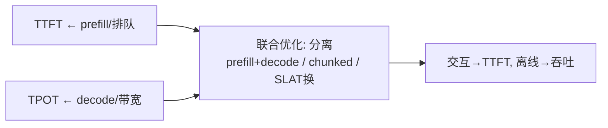

**面试要点**：TTFT 归 prefill、TPOT 归 decode；联合优化=**分离调度 + Chunked prefill + 按 SLA 调 TTFT/吞吐**。

---

## Q2. 用户对首字延迟极敏感时，应优先调整 serving 系统的哪些参数？对吞吐更敏感时又如何调整？

**回答**

**首字延迟（TTFT）敏感时**：
1. **并行 prefill**：拆成多节点/多 TP 同时算（降 prefill 时间）；
2. **Prefix Cache**：命中前轮 → 直接复用免 prefill（Q17 第 9 章）；
3. **小 batch / 即时调度**：新请求优先 prefill（不排队等大 batch），必要时**抢占/Chunked prefill**；
4. 用**更高算力节点**（大 prefill 卡）、减少 decode 排队。

**吞吐敏感时**：
1. **连续大 batch**：放大 decode batch 共享带宽（Q27 第 5 章）；
2. **Chunked/分离**：prefill/decode 分离让 decode 满载；
3. **KV/量化/模型瘦身**（Q28 第 9 章）；
4. 吞吐优先就不在乎单请求 TTFT，调度器把 prefill 排后、decode 优先。

```python
def serving_tuning(sensitive):
    if sensitive == "ttft": return {"parallel prefill": True, "prefix cache": True, "small batch": True}
    if sensitive == "throughput": return {"big continuous batch": True, "decode priority": True}
```

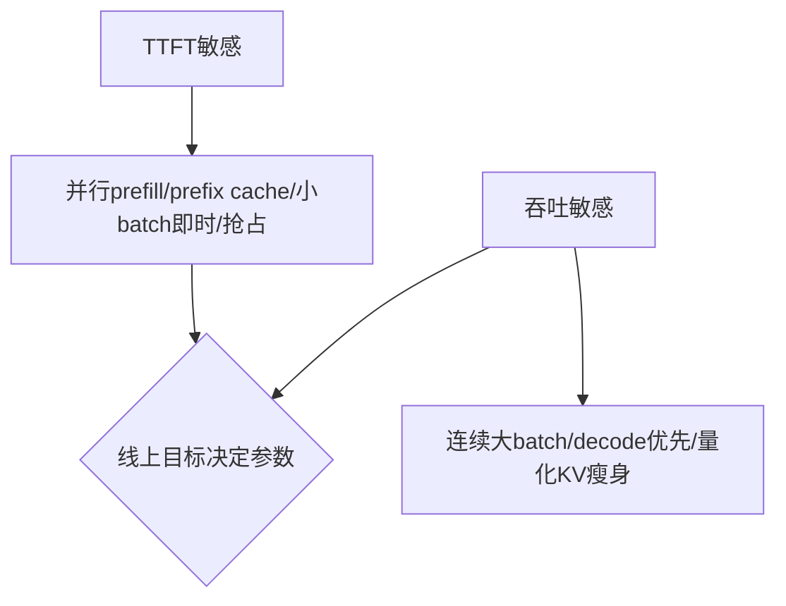

**面试要点**：TTFT 敏感=并行 prefill+cache+即时小批；吞吐敏感=连续大 batch+decode 优先+瘦身。

---

## Q3. LeCun 对 LLM 路线的核心批评是什么？他认为"下一 token 预测"范式的根本局限在哪里？

**回答**

**核心批评**：LLM 只是**"文本的预测器"**——靠统计下一个 token 的共现，**没有真正的世界理解/规划/常识推理**；把"在语言分布上说得通"误当成"懂世界"。

**"下一 token 预测"的根本局限**：
1. **无目标/规划**：预测下一个 token 是**统计关联**，不是"面向目标的行为"（无法真正长程规划）；
2. **缺乏世界模型**：没有**可预测物理/因果的模型**（文本不能穷尽世界状态，语言只是世界的投影，都有 gap）；
3. **被动/只能产生语言**：不能与真实环境交互/验证；
4. **学习方式不高效**：海量文本被动自监督，缺乏**交互/多模态/动作反馈**的学习；
5. 因而**不可靠**（幻觉）、不具可解释的推理链。

（Q17 里 JEPA 是 LeCun 的替代路线。）

```python
def leaky_critique():
    return {"text-only": "只预测token, 无世界理解",
            "no_goal": "无规划/面向目标",
            "no_world": "缺可交互世界模型/因果"}
```

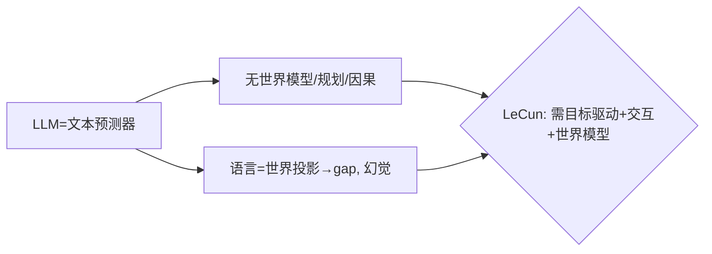

**面试要点**：批评=LLM 只是**统计下一 token、缺世界理解/规划**；局限=无目标、无世界模型、被动文本、幻觉。

---

## Q4. 你如何看待"世界模型"与 LLM 的关系？LLM 是否已经隐式学到了世界模型？

**回答**

**关系看法**：
- **世界模型** = 能**预测环境状态变化/因果/物理**的内部模型——agent 凭它规划；
- LLM 通过海量文本**可能学到了世界的"语言投影"**（事实、关系、一些物理常识的表层）；
- **但差距**：LLM 学到的是**语言描述的规律**，不是**可操作/可预测真实状态**的世界模型（尤其在物理动态、交互、未见状态上）。

**LLM 是否隐式学到世界模型**：
- **有部分**：研究表明 LLM 在某些任务（推理、空间、简单因果）里 **"隐性形成了一种世界模型"**（如用内部表征反映真实世界结构）——证据存在但有限；
- **结论**：**是"部分/不完整的世界模型"**——它能片段地推断，但**不是可验证、完整、可交互**的世界模型；真正世界模型仍需显式环境交互或架构（如 JEPA/多模态+动作，Q17）。

```python
def world_model_view():
    return ("LLM有'语言的投影'与部分隐性结构, "
            "但不是可预测/可交互的完整世界模型")
```

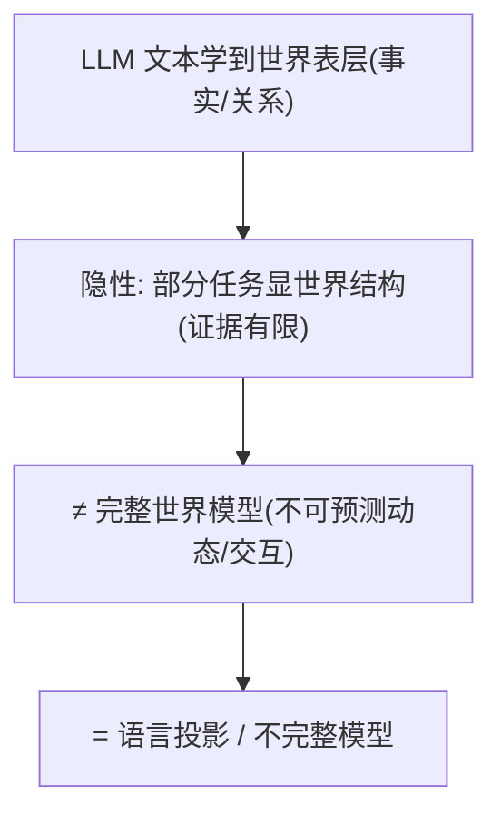

**面试要点**：LLM 学到**语言的投影**与**有限隐性结构**；但不是**可预测/可交互的完整世界模型**（差距在动态与交互）。

---

## Q5. 推理时间扩展（test-time compute，长思维链）是否改变了 Scaling Law 的形态？

**回答**

- **训练 Scaling Law**：`loss(N,D)`——训练时算力预算决定能力（第 8 章）；
- **推理时间扩展（test-time compute）**：**推理时花更多算力**（长思维链、beam search、多次采样/验证）**提升单次质量**——**同一模型**，算力预算从"训练"部分转移到"推理"。

**是否改变形态**：
- **在"能力 vs 总算力（训练+推理）"的图上**，**形态确实扩展**：**推理时可以用算力换取能力**（每多花推理算力都涨一点能力，形成**推理 scaling**）；
- **建议理解**：不是推翻训练 Scaling Law，而是**新增一个维度**——`能力(f(train, test_compute))`：固定模型 + 更多推理算力 → 持续提升（长思维链、GO 的 test-time 搜索同理）；
- 所以**"Scaling 的战线从训练迁移到了推理"**（Q21 本章的边际收益会在推理端继续）。

```python
def capability(fixed_model, test_compute):
    # 同模型: 推理算力越多能力越高（近似幂律）
    return base + C**(0.5)*test_compute
```

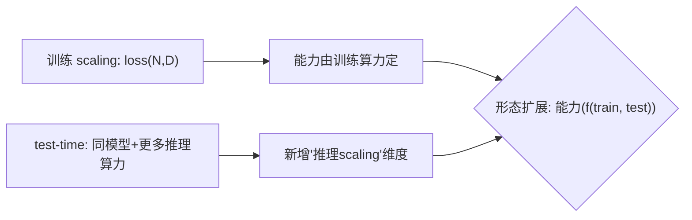

**面试要点**：test-time compute **新增"推理缩放"维度**（同模型+推理算力→更强）；不推翻训练 scaling，而是**战线迁移到推理端**。

---

## Q6. 推理阶段可以无限延长思维链时，模型能力的上限由什么决定？

**回答**

**无限推理算力时，能力上限由**：

1. **模型内在能力/表示**：**权重里是否有足够的知识与推理原语**——推理算力只能**利用**已有表示，不能凭空产生**它不了解的领域/概念**（没有相关知识，再长 COT 也造不出）；
2. **正确的验证/目标**：能不能**判断当前推理对不对**（没有验证信号，就会无限说错——需要过程验证/搜索）；
3. **搜索/规划的质量**：更长 COT = **更深的搜索**——上限也受**搜索策略（发散/回溯/验证）**约束（无系统搜索就是"绕圈"）；
4. **稳定性**：长链会**累积错误/重复**（不修正则发散）。

**结论**：**上限 ≈ 模型内部的"理解+知识" × 验证与搜索策略的可靠性**；推理算力放大的只是"利用这些能力的过程"，**不是能力本身**。

```python
def ceiling(model, verifier, search):
    return model._knowledge * verifier_quality * search_quality
print("算力只放大'利用'; 上限=知识×验证×搜索")
```

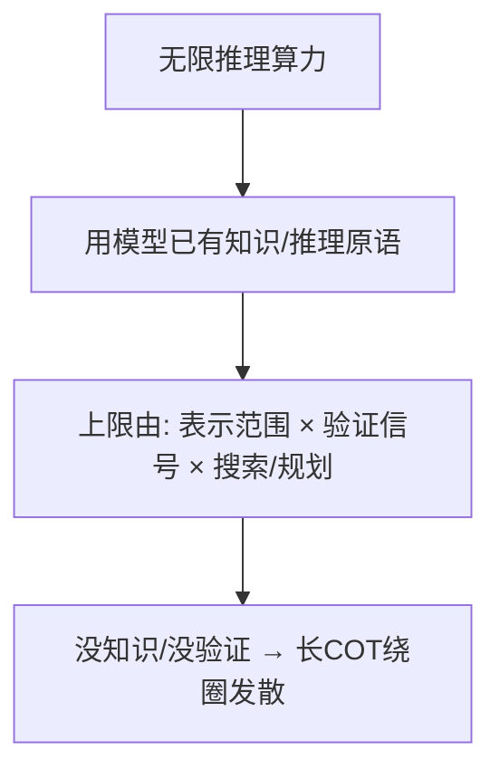

**面试要点**：上限=**权重内的知识/表示 × 验证 × 搜索策略**；推理算力放大"利用"而非"能力本身"。

---

## Q7. Agent 范式与纯 LLM 推理的核心区别是什么？工具使用、记忆、规划分别给模型增加了什么？

**回答**

**核心区别**：
- **纯 LLM 推理**：一次性"想→答"（无外部交互）；
- **Agent**：**多步闭环**——感知→决策→行动（调用工具/改环境）→ 观察 → 再决策，**与环境交互**。

**增加的东西**：
1. **工具使用**：给模型**行动能力**（API/代码/检索/计算器）→ 能**执行/验证**，扩展了"只说话"为"能做事"（也补校验与计算）；
2. **记忆**：给模型**跨步/跨会话的状态**（长期记忆/历史记录）→ 能**利用过去决策**、保持一致性（解决单模型"无状态"）；
3. **规划**：给模型**分步目标与执行回退**→ 能**长程拆解/搜索/纠错**（走出"单步预测"的限制）。

**一句话**：Agent 加了"**闭环交互（行动）+ 记忆（状态）+ 规划（分解）**"，让模型从"回答"变"解决问题"。

```python
def agent_loop(state, memory, tools, planner):
    while not done:
        plan = planner(state, memory)          # 规划(分解)
        act = choose_tool(plan, tools)          # 行动/工具
        obs = execute(act)                      # 观察环境
        state, memory = update(state, memory, obs)
    return result
```

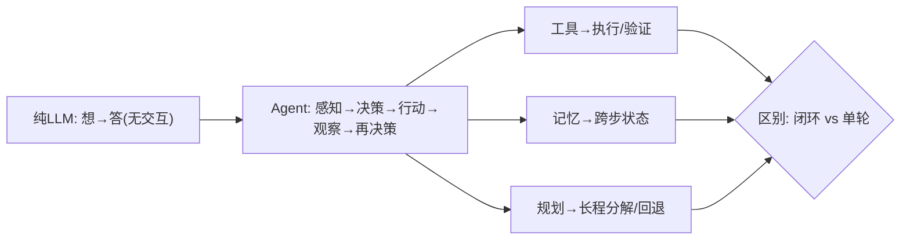

**面试要点**：Agent=**闭环多步与环境交互**；工具（行动）、记忆（状态）、规划（分解）各扩展不同能力。

---

## Q8. RAG 与长上下文是否是替代关系？各自适合什么知识更新频率与任务类型？

**回答**

**不是替代，是互补**：

- **RAG（检索增强）**：
  - 把**外部知识**动态检索注入 prompt；
  - 适合：**高频更新知识**（新闻、实时、用户私有库）、**精确事实**（需要引用验证）、**内存受限**（不把全部塞上下文）；
  - 局限：检索质量影响答案、跨多文档复杂推理弱。
- **长上下文（long-context）**：
  - 把**整个语料/文档**一次性放上下文；
  - 适合：**低频稳定知识**（法律全文、一本书）、**需要全局理解**（跨长文档推理、总结）、文档就在手边；
  - 局限：token/成本高、长文检索效率与"顿悟"弱（needle 外仍难）、不能顶替外部实时知识。

**结论**：**知识更新频繁→RAG；知识稳定/需整文→长上下文**；实际工作流常**RAG 检索 + 长上下文推理组合**。

```python
def pick(freq, whole_needed):
    return "RAG" if freq=="high" or not whole_needed else "long-context"
```

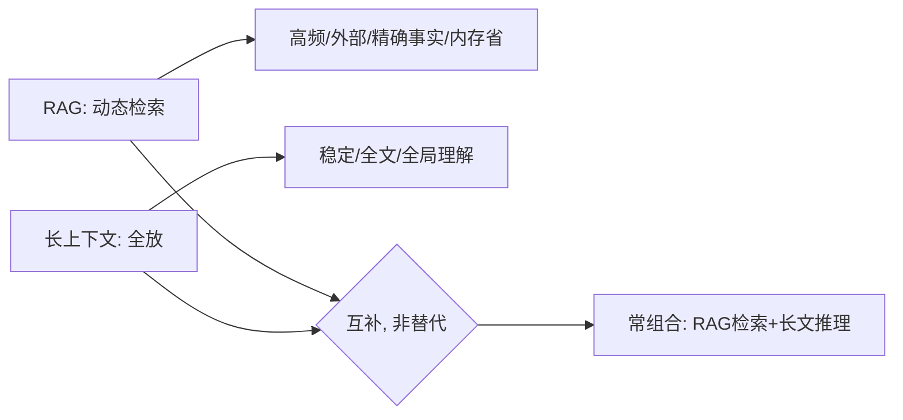

**面试要点**：高频/外部知识用 RAG，稳定/全局用长上下文——**互补**、常组合。

---

## Q9. 多模态、Agent、推理时间扩展三条路线，哪一条最有可能突破当前 LLM 的瓶颈？为什么？

**回答**

**没有唯一答案，但倾向给结构性判断**：**推理时间扩展 + Agent 组合** 最可能带来能力突破，原因是：

- **多模态**：扩宽**输入范围**（看/听），但仍是"被动预测"——补广度，不治"规划/可靠"的病；
- **Agent**：给**行动/交互/目标**——从"回答"到"解决问题"，是**能力形态的跃迁**（但受模型规划/验证限制）；
- **推理时间扩展**：给**探索/验证/搜索**——**用算力补模型的推理上限**（Q5/Q6），"会想得更久"是**现成瓶颈的缓解**。

**为什么组合最强**：**Agent 需要规划（test-time 推理的赛跑）与多模态理解**；三者是"感知×行动×推理"三维——单点都不够，**先推理扩展提升单步质量，Agent 提供执行闭环，多模态扩展感知输入**。

```python
def breakthrough():
    return {"multimodal": "感知广度", "agent": "行动/闭环",
            "test-time": "推理深度", "组合": "感知×行动×推理 → 最可能突破"}
```

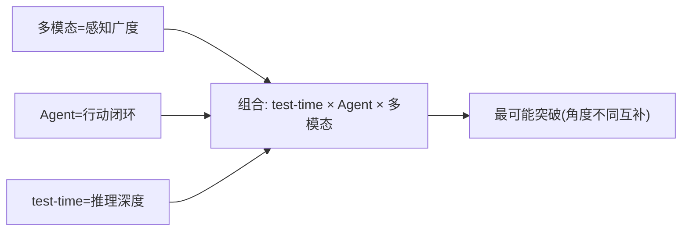

**面试要点**：无唯一；**组合（推理扩展×Agent×多模态）**最可能——感知×行动×推理三维配合；说明你的推理逻辑。

---

## Q10. 从"训练最优"到"推理最优"的范式转移，对模型架构设计会带来什么反向影响？

**回答**

**训练最优→推理最优的转移**（推理成本/部署越来越被重视）对架构的反向影响：

1. **更小激活参数/高效部署**：MoE（激活少）、GQA/MQA（KV 少）、低精度友好（架构允许量化）；
2. **更长上下文效率**：长上下文/稀疏注意力、"可推理扩展"（支持 test-time compute 的搜索/验证友好架构）；
3. **模块化/可卸载**：让推理更容易（专家可卸载、KV 可压缩、逐层可切分）；
4. **推理友好的 token 设计**：减 token（长上下文省）、可缓存（prefix）；
5. **更小模型靠算力补齐**：既然推理可加算力（test-time），架构**不必一味追大参数**——偏向"中小模型 + 可扩展推理"（推理 scaling 让架构从"堆参数"转向"能 query 更久"）。

```python
def arch_shift():
    return ["MoE/激活少", "GQA/低KV", "量化友好", "长上下文/稀疏", "test-time扩展友好"]
```

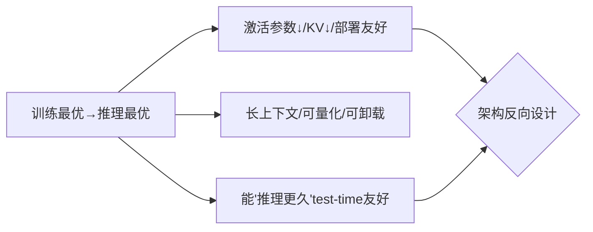

**面试要点**：推理最优反向要求=**激活/KV 少、部署/量化友好、长上下文、test-time 可扩展**——架构从"堆参数"转向"高效+可推理扩展"。

---

## Q11. 预测未来 3 年 LLM 架构最可能的一个变化，你会选什么？依据是什么？

**回答**

**我选：MoE 化（稀疏激活 + 多专家）在主流生产模型中的普及**。

**依据**：
1. **成本-收益**：同激活 FLOPs 下 MoE 用总参换容量（Q14 第 4 章），**激活少、部署划算**——推理成本压力下最经济；
2. **已验证**：Mixtral/DeepSeek/GPT-4 等已用，**研究稳定**，工程链（路由/EP/通信）成熟；
3. **趋势合并**：MoE + 多模态/长上下文组合（专家可换模态/知识）有自然扩展；
4. **产业**：需要"第一便宜 + 能力接近"——MoE 是**最能同时满足**的架构变化。

（备选：长上下文/稀疏 attention、或统一原生多模态——我按"大概率在工业落地"选 MoE。）

```python
moe_evidence = ["同FLOPs更多容量", "深层验证", "生产成本压力", "可组合多模态"]
print("预测: MoE 普及（最可能+依据如上）")
```

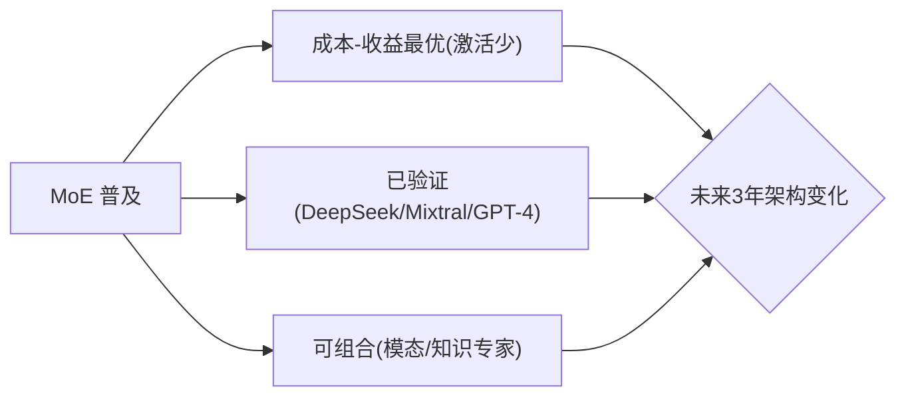

**面试要点**：给明确预测（MoE 化）+ 三条依据（成本收益/实证/可组合）——并说明是"概率判断"。

---

## Q12. 稀疏化（MoE、结构化剪枝、动态计算）与稠密化两条路线，你更看好哪一条？为什么？

**回答**

**我倾向"混合——不能只押一边"，但若单选：稀疏化在**部署成本**上更可能赢**。

**理由**：
- **稀疏化（MoE/剪枝/动态计算）**：**同 FLOPs 下容量更大、激活少、部署便宜**（Q14 第 4 章）；剪枝/动态计算还能在推理时自适应省算力——在**成本与规模压力**下更划算；
- **稠密化**：表达连续、训练稳定、无路由/负载问题，但**随规模算力线性涨**（贵）；
- 实际：**业界正并行**——**训练用大模型（大总参）+ 部署用稀疏（MoE/量化/剪枝）**"先稠密后稀化"的混合；"只看一条"会失去另一条的好处。

**结论**：**稀疏化在推理成本的考量下更可能胜**；但长期是"稠密训练 + 稀疏部署/专家化"的混合。

```python
def compare():
    return {"sparse": "容量/便宜/部署友好, 但路由/负载复杂",
            "dense": "稳/连续, 但随规模贵"}
print("看好: 混合(训练稠密+部署稀疏化); 单选按成本押稀疏化")
```

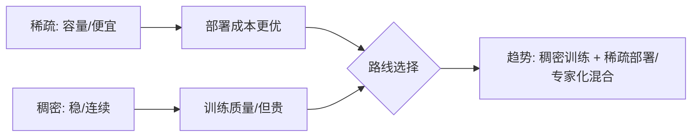

**面试要点**：给明确判断 + 理由；推荐**混合**（训练稠密/部署稀疏），单选按成本押稀疏化。

---

## Q13. LLM 的"记忆"应如何实现？参数化记忆、外部检索、KV 持久化各自的优劣是什么？

**回答**

**三种记忆实现**：

1. **参数化记忆（权重内）**：把知识**写进权重**（预训练/微调）——
   - 优：**检索快、天然语境**；
   - 劣：**更新难/贵**（要微调）、易过时、**不可控**（无法删除特定记忆）,容量有限。
2. **外部检索（RAG/向量库）**：把知识存外部，**查询时检索注入**（Q8）——
   - 优：**可更新/可删/可溯源**、容量不受模型限、成本低；
   - 劣：**检索质量依赖**、非线性查询时不可靠、需检索系统。
3. **KV 持久化（上下文记忆/cache）**：把对话/上下文**存在 KV Cache**（长上下文、视觉记忆）——
   - 优：**精确保历史**、无需训练、天然支持多轮；
   - 劣：**token/显存成本**随长度涨、上下文窗口有限、无"持久知识"（窗口外就忘）。

**结论**：**混合**——**参数化存稳定知识 + 外部检索存动态更新 + KV 存会话上下文**；各管一层。

```python
def memory_layers():
    return {"parametric": "稳定知识(难更新)", "external_rag": "动态可更新",
            "kv_persist": "会话/上下文(窗口受限)"}
```

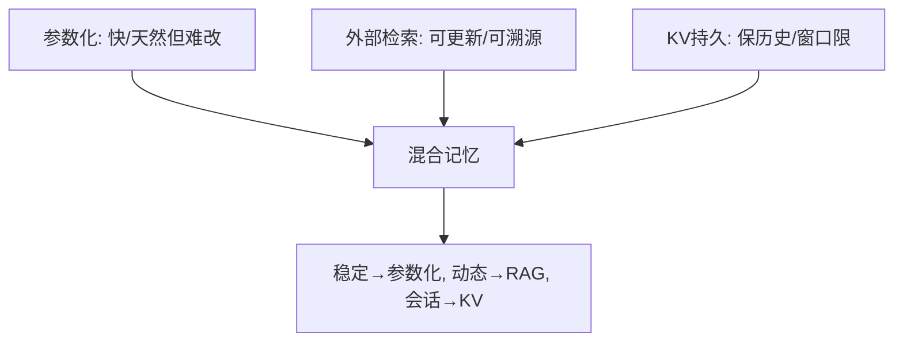

**面试要点**：三者的优劣（更新/容量/成本/控制）；结论=**分层混合**（稳定、动态、会话各司其职）。

---

## Q14. 推理中的"自我验证"为什么困难？模型能否可靠地判断自己答案的对错？

**回答**

**自我验证困难的本质**：
1. **无外部真值**：模型"验证"自己答案时，**唯一依据就是它自己的表示**——没有独立 ground truth（同一个模型既答题又判题，无法跳出自身）；
2. **置信度不可靠**：LLM 的置信度/自评**校准差**（过度自信、与真实正确率相关性低）；
3. **同源偏差**：判断逻辑与生成逻辑**同源**——生成错的地方判断也错（盲区一致）；
4. **长链累积**：验证长推理要**回溯整条链**，容易中途错误不改。

**能否可靠判断**：
- **单独"自我检查"通常不可靠**（自评与真实强关联低）；
- **可靠方式**：**外部验证**（可验证任务的直接判定：代码测试、数学校验）、**多次采样一致性**（self-consistency：多路结果投票，分歧时更可靠）、**对抗验证**（不同模型 cross-check）。

```python
def self_verify(ans):
    score = model.confidence(ans)      # 自评（校准差, 不可靠）
    return score
def reliable(ans, verifier, samples):
    return verifier(ans) or (majority(samples) == ans)   # 外部/多数一致
```

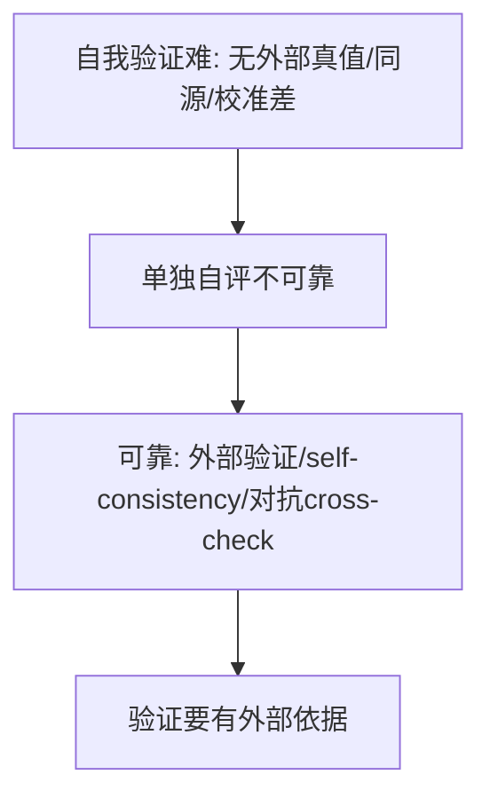

**面试要点**：自我验证难因**无外部真值+同源+校准差**；可靠判断要靠**外部验证/多次采样一致**。

---

## Q15. o1/R1 类长推理模型对 serving 基础设施提出了什么新要求？

**回答**

**长推理模型（o1/R1，会产生长思维链）对 serving 的新要求**：

1. **海量 KV Cache 与长序列**：长思维链 → **超长上下文/海量 KV**——需要**长上下文 + KV 压缩/多分辨率缓存**（Q16 第 9 章）、显存规划；
2. **算力预算动态/可扩展**：每个请求的推理 token 数**不可预知（几十~几千）**→ 需要**容量可伸缩**、超时/预算控制、按需延长；
3. **prefill/decode 比例失调**：长链 prefill 反复 → **调度器要处理超长 prefill**（chunked、能断点续算）；
4. **成本与定价**：推理 token 消耗大 → 需要**可观测/计量**、模型瘦身（量化/蒸馏）与高效内核；
5. **中断/恢复（长任务断点）**：长推理若被抢占需**保存中间状态**。

```python
def long_reasoning_serving():
    return ["超长KV/长上下文", "动态算力预算/超时", "长prefill调度",
            "成本计量", "中断恢复"]
```

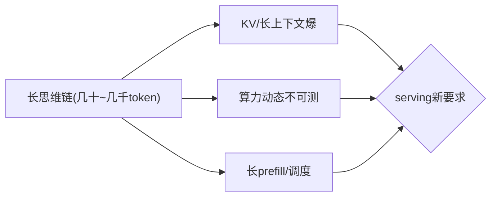

**面试要点**：新要求=**超长 KV、动态预算、长 prefill 调度、成本计量、中断恢复**。

---

## Q16. 推理成本持续下降后，哪些当前"不经济"的应用会变得可行？举一个具体例子。

**回答**

**推理成本下降使"重推理/多轮/大规模"应用可行**：

1. **长推理/Agent 大规模跑**：推理扩展便宜 → **每位用户跑长 agent 任务、多次自我验证**可行；
2. **个人化/实时大模型助手**：便宜到"日常随时随地"；
3. **批处理重推理**：文本校对、税务、法律审查等**单次便宜到可批量化**。

**具体例子**：
- **长链思维+Agent 的"自主研究助手"**：如今推理贵，跑 1 个问题 1 万 token 不合适；
- 成本下降后：**每个学生/每份文档都能跑"自主文献调研 + 逐步验证 + 工具调用"**——原来"一次就答"变"多轮深度研究"，且**每步都多次验证**——因为推理 token 便宜到可负担。

```python
def app_vital(cost_per_1k):
    return cost_per_1k < 0.01   # 推理够便宜 → 深度agent应用可行
print("成本下降 → 长链agent/个人助手/批量重推理 变得经济")
```


**面试要点**：回答=**成本下降解锁重推理/Agent/批量**；给具体例（自主研究/每用户 agent）并说明"为什么原来不经济"。

---

## Q17. LeCun 提出的 JEPA 路线与 LLM 路线的本质分歧是什么？JEPA 缺少什么才没有成为主流？

**回答**

**本质分歧**：
- **LLM 路线**：**预测 token（语言）**——学习"文本的分布/共现"；
- **JEPA（Joint Embedded Predictive Architecture）**：**在表示空间做预测**——把世界压缩成**抽象表示**，预测**未来的表示**（不逐像素/token，而是语义潜在状态），**目标=learn world model/规划/具身**。

**JEPA 缺少什么才没成主流**：
1. **缺少内容/应用支撑**：没有像文本一样**海量现成数据与统一目标**（token 是自然的监督；JEPA 要设计表示/损失，尚无等效"文本级"规模数据与标准）；
2. **缺失"生成"能力**：JEPA 在表示空间预测，**不直接生成输出**——难接下游任务/对话（LLM 的生成/接口直接可用）；
3. **训练目标/稳定复杂度**：多模态表示学习的稳定性与损失设计比 token 预测复杂；
4. **生态与算力壁垒**：LLM 有算力/框架/Transformer 生态；JEPA 缺乏等效成熟栈。

```python
def jepa_vs_llm():
    return {"LLM": "预测token(语言分布)", "JEPA": "预测表示(世界模型/规划)"}
```

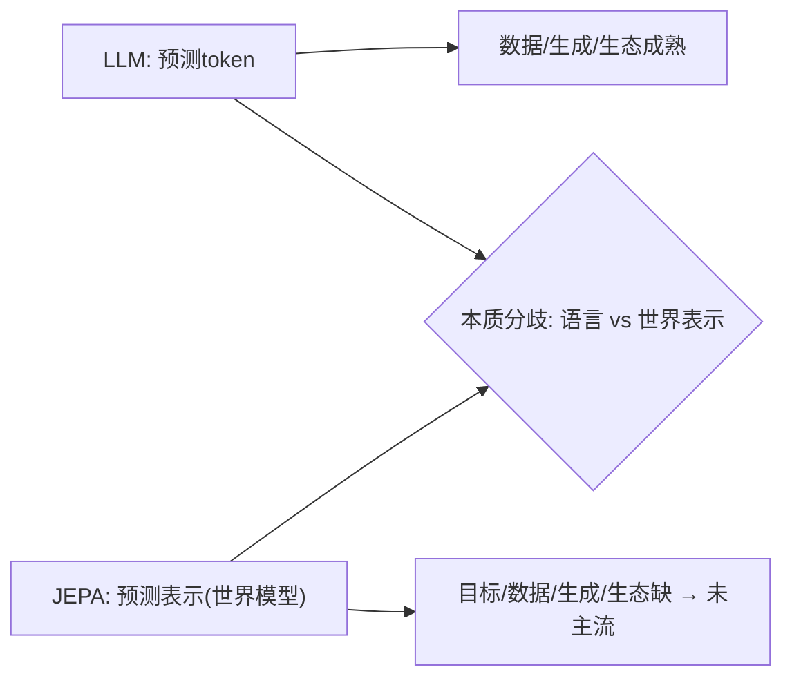

**面试要点**：分歧=**文本 token 预测 vs 表示空间的世界模型预测**；JEPA 缺**数据/统一目标、生成接口、生态** → 未主流。

---

## Q18. Agent 的"规划"能力能否完全由 LLM 本身涌现，还是必须依赖外部搜索/规划器？

**回答**

**两者都需要（不是纯涌现）**：

- **部分可涌现**：LLM 在多步任务上有**一定内隐规划**（从训练数据学到"分步做"的模式，如长 COT 的自规划）；
- **但不可靠/不充分**：
  - **长程/组合规划、需要系统搜索**的规划（约束满足、BFS/DFS、回溯）——**纯 LLM 会错、会绕圈、不保证最优**；
  - **无自我验证/回溯**：长规划遇到错误分支需**外部修正**；
  - 不确定性/环境动态 → 需**显式规划器或搜索**来补。

**结论**：**LLM 提供的"启发式/生成候选" + 外部搜索/验证器的"结构化规划"**是组合——**纯涌现不够**，Agent 工程中把"计划生成(LLM)"与"搜索/执行/校验(外部)"结合（ReAct/Tree-of-thought 本质就是 LLM+外部搜索）。

```python
def plan(llm, search, verifier):
    candidates = llm.propose_actions(state)   # 涌现(启发式)
    best = search.beam(candidates, verifier)  # 外部结构化搜索
    return best
```

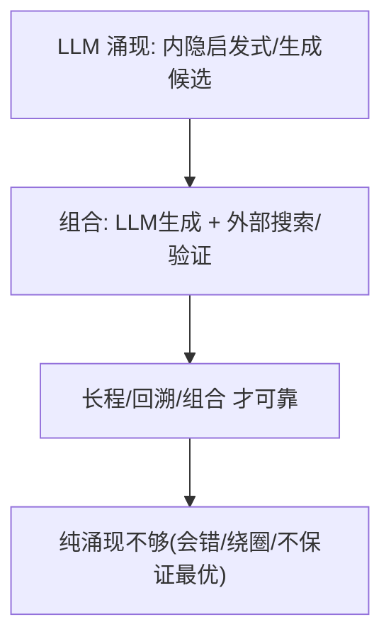

**面试要点**：规划=**LLM 启发式+外部搜索/验证的组合**；纯涌现不可靠（长程/回溯/最优）。

---

## Q19. 多轮 Agent 任务中错误累积如何缓解？自我纠错在什么条件下有效？

**回答**

**错误累积的缓解**：
1. **检查点/验证每步**：每步行动后**验证状态/输出**（结构校验、环境反馈），出错即时回退；
2. **计划细分 + 分解**：把长任务拆成可验证子目标（每步独立可控）；
3. **π 强制/工具约束**：用规则约束动作空间（防非法动作引入错误）；
4. **长期记忆回放**：避免反复踩同一坑（把历史错误纳入记忆，Q7 第 15 章记忆）；
5. **多方案对比**：关键步骤生成多方案选优。

**自我纠错（self-correction）的有效条件**：
- **有外部反馈/验证**：能拿到"错在哪"（执行结果、测试、ground truth）——**有反馈才有效**；
- **错误可定位**：纠错需要**知道改哪里**；模糊错误（无信号）自我纠错无效甚至"改错";
- **有足够算力与正确方向**：多次修正须**收敛于更好**（无验证时多次自评多为噪声）；
- 结论：**自我纠错在"有外部信号可验"时有效，纯自评无反馈时基本无效**（Q14）。

```python
def self_correct(attempt, feedback):
    if feedback is None: return attempt          # 无反馈 → 无法valid纠错
    return refine(attempt, feedback)             # 有反馈 → 收敛修正
```

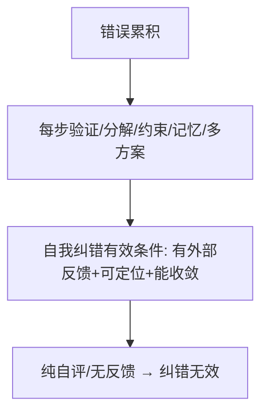

**面试要点**：缓解=每步验证、分解、工具约束、记忆、多方案；自我纠错**需外部反馈与可定位**，纯自评无效。

---

## Q20. 从"下一个 token 预测"到"下一个概念预测"，是否是一个可行方向？技术障碍在哪里？

**回答**

**方向可行但技术障碍大**：

- **概念预测** = 在**更高抽象表示**上预测（而不是 token）——类似 JEPA（Q17）、或"语义/latent token"预测（降低推理、提升推理的令牌级噪声）；
- **可行性的理由**：token 级预测有时**噪声/低效**（长推理冗余），概念级更有归纳、更抽象。

**技术障碍**：
1. **概念没有统一标注/切分**：token 是现成的离散，**"概念"边界/粒度难定义**（怎么把推理链切成"概念元"？）——缺标准监督；
2. **表示的可解释/可验证**：概念表示**难验证**（token 有 ground truth 可判；latent 概念对错难判）；
3. **学习目标不自然**：如何让"预测下一个概念"的损失（对比/重建）稳定地自监督——比 token 的 CE 复杂；
4. **与生成/接口衔接**：概念级别输出**要解码回语言/动作**才能用（多一层）。

```python
# token预测: CE(next_tok)
# concept预测: 在latent表示上预测/Z (需定义概念与重建)
concept_target = predict_in_latent(h)      # 障碍: 概念切分/验证/重建
```

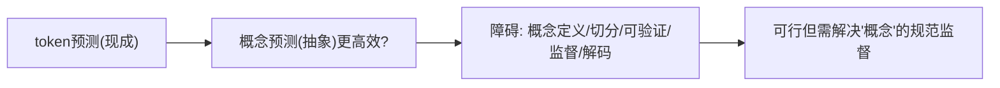

**面试要点**：方向可行（更抽象/少噪声）；障碍=**概念无统一切分与监督、难验证、需解码回语言**。

---

## Q21. 推理时间扩展的边际收益何时递减？如何判断一个任务是否值得用长思维链？

**回答**

**边际收益递减的条件**：
- **任务已"饱和"**：模型短时已能答好（简单题——再加算力无益）；
- **无法验证/无果**：任务无明确目标信号 → 长链只会绕圈（发散），收益不随算力涨；
- **模型表示上限**：知识/推理原语不足（Q6），再长也不超过上限；
- **重复/不动**：长链反复说同样内容（无新探索）→ 收益平。

**判断是否值得用长 COT**：
1. **难度**：任务对模型**当前需要探索**（中等偏难、非"秒答"），简单题不值得；
2. **可验证**：有**验证/可判目标**（数学/代码/明确目标）→ 长链+验证有价值；开放无真值 → 不值得；
3. **收益-成本**：估算"加算力能换多少正确率"（在验证集上测长/短 COT 的 Δ）——**Δ 大用长链，Δ≈0 用短**；
4. **容错**：必须精确的任务值得（低容错），随口问答不值得。

```python
def use_longcot(diff, verifiable, gain):
    return (diff >= medium) and verifiable and gain > threshold
```

```mermaid
flowchart TB
    A["收益递减: 饱和/无验证/上限/重复"] --> B{"任务值得长COT?"}
    B --> C["难 + 可验证 + 增益>成本 → 用长链"]
    B --> D["简单/无真值/Δ≈0 → 用短链"]
    C --> E["按难度×验证×增益判断"]
    D --> E
```

**面试要点**：递减=饱和/无验证/上限；值得长 COT 的判据=**难度、可验证、收益-成本（在验证集测 Δ）**。

---

## Q22. 模型参数不再增长时，仅靠推理时间扩展与数据质量提升，能否继续获得显著能力进步？

**回答**

**可以，但"显著"受结构与收益限制**：

**能继续进步的来源**：
1. **推理时间扩展**：同参数 + 更多 test-time（长链/搜索/验证）→ 能力明显提升（Q5 的推理 scaling）；
2. **数据质量提升**：同样量 token 下**更高质/更配比**（第 10 章）→ 表示更优、能力更强；
3. **对齐/后训练**（SFT/RL 精修）；
4. **架构内效率**（MoE/稀疏保持大总参小激活，Q12 第 15 章）。

**限制**：
- 极端下，**参数固定 → 表示容量有上限**（新知识/新模态/极端任务需要参数存储）；
- 数据质量/推理扩展的收益**最终也幂律饱和**（但仍有很长时间的显著增长区间）。

**结论**：**在相当长范围内"是"**（参数不涨也能靠推理扩展+数据质量+后训练继续涨）；但要意识到**参数仍决定表示上限**——两者都做最优。

```python
def progress(fixed_N):
    return {"test_time": 有(推理scaling)", "data_quality": 有(有效D提升)",
            "ceiling": "参数决定表示上限(长期)"}
```

```mermaid
flowchart LR
    A["参数不动"] --> B["test-time↑能力↑(推理scaling)"]
    A --> C["数据质量↑能力↑(有效D/表示)"]
    B --> D["仍显著进步(相当范围)"]
    C --> D
    D --> E["极限: 参数=表示上限 → 两者配合"]
```

**面试要点**：在相当范围**能**（推理扩展+数据质量+后训练）；但**参数=表示上限**，长期两者配合最优。

---

## Q23. LLM 的"可解释性"在推理模型上变得更难还是更容易？思维链是否忠实反映了真实计算？

**回答**

**两面：既是机会也更难**。

- **更容易的方面**：推理模型**输出思维链**——能**看到推理过程**（步骤），比黑箱分类器更可审计；
- **更难的方面**：
  1. **COT 是"生成文本"不是"真实计算"**——**思维链不一定忠实反映内部计算**（transformer 的真实"思考"发生在隐藏层/注意力，COT 只是它"写出的合法性叙述"；模型可以在内部分两路，COT 只是表述）；
  2. 长推理模型**内部状态更复杂**（长链/验证/回溯痕迹不易被简单探针解释）；
  3. **COT 可能事后合理化**（与内部不符但"看起来合理"）。

**忠实性证据**：研究表明 **COT 在部分任务上与内部推理有一定对应**（改变中间步骤会改变输出），但**不保证完全忠实**（存在"口是心非"的链）。结论：**COT=可读但不等于真实计算**。

```python
def faithfulness():
    return {"可读": "能看到步骤", "忠实": "部分(改链会改输出), 但不等于内部计算"}
```

```mermaid
flowchart LR
    A["推理模型输出COT"] --> B["可读(审计性强)"]
    A --> C["但不忠实: COT是叙事, 真实计算在隐藏"]
    B --> D{"解释性: 可读≠忠实"}
    C --> D
```

**面试要点**：可读提升但**忠实性存疑**（COT 是"表述"非"计算"）；结论=可读≠忠实，内部计算在隐藏层。

---

## Q24. 开源模型与闭源模型的差距在扩大还是缩小？从训练流程、数据、算力三个维度分析。

**回答**

**总体趋势：传统差距在缩小，但"前沿/边界"差距仍存在（部分维度在扩大）**：

- **训练流程（架构/算法）**：开源已有**等效流程**（LLaMA、DeepSeek、Qwen 发布对齐流程）——**差距小**，甚至开源论文先发（LoRA、GRPO）；
- **数据**：
  - 开源已有大语料（RedPajama/FineWeb/C4），但**顶级/私有/高质量与垄断数据（技术文档、长回复、专有正反馈）仍有差距**——部分维度差距可能在扩大（闭源积累 feedback data 优势）；
  - 数据质量与配比方面闭源有差距优势。
- **算力**：闭源巨头算力远多——**训练大模型的前沿能力**闭源强；但**开源小模型 + 高效训法**（MoE/蒸馏）弥补一部分。

**结论**：**开放/可复现部分大幅缩小（流程、算法），但"顶级数据 + 前沿算力"堆出的边界能力仍领先**——差距不是单调（能力分布上前沿拉开、通用能力拉近）。

```python
def openness_gap():
    return {"流程": "缩小(开源对齐)",
            "数据": "部分扩大(顶级/反馈数据)",
            "算力": "闭源前沿领先(开源靠效率补)"}
```

```mermaid
flowchart LR
    A["训练流程/算法"] --> B["缩小(等效流程公开)"]
    C["数据"] --> D["部分扩大(私有/反馈质量)"]
    E["算力"] --> F["闭源前沿领先(开源补效率)"]
    B --> G{"综合: 通用拉近, 边界仍有差距"}
    D --> G
    F --> G
```

**面试要点**：分三维——**流程缩小、数据部分扩大、算力闭源领先**；结论=通用能力拉近但前沿边界有差距。

---

## Q25. 端侧 LLM 的瓶颈是什么？量化、蒸馏、MoE 哪条路线最有可能让 7B 模型在手机上流畅运行？

**回答**

**端侧瓶颈**：
1. **显存/算力**：手机显存小、算力受限——7B FP16 权重 14GB 装不下；
2. **带宽**：内存带宽瓶颈（decode 每 token 读权重，Q10 第 5 章）；
3. **功耗/散热**：持续推理耗电/发热；
4. **长上下文/算力扩展受限**。

**三条路线对比（7B 上手机）**：
- **量化（最关键，第一优先）**：W4/量化把 7B 压到 **~4GB**（装得下）且 decode 带宽需求降 4×——**最直接的瓶颈消除**；
- **蒸馏**：蒸馏出**更小的专业模型**（~1–3B）——最省，但**通用性损失**；
- **MoE**：激活参数少 → **推理算力省**，但**总权重仍需加载**（显存没省多少，Q10 第 4 章）——在端端要"能激活少"才有用，但**驻留权重问题仍在**。

**结论**：**量化为主（先装得下/降带宽）→ 蒸馏出小模型（再省）→ MoE 做激活优化（补推理算力）** 最可行；其中**量化是让 7B 上手机的第一手段**。

```python
def edge_7b():
    q = "W4量化: 7B→4GB(装/带宽降4×)"
    d = "蒸馏: 更小专用模型(通用降)"
    m = "MoE: 激活少但权重全加载(显存没省)"
    return f"{q} → {d} → {m}（量化优先）"
```

```mermaid
flowchart TB
    A["端侧瓶口: 显存/带宽/功耗"] --> B["量化: 先装得下+带宽降(最优先)"]
    B --> C["蒸馏: 更小专用"]
    B --> D["MoE: 激活优化(权重驻留仍在)"]
    C --> E{"组合最可行"}
    D --> E
```

**面试要点**：瓶颈=显存/带宽/功耗；**量化是第一手段**（7B→~4GB）、蒸馏/小型化、MoE 补激活——组合最好。

---

## Q26. 设计一段"LLM 全栈能力"的 2 分钟面试自述，你会用《diy-llm》重排后的 15 章地图如何组织？

**回答**

**2 分钟全栈自述（按 15 章地图结构）：**

> "我的 LLM 全栈能力分四层：
> **第一层·地基**——我懂**分词器（BPE/字节级）**与**训练资源核算（6ND、显存/混合精度）**，知道模型的第一性原理与算力账；
> **第二层·系统**——深入**MoE、GPU 与 Kernel（FlashAttention/Triton）、分布式（ZeRO/Ring AllReduce）**，从算子级到集群级都能上手；
> **第三层·规模与数据**——会用 **Scaling Laws 定规模与配比**、设计推理系统（KV Cache/PagedAttention）、做**数据工程与评估**（MMLU/pass@k/评估驱动开发）；
> **第四层·对齐与前沿**——做过 **SFT/RLHF/RLVR（DPO/GRPO）**，了解**多模态（CLIP→LLaVA→Omni）**，对 **Agent/世界模型/未来路线**有结构化判断。
> 所以我能从"为什么这么训"到"怎么训出来、跑得快、对齐好"整条链路闭环。"

```python
def self_intro():
    layers = {"地基": "分词/资源/架构",
              "系统": "MoE/GPU/分布式",
              "规模与数据": "Scaling/推理/数据/评估",
              "对齐前沿": "RLHF/RLVR/多模态/未来"}
    return layers
```

```mermaid
flowchart TB
    A["地基: 分词/6ND/架构"] --> B["系统: MoE/GPU/分布式"]
    B --> C["规模: Scaling/推理/数据/评估"]
    C --> D["对齐: RLHF/RLVR/多模态/未来"]
    D --> E["整链路闭环(能训能跑能对齐)"]
```

**面试要点**：用 15 章四段（地基/系统/规模数据/对齐前沿）组织，展示"从训到跑再到对齐"的全栈闭环——注意开头概括、前后呼应。

---

## Q27. 同一个模型在不同 serving 框架下吞吐可以差数倍，框架的哪些设计决策影响最大？

**回答**

**影响吞吐最大的框架设计决策**：

1. **调度（Continuous Batching / 批管理）**：是否**动态入批/连续批**（Q27 第 5 章）→ 带宽共享程度——**吞吐最大杠杆**；
2. **内存管理（KV Cache 分页/PagedAttention）**：能否按需分块分配/共享/淘汰 → **并发容量**（Q6 第 9 章）；
3. **kernel 与计算层**：是否用 **FlashAttention/融合/CUDA Graph**、长序列优化 → 计算效率；
4. **prefill/decode 分离**（disagg/Chunked）→ 无相互拖累；
5. **量化/精度路径**：是否 W4/8 与相应的 kernel；
6. **并行（TP/EP）与通信**、图固化、调度策略（公平/吞吐）。

**总结**：**调度 + 内存管理（Paged/连续批）是吞吐差异的主因**；其次 kernel/Gender/量化/并行。

```python
top_design = ["continuous batching", "paged KV 内存管理",
              "flash/fusion kernel", "prefill-decode分离", "量化/并行"]
```

```mermaid
flowchart LR
    A["连续批调度"] --> B["带宽共享→吞吐主因"]
    C["Paged KV 管理"] --> D["并发容量(显存利用)"]
    E["kernel/Flash/量化"] --> F["计算效率"]
    A --> G{"哪些框架决策影响最大"}
    C --> G
    E --> G
```

**面试要点**：影响最大=**调度（连续批）与内存管理（PagedAttention）**；其次 kernel/量化/并行。

---

## Q28. 从"模型中心"到"数据中心"再到"推理中心"，LLM 工程的范式正在如何迁移？

**回答**

**三阶段迁移**：
1. **模型中心（model-centric）**：早期——**焦点在模型架构/参数量**（"我的模型多大/多强"），数据/工程服务型；
2. **数据中心（data-centric）**：后来——认识到 **数据决定上限**（Scaling 下数据配比/质量/去重成为主战场，第 10 章），模型相对成熟；
3. **推理中心（inference/system-centric）**：现在——模型趋同，**焦点转向"如何高效部署与推理"**（KV Cache/Paged/连续批/量化/MoE/长上下文），推理成本与系统优化主导工程。

**迁移本质**：**价值从"模型本身" → "喂的数据" → "部署与推理系统"**。今天模型层趋同、数据壁垒仍在，但**推理成本/延迟成为工程竞争点**（"会跑、跑得快、跑得便宜"）。

```python
def paradigm():
    return ["模型中心(架构)", "数据中心(数据)", "推理中心(系统/成本)"]
```

```mermaid
flowchart LR
    A["模型中心: 架构/参数"] --> B["数据中心: 数据/配比/scaling"]
    B --> C["推理中心: 部署/KV/量化/serving系统"]
    C --> D["工程焦点: 从'堆模型'到'堆数据'再到'跑得便宜'"]
```

**面试要点**：迁移=**架构→数据→推理系统**；今天聚焦"低成本高效部署"，价值从参数流向推理链路。

---

## Q29. 你认为当前 LLM 最被高估的能力与最被低估的能力分别是什么？给出判断依据。

**回答**

**最被高估**：
- **"推理/规划（长链思维）能力"**——长 COT 在 benchmark 上好看，但**离可靠、可验证的规划差很远**（Q18：需要外部搜索；Q14：自验证差）；被市场当作"会自主思考"实际是"更多搜索的文本"；
- （也可选"自我意识/理解"——无贴合证据。）

**最被低估**：
- **"系统/工程能力的放大"**（推理系统、Agent 编排、成本优化）——模型单点提升已放缓，但**"模型 × serving 系统 × agent 工作流"的组合能力被低估**（Q27/Q28：吞吐差数倍、闭环 agent）；以及**数据/评测工程**（决定最后一公里）也被低估。

**一句判断**：**"会自己长链规划"高估，"系统级组合与数据/评测工程"低估**。

```python
def assessment():
    return {"over": "长链'自主推理'（基准≠可靠规划）",
            "under": "推理系统×Agent×数据评测的组合价值"}
```

```mermaid
flowchart LR
    A["高估: 长链自主推理"] --> B["依据: 基准好看≠可靠规划/自验证差"]
    C["低估: 系统组合/数据评测"] --> D["依据: 吞吐差数倍/agent闭环/end-to-end决定"]
    B --> E{"给出依据的判断"}
    D --> E
```

**面试要点**：高估选"长链自主推理"（依据=可靠规划与自验证差）；低估选"系统组合/数据评测工程"（依据=工程决定最后一公里）。

---

## Q30. 面试官问"你如何看待 LLM 的未来"，你会如何组织一个既有技术深度又有个人判断的回答？

**回答**

**回答结构（四段）：**

1. **短期（1–2 年）**：**推理成本下降 + 推理时间扩展普及**——长链/Agent 在服务、编程、科研落地；模型看"会算得更久+系统高效"；
2. **中期（3–5 年）**：**Agent 化 + 多模态 + 稀疏（MoE）**——从"问答"到"任务闭环"（工具/记忆/规划），世界模型/隐式规划逐步增强（Q4）；推理与训练 scaling 同向；
3. **长期（5+ 年）**：**超越语言建模**——真正"行动/可交互/具身"的世界模型路线（JEPA 也可并行），模型成为"会规划、能执行、可学习"的 agent；与人类的接口（对齐/安全/可解释）成为核心；
4. **个人判断**：**曲线不会因"token 预测到头"而停**——**会转向推理-行动-触达世界的多元 scaling**；关键变量=**系统效率 + 数据能力 + 对齐可靠性**。

**技术深度要点**：引用 Scaling Law 迁移、推理 scaling、Agent/世界模型、系统优化——展现"从底层机制到产业判断"的完整逻辑。

```python
def future_view(horizon):
    return {"short": "推理扩展+成本↓", "mid": "Agent×多模态×MoE",
            "long": "行动/世界模型", "key": "系统效率+数据+对齐"}
```

```mermaid
flowchart TB
    A["短期: 推理扩展/成本下降"] --> B["中期: Agent×多模态×稀疏"]
    B --> C["长期: 行动/世界模型/可验证"]
    C --> D["关键: 系统效率 × 数据 × 对齐"]
    D --> E["有深度+有判断的展望"]
```

**面试要点**：四段结构（短期/中期/长期/个人判断）+ 技术机制（scaling 迁移、推理算力、Agent、世界模型、系统）——既有深度又有观点。

---

## 参考链接

1. [视觉特征-自监督-掩码特征预测【V-JEPA】-CSDN博客](https://blog.csdn.net/u013250861/article/details/163735019)
2. [视觉特征-自监督-掩码特征预测【V-JEPA2.1】-CSDN博客](https://blog.csdn.net/u013250861/article/details/163742057)
3. [2024-2026多模态大模型演进：从融合到统一基座与世界模型-CSDN博客](https://blog.csdn.net/weixin_33309048/article/details/169333152)
4. [现在的大语言模型已经发展得接近极限了？-CSDN博客](https://blog.csdn.net/qq_60906896/article/details/162769664)
5. [【AI】大模型的记忆机制有哪些？-CSDN博客](https://blog.csdn.net/weixin_40970718/article/details/158428644)
6. [模态×空间×时间：一篇119页综述定义了世界模型该长什么样-CSDN博客](https://blog.csdn.net/xx_nm98/article/details/160050632)

---

*全书 15 章 · 480 题完。《diy-llm》重排后的 15 章地图带你从"地基"（分词/资源/架构）到"系统"（MoE/GPU/分布式）再到"规模与数据"（Scaling/推理/数据/评估），最终进入"对齐与前沿"（SFT/RLHF/多模态），形成从"会训"到"会跑、会对齐、看得清未来"的完整能力闭环。*