# 第 15 章 · 扩展内容

> 面试生普（LLM 500 题）· 第 15 章。本章覆盖系统视角推理、Agent、世界模型、LeCun 路线、test-time compute、推理时间扩展、记忆实现、可解释性、开源/闭源、端侧、LLM 全栈自述与未来展望等 30 个问题，关键概念配 Python 代码与 mermaid 图解。

---

> 先把话说清楚：前面 14 章基本都在讲"大模型这台机器怎么造、怎么跑"，到了最后一章，我们抬头看看更远的地方——它正在被拿去干什么、接下来可能变成什么样。这一章更偏"观点题"：推理系统怎么伺候、Agent 到底是什么、世界模型和 LeCun 的批评是怎么回事、开源闭源谁追谁、手机能不能跑得动 7B、以及"你怎么看大模型的未来"。这些题没有唯一正确答案，面试官其实是在看你有没有把前 14 章的知识串成一条自己的逻辑线。所以读这章不必死记，重点是把"每个判断背后的理由"跟着走一遍，慢慢地你也能形成自己的说法。

---

## Q1. 从系统角度重新审视推理：TTFT 与 TPOT 分别受哪些因素支配？在线上服务中如何联合优化？

**回答**

先把两个缩写摆出来，它们是线上服务最常盯的两个"仪表盘"：

- **TTFT（Time to First Token，首个 token 的等待时间）**：用户敲完问题后，等多久能看见第一个字蹦出来。它主要受 **prefill**（把整段 prompt 一次性读进去、算出第一批结果的那个阶段）支配，另外还叠加了排队时间——prompt 越大，prefill 的算力越重，batch 怎么调度、prefix cache（前缀缓存，见第 9 章 Q13）有没有命中、chunked 策略怎么切（第 9 章），都会直接影响它。
- **TPOT（Time Per Output Token，生成阶段每个 token 的间隔）**：第一个字出来之后，后面每吐一个字平均要等多久。它主要受 **decode**（一个 token 一个 token 往下生成）支配，影响因素是解码带宽（要读权重、读 KV Cache）、batch 大小（一堆请求共享带宽）、kernel 效率、以及 CUDA Graph。

**线上怎么把两者一起优化**，通常几招配合用：

- **分离 prefill/decode**（disaggregated serving：prefill 专门一组节点、decode 专门一组节点，各调各的），避免两种负载互相拖累；
- **Chunked prefill** 把长 prompt 切成小段穿插执行，保住 TPOT 的稳定（代价是 TTFT 稍靠后一点）；
- 想要**低 TTFT**：开 prefix cache、并行 prefill、先用小 batch 把第一个 token 冲出来；想要**高吞吐（TPOT 端）**：上连续批、放大 batch 把带宽摊薄；
- 最后用 **SLA 权重**在调度器里做取舍——交互式请求优先 TTFT，离线任务优先吞吐（也就是下一题 Q2 要展开的）。

```python
def joint_opt(mode):
    if mode == "interactive": return "TTFT优先: 并行prefill+prefix cache+小batch"
    if mode == "throughput":  return "TPOT/吞吐: 大batch连续+chunked"
```

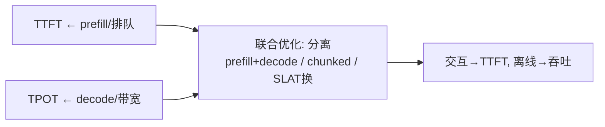

**面试要点**：TTFT 归 prefill、TPOT 归 decode；联合优化=**分离调度 + Chunked prefill + 按 SLA 调 TTFT/吞吐**。搞清这两个指标归谁管，下一题就顺着问：用户更在意哪个，参数该往哪边调。

---

## Q2. 用户对首字延迟极敏感时，应优先调整 serving 系统的哪些参数？对吞吐更敏感时又如何调整？

**回答**

一句话概括：**瓶颈在"首字"，就往压缩 prefill 时间上使劲；瓶颈在"总量"，就往让 decode 满载上使劲。**

**如果用户对首字延迟（TTFT）极敏感**：

1. **并行 prefill**：拆成多节点/多张卡上的张量并行同时算，把 prefill 的时间压下来；
2. **Prefix Cache**：命中前一轮的相同前缀就直接复用，跳过 prefill（见第 9 章 Q17）；
3. **小 batch / 即时调度**：新请求优先做 prefill（而不是排队等一个更大的 batch），必要时用**抢占**或 **Chunked prefill**；
4. 换**算力更强的节点**（prefill 大卡），并减少 decode 环节的排队。

**如果对吞吐更敏感**：

1. **连续大 batch**：把 decode 的 batch 放大，让更多请求共享同一份带宽（见第 5 章 Q27）；
2. **Chunked / 分离**：prefill 与 decode 分离，让 decode 一路满载；
3. **KV 压缩 / 量化 / 模型瘦身**（见第 9 章 Q28）；
4. 既然吞吐优先，就别管单请求的 TTFT 了，调度器可以把 prefill 排后、decode 优先。

```python
def serving_tuning(sensitive):
    if sensitive == "ttft": return {"parallel prefill": True, "prefix cache": True, "small batch": True}
    if sensitive == "throughput": return {"big continuous batch": True, "decode priority": True}
```

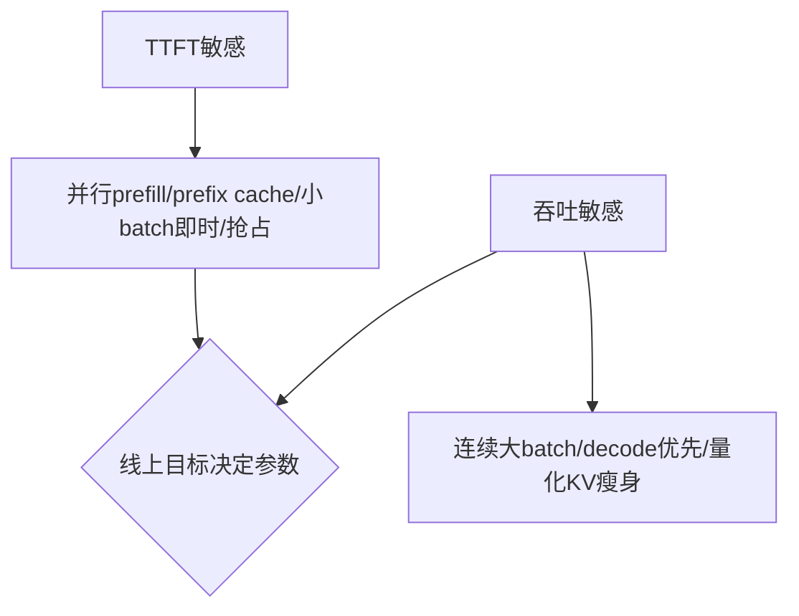

**面试要点**：TTFT 敏感=并行 prefill+cache+即时小批；吞吐敏感=连续大 batch+decode 优先+瘦身。从"怎么伺候系统"往下走，就该看"模型本身够不够聪明"了——先看 LeCun 那套尖锐的批评。

---

## Q3. LeCun 对 LLM 路线的核心批评是什么？他认为"下一 token 预测"范式的根本局限在哪里？

**回答**

LeCun（图灵奖得主、Meta 首席 AI 科学家）是 LLM 路线最有名的"质疑者"之一。他的火药味核心就一句：**LLM 充其量是个"文本的预测器"**——它靠统计下一个 token 的共现规律转得飞快，但**并没有真正的世界理解、规划和常识推理**；人们常把"在语言分布上说得通"误当成了"真的懂世界"。

在他看来，"下一 token 预测"这个范式的根本局限有这么几条：

1. **没有目标、没有规划**：预测下一个 token 本质是**统计关联**，不是"朝着某个目标去行动"，所以做不了真正的长程规划；
2. **缺乏世界模型**：它没有一套**能预测物理、预测因果的内部模型**——文本穷尽不了真实世界的状态，语言只是世界的投影，投影和实物之间隔着一道 gap；
3. **被动，而且只会产语言**：它没法跟真实环境交互、也没法在环境里验证自己；
4. **学习方式不高效**：靠海量文本被动地自监督，缺少**交互、多模态、动作反馈**这类更高效的学习信号；
5. 因此它**不可靠**（就是大家说的幻觉），也拿不出一条可解释的推理链。

（LeCun 自己提出的替代路线是 JEPA，留到 Q17 再聊。）

```python
def leaky_critique():
    return {"text-only": "只预测token, 无世界理解",
            "no_goal": "无规划/面向目标",
            "no_world": "缺可交互世界模型/因果"}
```

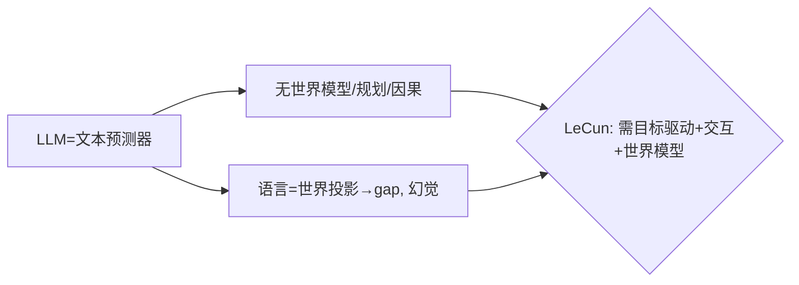

**面试要点**：批评=LLM 只是**统计下一 token、缺世界理解/规划**；局限=无目标、无世界模型、被动文本、幻觉。那既然 LeCun 嫌它不懂世界，我们不妨追问一句：LLM 到底有没有偷偷学到一点"世界模型"？

---

## Q4. 你如何看待"世界模型"与 LLM 的关系？LLM 是否已经隐式学到了世界模型？

**回答**

先把"世界模型"定义清楚：它指的是一个**能在内部预测环境状态怎么变、预测因果和物理规律**的模型——agent 靠它来做规划（先在心里"过一遍"，再决定怎么做）。

那 LLM 和它是什么关系呢？

- 经过海量文本训练，LLM **可能学到了世界的一层"语言投影"**——事实、关系、一些表层物理常识，它都能复述；
- **但差距是实打实的**：LLM 学到的是"语言里描述的规律"，而不是**可操作、可预测真实状态**的世界模型，尤其在物理动态、真实交互、它没见过的状态上，差得很远。

**那 LLM 到底有没有隐式学到世界模型？**

- **有一点**：有研究表明，LLM 在某些任务（推理、空间、简单因果）里似乎**"悄悄形成了一种世界模型"**（用内部表征反映了真实世界的结构）——证据是有的，但很有限；
- **结论**：它顶多算个**"部分、不完整的世界模型"**——能片段式地推断，但不是**可验证、完整、可交互**的世界模型。要得到真正的世界模型，还得动真格地做环境交互，或者换架构（比如 JEPA、多模态+动作，见 Q17）。

```python
def world_model_view():
    return ("LLM有'语言的投影'与部分隐性结构, "
            "但不是可预测/可交互的完整世界模型")
```

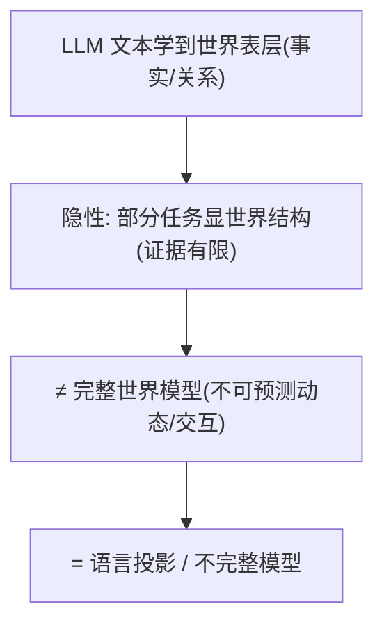

**面试要点**：LLM 学到**语言的投影**与**有限隐性结构**；但不是**可预测/可交互的完整世界模型**（差距在动态与交互）。世界模型是一条路，另一条更省钱的路是"让模型想得更久"——这就引出推理时间扩展。

---

## Q5. 推理时间扩展（test-time compute，长思维链）是否改变了 Scaling Law 的形态？

**回答**

先分清两个 scaling：

- **训练 Scaling Law**：`loss(N, D)`——训练时你投入多少算力（参数 N、数据 D），就决定了模型能有多强（第 8 章）；
- **推理时间扩展（test-time compute）**：在**推理的时候多花算力**（拉长思维链、做 beam search、多次采样再验证）来**提升单次回答的质量**。注意是**同一个模型**，只是把算力预算从"训练"挪一部分到"推理"。

**它到底有没有改变形态？**

- 如果把图横轴换成"**能力 vs 总算力（训练+推理）**"，那**形态确实被扩展了**：因为**推理时可以用算力换能力**，每多花一点推理算力，能力就涨一点，看起来就像多了一条"推理 scaling"的曲线；
- 更好的理解方式是：它并没有推翻训练 Scaling Law，而是**给它多开了一个维度**——`能力 = f(train, test_compute)`。固定模型、加更多推理算力，能力还能持续往上走（长思维链、GO 那类 test-time 搜索都是一个道理）；
- 所以说到底，**"Scaling 的战线从训练慢慢迁移到了推理"**（这一章 Q21 会接着聊推理端的边际收益什么时候开始递减）。

```python
def capability(fixed_model, test_compute):
    # 同模型: 推理算力越多能力越高（近似幂律）
    return base + C**(0.5)*test_compute
```

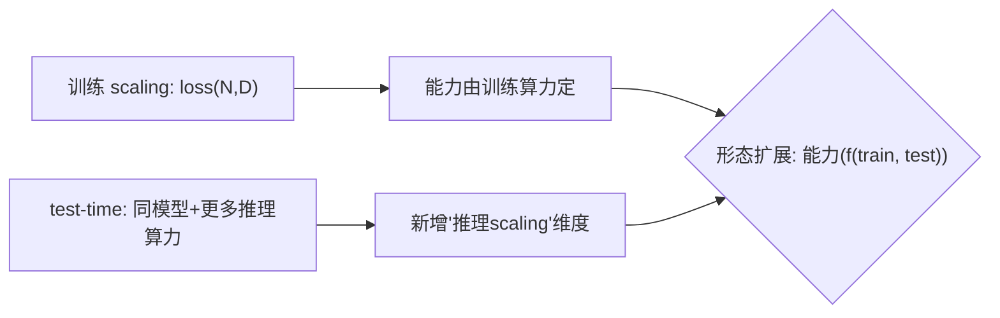

**面试要点**：test-time compute **新增"推理缩放"维度**（同模型+推理算力→更强）；不推翻训练 scaling，而是**战线迁移到推理端**。既然算力能换能力，那问题就来了：如果推理算力"无限"给下去，能力上限又卡在哪？

---

## Q6. 推理阶段可以无限延长思维链时，模型能力的上限由什么决定？

**回答**

想象推理算力像水龙头一样可以一直开下去——那上限由几个东西共同决定：

1. **模型内在的能力与表示**：**权重里到底有没有足够的知识和推理"原材料"**。推理算力只能**利用**已有的表示，没法凭空变出它压根不了解的领域或概念——肚子里没货，思维链再长也编不出来；
2. **正确的验证与目标**：模型能不能**判断自己当前这一步推得对不对**？如果没有验证信号，它就会一路错下去——所以需要"过程验证"或"搜索"来把关；
3. **搜索/规划的质量**：更长的思维链本质是**更深的搜索**，上限还要受**搜索策略（怎么发散、怎么回溯、怎么验证）**的约束。没有系统性的搜索，就只是"原地绕圈"；
4. **稳定性**：链一长，错误会**一点点累积、内容会重复**，不自我修正就会发散掉。

**所以结论是**：**上限 ≈ 模型内部的"理解+知识" × 验证与搜索策略的可靠性**。推理算力放大的，只是"利用这些能力的过程"，**不是能力本身**。

```python
def ceiling(model, verifier, search):
    return model._knowledge * verifier_quality * search_quality
print("算力只放大'利用'; 上限=知识×验证×搜索")
```

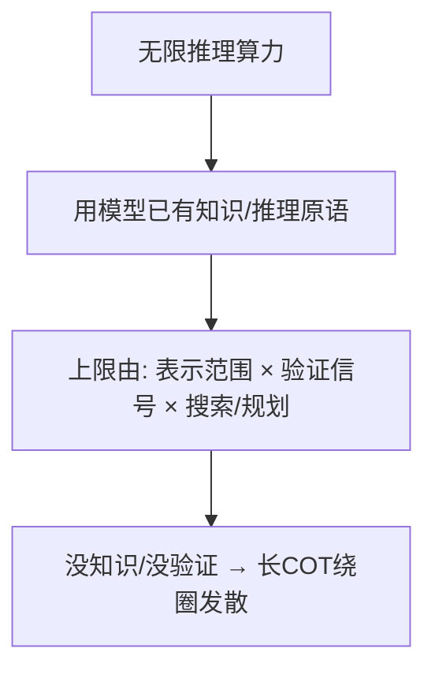

**面试要点**：上限=**权重内的知识/表示 × 验证 × 搜索策略**；推理算力放大"利用"而非"能力本身"。光会"想"，还得会"做"——这就轮到 Agent 范式登场了。

---

## Q7. Agent 范式与纯 LLM 推理的核心区别是什么？工具使用、记忆、规划分别给模型增加了什么？

**回答**

**核心区别一句话**：纯 LLM 推理是"一次性想完就答"，中间不跟外界打交道；而 **Agent 是多步闭环**——感知 → 决策 → 行动（调用工具、改动环境）→ 观察结果 → 再决策，它会**跟环境持续交互**。

那 Agent 相比纯 LLM，到底多了哪几件装备？

1. **工具使用**：给了模型**"动手"的能力**（调用 API、跑代码、检索、计算器），于是它能**执行、能验证**——从"只会说"升级为"能做事"（顺便也补上了校验和计算能力）；
2. **记忆**：给了模型**跨步骤、跨会话的状态**（长期记忆、历史记录），它可以**参考过去的决策**、保持前后一致（解决单个模型"没记性"的问题）；
3. **规划**：给了模型**分步目标和执行时的回退能力**，它能**长程地拆解、搜索、纠错**（挣脱"只能单步预测"的局限）。

**一句话总结**：Agent 给模型加了"**闭环交互（行动）+ 记忆（状态）+ 规划（分解）**"，让模型从"回答问题"进化成"解决问题"。

```python
def agent_loop(state, memory, tools, planner):
    while not done:
        plan = planner(state, memory)          # 规划(分解)
        act = choose_tool(plan, tools)          # 行动/工具
        obs = execute(act)                      # 观察环境
        state, memory = update(state, memory, obs)
    return result
```

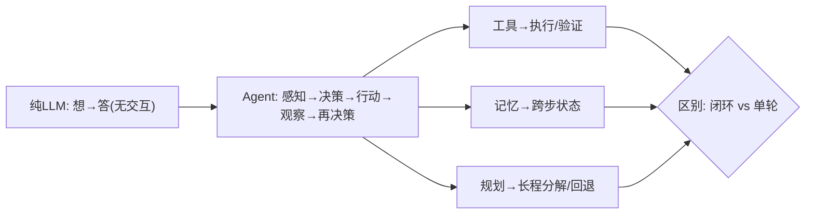

**面试要点**：Agent=**闭环多步与环境交互**；工具（行动）、记忆（状态）、规划（分解）各扩展不同能力。Agent 让模型"能做事"，但知识总得从哪儿来——是检索进来，还是全塞进上下文？这就是 RAG 和长上下文的取舍。

---

## Q8. RAG 与长上下文是否是替代关系？各自适合什么知识更新频率与任务类型？

**回答**

**先说结论：不是二选一的替代，而是彼此互补。**

- **RAG（检索增强生成）**：把外部知识**动态地检索出来**，再塞进 prompt。
  - 适合：**更新频繁的知识**（新闻、实时信息、用户私有资料）、**需要精确事实并引用验证**的场景、以及**内存/成本受限**（不想把所有东西都塞进上下文）的情况；
  - 局限：答案质量受检索质量连累，跨很多文档做复杂推理时偏弱。
- **长上下文（long-context）**：把**整个语料/文档一次性放进上下文**。
  - 适合：**更新频率低的稳定知识**（法律全文、一整本书）、**需要通盘理解**的任务（跨长文档推理、总结）、以及"文档就在手边"的场景；
  - 局限：token 多、成本高；在超长文里找信息效率有限、也很难"顿悟"出全局（找不到 needle 时依旧难），更不能代替外部实时知识。

**结论**：**知识更新勤 → 用 RAG；知识稳定、需要整篇通读 → 用长上下文**。实际工程里最常见的做法是**把两者组合起来**：先用 RAG 检索，再放进长上下文里推理。

```python
def pick(freq, whole_needed):
    return "RAG" if freq=="high" or not whole_needed else "long-context"
```

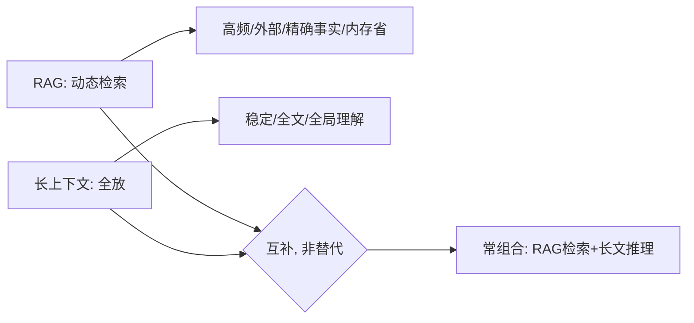

**面试要点**：高频/外部知识用 RAG，稳定/全局用长上下文——**互补**、常组合。工具、记忆、检索这些都是"零件"，Q9 就来问：这些路线里，到底哪条最可能捅破当前的天花板？

---

## Q9. 多模态、Agent、推理时间扩展三条路线，哪一条最有可能突破当前 LLM 的瓶颈？为什么？

**回答**

这题**没有唯一标准答案**，关键是给出一个有结构、有逻辑的判断。我倾向于：**"推理时间扩展 + Agent"这个组合**最可能带来能力上的突破，理由如下。

- **多模态**：它扩宽的是**"输入范围"**（能看、能听），但本质上仍然是"被动预测"——它补的是广度，治不了"规划差、不可靠"这两个病；
- **Agent**：它给了模型**行动、交互、目标**——从"回答问题"变成"解决问题"，这是**能力形态的一次跃迁**（但它受限于模型的规划与验证能力）；
- **推理时间扩展**：它给了模型**探索、验证、搜索**——**用算力去补模型推理的上限**（见 Q5/Q6），"愿意想得更久"是对现有瓶颈的即时缓解。

**为什么说"组合"最强**：Agent 本身就需要规划（这正是推理时间扩展的用武之地），也需要多模态去理解环境。三者恰好是"感知 × 行动 × 推理"三个维度——单独哪一维都不够用。合理的路径是：**先用推理扩展把单步质量提上去，再由 Agent 提供执行闭环，多模态负责扩展感知的输入**。

```python
def breakthrough():
    return {"multimodal": "感知广度", "agent": "行动/闭环",
            "test-time": "推理深度", "组合": "感知×行动×推理 → 最可能突破"}
```

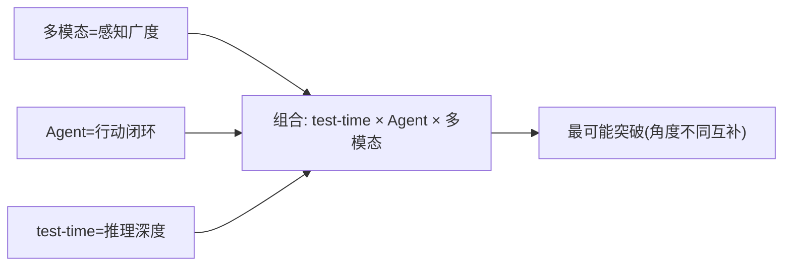

**面试要点**：无唯一；**组合（推理扩展×Agent×多模态）**最可能——感知×行动×推理三维配合；说明你的推理逻辑。路线在往前走，架构设计也得跟着转——如果重心从"训练最优"挪到"推理最优"，模型会长成什么样？

---

## Q10. 从"训练最优"到"推理最优"的范式转移，对模型架构设计会带来什么反向影响？

**回答**

过去大家比的是"谁能训出一个更强的模型"（训练最优）；现在推理成本和部署体验越来越被看重（推理最优）。这个重心一旦挪动，就会**反过来倒逼架构设计**往这些方向走：

1. **更少的激活参数、更利于部署**：比如 MoE（每次只激活一部分专家）、GQA/MQA（把 KV 变大变小）、以及对低精度更友好的架构（天生好量化）；
2. **更长上下文的效率**：设计长上下文、稀疏注意力，并且让架构**对 test-time compute 友好**（方便搜索、验证）；
3. **模块化、可卸载**：让推理更好伺候——专家能卸载、KV 能压缩、模型能逐层切分；
4. **推理友好的 token 设计**：减少 token 数（长上下文更省）、尽量可缓存（方便 prefix 复用）；
5. **"小模型 + 靠算力补"**：既然推理阶段可以再加算力（test-time），架构就**不必一味追大参数**了——更倾向于"中等模型 + 可扩展的推理"（推理 scaling 让思路从"堆参数"转向"能 query 更久"）。

```python
def arch_shift():
    return ["MoE/激活少", "GQA/低KV", "量化友好", "长上下文/稀疏", "test-time扩展友好"]
```

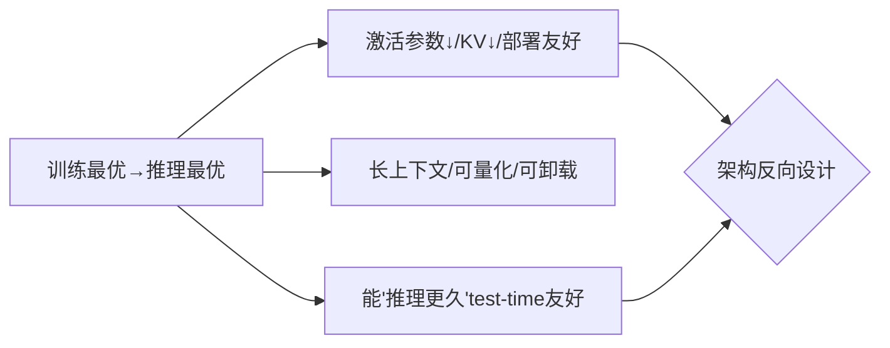

**面试要点**：推理最优反向要求=**激活/KV 少、部署/量化友好、长上下文、test-time 可扩展**——架构从"堆参数"转向"高效+可推理扩展"。既然聊到了架构的未来，不如让你具体押一个：未来 3 年，LLM 架构最可能变的是什么？

---

## Q11. 预测未来 3 年 LLM 架构最可能的一个变化，你会选什么？依据是什么？

**回答**

**我的选择是：MoE 化（稀疏激活 + 多专家）会在主流生产模型里大面积普及。**

依据有四条：

1. **成本-收益最划算**：在"相同激活 FLOPs"的前提下，MoE 用更大的总参数量换来了更大的容量（见第 4 章 Q14），**激活少、部署便宜**——在推理成本压力越来越大的今天，这是最经济的做法；
2. **已被验证**：Mixtral、DeepSeek、GPT-4 等都已经在用，研究比较稳，工程链条（路由、EP 专家并行、通信）也成熟了；
3. **趋势能合流**：MoE 能和"多模态、长上下文"自然组合（可以拿不同专家分别管不同模态/知识）；
4. **产业需要**：行业想要"第一便宜 + 能力接近"，MoE 是**最能同时满足这两点**的架构变化。

（备选方案是长上下文/稀疏注意力，或者统一的原生多模态——我按"最可能先在工业界落地"这个标准选了 MoE。）

```python
moe_evidence = ["同FLOPs更多容量", "深层验证", "生产成本压力", "可组合多模态"]
print("预测: MoE 普及（最可能+依据如上）")
```

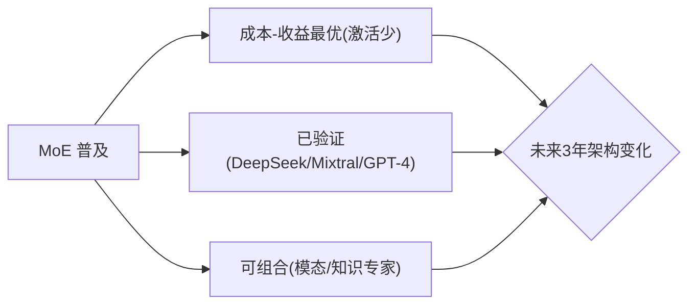

**面试要点**：给明确预测（MoE 化）+ 三条依据（成本收益/实证/可组合）——并说明是"概率判断"。说到 MoE 这种"稀疏化"，就自然引出一个更大的问题：稀疏化与稠密化两条路，你到底更看好哪条？

---

## Q12. 稀疏化（MoE、结构化剪枝、动态计算）与稠密化两条路线，你更看好哪一条？为什么？

**回答**

**我更倾向"走混合路线，不能只押一边"；如果非要单选，那在"部署成本"这个维度上，我看好稀疏化。**

理由：

- **稀疏化（MoE / 剪枝 / 动态计算）**：**同样的 FLOPs 能装下更大的容量、激活更少、部署更便宜**（见第 4 章 Q14）；剪枝和动态计算还能在推理时按需自适应地省算力——在成本与规模的持续压力下，这条路更划算；
- **稠密化**：表达连续、训练稳定、没有路由和负载均衡的麻烦，但**它的算力消耗会随规模线性往上涨**（贵）；
- **现实里，业界其实是两条腿一起走**：训练时用大模型（总参数大）+ 部署时用稀疏化（MoE/量化/剪枝），也就是"先稠密后稀化"的混合打法；只盯着一条路线，反而会丢掉另一条的好处。

**结论**：**从推理成本的角度看，稀疏化更可能胜出**；但长期看，会落在"稠密训练 + 稀疏部署/专家化"的混合形态上。

```python
def compare():
    return {"sparse": "容量/便宜/部署友好, 但路由/负载复杂",
            "dense": "稳/连续, 但随规模贵"}
print("看好: 混合(训练稠密+部署稀疏化); 单选按成本押稀疏化")
```

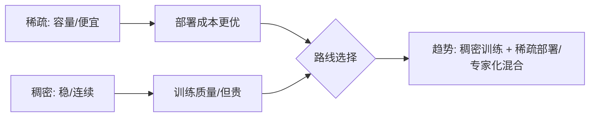

**面试要点**：给明确判断 + 理由；推荐**混合**（训练稠密/部署稀疏），单选按成本押稀疏化。架构和部署聊完了，还有一个绕不开的"人的需求"：模型该怎么"记住"东西？

---

## Q13. LLM 的"记忆"应如何实现？参数化记忆、外部检索、KV 持久化各自的优劣是什么？

**回答**

把模型的"记忆"拆开看，常见有三种实现方式：

1. **参数化记忆（写进权重）**：预训练或微调时，把知识**写进模型权重**里。
   - 优点：**检索快，天然就带着语境**；
   - 缺点：**更新难、更新贵**（得再微调）、容易过时、**不可控**（你没法精确删掉某条记忆），容量也有限。
2. **外部检索（RAG/向量库）**：把知识存在外部，**用的时候检索出来再注入**（见 Q8）。
   - 优点：**可更新、可删除、可溯源**，容量不受模型本身限制，成本低；
   - 缺点：**效果依赖检索质量**，做非线性查询时不太可靠，还得额外搭一套检索系统。
3. **KV 持久化（上下文记忆/缓存）**：把对话、上下文**存在 KV Cache 里**（长上下文、视觉记忆都算这一类）。
   - 优点：**能精确保住历史**，不用训练，天然支持多轮对话；
   - 缺点：**token 和显存成本随长度上涨**，上下文窗口有限，而且没有"持久的长期知识"（窗口一过就忘了）。

**结论**：现实里要**分层混合**——**参数化存稳定的知识 + 外部检索存动态更新的内容 + KV 存会话上下文**，各管一摊。

```python
def memory_layers():
    return {"parametric": "稳定知识(难更新)", "external_rag": "动态可更新",
            "kv_persist": "会话/上下文(窗口受限)"}
```

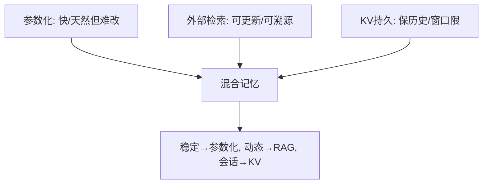

**面试要点**：三者的优劣（更新/容量/成本/控制）；结论=**分层混合**（稳定、动态、会话各司其职）。说到"记东西"，就不得不提另一个更微妙的事——模型能不能"检查自己"？

---

## Q14. 推理中的"自我验证"为什么困难？模型能否可靠地判断自己答案的对错？

**回答**

**"自我验证"为什么这么难？本质上有四个坎**：

1. **没有外部真值**：模型"验证"自己答案的时候，**唯一的依据就是它自己内部的表示**——它手上没有一份独立的 ground truth（同一个模型既当考生又当判卷老师，怎么跳出自己）；
2. **置信度不可靠**：LLM 给自己答案打的"置信分"**校准很差**（常常过度自信，跟真实正确率的相关性很低）；
3. **同源偏差**：它"判断"的逻辑和"生成"的逻辑**来自同一处**——生成错的地方，判断往往也错（盲区是重合的）；
4. **长链会累积**：验证一段长推理，得**回溯整条链**，中途的错误不容易改过来。

**那到底能不能可靠地判断？**

- **单纯靠"自我检查"通常不可靠**（自评结果和真实对错关联很低）；
- **可靠的方式是引入外部依据**：比如**外部验证**（对可验证任务直接判对错：跑代码测试、做数学校验）、**多次采样一致性**（self-consistency：多解几遍再投票，出现分歧时反而更可信）、**对抗验证**（换个模型来 cross-check）。

```python
def self_verify(ans):
    score = model.confidence(ans)      # 自评（校准差, 不可靠）
    return score
def reliable(ans, verifier, samples):
    return verifier(ans) or (majority(samples) == ans)   # 外部/多数一致
```

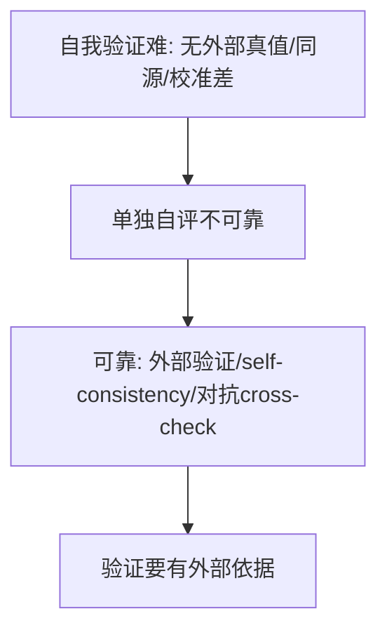

**面试要点**：自我验证难因**无外部真值+同源+校准差**；可靠判断要靠**外部验证/多次采样一致**。验证这件事，在 o1/R1 这类"爱长篇推理"的模型上会被放大成实实在在的工程压力——下一题看 serving 要怎么招架。

---

## Q15. o1/R1 类长推理模型对 serving 基础设施提出了什么新要求？

**回答**

o1/R1 这类模型有一个显著特征：回答前会先"想很久"，吐出**很长的思维链**。这给 serving（在线服务）带来了一串新要求：

1. **海量 KV Cache 与超长序列**：思维链一长，**上下文就超长、KV Cache 就暴涨**——需要长上下文能力 + KV 压缩/多分辨率缓存（见第 9 章 Q16），显存也得好好规划；
2. **算力预算要动态、可伸缩**：每个请求要生成多少推理 token **事先没法预知（几十到几千都可能）**——所以系统容量要能伸缩、要有超时和预算控制、能按需延长；
3. **prefill/decode 比例失调**：长链导致 prefill 一遍遍地反复做——调度器得能扛住超长 prefill（chunked、可断点续算）；
4. **成本与定价**：推理 token 消耗巨大——需要能观测、能计量，同时靠模型瘦身（量化/蒸馏）和高效 kernel 来压成本；
5. **能中断、能恢复（长任务断点）**：长推理要是中途被抢占，得能把中间状态存下来、之后再接着算。

```python
def long_reasoning_serving():
    return ["超长KV/长上下文", "动态算力预算/超时", "长prefill调度",
            "成本计量", "中断恢复"]
```

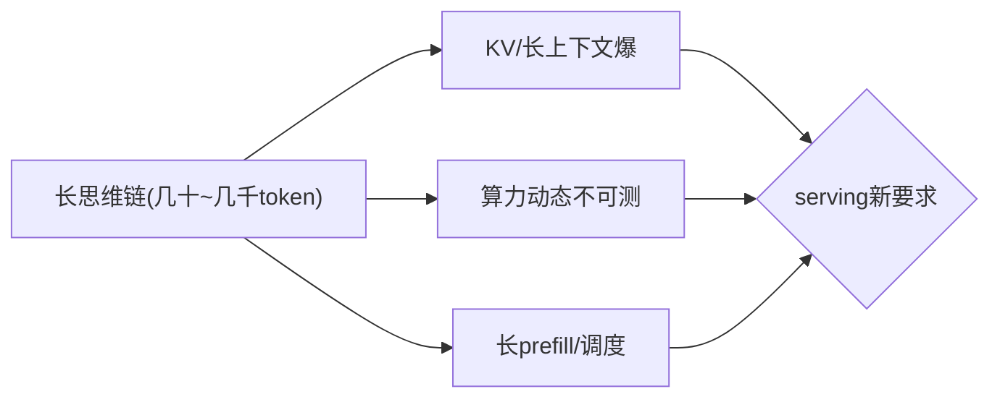

**面试要点**：新要求=**超长 KV、动态预算、长 prefill 调度、成本计量、中断恢复**。服务端扛得住，是因为推理本身在变便宜——一旦便宜下来，很多原来"划不来"的应用就变得划得来了。

## Q16. 推理成本持续下降后，哪些当前"不经济"的应用会变得可行？举一个具体例子。

**回答**

推理成本一路往下降，会最先让那些"重推理、多轮、大规模"的应用变得可行：

1. **长推理 / Agent 大规模地跑**：推理扩展变便宜之后，**给每个用户跑一长串 agent 任务、反复做多次自我验证**就划得来了；
2. **个人化、实时的 LLM 助手**：便宜到可以"随时随地、日常一直开着"；
3. **批处理式的重推理**：文本校对、税务处理、法律审查这类活儿，单次便宜到可以批量去做。

**举个具体例子**：

- 以**"长思维链 + Agent"的"自主研究助手"**为例：在如今推理还贵的阶段，为一个问题烧掉一万个 token 是不划算的；
- 等成本降下来之后：**每个学生、每份文档都能跑一遍"自主文献调研 + 逐步验证 + 工具调用"**——原来"一次就答"的用法，会变成"多轮深度研究、每一步都反复验证"，因为推理 token 已经便宜到可以随便用了。

```python
def app_vital(cost_per_1k):
    return cost_per_1k < 0.01   # 推理够便宜 → 深度agent应用可行
print("成本下降 → 长链agent/个人助手/批量重推理 变得经济")
```

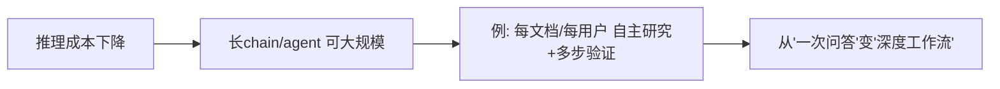

**面试要点**：回答=**成本下降解锁重推理/Agent/批量**；给具体例（自主研究/每用户 agent）并说明"为什么原来不经济"。聊完"未来会更便宜"，不妨回头看一条"另起炉灶"的路线——LeCun 的 JEPA。

---

## Q17. LeCun 提出的 JEPA 路线与 LLM 路线的本质分歧是什么？JEPA 缺少什么才没有成为主流？

**回答**

**两者的本质分歧，在于"预测什么"**：

- **LLM 路线**：**预测 token（也就是语言）**——学的是"文本的分布和共现规律"；
- **JEPA（Joint Embedded Predictive Architecture，联合嵌入预测架构）**：**在"表示空间"里做预测**——把世界压缩成一套**抽象表示**，然后去预测**未来的表示**（不是逐像素、也不是逐 token，而是预测语义层面的潜在状态），它瞄准的目标是 learn world model、做规划、做具身智能。

**那 JEPA 到底缺了什么，才没能成为主流**：

1. **缺内容、缺应用支撑**：它没有像文本那样**海量现成的数据和统一的目标**——文本的 token 本身就是天然的监督信号；而 JEPA 得自己设计表示和损失，目前还没有"文本级规模"的数据和标准；
2. **缺"生成"能力**：JEPA 是在表示空间里做预测，**不直接生成输出**——很难直接接下游任务或对话（而 LLM 的生成/接口拿来就能用）；
3. **训练目标和稳定性更复杂**：多模态表示学习要保证稳定，损失函数设计也比 token 预测复杂得多；
4. **生态和算力有壁垒**：LLM 背后有成熟的算力、框架和 Transformer 生态，JEPA 还没有同等成熟的工具链。

```python
def jepa_vs_llm():
    return {"LLM": "预测token(语言分布)", "JEPA": "预测表示(世界模型/规划)"}
```

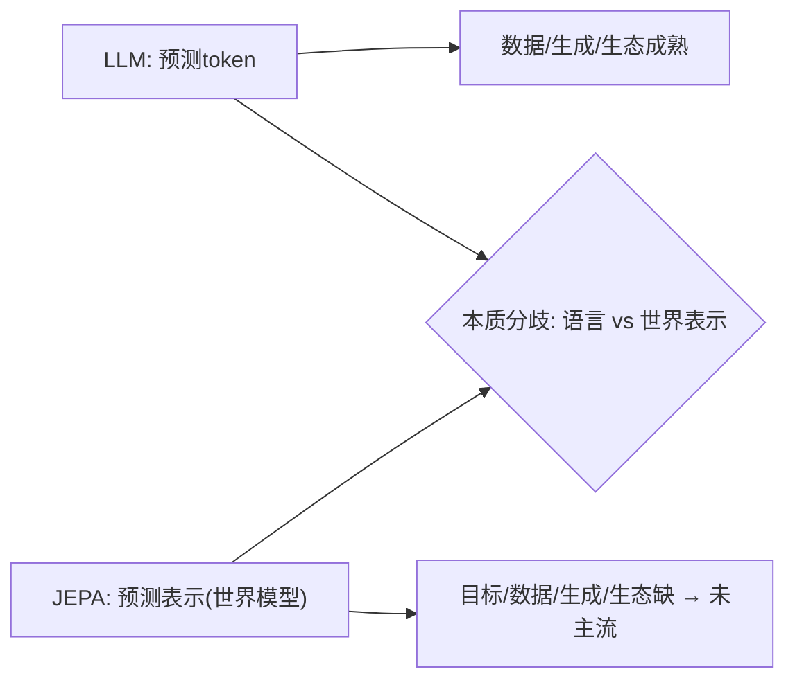

**面试要点**：分歧=**文本 token 预测 vs 表示空间的世界模型预测**；JEPA 缺**数据/统一目标、生成接口、生态** → 未主流。JEPA 想一上来就做"会规划的世界模型"，那现实中的 Agent 到底能不能自己"涌现"出规划能力？这是 Q18 的问题。

---

## Q18. Agent 的"规划"能力能否完全由 LLM 本身涌现，还是必须依赖外部搜索/规划器？

**回答**

**答案是：两者都需要，不是纯粹靠涌现。**

- **有一部分能力确实能"涌现"出来**：LLM 在多步任务上有**一定的内隐规划能力**——它从训练数据里学到了"分步来做"的模式，比如长思维链里的自我规划；
- **但它不可靠、也不够用**：
  - 凡是**长程/组合式规划、需要系统性搜索**的任务（约束满足、BFS/DFS、回溯），**纯靠 LLM 会出错、会绕圈、不保证最优**；
  - **它没有自我验证和回溯**：规划一走上错误分支，就得靠**外部来纠正**；
  - 碰上不确定性或环境动态变化，就需要**显式的规划器或搜索**来补位。

**结论**：现实里的做法，是让 **LLM 负责"启发式地生成候选"，外部搜索/验证器负责"结构化地规划"**，两者组合起来。**纯涌现不够**——所以在 Agent 工程里，人们把"计划生成（LLM）"和"搜索/执行/校验（外部）"结合起来（ReAct、Tree-of-thought 的本质其实都是 LLM + 外部搜索）。

```python
def plan(llm, search, verifier):
    candidates = llm.propose_actions(state)   # 涌现(启发式)
    best = search.beam(candidates, verifier)  # 外部结构化搜索
    return best
```

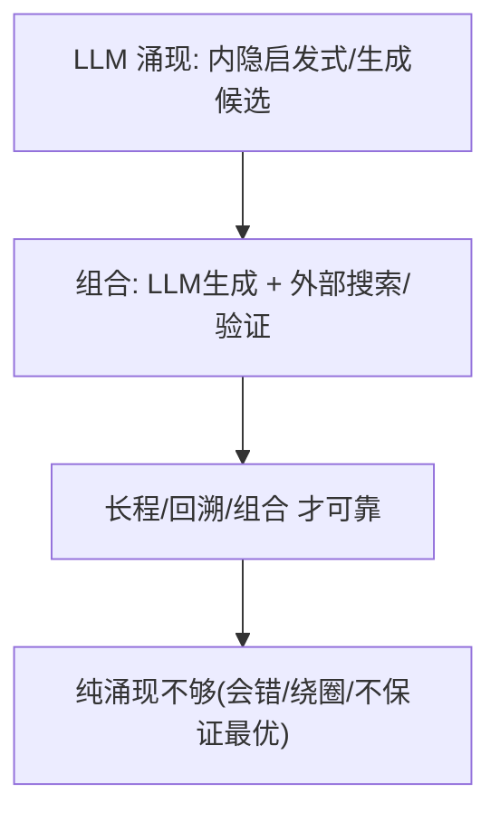

**面试要点**：规划=**LLM 启发式+外部搜索/验证的组合**；纯涌现不可靠（长程/回溯/最优）。规划说完，就绕不开多轮任务里那个老大难：错误会越积越多，怎么治？

---

## Q19. 多轮 Agent 任务中错误累积如何缓解？自我纠错在什么条件下有效？

**回答**

**先看怎么缓解"错误一路叠上去"**：

1. **每步设检查点、每步验证**：每做完一步就**校验状态或输出**（结构检查、看环境反馈），一出错马上回退；
2. **计划拆分 + 分解**：把长任务切成一个个可验证的子目标（每一步都独立可控）；
3. **"π 强制"/工具约束**：用规则把动作空间收窄（防止非法动作把错误带进来）；
4. **长期记忆回放**：避免反复踩同一个坑（把历史上犯过的错记进记忆里，见 Q7 讲记忆那题）；
5. **多方案对比**：关键步骤一次生成多个方案，再挑最好的。

**那"自我纠错"在什么条件下才有效？**

- **得有外部反馈/验证**：能知道"到底错在哪"（执行结果、测试、标准答案）——**有反馈才有效**；
- **错误得能定位**：纠错的前提是**知道该改哪儿**；对模糊的、没有信号的错误，自我纠错不但无效，还可能"把对的改错"；
- **得有足够算力，且修的方向对**：多次修正必须能**收敛到更好的解**（没有验证时，反复自评大多只是在制造噪声）；
- 结论：**自我纠错只在"有外部信号可验证"时有效；纯自我评价、没有反馈时，基本无效**（承接 Q14）。

```python
def self_correct(attempt, feedback):
    if feedback is None: return attempt          # 无反馈 → 无法valid纠错
    return refine(attempt, feedback)             # 有反馈 → 收敛修正
```

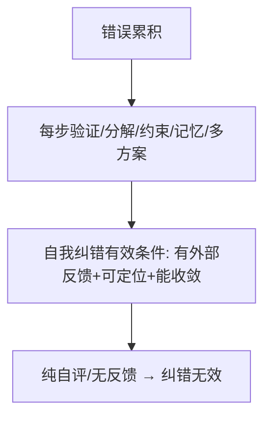

**面试要点**：缓解=每步验证、分解、工具约束、记忆、多方案；自我纠错**需外部反馈与可定位**，纯自评无效。纠错是在 token 层面打补丁，那有没有可能从根上换掉"以 token 为单位"这件事？

---

## Q20. 从"下一个 token 预测"到"下一个概念预测"，是否是一个可行方向？技术障碍在哪里？

**回答**

**方向是可行的，但技术障碍很大。**

- **所谓"概念预测"**，就是**在更高的抽象表示上做预测**（而不是预测 token）——思路类似 JEPA（见 Q17），或者预测"语义 token / latent token"（这样可以减少推理时的 token 级噪声）；
- **为什么说可行**：token 级的预测有时**很啰嗦、很低效**（长推理里一堆冗余），概念级更讲究归纳、更抽象。

**但技术障碍一堆**：

1. **概念没有统一的标注和切分**：token 是现成的、天然离散的，而**"概念"的边界和粒度很难定义**（怎么把一条推理链切成一个个"概念单元"？）——缺少标准监督；
2. **表示难以解释、难以验证**：概念表示**很难验证**（token 有标准答案可判对错；而 latent 概念对不对，很难判断）；
3. **学习目标不自然**：怎么设计一个"预测下一个概念"的损失（用对比还是重建），让它能稳定地自监督——这比 token 的交叉熵复杂；
4. **和生成/接口的衔接**：概念级的输出**还得解码回语言或动作**才能用（多了一道工序）。

```python
# token预测: CE(next_tok)
# concept预测: 在latent表示上预测/Z (需定义概念与重建)
concept_target = predict_in_latent(h)      # 障碍: 概念切分/验证/重建
```

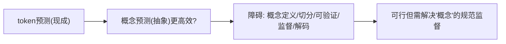

**面试要点**：方向可行（更抽象/少噪声）；障碍=**概念无统一切分与监督、难验证、需解码回语言**。既然推理算力能换能力，那它什么时候就不划算了？这是 Q21。

---

## Q21. 推理时间扩展的边际收益何时递减？如何判断一个任务是否值得用长思维链？

**回答**

**先看边际收益什么时候开始递减**：

- **任务已经"饱和"**：模型短期就能答好的题（简单题）——再多给算力也没用；
- **无法验证、也没有明确目标**：任务没有清晰的目标信号，长链只会"绕圈"发散，收益不会随算力增长；
- **撞上模型的表示上限**：知识或推理原语不够（见 Q6），再长的链也超不过这个上限；
- **重复不动**：长链反反复复说同样的内容（没有新的探索），收益就停在那里了。

**那怎么判断一个任务到底值不值得用长思维链（长 COT）**：

1. **看难度**：任务对模型来说是**需要探索**的（中等偏难、不是"秒答"的）才值得；简单题不值得；
2. **看可验证性**：有**明确的验证信号/可判定的目标**（数学、代码、目标清晰的任务）→ 长链+验证才有价值；开放性、没有标准答案的任务 → 不值得；
3. **算收益-成本**：估一下"多花算力能换来多少正确率提升"（在验证集上测长/短 COT 的差值 Δ）——**Δ 大就用长链，Δ≈0 就用短**；
4. **看容错要求**：必须精确、低容错的任务值得用；随口闲聊问答就不值得。

```python
def use_longcot(diff, verifiable, gain):
    return (diff >= medium) and verifiable and gain > threshold
```

```mermaid
flowchart TB
    A["收益递减: 饱和/无验证/上限/重复"] --> B{"任务值得长COT?"}
    B --> C["难 + 可验证 + 增益>成本 → 用长链"]
    B --> D["简单/无真值/Δ≈0 → 用短链"]
    C --> E["按难度×验证×增益判断"]
    D --> E
```

**面试要点**：递减=饱和/无验证/上限；值得长 COT 的判据=**难度、可验证、收益-成本（在验证集测 Δ）**。如果参数规模干脆不涨了，只靠推理扩展 + 数据质量，还能不能继续变强？这就是 Q22。

---

## Q22. 模型参数不再增长时，仅靠推理时间扩展与数据质量提升，能否继续获得显著能力进步？

**回答**

**可以，但"显著"这两个字要受结构和收益上限的约束。**

**能继续进步的来源有**：

1. **推理时间扩展**：同参数 + 更多 test-time（长链/搜索/验证）→ 能力明显提升（就是 Q5 讲的推理 scaling）；
2. **数据质量提升**：同样是这么多 token，换成**更高质量、更好的配比**（第 10 章）→ 表示更优、能力更强；
3. **对齐 / 后训练**（SFT、RL 精修）；
4. **架构内的效率优化**（比如用 MoE/稀疏，保持"大总参、小激活"，见这章 Q12）。

**但有限制**：

- 走到极端会发现，**参数一旦固定，表示容量就有上限**（遇到全新知识、新模态、极端任务，还是需要参数来存）；
- 数据质量和推理扩展带来的收益，**最终也会按幂律饱和**（不过在此之前，还有很长一段能显著增长的区间）。

**结论**：**在相当长的一段范围内，答案是"能"**（参数不涨，靠推理扩展+数据质量+后训练也能继续涨）；但也要清醒，**参数仍然决定着表示的上限**——两件事都做到最优才是最好的。

```python
def progress(fixed_N):
    return {"test_time": 有(推理scaling)", "data_quality": 有(有效D提升)",
            "ceiling": "参数决定表示上限(长期)"}
```

```mermaid
flowchart LR
    A["参数不动"] --> B["test-time↑能力↑(推理scaling)"]
    A --> C["数据质量↑能力↑(有效D/表示)"]
    B --> D["仍显著进步(相当范围)"]
    C --> D
    D --> E["极限: 参数=表示上限 → 两者配合"]
```

**面试要点**：在相当范围**能**（推理扩展+数据质量+后训练）；但**参数=表示上限**，长期两者配合最优。能力变强了，可我们能"看懂"它为什么这么想的吗？这就是可解释性的问题。

---

## Q23. LLM 的"可解释性"在推理模型上变得更难还是更容易？思维链是否忠实反映了真实计算？

**回答**

**这是一体两面：既是机会，也变得更难。**

- **更容易的一面**：推理模型会**输出思维链**——你能**看到它一步步怎么想的**，比那种纯黑箱的分类器要可审计得多；
- **更难的一面**：
  1. **思维链是"生成的文本"，不是"真实的计算"**——**它不一定忠实反映内部的计算过程**（Transformer 的"真思考"发生在隐藏层和注意力里，思维链只是它"写出来的一段听起来合理的叙述"；模型完全可能内部走两套逻辑，思维链只是一种表述）；
  2. 长推理模型的**内部状态更复杂**（长链、验证、回溯的痕迹，不容易被简单的探针解释清楚）；
  3. **思维链可能只是"事后合理化"**（内部其实不是这么算的，但写出来"看起来挺合理"）。

**关于忠实性的证据**：有研究表明，**思维链在某些任务上和内部推理有一定对应**（改动中间步骤，输出会跟着变），但**不保证完全忠实**（确实存在"口是心非"的链）。结论：**思维链可读，但不等于真实计算**。

```python
def faithfulness():
    return {"可读": "能看到步骤", "忠实": "部分(改链会改输出), 但不等于内部计算"}
```

```mermaid
flowchart LR
    A["推理模型输出COT"] --> B["可读(审计性强)"]
    A --> C["但不忠实: COT是叙事, 真实计算在隐藏"]
    B --> D{"解释性: 可读≠忠实"}
    C --> D
```

**面试要点**：可读提升但**忠实性存疑**（COT 是"表述"非"计算"）；结论=可读≠忠实，内部计算在隐藏层。说回产业格局：开源和闭源的差距，如今是在拉大还是缩小？

---

## Q24. 开源模型与闭源模型的差距在扩大还是缩小？从训练流程、数据、算力三个维度分析。

**回答**

**总趋势是：传统意义上的差距在缩小，但"最前沿/天花板"上的差距依然存在（个别维度甚至在扩大）。** 分三个维度看：

- **训练流程（架构/算法）**：开源这边已经有**对等可用的流程**（LLaMA、DeepSeek、Qwen 都公开了对齐流程）——**这块差距很小**，甚至有些方法开源还先发（LoRA、GRPO）；
- **数据**：
  - 开源已有大语料（RedPajama / FineWeb / C4），但**顶级的、私有的、高质量和垄断性的数据（技术文档、高质量长回复、专有的正反馈数据）仍有差距**——个别维度上，差距可能还在拉大（闭源积累的反馈数据优势）；
  - 数据质量和配比方面，闭源有一块优势。
- **算力**：闭源巨头的算力要多得多——**训练最前沿的大模型，闭源更强**；但**开源的小模型 + 高效的训练方法**（MoE/蒸馏）能补回一部分。

**结论**：**开放、可复现的部分大幅拉近（流程、算法），但"顶级数据 + 前沿算力"堆出来的天花板能力仍然领先**——差距并不是单调的（在前沿能力上被拉开，在通用能力上被追近）。

```python
def openness_gap():
    return {"流程": "缩小(开源对齐)",
            "数据": "部分扩大(顶级/反馈数据)",
            "算力": "闭源前沿领先(开源靠效率补)"}
```

```mermaid
flowchart LR
    A["训练流程/算法"] --> B["缩小(等效流程公开)"]
    C["数据"] --> D["部分扩大(私有/反馈质量)"]
    E["算力"] --> F["闭源前沿领先(开源补效率)"]
    B --> G{"综合: 通用拉近, 边界仍有差距"}
    D --> G
    F --> G
```

**面试要点**：分三维——**流程缩小、数据部分扩大、算力闭源领先**；结论=通用能力拉近但前沿边界有差距。说到"算力/部署"，还有一个很接地气的场景：手机能不能跑得动 7B 模型？

---

## Q25. 端侧 LLM 的瓶颈是什么？量化、蒸馏、MoE 哪条路线最有可能让 7B 模型在手机上流畅运行？

**回答**

**端侧（手机这类设备）的瓶颈**：

1. **显存/算力**：手机显存小、算力有限——7B 模型用 FP16 存，光权重就有 14GB，根本装不下；
2. **带宽**：内存带宽是硬瓶颈（decode 时每生成一个 token 都要把权重读一遍，见第 5 章 Q10）；
3. **功耗/散热**：持续推理又耗电、又发热；
4. **长上下文、算力扩展都受限**。

**三条路线的对比（目标是让 7B 上手机）**：

- **量化（最关键、第一优先）**：用 W4 这类量化把 7B 压到 **约 4GB**（装得下了），decode 的带宽需求同时降为原来的 1/4——**这是最直接地消除瓶颈**；
- **蒸馏**：蒸馏出一个**更小的专用模型**（约 1–3B）——最省，但**会损失通用性**；
- **MoE**：激活参数少 → **推理算力省**，但**总权重还是得整个加载**（显存没省下多少，见第 4 章 Q10）——在端侧得真能"少激活"才有用，可**权重常驻内存的问题依然存在**。

**结论**：**以量化为主（先解决装得下、降低带宽）→ 再用蒸馏出小模型（进一步省）→ 最后用 MoE 做激活优化（补推理算力）** 最可行；其中**量化是把 7B 塞进手机的第一手段**。

```python
def edge_7b():
    q = "W4量化: 7B→4GB(装/带宽降4×)"
    d = "蒸馏: 更小专用模型(通用降)"
    m = "MoE: 激活少但权重全加载(显存没省)"
    return f"{q} → {d} → {m}（量化优先）"
```

```mermaid
flowchart TB
    A["端侧瓶口: 显存/带宽/功耗"] --> B["量化: 先装得下+带宽降(最优先)"]
    B --> C["蒸馏: 更小专用"]
    B --> D["MoE: 激活优化(权重驻留仍在)"]
    C --> E{"组合最可行"}
    D --> E
```

**面试要点**：瓶颈=显存/带宽/功耗；**量化是第一手段**（7B→~4GB）、蒸馏/小型化、MoE 补激活——组合最好。聊了这么多技术，最后几题都指向"怎么把这些串成你自己的表达"——先来一段面试自述。

---

## Q26. 设计一段"LLM 全栈能力"的 2 分钟面试自述，你会用《diy-llm》重排后的 15 章地图如何组织？

**回答**

**2 分钟全栈自述（按 15 章的地图来组织）：**

> "我的 LLM 全栈能力，可以分成四层：
> **第一层·地基**——我懂**分词器（BPE/字节级）**和**训练资源核算（6ND、显存/混合精度）**，清楚模型的第一性原理和这笔算力账；
> **第二层·系统**——深入过 **MoE、GPU 与 Kernel（FlashAttention/Triton）、分布式（ZeRO/Ring AllReduce）**，从算子级到集群级都能上手；
> **第三层·规模与数据**——会用 **Scaling Laws 决定规模与配比**、设计推理系统（KV Cache/PagedAttention）、做**数据工程与评估**（MMLU/pass@k/评估驱动开发）；
> **第四层·对齐与前沿**——做过 **SFT/RLHF/RLVR（DPO/GRPO）**，了解**多模态（CLIP→LLaVA→Omni）**，对 **Agent/世界模型/未来路线**有结构化的判断。
> 所以从'为什么这么训'，到'怎么训出来、跑得快、对齐好'，整条链路我都能闭环。"

```python
def self_intro():
    layers = {"地基": "分词/资源/架构",
              "系统": "MoE/GPU/分布式",
              "规模与数据": "Scaling/推理/数据/评估",
              "对齐前沿": "RLHF/RLVR/多模态/未来"}
    return layers
```

```mermaid
flowchart TB
    A["地基: 分词/6ND/架构"] --> B["系统: MoE/GPU/分布式"]
    B --> C["规模: Scaling/推理/数据/评估"]
    C --> D["对齐: RLHF/RLVR/多模态/未来"]
    D --> E["整链路闭环(能训能跑能对齐)"]
```

**面试要点**：用 15 章四段（地基/系统/规模数据/对齐前沿）组织，展示"从训到跑再到对齐"的全栈闭环——注意开头概括、前后呼应。会表达自己，还得会判断系统：同一个模型换个 serving 框架，吞吐就能差好几倍，为什么？

---

## Q27. 同一个模型在不同 serving 框架下吞吐可以差数倍，框架的哪些设计决策影响最大？

**回答**

**对吞吐影响最大的几个框架设计决策**：

1. **调度（Continuous Batching / 批管理）**：是不是支持**动态入批/连续批**（见第 5 章 Q27）→ 决定了带宽能共享到什么程度——**这是吞吐最大的杠杆**；
2. **内存管理（KV Cache 分页/PagedAttention）**：能不能按需分块分配、共享、淘汰 → 决定了**并发容量**（见第 9 章 Q6）；
3. **kernel 与计算层**：有没有用 **FlashAttention/融合算子/CUDA Graph**、有没有做长序列优化 → 决定计算效率；
4. **prefill/decode 分离**（disagg/Chunked）→ 两边互不拖累；
5. **量化/精度路径**：是不是 W4/W8，以及配套的 kernel；
6. **并行（TP/EP）与通信**、计算图固化、调度策略（偏公平还是偏吞吐）。

**总结一句**：**调度 + 内存管理（Paged/连续批）是吞吐差异的主因**；其次才是 kernel、量化、并行这些。

```python
top_design = ["continuous batching", "paged KV 内存管理",
              "flash/fusion kernel", "prefill-decode分离", "量化/并行"]
```

```mermaid
flowchart LR
    A["连续批调度"] --> B["带宽共享→吞吐主因"]
    C["Paged KV 管理"] --> D["并发容量(显存利用)"]
    E["kernel/Flash/量化"] --> F["计算效率"]
    A --> G{"哪些框架决策影响最大"}
    C --> G
    E --> G
```

**面试要点**：影响最大=**调度（连续批）与内存管理（PagedAttention）**；其次 kernel/量化/并行。框架之外，整个行业的注意力也在挪位置——从"模型"挪到"数据"，再挪到"推理系统"。

---

## Q28. 从"模型中心"到"数据中心"再到"推理中心"，LLM 工程的范式正在如何迁移？

**回答**

**三阶段的迁移是这样**：

1. **模型中心（model-centric）**：早期——**焦点在模型架构和参数量**（比的是"我的模型多大、多强"），数据和工程都是配角、服务于模型；
2. **数据中心（data-centric）**：后来——大家意识到 **数据决定了能力上限**（在 Scaling 的框架下，数据配比、质量、去重成了主战场，见第 10 章），模型相对成熟了；
3. **推理中心（inference/system-centric）**：现在——模型趋于同质，**焦点转向"怎样高效地部署和推理"**（KV Cache/Paged、连续批、量化、MoE、长上下文），推理成本和系统优化开始主导工程。

**迁移的本质**：**价值从"模型本身" → "喂进去的数据" → "部署与推理系统"**。今天模型这一层在趋同，数据壁垒还在，但**推理成本/延迟成了工程上的竞争点**（"会跑、跑得快、跑得便宜"）。

```python
def paradigm():
    return ["模型中心(架构)", "数据中心(数据)", "推理中心(系统/成本)"]
```

```mermaid
flowchart LR
    A["模型中心: 架构/参数"] --> B["数据中心: 数据/配比/scaling"]
    B --> C["推理中心: 部署/KV/量化/serving系统"]
    C --> D["工程焦点: 从'堆模型'到'堆数据'再到'跑得便宜'"]
```

**面试要点**：迁移=**架构→数据→推理系统**；今天聚焦"低成本高效部署"，价值从参数流向推理链路。顺着"什么被高估、什么被低估"这个视角，下一题更尖锐。

---

## Q29. 你认为当前 LLM 最被高估的能力与最被低估的能力分别是什么？给出判断依据。

**回答**

**最被高估的**：

- **"推理/规划（长链思维）能力"**——长思维链在 benchmark 上很好看，但**离可靠、可验证的规划还差得远**（Q18 说过它需要外部搜索；Q14 说过它的自我验证很差）；市场把它当成"会自主思考"，实际更像是"做了更多搜索的文本"；
- （另一个候选人选是"自我意识/理解"——但没有贴得住的证据。）

**最被低估的**：

- **"系统/工程能力的放大"**（推理系统、Agent 编排、成本优化）——模型单点的提升已经放缓，但**"模型 × serving 系统 × agent 工作流"这种组合能力被低估了**（Q27/Q28：吞吐就能差好几倍、闭环 agent 的价值）；另外**数据和评测工程**（它决定最后一公里）也被低估。

**用一句话判断**：**"会自己长链规划"被高估，"系统级组合 + 数据/评测工程"被低估**。

```python
def assessment():
    return {"over": "长链'自主推理'（基准≠可靠规划）",
            "under": "推理系统×Agent×数据评测的组合价值"}
```

```mermaid
flowchart LR
    A["高估: 长链自主推理"] --> B["依据: 基准好看≠可靠规划/自验证差"]
    C["低估: 系统组合/数据评测"] --> D["依据: 吞吐差数倍/agent闭环/end-to-end决定"]
    B --> E{"给出依据的判断"}
    D --> E
```

**面试要点**：高估选"长链自主推理"（依据=可靠规划与自验证差）；低估选"系统组合/数据评测工程"（依据=工程决定最后一公里）。最后一题，面试官很可能直接问：你怎么看大模型的未来？

---

## Q30. 面试官问"你如何看待 LLM 的未来"，你会如何组织一个既有技术深度又有个人判断的回答？

**回答**

**我的回答分四段来组织：**

1. **短期（1–2 年）**：**推理成本下降 + 推理时间扩展普及**——长链/Agent 会先在企业服务、编程、科研这些场景落地；这时模型拼的是"能算得更久 + 系统更高效"；
2. **中期（3–5 年）**：**Agent 化 + 多模态 + 稀疏（MoE）**——从"问答"走向"任务闭环"（工具/记忆/规划），世界模型、隐式规划逐步增强（见 Q4）；推理 scaling 和训练 scaling 朝同一个方向发力；
3. **长期（5 年以上）**：**超越语言建模**——走向真正"能行动、能交互、能具身"的世界模型路线（JEPA 这类也可以并行发展），模型变成一个"会规划、能执行、可学习"的 agent；而和人类对接的接口（对齐/安全/可解释）会成为核心；
4. **个人判断**：**这条曲线不会因为"token 预测到头了"就停下来**——**它会转向"推理-行动-触达世界"的多元 scaling**；关键变量是**系统效率 + 数据能力 + 对齐可靠性**。

**技术深度要点**：回答里要能引用 Scaling Law 的迁移、推理 scaling、Agent/世界模型、系统优化——展现出"从底层机制到产业判断"的完整逻辑。

```python
def future_view(horizon):
    return {"short": "推理扩展+成本↓", "mid": "Agent×多模态×MoE",
            "long": "行动/世界模型", "key": "系统效率+数据+对齐"}
```

```mermaid
flowchart TB
    A["短期: 推理扩展/成本下降"] --> B["中期: Agent×多模态×稀疏"]
    B --> C["长期: 行动/世界模型/可验证"]
    C --> D["关键: 系统效率 × 数据 × 对齐"]
    D --> E["有深度+有判断的展望"]
```

**面试要点**：四段结构（短期/中期/长期/个人判断）+ 技术机制（scaling 迁移、推理算力、Agent、世界模型、系统）——既有深度又有观点。

---

## 参考链接

1. [视觉特征-自监督-掩码特征预测【V-JEPA】-CSDN博客](https://blog.csdn.net/u013250861/article/details/163735019)
2. [视觉特征-自监督-掩码特征预测【V-JEPA2.1】-CSDN博客](https://blog.csdn.net/u013250861/article/details/163742057)
3. [2024-2026多模态大模型演进：从融合到统一基座与世界模型-CSDN博客](https://blog.csdn.net/weixin_33309048/article/details/169333152)
4. [现在的大语言模型已经发展得接近极限了？-CSDN博客](https://blog.csdn.net/qq_60906896/article/details/162769664)
5. [【AI】大模型的记忆机制有哪些？-CSDN博客](https://blog.csdn.net/weixin_40970718/article/details/158428644)
6. [模态×空间×时间：一篇119页综述定义了世界模型该长什么样-CSDN博客](https://blog.csdn.net/xx_nm98/article/details/160050632)

---

*全书 15 章 · 480 题完。《diy-llm》重排后的 15 章地图带你从"地基"（分词/资源/架构）到"系统"（MoE/GPU/分布式）再到"规模与数据"（Scaling/推理/数据/评估），最终进入"对齐与前沿"（SFT/RLHF/多模态），形成从"会训"到"会跑、会对齐、看得清未来"的完整能力闭环。*