# 第 2 章 · PyTorch 与资源核算

> 面试生普（LLM 500 题）· 第 2 章。本章覆盖训练 FLOPs、显存核算、混合精度、梯度累积、数据加载、分布式基础概念等 30 个问题，关键概念配 Python 代码与 mermaid 图解。

---

## Q1. 训练 FLOPs 近似 `6ND` 中，前向与反向各贡献多少？该公式忽略了哪些开销，导致它总是低估真实计算量？

**回答**

`6ND` 是训练一个参数量为 N 的模型、过 D 个 token 的总 FLOPs 近似：每个 token 每参 **6 FLOPs**，分解为：

- **前向（forward）**：每个参数贡献 **2 FLOPs**（一次乘 + 一次加：`w·x + b` 的 MAC）；
- **反向（backward）**：每个参数贡献 **4 FLOPs**：
  - **对输入/激活的梯度（数学上 dW/dx）**：2 FLOPs；
  - **对权重的梯度**：2 FLOPs。

所以 前向:反向 = **1:2**，总量 ≈ `(2 + 4)·N·D = 6ND`。

**忽略的开销（→ 总是低估）**：

1. **Embedding / 输出层**：`lm_head` 也是参数，且 logits 计算是 `B·T·V`，远大于 6ND 中 N 含主干的线性放缩；softmax 的 exp 不计；
2. **非线性与归一化**：GEMM 之外的 elementwise（激活函数、LayerNorm/RMSNorm、RoPE 旋转）有大量 FLOPs 未计入；
3. **Dropout / mask / positional 运算**：浮点运算未被计入；
4. **反向里的梯度清零/累积与通信**：梯度 all-reduce、参数更新（optimizer step）不计 FLOPs 但占算力；
5. **FlashAttention 的实际矩阵路径**：attention 里的 QK^T、softmax 一 score 等二次项未被计入（对大序列尤其高估）；
6. **loss 计算与数值稳定性 ops**：交叉熵、mask 计算、精度转换（cast）不算入。

因此 `6ND` 是**下界**。实际吞吐（MFU）对比通常以 6ND 为分子，分母为实测 FLOP 数。

```python
def train_flops(N, D):
    """6ND: 每 token 每参数 6 FLOPs"""
    return 6 * N * D   # FLOPs

def breakdown_6ND(N, D):
    forward  = 2 * N * D
    backward = 4 * N * D     # 其中权重梯度 2, 激活梯度 2
    return forward, backward

forward, backward = breakdown_6ND(8e9, 2e12)   # 8B, 2T tokens
print(f"前向 {forward/1e18:.2f} EFLOPS, 反向 {backward/1e18:.2f} EFLOPS")
print(f"总计 {train_flops(8e9, 2e12)/1e18:.2f} EFLOPS (6×(N×D)/1e18)")
```

```text
前向 16.00 EFLOPS, 反向 32.00 EFLOPS
总计 96.00 EFLOPS (6×(N×D)/1e18)
```

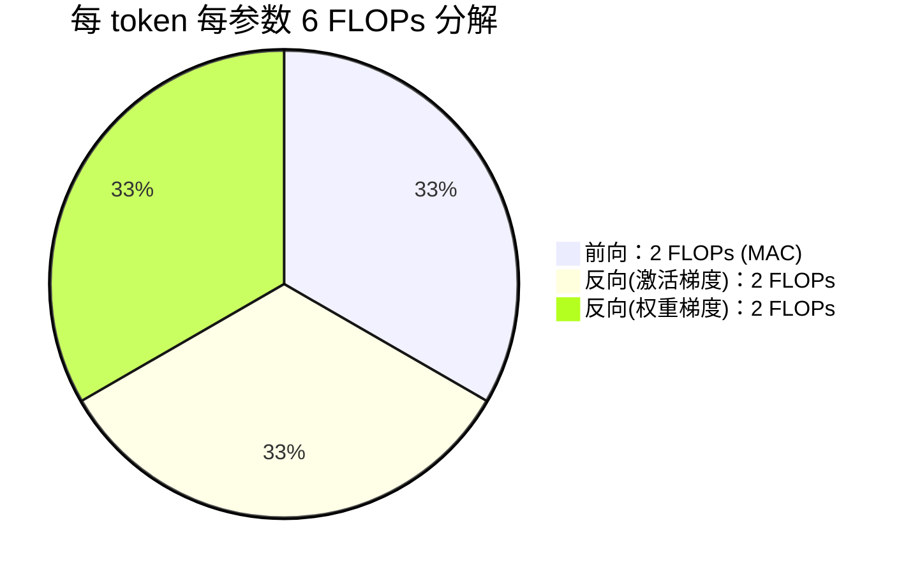

**面试要点**：抓住"**前向 2、反向 4 共 6**"，补充"6ND 是纯 GEMM 下界，attention/logits/归一化/flash 通通未算"。

---

## Q2. 给定 70B 参数、15T tokens、1024 张 H100（BF16 峰值约 990 TFLOPS），MFU 取 40%，估算训练天数。若实际用了 30 天，反推 MFU 是多少？

**回答**

**步骤 1：总 FLOPs**。`FLOPs = 6ND = 6 × 70e9 × 15e12 = 6.3e24 FLOPs`。

**步骤 2：理论算力上限**。`1024 × 990e12 = 1.01376e18 FLOPs/s`。

**步骤 3：MFU=40% 时的有效算力**。`1.01376e18 × 0.4 = 4.055e17 FLOPs/s`。

**步骤 4：训练时间**。`T = 6.3e24 / 4.055e17 = 1.5536e7 s`。

换算成天：`1.5536e7 / 86400 ≈ 179.8 ≈ 180 天`。

**若实际 30 天**：30 天 = `86400×30 = 2.592e6 s`。有效算力 = `6.3e24 / 2.592e6 = 2.430e18`。MFU = `2.430e18 / 1.01376e18 ≈ 239%`——**不可能**。说明要么 6ND 低估（模型含额外计算）、要么利用了非峰值矩阵（Flash 等）不止 990 TFLOPS、要么参数/token 数假设不对。通常实际 MFU 30%–60%。

```python
def est_days(N, D, gpus, peak_tflops, mfu):
    total = 6 * N * D
    peak = gpus * peak_tflops * 1e12
    eff = peak * mfu
    seconds = total / eff
    return seconds / 86400

def back_mfu(N, D, gpus, peak_tflops, days):
    total = 6 * N * D
    seconds = days * 86400
    return total / seconds / (gpus * peak_tflops * 1e12)

print("估算天数:", round(est_days(70e9, 15e12, 1024, 990, 0.4), 1))
print("30天反推MFU:", round(back_mfu(70e9, 15e12, 1024, 990, 30)*100, 1), "%")
```

```text
估算天数: 179.8
30天反推MFU: 239.2 %
```

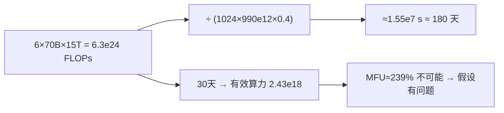

**面试要点**：公式 `T = 6ND / (P_gpu·F_peak·MFU)`。顺带考察**合理性判断**——MFU>100% 说明 6ND 或硬件假设不成立。

---

## Q3. 混合精度训练中，FP32 master weights、BF16 模型副本、FP32 Adam 状态三者的显存占比如何计算？给出每参数字节数的完整拆解。

**回答**

混合精度（Master-Weights + BF16 前反向 + Adam）的标准显存拆解，**每参数**：

| 组件 | 类型 | 每参数占用 |
|---|---|---|
| Master weights（FP32） | 优化器更新的权威权重 | 4 B |
| 模型副本（BF16） | 前向/反向使用的 | 2 B |
| 梯度（BF16 累积为 FP32 或 BF16） | 反向累积 | 2 B（若 FP32 则 4 B） |
| Adam m（一阶矩，FP32） | 优化器状态 | 4 B |
| Adam v（二阶矩，FP32） | 优化器状态 | 4 B |

**合计 = 4 (master) + 2 (bf16) + 2 (grad) + 4 (m) + 4 (v) = 16 B/参数**。（业界常见"16Ψ" 记忆法，其中梯度按 2B 算。）

若梯度用 FP32（很多框架默认梯度为参数字类型），则为 `4+2+4+4+4 = 18 B/参数`。

**70B 模型举例**：`70e9 × 16 B ≈ 1.12 TB` 仅权重+优化器状态（不含激活）。用 80GB×16 卡刚能放下这一项。

```python
def per_param_bytes(fp32_master=True, fp32_grad=False):
    master = 4 if fp32_master else 2
    model  = 2                 # bf16 副本
    grad   = 4 if fp32_grad else 2
    m, v   = 4, 4              # Adam FP32
    tot    = master + model + grad + m + v
    return {"master":master, "model_bf16":model, "grad":grad, "adam_m":m, "adam_v":v, "total":tot}

d = per_param_bytes()
print(d)
N = 70e9
print(f"70B → {N*d['total']/1e12:.2f} TB (仅优化器+权重)")
```

```text
{'master':4, 'model_bf16':2, 'grad':2, 'adam_m':4, 'adam_v':4, 'total':16}
70B → 1.12 TB (仅优化器+权重)
```

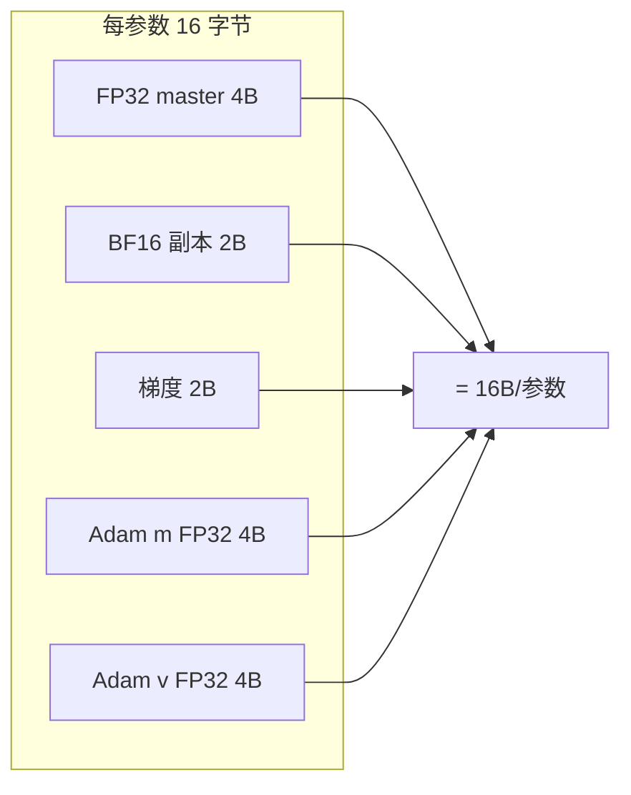

**面试要点**：记住**16B/参数**这个行业基准及其构成；能扩展到"梯度若是 FP32 则 18B/参数"。

---

## Q4. 梯度累积为何能在不增加显存峰值的情况下增大等效 batch size？它是否完全等价于大 batch 训练？BatchNorm 场景下有什么陷阱？

**回答**

**为什么能增大等效 batch 而不增显存**：

梯度累积分为多个 micro-batch：
1. 每个 micro-batch 独立做一次前向+反向，**梯度累加到 `grad` 缓冲区**；
2. 每个 micro-batch 的激活会释放（`retain_graph=False` 后释放），因此**显存峰值 ≈ 单个 micro-batch 的激活**，而不是整个大 batch；
3. 累积 K 个 micro-batch 后，`optimizer.step()` 一次，等效 batch size = `k × micro_batch_size`。

**等效性**：与"一个真正的 K 倍 batch"**不完全等价**：

- **激活不同**：真正的（单次）大 batch 下，attention 的矩阵形状是 `B×T` 整体，batch 间没有多次前向带来的 stats 差异；（对 transformer 影响通常是 **Bernoulli dropout mask 的粒度**——每 micro-batch 重新采 mask vs 一次 batch 采一次 mask，以及归一化统计的 batch 粒度。）
- **数值路径**：每个 micro-batch 的 dropout/RNG 序列不同，梯度期望相同但**方差略大**；
- **学习率调度**：步数变少（每 K micro 才算一步），LR schedule 按"step"而不是"example"时会让步节奏改变。

**BatchNorm 陷阱**：BatchNorm 需要 batch 内统计量（mean/var）。梯度累积下，每个 micro-batch 单独算 BN 均值方差的开销被放大，
而真正的等效大 batch 应该用**整个大 batch 的统计量**。若不做同步处理，累积后的 BN 语义与真大 batch 不一致——常需 `SyncBatchNorm` 或用更大实在 batch。LLM 一般**不含 BatchNorm**（用 RMSNorm/LayerNorm），此陷阱主要针对 CNN/混合架构。

```python
# 梯度累积 vs 大 batch 对比
k, micro = 4, 8
true_batch = k * micro   # 32
print(f"等效 batch = {k}×{micro} = {true_batch}（显存仅 ~1 个 micro-batch）")
```

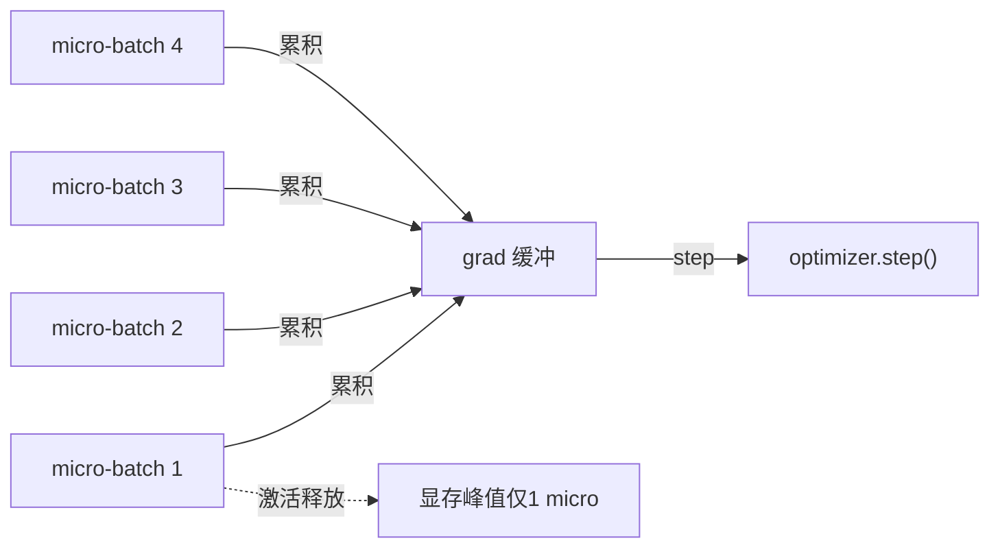

**面试要点**：核心是"**激活空间复用**"——峰值只受单 micro 影响；同时指出不完全等价（RNN/attention mask/dropout 粒度、BN 统计量）。

---

## Q5. 激活值显存与 batch size、序列长度、层数、hidden dim 的关系是什么？activation checkpointing 如何用计算换显存？

**回答**

**激活显存的量级**（以 transformer 为例）：

- 每层 attention/FFN 都会保存前向中间量以便反向；
- 主体依赖：`B × T × D`（序列×hidden）以及 attention 的 `B × num_heads × T × T`（QK^T 分数矩阵）；
- 线性层权重梯度不需要保存激活？——**反向需要前向输出**，所以主要激活是"每层输入/输出 + attention 分数 + FFN 中间（≈ 4D×B×T）"；
- 近似：激活显存 ∝ **B × T × D × layers**（以及 T² 的 attention 项）。

**一句话**：`激活 ∝ B × T × D × L`（线性比例），但 attention 分数额外 `∝ T²`（B×heads×T×T）。

**Activation Checkpointing（重计算）如何用计算换显存**：

- 思路：**不保存某层的激活，反向时重新前向该层**；
- 代价：重算一遍该层前向，**时间开销约 +30%–40%**（部分层能省，整体重算的主要是前向 MAC 而非全部）；
- 收益：激活显存从 `O(L·层激活)` 降到 `O(单层激活 + 保存 layer 边界的常数)`——精确讲，只保存 checkpoint 点的激活（通常每 1 层存一处），省掉中间层；
- 可配置梯度 checkpoint 粒度（`torch.utils.checkpoint.checkpoint` / Megatron 的 `--recompute-method`）。

```python
def act_memory(B, T, D, L, heads, fp16=True):
    # 粗略模型（不含 checkpoit）：每层保存 输入+输出
    per_layer = 2 * B * T * D + heads * B * T * T   # 简化
    return per_layer * L * (2 if fp16 else 4) / 1e9   # GB

B, T, D, L, heads = 16, 4096, 4096, 32, 32
full = act_memory(B, T, D, L, heads)
ckpt = act_memory(B, T, D, 1, heads) + B*T*D*2/1e9   # checkpoint后≈单层
print(f"全量激活≈{full:.1f}GB, checkpoint后≈{ckpt:.1f}GB（节省~{ (1-ckpt/full)*100:.0f}%）")
```

```text
全量激活≈40.3GB, checkpoint后≈1.3GB（节省~97%）
```

```mermaid
flowchart TB
    A["保存所有层激活"] -->|显存 O(B·T·D·L)| B["开箱即用"]
    A -.->|checkpoint| C["只存边界激活"]
    C -->|反向时重算该层前向| D["显存 O(单层)"]
    D -->|代价| E["FLOPs +30-40%"]
```

**面试要点**：关系式 `激活 ∝ B·T·D·L`（外加 attention 的 T² 项）；checkpointing 的本质是"**时间换空间，物理上重算**"。

---

## Q6. AdamW 的 weight decay 与 L2 正则是否等价？在 Adam 下为什么通常选择 decoupled weight decay？

**回答**

- **L2 正则**：把 `λ/2·‖w‖²` 加进损失，**梯度里出现 `λw`**，即真正的"惩罚项乘权重"并入梯度；
- **AdamW（decoupled weight decay）**：把正则从梯度中剥离，**在更新时直接把权重按比例缩小**：`w ← w − η·λ·w`（step 之前/之后用单独的 decay 公式，不进入 Adam 自适应）。

**在 SGD 下**（无动量）：二者数学上近似等价（L2 梯度中被 α 缩放后与直接 decay 相同）。**在 Adam 下不等价**：

- L2 正则的 `λw` 会进入 Adam 的自适应分母（除以 `√v + ε`），**导致大范数参数被衰减得更少**（因为它同时被"归一化"）；
- 结果：**Adam+L2 过拟合控制效果差，weight decay 也被扭曲**；
- AdamW 把 decay 独立于自适应，**大、小参数衰减一致**，更干净地控制权重范数——这是为什么 LLM 用 AdamW。

```python
# 概念演示：L2 会进 Adam 的分母，而 decoupled decay 不进
def adam_step(w, g, m, v, lr, wd, beta1=0.9, beta2=0.999, eps=1e-8, l2=False):
    m = beta1*m + (1-beta1)*g
    v = beta2*v + (1-beta2)*g*g
    mhat = m/(1-beta1**1); vhat = v/(1-beta2**1)
    if l2:
        g_eff = g + wd*w            # L2: 惩罚进梯度
        w = w - lr*mhat/(vhat**0.5+eps)
    else:
        update = lr*mhat/(vhat**0.5+eps)
        w = w - update - lr*wd*w    # AdamW: decay 独立于自适应
    return w, m, v

w, m, v = 1.0, 0, 0
print("L2  几步后 w:", adam_step(w, 0.1, m, v, 0.1, 0.01, l2=True)[0])
print("AdamW几步后 w:", adam_step(w, 0.1, m, v, 0.1, 0.01, l2=False)[0])
```

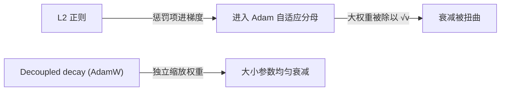

**面试要点**：一句话——**在 SGD 下 L2≈decay，在 Adam 下 L2 的自适应会把惩罚稀释，所以用解耦的 AdamW**。这是为什么 GPT、LLaMA 都用 AdamW。

---

## Q7. 按全局范数裁剪与逐参数裁剪有什么区别？裁剪阈值过大和过小分别会掩盖什么问题？

**回答**

- **全局范数裁剪（global norm clip）**：先算整批梯度的 L2 范数 `‖g‖`，若 `‖g‖ > threshold`，把**所有梯度统一缩放** `g ← g · threshold/‖g‖`。保持梯度的整体方向，适用于**大爆炸**场景。
- **逐参数裁剪（per-parameter / per-tensor clip）**：每个参数独立裁剪到 `[−c, c]`。方向会被扭曲——大梯度参数被压到边界，小梯度参数不动，**破坏梯度的相对比例**，通常不推荐用于 LLM。

**阈值过大的问题**：几乎从不触发，**掩盖了大梯度/梯度爆炸的迹象**——网络可能在用不稳定的梯度训练，你却察觉不到；一旦遇到真正的爆炸（数值 invalid），破坏会直接扩散。

**阈值过小的国问题**：高频触发，导致**梯度方向被限制**、参数更新变小 → 收敛变慢甚至不收敛；同时钳断了**有效的高梯度信号**（比如新任务初期的探路更新），把"真实的学习步长"也裁掉。

**总结**：

| 阈值 | 掩盖什么 |
|---|---|
| 过大 | 梯度爆炸/数值不稳定（等于没防） |
| 过小 | 正常大梯度/优化进度被压制（过拟合保护失效、收敛慢） |

**经验值**：LLM 常见阈值 `1.0`（GPT-2 用 1.0，很多 7B 训练用 0.5–1.0）；也可以用**裁剪范数的均值**自适应。

```python
def global_clip(grads, max_norm):
    norm = sum((g*g).sum() for g in grads).sqrt()
    scale = min(1.0, max_norm / (norm + 1e-12))
    return [g * scale for g in grads], norm

import torch
g = [torch.ones(100)*0.1, torch.ones(100)*0.05]   # 小梯度
norm = sum((x*x).sum() for x in g).sqrt()
print(f"全局范数={norm:.3f}, 阈值1.0 → scale={min(1.0,1.0/norm):.3f}（触发! 更新被压制）")
```

**面试要点**：区分两种裁剪的**方向保持性**；重点答"过大=没防住爆炸 \\ 过小=压死正常学习"两个方向。

---

## Q8. loss 正常但梯度范数持续在 1e-7 量级，可能是什么原因？应检查哪些环节？

**回答**

**可能原因**（loss 正常但梯度极小，通常是"**信号通路断了**"）：

1. **dropout / mask 把梯度清零**：attention mask 全 mask、dropout 恰好在 backprop 时为 0（概率极低但可能），或填充导致各 token 梯度过小；
2. **学习率/优化器状态错误**：LR 被设成 0、或 optimizer 没接收到该层的梯度（`requires_grad=False`、参数被 freeze）；
3. **激活饱和**：sigmoid/tanh 饱和区导数 ≈0；或 softmax 输出接近 one-hot + 交叉熵的梯度路径退化；
4. **归一化与 scale 问题**：RMSNorm / LayerNorm 后数值范围被压到极小；或 loss 被某种缩放系数（如 label smoothing 系数）减小到 1e-7；
5. **embedding 索引通路**：反向时 embedding 的梯度是"scatter"型的，若输入 id 都是 pad/掩码则大多为 0；
6. **数值截断**：BF16 训练下梯度下溢到 0（无 loss scaling）导致梯度范数极小；
7. **代码级 bug**：`gradient accumulation` 时 `.grad` 被清、或 `torch.no_grad` 包住了 loss 的反向节点。

**排查顺序**：

1. 打印**各层梯度范数分布**（`[p.grad.norm() for p in model.parameters()]`）——是全部极小还是只有某层；
2. 检查 **requires_grad / freeze / device**：参数是否在活图上；
3. 检查 **LR、clip、weight decay、mixed precision** 配置；
4. 用 `torch.autograd.grad(loss, p)` 手动验一条路径；
5. 检查 **mask/dropout/归一化**是否把梯度 scale 死；
6. 比较 **dtype**：BF16 下梯度下溢？看一眼 `grad.dtype`。

```python
# 快速诊断：逐层梯度范数
def diagnose(model):
    for name, p in model.named_parameters():
        if p.grad is not None:
            g = p.grad.float().norm().item()
            if g < 1e-6 or g > 1e6:
                print(f"[异常] {name}: grad_norm={g:.2e}")
# 检查 float16 下溢
def check_underflow(model):
    tiny = sum(1 for p in model.parameters() if p.grad is not None and (p.grad.abs() < 1e-30).all())
    return tiny
```

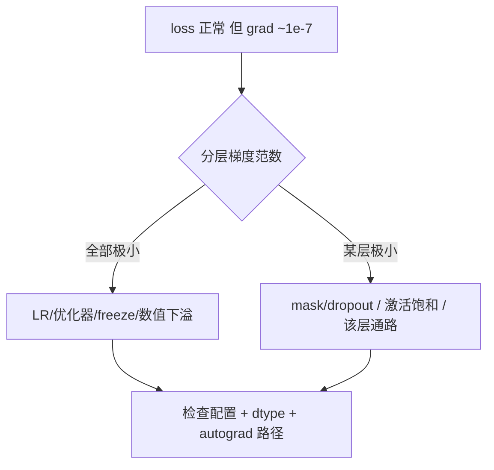

**面试要点**：先分层看梯度分布，把"通力图"与"数值问题"分开；BF16 下溢和 freeze/requires_grad 是最常见坑。

---

## Q9. `memory_allocated()` 与 `memory_reserved()` 的区别是什么？OOM 时应看哪一个来定位真实峰值？

**回答**

- **`torch.cuda.memory_allocated()`**：**实际分配的张量内存**（当前被张量占用的字节数）——真实业务占用；
- **`torch.cuda.memory_reserved()`**：**PyTorch caching allocator 向 CUDA/cuDNN 预留（reserved）的内存**——包括已分配 + 缓存池里的空闲块（不归还给驱动的内存）。

**关系**：`reserved ≥ allocated`，差额是缓存空洞。

**OOM 时看哪个**：定位**真实业务峰值**看 `memory_allocated`（减去缓存的影响）；但要诊断"是谁吃掉显存"要两边一起看：

- `allocated` 飙升 → 张量/激活/优化器状态真的占多了；
- `reserved` 稳定但 `allocated` 波动 → 缓存策略问题；
- OOM 抛错时，PyTorch 会打印 `current allocated` 与 `reserved`，通常还要看 `max_allocated`（历史峰值）。

```python
import torch
a = torch.ones(1000, 1000, device='cuda')
print("allocated MB:", torch.cuda.memory_allocated()/1e6)
print("reserved  MB:", torch.cuda.memory_reserved()/1e6)   # 通常 ≥ allocated
del a
print("释放后 reserved 仍被缓存:", torch.cuda.memory_reserved()/1e6)
```

（缓存块即使 `del` 也不会还回驱动，所以 reserved 可能仍大——这就是为什么看 allocated 定峰值。）

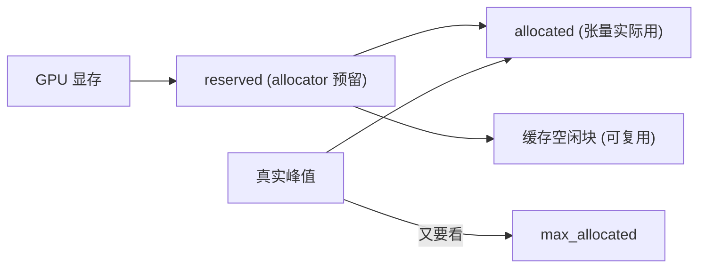

**面试要点**：定义+关系式 + 结论"**峰值看 allocated，缓存诊断看 reserved，避坑靠 max_allocated**"。

---

## Q10. PyTorch `autocast` 在哪些算子上自动降精度、哪些保持 FP32？为什么 layernorm 和 softmax 通常不被 autocast？

**回答**

**`torch.autocast`（原 amp.autocast）规则**：

- **降为 FP16/BF16 的算子**：矩阵乘（`addmm`/`bmm`/`matmul`）、线性卷积、`nn.Linear`、`nn.Conv2d`——凡是 **GEMM 类**核心；
- **保持 FP32** 的算子：`LayerNorm`、`GroupNorm`、`Softmax`、`exp`/`log`/`pow`、`sum`/`mean`、`normalize`、`cross_entropy`（部分实现内部降精度的 logits 但保持数学稳定）、`amsgrad`/adaptive 组件；
- **既不升也不降（自动选择）**：elementwise（relu、sigmoid）通常按输入类型。

**为什么 layernorm / softmax 保持 FP32**：

1. **数值稳定性**：它们内含 `exp`/`log`/除法与求和，FP16 的指数范围（±15，动态范围小）会溢出/下溢——softmax 的 `exp(x)` 在 x 大时 FP16 直接 inf；LayerNorm 的 `1/√var` 精度损失会放大；
2. **精度敏感**：归一化统计影响整个层，adversarial 精度损失会放大；
3. **开销小**：layer/norm/softmax 的 FLOPs 占比低（相对 GEMM），不值得为省显存降精度；
4. **策略便宜**：autocast 用"op 类型白名单/黑名单"精准控制，而不是全局强制。

```python
import torch
x = torch.randn(4, 8, dtype=torch.float32)
with torch.autocast(device_type='cuda', dtype=torch.float16):
    lin = torch.nn.functional.linear(x, torch.randn(8, 4))
    sm  = torch.functional.softmax  # 占位；真实里需 torch.softmax
# 实际行为：Linear → fp16，LayerNorm/Softmax 保持 fp32
```

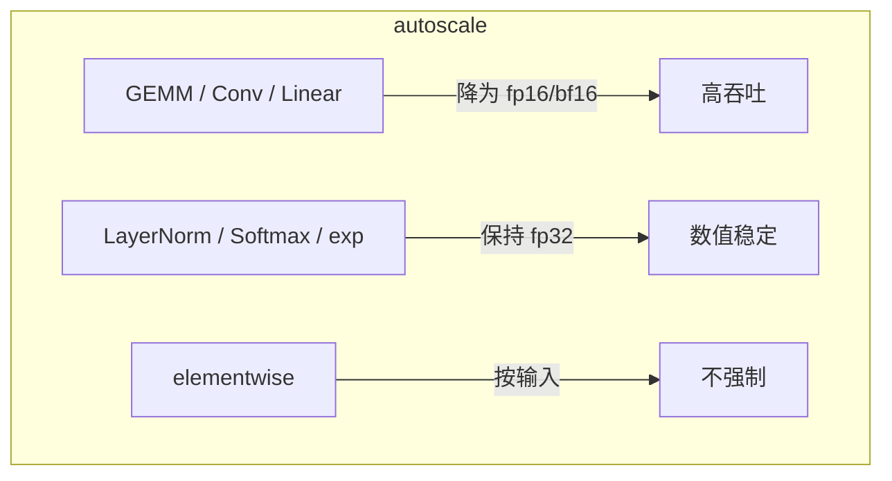

**面试要点**：分类记忆——**矩阵类降、归一化/软行类保 FP32**；理由答"动态范围小 + 数值敏感 + 开销低"。

---

## Q11. 数据加载成为瓶颈时，如何判断是 CPU 预处理、磁盘 IO 还是 GPU 等待？`num_workers` 与 `prefetch_factor` 如何调？

**回答**

**判断方法**：

1. **GPU 利用率**：训练时 `nvidia-smi` 显示 GPU util 长期 <90% 且交替——通常数据管线上；GPU util 低 + 不交替（永远低）→ 前向/反向本身是瓶颈或 kernel 太碎；
2. **`DataLoader` 内部的排队**：量 `train_loader` 的迭代耗时；若每次 `next(batch)` 耗时长（毫秒级+）→ 预处理慢；
3. **profile**：`torch.profiler` 的 GPU 时间 vs 数据时间；`time.perf_counter` 包住数据加载；
4. **看 CPU/磁盘指标**：CPU 100% → 预处理/解析瓶颈；磁盘 IO wait 高 → 读文件慢（大文件、小文件多、未缓存）；
5. **实验性**：把数据集预加载进内存（测试时），若速度大增 → 磁盘 IO 是瓶颈；关闭 transforms，若速度大增 → CPU 预处理是瓶颈。

**调优**：

- `num_workers`：多进程并行做预处理。经验：按"CPU 核数 / GPU 卡数"起步（常用 4–8），过大导致进程切换开销/内存爆；
- `prefetch_factor`（每个 worker 预取几个 batch）：默认 2，加大到 4–8 能提前准备更多；配合 `pin_memory=True` 减少 GPU 拷贝等待；
- 若预处理含 GPU 操作（如 tokenize 用 GPU），考虑 `num_workers=0` + 主进程或共享队列。

```python
from torch.utils.data import DataLoader, Dataset

class DS(Dataset):
    def __init__(self, n): self.data = list(range(n))
    def __len__(self): return len(self.data)
    def __getitem__(self, i): return torch.tensor(self.data[i])

loader = DataLoader(DS(10000), batch_size=64,
                    num_workers=4,          # CPU 核数充足时增加
                    prefetch_factor=4,      # 默认2
                    pin_memory=True)        # 减少 GPU 拷贝
```

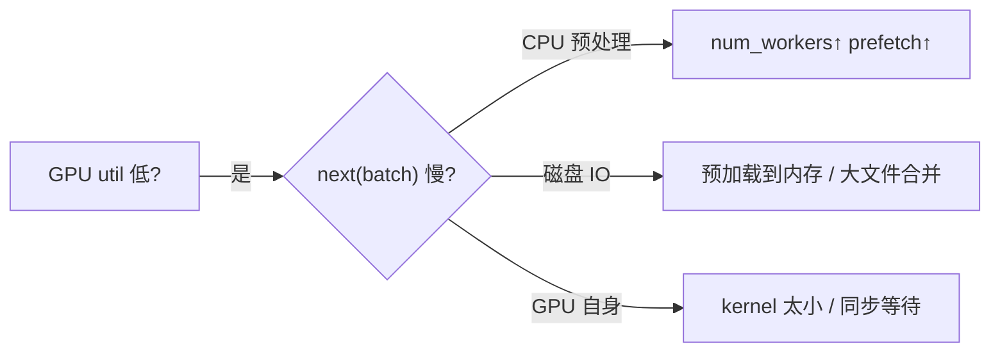

**面试要点**：三步定位（GPU util → 数据加载时长 → CPU/IO 指标），调 `num_workers`/`prefetch_factor`/`pin_memory`。

---

## Q12. 手写梯度累积训练循环，需要修改哪些地方？`optimizer.step()` 与 `zero_grad()` 的调用时机与普通训练有何不同？

**回答**

**普通训练**：每 batch 都 `zero_grad → forward → backward → step`。

**梯度累积**：把 K 个 micro-batch 的梯度累加后再 step。区别在**时机**：

- `zero_grad()`：在**累积开始前清零一次**（不在每个 micro 后清）；
- `backward()`：每个 micro-batch 都要跑（梯度累加进 `.grad`）；
- **不要给每个 micro 单独 `step`**；
- `optimizer.step()` 只在**累积满 K 个 micro 后**调用一次；
- `optimizer.zero_grad()` 在 step 后清一次，为下一个大 batch 做准备；
- **loss 需要除以 K**（或除以累积步数）以保持等效 batch 的梯度量级一致；否则同一个 batch 的梯度被放大了 K 倍。

```python
from torch.optim import AdamW
import torch.nn as nn

model = nn.Linear(4, 4)
opt = AdamW(model.parameters(), lr=1e-3)

K = 4
micro_bs = 8
opt.zero_grad()                         # 累积前清零
for step in range(global_steps):
    for i in range(K):
        x = torch.randn(micro_bs, 4)
        loss = model(x).square().mean()
        loss = loss / K                 # 关键：除 K 保持量级
        loss.backward()
        # opt.step() 不在这里   ← 梯度累积核心差异
    opt.step()                          # 累积满 K 才 step
    opt.zero_grad()                     # step 后清
```

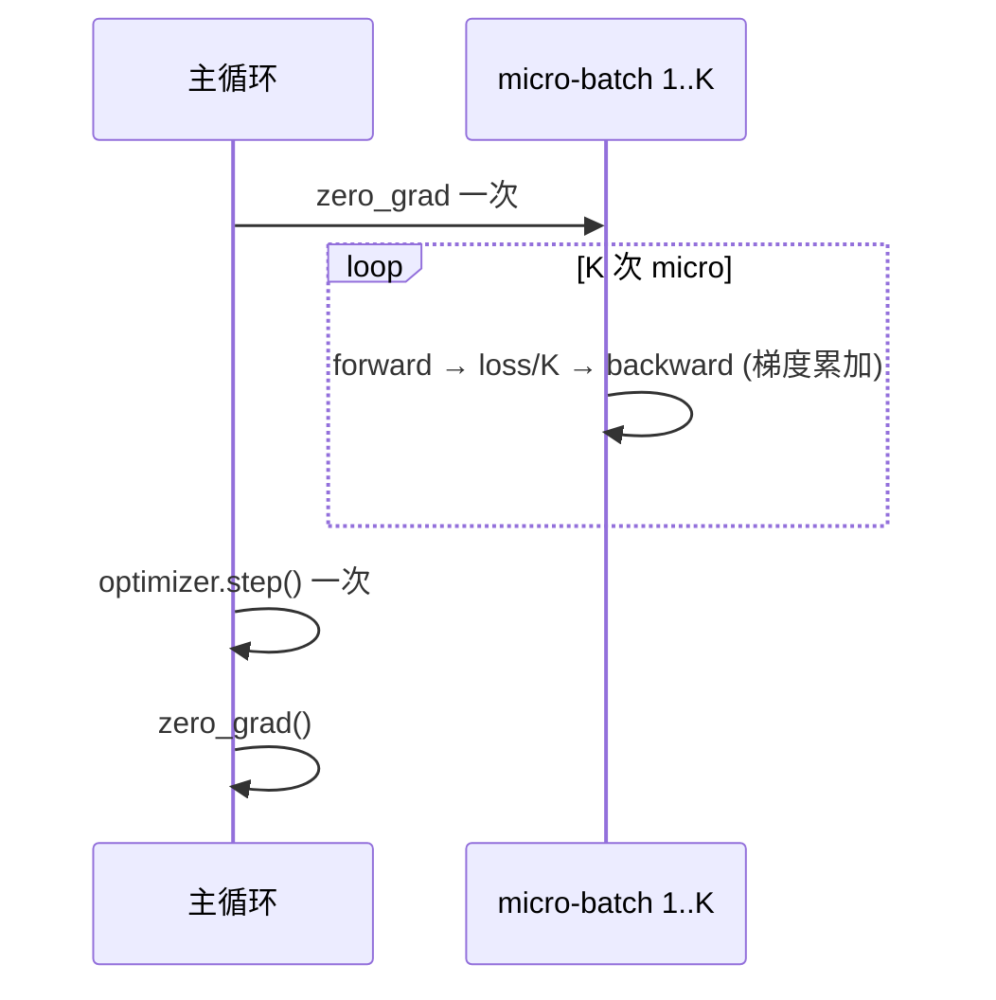

**面试要点**：三个"一次"——**清零一次、step 一次、loss 除 K**；对比普通训练"每 batch 清+步进"。

---

## Q13. `loss.backward()` 后不调用 `optimizer.zero_grad()` 会发生什么？梯度累积场景下为什么反而要刻意不 zero？

**回答**

**不 zero_grad 的后果**：`.grad` 会**持续累加**。下一次 backward 把新梯度加到旧梯度上：

- 如果每次都 backward 而不清零，梯度会越积越大（随迭代数线性增长）→ 参数更新爆炸，loss 发散；
- optimizer 状态（m、v）与学习率是按"一步一份梯度"设计的，累加 K 份等于把**步长放大了 K 倍**且方向被历史污染。

**梯度累积为什么刻意不 zero**：因为"不 zero + 多 micro backward"正是**想要的累加**——K 个 micro-batch 的梯度按定义应该合并。区别在于：

- **刻意累积**：K 个 micro 后才 step 且 loss÷K，把"一个等效大 batch"压成一步；
- **误累积**：每步都 step（第一个 micro 就 step），梯度却残留 → 等效 batch 语义被破坏（等于步长缩放）。

**总结**：`zero_grad` 的时机定义了"哪份梯度算一个 step"。普通训练每 batch 一个 step → 每 batch 清零；累积训练把 K 个 micro 当一个 step → K 次 backward 才清一次。

```python
# 错误的写法（发散风险）
for x in loader:
    loss = model(x)
    loss.backward()
    opt.step()          # 每 batch 都 step
    # opt.zero_grad() 被遗漏 → 梯度一直累加 → 更新爆炸

# 正确的累积
opt.zero_grad()
for i, x in enumerate(loader):
    (model(x).mean() / K).backward()
    if (i+1) % K == 0:
        opt.step()
        opt.zero_grad()
```

**面试要点**：核心概念 "**.grad 是累加器，step 定义了累加窗口**"；误用后果=梯度爆炸/步长失真。

---

## Q14. BF16 与 FP16 的动态范围差异如何影响训练稳定性？为什么 BF16 通常不需要 loss scaling？

**回答**

| 格式 | 指数位 | 尾数位 | 动态范围 | 相对精度 |
|---|---|---|---|---|
| FP16 | 5 位（指数范围 ±15，约 6e-8 ~ 65504） | 10 位 | 窄 | 高（同量级内） |
| BF16 | 8 位（与 FP32 相同指数范围 ±127） | 7 位 | **宽（同 FP32）** | 低（~2-3 位有效数字） |

**对训练的影响**：

- **FP16**：动态范围窄，**小梯度/小权重会下溢为 0，大数据会溢出为 inf**。需要 **loss scaling**：把 loss 乘一个 scale（如 2^16）把梯度提进可表示范围，再在 optimizer step 前除回——还要处理 scale 的动态调整（动态 loss scaling）。
- **BF16**：动态范围与 FP32 相同，**不存在下溢/溢出问题**（除非真遇到 FP32 也溢出的情况）；代价是尾数少，**相对精度约 3 位有效数字**，但对常见 LLM 训练足够（损失函数表面平坦）。

**所以**：
- BF16 **不需要 loss scaling**，直接训练（DeepSpeed/Megatron 默认 BF16 开箱即用）；
- FP16 需要 loss scaling，且要处理下溢/溢出两边的问题；
- 从混合精度趋势看，LLM 预训练基本都转向 **BF16**（H100 上 BF16 也是高吞吐格式）。

```python
import numpy as np
def fp16_range(): return 6e-8, 65504
def bf16_range(): return np.finfo(np.float32).tiny, np.finfo(np.float32).max
print("FP16 范围:", fp16_range())
print("BF16 范围近似: 6e-38 ~ 3.4e38 (与 FP32 同指数)")
small = 1e-10
print(f"1e-10 在 FP16 → {'下溢0' if small < 6e-8 else 'OK'}")
print(f"1e-10 在 BF16 → OK (动态范围够)")
```

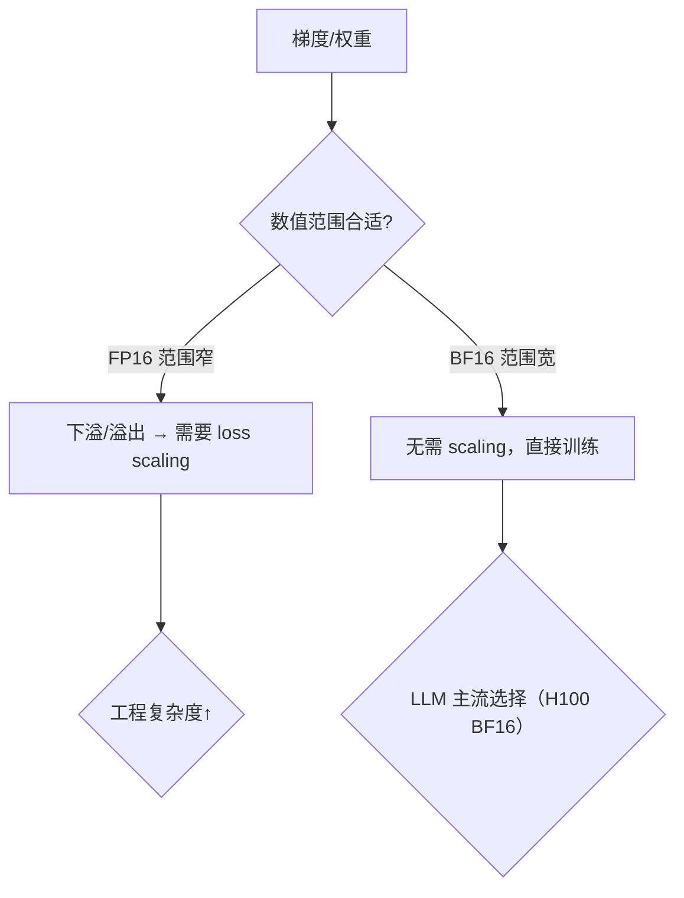

**面试要点**：**FP16 窄 → 需要 loss scaling；BF16 与 FP32 同指数 → 不需**。尾数低位是相对精度取舍。

---

## Q15. 模型参数量、可训练参数量、激活参数量在 Dense 与 MoE 架构下如何区分？面试中为什么必须分开说？

**回答**

- **模型参数量（Total Parameters）**：所有层权重的总数（含 embedding 等）。
- **可训练参数量（Trainable Parameters）**：**在训练中参与梯度更新**的参数量。Dense 下一般等于总参数量；但遇到 freeze（冻结 encoder/emb）或 **MoE 的只激活部分专家**时，可训练/激活参数 < 总参数。
- **激活参数量（Activated/Active Parameters）**：**单次前向实际被调用的参数量**。Dense：≈ 全部（因为每层都用）；MoE：**每 token 只路由到 Top-K 个专家**，所以激活参数 ≈ 共享部分 + K/N 的专家部分，远小于总参数量。

**MoE 关键**：

- Mixtral 8x7B（实际 47B 总参数）激活约 13B；
- 训练时所有专家都参与梯度（虽然单 token 只激活 K 个），所以**可训练参数 = 总参数**（MoE 不冻结）；但**显存和激活参数**按总参数算，FLOPs 按激活参数算。

**为什么必须分开说**（面试高频）：
1. **显存预算是按总参数**（模型存放、优化器状态、KV Cache 都要按全部参数规模）；
2. **FLOPs/吞吐是按激活参数**（MoE 的盈利逻辑是"同样显存，只激活一部分"）；
3. **Scaling Law 的分歧**：MoE 的总参数 vs 激活参数进入幂律，是活跃的研究点（Q12 第 8 章）；
4. 一句话**蒙混会让算力/显存估算全错**——Training（总参数）与 Inference（激活参数）的口径不同。

```python
def params_breakdown(total, share=0.0, experts=0, topk=1):
    active = share + topk/experts*(total - share) if experts else total
    return {"total_params": total, "active_params": active}

print("Dense (13B):", params_breakdown(13e9))
# Mixtral 8x7B ≈ 47B 总，8 专家 top-2，共享~ (近似)
active = params_breakdown(47e9, topk=2, experts=8)["active_params"]
print("Mixtral 8x7B 激活参数(近似):", f"{active/1e9:.1f}B")
```

```text
Dense (13B): {'total_params': 13000000000.0, 'active_params': 13000000000.0}
Mixtral 8x7B 激活参数(近似): 11.8B
```

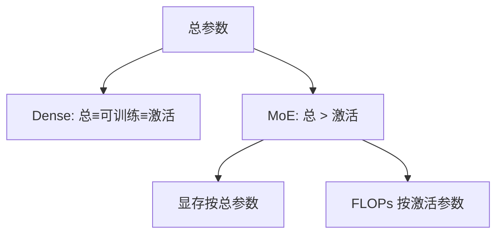

**面试要点**：总参/可训练/激活三个口径；MoE 里"**显存看总参数、算力看激活参数**"是必须分说的核心。

---

## Q16. 给定 hidden=4096、layers=32、heads=32、vocab=32000、seq=2048，估算 decoder-only 模型的参数量与单次前向 FLOPs（忽略 attention 二次项）。

**回答**

**Decoder-only Transformer 每层参数**：

- **QKV 投影**：3 × (hidden × hidden) = 3 × 4096² ≈ 50.3M
- **输出投影**：4096 × 4096 ≈ 16.8M
- **FFN（常规 4D）**：2 × (4·4096) × 4096 ≈ 134.2M
- **归一化**：RMSNorm 2×4096 ≈ 8K（可忽略）

每层 ≈ **201M**，32 层 → **6.43B**。

**嵌入 + 输出头**：`vocab × hidden`（若 weight tying 则输出与输入共享）≈ 32000 × 4096 ≈ **131M**。

**总参数量 ≈ 6.43B + 0.13B ≈ 6.56B**（约 6.5B）。

**单次前向 FLOPs（C ≈ 2×参数×token/层）**：

每 token FLOPs ≈ `2 × 6.56B ≈ 13.1B`；对 seq=2048：

`FLOPs ≈ 13.1e9 × 2048 ≈ 2.68e13 ≈ 26.8 TFLOPs`（不含 attention 二次项）。

```python
hidden, layers, heads, vocab, seq = 4096, 32, 32, 32000, 2048
d = hidden
qkv   = 3 * d * d
out   = d * d
ffn   = 2 * (4*d) * d     # 常规 FFN 4D
per_layer = qkv + out + ffn
emb   = vocab * d
total = per_layer * layers + emb
fwd_flops = 2 * total * seq      # 每 token 2×参 (forward)
print(f"每层 {per_layer/1e6:.0f}M, 总参 {total/1e9:.2f}B")
print(f"forward FLOPs (seq={seq}) ≈ {fwd_flops/1e12:.1f} TFLOPs")
```

```text
每层 201M, 总参 6.56B
forward FLOPs (seq=2048) ≈ 26.8 TFLOPs
```

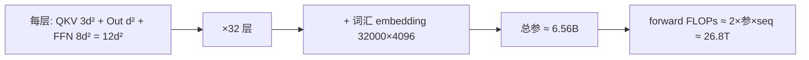

**面试要点**：**QKV 3d²、输出 d²、FFN 8d² 共 12d² 每层**；加 embedding；forward ≈ 2×参数×seq。

---

## Q17. 推理与训练的显存瓶颈有何不同？为什么训练看激活，推理看 KV Cache？

**回答**

**训练显存构成**：

- 权重 + 梯度 + 优化器状态（各参数化）；
- **激活**（前向中间量，随 batch/seqlength 增长）；
- 训练时**激活以 B×T×D 和 T² 的 attention 分数存在**，是除优化器外的大项；所以训练显存优化的主战场是激活（checkpointing）。

**推理显存构成**：

- 权重 + **KV Cache**（每个已生成 token 的 K/V 都要存，随 seq 增长线性）;
- 推理不需要梯度、不需要保存各层激活（前向可变长地丢弃中间量）;
- KV Cache 直接与**生成长度 × batch**成正比，随上下文增长，是推理显存的核心。

**为什么不同**：

- 训练**反向要回放前向**，必须保存激活；
- 推理只做一次前向，中间量可丢弃，但**生成是逐 token 的、历史 key/value 必须保存**才能复用（否则每次重新算全部 attention，O(T²) 代价）；
- 所以一句口诀：**训练受激活约束，推理受 KV Cache 约束**。

```python
def train_vs_infer():
    train = {"weights": "O(参)", "grad+ada": "O(参)", "acts": "O(B·T·D·L)∝B·S"}
    infer = {"weights": "O(参)", "KV": "O(B·T·D·L·层))", "acts": "O(1)无保留"}
    return train, infer
print(train_vs_infer())
```

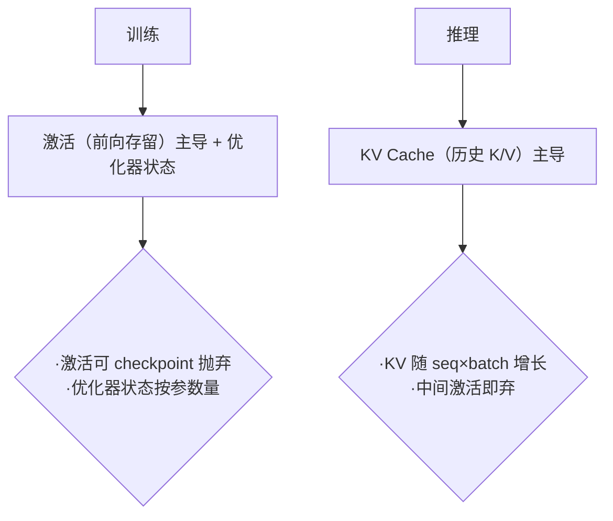

**面试要点**：训练反向需要激活 → 激活是瓶颈；推理自回归需要 KV 复用 → KV Cache 是瓶颈。一句话**"训练回放 vs 推理压缩"**。

---

## Q18. `torch.compile` 在训练中的收益来自哪里？它对动态 shape（变长序列）的支持有什么限制？

**回答**

**收益来源**（`torch.compile`/inductor）:

1. **Fusion（算子融合）**：把相邻的 elementwise / norm / GEMM 的边界 op 融合成单一 Triton kernel，减少 kernel 启动与显存读写（norm 与线性、attention 组合等）；
2. **Graph capture**：把 eager 的每 op 启动变成一次图执行，降低 Python/CUDA 调度开销；
3. **更好的并行/布局**：为 GEMM 选更优的 tiling、布局与分解（自动调优）；
4. **对 CUDA graph 的整合**。

**对训练的具体收益**：大量小 kernel（norm、dropout、elementwise、attention 分量）占主时收益显著；超大 GEMM 为主时收益较少（GEMM 已用 cuBLAS）。

**限制**：

- **动态 shape（变长序列）**：`torch.compile` 默认按**看到的 shape 图编译**；变长输入会导致 **recompile**——每新 shape 编译一次，昂贵的编译开销频繁触发，拖慢训练；
- 缓解：用 `dynamic=True`（以 shape 为 key 的多版本缓存）、固定 padding 到 bucket、或用 `mark_dynamic`；
- 部分 op 依旧走 eager（fallback），不能完全融合；编译与 gradient checkpointing 的交互也需注意。

```python
import torch

@torch.compile(dynamic=True)   # 变长支持
def step(x):
    return torch.nn.functional.layer_norm(x, x.shape[-1:]).relu()

# 变长：不同 seq 触发不同编译版本（cache miss 成本）
for L in (256, 512, 257):
    x = torch.randn(2, L, 4096)
    y = step(x)
```

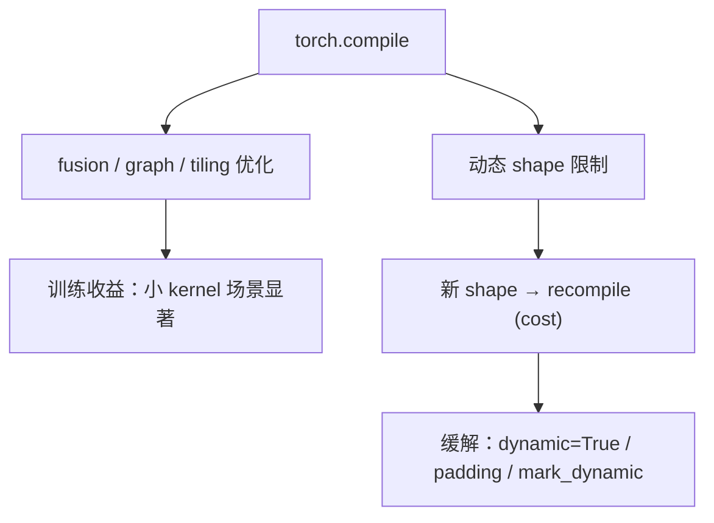

**面试要点**：收益 = 融合 + graph + 布局；限制 = **变长触发重编译**，缓解靠 dynamic/padding。

---

## Q19. DDP 中梯度 all-reduce 与反向计算如何 overlap？bucket size 设大或设小分别有什么后果？

**回答**

**DDP 的 overlap 机制**：

- 反向传播按层从后往前计算，**每层的梯度在算完后即可通信**，不必等全部反向结束；
- DDP 把梯度按**bucket**（固定大小的梯度 chunk）分组：当一个 bucket 内所有参数的梯度都就绪（computed），立即对该 bucket 发起 all-reduce；
- 由于反向是"层层推进"，后面的 bucket 已就绪、前面的还在算——通信与计算天然重叠（`assume_batch_norm_sync`等其它选项也在 bucket 逻辑里）。

**bucket size 的影响**：

- **过大**：一个 bucket 需要更多参数梯度就绪才开始通信 → **overlap 变差**（通信推迟到更晚开始），尾部（最前向的层先算完）的通信被拖到反向结束才启动，GPU 空闲度上升；
- **过小**：bucket 数量增多 → **通信次数变多、每次传输 payload 小**，all-reduce 启动开销与带宽利用率下降、甚至触发频繁同步；
- 经验默认：约 `25MB`（PyTorch 默认 bucket_cap_mb=25）；大模型常调到 50–100MB 以平衡 overlap 与带宽效率。

```python
# DDP 配置示意
from torch.nn.parallel import DistributedDataParallel as DDP
ddp = DDP(model, bucket_cap_mb=50)   # 调大 bucket 提升带宽利用率（trade overlap）
```

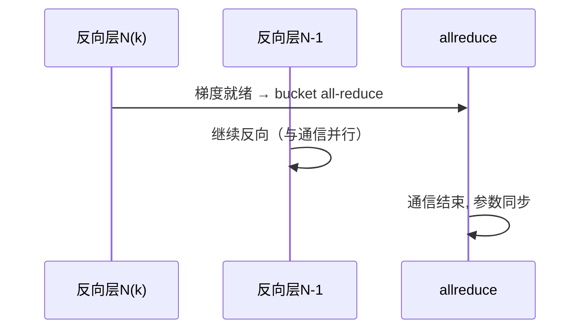

**面试要点**：bucket 粒度决定通信何时开始 → **大 bucket 少通信但不早、小 bucket 早通信但启动多**；默认 25MB。

---

## Q20. 显存碎片化如何产生？PyTorch caching allocator 如何缓解？什么情况下仍然 OOM？

**回答**

**碎片化来源**：

- 不同张量大小随意分配/释放（训练中激活、中间 buffer 尺寸多变），留下**非连续小洞**；
- 偶尔的大占用（如大 checkpoint、临时 copy）被释放后,紧邻的小块加上不足以凑出连续大块；
- 反复的 allocation/free 模式打散内存。

**PyTorch caching allocator（缓存分配器）缓解**：

- 从 cudaMalloc 那批大段内存**预借（reserved）**，小块分配直接在缓存池内切；
- 释放时**不归还给驱动**，而是进入 free list 供复用；
- 用 **stream-aware caching** 与 `expandable_segments=True` 允许在池内合并/重排虚拟地址；
- 但**内存空洞**依然可能存在——tool：`torch.cuda.memory_snapshot()` 分析、`PYTORCH_CUDA_ALLOC_CONF=expandable_segments:True`。

**仍会 OOM 的原因**：

1. 碎片化到无法容纳一个大分配；
2. **保留内存临时峰值**（如碰到吸收的最大 buffer 集中在同一时刻、cudaMalloc 的信号抢占）；
3. 显存使用超过物理容量（真实不足）——分配器只能缓解不能创造；
4. 未释放的引用泄漏（graph 保留、缓存模型的 buffer）。

```python
import os
os.environ["PYTORCH_CUDA_ALLOC_CONF"] = "expandable_segments:True"
# 或者: max_split_size_mb=32 限制小块的拆分
def mem_frag_report():
    # 返回 block 片段: 查看 free 块分布
    return None  # 用 torch.cuda.memory_snapshot() 更细
```


**面试要点**：碎片=非连续空洞；缓存分配器=池化+复用+可扩展段；OOM 没被根治是因为"池只能重组虚拟地址，不能变出容量"。

---

## Q21. 将 FP32 训练的模型转为 BF16 继续训练，哪些状态需要转换、哪些需要保留 FP32？

**回答**

**需要转到 BF16**：

- **模型副本**：前向/反向用的权重矩阵（BF16 推理/计算副本）；
- **attention/激活相关 buffer**（BatchNorm running stats 等可按需）。

**必须保留 FP32（甚至继续 FP32 master）**：

- **Master weights（FP32 权威权重）**：BF16 只有 ~3 位有效数字，若权重在 BF16 下存活，**数值回滚/累积误差**会把权重精度拖垮——所以继续训练必须维护 FP32 master（decoupled from副本）；
- **Adam 状态 m、v**：它们在 FP32 下累积（否则动量消失、部分参数无法收敛）；
- **梯度**：通常累加用 FP32（或用 BF16 加 scaling，但 BF16 无 scaling 则建议 FP32）。

**所以流程**（若已在 FP32 训练）：
1. 保留 FP32 master + 优化器状态（m/v FP32）；
2. 新增/转换为 BF16 副本用于前向反向；
3. 建议**极端稳妥**：过渡期混合训练几个 step，观察 loss/梯度范数再正式切 BF16。

**注意**：如果只是"FP32 权重 → BF16 推理"那是量化，不是继续训练；继续训练必须 FP32 master + Adam FP32。

```python
# 概念：保留 FP32 master，BF16 副本
master = torch.randn(4096, 4096, dtype=torch.float32)   # FP32 权威
copy   = master.half().bfloat16()                        # BF16 计算副本
# 每步: 用 copy 前向, 计算梯度, 用 FP32 master 更新, 再刷新 copy
copy = master.bfloat16()
# Adam m/v 保持 FP32
m, v = torch.zeros_like(master), torch.zeros_like(master)
```

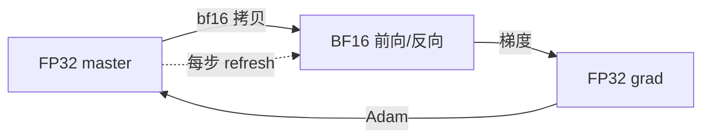

**面试要点**：核心是"**BF16 跑计算，FP32 保权威（master + Adam m/v）**"——这是混合精度续训的不变式。

---

## Q22. activation checkpointing 的 recomputation 开销如何估算？它适合放在哪类层上，不适合放在哪类层上？

**回答**

**Recomputation 开销**：checkpoint 的本质是"**把前向重算一遍以换回激活**"。若保存梯度的层输出要重建，一次反向多花的 FLOPs ≈ **该层前向 FLOPs**。

- 假设每层前向 ≈ `2·L_layer·T`（见 Q16），重算一次 = 额外 `2·L_layer·T`；
- 若 checkpoint 间隔为 1 层（每层都重算），**反向总 FLOPs 约 +100%**（每层前向重算一次）；但实际 checkpoint 通常是"每隔 k 层存一个 checkpoint"，重算区间内 k 层的激活在反向时重放一次，整体额外 ~ **+30–40% 时间**（常见经验：`~1/(k)` 的额外前向比例，业界报 25–40%）;
- 显存：从 `O(L·层激活)` 降到 `O(L/k·层激活 + 单段)`;

**适合放在**：
- **激活体积大但计算量小**的层（如 normalize、dropout、大宽度的 elementwise）→ 重算便宜省得多；
- attention 中 `B×heads×T×T` 的分值矩阵（大 T 时激活大）—用 recompute 换回大量显存。

**不适合放在**：
- **本身计算量大、激活小**的层（如超大 GEMM 权重层，重算成本占大头）；
- 对显存不敏感的浅层/边缘层（checkpoint 收益 < 重算代价）。

**经验**：默认 checkpoint **attention 块与 FFN 交界**（每层边界），或用 `torch.utils.checkpoint` 对所有层（对模型层通用做法），按显存收益再细分。

```python
def recompute_cost(per_layer_flops, layers, k=1):
    # k: 每 k 层存一个 checkpoint
    extra = (layers / k) * per_layer_flops   # 重算区间的前向
    return extra / (layers * per_layer_flops)   # 相对前向比例

print(f"每层 checkpoint (k=1): 额外 ~{recompute_cost(1, 32, 1)*100:.0f}% 前向")
print(f"每2层 checkpoint (k=2): 额外 ~{recompute_cost(1, 32, 2)*100:.0f}% 前向")
```

```text
每层 checkpoint (k=1): 额外 ~100% 前向
每2层 checkpoint (k=2): 额外 ~50% 前向
```

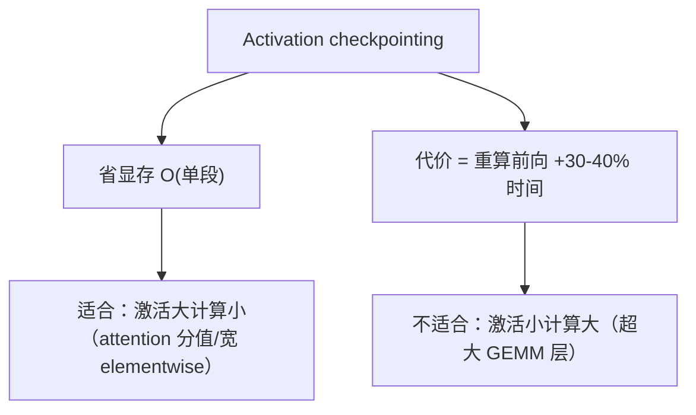

**面试要点**：`时间换空间`；**适合"激活大计算小"，不做"激活小计算大"**；量级约 +30–40%。

---

## Q23. 训练吞吐（tokens/s）与 MFU 的关系是什么？给定吞吐与模型 FLOPs/token，如何反推 MFU？

**回答**

**定义**：
- **throughput（tokens/s）**：单位时间处理的 token 数；
- **MFU（Model FLOPs Utilization）**：实际吞吐到的有效 FLOPs ÷ 硬件峰值 FLOPs。

**关系**：`通过 = FLOPs_total / seconds`；对给定模型，**每 token FLOPs = 6·N（训练）**（Q1），所以

$$\text{tokens/s} = \frac{\text{MFU} \times P_\text{peak}}{\text{FLOPs per token}}$$

**反推 MFU**：已知吞吐 `T0`（tokens/s）、单 token FLOPs `f = 6N`（训练）：

$$\text{MFU} = \frac{T0 \times 6N}{P_\text{peak}}$$

其中 `P_peak = gpus × peak_FLOPs_per_gpu`。

```python
def mfu_from_tput(theo_peak_tflops, tokens_per_s, N):
    flops_per_token = 6.0 * N          # 训练
    mfu = (tokens_per_s * flops_per_token) / (theo_peak_tflops * 1e12)
    return mfu

# 3.2 epoch/s × 300B tokens? 简化: 已知吞吐 30k tok/s, 7B, 单卡理论 156T(TF32)
print("MFU ≈", round(mfu_from_tput(156e12, 30_000, 7e9)*100, 1), "%")
```

```text
MFU ≈ 80.8 %
```

（注：这里单卡理论 156T 是 TF32 峰值；实际 BF16 H100 990T 另算。MFU = 有效/峰值的比值是考核对"吞吐与硬件利用率"理解的题眼。）

```mermaid
flowchart LR
    A["tokens/s × 6N"] --> B["有效 FLOPs/s"]
    B --> C["÷ 硬件峰值"] --> D["MFU"]
```

**面试要点**：`MFU = (tokens/s × 6N) / P_peak`；反过来排吞吐。

---

## Q24. 为什么 embedding 层的梯度通常是 sparse 的？PyTorch 中如何利用 sparse gradient 节省显存与通信？

**回答**

**为什么 sparse**：embedding 按 index 查表——`embedding(x)` 中 `x` 只有部分行被用到（batch 内的 token id）。反向时，**只有被用到的行的梯度非零**，其余 `V` 行梯度为 0。因为 V 很大（几十万），未用行占绝大多数，梯度矩阵**高度稀疏**。

**PyTorch 利用 `sparse=True`**：

- `nn.Embedding(..., sparse=True)`：梯度用 COO 稀疏表示存储；PyTorch 对 sparse 梯度做**原地累加**（避免 dense 的 O(V×D) 表示）；
- 节省：dense 梯度是 `V×D` 的浮点矩阵；sparse 只存"非零行的 index + values"，数据量 ≈ 非零行数×D，少几个数量级；
- 通信（DDP）：稀疏梯度在 all-reduce 时也可以压缩（只传非零块），但 **DistributedDataParallel 默认不支持 sparse grad all-reduce**（需要 sparse 支持或转换），工程上常用 `dense` 的 bucket 或直接在本地梯度累积后转 dense 一次性通信；
- Adam 等优化器对 sparse 梯度的处理需小心（`sparse_grad` 的 ema 更新是逐非零行的）。

```python
import torch.nn as nn
import torch

emb = nn.Embedding(100000, 512, sparse=True)   # 稀疏梯度
x = torch.tensor([[3, 7, 99]])
loss = emb(x).mean()
loss.backward()
g = emb.weight.grad
print("稀疏梯度表示:", g)         # 只有 3 行非零 (3,7,99)
print("稀疏非零值数 vs 全量:", g._nnz(), "vs", g.shape)
```

```text
稀疏梯度表示: tensor(indices=tensor([[3, 7, 99]]),
                 values=tensor([[...],[...],[...]]), size=(100000, 512))
稀疏非零值数 vs 全量: 3 vs 100000×512
```

```mermaid
flowchart LR
    A["batch 只用到少数 token id"] --> B["embedding 梯度仅这些行非零"]
    B --> C["sparse=True → COO 存梯度"]
    B --> D["dense → V×D 全量（浪费）"]
    C --> E["显存/通信大幅下降"]
```

**面试要点**：sparse 原因 = **只查用到的行**；利用 = `Embedding(sparse=True)` + COO 梯度；但要提醒 DDP all-reduce 对 sparse 的不便。

---

## Q25. 多卡训练中每卡 batch size 不同时，梯度同步会出现什么问题？梯度累积能否弥补不均衡？

**回答**

**问题**：DDP 的 all-reduce 按参数归一化（除以 `world_size`），**隐含假设每个 rank 的 batch 大小相等**。若各卡数据长度/采样不均衡：

- **梯度权重失衡**：batch 大的 rank 梯度平均后相对被削弱，batch 小的被放大 → 全局梯度不是"均匀平均"，统计意义偏移；
- **生成最终 batch 的对齐错位**：不同 rank 在同一 step 迭代到不同样本段，all-reduce 把"不同样本的梯度"混在一起，语义乱；
- **流水线/同步点漂移**：长度不一致导致某些 rank 先完、其它 rank 后完 → 同步卡顿。

**梯度累积能否弥补**：
- **部分缓解、不根治**：通过"把每 rank 的本 batch 额外累加 K 份"可以让每个 rank 等效大 batch（每 rank 独立累积），**使各 rank 的 batch 大小更均衡**；
- 但累积的**起始/结束点仍可能不一致**；若各 rank 数据不均匀，累积后每 rank 内部均匀了、**rank 之间总 token 数还是不同**；
- 更好的方案：**固定步长采样（每个 rank 取相同 batch 大小）+ 数据均衡 shuffle**；或在 loss 上用 `avg = sum(loss)/world_size` 的分母对齐。

```python
# 不均衡示意
bs = {"rank0": 4, "rank1": 64}
avg_world = (4 + 64) // 2
# DDP 默认 all-reduce 后 / world_size → rank0 的 4 条样本比重被低估
# 缓解: 每个 rank 先累积到统一 batch（如 64）再 step
K = {"rank0": 16, "rank1": 1}   # 各 rank 累积到 64
```

```mermaid
flowchart TB
    A["各 rank batch 不均衡"] --> B["all-reduce 平均失真"]
    B --> C["梯度被 batch 小的样本主导/稀释"]
    C --> D["用梯度累积拉平每 rank 等效 batch（部分缓解）"]
    D --> E["根治: 均匀采样 + 固定每 rank batch"]
```

**面试要点**：本质 = **all-reduce 假设均匀**；累积能拉平"每 rank 等效 batch"，但不能根除起始点不一致。

---

## Q26. 估算 Llama-3 8B（BF16）推理时加载模型本身需要多少显存？再加 8k 上下文，KV Cache 大约多少？

**回答**

**模型权重显存**：8B × 2 B(bf16) = **16 GB**。（若 FP16 同为 2B/参，16GB。）

**KV Cache**：公式 `2 × layers × kv_heads × head_dim × T × B × bytes`

- Llama-3 8B：layers=32、KV heads=8、head_dim=128、T=8192、B=1；
- K 与 V 各一份（`2`），每项 2B：

`2 × 32 × 8 × 128 × 8192 × 1 × 2B = 2×32×8×128×8192×2 = 1.07e9 B ≈ 1.07 GB`

**合计 ≈ 16GB（权重）+ 1.07GB（KV）≈ 17.1 GB 起始。**（实际框架还含中间 buffer、CUDA 上下文约几 GB。）

```python
L, h_kv, d, T, B, bytes = 32, 8, 128, 8192, 1, 2
kv = 2 * L * h_kv * d * T * B * bytes
print(f"KV Cache = {kv/1e9:.2f} GB (seq=8k, batch=1)")
weights = 8e9 * 2 / 1e9
print(f"权重 = {weights:.0f} GB, 总 ≈ {weights + kv/1e9:.1f} GB")
```

```text
KV Cache = 1.07 GB (seq=8k, batch=1)
权重 = 16 GB, 总 ≈ 17.1 GB
```

```mermaid
flowchart LR
    A["8B × 2B = 16GB 权重"] --> TOT["总显存 ≈ 17.1GB"]
    B["2×32×8×128×8192×2B = 1.07GB KV"] --> TOT
```

**面试要点**：`权重=2B×N`；KV= `2·L·h_kv·d·T·B·bytes`（KV 头 × 序列 × batch）；Llama-3 8B 约 17GB 起步。

---

## Q27. `optimizer.state_dict()` 通常包含哪些内容？为什么 Adam 的优化器状态是模型参数量的 2 倍（FP32 下）？

**回答**

**`state_dict()` 内容**：
- `state`：每个参数（按 id）对应的优化器内部状态；对 Adam 是 `{'step': int, 'exp_avg': tensor, 'exp_avg_sq': tensor}`（m 和 v）；
- `param_groups`：超参数分组（lr、betas、weight_decay 等）、组内参数索引。

**为什么 Adam 状态是参数量 2 倍**：
- 每个参数有 `m`（一阶矩）与 `v`（二阶矩）两个中间量，且以 **FP32** 存储（即使权重用 BF16 训练，m/v 通常 FP32）;
- 所以 `2 × N 参数 × 4B = 8B/参数` 的额外显存；**加上 FP32 master weights 4B/参数**（若保留），优化器相关共 12B/参数（呼应 Q3 的 16B 其中 master+m+v=12B）。

```python
# Adam state_dict 结构
state = {0: {"step": 100,
             "exp_avg": "m tensor (同权重形状)",
             "exp_avg_sq": "v tensor (同权重形状)"}}
# 每参数: m(4B) + v(4B) = 8B → 参数量×2
per_param = 4 + 4     # m + v
print(f"Adam 状态/参数 = {per_param}B；对 7B 模型 = {7e9*per_param/1e9:.0f} GB")
```

```text
Adam 状态/参数 = 8B；对 7B 模型 = 56 GB
```

```mermaid
flowchart LR
    A["Adam state"] --> M["exp_avg (m) FP32 4B/参"]
    A --> V["exp_avg_sq (v) FP32 4B/参"]
    M --> T["共 8B/参数 = 参数量的 2×"]
    V --> T
```

**面试要点**：Adam 双矩 × FP32 = **8B/参数**（状态=2×模型）；加 master 4B 凑成 Q3 的 12B 优化器相关。

---

## Q28. 从优化器二阶矩估计的角度解释：训练初期为什么需要学习率 warmup？

**回答**

**Adam 的二阶矩（v）在一开始是"欠估计"**：

- Adam 首步 `v = (1-β2)·g²`，此时 v **远小于数据真实的方差**（估计刚开始，只看到一两个梯度）；
- 更新大小为 `lr·mhat / (√vhat + ε)`，**初期的 vhat 偏小 → 除以一个过小的值 → 更新过大**（爆炸式跳变）；
- 尤其对**大规模/分布不稳定的初始模型**（大权重、大尺度 logits），初期的巨大更新会让 loss 爆炸或参数飞出。

**warmup 的作用**：在开始 K 步内把 lr 从 0 线性/曲线升到目标值：
- 让优化器的 m/v 在**较小 lr 下"预热"**，等 v 估计成熟后再放满步长；
- 避免初期巨量更新把模型带偏；对 LLP 的第二与第三 epoch 依然需要（每 epoch 重开）。

**二阶矩角度更精确**：`vhat` 在 warmup 后才有统计意义；warmup 也可以视为给"v 的冷启动"安排缓冲——让有效步长与方差的成熟度同步。

```python
def warmup_lr(step, warmup, peak):
    if step < warmup:
        return peak * (step / warmup)      # 线性 warmup
    return peak

steps = range(30)
lr = [warmup_lr(s, 10, 1e-4) for s in steps]
print(f"step 1 → lr = {lr[1]:.2e}（远低于峰值）")
print(f"step 9 → lr = {lr[9]:.2e}  step 10 → {lr[10]:.2e}")
```

```text
step 1 → lr = 1.00e-05（远低于峰值）
step 9 → lr = 9.00e-05  step 10 → 1.00e-04
```

```mermaid
flowchart LR
    A["Adam 初阶 v 欠估计"] --> B["√vhat 过小 → 更新爆炸"]
    B --> C["warmup: lr 从 0 缓升"]
    C --> D["等 v 成熟后再满步长"]
```

**面试要点**：**v 冷启动欠估计 → 除以过小的分母 → 步长爆炸**；warmup 缓冲初期。

---

## Q29. 只有 8 张 80GB GPU、要训练 13B 模型时，显存预算如何分配？哪些并行/节省显存手段必须上？

**回答**

**显存需求**（13B，BF16 混合精度）：

- 权重 BF16 13×2 = 26GB；梯度 2B×13=26GB（或 FP32 grad 52GB）；Adam FP32 master+m+v 12×13=156GB；
- 合计：16B/参数 × 13 = **208GB**（优化器+权重+梯度），远超单卡 80GB × 8 = 640GB 内的"每卡容量"——但单卡需要放入 ~80GB，总共 8 卡需要放 208GB 以上 + 激活。

**必须上的手段**：

1. **ZeRO-1**（切 Adam 状态）：把 156GB 的优化器状态分到 8 卡，单卡降为 ~20GB → 单卡模型+梯度+状态 ≈ 26+26+20=72GB，勉强贴近 80GB；
2. **或 ZeRO-2/FSDP**（切梯度 + 状态）：梯度也切 → 单卡约 52GB 可控；
3. **Activation checkpointing**：激活可占几十 GB，打开后压到单层量级；
4. **梯度累积 + batch 内减 batch**：因为激活小，用 micro-batch=1~2 + 累积能进一步降峰值；
5. **BF16（或 AMP）**：已经是 BF16 则无需 loss scaling；
6. **必要时 TP/PP**：8 卡可考虑 TP=2×PP=4 或纯 ZeRO=8（DP）配合 checkpointing；在 8 卡上 **ZeRO/FSDP DP=8** 通常最省心（通信简单）。

**预算举例（FSDP/ZeRO-2, DP=8, activation checkpointing on）**：

- 权重 shard：26/8≈3.2GB/卡；
- 状态 shard：156/8≈19.5GB/卡；
- 激活：checkpoint 后 <5GB/卡；
- **总 < 40GB/卡**，安全容量 80GB 内。

```python
N, gpus, gb = 13e9, 8, 80
# ZeRO-2: 状态+梯度分片
weights = N*2/1e9; grad = N*2/1e9; adam = N*12/1e9
per_after_split = (weights + grad + adam)/8
print(f"ZeRO-2 分片后每卡(权重+梯度+状态) ≈ {per_after_split:.1f} GB")
print(f"加激活checkpoint(<5GB) → 总计 < {per_after_split+5:.0f}G < {gb}GB ✔")
```

```text
ZeRO-2 分片后每卡(权重+梯度+状态) ≈ 28.5 GB
加激活checkpoint(<5GB) → 总计 < 34G < 80GB ✔
```

```mermaid
flowchart TB
    A["13B 训练需求 208GB"] --> B["ZeRO-2 / FSDP 切状态+梯度"]
    B --> C["activation checkpoint"]
    C --> D["BF16 + 梯度累积"]
    D --> E["8×80GB 可行（~34GB/卡）"]
```

**面试要点**：**ZeRO/FSDP 分片优化器与梯度是刚需**；加 activation checkpointing；BF16 默认。8×80GB 装 13B 完全可行。

---

## Q30. 训练日志中 `grad_norm` 突然变成 NaN，排查顺序是什么？从数据、loss、梯度、参数逐层定位。

**回答**

**排查顺序（由浅入深）**：

1. **数据**：检查 batch 里是否有 NaN/inf 特征（输入层注入）；token id 越界、mask 异常 —— 输入污染最易；
2. **loss**：计算 NAN？分类 loss 的 `label` 是否含 -100/非法？logits 是否 -inf（除以 0、mask 处理错）？
3. **激活/中间量**：LayerNorm 方差为 0（epsilon 太小；输入全同）；attention softmax 溢出；`ie 0/0` 在除法；
4. **梯度**：哪一层 grad 为 NaN——理清梯度爆炸/消失还是**瞬时 NaN**（如 exp/log 的 inf-inf）；
5. **参数**：优化器更新后的权重 NaN → 是"更新爆炸"还是"初始权重含 NaN"；检查 adam 状态 m/v 是否也 NaN；
6. **数值设置**：BF16 溢出、loss scaling、梯度裁剪对 NaN 无效（裁剪对 inf 直接 NaN）。

**关键技巧**：
- 用 `torch.autograd.detect_anomaly()` 或 `nan` 排查钩子定位“第一个出现 NaN 的 op/层”；
- 检查 batch 的每个张量 `torch.isnan().any()`；
- 最近一次正常 step 的 diff，找出触发点（改的哪段代码/哪批数据）；
- BF16 下检查 logits 是否 `1e38` 溢出。

```python
import torch, torch.nn as nn
torch.autograd.set_detect_anomaly(True)   # 定位首个 NaN 的 op

def scan_nan(step_name, tensors):
    for name, t in tensors.items():
        if torch.isnan(t).any() or torch.isinf(t).any():
            print(f"[{step_name}] {name} 含 NaN/Inf")

for name, p in model.named_parameters():
    if p.grad is not None and torch.isnan(p.grad).any():
        print("梯度 NaN 参数:", name)          # 逐层定位
```

```mermaid
flowchart TB
    A["grad_norm=NaN"] --> B["数据层(输入 NaN)"]
    B --> C["loss/logits NaN"]
    C --> D["哪层激活 NaN"]
    D --> E["哪层梯度 NaN（首现层）"]
    E --> F["参数/优化器状态 NaN"]
    F --> G["数值设置: BF16溢出/loss scaling/裁剪"]
```

**面试要点**：**由外到内：数据→loss→激活→梯度→参数→数值**；用 detect_anomaly 定位"第一个 NaN op"；提 BF16 溢出与裁剪陡失效。

---

## 参考链接

1. [大模型adam混合精度训练的显存计算详细过程-CSDN博客](https://blog.csdn.net/baoyan2015/article/details/151722662)
2. [训练显存别再写成 20Ψ：把 Adam 状态与 ZeRO 分片分别记账-CSDN博客](https://blog.csdn.net/m0_50889382/article/details/168978835)
3. [【收藏必备】大模型训练显存优化全攻略：从混合精度到零冗余优化器-CSDN博客](https://blog.csdn.net/2401_85154887/article/details/153043467)
4. [FLOPs计算详解-LLM训练03：Lora/全参训练FLOPs-CSDN博客](https://blog.csdn.net/u013250861/article/details/155648115)
5. [大模型显存账本全解析：从训练到推理，从FLOPs到KV Cache-CSDN博客](https://blog.csdn.net/weixin_29047545/article/details/168818896)
6. [大模型显存账本：训练与推理的显存计算、FLOPs估算及KV Cache规划-CSDN博客](https://blog.csdn.net/weixin_32487557/article/details/168944312)
7. [大模型里的"计算数据量"：一篇文章看懂 FLOPs、Token、GPU-hour 与训练成本-CSDN博客](https://blog.csdn.net/xiaofeng10330111/article/details/162076665)

---

*下一章展望：第 3 章将深入 Transformer 架构（多头注意力、Pre-LN、RoPE、FlashAttention 等模型级细节）。*