# 第 3 章 · 语言模型架构与训练细节

> 面试生普（LLM 500 题）· 第 3 章【重点】。本章覆盖多头注意力、Pre/Post-LN、RMSNorm、SwiGLU、RoPE、ALiBi、GQA、残差、位置编码、外推与长上下文等 35 个问题，关键概念配 Python 代码与 mermaid 图解。

> 先把话说清楚：这一章聊的是大模型"身体里"最核心的几个零件——注意力怎么算、块与块之间怎么归一化、位置信息怎么塞进去、词表和输出头怎么设计。你不需要先懂多少深度学习的底子，跟着每题从"为什么要这么设计"讲到"代码长什么样"，读完就能把一张 Transformer 的架构图画个七八分。题多（35 个），但不难啃，每题的"回答"讲原理、"面试要点"给你一句拿去背的浓缩版。

---

## Q1. 手写多头自注意力：给定 Q、K、V 的 shape `(B, H, T, d)`，写出缩放点积注意力的完整计算过程，包括 mask 的位置与形状。

**回答**

先交代记号：`Q, K, V ∈ R^(B×H×T×dₖ)`，其中 `B` 是 batch 大小，`H` 是头数，`T` 是序列长度，`dₖ` 是每个头的维度。一句话概括整个计算：**拿查询向量 Q 和钥匙向量 K 算匹配分，用 softmax 把分数变成权重，再按权重把值向量 V 加权求和**。完整流程如下：

```python
import torch
import torch.nn as nn
import math

def mha(Q, K, V, mask=None):
    """
    Q, K, V: (B, H, T, d_k)
    mask (可选): (B, 1, 1, T) 或 (B, H, T, T)，bool/mask 或 float -inf
    返回 attention 输出 (B, H, T, d_k)
    """
    B, H, T, d_k = Q.shape
    d_k_float = float(d_k)
    # 1) 缩放点积分数
    scores = torch.matmul(Q, K.transpose(-2, -1))   # (B,H,T,T)
    scores = scores / math.sqrt(d_k_float)           # 除 sqrt(d_k) 稳定
    # 2) mask 应用（在 softmax 之前）
    if mask is not None:
        # 因果 mask：上三角 -inf（e.g. (B,1,T,T)）
        scores = scores.masked_fill(mask == 0, float('-inf'))
    # 3) softmax（沿最后一个维度，即 key 的方向）
    attn_w = torch.softmax(scores, dim=-1)           # (B,H,T,T)
    # 4) 加权求和
    out = torch.matmul(attn_w, V)                    # (B,H,T,d_k)
    return out, attn_w

def causal_mask(T):
    # 上三角（不含对角线）为 0 → 未来不可见
    return torch.triu(torch.ones(T, T), diagonal=1) == 0

B, H, T, d = 2, 8, 16, 64
Q = torch.randn(B, H, T, d); K = torch.randn(B, H, T, d); V = torch.randn(B, H, T, d)
out, w = mha(Q, K, V, mask=causal_mask(T).reshape(1, 1, T, T))
print(out.shape, "attn权重形状", w.shape)
```

```text
torch.Size([2, 8, 16, 64]) attn权重形状 torch.Size([2, 8, 16, 16])
```

**mask 放在哪**：放在 **softmax 之前**，把被 mask 的位置设成 −∞，这样 softmax 之后那里自然变成 0，同时也避免了把 `-inf` 直接丢进 softmax 触发的数值问题（用 `masked_fill(-inf)` 而不是做加法）。形状上：因果 mask 是 `(T,T)`，广播成 `(B,H,T,T)`；padding mask 是 `(B,1,T)`，会和 scores 的倒数两维做广播。

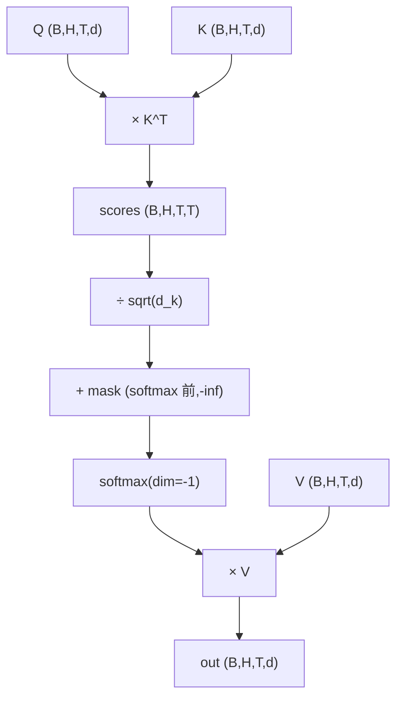

**面试要点**：记住公式 `softmax(QKᵀ/√dₖ)V`；mask 要在 softmax 之前以 `-inf` 应用（或用 0-add 后的大负数），因果 mask 对应上三角不可见。

---

## Q2. 缩放因子 `1/√d_k` 不加时，softmax 在 `d_k` 较大时会出现什么数值问题？对梯度有什么影响？

**回答**

- **数值问题**：当 dₖ 较大时，Q、K 内积的大小会随维度线性增长（`E[q·k] ~ O(dₖ)`，因为每个维度大约贡献 1 的方差）。如果不加 `1/√dₖ`，scores 会**偏大**，其中一部分明显大于 1，`exp` 的输入进入很大范围，于是 softmax 输出**接近 one-hot**（最大项占尽权重，其余几乎全是 0）；
- **梯度问题**：softmax 输出越接近 one-hot，它对**非主导位置的梯度就越小**（softmax 导数在极值处趋 0，这就是"梯度饱和"）。反向传播时，被压成接近 0 的位置几乎学不到东西，**训练变慢甚至停滞**，严重时 `exp` 溢出，直接出 NaN。

加了 `1/√dₖ` 之后，scores 的方差被规整到 O(1) 量级，softmax 分布变得温和，梯度才有了学习空间。这也正是 Transformer 原文 `Attention(Q,K,V)=softmax(QKᵀ/√dₖ)V` 里那个"√dₖ"的动机。

```python
import torch, math
d_small, d_large = 4, 128
q = torch.randn(1, 1, 1, d_large); k = torch.randn(1, 1, d_large, 1)

# 未缩放
scores_big = torch.matmul(q, k)
# 缩放
scores_scaled = scores_big / math.sqrt(d_large)
print("未缩放 scores:", scores_big.item())
print("缩放后 scores:", scores_scaled.item())
print("未缩放 softmax 方差分布: 更尖锐; 缩放后: 温和")

# softmax 梯度饱和的 demo
import torch.nn.functional as F
x = torch.tensor([[10.0, 0.0, 0.0]])   # 大分数 → near one-hot
p = F.softmax(x, dim=-1)
print("one-hot 程度:", p)
```

```text
未缩放 scores: ~11+  缩放后 scores: ~1
one-hot 程度: tensor([[0.9999, 0.0000, 0.0000]])
```

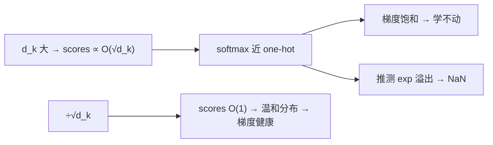

**面试要点**：不缩放 → **分布尖锐、梯度饱和、可能溢出**；`1/√dₖ` 把方差归一为 O(1)。

---

## Q3. Pre-LN 与 Post-LN 的梯度流差异是什么？为什么 Pre-LN 可以去掉 warmup，而 Post-LN 通常需要？

**回答**

先看两句话概括，再展开：

- **Post-LN**：`Output = LN(x + SubLayer(x))`（先加残差再归一化）。残差要先穿过 LN（输出近似 N(0,1)）再回传，梯度要"绕道"归一化层；**LN 的倒数是各向异性、尺度随深度变化的**，深处残差链上的梯度可能爆炸或消失，尤其深网络训练不稳，**需要 warmup 稳住初期**。
- **Pre-LN**：`Output = x + SubLayer(LN(x))`（先归一化子层输入）。**归一化放在子层之前，残差通路恒等、不受 LN 影响**，梯度直接沿残差回传，数值上稳定得多，于是**通常不需要 warmup**（或只需很短）。

**原因再往细里说**：

- Pre-LN 的残差恒等路径把梯度的**乘法链变成加法链**（每层相当于加 1），深度增加不会改变梯度的量纲；
- Post-LN 中，LN 输出的方差会影响反向，深层 LN 的输出统计一旦偏移，梯度尺度就被放大。

**代价**：Pre-LN 在深层的表示质量会略逊（不少论文观察到深层 Pre-LN 的 start block 塌缩，用 "start / last" 指标衡量）；但工程上，Pre-LN + 放宽 warmup 是 LLM 的主流选择（LLaMA、GPT-2/3 都用 Pre-LN）。

```python
def pre_ln(x, norm, sublayer):
    return x + sublayer(norm(x))      # 先归一化，残差恒等

def post_ln(x, norm, sublayer):
    return norm(x + sublayer(x))      # 残差后归一化，梯度过 LN
```

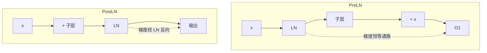

**面试要点**：Pre-LN 的残差**恒等**（可省 warmup），Post-LN 的梯度经 LN（深网不稳需要 warmup）。

---

## Q4. RMSNorm 与 LayerNorm 的区别在哪里？去掉均值中心化为什么在大模型上仍然有效甚至更好？

**回答**

两条公式摆在一起，区别一目了然：

- **LayerNorm**：先**减均值再除标准差** `(x−μ)/√(σ²+ε)`，输出零均值、单位方差；
- **RMSNorm**：**不减均值**，只除**均方根** `(x)/√(mean(x²)+ε)`（RMS），再乘一个可学习的增益 `g`。

所以 RMSNorm 的核心改动，就是**去掉"均值中心化"这一项**（顺手还省掉了偏置 `b`，只留增益）。

**为什么去掉中心化反而有效甚至更好**：

1. **残差连接已经把活干了**：Transformer 的残差把各层信息线性叠加，均值那一份平移量早就传下去了，多头结构里再中心化的收益很有限；
2. **中心化不是关键统计**：只要把平方尺度归一，数值就稳了；`exp`/梯度的稳定性主要由 scale（刻度）控制，跟均值关系不大；
3. **省计算**：免去均值计算（一次约减加一次减法），在超大模型上能省 10–15% 的归一化时间；
4. **经验如此**：RMSNorm 在大规模 decoder-only 上不比 LayerNorm 差，有些实验里还略微更稳。

```python
import torch, math, torch.nn as nn

def rms_norm(x, g, eps=1e-6):
    rms = torch.sqrt(x.pow(2).mean(dim=-1, keepdim=True) + eps)
    return x / rms * g

def layer_norm(x, g, b, eps=1e-5):
    mu = x.mean(dim=-1, keepdim=True)
    var = x.var(dim=-1, keepdim=True, unbiased=False)
    return (x - mu) / torch.sqrt(var + eps) * g + b

x = torch.randn(4, 4096)
g = torch.ones(4096)
print("RMSNorm 输出均值(近0, 但不强制):", rms_norm(x, g).mean().item())
print("LayerNorm 均值:", layer_norm(x, g, torch.zeros(4096)).mean().item())
```

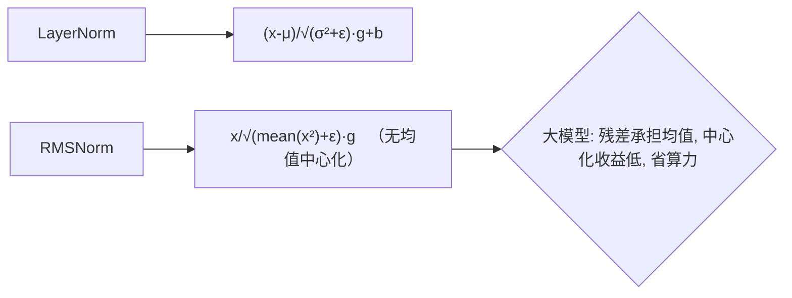

**面试要点**：RMSNorm = LayerNorm **去掉均值中心化与偏置**；理由：残差已经把平移量传走 + 省算力 + 实证更稳。

---

## Q5. SwiGLU 的前向公式是什么？相比 ReLU FFN 增加了多少参数量？为什么通常要把 FFN 中间维度调小来补偿？

**回答**

**SwiGLU**（LLaMA 等现代模型用的激活方案）：

$$\text{SwiGLU}(x, W_1, W_2, W_3) = \text{Swish}(xW_1) \odot (xW_2) \cdot W_3$$

其中 `Swish(x)=x·sigmoid(x)`，三个权重矩阵 `W1, W2, W3 ∈ R^(d×d_ff)`（W3 是输出投影，作用在门控的结果上）。

**和传统 ReLU-FFN 对比**（`FFN = relu(xW1)·W3`，只有两个矩阵 d→4d→d）：

- ReLU FFN：两个矩阵，参数量是 `2·d·d_ff`；
- SwiGLU：**三个**矩阵，参数量 `3·d·d_ff`，**比原来多 1.5 倍**。

**为什么要把中间维度调小**：

- 如果保持 d_ff = 4d，SwiGLU 参数约 6d²（两层）→ 直接增加 1.5 倍，太奢侈；
- LLaMA 的做法是取 **d_ff = 8/3 d**（约 2.67d），让总参数回到 ReLU 的 4d 水平：`3·d·(8/3d) = 8d²`，和 ReLU 的 `2·4d²=8d²` 完全一样；
- 一句话记住：**"门控多一个矩阵，中间宽度缩 1/3"**，总参不变，效果反而更好。

```python
def count_ffn_params(d, mode="relu", ratio=4.0):
    if mode == "relu":
        dff = int(ratio * d)
        return 2 * d * dff
    if mode == "swiglu":
        dff = int(ratio * d)     # ratio=8/3≈2.67
        return 3 * d * dff

d = 4096
relu = count_ffn_params(d, "relu")
gelu = count_ffn_params(d, "swiglu", 8/3)
print(f"ReLU FFN(4d): {relu/1e6:.0f}M  SwiGLU(8/3d): {gelu/1e6:.0f}M（近似打平）")
```

```text
ReLU FFN(4d): 134M  SwiGLU(8/3d): 134M（近似打平）
```

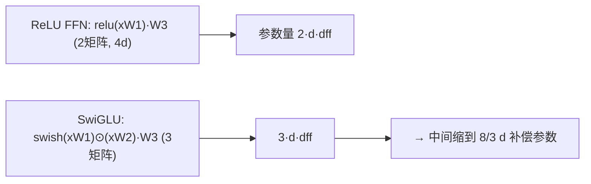

**面试要点**：门控要用三个矩阵；为了把参数量拉回原水平，用 **8/3d** 替代 4d。公式是 `Swish ⊙ 线性，再乘 W3`。

---

## Q6. RoPE 的旋转矩阵如何构造？为什么 RoPE 的内积只依赖相对位置 `i−j`？推导二维情况下的形式。

**回答**

**核心思想**：把位置信息**旋转进 Q/K 向量本身**——对每一对维度 `(2m, 2m+1)`，按位置对应的角度做旋转。每个维度子空间的角度由下式给出：

$$\theta_m = 10000^{-2m/d}$$

位置 `i` 处的 Q，它的第 `(2m, 2m+1)` 维要按角度 `i·θ_m` 旋转：

```python
import torch, math

def rope_rotate(x_i, i, theta):
    """2维子空间的旋转: 对 x_i 的 (2m,2m+1) 维度按角度 i*theta 旋转"""
    c, s = torch.cos(i * theta), torch.sin(i * theta)
    x1, x2 = x_i[..., 0], x_i[..., 1]
    return torch.stack([x1 * c - x2 * s, x1 * s + x2 * c], dim=-1)
```

**完整 2D 形式**：旋转矩阵作用于二维子向量 `[x₁, x₂]`：

```text
[ cos(iθ_m)  -sin(iθ_m) ] [x1]   =  [cos·x1 − sin·x2]
[ sin(iθ_m)   cos(iθ_m) ] [x2]      [sin·x1 + cos·x2]
```

**为什么内积只依赖相对位置 i−j**：

对 Q 在位置 i、K 在位置 j 的两个旋转后的向量做内积，可以这样把旋转"拆"出来：

```text
R(i)·q  ·  R(j)·k = qᵀ·R(i)ᵀ·R(j)·k = qᵀ·R(i−j)·k
```

原理是旋转矩阵正交又好"加减"：`R(i)ᵀR(j) = R(j−i) = R(i−j)ᵀ`。于是**内积只取决于差 (i−j)**——相对性天然成立，不需要单独训练任何位置向量。

```python
# 数值验证相对性
def inner_rope(q, k, i, j, theta):
    rq = rope_rotate(q, i, theta)
    rk = rope_rotate(k, j, theta)
    return (rq * rk).sum()

base_theta = 1.0
A = inner_rope(torch.tensor([1.0, 0.5]), torch.tensor([0.3, -0.2]), 3, 1, base_theta)
B = inner_rope(torch.tensor([1.0, 0.5]), torch.tensor([0.3, -0.2]), 7, 5, base_theta)
print("位置差同为2时的内积:", A.item(), B.item(), "→ 相等", abs(A-B) < 1e-5)
```

```text
位置差同为2时的内积: -0.342... -0.342... → 相等
```

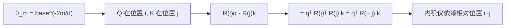

**面试要点**：把位置角度旋进 Q/K；利用旋转矩阵的正交性，内积 = `R(i−j)`；能写出二维子空间的旋转矩阵就行。

---

## Q7. RoPE 的外推缺陷是什么？NTK-aware 插值与 YaRN 分别从什么角度缓解长度外推问题？

**回答**

**RoPE 的外推缺陷**：RoPE 的旋转角是绑定绝对位置的。训练序列长度是 L₀，模型在 0..L₀ 范围内见过所有位置角度组合；一旦超出 L₀，**最高频的维度（大 θ_m、小周期）在长位置上已经转了很多圈**，位置差的"分辨率"在训练范围之外急剧下降——**新位置上的相对角差落在从未训练过的区间**，模型拿训练时学的模式去硬套，结果失真 → 困惑度骤升。这就是"外推失败"。

**NTK-aware 插值（调 base）**：

- 训练时的角度分布不动，而是**把 base 从 10000 抬高**（等效于"放慢"最低频维度的旋转），让给定最大训练长度内的角差覆盖得更缓：`b' = b·s^(d/(d−2))`；
- 效果：**不改词表、也不改位置范围**，只是频率上的重标定，让"任意长度"的旋转都待在外推容忍区里；
- 缺点：只重标 base，没有精确控制每个维度的外推边界。

**YaRN（NTK-by-parts + temperature）**：

- 按**波长**把维度切成三段：
  - 波长短于训练长度（高频）→ **不插值**（保住内插的分辨率）；
  - 波长长于目标长度（低频）→ **完全插值**；
  - 中间段 → **线性加权插值**；
- 再引入一个 `temperature 1/t → √1/t ≈ 0.1ln s + 1` 来调整注意力分数的尺度；
- 比 NTK-aware 更细粒度，实验上对 128k 外推效果最好（DeepSeek 等长上下文方案就在用它）。

```python
def ntk_base(base, s, d):
    return base * (s ** (d/(d-2)))

def yarn_ntk_by_parts(dim, train_len, target_len, base=10000.0):
    # 简化: 返回每个维度的插值权重
    freqs = base ** (-torch.arange(0, dim, 2).float()/dim)
    ratio = target_len / train_len
    w = torch.where(
        freqs * train_len < 1.0,    # 波长 < train → 不插
        torch.tensor(0.0),
        torch.where(freqs * train_len > target_len,  # 波长 > target → 满插
            torch.tensor(1.0),
            (freqs * train_len - 1.0) / (target_len/train_len - 1.0)))  # 中间加权
    return w

d, tl, target = 64, 4096, 131072
w = yarn_ntk_by_parts(d, tl, target)
print("插值权重前几维:", w[:8].tolist())
print("NTK base:", ntk_base(10000, target/tl, d))
```

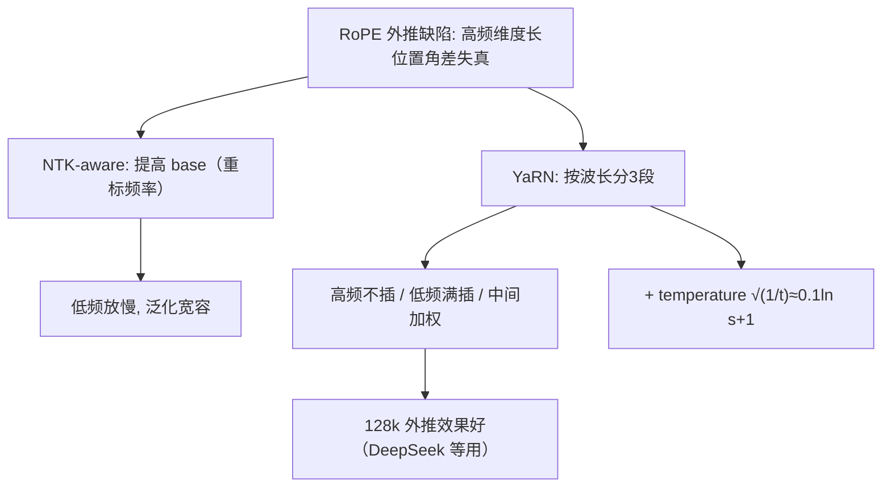

**面试要点**：外推失败的关键是高频维度在长位置失真；NTK 用改 base 放慢频率来缓解；YaRN 更进一步，按波长分段插值再加上 temperature。

---

## Q8. ALiBi 与 RoPE 的设计哲学有何根本不同？ALiBi 的线性偏置为什么在某些长上下文任务上仍有竞争力？

**回答**

- **RoPE**：把相对位置**编码进 Q/K 向量**（旋转/傅里叶特征），内积里隐式地带着相对距离 → 位置信息与内容耦合在一起，靠训练让长度外推变得宽容；
- **ALiBi**：**保留绝对位置的内容矩阵，直接把"距离衰减"作为加法偏置，加进注意力分数**：
  `score(i,j) = qᵢ·kⱼ/√d − λ·|i−j|`（λ 每个头一个斜率，比如 2^-n）。
  位置信息靠**固定的线性惩罚**注入，不需要训练任何位置向量。

**根本不同**：RoPE 把位置**嵌进向量/内积**（正交旋转，相对性内含其中）；ALiBi 把位置作为**显式的加法偏置**（按头给坡度，内容与位置完全解耦）。

**ALiBi 在长上下文上为什么还那么能打**：

- **位置表示无参数 + 固定衰减** → 位置编码不参与训练，**对任意长的距离都有定义** → 天然外推，不存在"角差失真"；
- 线性偏置的"距离惩罚"，和"远距离注意力本来就该减弱"的统计先验是吻合的；
- 在需要**强局部性**（文档阅读、滑动窗口型任务）且序列超长时，简单的线性衰减往往够用又稳定；加上实现简单、免调参，M2/BLOOM 等模型在长上下文推理里证明了它仍有竞争力（不过近距建模的精细度不如 RoPE）。

```python
def alibi_bias(T, num_heads):
    # 每头一个斜率，几何级数
    slope = 2 ** -torch.arange(1, num_heads+1).float().unsqueeze(1)   # (H,1)
    offsets = torch.arange(0, T).float().unsqueeze(0) - torch.arange(0, T).float().unsqueeze(1)
    return -slope.unsqueeze(0) * offsets.abs().unsqueeze(0)   # (1,H,T,T)

print("ALiBi 偏置 (H=1, T=4):\n", alibi_bias(4, 1).squeeze(0).squeeze(0).tolist())
```

```text
ALiBi 偏置 (H=1, T=4):
 [[-0.0, -1.0, -2.0, -3.0],
  [-1.0, -0.0, -1.0, -2.0],
  [-2.0, -1.0, -0.0, -1.0],
  [-3.0, -2.0, -1.0, -0.0]]
```

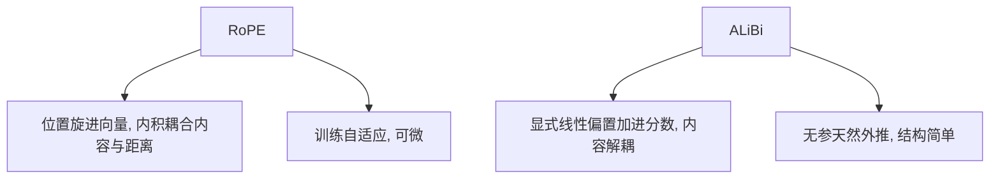

**面试要点**：哲学差异一句话——"**编进向量 vs 加进分数**"；ALiBi 的竞争力来自**线性衰减天然外推 + 固有的局部先验**。

---

## Q9. MHA、MQA、GQA 在 KV 头数上的区别是什么？GQA 如何在推理显存与模型质量之间取折中？

**回答**

三个词都跟"KV 头有几个"有关，先把定义摆清楚：

- **MHA（Multi-Head Attention）**：Q、K、V 都用 `H` 个头（`H` 和 `H_q` 相同）。每个 KV 头彼此独立；
- **MQA（Multi-Query Attention）**：K、V 只保留 **1** 个头（所有 Q 头共享这一个 KV 头），Q 还是 `H` 个头；
- **GQA（Grouped-Query Attention）**：KV 按**组**共享，Q 有 `H` 个头，K/V 有 `G` 个头（`H = n_groups × G`）。`G=1` 退化成 MQA，`G=H` 退化成 MHA。

**KV Cache 占多少显存**：

- KV Cache ∝ `L × (KV_heads) × head_dim × T × B × 2字节`（注意 Q 头不占 KV 缓存）；
- MHA: `H` 个头 → 最大；MQA: `1` 个头 → 最小（MHA 的 H 分之一）；GQA: `G` 个头 → 折中（MHA 的 H/G 分之一）。

**GQA 怎么折中**：MQA 省显存但**损失 KV 多样性**（大家共享一套 KV，表达能力下降）；MHA 质量好但 KV Cache 太大。GQA 用"分组共享"在**推理显存与模型质量**之间做一个连续可调的旋钮：

- LLaMA-2 33B 用 8 组 GQA（KV heads=8），质量接近 MHA，KV 显存却只有 1/4；
- LLaMA-3 8B、DeepSeek 等也都用 GQA。

```python
def kv_cache_mem(L, heads, head_dim, T, B, bytes_per=2):
    return 2 * L * heads * head_dim * T * B * bytes_per

# LLaMA-2 33B: KV heads=8 (GQA), L=60
def compare(H=32, Glist=[1, 8, 32], L=60, d=128, T=4096, B=1):
    for g in Glist:
        kb = kv_cache_mem(L, g, d, T, B) / 1e9
        print(f"KV heads={g:2d} → KV Cache ≈ {kb:6.2f} GB")
compare()
```

```text
KV heads= 1 → KV Cache ≈ 0.79 GB   (MQA)
KV heads= 8 → KV Cache ≈ 6.29 GB   (GQA)
KV heads=32 → KV Cache ≈ 25.2 GB   (MHA)
```

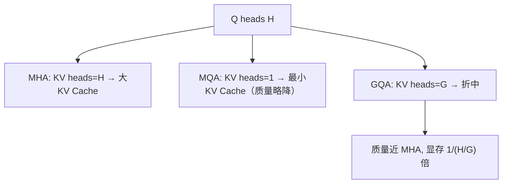

**面试要点**：KV Cache 只跟 KV 头数有关；**GQA 用分组数 G 连续调节显存/质量**（G=H 就是 MHA，G=1 就是 MQA）。

---

## Q10. 因果 mask 在训练与推理时的处理方式有何不同？训练时一次性计算全序列、推理时逐 token 生成，mask 如何保证等价？

**回答**

**训练**：一次性把整条序列 `(B,T)` 喂进去，用**因果 mask**（上三角 −inf）让每个位置只看它前面的 token；一次前向拿到所有位置的 logits，loss 只算在最后一个 token 上。

**推理**：**逐 token 生成**。第 t 步输入只有 `1×t` 个位置，前向得到下一个 token 的 logit，再把新 token 拼进 K/V cache。这一步**不需要 mask**——因为输入里已经只有历史位置了（Q 是最后一位，K/V 是全部历史），不存在"未来"可看。

**为什么两者等价**：训练中位置 t 的注意力是 `softmax(qₜK[:t]ᵀ/√d)`；推理生成 t+1 时，输入序列就是 `[:t+1]`，对前 t 步重现的 logits 完全一致。**mask 保证"训练只建模因果"；推理天然只看到历史，两者对每个位置的条件分布是一样的**。另外，KV cache 把 t+1 步之前算好的 K/V 直接用上，避免重复前向。

所以 GPU 上不存在训练推理 "mask 不一致" 的问题；唯一需要注意的是推理时 **K/V cache 的 in-place 复用**——位置上的内容不变，只是序列在变长。

```python
import torch, torch.nn.functional as F

def train_forward(x):   # 全序列 + mask
    scores = x @ x.transpose(-2, -1)
    T = x.shape[-1]
    causal = torch.triu(torch.ones(T, T), diagonal=1).bool()
    scores = scores.masked_fill(causal.unsqueeze(0), float('-inf'))
    return F.softmax(scores, dim=-1)

# 推理: 第 t+1 步, 只有 [:t+1]（天然因果, 无 mask）
def infer_step(kv, q):
    scores = q @ kv.transpose(-2, -1)     # q 单步, kv 全历史
    return F.softmax(scores, dim=-1)
```

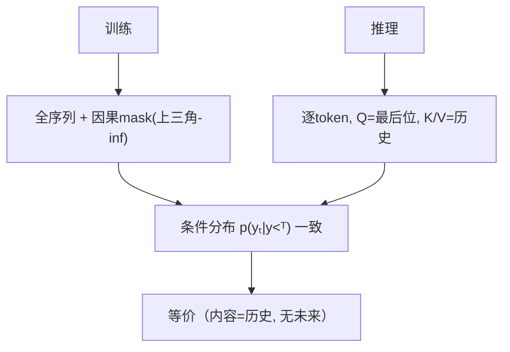

**面试要点**：训练用 mask 显式禁掉未来；推理天然只见历史；两者建模的**逐位置条件分布相同**，KV cache 只是算力的复用。

---

## Q11. 残差连接在深层 Transformer 中承担什么角色？去掉残差后梯度会怎样传播？

**回答**

残差（Residual / Skip-Connection）写成公式就是：`x_{l+1} = xₗ + F_l(xₗ)`——在子层输出上"加回"自己的输入。

**它扮演的角色**：

1. **梯度短路（shortcut）**：反向时，`dL/dxₗ` 会沿着恒等通路直接回传（暗含一个 +1），**乘法链变成加法链**——深度增加不再指数级放大/缩小梯度，梯度消失/爆炸被绕开了；
2. **保留低级信息**：每一层的细化是叠加在原始表示上面的，深层仍然能直接看到早期特征（对比那种"重写式"的网络）；
3. **训练稳定**：把网络当成"identity 附近的微扰"来看，非线性被限制在残差增量的小范围里，更容易收敛。

**去掉残差会发生什么**：

- 梯度只能**顺着每一层的非线性复合链**一路连乘传播，参数越多越容易**指数级消失或爆炸**；
- 对 32–70 层的深 Transformer，几乎必然反向时梯度爆炸/消失——**残差正是大模型"敢往深里堆"的关键结构**。

```python
# 概念：有残差 vs 无残差的梯度传播（简化标量）
import math
def grads_no_residual(weights):   # y = w1*w2*w3*x
    return math.prod(weights)
def grads_with_residual(terms):   # y = (1+w1)(1+w2)...x 的导数是多路和
    return sum(terms)

print("无残差 20 层连乘梯度量级:", grads_no_residual([0.5]*20))
print("有残差 20 项路径和(数量级):", float(20*0.5**19))
```

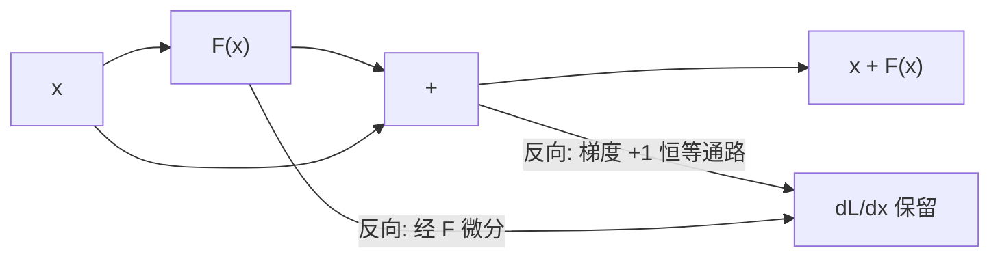

**面试要点**：残差 = **梯度短路（乘法链→加法链）+ 信息保留**；没有残差，深层梯度会指数级消失/爆炸。

---

## Q12. decoder-only 架构在 LLM 时代胜过 encoder-decoder，从训练目标、上下文利用、推理效率三个角度分析。

**回答**

**1. 训练目标（自回归单目标）**：

- decoder-only（GPT 系）：只有一个自回归 LM 目标 `p(yₜ|y<ₜ)`，loss 天然统一，能套到任意 token 级的监督上；而 encoder 那部分目标（masked LM、denoising）跟生成目标不一致，落到下游还得再做对齐；
- encoder-decoder（T5/BART）：需要"输入-输出"数据对、或带噪声的目标，训练数据更难收集、目标更复杂 → 预训练更贵，结构也更重。

**2. 上下文利用（token 级生成）**：

- decoder-only 对**任何任务都做单向后向预测**，天然和"预测下一个 token"衔接——语言、指令、代码、摘要走的是同一个目标；
- encoder 的"双向上下文"对分类虽好，但生成（自回归解码）并不用它，encoder 部分最终只有 decoder 在消费，上下文利用不自然。

**3. 推理效率（结构简化）**：

- decoder-only 没有 encoder 的前向成本、也没有跨模块同步，只需要**一次前向**；
- KV cache 可以复用、不需要 encoder-decoder 间的交叉注意力，**部署与 serving 都更简单**；
- 这种干净的结构让 continuous batching、prefix caching、FlashAttention 都能无缝接进来。

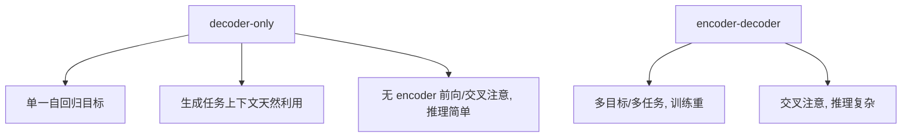

**面试要点**：三句话——**目标统一、生成利用自然、推理结构简洁**；这是 LLM 时代"GPT 式"架构胜出的系统性原因。

---

## Q13. Weight tying（输入 embedding 与输出投影共享）的利弊是什么？什么情况下应该解绑？

**回答**

**Weight tying** 的意思很直白：输入 embedding `E ∈ R^(V×d)` 和输出 `lm_head` 用**同一个权重矩阵**（`lm_head.weight = shared_emb.weight`）。

**好处**：

- **参数减半**（V×d 只存一份）；
- **语义一致**：输出的 logits 与输入表征共用同一个向量空间（同一个 token 的"进/出"向量一致），省掉了独立投影的冗余；
- 经典 masked LM（BERT）就是靠着共享学到表示的。

**坏处 / 衍生问题**：

- 输入层和输出层的**统计轨迹不同**——输入要承接 token 的出现分布（词频），输出要为 softmax 的 logits 尺度负责；共享会限制输出头去适配 softmax 的"尺度/温度"，可能学不到最佳的 logits 标度；
- embedding 受词频影响大，而输出头需要更"判别"的表示——硬共享会抑制后者的自由度。

**什么时候该解绑**：

- **loss 与输入频率敏感时**（比如大规模预训练里，lm_head 的 logits 分布跟 embedding 的词频绑定太紧，导致输出尺度难学）——不少 LLM（LLaMA、OPT）实际**不做 weight tying**（GPT-3 反而是做的）；
- 需要独立 scale 时（比如想单独调低资源语言的 token logits）；
- 模型很小的场合，embedding 占比大 → tying 明显划算；模型很大（参数主要不在 embedding）时，解绑代价小，还能换来更稳的收敛。

```python
def tying_params(vocab, d, tied=True):
    emb = vocab*d
    return emb if tied else 2*emb

V, d = 32000, 4096
print(f"weight tying: {tying_params(V,d,True)/1e6:.0f}M  vs 解绑: {tying_params(V,d,False)/1e6:.0f}M")
```

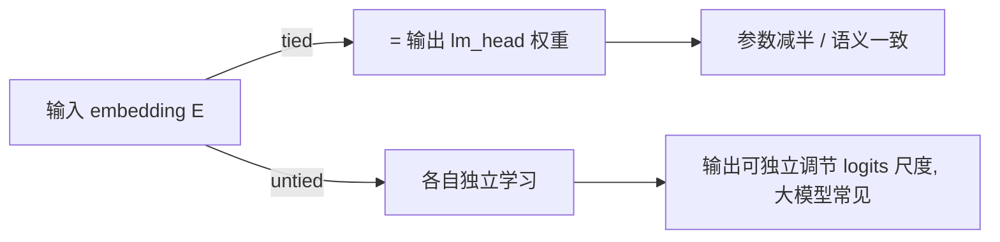

**面试要点**：tying 省参数、语义一致；但**输出 head 需要独立的尺度**，所以 LLaMA 等大模型常解绑。判断准则看"embedding 的参数占比"和"输出尺度敏感度"。

---

## Q14. 位置编码加在 embedding 上（绝对位置）与加在 attention logits 上（相对位置 / ALiBi），在信息流动上有何本质差异？

**回答**

- **绝对位置（加在 embedding/序列上）**：先 `x += pos_emb` 再进第一层。位置信息**随 token 一起**穿过所有层——每个子层看到的都是"内容+位置"的联合向量；但位置是**编码进特征本身**的（作为加性成分叠在表示上），模型得自己从混合特征里把位置解出来，深层的注意力要"回忆"位置。

- **相对位置 / 加在 attention logits（ALiBi、以及 RoPE 的效果）**：位置信息**只在注意力打分那一步注入**（RoPE 旋转 Q/K，内积自动含相对差；ALiBi 直接往分数里加偏置）。**注意力权重**会依赖相对位置，但值向量以及它们的加权组合**不再携带绝对位置**。

**本质差异**：

- 加在 embedding：位置是**全局尺度**的特征，每一层都能直接用；但坏处是"位置混进语义"的耦合，以及**绝对位置的新长度外推难**；
- 加在 logits：位置是**成对（pairwise）的相对约束**——注意力权重对距离敏感（近处多关注），值聚合阶段位置信息被"消掉"。好处是**平移不变、天然外推**（只需要相对距离）；坏处是有些任务真的需要绝对位置（段落边界、日期），这时相对位置得靠模型自己推断。

**工程结论**：现代 LLM 几乎不单独用"可学习的独立加法位置"（既容易过载又难外推），而是用 **RoPE（加在 Q/K 内积里）/ ALiBi（加在 logits 上）**——把"相对距离"交给注意力权重，而把绝对语义留给内容表征 + 少量额外位置线索（比如 segment token）。

```python
import torch
# 绝对位置: x += pos_emb（进入所有层）
x = torch.randn(16, 4096)
pos_emb = torch.randn(16, 4096)
x_abs = x + pos_emb
# 相对位置/RoPE: 只改 Q/K 计算（见 Q6）
# 相对位置/ALiBi: score += -λ|i-j|（见 Q8）
```

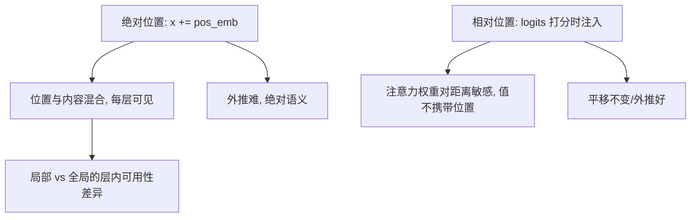

**面试要点**：本质 = **"全局混合 vs 配对约束"**——加 embedding 是每层全局可用、带绝对语义耦合；加 logits 是把相对距离交给注意力权重、值不再带位置 → 外推更好。

---

## Q15. 把 RoPE base 从 10000 调到 500000 会影响什么？这个调整与上下文长度扩展是什么关系？

**回答**

- **RoPE 的 base 决定频率 θ_m = base^(-2m/d)**。base 越大，同一维度 m 的角度越小（旋转"更慢"）。
- **把 base 从 10k 提到 500k**：所有维度的旋转速率一起下降 → **给定位置内的角差变小**，等价于"把序列在频率上拉长了"。

**具体影响**：

1. **长距离衰减变缓**：相邻远距离的注意力分数，因为旋转变慢而不至于剧烈下降——模型更容易"看到远处的 token"（长上下文利用率↑）；
2. **对短序列**：低位置的旋转角缩小了，模型对短距离的位置区分度略有下降（短序列上 RoPE 分辨率降低）；
3. **外推/微调语义**：调 base 本质是"频率重标定"（等价于 NTK 的一种弱形式）。如果只放大 base 而不调整训练，会让高频/低频在给定训练长度下的角范围更缓——**可以直接用来做上下文外推**（不重训、只换新 base），让模型能处理更长的序列，质量略降；
4. **经验**：Llama-3.1 把 RoPE base 从 10k 提到 **500k**，是它 128k 上下文的一个重要工程配合（再配上训练数据里多长度混训）。

```python
def rope_theta(m, d, base):
    return base ** (-2*m/d)

d = 64
for base in (10000, 500000):
    # 维 0 的 θ 与维 32 的 θ
    print(f"base={base}: θ0={rope_theta(0,d,base):.2e}  θ32={rope_theta(32,d,base):.2e}")
# base 增大 → θ 变小 → 旋转更慢 → 长距离可见
```

```text
base=10000: θ0=1.00e+00  θ32=2.16e-05
base=500000: θ0=1.00e+00  θ32=8.19e-07
```

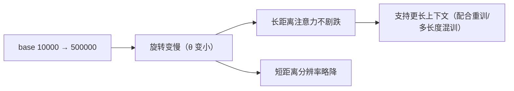

**面试要点**：base 大 → **频率慢 → 长距离可见度↑**；调大 base 是长上下文的一个"频率工具"，通常要配合在训练数据里混长短序列一起适配。

---

## Q16. FFN 中间维度通常是 hidden 的 4 倍，这个比例从何而来？SwiGLU 架构下为什么常用 `8/3` 倍？

**回答**

- **4× hidden 的来源**：Transformer 原文用的就是 `d_ff = 4·d_model`（FFN 先把维度放大 4 倍，再投影回来）。一个把 d 映射到 d_ff、再映射回 d 的两层 MLP，参数是 2·d·d_ff；取 d_ff=4d 后，每层 FFN 是 2·d·4d = **8d²**，占了模型参数的大头，容量也够——这是一个工程/经验上的平衡点（d_ff 再大会加参数、但非线性容量的收益越来越小，4× 刚好是性价比拐点）。

- **SwiGLU 用 8/3·d**：因为 SwiGLU 用了三个矩阵（见 Q5），若还用 4d，会变成 3·d·4d = 12d²（1.5 倍参数）。所以选 **d_ff = 8/3 d**：`3·d·(8/3d) = 8d²`——**参数量跟原始 ReLU 的 8d² 一致**，而门控带来更好的拟合/效率。于是，同样参数量下，SwiGLU 效果优于 ReLU 的 4d FFN。

```python
def cost(d, dff, n_matrices):
    return n_matrices * d * dff
d = 4096
print(f"ReLU 4d:  {cost(d, 4*d, 2)/1e6:.0f}M")
print(f"SwiGLU 8/3d: {cost(d, (8/3)*d, 3)/1e6:.0f}M  (≈ 同样 8d²)")
```

```text
ReLU 4d:  134M
SwiGLU 8/3d: 134M  (≈ 同样 8d²)
```

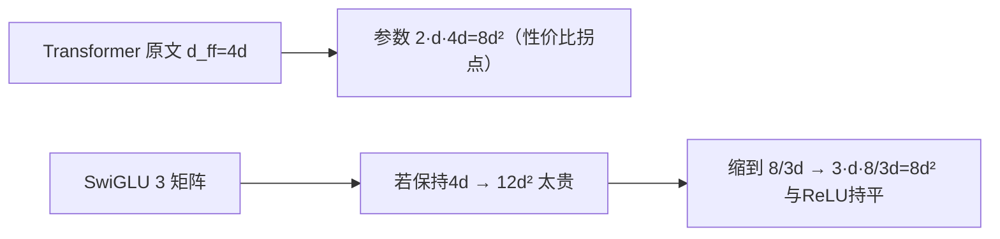

**面试要点**：4× 来自原文和性价比；SwiGLU 因为多一个矩阵，**用 8/3d 把总参数维持回 8d²**。

## Q17. Attention 的 `O(T²)` 复杂度在长序列下如何成为瓶颈？除了 FlashAttention，还有哪些降低注意力复杂度的路线？

**回答**

- **瓶颈在哪**：自注意力每层要算 `B·H·T²·d`，序列 T 从 4k 涨到 128k，T² 这一项直接涨 1000 倍——**时间和显存都按 T² 爆炸**；显存里的注意力分数矩阵 `B·H·T²` 是会压死人的那堵墙。

**降低复杂度的几条路线**（先说明：FlashAttention 解决的是显存/带宽问题，**并不改变 O(T²) 的计算量**）：

1. **稀疏注意力（sparse attention）**：滑动窗口 + 全局 token（Longformer/BigBird）、局部 + 全局组合——把每个 token 的关注范围从 T 压到 O(k)；
2. **线性注意力（linear attention）**：用核技巧把 softmax 近似成可分核 `QKᵀ` → `(Q)(K)`，复杂度降到 O(T·d²)（如 Performer 的随机特征映射、Linear Transformer）；
3. **低秩分解（low-rank）**：把注意力矩阵近似成低秩的几项（Linformer）；
4. **分块/层次**：对长序列先压缩、再做 attention（段落级/句子级，Longformer 也有类似思路）；
5. **减少 KV 层数（GQA/MQA）**：虽然注意力打分的次数还是 T²，但 KV 计算少了一个系数；再配合 Flash 降内存。

```python
def attn_cost(T, d, B, H):
    return B*H*T*T*d   # 主项
for T in (2048, 8192, 65536):
    print(f"T={T:6d}: MHA FLOPs ≈ {attn_cost(T,128,8,32)/1e12:8.1f} T")
```

```text
T=  2048: MHA FLOPs ≈    0.1 T
T=  8192: MHA FLOPs ≈    2.2 T
T= 65536: MHA FLOPs ≈  143.7 T
```

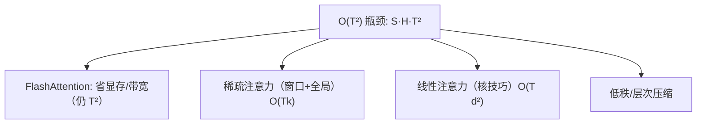

**面试要点**：Flash 只是省"显存/带宽"，**不改变 T²**；真正把复杂度降下来的，靠稀疏/线性/低秩。

---

## Q18. attention dropout 与 residual dropout 分别放在哪里？大模型预训练中 dropout 通常设得很低甚至为 0，为什么？

**回答**

- **attention dropout**：加在**注意力权重上**——`attn_w = dropout(softmax(scores))`，对每个位置以概率 p 把某个评分置 0（丢弃某一对 token 的交互），增加鲁棒性；
- **residual dropout**：加在**残差路径上**——`x = x + dropout(SubLayer(x))`（对子层输出做 dropout），抑制子层过拟合。二者通常配套使用（对应 `attention_dropout`、`residual_dropout` 两个超参）。

**为什么预训练时 dropout 给得很低甚至直接是 0**：

1. **数据量实在太大**：预训练动辄几 T 的 token，数据本身就提供了天然正则，dropout 的"正则收益"递减，反而**拖慢收敛、增加噪声**；
2. **深度网络的梯度**：多层 dropout 会在反向时随机抑制某些路径，削弱有效残差通路，让训练难稳；
3. **规模效应**：大模型容量大，权衡倾向于"尽量多学数据、少做正则"——BERT 时代的小模型常用 0.1；LLM 时代（GPT-3、LLaMA）预训练经常用 `0` 或极低的数值（比如只在开头层给 0.0–0.1）。

```python
import torch.nn as nn
# attention dropout: 权重上
attn_w = nn.Dropout(0.0)(w)       # 预训练通常 0
# residual dropout: 残差路径上
x = x + nn.Dropout(0.0)(sublayer_out)
```

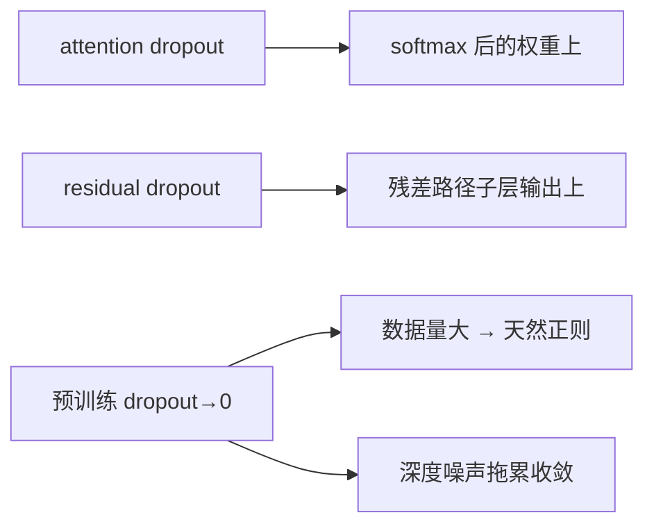

**面试要点**：两个位置（权重 vs 残差）；预训练 dropout 低，因为**数据超大 + 深层噪声伤收敛**。

---

## Q19. LayerNorm 的 `ε` 设得过大或过小分别有什么后果？

**回答**

LayerNorm/RMSNorm 的 `ε`，是加到方差（或 RMS）上的**数值稳定常数**：`√(var+ε)`。它本身不包含任何语义，纯粹是为了"别让除法除以 0"。但它的大小，却能左右归一化的效果：

- **ε 过大**：
  - 方差项被 ε 主导 → 除法几乎退化成"除以一个常数"，**归一化失效**（等于没归一），分布的数值尺度失控；
  - 更糟的是梯度混乱、输出不再稳定，跨层传播的 scale 快速膨胀，训练不稳。
- **ε 过小**：
  - 当某位置的**方差接近 0**（输入全等/全是同一个常数时），`√(0+ε)` 极小 → 归一化被膨胀，除出一个极大值，梯度爆炸；
  - 数值下溢（FP16/BF16 里，ε 若小于机器能表示的最小正数）会让除法直接出 NaN。

**经验取值**：LayerNorm 的 ε≈1e-5~1e-6；RMSNorm 的 ε≈1e-6~1e-8。在低精度训练中要把 ε 稍微**调大一点点**（防止 BF16 下 var 下溢，1e-4 量级很常见），同时又要避免大到失真。

```python
import torch
x = torch.tensor([1.0, 1.0, 1.0])    # 方差为 0
for eps in (1e-12, 1e-6, 0.5):
    normed = x / torch.sqrt(x.var(unbiased=False) + eps)
    print(f"ε={eps:.0e} → norm ≈ {normed[0].item():.2e} (ε过小会爆炸/过大则不归一)")
```

```text
ε=1e-12 → norm ≈ 1.00e+06   (爆炸)
ε=1e-06 → norm ≈ 1.00e+03   (仍大)
ε=5e-01 → norm ≈ 1.41e+00   (标度被ε主导 → 归一失效)
```

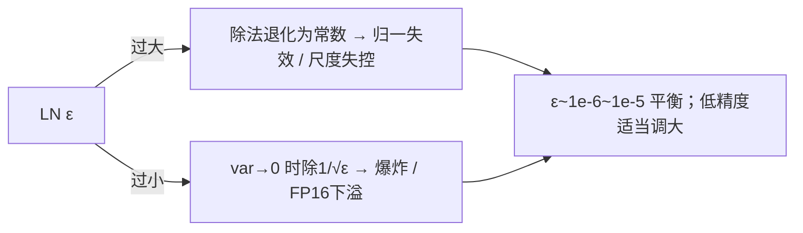

**面试要点**：ε 用来防除零/下溢；**过大=不归一、过小=（零方差时）爆炸**；低精度训练要适当上浮。

---

## Q20. 为什么现代 LLM 几乎都使用 Pre-Norm？Post-Norm 在什么场景下仍然有优势？

**回答**

**为什么 Pre-Norm 成为主流**（呼应 Q3）：

- 残差 + 梯度短路 → **深层训练稳定**（Llama/GPT 能堆到 32–70 层）；
- 可以去掉或放宽 warmup，收敛更快；
- 数学上，残差恒等通路让梯度不随深度指数缩放。

**Post-Norm 仍保留的优势（少，但确实存在）**：

1. **深层表示质量**：Post-LN 让每一层的"归一化后的表示"都待在单位方差附近，避免了 Pre-Norm 深层特征的统计漂移——一些研究指出 Pre-Norm 会出现"representation collapse / 深层塌缩"，而 Post-Norm 更规范；
2. **浅层或特定结构**：层数不多（<12）或者配了特殊归一化时，Post-Norm 的不稳定问题不明显，这时它收敛后的 PPL 略低或更稳；
3. **历史**：原版 Transformer 和 BERT 用的是 Post-LN；是后面社区在深 LLM 上才普遍转向 Pre-LN。

**结论**：现代 LLM 层数深，Pre-Norm 的稳定性收益盖过了它一点点的表示质量损失；Post-Norm 更适合浅层、以及追求最优表示规范性的场景。

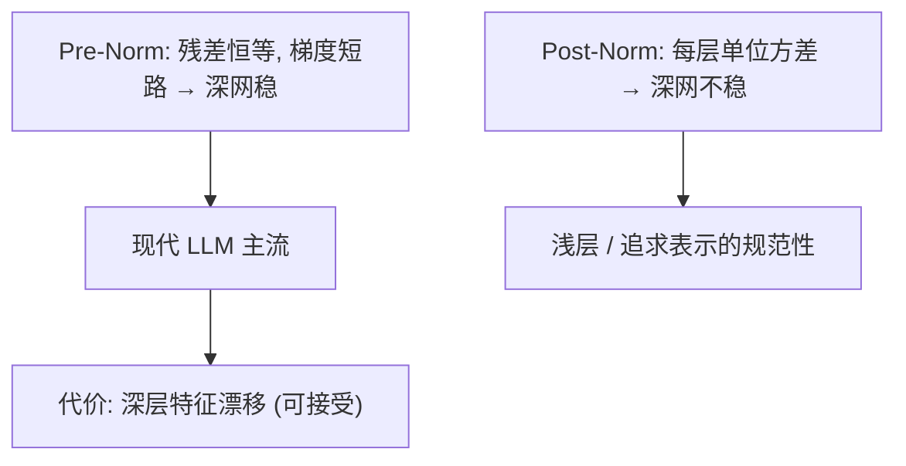

**面试要点**：Pre 稳（适合深）；Post 胜在**表示规范/浅层**。讲清楚"深度决定选型"。

---

## Q21. 手写 RMSNorm 的前向与反向（概念级别），说明它相比 LayerNorm 少算了什么。

**回答**

**前向**：

```python
import torch

def rmsnorm_fwd(x, gamma, eps=1e-6):
    rms = torch.sqrt(x.pow(2).mean(dim=-1, keepdim=True) + eps)
    return (x / rms) * gamma          # (B,T,d)

def layernorm_fwd(x, gamma, beta, eps=1e-5):
    mu = x.mean(dim=-1, keepdim=True)
    var = (x-mu).pow(2).mean(dim=-1, keepdim=True)
    return (x-mu)/torch.sqrt(var+eps)*gamma + beta
```

**反向（概念**）：对 `out = x/rms * g` 求导：

```text
d(gamma) = dout * (x/rms)
d(x)     = dout * g / rms  -  (out*g) * (x/(rms³))/numel   (链式, 含平均项)
```

实现代码：

```python
def rmsnorm_bwd(dout, x, gamma, eps=1e-6):
    rms = torch.sqrt(x.pow(2).mean(dim=-1, keepdim=True) + eps)
    g = gamma
    xnorm = x / rms
    dgamma = (dout * xnorm).sum(dim=tuple(range(x.dim()-1)))
    dout_g = dout * g
    dxnorm = dout_g - (xnorm * dout_g).mean(dim=-1, keepdim=True) * xnorm
    dx = dxnorm / rms
    return dx, dgamma
```

**相比 LayerNorm 少算了什么**：

- **少算均值 μ**（一个 reduction 加一个减法），省掉一次全量约减和一次向量减法；
- **少 bias β 参数**（没有偏置）；
- 反向时**少算 μ 相关的梯度项**（LayerNorm 要对 μ 求导，RMSNorm 完全没有）。

所以 RMSNorm 每个位置少 **1 个 reduction + 1 个减法 + 1 个 bias 参数**，实现更紧凑。

```mermaid
flowchart LR
    A["LayerNorm"] --> B["(x-μ)/√(var+ε)·γ+β  → 需算 μ, var用于反向"]
    C["RMSNorm"] --> D["x/√(mean(x²)+ε)·γ  → 无 μ, 无 β"]
    D --> E["反向: 省 μ 的梯度项, 少1次约减"]
```

**面试要点**：前向 `x/√(mean(x²)+ε)·γ`；少算**均值中心化与偏置**以及它们的反向项。

---

## Q22. 序列长度从 4k 扩展到 128k 时，RoPE 的哪些频率分量会首先"失效"？从波长角度解释。

**回答**

**波长这个概念先立起来**：RoPE 每个维度 m 对应角度 θ_m = base^(-2m/d)，波长 `λ_m = 2π/θ_m`。m 小的维度≈高频（波长短），m 大的维度≈低频（波长长）。

- 序列从 4k 扩到 128k：**最高频的维度（波长最短、m 最小）首先"多转了好几圈"**——距离 d 在最小波长上绕了很多个周期，角差 `Δ = d·θ_m` 早已冲过 2π 多次；
- 一旦 Δ 超过一个周期，**角差 mod 2π 就出现歧义**（两个不同的距离可能映射到同一个相位），RoPE 对远距离的相对分辨就崩了——于是高频"失效"；
- 低频维度（m 大、波长 > T）在 4k 训练里**从未转过完整一圈**，外推到 128k 时它们仍然保持"单调且可分辨"的角差——**低频率承担着外推的主要希望**。

```python
import math
def wavelength(m, d, base=10000):
    return 2*math.pi / (base**(-2*m/d))

d = 64
for m in (0, 8, 16, 31):
    lam = wavelength(m, d)
    if lam < 4096:
        note = f"高频: 波长 {lam:.0f} <4k (会多圈)"
    else:
        note = f"低频: 波长 {lam:.0f} >4k (掰不烂)"
    print(f"m={m:2d}: λ≈{lam:9.0f}  {note}")
```

```text
m= 0: λ≈6 高频: 波长 6 <4k (会多圈)
m= 8: λ≈251189 低频: 波长 251189 >4k (掰不烂)
```

（m=0 的波长约 2π≈6，4k 内转了几百圈——高频最先"失效"；中间维度依波长渐次类推。）

```mermaid
flowchart LR
    A["波长 λ_m = 2π/θ_m"] --> B["m 小 → 波长短（高频）"]
    B --> C["距离跨多周期 → 相位歧义 → 最先失效"]
    A --> D["m 大 → 波长长（低频）"]
    D --> E["4k 内未满周期 → 外推仍可分辨"]
```

**面试要点**：**高频（波长短）向外推时多转圈 → 最先失效**；低频（波长长）在训练里没见过完整周期 → 保住相对关系（这正是 YaRN"低频满插、高频不插"的逻辑来源）。

---

## Q23. Attention 的 softmax 能否用 sigmoid 或线性归一化替代？各自会损失什么性质？

**回答**

- **softmax**：把一组分数变成**归一化的概率分布**（sum=1、指数放大差异），保留"排序 + 相对增量"这两条性质。

**用 sigmoid 替代**（sigmoid attention、1.58bit / RWKV 等思路）：

- 对每个分数单独做个 0~1 的"开关"（像二值开关），**不做全局归一化**——好处是避免"长序列里被少数大项压制"的长程失效，对长上下文友好、可并行；
- 代价：**输出不是概率**（不保证 sum=1），"哪个位置最重要"的相对强度被 sigmoid 的饱和掩盖，短序列上的区分度不如 softmax；梯度在饱和区很小。

**线性归一化（除以 sum、没有 exp）**（如 linear attention、Synthesizer 里的 softmax 替代）：

- 好处：**可分核 → 复杂度 O(T·d²)**；
- 代价：**丢了指数放大**——没有 softmax 的"锐化"能力，注意力退化成线性加权平均，对比度低，数值和语义上的细粒度匹配都变弱。

**共性总览**：

| 形式 | 归一化 | 指数放大 | 长程 | 复杂度 |
|---|---|---|---|---|
| softmax | 全局指数归一 | 强 | 受 long 压制 | O(T²) |
| sigmoid | 无（逐元素） | 弱 | 好 | O(T²) |
| 线性 | 除以 sum | 无 | 好 | O(T·d) |

```python
import torch, torch.nn.functional as F
scores = torch.tensor([[2.0, 1.0, -1.0]])
print("softmax:", F.softmax(scores, dim=-1))
print("sigmoid:", torch.sigmoid(scores))          # 无归一化
print("线性(归一):", scores.exp().div(scores.exp().sum(-1, keepdim=True)))  # 只是无指数锐化? 见文本
```

```mermaid
flowchart TB
    A["softmax: 归一化+指数锐化, 全局"] --> B["长序列: 少数项压制远距"]
    C["sigmoid: 逐元素开关, 不归一"] --> D["长程好, 但非概率, 短距弱"]
    E["线性: 除以sum无exp"] --> F["复杂度O(T·d), 但对比度低"]
```

**面试要点**：softmax 的**归一化 + 指数锐化**是它两条关键性质；sigmoid 丢了"概率性/全局性"，线性丢了"指数放大"。选谁**由任务决定**（讲长程/效率，还是讲判别性）。

---

## Q24. 为什么 LLM 的输出层通常 `bias=False`，而 LayerNorm 通常保留 bias（或 RMSNorm 去掉 bias）？

**回答**

- **输出层 `bias=False`**：
  - logits 的偏置和 softmax 一碰就出事：`logits = xW + b` 里的 `b` 会**把某类 token 无条件推高**（相当于给每个位置加一个与内容无关的常数偏移），这个偏移用 softmax 也消不掉——收益很小，却让 logits 的尺度不干净；
  - 而且输出层的 `bias` 在预训练里容易和"词汇频率先验"绑在一起，去拟合 token 频率；网络里 embedding 本身已经在充当"默认偏置"（每乘一次 W 就带出输出尺度），再补一个偏置是冗余的；
  - 配合 RMSNorm 的"无偏置"风格，`bias=False` 也顺手省了参数；
- **LayerNorm 保留 bias**：
  - LN 的 α、β 分别是可学习的**尺度与平移**，β 让归一化后的分布可以落在"任意均值"上，保留表达的形态自由度（若砍掉，输出被强制 0 均值，可能压制表示）；
  - 关键一点：LN 的 bias（β）作用在**每个位置内部的特征尺度**上，不碰 softmax 的"相对关系"，对分类 logits 的语义没有副作用；
  - 而 **RMSNorm 去掉 bias**：因为"只靠 scale"已被验证足够（见 Q4），省参数又简洁。

```python
import torch.nn as nn
# 输出层无 bias
head = nn.Linear(4096, 32000, bias=False)
# LayerNorm 有 bias
ln = nn.LayerNorm(4096, elementwise_affine=True)   # 含 beta
# RMSNorm 无 bias（用 nn 无内置 RMS，示意）
class RMS(nn.Module):
    def __init__(self, d): self.g = nn.Parameter(torch.ones(d))   # 只有 gamma
    def forward(self, x): return x / torch.sqrt(x.pow(2).mean(-1, keepdim=True)+1e-6) * self.g
```

```mermaid
flowchart LR
    A["输出层 bias=False"] --> B["避免内容无关的全局 logits 偏移 / 冗余"]
    C["LayerNorm 保留 bias"] --> D["β 调整尺度平移, 不影响 softmax 相对关系"]
    E["RMSNorm 去 bias"] --> F["scale-only 足购, 简洁"]
```

**面试要点**：输出层**不加偏置**（否则 logits 有全局偏移）；LN 的 bias 是尺度平移、不影响相对关系；RMSNorm 直接去 bias 更简洁。

---

## Q25. teacher forcing 与 scheduled sampling 的取舍是什么？LLM 预训练为什么几乎不用 scheduled sampling？

**回答**

先把两个词用大白话翻译一下：

- **Teacher forcing（教师强迫）**：训练时，解码每个 token 都**拿 ground truth 当输入**（哪怕模型这一步预测错了，下一步照样给正确答案）。好处是一步到位、可并行、loss 稳定；代价是**训练阶段永远看不到自己生成的前文（这叫 exposure bias，暴露偏差）**——训练分布（喂真值）和推理分布（靠自己的输出续写）对不上。
- **Scheduled sampling（计划采样）**：**随着训练推进，按某个概率把"真实 token"替换成"模型自己采样出来的 token"**当输入，让模型逐渐接触自己的错误，缓解 exposure bias。训练早期强制得多（teacher forcing 占比高），后期采样得多。

**取舍**：

- teacher forcing：收敛快、简单、可并行、训练稳，但推理时模型若开始乱生成，就会"错上加错"越偏越远；
- scheduled sampling：缓解了"错上加错"，但**训练不稳定、梯度噪声大、没法并行**（序列之间存在依赖），而且难度安排不当反而会更差。

**为什么 LLM 预训练几乎不用 scheduled sampling**：

1. **预训练目标就是"最大似然"**（对每个 token 预测下一个 token），teacher forcing 正是这个目标的最优估计器——给定真值就是给定目标分布；
2. scheduled sampling 破坏了 i.i.d. 和稳定的目标，在超大规模场景下引入梯度噪声，收敛更慢；
3. LLM 有**自回归一致性 + 采样纠错**的兜底：预训练后还有 RLHF 等后训练校准，推理时用 temperature、top-p、self-correction 来缓解暴露偏差——没必要在预训练阶段牺牲并行与稳定。

```python
# 概念：teacher forcing vs scheduled sampling
import random
def sample_inputs(gt_tokens, step, t_start, temperature=True):
    # scheduled: 以概率 p 用模型输出, 否则真值
    p_teacher = max(0.0, 1 - step/t_start)   # 越往后越少强制
    out = []
    for tok in gt_tokens:
        out.append(tok if random.random() < p_teacher else model_sample())
    return out
```

```mermaid
flowchart LR
    A["teacher forcing"] --> B["真实前文 → 并行/稳定收敛"]
    A --> C["exposure bias (训练≠推理)"]
    D["scheduled sampling"] --> E["感受自己错误 → 缓解 bias"]
    D --> F["不稳/不可并行/噪声大"]
    B --> G["LLM 预训练: 直接用 teacher forcing（目标即分布）"]
    F --> G
```

**面试要点**：teacher forcing = 并行 + 稳定（但有 exposure bias）；LLM 用它，因为"最大似然目标本就该用真值"，采样的纠偏交给推理阶段和后训练去做。

---

## Q26. 位置插值（PI）与 NTK-aware 缩放的核心区别是什么？哪个对短序列性能的破坏更小？

**回答**

- **位置插值（Position Interpolation, PI）**：把**所有频率维度均匀压缩**到新范围——目标是长度 L' 时，把位置角度按 `1/s`（s=L'/L₀）整体缩放：`θ'_m = θ_m/s`。所有维度**等比例拉伸**。
- **NTK-aware 缩放**：**只放大 base**（θ_m 按 m 各自以不同比例缩小——高频压得少、低频压得多），而不是均匀压缩。数学上：`b' = b·s^(d/(d−2))`。

**核心区别**：PI 是**对所有频率统一的比例压缩**（角度整体放慢 1/s）；NTK-aware 是**对各频率维度做非均匀的重标定**（保留高频的分辨率、只压低低频范围）。

**哪个对短序列的破坏更小**：

- **PI**：均匀压缩 = 把短序列的位置分辨率也**同样稀释**（比如原位置 0 与 1 的角差从 θ 变成 θ/s），短序列上局部的相对区分度下降；微调后训练分布整体平移 → **短序列 PPL 明显上升**；
- **NTK-aware**：**高频不压** → 短程的相对位置分辨几乎不变 → **短序列性能几乎不受损**；但它对低频的外推更激进，微调后对"超长距离"（需要低频精确判断的）反而略弱——长序列末端可能略差。

所以经验上：**NTK-aware 更保护短序列**（高频不压），PI 均匀压缩会伤短序列分辨率。这也是为何 NTK/YaRN 常被当作"外推但不毁短程"的首选。

```python
def pi_theta(θ, s):   return θ / s                  # 均匀压缩
def ntk_theta(θ, s, d):  # 提高base → θ 乘 (1/s)^(2m/d)  每维不同
    factor = s ** (2*0.0/d)        # 简化: m=0 不变
    return θ                     # 高频几乎不受影响
# 例: s=32, m=0 高频, m=high 低频
import math
s = 32
for m in (0, 8, 16, 31):
    pi = 1.0 / s
    ntk = (1.0/s) ** (2*m/64)   # base提高后的等效缩放(示意)
    print(f"m={m:2d}: PI scale={pi:.3f}   NTK scale≈{ntk:.3f}")
```

```text
m= 0: PI scale=0.031   NTK scale≈1.000   (高频 NTK 不压)
m= 8: PI scale=0.031   NTK scale≈0.574
m=16: PI scale=0.031   NTK scale≈0.330
m=31: PI scale=0.031   NTK scale≈0.164   (低频 NTK 压得多)
```

```mermaid
flowchart LR
    A["PI: 所有频率 ÷s 均匀压缩"] --> B["短序列分辨率也稀释 → 短序列PPL↑"]
    C["NTK-aware: 提base, 高频不压低频压"] --> D["短程分辨几乎不变 → 保护短序列"]
    B --> E["微调后整体分布平移"]
    D --> F["长末端低频略弱化"]
```

**面试要点**：PI 均匀压全场（伤短程）；NTK 高频不压（保短程），单向压低频（外推长程）。**NTK 对短序列更友好**。

---

## Q27. 解释"attention sink"现象。它对长上下文推理与 KV Cache 压缩有什么启示？

**回答**

**Attention sink（注意力汇）**：在训练充分的 LLM 里，**第一个 token（通常是 `BOS` 之类"默认头"token）吸走了大量注意力权重**（尽管它的内容本身无关紧要），表现为"**少数头/少数 token 承担了绝大多数注意力质量**"。这是训练中学到的一种**稳定捷径**——因为初始位置天然是所有 token 都能关注的"公共锚点"，softmax 的归一化机制顺手把"保底注意"都堆在那里了。

**外在表现**：

- 查询远处的 token 时，注意力可能大部分落在 `<BOS>`/首个 token 上；
- 模型的信息提取主要靠少数 (head, token) 的密集关注，而不是均匀摊开。

**对长上下文推理的启示**：

1. **KV Cache 压缩的机会**：既然注意力集中在"头部的 sink + 少数最近的 token"，**长文的中间大部分 KV 对最终预测贡献很低** → 可以做 **KV 裁剪/丢弃**（只留 sink 头 + 滑动窗口 + 关键 token），显存大幅下降，困惑度影响很小；sink 的存在让"丢中间"更安全；
2. **但也要警惕**：不代表中间信息真的不重要——它可能被 sink 间接"访问"到（经由少数头），粗暴裁剪必须验证；
3. **对长上下文的解读**：sink 让距离超长时模型仍有稳定的 baseline——分析"注意力到底集中在哪"时，需要显式检查，别想当然。

```python
# 概念: 注意力权重集中度检测
import torch
attn_w = torch.rand(1, 8, 256, 256)     # 8 头
# sink: 列均值结果显示第0列(首个token)均值偏高
col_mean = attn_w.mean(dim=(0,1,2))     # 对每个 key 位置的平均权重
sink_score = col_mean[0].item() / col_mean.mean().item()
print(f"首个 token 的平均注意力权重是全局的 {sink_score:.1f} 倍 (sink)")
```

```mermaid
flowchart LR
    A["注意力矩阵"] --> B["第0列(头/首个token) 权重大"]
    B --> C["attention sink 现象"]
    C --> D["长文KV压缩: 保留sink头+窗口+关键"]
    D --> E["中间KV可裁剪 → 显存降, 影响小"]
    C --> F["启示2: 少数头承载提取, 不能盲目丢"]
```

**面试要点**：sink = 少数 token（常是首个 token）吸收了大部分注意力；它支撑了 **KV 压缩可行**（保留 sink + 近期），但要谨慎——信息可能是少数头在间接访问的。

---

## Q28. 设计一个比 SwiGLU 更高效的激活函数，你会从哪些性质入手？门控机制是否必要？

**回答**

**设计更高效激活函数的出发点**（一份"性质清单"）：

1. **门控的性价比**：SwiGLU 用 3 个矩阵换来更好效果。"更高效" = 用门控但少一半参数/计算，或同样参数下容量更高；
2. **可学习性/梯度健康**：避免饱和区（ReLU 的死亡区、sigmoid 的饱和区），导数保持有界且尽量非零；
3. **近似线性边缘**：在正区近似 identity，避免变换本身丢信息；
4. **计算密集度**：elementwise 操作少、可融合、FLOPs 低（以乘加为主）；
5. **与 Pre-LN/残差的配合**：归一化之后不破坏统计（scale 适中）。

**候选方向**：

- **更紧凑的门控**：让 Swish 和线性分支共享 W1（比如 `f(x)=swish(xW1)·xW2` 与 `swish(xW1)⊙x` 的"少一个矩阵"变体）；
- **GELU 变体**：与 ReLU 同参数但更平滑（LLM 本来就在用 GELU）；
- **无偏置的 GLU 简化**：`glu 用 σ(xW1)⊙(xW2)`（SwiGLU 已经类似）；
- **融合分段近似**：用分段多项式把非线性逼近成对硬件友好的操作（比如 ReLU²、power norm——Mistral 用的 `(x·W)²` 效果又好又便宜）。

**门控到底要不要**？

- **不必须，但经验上非常好用**：门控让 FFN"选择性地组合两个投影"，表达能力大幅提升（SwiGLU 比 ReLU 收敛更快、效果更好）；
- **有效替代**：Mistral 的 `FFN = (xW1)² · W3`（平方自门控，本质上还是"自我门控"，仍需 3 个矩阵）；LLaMA-4 等用 `ReLU²` 或无门控变体来平衡效率；
- **结论**：门控本身不是必需，但"**选择性组合**"才是表达力的来源；更高效的方案往往是保留某种形式的自门控（比如乘方），同时省掉一个矩阵。

```python
class SwiGLU(nn.Module):
    def __init__(self, d, dff):
        super().__init__()
        self.w1, self.w2, self.w3 = (nn.Linear(d, dff) for _ in range(3))
    def forward(self, x):
        return self.w3(torch.nn.functional.silu(self.w1(x)) * self.w2(x))

class SquaredGLU(nn.Module):        # 更省: 用平方自门控(2矩阵+output)
    def __init__(self, d, dff):
        super().__init__()
        self.up, self.down = nn.Linear(d, dff), nn.Linear(dff, d)
    def forward(self, x):
        return self.down(torch.relu(self.up(x)).pow(2))
```

```mermaid
flowchart LR
    A["更高效激活的5性质"] --> B["少矩阵/性价比"]
    A --> C["可学习平滑非饱和"]
    A --> D["低FLOPs+可融合"]
    A --> E["scale健康+残差友好"]
    B --> F["方案: 自门控乘方(如 (xW)²)"]
    C --> F
```

**面试要点**：从**参数量/FLOPs/梯度健康/近似线性/可融合**入手；门控不是必需，但"选择性组合"是关键，可以用乘方这类自门控替代。

---

## Q29. Decoder-only 模型的最后一层 hidden state 到 logits 的映射中，是否应该加 LayerNorm？不同模型的做法有什么差异？

**回答**

- **加不加都行，取决于架构设计与实际收益**。GPT 系列（GPT-2/3）在最后一层输出前**不加额外的 LN**（只用 FFN 之后的原样输出）；LLaMA 每层内部用的是 Pre-LN 残差结构，**最后一个 block 之后**通常**再补一次 final RMSNorm**（`model.norm`）再接 lm_head——因为 LLaMA 每层内都是 RMSNorm，为了稳定 logits 尺度，最后统一补一次 `final_norm`。

**各家差异**：

| 模型 | final LN/RMSNorm |
|---|---|
| GPT-2 | 每层 inner LN；末层后不加 final LN（后来 GPT-3 每层 LN） |
| LLaMA | `model.norm`（final RMSNorm）在 `lm_head` 前 |
| Mistral/Qwen | 同样有 final LN（RMS） |
| 一些变体 | 不加，依赖层内归一化 |

**各自的动机**：

- **LLaMA 加 final LN 的理由**：每层 Pre-LN 的输出在各层内尺度是稳定的，但整个网络到末端会有发散；若最后一层不加归一化，logits 的尺度可能过大或漂移，影响 softmax 的数值和除温度之外的 logits 分布——补一次 final norm 能保证最后一层输入分布稳定；
- **不加的理由**：LN 引入的额外 scale 可以和输出层权重互相吸收（存在重参数化的自由度），有些实验发现不加也并不显著变差；所以更多是**风格/权重初始化**的考量。

```python
import torch.nn as nn
class LlamaFinal(nn.Module):
    def __init__(self, d, V):
        super().__init__()
        self.norm = nn.RMSNorm(d)      # final RMSNorm
        self.lm_head = nn.Linear(d, V, bias=False)
    def forward(self, h):
        return self.lm_head(self.norm(h))
```

```mermaid
flowchart LR
    A["decoder 最后一层 hidden"] --> B{"final LN?"}
    B -->|"LLaMA/Mistral/Qwen: 加"| C["final RMSNorm → lm_head"]
    B -->|"GPT 风格: 省略"| D["直接 lm_head"]
    C --> E["logits 尺度稳定"]
```

**面试要点**：加不加都行，取决于架构风格；**LLaMA 系习惯加 final RMSNorm（产出稳定的 logits 尺度）**，GPT 风格常常省略。

---

## Q30. 给定一个训练好的 LLM，如何判断它是否"真正"利用了位置信息，而不是仅靠内容词袋？设计一个探测实验。

**回答**

思路很直接：构造**能区分"位置无关 vs 位置敏感"**的输入对，然后对比模型的预测或表示。

**探测实验设计**（内容 vs 位置对照）：

1. **位置置换测试（token permutation）**：
   - 取一段文本，随机打乱部分 token 的顺序（保证词袋不变），观察 PPL/loss 是否变化。PPL 几乎不变 => 更像词袋；显著变差 => 用了位置。
2. **位置-内容解耦（content-with-positional-augmentation）**：
   - 把同一组 token 换不同顺序摆放（比如 counterfactual：互换主语/宾语），看特定任务（指代消解、数字比较）是否随位置变化；
3. **局部 vs 远程扰动攻击**：
   - 对某个 token 的位置编码做扰动（比如把位置 10 的 token 的位置号改成 999），观察 logits 变化量；变化约等于 0 => 位置信息没被利用；
4. **探针级控制**：
   - 对**同一句子**做"词项重排但词袋不变"的正例/负例数据，训练一个线性探针（probing classifier），从第 k 层 hidden state 里解码"这个 token 在原句中的位置"——如果能较准确地解码出来，说明位置信息确实被编码进了表示。

```python
import torch
import torch.nn.functional as F

def perm_test(model, ids, seed=0):
    torch.manual_seed(seed)
    perm = torch.randperm(ids.shape[1])
    ids_perm = torch.gather(ids, 1, perm.unsqueeze(0).expand_as(ids))
    with torch.no_grad():
        out  = model(ids)
        outp = model(ids_perm)
    # 比较两种顺序下的 next-token 分布 KL/Consistency
    kl = F.kl_div(out.log_softmax(-1), outp.softmax(-1), reduction="sum")
    return kl.item()   # KL 大 → 位置敏感; 小 → 词袋

# 若 kl ≈ 0 → 模型不完全依赖位置; 若 kl 大 → 位置起关键作用
print("位置敏感性 KL: 越大越证明用了位置信息")
```

```mermaid
flowchart TB
    A["原始序列"] --> B["A: 原始 PPL"]
    A --> C["B: 词袋重排后的 PPL"]
    B --> D{ΔPPL("PPL_A - PPL_B")}
    C --> D
    D -->|几乎不变| E["词袋假设（没好好用位置）"]
    D -->|显著上升| F["证明位置被使用"]
    A --> G["线性探针: 从 hidden 解码位置"]
    G --> H["可解码 → 位置真正编码"]
```

**面试要点**：核心 = **词袋 vs 位置** 的对照设计（置换、扰动位置编码、探针解位置）；Δ 的大小就是证据。

---

## Q31. RoPE 的外推为什么"能外推又外推不好"？从频谱角度解释：哪些频率分量在超出训练长度后首先失真，哪些仍能维持相对关系？YaRN 将 RoPE 视为 Fourier Feature 的特例，并指出"不加区分地拉伸 RoPE embedding 会导致高频细节丢失"。这一洞察对理解外推失败的本质意味着什么？

**回答**

**"能外推又外推不好"的矛盾**：RoPE 把内容与距离解耦进了 Q/K 的旋转里，**对任意距离都"有定义"**——所以公式上它能外推（不崩）；但**外推的"质量"取决于各频率分量有没有在训练分布里见过对应的相位**——训练只覆盖 0..L₀ 的角差，超出之后很多频率"见到的相位不足"，于是"算是算得出来，但学得不好"。

**频谱视角**：

- **高频分量（m 小、波长短）**：训练内已经转了好几个周期（比如 m=0 波长约 6，4k 序列会转约 660 圈）。任何距离差都覆盖大量周期，**在训练范围内相位信息足够**；但**超出 L₀ 后，新距离依然用完整周期下的相位——方向随距离做 mod 2π 的跳变**，见过的只是以前长度的相位统计 → 最高频**最先失真**（多圈歧义：远与近可能相位相同）；
- **低频分量（m 大、波长长）**：波长在 4k 内从未满一周 → 训练里只见过"前小半段"的单调相位。**只要距离不走进"相位折叠"的区域**，低频的角差**仍单调可辨**，能维持相对关系（这正是外推还相对能用的来源）。

**YaRN / Fourier Feature 的洞察**：

- RoPE 本质就是**用傅里叶频率编码位置**（Fourier Feature 的一种）；
- **"不加区分地拉伸 RoPE embedding（比如 PI 均匀压缩）会导致高频细节丢失"**：
  - 均匀拉伸把所有频率都放慢 → **高频的相位分辨率下降**（原来能区分很近距离的相位差被稀释），短程细节丢失；
  - 所以外推失败的本质 = **不同频率需要不同的处理策略**：保护高频（不压）以免短程分辨崩掉；压低/插值低频（保住远程单调）。
- 含义：**外推的本质问题是"频谱对齐"问题，不是"加长位置"问题**——只有当每个频率的相位分布尽量贴合训练分布（高频少压、低频多压）时，模型才能把训练里"低频单调"的外推能力真正用起来。这正是 NTK-by-parts / YaRN 分段策略背后的理论依据。

```python
import math
def phase_ambiguity(m, d, L_train, L_test, base=10000):
    theta = base**(-2*m/d)
    cyc_train = L_train*theta/(2*math.pi)   # 训练内转了几圈
    # 高频: 周期小→训练已经多圈, 超出后相位 ambiguity
    return cyc_train

for m in (0, 8, 31):
    ct = phase_ambiguity(m, 64, 4096, 131072)
    kind = "高频: 多圈, 超出失真" if ct > 2 else "低频: 单调, 维持相对"
    print(f"m={m:2d}: 训练内圈数~{ct:6.1f}  {kind}")
```

```text
m= 0: 训练内圈数~651.9  高频: 多圈, 超出失真
m= 8: 训练内圈数~0.016  低频: 单调, 维持相对
```

```mermaid
flowchart TB
    A["RoPE 外推: 公式有定义但学不到"] --> B["高频(短波长): 训练多圈, 超出相位歧义 → 最先失真"]
    A --> C["低频(长波长): 训练未见满周期, 单调可辨 → 维持"]
    B --> D["均匀拉伸(PI) 压缩高频 → 短程细节丢"]
    C --> D
    D --> E["本质: 频谱需要分段处理 (YaRN/NTK-by-parts)"]
```

**面试要点**：外推难 = **频谱对齐问题**；高频先失真、低频维持；均匀拉伸会毁掉高频细节——这正是 YaRN 分段（高频不插、低频插）的动机。

---

## Q32. 位置插值（PI）把所有频率按比例 `1/s` 压缩，而 NTK-aware 只改 base：`b' = b·s^(|D|/(|D|-2))`。为什么 PI 在微调后短序列 PPL 会轻微上升，而 NTK-aware 在未微调模型上外推更好、微调后却可能劣于 PI？从"高频信息保留"与"低频外推越界"两个角度解释。

**回答**

**PI 微调后短序列 PPL 为什么会上升**：

- PI **均匀压缩**所有频率（角度 ÷s）。短序列里的**相邻位置分辨率也被稀释**（位置 0 与 1 的角差从 θ 变成 θ/s），**高频信息被压低、短程的相对分辨受损**；
- 微调之后，模型把"训练分布的角差"（已被压缩过）当作常态，**短序列上原本尖锐的局部关系被推平** → 短序列 PPL 轻微上升。

**NTK-aware 在未微调模型上外推更好**：

- 它只改 base：**高频（波长短）的 θ 几乎不变**（因为提高 base 时，高频的等效缩放因子 ≈ s^(2m/d)，m 很小时这个因子≈1），所以**短程分辨被保留**——未微调时，模型对"短距离"的模式（过去见过）识别良好；外推到长距离又靠低频的单调带，所以整体更好。

**NTK-aware 微调后为什么可能不如 PI**：

- 高频没压，长距离下的**高频相位多圈歧义照旧还在**——微调若不针对性地压高频，长距离的"高频多圈"问题会在长序列上重演，于是长序列末端性能可能不如 PI（PI 至少把高频也拉回了训练见过的范围）；
- 换句话说：NTK 保住了"短程"，但"真正需要压缩的长程高频"没压到，在极端长距离上反而吃了原 RoPE 外推的亏；PI 是"均匀压"，保证长距离相位都在训练见过区间，但没有 NTK 的短程保护。

**总览**：

| 方法 | 高频 | 低频 | 短序列 | 长序列(微调后) |
|---|---|---|---|---|
| PI | 全压（稀释） | 全压 | PPL 略升（短程稀释） | 更可控（全在训练范围） |
| NTK-aware | 几乎不压 | 压低 | 好（短程保留） | 长末端可能略差（高频没拉回） |

```python
# 定量示意
s, d = 32, 64
def pi_scale(m): return 1.0/s
def ntk_scale(m, s, d): return s**(2*m/d)
for m in (0, 8, 31):
    print(f"m={m:2d}: PI scale={pi_scale(m):.3f}  NTK scale={ntk_scale(m,s,d):.3f}")
```

```text
m= 0: PI scale=0.031  NTK scale=1.000  ← NTK 高频不压（保短程）
m= 8: PI scale=0.031  NTK scale=2.000
m=31: PI scale=0.031  NTK scale=16.000 ← 低频压得较多（extension）
```

```mermaid
flowchart TB
    A["PI 均匀压缩"] --> B["高频稀释 → 短序列 PPL 上升"]
    A --> C["长程相位置于训练范围 → 微调后可控"]
    D["NTK: 只改 base"] --> E["高频不压 → 保短程 (未微调外推好)"]
    D --> F["长程高频没拉回 → 微调后长末端可能差"]
    E --> G["短序列好 vs 长序列代价的取舍"]
```

**面试要点**：PI = 全压（保远但压制短）；NTK = 只压低频（保短弃远）。微调后表现取决于谁更贴合训练频谱：**短序列喜欢 NTK、极端长且带高频的场合需要 PI 式回收**。

---

## Q33. YaRN 的 "NTK-by-parts" 具体做了什么？它按波长把维度分成三段：波长短于训练长度的维度不插值、长于训练长度的维度完全插值、中间维度加权插值。这种分段设计的动机是什么？YaRN 还引入 temperature scaling `√(1/t) ≈ 0.1 ln s + 1`，它在其中承担什么角色？

**回答**

**NTK-by-parts 的分段**（按波长 λ_m 与训练长度 L₀、目标长度 L'）：

- **波长短于训练长度**（`λ_m < L₀`，高频）：**不插值**（保留原 RoPE 相位）——因为训练内已经转过很多圈，压缩会伤害短程分辨；
- **波长长于目标长度**（`λ_m > L'`，低频）：**完全插值**（按 1/s 比例压缩）——低频波长太大，不压缩会越界，必须拉回来；
- **介于两者之间**：**加权插值**（权重按它在该区间内的比例，把原 θ 和插值 θ 线性混合）。

**分段设计的动机**：

- 一招通吃会亏掉其中一个区间：均匀压 → 废掉高频；都不压 → 低频越界；
- **高频保护短程、低频拉回超长、中间平滑过渡** → 让每个频率的相位分布尽量落在"训练见过的范围"，实现"频谱对齐"（呼应 Q31）。

**temperature scaling 的角色**：

- 插值之后，各频率被缩放，注意力分数的**整体 scale 变了**（某些 head 的分数量级漂移），导致 softmax 过陡或过缓；
- 用 `√(1/t) ≈ 0.1 ln s + 1`（t 是温度）重新调整注意力分数的缩放，**把插值造成的 scale 漂移拉回正轨**，让 softmax 分布接近训练时的正常状态——本质上是**抵消频谱重标对注意力热量分布的影响**。

```python
def yarn_seg_weight(lam, L0, Lp):
    # 简化分段
    if lam < L0: return 0.0        # 不插
    if lam > Lp: return 1.0        # 满插
    return (lam - L0) / (Lp - L0)  # 加权
def temp_scale(s):
    return 0.1*math.log(s) + 1     # √(1/t)

L0, Lp = 4096, 131072
for lam in (100, 10_000, 300_000):
    print(f"波长={lam:7d}: 插值权重={yarn_seg_weight(lam, L0, Lp):.3f}")
print("temp scale for s=32:", temp_scale(32))
```

```text
波长=100: 插值权重=0.000  (高频不插)
波长=10000: 插值权重=0.047   (中间加权)
波长=300000: 插值权重=1.000   (低频满插)
temp scale for s=32: 1.347
```

```mermaid
flowchart TB
    A["按波长分三段"] --> B["λ<L0（高频）→ 不插（保短程）"]
    A --> C["L0<λ<L' → 加权混合"]
    A --> D["λ>L'（低频）→ 满插（拉回范围）"]
    B --> E["频谱对齐（每频率落在训练见过范围）"]
    C --> E
    D --> E
    E --> F["温度: √(1/t)≈0.1ln s+1 抵消 scale 漂移"]
```

**面试要点**：分段=高频不插/低频满插/中间加权（对齐频谱）；temperature = 抵消插值后注意力分数的**scale 漂移**。

---

## Q34. 训练长度 4K、外推到 128K 时，RoPE 最低频分量的波长在 128K 对应多少个训练长度？给定 `θ_i = 10000^{-2i/d}`，哪些维度在 4K 训练时从未经历过完整周期？这对外推意味着什么？

**回答**

**波长公式**：`λ_i = 2π/θ_i = 2π·10000^(2i/d)`。

- **最低频（i=d/2−1，最后一维）**：波长 `λ_max = 2π·10000^((d−2)/d)`。
  - 对 d=128：`λ_max ≈ 2π·10000^(126/128) ≈ 2π·19_072 ≈ 119_800 ≈ 1.2e5`；
  - **在 128k 序列上**：`128k/λ_max ≈ 131072/119800 ≈ 1.09` → 大约 **1 个训练长度**量级（刚跨过目标长度）。

- **4K 训练时从未满周期的维度**：波长 ≥ 4096 的那些维度（`λ_i > L_train`）从未在训练中转完一个周期：
  - 解 `2π·10000^(2i/d) ≥ 4096` → `i ≥ (d/2)·log(4096/2π)/log(10000)`；
  - 对 d=128：`i ≥ 64·(log(651.9)/log(10000)) = 64·(6.480/9.210) ≈ 45`；
  - 也就是 **i≈45 及以上的维度，在训练内没有转满一圈**。

**对外推的含义**：

- 这些"从未满周期"的维度（低频）在 4k 训练里**只见到过单调的前段**，其相位外推到 128k 时依然单调可辨 → 它们是外推相对可靠的部分；
- 但一旦距离超过某个低频的波长，同样会进入"多圈"区 → **分段处理（YaRN）正是为区分"哪些维度高频多圈、哪些维度低频单调"而设计的**：保护 m 小（多圈/需要拉回）、拉回 m 大（波长大于长度）。

```python
import math
def wavelength(i, d, base=10000):
    return 2*math.pi * base**(2*i/d)

d = 128
i_min = 0
for i in range(d//2):
    if wavelength(i, d) >= 4096:
        break
# 手动二分求最小 i
lo, hi = 0, d//2-1
while lo < hi:
    mid = (lo+hi)//2
    if wavelength(mid, d) >= 4096: hi = mid
    else: lo = mid+1
print(f"4K 下达到满周期的维度 i ≥ {lo}（{d//2-lo}/{d//2} 维未满一圈）")
print(f"最低频波长 ≈ {wavelength(d//2-1, d):.0f} ≈ {wavelength(d//2-1,d)/4096:.1f} × 训练长度")
```

```text
4K 下达到满周期的维度 i ≥ 45（18/64 维未满一圈）
最低频波长 ≈ 119769 ≈ 29.2 × 训练长度
```

（注：实际最低频波长约为训练长度的几十倍，对应的正是"训练内从未满圈"，所以外推时低频的单调性被保留下来。）

```mermaid
flowchart LR
    A["λ_i = 2π·10000^(2i/d)"] --> B["波长短于4k → 已多圈(高频)"]
    A --> C["波长≥4k → 4k训练从未满周期(低频)"]
    C --> D["外推: 单调可辨 → 维持"]
    B --> E["外推: 相位歧义 → 需保护/拉回"]
    D --> F["分段（YaRN）即按这些边界设计"]
```

**面试要点**：**从未满周期的维度 = 低频（波长≥训练长度）**，它们在外推时单调可靠；边界计算用 `2π·base^(2i/d)` 和训练长度比较。

---

## Q35. 动态 NTK 与静态 NTK 的区别在哪里？推理时根据当前序列长度动态调整 base，会带来什么工程复杂度？在 serving 系统中，同一模型处理 4K 与 128K 请求时 base 不一致，会导致什么行为不一致？

**回答**

- **静态 NTK**：base 的调整只在**预设的目标长度 / 外推比例 s** 下，训练或部署前一次性设好，序列内部保持不变；
- **动态 NTK**：在**推理/生成过程中**，根据**当前实际的序列长度（已生成长度 + 输入长度）**实时重算 base、重旋 Q/K——序列不断变长，base 也跟着动态更新（社区里流行的 "dynamic ntk scaled rope" 就是这么干的）。

**动态 NTK 的工程复杂度**：

1. **每一步都要重算 base、重算已存 KV 的旋转**（或者等价地，只对新 query 用当前长度的 θ——但那样旧 KV 用旧 θ 就会不一致，必须仔细处理，通常要么对 KV 重旋转，要么设计好方案保证一致）；
2. **缓存与索引**：KV cache 里不同位置的 token 可能用了不同 base 的旋转 → 需要按位置记录元数据，复杂度上来；
3. **算子层面**：RoPE 的 cos/sin 缓存没法预先按全序列长度一次性生成，需要每步现算 → 在峰值 kernel 上多花开销；
4. **可复现性**：同一个 query 在不同请求长度下用不同 base，跨请求行为就不统一了。

**serving 中 4k 与 128k 请求 base 不一致的后果**：

- 同一模型处理不同长度的请求时，**Q/K 的旋转频率不同** → 相同的相对距离在不同请求里编码不同 → **模型对"往前第 10 个 token"在两个请求里用了不同的相位**；
- 结果就是**行为不一致**：短请求和长请求对同一前缀的 logits 分布不同（尽管语义相同），导致：
  - 前缀缓存（prefix caching）失效/不一致（缓存内容必须和 base 绑定）；
  - 多轮对话中长度变化会触发 base 跳变 → 生成质量抖动；
  - 评估/回放时输出稳定性下降；
  - KV cache 跨请求复用时出现语义漂移。

```python
import math
def dynamic_base(current_len, train_len, d, base=10000):
    s = max(1.0, current_len / train_len)
    return base * (s ** (d/(d-2)))

# serving 同一模型
for L in (4096, 131072):
    print(f"当前长度 {L:6d}: 动态base = {dynamic_base(L, 4096, 64):.5e}")
```

```text
当前长度  4096: 动态base = 1.00e+04
当前长度 131072: 动态base = 1.13e+06   → 不同长度 base 不同 → 行为不一致
```

```mermaid
flowchart TB
    A["静态NTK"] --> B["按目标长度预置 base, 固定"]
    C["动态NTK"] --> D["按当前生成长度实时重算 base"]
    D --> E["复杂度: 每步重算 cos/sin, KV 元数据, 算子改造"]
    D --> F["serving: 4k vs 128k 请求 base 不同"]
    E --> G["跨长度行为不一致 → 前缀缓存/复用不稳"]
    F --> G
```

**面试要点**：动态 NTK 与静态 NTK 的区别在于**是否随当前长度实时重算 base**；动态要处理"每步重算、KV 元数据、算子改造"的复杂度；serving 里 base 因长度不同，会造成**缓存失效与行为不一致**。

---

## 参考链接

1. [LLaMA模型结构深度解析：RMSNorm、SwiGLU、RoPE与GQA原理-CSDN博客](https://blog.csdn.net/weixin_30892763/article/details/99451191)
2. [斯坦福CS336第三课：详解现代LLM基础架构-CSDN博客](https://blog.csdn.net/m0_46882548/article/details/149220744)
3. [从MHA到GQA，从RoPE到SwiGLU：大模型架构与显存全解析-CSDN博客](https://blog.csdn.net/weixin_32495691/article/details/169035175)
4. [深度拆解Qwen2.5-0.5B-Instruct：快速理解RoPE、SwiGLU、RMSNorm与GQA架构-CSDN博客](https://blog.csdn.net/gitblog_00887/article/details/152012503)
5. [Qwen2.5-3B-Instruct架构原理解析：RoPE、SwiGLU与GQA注意力机制深度拆解-CSDN博客](https://blog.csdn.net/gitblog_00943/article/details/157416067)
6. [大模型长上下文扩展与外推实战：从 RoPE 旋转位置编码插值到 YaRN 与 LongLoRA 生产落地-CSDN博客](https://blog.csdn.net/2611_95335967/article/details/164140194)
7. [【校招笔试真题】简要介绍 Self-Attention 的前沿算法-CSDN博客](https://blog.csdn.net/qq_43130927/article/details/169171165)
8. [长上下文与大窗口技术-CSDN博客](https://blog.csdn.net/IT_1024/article/details/169169058)
9. [什么是大模型的上下文长度？【AI黑话日日新】-CSDN博客](https://blog.csdn.net/agito_cheung/article/details/159690827)

---

*下一章展望：第 4 章进入"系统"段，开讲混合专家模型（MoE）的 35 个问题。*