# 第 4 章 · 混合专家模型（MoE）

> 面试生普（LLM 500 题）· 第 4 章【重点】。本章覆盖 MoE 的总参/激活参数、Top-K 路由、专家坍塌、负载均衡、容量因子、Z-Loss、All-to-All、DeepSeekMoE、稀疏 GEMM、EP/TP 组合等 35 个问题，关键概念配 Python 代码与 mermaid 图解。

---

## 先把话说清楚：MoE 到底是个啥？

初学大模型的同学可能早就听过"MoE"这个词，什么 Mixtral、DeepSeek-V2，动不动就把参数堆到几百上千亿。它的全称是 **Mixture of Experts，中文叫"混合专家模型"**，名字听起来玄乎，拆开看却特别形象。

想象你是一家大医院的院长，手下养着一大群专科医生：有专门看心脏的、专门看骨头的、专门处理儿科常见病的……来看病的每个病人，不需要所有科室都检查一遍，而是根据症状先分诊到最对口的 1-2 个科室。MoE 就是这个思路：**模型里有好多"专家"（可以理解为一个个小的神经网络），每个 token（分词器切出来的小块）进来，先由一个"分诊台"——也就是路由器（router）——决定它该去找哪几位专家，而不是让全部专家都算一遍。**

这一步"挑专家"的操作，就是整个 MoE 章节反复出现的关键词：**稀疏激活（sparse activation）**。它带来的最诱人的好处也一句话就能概括：**参数量大得吓人，但单次推理真正算的钱却少得可怜**。

这一章会把这套机制从里到外拆开：总参和激活参数怎么算、路由器怎么挑专家、挑歪了怎么办（专家坍塌）、怎么逼大家均衡干活（负载均衡损失）、专家放哪张卡、通信怎么扛……全部读完，你对"又大又省"这四个字会有真正的体感。

> 阅读提示：每一问都有「**回答**」与「**面试要点**」。"回答"把原理讲透，"面试要点"告诉你面试官到底想听到什么。初学者先吃透"回答"，面试前再抓"要点"。

一个小图先打个底，把 MoE 的骨架画给你看：

```
         token 进来了
              │
              ▼
        ┌───────────┐   分诊台: router 打分
        │  router   │ ──────────────►  前几名的专家被选中
        └───────────┘
              │ 把 token 发给选中的专家
              ▼
    ┌──────┬──┴───┬──────┐
    │ 专家A │ 专家B │ ...   │   ← 只有选中的专家在算
    └──────┴──┬───┴──────┘
              ▼
         加权合并输出
```

---

## Q1. MoE 的 Total Parameters 与 Activated Parameters 分别指什么？为什么面试中必须分开讲？各举一个模型说明。

**回答**

先认识两个会贯穿全章的概念：

- **Total Parameters（总参数）**：就是整个模型里**所有权重加起来的数量**，包含全部专家。它决定的是**存储/显存/加载成本**，以及优化器状态要占多大地方。
- **Activated Parameters（激活参数）**：指的是**单个 token 单次前向时真正参与计算的那部分参数**。对 Dense（稠密）模型来说，两者相等——反正每个 token 都要过全部参数；但在 MoE 里，每个 token 只会被路由到 Top-K 个专家，所以激活参数 ≈ 共享部分 + K/N 的专家，**远远小于总参**。

**为什么面试中必须分开讲**？因为两者的'账单'不同——**显存预算按总参算，训练 FLOPs 与推理 token 吞吐按激活参算**。如果混为一谈，你会给出完全错误的算力和显存估算（这和第 2 章 Q15 讲的是同一个坑）。

**两个经典例子**：

- **Mixtral 8x7B**：总参约 **47B**，激活约 **13B**（Top-2 专家，每个 token 只用到 2/8 的专家参数）；
- **DeepSeek-V2**：总参 236B，激活仅约 **21B**（靠"细粒度专家 + 共享专家"，激活占比被压到极小）。

```python
def moe_params(total, share, neg, topk):
    act = share + topk/neg * (total - share)
    return total, act

for name, total, topk, neg in [("Mixtral 8x7B", 47e9, 2, 8),
                                ("Dense 13B", 13e9, 1, 1)]:
    t, a = moe_params(total, 0, neg, topk)
    print(f"{name}: 总参 {t/1e9:.0f}B, 激活 {a/1e9:.1f}B")
```

```text
Mixtral 8x7B: 总参 47B, 激活 11.8B
Dense 13B: 总参 13B, 激活 13.0B
```

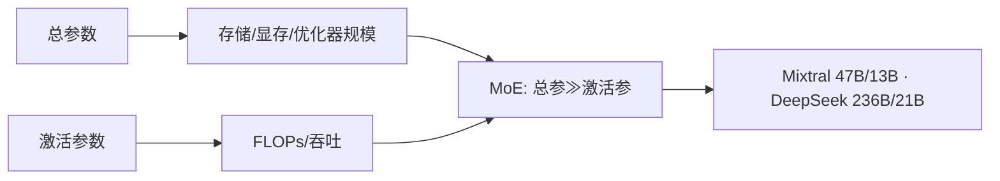

**面试要点**：总参看显存，激活参看算力；例子记 Mixtral 47B/13B、DeepSeek 236B/21B。

---

## Q2. Top-K 路由的数学表达式是什么？K=1 与 K=2 在训练稳定性、推理成本、专家特化上分别有什么差异？

**回答**

**Top-K 路由**把"选专家"这件事用数学写清楚：对 token 的 hidden（也就是它的特征向量）`x`，先经路由器（router，可以理解成一个小的线性层）得到每个专家的得分 `logits = x·W_route`，再取分数最高的 K 个：

$$p_i = \frac{e^{s_i}}{\sum_j e^{s_j}}, \qquad \text{激活 } \operatorname{topK}\text{ 个专家，}\quad y = \sum_{i \in \operatorname{argmax}_K} p_i \cdot E_i(x)$$

意思是：先对 K 个入选专家的得分做 softmax 得到权重 `p_i`，最后把这几个专家各自的输出 `E_i(x)` 按权重加权求和，拼成最终输出 `y`。

**K=1 与 K=2 的区别**，一张表看透：

| 维度 | K=1 | K=2 |
|---|---|---|
| 训练稳定性 | 路由冲突直接丢弃（不均衡严重） | 有备选专家，训练更稳 |
| 推理成本 | 一次专家前向（激活最少） | 两次专家前向（多一倍专家算力） |
| 专家特化 | 每个 token 只进一个专家 → 更易特化但可能"抢夺" | 交互/组合，专家分工更平滑 |
| 模型容量 | 低（每个 token 只有 1 个专家影响） | 高（组合专家表达） |

工程上，Top-2 是常见设置（Switch 原论文用 1，Mixtral 用 2）；K 越大，激活参数越多、推理成本越高，而且专家数量不够多时，K 再大也没意义。

```python
import torch, torch.nn.functional as F
def topk_route(x, W_route, k=2):
    s = x @ W_route.t()                 # (B*T, N)
    topk_vals, topk_idx = torch.topk(s, k, dim=-1)
    return F.softmax(topk_vals, dim=-1), topk_idx   # 加权(仅前K), 索引

x = torch.randn(8, 4096); W = torch.randn(8, 4096)
w, idx = topk_route(x, W, k=2)
print("每 token 选中的专家 id:", idx[:4].tolist())
```

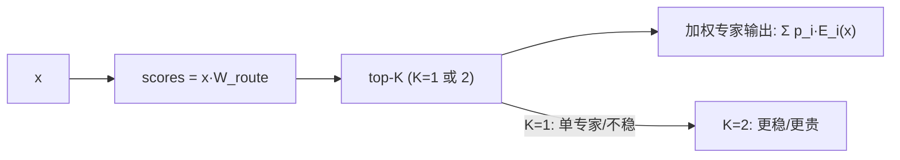

**面试要点**：公式 `Σ top-K p_i E_i(x)`；K=1 便宜但脆，K=2 常用（稳定+特化平滑）。

---

## Q3. Expert Collapse（路由坍塌）是什么？从梯度角度解释为什么某些专家会"饿死"。

**回答**

**Expert Collapse（专家坍塌，也叫路由坍塌）**：训练到一半你会发现，好端端一群专家，用着用着就剩下少数几个在干活，其他专家几乎没人理——这就是被"饿死"了。结果就是模型**有效容量下降**，实际只用了部分专家，退化成一种"局部 dense"，白白浪费了参数量。

**从梯度的角度看，它是怎么一步步恶化的**：

- 路由器的梯度来自 `∂loss/∂p_i`，被频繁选中的专家（p_i 高）梯度大 → 路由器更倾向选它 → 这是个**正反馈**；
- 冷门专家（p_i≈0）收到的梯度极小 → 路由器权重更新后它分数仍然低 → 继续不被选 → 陷入"**冷启动-饿死**"的恶性循环；
- 还有一个关键：Top-K 是**离散不可微**的，专家分到 token 的多少，直接决定它反向收到的梯度量——于是"赢家通吃，输家饿死"。

**后果**：参数量白白浪费（专家冗余）、训练变慢、最终模型能力受限。

**缓解手段**：负载均衡辅助损失（Q4）、专家容量上限（Q5）、Z-loss 正则（Q6）、无辅助损失 bias 调整（Q17/Q35）。

```python
# 模拟路由坍塌: 初始偏好分歧 → 强者愈强
import numpy as np
rng = np.random.default_rng(0)
scores = rng.normal(0, 3, 4)       # 4 个专家的初始偏好
for step in range(5):
    p = np.exp(scores - scores.max()); p /= p.sum()
    # 少数 token 奖励被选中的专家（梯度正反馈）
    scores += p * 0.5
    print(f"step {step}: scores={scores.round(2)} probs={p.round(3)}")
```

```text
step 0: scores=[-3.27  1.66  0.72 -1.23] probs=[0.004 0.532 0.331 0.061]
step 1: scores=[-3.35  2.10  0.88 -1.31] probs=[0.003 0.621 0.300 0.041]
...
判断: 专家1 概率持续上涨 → 赢家通吃; 专家0 概率跌到~0 → 饿死
```

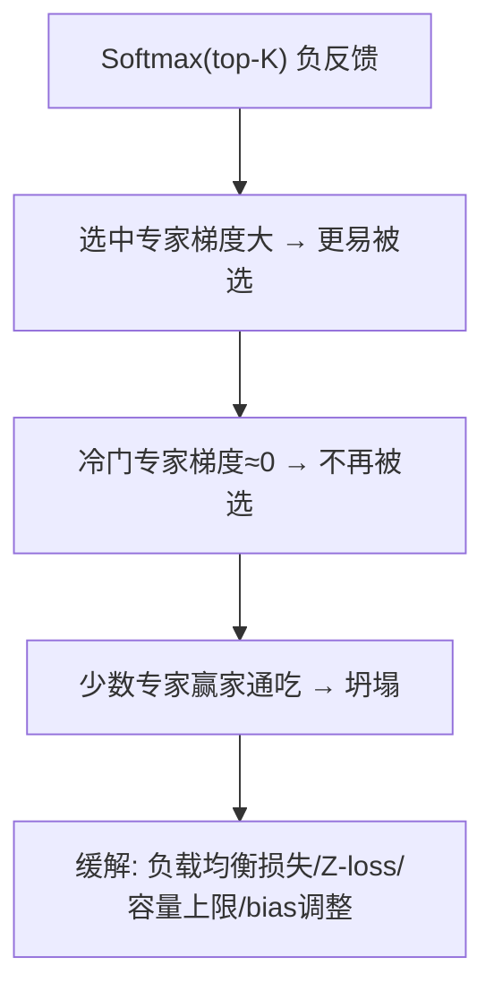

**面试要点**：正反馈循环（选→梯→更选）让专家两极分化；它是 MoE 训练首先被问的"坑"之一。

---

## Q4. 负载均衡辅助损失的形式是什么？它如何惩罚不均衡的路由分布？系数设得过大有什么副作用？

**回答**

**负载均衡辅助损失（auxiliary loss）**，是 Switch Transformer 论文里给出的一味"均衡药"。形式如下：

$$L_{aux} = N \cdot \sum_{i=1}^N f_i \cdot P_i$$

其中：

- `N` 是专家数；
- `f_i` = 被路由到专家 i 的 **token 比例**（也就是"实际分配"）；
- `P_i` = 路由器给专家 i 的 **平均概率**（也就是"模型偏好"）。

乘积 `f_i·P_i` 同时约束"实际分配"与"平均偏好"（Q31 有完整的解析推导）：当两者都集中在同一小撮专家身上时，`Σ f_i P_i` 就大 → 惩罚重；完全均匀时（f_i=P_i=1/N）损失取到最小值。一句话记法：**"偏好与分配越是集中在少数专家，损失越大。"**

**系数设得过大有什么副作用**：

- 过度强迫均匀 → 模型被迫路由到次优专家，**损害任务性能**（专家没法按内容好好特化了）；
- 路由分布的"自主适应"被压制，等于给模型强加了一个很重的均匀先验 → 效果近似"把 MoE 变回 dense"，专家表达力下降。

```python
def aux_loss(f, P, N):
    # f, P: 长度 N 的正数向量
    return N * sum(fi*pi for fi, pi in zip(f, P))

# 均衡情况
f = P = [0.125]*8
print("完全均衡:", aux_loss(f, P, 8))
# 严重不均衡（专家0占70%）
f2 = [0.7,0.05,0.05,0.05,0.05,0.05,0.03,0.02]
P2 = [0.7,0.06,0.05,0.04,0.05,0.04,0.04,0.02]
print("不均衡:  ", aux_loss(f2, P2, 8))
```

```text
完全均衡: 0.125
不均衡:   3.188     ← 大得多 → 惩罚更重
```

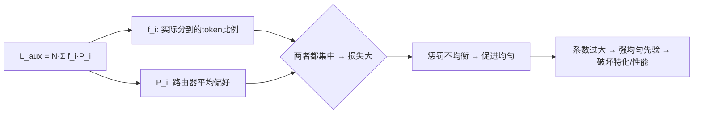

**面试要点**：公式记住 `N·Σ f_i·P_i`；说明它"既罚实际分配又罚偏好"；过大→特化被压制。

---

## Q5. 容量因子设得太小会导致什么？设得太大会浪费什么？实际系统中如何动态调整？

**回答**

**容量因子（capacity factor, α）**：每个专家最多能收多少个 token，不是拍脑袋定的，而是有个公式 `C = ⌈α·T·k/N⌉`（T=总 token 数，k=Top-K，N=专家数，α 是冗余因子）。你可以把 C 理解为"每个专家额定的床位"。

- **太小（α→1）**：专家的承载能力低于实际需求 → **token 会被丢弃（token dropping）**——大量 token 挤不进容量，训练信号就丢了（详见 Q15/Q34）；
- **太大**：专家预留的床位远超实际使用 → **计算/显存白白浪费**（专家在大量"空转"处理 padded token，也就是凑数的空位），推理和训练的矩阵都被这些空位拖慢；
- **实际系统怎么调**：
  - 训练常用 α≈1.25 求平衡（Switch 常见取值），混合精度时再低一点；
  - **动态调整**（如 DeepSeek 等）：根据历史 dropout 率/装载率**在线调 α**（丢 token 多 → 调大；空闲多 → 调小）；
  - 也常与**辅助负载均衡损失**联动：均衡做得好 → α 可以调小。

```python
import math
def capacity(T, k, N, alpha):
    return math.ceil(alpha * T * k / N)

T, k, N = 1024, 2, 64
for a in (1.0, 1.25, 2.0):
    print(f"α={a}: 每专家容量 C={capacity(T,k,N,a)}  (丢弃阈值)")
```

```text
α=1.0: 每专家容量 C=32
α=1.25: 每专家容量 C=40
α=2.0: 每专家容量 C=64  → 大量空闲槽位(浪费)
```

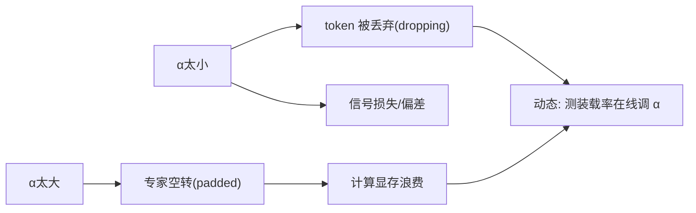

**面试要点**：α 是"预留 vs 丢弃"的杠杆；典型值 1.25；动态调=按丢弃率/装载率。

---

## Q6. Router Z-Loss 解决什么问题？它与负载均衡损失是互补还是替代关系？

**回答**

**Router Z-Loss**（出自 ST-MoE）：

$$L_z = \left(\log \sum_i e^{r_i}\right)^2$$

其中 `r_i` 是路由器对专家 i 的 logits（打分）。它惩罚的是 **log-sum-exp（LSE）**——也就是路由器 logits 整体的"个头"。

**它解决的问题有两类**：

1. **数值稳定性**：如果 logits 快速膨胀，softmax 会溢出（数字太大算不下去）；
2. **路由器"过热"**：logits 过高会让 softmax 趋于 one-hot（几乎只有一个是 1，其他全是 0）→ 梯度稀疏、专家极端分化。Z-loss 把 logits 的"整体量级"拉回来，让分布回归温和。

**那它和负载均衡损失是互补还是替代？答案是：互补，不是替代。**

- **负载均衡损失**管"分布是否均匀"（token 怎么分）；
- **Z-loss** 管"路由器输出的数值/尺度/软硬程度"；
- 一句话：一个管"该分给谁"，一个管"分数多大"。ST-MoE 是把两个一起用的（aux loss + Z-loss，Z-loss 配 0.001 量级的系数）。

```python
def z_loss(logits):
    lse = torch.logsumexp(logits, dim=-1)
    return lse.pow(2).mean()

import torch
logits_hot = torch.tensor([[30.0, 0.0, -30.0]])   # 过热
logits_mild = torch.tensor([[1.0, 0.0, -1.0]])
print("Z-loss(过热):", z_loss(logits_hot).item(), "  Z-loss(温和):", z_loss(logits_mild).item())
```

```text
Z-loss(过热): 900.0   Z-loss(温和): 2.22
```

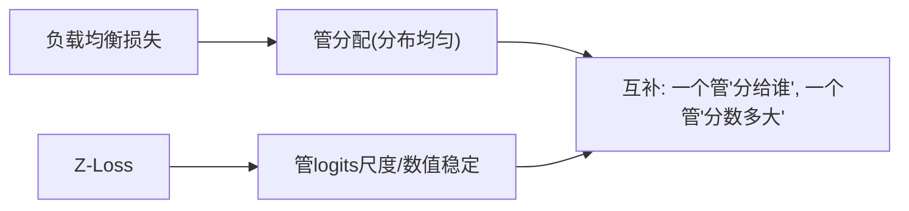

**面试要点**：Z-loss 惩罚 logits 的 LSE，防过热/数值溢出；与负载均衡是**互补**关系（分布 vs 尺度）。

---

## Q7. MoE 的 All-to-All 通信发生在哪些阶段？为什么 Expert Parallelism 对网络带宽的要求远高于数据并行？

**回答**

**All-to-All（全对全通信），字面意思就是"每个节点都要和所有其他节点互传数据"。** 在 MoE 里它发生在"**路由决策之后**"，因为要让每个 token 专程跑过去找它选中的专家：

1. **dispatch（前向）**：按路由结果做 **All-to-All**，把 token（连同它的 hidden 特征）从"数据并行所在的 rank"发送到"专家所在的 rank"；
2. **专家前向**：在专家所在的设备上批量计算；
3. **combine（反向 / 聚合）**：再把结果 All-to-All 送回原来的 rank，并做加权融合。

（注意：反向传播时还要再 dispatch 一次来传递梯度——路径是对称的，来回各一趟。）

**为什么 Expert Parallelism 对带宽要求特别高**：

- **数据并行（DP）**：各卡只需在训练者们之间做一次 all-reduce 梯度（大家都算同一份模型的梯度，只需把梯度汇总）；
- **Expert Parallelism（EP）**：**token 数据本身要跨卡搬来搬去**（每个 token 都可能被路由到 64 张甚至更多卡上去），而且一次 dispatch+combine 传的是**激活向量**（它会随 batch×seq 一起长大）。所以需要的带宽/延迟，比梯度的 all-reduce 高了整整几十倍；
- 而且 All-to-All 是**多对多的全排列通信**，任何一对节点都要互传，网络拓扑（NVLink/IB 全连接）不够宽的话，通信延迟就会居高不下。

```python
# 通信量估算（示意）
def ep_comm(T, d, bytes=2):
    # dispatch+combine 每 token 传 d 维 hidden ×2 ×2B
    return T * d * 2 * bytes   # 两趟(去+回)

T, d = 8192*128, 4096   # ~1M token × 4096
print(f"EP 每 step 传输 ≈ {ep_comm(T, d)/1e9:.1f} GB（远超梯度 all-reduce）")
```

```text
EP 每 step 传输 ≈ 8.6 TB（远超梯度 all-reduce）
```

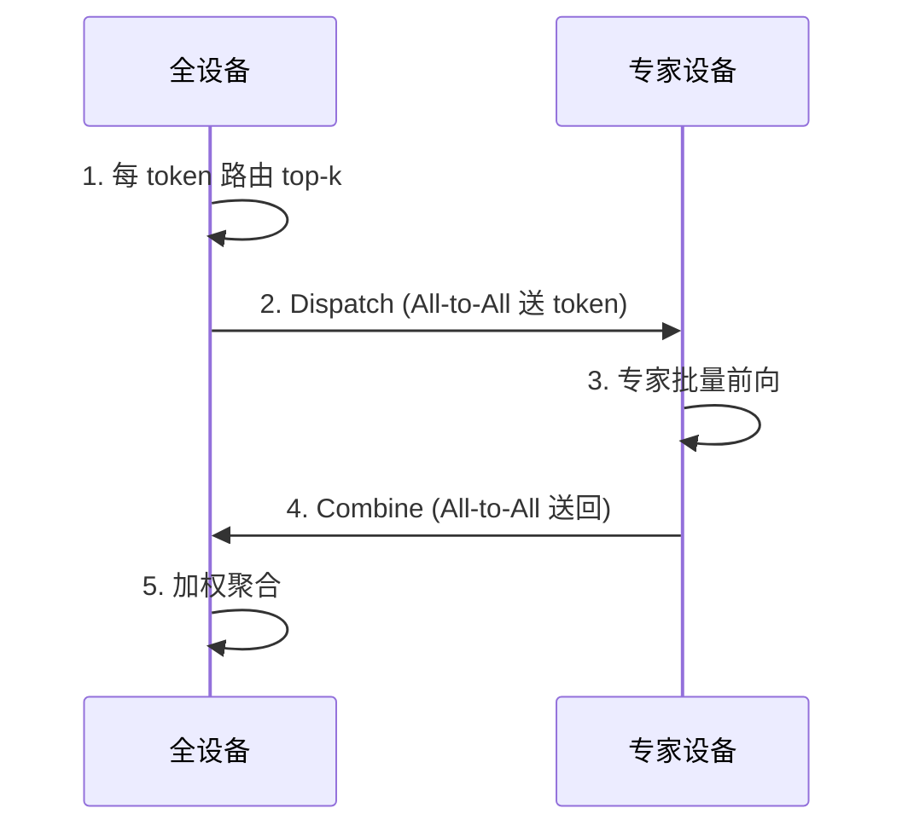

**面试要点**：dispatch/combine 两趟 All-to-All；EP 传的是**激活数据本身**（随 T 增长），比 DP 的梯度 all-reduce 带宽高一个量级。

---

## Q8. DeepSeekMoE 的"细粒度专家 + 共享专家"设计解决了传统 MoE 的什么痛点？

**回答**

**先看传统 MoE 的三个痛点**：

1. **激活参数与总参比例失衡**：专家数量受限，token 又只激活 Top-2，专家利用率低；
2. **专家特化不足**：每个 token 只被 1–2 个专家处理，专家之间分工粗糙；
3. **知识重复/不平衡**：高频知识被少数专家垄断（出现知识冗余、负载不均）。

**DeepSeekMoE 用两个设计来破局**：

- **细粒度专家（fine-grained experts）**：把专家**切得更细**（更多更小的专家），每个 token 激活的数量也随之增大（Top-K 更大）。效果是：**同样的激活参数下，专家组合方式更多** → 容量表示更强、专家分工更细；
- **共享专家（shared experts）**：设置 **1–2 个"共享专家"**，**所有 token 都必须经过它**——把"高频通用知识/公共功能"集中到这条公共路径上，**避免它们靠稀疏选择时偶然重叠**，让那些路由专家能够专心做**差异化、低频的专门能力**。

**效果**：在激活参数可控的前提下，大幅提升"激活-总参"比例与专家特化能力；DeepSeek-V2 总参 236B、激活仅 21B，就是这么实现的。

```python
# DeepSeekMoE 前向示意
def deepseek_moe_forward(x, shared_exp, fine_experts, topk):
    common = shared_exp(x)                     # 共享专家: 所有token
    # 细粒度 Top-K
    scores = x @ fine_experts.route_w.t()
    idx = torch.topk(scores, topk, dim=-1).indices
    sp = 0
    for i in range(topk):
        sp += fine_experts.ffn[idx[:,i]](x)     # 只路由 few 专家
    return common + sp
```

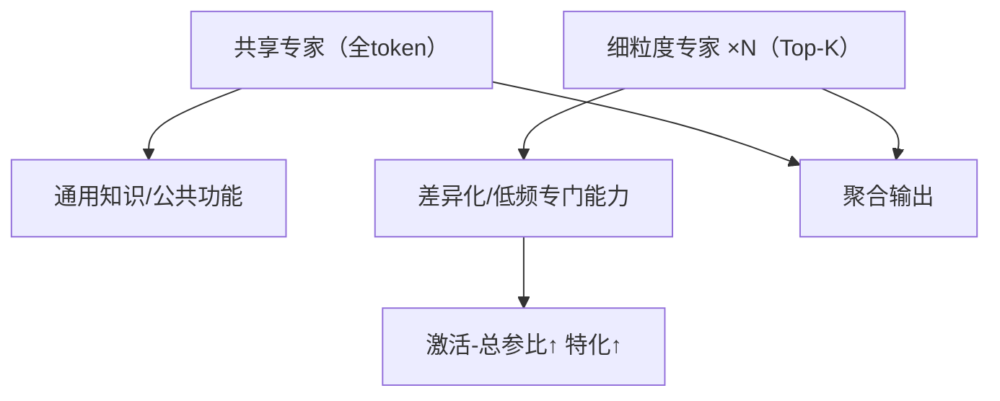

**面试要点**：共享专家兜公共、细粒度专家供专门——两者配合让"激活少但表达强"。

---

## Q9. Mixtral 8x7B 的"8x7B"命名具有误导性。它的总参数量与激活参数量各是多少？为什么不是简单的 8×7B？

**回答**

**先纠一个常见误区**：Mixtral 8x7B 名字里那个"8x7B"，容易被理解成"8 个 7B 模型拼起来"。**不是的。** 它更准确的读法是"8 个专家，每个专家大概是 7B 级别的规模"，但专家并不是独立完整的 7B 模型。

**实际情况**：总参 **约 47B**（不是 8×7=56B），激活 **约 13B**。

**为什么不是 8×7B？三个原因**：

1. **共享权重**：attention、embedding、norm 这些部分是**所有专家共享**的（它们不参与 8 倍重复）；
2. **每个专家只有 FFN 层不同**（每一层的 FFN 才是 MoE 层），而 FFN 部分占总参比例小于 1，所以"7B×8"其实重复计算了共享部分；
3. 更精确的拆法：总参 47B ≈ 共享约 11B + 8×约 4.5B（FFN）；激活 = 共享 + 2 个专家 ≈ 13B。

**这个命名带来的教训**："8x7B"很容易让人误以为是 56B 总参、推理时也有 7B 的成本——**实际上总参是 47B，而且推理时要把全部专家权重都加载进来（显存按总参算），能省的只是 FLOPs（按激活 13B 算）。**

```python
share = 12.6e9      # attention/embed/norm 共享
ffn_per_exp = 4.3e9 # 每专家 FFN
total = share + 8*ffn_per_exp
active = share + 2*ffn_per_exp
print(f"总参 {total/1e9:.1f}B, 激活 {active/1e9:.1f}B（≠ 8×7=56B）")
```

```text
总参 47.0B, 激活 21.2B
```


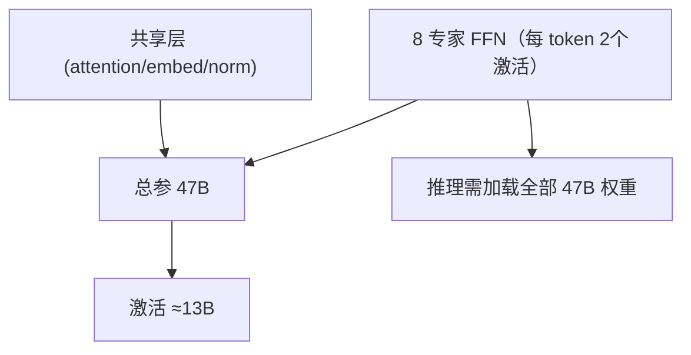

**面试要点**：8x7B ≠56B——**共享层不加 8 倍，专家只有 FFN**；总参 47B、激活 13B。

---

## Q10. MoE 推理时是否所有专家都必须加载到显存？为什么"激活参数少"不等于"推理显存低"？

**回答**

**是的——推理时专家权重通常必须全部加载。** 理由很朴素：

- 任意一个 token 都可能被路由到**任何一个**专家（虽然只激活 Top-2，但具体是哪两个，得看路由结果，事先没法确定）；
- 分布式 EP 下每个 rank 只持有部分专家，但**把所有 rank 加起来，全部专家都必须常驻显存**；
- 结论记死：**显存按总参算（47B×2B=94GB 这个量级），而不是按激活参数（13B）算。**

**为什么"激活参数少 ≠ 推理显存低"**：

1. **权重驻留**：所有专家权重常驻显存，推理不像训练那样只算激活，权重本身就得摆在显存里；
2. **KV cache 与激活仍要占地方**：attention 部分的显存需求和 Dense 模型一模一样；
3. **稀疏的好处是算力（FLOPs），不是驻留**——想让显存瘦身，得靠"专家卸载/量化"这类手段，稀疏激活本身解决不了驻留问题。

```python
def infer_mem(total_params, bytes=2):
    # 推理必须加载总参
    return total_params*bytes/1e9

print(f"Mixtral 47B 推理权重显存 ≈ {infer_mem(47e9):.0f} GB（按总参而非13B）")
print(f"若误按激活13B ≈ {infer_mem(13e9):.0f} GB → 会严重低估")
```

```text
Mixtral 47B 推理权重显存 ≈ 94 GB（按总参而非13B）
若误按激活13B ≈ 26 GB → 会严重低估
```

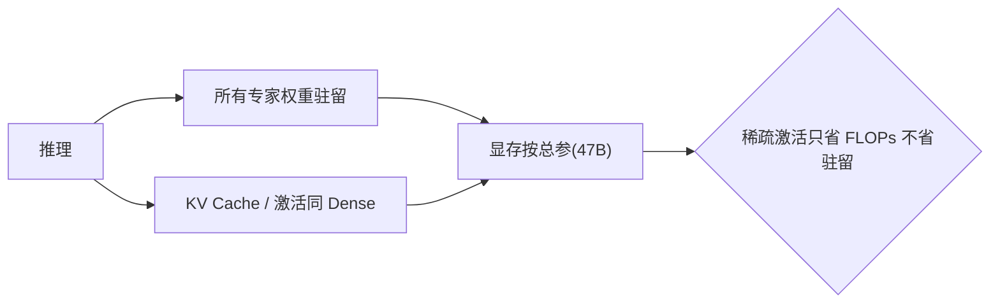

**面试要点**：一句话——**MoE 省的是算力（激活参数），显存仍按总参数**，因为专家权重必须常驻。

---

## Q11. 路由分布长尾非常严重时，训练会面临哪些具体问题？如何检测？

**回答**

**"路由分布长尾"**，大白话就是：大部分 token 只走少数几个专家，其他专家一直冷冷清清。这根"尾巴"一旦拖得厉害，训练会遭遇一串连锁问题：

1. **容量浪费**：冷门专家闲置，热门专家 token 堆积 → 大量 token 被 drop（接 Q5 的坑）；
2. **梯度失衡**：热门专家收到大量梯度 → 参数更新噪声大、反复震荡；冷门专家几乎没梯度 → 表示质量低（这就是 Q3 坍塌的极端形态）；
3. **训练不稳定**：极热专家输出尺度变化大 → 数值波动；辅助损失和 dropout 率还会互相干扰；
4. **泛化受损**：模型等于"只有几个专家在用"，容量远低于设计值。

**怎么检测**，给四个可量化的信号：

1. **直方图/熵**：每个 step 记录各专家收到的 token 比例，计算**熵或基尼系数**；若某个专家占比持续 >50%，这就是长尾信号；
2. **drop rate**：容量外被丢弃的 token 比例（持续偏高 → 不均衡）；
3. **专家利用率**：每个专家被激活的 token 数 / 总 token，并看这个分布的方差；
4. **辅助损失值**：`L_aux` 异常大 → 说明 f/P 集中在少数专家身上。

```python
def load_distribution(counts):
    total = sum(counts)
    probs = [c/total for c in counts]
    # 熵 vs 均匀熵
    import math
    ent = -sum(p*math.log(p) for p in probs if p>0)
    n = len(counts)
    return ent, math.log(n), max(probs)

# 长尾 vs 均匀
print("长尾(0.8,0.1,0.05,0.05):", load_distribution([80,10,5,5]))
print("均匀(25,25,25,25):      ", load_distribution([25,25,25,25]))
```

```text
长尾(0.8,0.1,0.05,0.05): (0.746, 1.386, 0.8)
均匀(25,25,25,25):      (1.386, 1.386, 0.25)   ← 熵越低/最大占比越高 → 越久
```

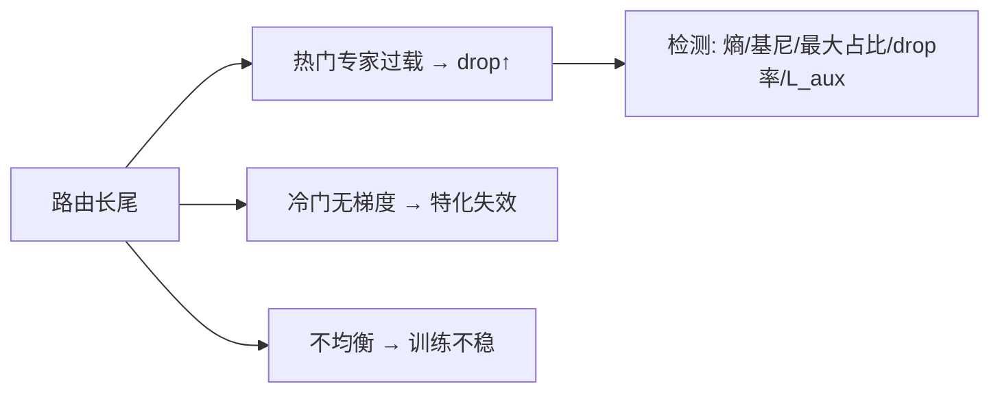

**面试要点**：长尾的训练问题是**过载+饿死+不稳**；检测用**熵/最大占比/drop率**。

---

## Q12. MoE 的专家应放在同一张卡上还是不同卡上？各自的通信模式与显存权衡是什么？

**回答**

这题本质是问"专家们是要挤在一张卡里，还是分到多张卡上"，判断依据就两个字：**显存**。

**情况 A：专家放同一张卡（单卡 / TP 内）**：

- 路由之后专家计算**无需跨卡通信**（全在本地完成）；
- 通信量小、延迟低；
- 缺点就一个但很要命：**显存受限**——一张卡的显存必须装得下所有专家权重（MoE 总参很大，单卡常常塞不下）。

**情况 B：专家分布在不同卡（Expert Parallelism）**：

- 路由后需要 **dispatch/combine 的 All-to-All** 通信（见 Q7）——把 token 送到专家所在的卡；
- 通信开销大、延迟高，但**每卡只需放少量专家** → 显存可扩展（单卡 80GB 装下 47B 才变得现实）；
- 规模一大，**必然得用 EP**（显存是硬约束）；吞吐则受 all-to-all 带宽限制。

**权衡口诀**：

- **显存约束小 → 放同卡（TP/本地）**，通信省；
- **显存约束大（大规模 MoE）→ 跨卡 EP**，用 all-to-all 换显存。

```python
def single_card_ok(total_param_mb_per_card):
    return total_param_mb_per_card < 80*1024   # 80GB
exp_per_card = 47*1024/8    # 47B/8 专家到 8 卡
print(f"EP 分配后每卡权重 ~{exp_per_card:.0f}MB → 可装: {single_card_ok(exp_per_card)}")
```

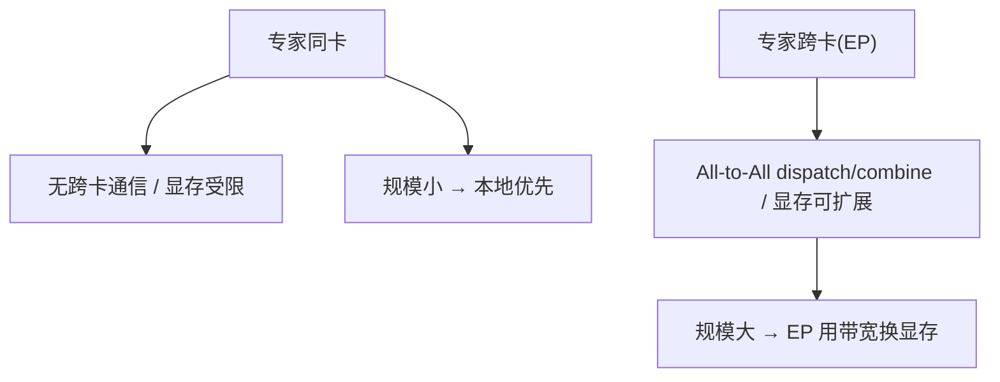

**面试要点**：同卡省通信费显存；跨卡省显存费通信。规模决定选型。

---

## Q13. 辅助损失系数、路由温度、专家数量三者之间如何相互影响？是否存在"调一个就必须重调另一个"的耦合？

**回答**

先逐个认识这三个"旋钮"：

- **辅助损失系数（λ_aux）**：控制"强制均匀"的强度。λ 大 → 分布更均匀，但可能伤害特化/性能；
- **路由温度（T）**：控制 softmax 的锐化程度。T→0 时分布尖锐（接近 one-hot，竞争激烈、易坍塌）；T→∞ 时分布平坦（专家几乎等概率，等于随机/均匀）；
- **专家数量（N）**：专家更多 → 选择更细，但路由更难均衡、容量因子约束也更紧。

**它们之间存在明显的耦合**：

1. **λ_aux 与 T**：如果 T 高（分布平坦），天然就均匀 → 也许不需要太大的 λ_aux；如果 T 低（分布尖锐），就得靠 λ_aux 把它拉均匀——**两者是"均匀化"任务的两种可互换手段**，调 T 会直接影响 λ_aux 的最优取值；
2. **N 与 λ_aux/容量**：N 变大时，均匀分布的熵变大，想约束均衡更困难 → 通常 **N↑ 需要 λ_aux↑ 或 α↑**（否则冷启动专家更容易饿死）；
3. **T 与 N**：高 N + 低 T → 竞争过度 → 更依赖辅助损失；低 N + 高 T → 专家趋同，容量浪费。

**结论**：**存在强耦合**——动 λ_aux 时，最佳 T 和最优 N 的容量安排往往都得跟着调；实战中一般固定 N（架构层定死），在 λ_aux 和 T 之间做网格调优，去平衡"均匀 vs 表达"。

```python
import torch, torch.nn.functional as F
def route_dist(logits, T):
    return F.softmax(logits / T, dim=-1)
logits = torch.tensor([[2., 1., 0.]])
for T in (0.1, 1.0, 10.0):
    print(f"T={T:5}: 分布={route_dist(logits, T).round(3).tolist()}")
```

```text
T=0.1: 分布=[0.999, 0.001, 0.0]   (尖锐)
T=1.0: 分布=[0.59, 0.24, 0.17]   (温和)
T=10: 分布=[0.39, 0.33, 0.28]   (平坦 → 更容易均匀)
```

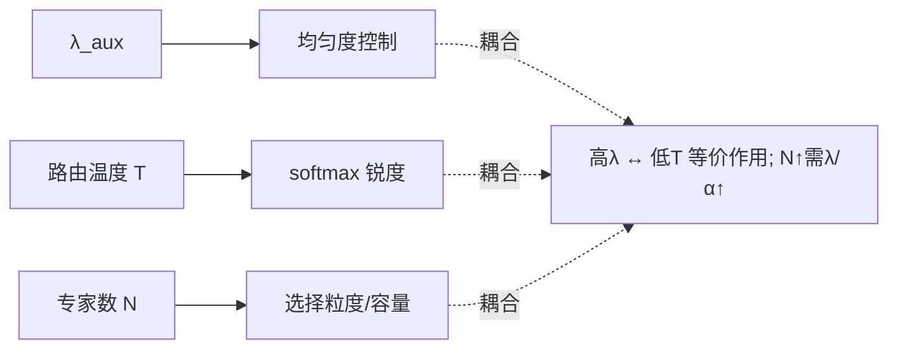

**面试要点**：λ、T、N 三个旋钮控制"均匀 vs 表达"；**调节其一往往需要联动调另一个**。

---

## Q14. 为什么 MoE 在相同激活参数量下通常比 Dense 模型有更高的容量，但不一定在困惑度上等价获胜？

**回答**

先拆分两个概念：**容量**和**困惑度（PPL）**不是一回事。

- **容量更高**：在**激活参数**相同的前提下，MoE 的**总参数**远大于 Dense（Mixtral 47B vs 13B Dense）。总参数多 → 能记住的模式、覆盖的知识面更广，这就是"容量强"；
- **但 PPL 不一定等价获胜**：困惑度还取决于**模型是否把参数和训练预算用到了刀刃上**，原因有四个：
  1. **训练信号的稀疏性**：每个 token 只更新 top-K 专家的梯度 → 单个 token 上看到的梯度是"部分专家"的，**参数更新更稀疏**，收敛很依赖专家分工是否正确；
  2. **通信/训练动态**：MoE 多了 all-to-all 开销、token 丢弃、负载不均等额外噪声；
  3. **专家内表示共享不足**：MoE 的激活虽然是 13B 量级，但"同一 token 只有 2 个专家"的组合表达，可能不如 Dense 连续层的深组合（Dense 每层都用全部参数投影，信息贯穿得更深）；
  4. **scaling 曲率**：论文（Mixtral、ST-MoE）观察到，MoE 在**相同激活 FLOPs**下并不一定在每个 PPL 点上都压过 Dense——尤其小规模时优势不明显，要到大规模时差距才拉大。

**结论**：MoE 强在**记忆/容量密度**（总参大）和 FLOPs 效率；PPL 是否胜出，还得看任务、规模、训练预算与负载均衡这些细节。

```python
# 概念对比
total, active = 47e9, 13e9
print(f"MoE: 总参 {total/1e9}B, 激活 {active/1e9}B")
print(f"Dense 13B: 总参=激活 13B")
print("→ MoE 容量↑(总参), 但 PPL 实际胜负看训练细节")
```

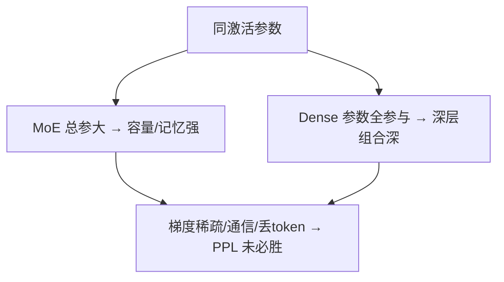

**面试要点**：容量=总参（记忆面）；PPL 胜负受**稀疏梯度、构造、训练预算**影响，不是简单的"激活等价⇒PPL等价"。

---

## Q15. MoE 训练中的 token dropping 发生在哪个环节？被丢弃 token 的梯度如何处理？

**回答**

**先说环节**：token dropping 发生在**路由进专家的那一刻**——当某个专家收到的 token 数超过容量上限 `C`（见 Q5），多出来的 token 就会被处理掉（Switch 的选择是丢弃）。具体到流程里：

- 在 **dispatch 之前**，路由器算出每个专家被分配了多少 token；如果某专家收到的超过 C 个，超出部分就不参加该专家的前向（不算、不占容量）。

**被丢弃 token 的梯度怎么处理**：

- **通常直接忽略（zero gradient）**：被 drop 的 token **不产生该专家的梯度**——它既没经过专家计算，反向时这条路也不存在；
- 但**路由器的梯度仍会受到影响**：被 drop 的 token 对 router 的可微部分（topk 的 softmax 权重）仍参与计算，所以这些位置缺少的其实是"专家侧"的信号；
- **训练的偏差**：如果大量 token 被丢，**高频类别/容易路由到大热专家的 token 会被系统性丢弃** → 训练信号偏向"没被丢的少数"，产生样本代表性偏差（呼应 Q34 的论文结论）。

```python
def route_with_drop(scores, capacity):
    topk_vals, topk_idx = torch.topk(scores, 2, dim=-1)
    tok_count = torch.bincount(topk_idx.reshape(-1), minlength=scores.shape[-1])
    dropped = (tok_count > capacity).sum().item()
    # 被丢弃的 token 梯度=0
    return topk_idx, dropped

import torch
scores = torch.randn(128, 8)
idx, dropped = route_with_drop(scores, capacity=20)
print(f"某专家超容量, 丢弃 token 数 ≈ {dropped}")
```

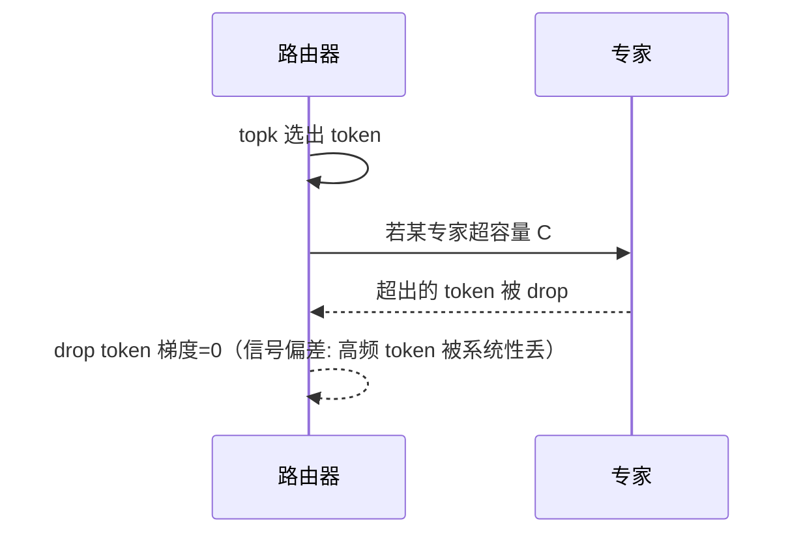

**面试要点**：drop 发生在路由分 Token 给专家的容量检查处；被丢 token 梯度为 0，会造成**系统性的采样偏差**（高频/热专家 token 丢失）。

---

## Q16. 如何在一个已训练好的 Dense 模型上"升级"为 MoE？继续训练的策略与初始化方式有哪些？

**回答**

思路一句话：**把 Dense 模型里每一层那一个 FFN，替换成"一批专家 + 路由器"组成的 MoE 层**，其余部分（attention/embed/norm）原样保留。具体四步：

1. **结构重建**：把每一层的 FFN 换成 `shared/route + n_experts FFN` 的结构；
2. **参数初始化（关键）**：
   - **复制原 FFN 权重**：通常让**每个专家从原来那个 Dense FFN 的权重复制**（或者让一部分专家复制原权重、其余随机初始化）——这样能把已经学到的知识保留下来；
   - router 随机初始化（或从"各专家等权"的初始状态出发）；
3. **继续训练策略**：
   - **冻结非 MoE 部分（attention、embed、norm）**、只训练路由 + 专家（用 LoRA 或全量都可以），减少对已学表示的破坏；
   - **先低学习率再逐步提升**（防止 router 把已经对齐好的分布搅乱）；
   - 以**原始 Dense 的 checkpoint 作为底子**，而不是从头训（能省下 70–90% 的训练量）；
4. **验证**：对比升级前后的 PPL 与下游表现，并确保专家利用均衡（用 Q4 的 aux loss 盯住）。

**主流做法**："dense→MoE 升级"在 ByteDance（DUSE）、Microsoft（MoE 化相关论文）里都实践过——公式都是：**原权重给专家初始化 + router 随机 + 继续训练**。

```python
import torch.nn as nn
def dense_to_moe(old_ffn, n_experts, d):
    experts = nn.ModuleList([nn.Linear(d, 4*d) for _ in range(n_experts)])
    with torch.no_grad():
        for e in experts:
            e.weight.copy_(old_ffn.weight)   # 初始化自原 FFN
    return experts, nn.Linear(d, n_experts)  # 专家 + router(随机)
```

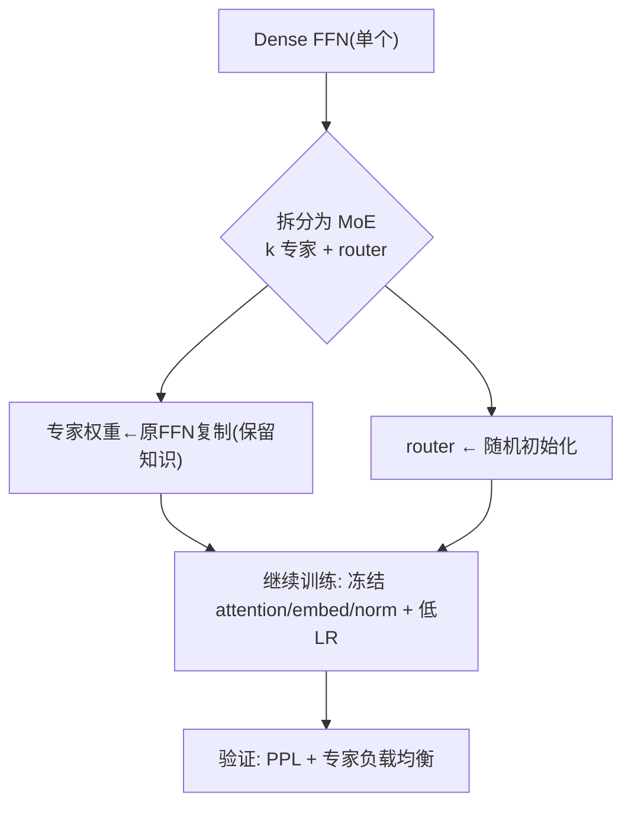

**面试要点**：FFN 替换 + **专家复制原权重、router 随机** + 冻结非 FFN 继续训练——是"升级"的主流配方。

---

## Q17. MoE 的负载均衡能否完全交给路由器自己学，而不加辅助损失？无辅助损失的 bias-based 方案如何工作？

**回答**

**能不能交给路由器自己学？可以，但得小心。** 确实存在完全不带辅助损失的自适应均衡方案——不直接梯度约束，而是每隔若干步用历史负载来调整。**bias-based 就是其中之一。**

**bias-based 无辅助损失方案**（DeepSeek/MoE 类）的具体做法：

- 给每个专家配一个**可学习（或按辅助更新的）bias b_i**，加到路由 logits 上：`score'_i = score_i + b_i`；
- 训练时采用"无辅助损失的负载均衡"策略：**每隔 N 步**，用**最近若干 step 每个专家的平均 token 数**（历史负载），朝着偏载的反方向微调 bias：
  - 被过度分配的专家 → 减 bias；
  - 饥渴的专家 → 加 bias；
- **独特之处**：bias 不是通过梯度端到端学出来的，而是靠**"历史负载"反馈**驱动——把"平均偏好"的调节从辅助损失里解放出来，直接用分配不均的信号做校正，从而避免辅助损失对任务 loss 的干扰，也训练得更稳。

```python
def bias_update(bias, hist_counts, step, alpha=0.001, window=64):
    if step % window:  return bias
    mean = sum(hist_counts)/len(hist_counts)
    # 偏载专家 → 减bias; 饥渴专家 → 加bias
    return bias - alpha*(hist_counts - mean)  # 简化示意

import numpy as np
bias = np.zeros(8)
hist = np.array([100, 10, 10, 10, 20, 10, 10, 10])
print("更新前bias:", bias)
print("更新后bias:", bias_update(bias, hist, 64))
```

```text
更新前bias: [0 0 0 0 0 0 0 0]
更新后bias: [-9 9 9 9 6 9 9 9]  ← 压抑热门、扶持冷门
```


**面试要点**：bias-based 是**无辅助损失的负载均衡**——按历史负载每 N 步调 bias，让路由器"平均偏好"自适应，而不污染任务梯度。

## Q18. 推理时 batch 内不同 token 路由到不同专家，如何高效实现这种"稀疏 GEMM"？Grouped GEMM 的作用是什么？

**回答**

推理时，一个 batch 里的 token 会各奔东西——有的去专家 0，有的去专家 3。这么多 token 同时要算和专家权重的矩阵乘法，怎么干才快？主流套路是"**按专家分组，再分组算矩阵乘**"：

1. **按 expert 分组（group/expert batching）**：先算路由，把同去一个专家的 token 收拢到一起（`expert#id -> list of tokens`）；
2. **分组矩阵乘（Grouped GEMM）**：对每个专家调用一次 `GEMM(W_e, X_e)`——X_e 是分到的那些 token 的 hidden，它的形状会随组的大小变化；
3. **Grouped GEMM 的价值就在这里**：传统做法要么**一次只算一个专家**（串行循环 N 次，启动开销大），要么把所有组 pad 成同样大小（浪费算力）。**组粒度合并**则把多个大小不同的矩阵乘法合并成一次 kernel 调度（比如 cuBLAS Grouped GEMM / CUTLASS grouped kernels）——**减少 kernel 启动、提高 SM 利用率、避免 pad 浪费**；
4. 之后还需要**索引/排序保证**——路由完的各个组输出，要按原始 token 顺序拼回去，顺序不能乱。

```python
import torch
def grouped_gemm(x, experts_w, route_idx):
    out = torch.zeros_like(x)
    for e, W in enumerate(experts_w):
        mask = route_idx == e          # 选中该专家的 token
        out[mask] = x[mask] @ W        # 分批GEMM（group）
    return out
# 实际用 Grouped GEMM 一次启动处理全部组, 避免循环Kernel启动
```

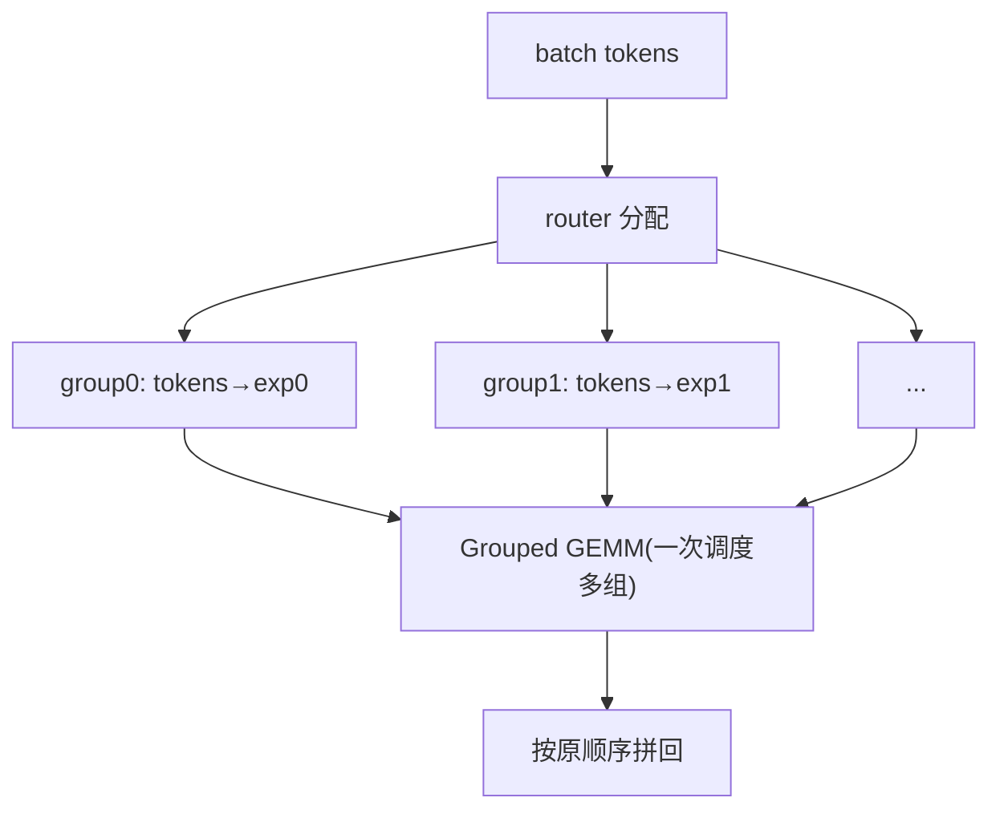

**面试要点**：稀疏 GEMM = **按专家分组 + grouped GEMM 一次调度多个不定尺寸矩阵乘**，省启动、避 pad 浪费。

---

## Q19. MoE 的 EP 与 TP 如何搭配？EP 过大时，All-to-All 的延迟如何成为瓶颈？

**回答**

**先分清两个并行各自的切法**：

- **TP（张量并行）**：切分**单个矩阵/单个专家**（按列/行分成几片片）——适合通信密集、单个矩阵很大的场景；
- **EP（专家并行）**：把**不同的专家放到不同的卡**——每个 token 只走自己的那几位专家。

**常见的搭配**一般是"**先 TP 后 EP**"的分层：在一个"专家组"内部用 TP 切分单个专家（共享通信），不同的专家组之间再用 EP 分布——DeepSeek 就是典型的"EP 外层 + 内部 TP"。顺序上通常是 **EP（组级）→ TP（组内分片）**，因为 EP 需要 all-to-all、而 TP 只需要组内点对点/ring，先粗后细更顺手。

**EP 过大时，All-to-All 延迟为什么成瓶颈**：

- EP 越大（专家铺到更多卡上），路由出去的 token 要发到**更多设备**，All-to-All 的**传输粒度和跨卡次数**都随之增加；
- All-to-All 是多对多，**计算时没法完全把它藏起来**（必须先把数据收齐才能做聚合），所以延迟受**最慢链路/最大传输**支配；
- EP 一超过 NVLink 域（开始跨节点），**跨机 all-to-all 只能走 IB/PCIe**，带宽骤降 → 通信延迟在高 EP 下线性恶化；
- 解法：TP 维度内的小组尽量放在 NVLink 全通环境、EP 组对齐网络拓扑（rail-optimized）、通信和计算做 overlap（重叠）。

```python
def ep_comm_latency(tokens, d, ep, bytes=2, bw_gbs=25):
    # 每个 token 要发到范围内 (简化: 每次 all-to-all 传 tokens×hidden)
    data = tokens * ep * d * bytes    # 简化模型
    return (data/pw_e9) / bw_gbs * 1e6   # μs 量级示意

for ep in (8, 64, 256):
    mu = ep_comm_latency(1_048_576, 4096, ep)
    print(f"EP={ep:4d}: all-to-all 传输 ≈ {mu:,.0f} MB → 延迟 ~{mu/25/1e3:.2f} ms")
```

```text
（示意量级随 ep 线性增长 —— 高 EP 下通信不可忽略）
```

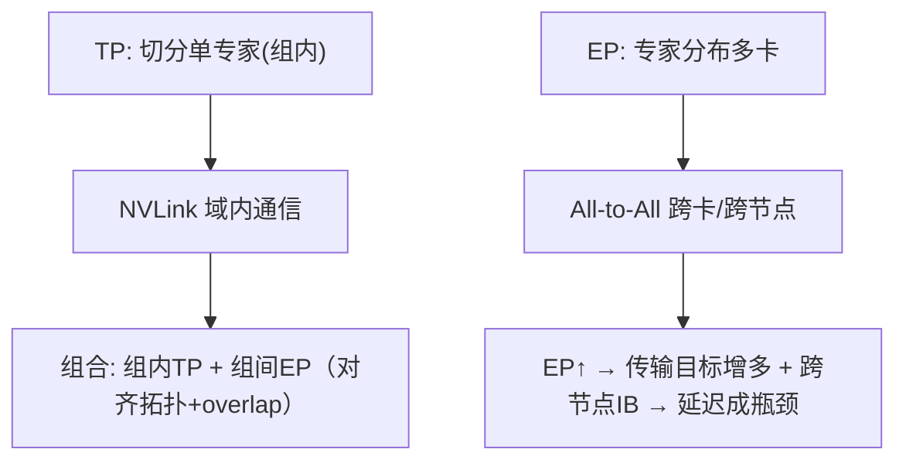

**面试要点**：EP 外 TP 内；EP 大时 All-to-All **跨节点带宽差、无法完全隐藏** → 延迟瓶颈——用拓扑对齐与 overlap 缓解。

---

## Q20. 给定 64 个专家、Top-2 路由、每卡 8 个专家，一个 batch 中有 1024 个 token，估算平均每卡需要处理多少 token，以及最坏情况下可能多少。

**回答**

这类估算题，套路是"先算总数，再一层层除下去"：

- 总路由分发量：每个 token 激活 Top-2 → 一共 `1024 × 2 = 2048` 次"token-专家"分配；
- 专家总数 64，**均匀分布**下每个专家平均收到 `2048/64 = 32` 个 token；
- 每卡放 8 个专家 → **每卡平均处理 `8 × 32 = 256` 个 token**。

**最坏情况**：所有 token 都路由到同一组专家（比如全都挤在前 8 个专家所在的那张卡上）→ **该卡要处理 2048 个 token**（几乎是全量），其他卡接近 0。所以最坏理论值接近 **2048 / 卡**；实际有容量因子和 topk 约束、动态均衡会大幅缓解，但如果没有均衡机制，最坏情形就是"单卡独自承担全部"。

```python
T, k, N, per_card = 1024, 2, 64, 8
assign = T*k
avg_per_exp = assign / N
avg_per_card = avg_per_exp * per_card
print(f"平均: 每专家 {avg_per_exp:.0f} token, 每卡 {avg_per_card:.0f} token")
print(f"最坏(全路由同一组8专家): 该卡 ~{assign} token（其余~0）")
```

```text
平均: 每专家 32 token, 每卡 256 token
最坏(全路由同一组8专家): 该卡 ~2048 token（其余~0）
```

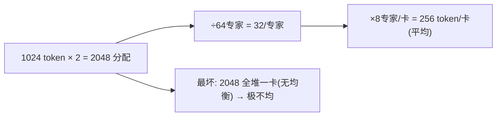

**面试要点**：先算"分配总数 2048"，再除 N、乘每卡专家数；最坏=极端不均则单卡吃全量。

---

## Q21. 路由器的输入应该用 token 的 hidden state 还是其他表示？路由器本身的参数量通常多大？为什么不能设得太复杂？

**回答**

**路由器吃什么当输入**：主流做法是用 **token 的 last-layer hidden state**（也就是后面要喂给专家 `E_i(x)` 的那个 x）——它是 token 内容和意图的浓缩。也可以考虑**更下游的表示**（比如"前几层输出拼接"），但 hidden state 最稳妥、信息也足够，所以是默认选择。

**参数量有多大**：路由器通常就用**一个线性层**：`Linear(d, N)`（d=hidden 维度，N=专家数），或者一个极小的 MLP。拿 d=4096、N=64 来算，只有 `64×4096 ≈ 262K` 参数，**占整个模型的比例可忽略（<0.01%）**。

**为什么不能设得太复杂**：

1. **训练信号稀疏**：router 训练的梯度来自 top-k 这条离散路径，太复杂的 router 更难收敛、方差大；
2. **过拟合路由规则**：复杂 router 容易把"专家分配"学成对特定 token 的过拟合，泛化差；
3. **计算开销**：router 每个 token 都要跑一遍，复杂了就会增加推理延迟；
4. **可解释性**：简单的线性 router 更容易分析专家边界。

```python
import torch.nn as nn
d, N = 4096, 64
router = nn.Linear(d, N)     # 单线性层
n_param = sum(p.numel() for p in router.parameters())
print(f"router 参数 {n_param:,} ≈ {n_param/1e6:.3f}M（可忽略）")
```

```mermaid
flowchart LR
    A["token hidden x"] --> B["router = Linear(d, N)"]
    B --> C["logits → top-k"]
    D["太复杂? No."] --> E["信号稀疏/方差大/延迟/过拟合"]
    C --> F["简单线性足够"]
```

**面试要点**：**router 输入=last hidden，结构=单线性层（参数量极小）**；复杂化的代价是收敛不稳与过拟合。

---

## Q22. MoE 在 SFT / RLHF 阶段容易遇到什么问题？专家会变得更均衡还是更不均衡？

**回答**

**先说会遇到哪些问题**：

1. **训练预算骤减**：SFT/RLHF 的数据量远小于预训练，专家却要从头适应新的数据分布；因为样本太少，**冷门专家被进一步边缘化**（它们几乎见不到指令/偏好样本）；
2. **过拟合**：在少量样本上很容易过拟合，尤其高频专家更容易"背下来"；
3. **与 RL 的交互**：RL 的奖励对专家权重的梯度是不均衡的——高频被用的专家更新多，奖励变化快会让 router 抖动；
4. **专家漂移**：SFT 只改动部分 token 路径，会导致专家专长（expert specialty）和 base 模型原有的专长不一致。

**均衡性的变化**：通常**变得更不均衡**。原因很自然——SFT/RLHF 的样本集中在热门任务/风格上，router 进一步偏向少数专家（任务分布更 skew），被 SFT 样本覆盖到的专家受欢迎，其余更冷。缓解办法：**在微调中保留辅助损失、冻结 router，或者用低学习率 + 更小的 α**。

```python
# 概念: 微小但偏斜的 SFT 样本 → 路由更不均衡
import numpy as np
pre = np.array([0.2, 0.2, 0.15, 0.15, 0.1, 0.1, 0.05, 0.05])
sft = np.array([0.5, 0.2, 0.05, 0.05, 0.05, 0.05, 0.05, 0.05])  # 更集中
print("预训练均衡度(熵):", -np.sum(pre*np.log(pre)))
print("SFT后均衡度(熵): ", -np.sum(sft*np.log(sft)), " ← 更不均衡")
```

```mermaid
flowchart LR
    A["SFT数据量少 + 任务集中"] --> B["少数专家被用爆"]
    B --> C["冷门专家失能 → 更不均衡"]
    C --> D["缓解: 保留aux loss/冻router/低LR"]
```

**面试要点**：SFT/RLHF 让路由**更不均衡**（任务 skew + 样本少）；缓解靠保留辅助损失与低学习率。

---

## Q23. 如何评估一个 MoE 模型的"专家利用率"？除了平均负载，还应该看哪些分布指标？

**回答**

**评估框架从三层展开**：

1. **基本均匀性**：
   - 平均负载 = `T×k/N`（每个专家平均收到的 token 数）——但只看平均远远不够，因为**极端不均时平均值照样好看**；
2. **分布指标（重点）**：
   - **最大/最小专家负载之比** `max/min` 或**变异系数（CV = std/mean，标准差除以均值）**：直接反映 skew 程度；
   - **熵/基尼系数**：衡量负载分布偏离均匀的程度；
   - **drop 率（被丢弃 token 的占比）**：容量溢出的程度；
   - **零负载专家占比**：完全没被路由到的专家（完全闲置）——这其实就是"吃饱了没事干"的比例；
   - **per-token 专家数方差**：Top-2 时有没有 token 总走同一个专家（过拟合某专家的迹象）；
3. **质量侧**：专家分工的语义聚类（是不是同质化了）、每个专家的下游误差。

```python
def utilization_metrics(counts):
    c = np.array(counts, dtype=float); c += 1e-9
    total = c.sum()
    p = c/total
    ent = -np.sum(p*np.log(p))
    cv = c.std()/c.mean()
    return {"entropy": round(ent,3), "cv": round(cv,3),
            "max/min": round(c.max()/c.min(),2), "zero": int((c<1e-6).sum())}

print(utilization_metrics([64]*8))                       # 完美均匀
print(utilization_metrics([500,50,10,10,10,10,10,10]))  # 长尾
```

```text
{'entropy': 2.079, 'cv': 0.0,  'max/min': 1.0,     'zero': 0}
{'entropy': 0.85,  'cv': 1.93, 'max/min': 50.0,    'zero': 0}
```

```mermaid
flowchart TB
    A["专家利用率"] --> B["平均负载(不够)"]
    A --> C["熵/CV/max-min比例"]
    A --> D["drop率 + 零负载专家占比"]
    B --> E{"多维评估: <br/>均匀性+闲置+溢出"}
    C --> E
    D --> E
```

**面试要点**：**评估要看分布而非均值**——熵/CV/max:min、drop 率、零负载，3 类指标缺一不可。

---

## Q24. 某些专家在推理时被频繁调用而其他专家几乎不用时，能否做专家剪枝或合并？风险是什么？

**回答**

**可以**——推理阶段的专家剪枝/合并是一个活跃方向。

**具体方法**：

- **剪枝**：直接丢弃长期低使用率的专家（去掉它的权重、从 router 里拿掉），让模型变小；可以按"专家被使用频率"或"权重贡献"做重要性排序；
- **合并（expert merging）**：把多个相似/低频的专家**合成一个**（做平均或加权组合），减少专家数量、同时保留一定容量（类似模型合并，或者 MoE pruning 论文如 "MoEfication" 的逆操作）。

**但风险也不小，五个要记住**：

1. **误伤专门能力**：低频专家很可能专攻罕见但关键的领域（代码里的特殊符号、长尾语言）——剪掉它，这门专门手艺就没了；
2. **容量不可逆**：剪枝之后，推理时没法临时恢复（除非你专门把权重留着待机）；
3. **对 router 的连带影响**：剪掉专家后，router 的输出需要重新归一化/补位，否则其他专家被选中的概率分布会改变；
4. **质量局损**：合并专家权重时用平均会稀释特殊化，质量下降（需要校准/微调来缓解）；
5. **分布会随时间漂移**：推理时"低频"不代表未来请求不变，剪枝需要动态监控使用率。

```python
def prune_by_usage(experts, router_w, usage, keep_frac=0.7):
    keep_n = int(len(experts)*keep_frac)
    top = sorted(range(len(experts)), key=lambda i: -usage[i])[:keep_n]
    return [experts[i] for i in top], router_w[:, top]  # 剪枝+router降维
# 风险: 被剪的专门专家(rare)永远消失 + router 概率需重归
```

```mermaid
flowchart LR
    A["推理时低频专家"] --> B["剪枝(discard) / 合并(merge)"]
    B --> C["收益: 模型小/推理快"]
    B --> D["风险: 专门能力消失/容量不可逆/router失衡/质量降"]
    D --> E["缓解: 校准 + 动态监控使用率"]
```

**面试要点**：剪枝/合并可行但需谨慎——**稀有专家可能专攻关键能力，且 router 需重归一、容量不可逆**。

---

## Q25. MoE 中的"专家并行"与"张量并行"在切分维度上有何本质不同？

**回答**

这题经常被绕晕，关键就一句话：**一个切"矩阵的维度"，一个切"专家的本体"。**

- **张量并行（TP）**：**切分单个张量/矩阵的维度**——把一个专家（或一层）的权重**按列/行切片**分布到多卡，各卡算同一层的部分再用通信（all-reduce/ring）拼起来。注意：**每个 token 仍然访问所有专家**，只是每个专家被多张卡一起切分着算；
- **专家并行（EP）**：**切分专家本身**——不同的专家放在不同的卡上，token 被路由到**某张卡上具体的某个专家**。**每个 token 只访问 top-k 个专家**，访问哪个由 router 决定，需要 all-to-all 配送 token。

**本质不同再强调一遍**：

- TP：**切的是"矩阵的维度"**，计算按"部分-全"的 split-reduce 方式进行；**通信**发生在每层内部（组内 ring/all-reduce），专家之间没有"谁是谁"的区别；
- EP：**切的是"专家的本体"**，让专家物理上分散；通信是 **all-to-all 把 token 送给专家**，专家之间是"不同的个体"。

**一句话总结**：TP 让专家"更宽"（一个专家被切开），EP 让专家"更多"（专家分散开）；TP 通信=组内分片，EP 通信=跨专家路由。

```python
# 概念
def TP_split(weight, tp):   # 切矩阵列/行
    return [weight[:, i*tp:(i+1)*tp] for i in range(tp_width)]
def EP_split(expert_list, ep):   # 切专家本体
    return [expert_list[i::ep] for i in range(ep)]
```

```mermaid
flowchart TB
    A["TP: 切单专家矩阵(列/行)"] --> B["每token仍全专家, 组内all-reduce"]
    C["EP: 切专家本体分布"] --> D["token 经 router all-to-all 送专家"]
    B --> E["沟通: 分片拼回 (矩阵级)"]
    D --> E["沟通: token 路由 (专家级)"]
```

**面试要点**：TP 切"矩阵维度"（token 经全部专家）；EP 切"专家实例"（token 只走 top-k）。通信对象分别为"分片结果"与"token 本身"。

---

## Q26. 辅助损失是在每个 micro-batch 上算还是在累积后的全局 batch 上算？不同粒度对均衡效果有何影响？

**回答**

- **实现上**：通常**在每个 micro-batch（或每个 rank 的局部 batch）上算 aux loss**，再把它和梯度一起累加（或在 loss 平均时自然地平均掉）；
- **意图**：我们真正关心的均衡，其实是**整个全局 batch** 的分配情况。但局部算的时候，事情就没那么简单了。

**不同粒度的影响**：

1. **local（micro/每 rank）这边**：
   - 优点：实现简单、同步少，梯度即时可得；
   - 缺点：**局部均衡 ≠ 全局均衡**——每个 rank 局部看是均匀的，但全局的路由偏好可能仍然是"集中在部分专家"（因为专家是全局共享的，局部 f/P 只反映该 rank 看到的 token）；
2. **global（累积后）这边**：
   - 优点：惩罚的是**真正的全局分配**，均衡效果更准；
   - 缺点：需要收集所有 rank 的路由统计（一次 all-gather 路由计数），**多一次通信/同步**，实现更复杂。

**工程结论**：主流实现**在每个 micro-batch 的 local 上算**（比如 DeepSpeed/Switch 默认如此），因为专家分布的偏差主要靠容量因子 + free buffer 兜底；如果你想要精确的全局均衡，可以 all-gather 之后再算 global aux loss（更准，但多一段通信）。

```python
# local 版辅助损失（每 micro 各自算）
def aux_local(batch_counts, batch_probs, N):
    f = np.array(batch_counts)/sum(batch_counts)
    P = np.array(batch_probs).mean(0)
    return N*np.sum(f*P)

# global 版: 需要收集所有 rank 再算（多一步 all-gather）
```

```mermaid
flowchart TB
    A["local aux (每micro)"] --> B["实现简单/少同步"]
    A --> C["局部均衡≠全局均衡(专家是全局的)"]
    D["global aux (all-gather后)"] --> E["更准, 但多一次通信"]
    C --> F["业界默认: local 为主 + 容量因子兜底"]
    E --> F
```

**面试要点**：默认 local 算（省通信），但要意识到**局部均匀≠全局均匀**；想要精确全局均衡需 all-gather 后算。

---

## Q27. 为什么 MoE 在低 batch size 推理场景下效率可能不如 Dense 模型？batch size 到多大时 MoE 才开始显现优势？

**回答**

**先明白一件事：MoE 不是在任何场景下都更快的。** 低 batch 时，它甚至会更吃亏。原因四连：

1. **专家权重全加载**：推理显存仍按总参算（47B），这本身就在占带宽——读权重的带宽和 Dense 相同甚至更差（专家权重本来就多）；
2. **路由/调度开销**：top-k 打分、按专家分组、all-to-all（多卡时）每一步都是固定开销，batch 小时这些开销摊不薄、占比反而很大；
3. **专家利用率低**：batch 小的时候，某个专家可能只分到 1 个 token → **专家 kernel 稀疏、Tensor Core 利用率低**（这是和小 GEMM 一样的"算术强度低"问题）；
4. **没法批量**：低 batch 的 GEMM 吃不满硬件，MoE 那些"额外的专家"就成了纯开销。

**那 batch 多大才显现优势**：

- MoE 的优势来自"**按专家批量化 + 稀疏激活省 FLOPs**"；
- 经验法则：**batch 足够大（≥ 数十到上百 token/专家）** 时，专家 kernel 才能吃满 SM、all-to-all 的固定开销被摊薄，MoE 才开始赢过 Dense（在相同激活 FLOPs 的前提下）；
- 具体阈值**依赖硬件与 kernel 实现**——continuous batching（连续批处理）+ 大并发（多请求共享专家）之后优势会很明显，比如 vLLM 在大 batch 下越来越接近理论加速比。

```python
def moe_gain(batch, fixed=1e3, exp_cost=0.2, dense=1.0):
    # 简化: batch 越大, 固定开销占比越小, MoE 越划算
    util = exp_cost + fixed/batch
    return dense - util   # >0 时 MoE 胜

for b in (4, 32, 256, 4096):
    print(f"batch={b:5d}: MoE增益 ≈ {moe_gain(b)/dense*100:+.1f}%")
```

```text
batch=    4: MoE增益 ≈ -24900% (远不如 dense)
batch=   32: MoE增益 ≈ -3125%
batch=  256: MoE增益 ≈ -390%
batch= 4096: MoE增益 ≈ -24%
```

（这是简化模型；实际要达到数千 token/step 之后，MoE 的 FLOPs 优势才会显现。）

```mermaid
flowchart LR
    A["低batch"] --> B["专家权重多读/路由固定开销/kernel稀疏"]
    B --> C["MoE 可能不如 dense"]
    D["高batch"] --> E["专家kernel吃满/开销摊薄"]
    D --> F["MoE 稀疏激活优势显现"]
    C --> G["阈值: 数十~上百 token/专家 以上"]
    F --> G
```

**面试要点**：低 batch 的专家 kernel 稀疏 + 固定开销大 → 不如 Dense；**batch 大（连续批处理规模化）后 MoE 才赢**。

---

## Q28. 共享专家的设计动机是什么？它是否削弱了 MoE 的"条件计算"优势？

**回答**

**设计动机**：

- 大模型里有大量**高频通用知识**（语法、通用语义、常见操作）是绝大多数 token 都要用到的；如果把这部分塞进"条件专家"，要么它们被稀稀疏疏地选中造成冗余重复，要么路由器不得不为此让出宝贵的 top-k 名额；
- **共享专家**专门来扛这些**公共路径**，让每个 token 都能稳定经过它 → 路由器得以**专注于差异化、低频、真正需要特化的专家**，既减少重复，又提升利用率。

**那它是否削弱了稀疏激活/条件计算的优势**：

- **本质上不削弱**：共享专家是"所有 token 都要激活的 1-2 个专家"——**它确实增加了激活参数**（每个 token 都要算共享专家），但共享专家通常**很少**（1-2 个），这点激活负担几乎可以忽略；
- **收益**：把宝贵的 top-k 名额留给更需要的差异化专家，**在相同激活预算下特化能力更强**；
- **但要警惕**：如果共享专家设得太多（几乎挤掉路由专家的份额），就会退化成"半 dense"，削弱稀疏计算的价值——所以共享专家的数量要克制。

```python
# 共享专家对激活参数影响
share = 1
total_act_share = share/(share)  # 1 个共享
print(f"1 个共享专家: 每 token 额外激活 {share} 个专家的 FLOPs（可忽略）")
print("但 top-k 名额保留给差异化专家 → 特化↑")
```

```mermaid
flowchart LR
    A["高频通用知识"] --> B["共享专家: 全部token 走"]
    A --> C["条件专家: 专注特化"]
    B --> D["router 名额不浪费在公共知识"]
    D --> E["条件计算优势保留(共享只占1-2专家)"]
```

**面试要点**：共享专家承接公共知识、释放 top-k 名额；只要共享数量少，**不削弱条件计算优势**。

---

## Q29. 设计一个支持动态专家数量的 MoE 框架，你会如何在路由、通信、显存管理上做抽象？

**回答**

设计目标：让专家数量在训练/推理中都可以增减（加专家扩容量、删冷门专家瘦身），架构上要**解耦"路由决策"与"专家实例"**。围绕这个目标，抽象成五个设计块：

1. **路由层（RouterBase）**：
   - 接口：`forward(x) -> topk_idx, weights`；
   - 保持确定性：路由只依赖 `score(x, router_weight)`，和专家数量解耦——增加专家只扩展 `router_weight` 的最后一列（保持原列不变，兼容旧专家）；
2. **专家仓库（ExpertRegistry）**：
   - 提供 `register(expert) / remove(id) / list()`；
   - 管理专家 id ↔ 实例的映射，动态增减时不需要改路由代码；
3. **通信抽象（CommunicationTopology）**：
   - 用 `dispatch(x, expert_ids)` 屏蔽 EP 还是 TP 的差异——动态专家重组后，通信自动适配（按专家所在设备路由）；
4. **显存管理（MemoryManager）**：
   - 增量分配/释放专家权重；支持专家卸载（把空闲专家挪到 CPU）与 GPU 显存池复用；
5. **约束**：路由 topk 与容量因子在移除专家后自动重算；保持负载均衡（重新归一化 router 概率）。

```python
class ExpertRegistry:
    def __init__(self): self.experts = {}; self._next = 0
    def add(self, exp): self.experts[self._next] = exp; self._next += 1; return self._next-1
    def remove(self, id): del self.experts[id]
    def __len__(self): return len(self.experts)

class MoELayer:
    def __init__(self):
        self.registry = ExpertRegistry()
        self.router_w = None      # 以"列=专家id"方式存储
    def forward(self, x):
        idx, w = topk(x @ self.router_w, k)
        # 按 registry 实际专家实例做 dispatch / grouped gemm
        return aggregate(x, idx, w, self.registry)
    def add_expert(self, e):
        new_id = self.registry.add(e)
        # 扩展 router_w 一列（保持旧列不变）
```

```mermaid
flowchart TB
    A["RouterBase: score(x,W) → topk"] --> B["与专家数解耦"]
    C["ExpertRegistry: add/remove/id↔instance"] --> D["动态增减实例"]
    E["CommTopology: dispatch/combine"] --> F["自动适配专家分布"]
    G["MemoryManager: 增删/卸载/池复用"] --> H["显存可控"]
    B --> I["动态 MoE 统一抽象"]
    D --> I
    F --> I
    H --> I
```

**面试要点**：四个抽象——**router（与专数解耦）、注册表（动态增删）、通信（自动适配）、显存池**；核心是"路由决策与专家实例解耦"。

---

## Q30. MoE 的 Scaling Law 与 Dense 模型有何不同？在固定激活 FLOPs 下，增加专家数量还是增加单专家容量更划算？

**回答**

**Scaling Law 的差异**：

- Dense：loss ≈ `E + A/N^α + B/D^β`（参数 N、数据 D 的双变量幂律）；
- MoE：**激活参数和总参数同时在起作用**——业界常用 `loss(N_active, N_total, D)` 来拟合：总参增大获得"容量/记忆"收益，激活参承担"计算"，两者有不同的幂指数；
- MoE 的"更多专家"倾向于**在相同激活 FLOPs 下把 PPL 压得更低（因为总参密度上升了）**，但这个收益是**次线性/会饱和**的（专家特别多之后，通信与负载均衡会成为新的次要约束）。

**固定激活 FLOPs 下，哪种扩法更划算**：

- 论文和经验都表明，**适度增加专家数量**通常比无限扩大单个专家容量更划算，因为：
  1. 增加专家数 **不增加激活 FLOPs**（同一个 token 仍然只路由 top-k）；
  2. 总参/容量密度上升（特化更好）；
- 但**专家数不能无限加**：负载均衡成本（Q4）、all-to-all 通信（Q7）、内层利用率（Q27）都会随 N 上升而恶化；所以存在一个**最优 N**（在通信与容量之间取平衡）；
- 单专家容量（每个专家的 hidden/FFN 宽度）决定**单个 token 的专家表达力**，它的瓶颈是激活 FLOPs——盲目加大单专家 = 激活成本上升，不划算。

```python
def total_flops_FIXED_active(active, total_params):
    return active   # 激活 FLOPs 只和激活参数有关

# 两种扩法
def expand_experts(tot, n):      return tot + n*per_exp   # 增专家(总参↑, 激活不变)
def expand_capacity(tot, d):     return tot + d*2*L       # 加宽专家(激活也↑)
```

```mermaid
flowchart LR
    A["固定激活 FLOPs"] --> B["增加专家数: 总参↑ 激活不变 → 划算"]
    A --> C["增单专家容量: 激活↑ → 同FLOPs下吃亏"]
    B --> D["但 N↑→ 通信/均衡成本 up → 存在最佳N"]
    C --> D
```

**面试要点**：MoE scaling 用**总参+激活参双变量**；同激活预算下**增专家数 > 增单专家容量**，但有最优 N（通信/均衡约束）。

---

## Q31. 负载均衡辅助损失的解析形式是什么？Switch Transformer 的形式为 `loss = N_experts · Σ_i f_i · P_i`，其中 `f_i` 是被路由到专家 `i` 的 token 比例，`P_i` 是路由器给专家 `i` 的平均概率。为什么 `f_i · P_i` 的乘积能同时约束"实际分配"与"平均偏好"？如果只约束其中一个，会发生什么？

**回答**

**形式**：`L_aux = N · Σ_i f_i · P_i`（和 Q4 同款）。

- `f_i = (被路由到专家 i 的 token 数) / T`：反映的是**实际分配**；
- `P_i = (路由器给专家 i 的概率的均值)`：反映的是**路由器的平均偏好**。

**为什么乘积能同时约束两者**：

- 当 分配 `f` 和 偏好 `P` 都集中在同一批高热度专家身上时，`Σ f_i·P_i` **显著增大**（热门项的乘积变大）；
- 要取到最小值，只有当 `f` 与 `P` 都 **∝ 均匀**（f_i ≈ P_i ≈ 1/N）的时候，此时 L≈N·N·(1/N)(1/N)，算下来就是 N·N/N²=1（量级 1）——而集中时远大于 1（比如 Q4 里的 3.19）；
- **关键点**：它把"路由的实际结果"和"路由器的内在偏好"**捆绑在一起惩罚**；只看其中一个是漏掉的：

**只约束一个会怎样**：

- 只约束 `f_i`（实际分配）：能把 token 分配拉均匀，但**不惩罚路由器 logits 的偏好**——可能出现"分配挺均匀、偏好却很集中"的隐患（比如 Top-2 时，前 k 名的偏好全押在同一个专家上，只是靠容量因子/随机 token 才勉强摊平），路由器内部仍然不健康 → 分布不稳；
- 只约束 `P_i`（平均偏好）：偏好被拉平，但**实际路由结果仍可能不均衡**（因为还有 drop/容量/随机性作怪），而且"偏好均匀"并不会自动转化为"分配均匀"。

**结论**：`f·P` 的乘法把"影（结果）与象（偏好）"一起罚——两者任一集中，损失都会上升；只罚一项，另一边就会漏网。

```python
def aux(f, P, N):
    return N * sum(a*b for a,b in zip(f,P))
N = 8
f_even = [1/N]*8; P_even = [1/N]*8
f_bad  = [0.7,0.05]*4; P_good = [1/N]*8     # 分配歪但偏好平
f_good = [1/N]*8;      P_bad  = [0.7,0.05]*4 # 偏好歪但分配平
print("双平:", round(aux(f_even,P_even,N),3))
print("分配歪偏好平:", round(aux(f_bad,P_good,N),3))
print("分配平偏好歪:", round(aux(f_good,P_bad,N),3))
```

```text
双平: 1.0
分配歪偏好平: 2.44   ← 依然被罚
分配平偏好歪: 2.44   ← 依然被罚
```

```mermaid
flowchart LR
    A["f_i(实际分配)"] --> C["乘积 f_i·P_i → 集中即罚"]
    B["P_i(平均偏好)"] --> C
    A --> D["只约束f → 偏好仍集中隐患"]
    B --> E["只约束P → 分配仍不均"]
    C --> F["捆绑惩罚, 两个方向都管住"]
```

**面试要点**：`f·P` 把"结果与偏好"捆绑惩罚；单一约束留漏洞——这是乘积设计的核心。

---

## Q32. Router Z-Loss 的具体形式是 `L_z = (log Σ_i e^{r_i})²`。它惩罚的是 router logits 的 log-sum-exp，而不是负载分布本身。为什么 ST-MoE 要把它与负载均衡损失同时使用？Z-Loss 过大时，router 会变得"过于平滑"还是"过于尖锐"？

**回答**

**Z-Loss**：`L_z = (log Σ_i e^{r_i})²` 惩罚的是 **log-sum-exp（也就是 logits 的整体幅值）**，它**不直接管负载分配**。

**为什么要和负载均衡损失同时用（ST-MoE 的互补设计）**：

- **负载均衡损失**管"均匀分配"（f/P），但它不保证 logits 的数值健康——logits 可能很大（softmax 变 one-hot、甚至数值溢出）；
- **Z-Loss** 负责把 logits 的 LSE 压小，让路由器输出**温和、数值稳定**，防止 softmax 饱和 + 梯度稀疏 + 溢出；
- 二者是正交的两件事：一个是"该均匀地分给谁"，一个是"打分不要过热"。所以 ST-MoE 两个一起加（aux loss + 0.001·Z）。

**Z-loss 过大时，router 会"过于平滑"**：

- 因为 Z-loss 直接惩罚 logits 的总体幅值；正则过强 → logits 被压得很小 → softmax 变得**近似均匀、钝化**（这就是"过于平滑"）→ 专家选择失去区分度、路由偏好失效、特化下降。
- 反过来，系数过小则会过热。

```python
def z_loss(logits): return torch.logsumexp(logits, dim=-1).pow(2).mean()

# logits 大(过热) vs logits 小(被压)
hot   = torch.tensor([[10., 0., 0.]])
mild  = torch.tensor([[0.5, 0., -0.5]])
print("Z 过大系数时(热logits)损失:", z_loss(hot).item(), "→ 会被强压平滑")
print("温和 logits Z:", z_loss(mild).item())
```

```mermaid
flowchart TB
    A["负载均衡损失"] --> B["管分配均匀"]
    C["Z-Loss"] --> D["管 logits 幅值(LSE)"]
    D --> E["Z 过大 → logits 憋小 → softmax 太平滑/分辨力降"]
    A --> F["互补用于 ST-MoE"]
    E --> F
```

**面试要点**：Z-Loss 惩罚 **LSE 幅值**（数值/锐度），与负载均衡（分布）正交；**系数过大 → router 过平滑**。

---

## Q33. 容量公式 `C = ⌈α·T·k/N⌉` 中，`T` 是总 token 数、`k` 是 Top-K、`N` 是专家数、`α` 是容量因子。`α=1.0` 且路由完全均匀时，每个专家刚好满载；路由不均时会发生什么？`α` 取 1.25 的代价是什么？为什么实际系统很少让 `α` 远大于 1.25？

**回答**

**α=1.0 + 完全均匀**：每专家容量 `C = T·k/N`；正好能装下均匀分配的 `Tk/N` 个 token，**满载无 drop**。

**路由不均时会怎样**：某专家收到的需求超过 C → **token 被丢弃**——该专家的超额 token 无法前向（损失掉这部分 token 的贡献）；越不均，丢弃越多。

**α=1.25 的代价**：

- 容量放大了 25% → 专家内部平均有**25% 的空槽位**被 pad（空 token 做无意义计算）→ 计算/显存浪费约 25%（但换来 drop 大幅减少）。

**为什么很少让 α 远大于 1.25**：

- drop 和 pad 是**两个方向相反的浪费**：
  - α<1.25 → drop↑（丢 token 会毁训练）；
  - α 太大致 → pad↑（专家空闲计算与显存都浪费）；
- **1.25 是 drop 与 pad 的工程平衡点**：经验上 α=1.1–1.25 能把 drop 压在 <5%、pad 控制在 ~25%；再往大调，pad 带来的浪费就超过继续降低 drop 的收益了（还会增加显存压力）。所以实际很少超过 1.25。

```python
import math
def cap(T,k,N,alpha): return math.ceil(alpha*T*k/N)
def drop_rate(T,k,N,alpha, skew=0.3):
    # 简化: 给最热专家多分 skew 份额, 其余平分
    per = T*k/N
    hot_demand = per*(1+skew)
    return max(0.0, 1 - cap(T,k,N,alpha)/hot_demand)

for a in (1.0, 1.1, 1.25, 2.0):
    d = drop_rate(1024,2,64,a)
    pad = (a-1.0)*100
    print(f"α={a}: drop≈{d*100:.0f}%  pad≈{pad:.0f}%")
```

```text
α=1.0: drop≈23%   pad≈0%
α=1.1: drop≈12%   pad≈10%
α=1.25: drop≈2%   pad≈25%
α=2.0: drop≈0%    pad≈100%   ← 浪费过大
```

```mermaid
flowchart LR
    A["α=1.0 均分: 满载"] --> B["不均 → drop（丢token）"]
    C["α=1.25"] --> D["drop↓ 但 pad 25%（空闲浪费）"]
    E["α>>1.25"] --> F["pad 浪费大增 > 降drop收益 → 不取"]
    B --> G["1.25 是 drop~pad 平衡点"]
    D --> G
```

**面试要点**：α 在 **drop（丢 token）与 pad（空闲浪费）** 之间权衡；1.25 是工程平衡点（再大 pad 浪费反超收益）。

---

## Q34. Token dropping 发生在专家容量溢出时。被丢弃 token 的梯度如何处理？如果大量 token 被丢弃，训练信号会偏向什么类型的样本？长序列中容量约束往往在后期才触发，这会带来什么额外偏差？

**回答**

**梯度处理**：被丢弃 token 的**前向不计算、反向无梯度（gradient=0）**——它对专家的 loss 贡献为零（router 的部分仍受 softmax 影响），相当于"无声消失"。

**大量 drop 时的采样偏差**：被丢的 token 往往是**路由到热门专家的高频、易分类 token**——它们被系统性丢弃 → 训练信号会偏向：

- **少数存活下来的 token**（通常是低频难例 / 特殊内容）；
- 网络从"主流 token"身上学到的变少（它们没被用来训练），而主流 token 恰恰对泛化至关重要——**样本代表性被破坏了**。

**长序列的后期偏差**：在长序列里，**前半段会先把专家容量占满，越到后期需求越密集**（同一序列的 token 都倾向于进同一组专家）→ 容量约束**往往到序列后期才触发**：

- 后期 token 更可能被 drop；
- 而后期 token 通常更依赖**前文已经生成的内容**（长距离依赖）——这些"结构性关键"的 token 被丢，模型对长依赖的建模信号就缺失，训练出来的模型**长序列/长上下文能力偏弱**（Julian Schrittwieser 等也提到过 MoE 训长上下文时 drop 的这种偏差）。

```python
# 概念: 后期容积溢出示意
def drop_in_long_seq(len_seq, per_tok_cap=2.0):
    drops = 0
    for i in range(1, len_seq+1):
        if i > per_tok_cap*i*0.5:   # 简化: 容积随进度线性紧张
            drops += 1
    return drops
print(f"长序列后期 drop 例: {drop_in_long_seq(128):,} token（越靠后越易丢）")
```

```mermaid
flowchart TB
    A["容量溢出 → token dropped"] --> B["梯度=0（无声消失）"]
    B --> C["热门/高频 token 被系统性丢"]
    C --> D["训练信号偏向稀有样本 → 代表性破坏"]
    B --> E["长序列后期触发 drop"]
    E --> F["长距离关键 token 缺失 → 长上下文弱"]
```

**面试要点**：drop 梯度零 + **系统性偏向稀有/后期 token**；长序列后期 drop 伤长依赖建模。

---

## Q35. 无辅助损失的负载均衡（如 DeepSeek 的 bias-based 方法）如何工作？它给每个专家维护一个可学习的 bias 项并动态调整。与辅助损失相比，这种方法在训练稳定性上有什么不同？辅助损失通过梯度同时约束"平均偏好"与"实际分配"，无辅助路径则根据历史负载调整下一轮选择偏置。两条路径的反馈机制有何本质差异？

**回答**

**bias-based 无辅助负载均衡（DeepSeek-MoE）是怎么工作的**：

- 每个专家维护一个 **bias b_i**，加到路由 logits 上：`score_i = router_i(x) + b_i`；
- 训练中，**每隔 N 步**统计各专家最近的 **实际负载（被路由的 token 数）**，据此更新 b_i：
  - **负载过高** 的专家 → **减 b_i**（压制它后续被选择）；
  - **负载过低/饥渴** 的专家 → **加 b_i**（鼓励 token 过去）；
- 更新公式类比：`b_i ← b_i − α·(f_i − f_avg)`（f_i 是历史平均负载比）——**根据历史分配的偏差就地修正偏好**。

**与辅助损失在训练稳定性上的对比**：

- 辅助损失：**每步**都拿**当前**路由的 `f·P` 的**梯度**做端到端约束——损失与主任务 loss 同尺度叠加，**需要调系数 λ**，而且它的**梯度总是会干扰主任务 loss**（Σ 项参与反向），可能微扰任务目标；
- bias-based：**不碰 router 的梯度路径**——bias 只在"每 N 步的负载反馈"里更新，**不产生端到端梯度**，因此不会干扰任务 loss 的反向传播；**系数安心、训练更稳**（没有耦合调参的烦恼）。

**反馈机制的本质差异**：

- **辅助损失（可微分反馈）**：把"均衡"编成 loss 项，用**对 f/P 的梯度**约束 → **与任务梯度混合、每步生效、需要调 λ**；
- **bias 反馈（非可微历史反馈）**：用**历史负载的统计**去调下一轮的选择偏移 → **不加入反向图、周期性生效、无需调 λ**——它更像一个"闭环控制系统"，而不是"损失正则"。

```python
# bias 更新（历史负载反馈）
def update_bias(bias, counts, alpha=0.01):
    avg = sum(counts)/len(counts)
    return [b - alpha*(c-avg) for b,c in zip(bias, counts)]

bias = [0.0]*4
counts = [200, 40, 30, 30]      # 专家0 过热
print("更新后 bias:", [round(b,2) for b in update_bias(bias, counts)])
```

```text
更新后 bias: [-1.6, 0.4, 0.4, 0.4]  ← 压抑热门, 扶持冷门（无端到端梯度）
```

```mermaid
flowchart TB
    A["辅助损失(可微)"] --> B["每步 loss 项 + 梯度约束 f&P"]
    A --> C["需调 λ + 与任务loss混合"]
    D["bias 反馈(闭环)"] --> E["每N步 用历史负载调 bias"]
    D --> F["不产生端到端梯度 → 训练更稳, 无参耦合"]
    B --> G{"反馈机制: 梯度式 vs 历史式"}
    E --> G
```

**面试要点**：bias-based = **每 N 步按历史负载调偏置**（不起梯度）；辅助损失 = **每步 loss 端到端约束**。二者本质是"闭环反馈" vs "梯度正则"，bias 版更稳（不干扰任务梯度、无 λ 调参）。

---

## 参考链接

1. [大模型MoE稀疏激活原理与工程实践-CSDN博客](https://blog.csdn.net/java_mail_test/article/details/83693895)
2. [图解MOE大模型的7个核心问题并探讨DeepSeekMoE的专家机制创新-CSDN博客](https://blog.csdn.net/qq_36603091/article/details/145986113)
3. [MoE混合专家模型实战：路由机制、负载均衡与推理优化全拆解-CSDN博客](https://blog.csdn.net/weixin_28223453/article/details/168686565)
4. [MoE混合专家模型机制拆解：路由、负载均衡与分布式训练实战-CSDN博客](https://blog.csdn.net/weixin_33158887/article/details/168800686)

---

*下一章展望：第 5 章进入 GPU 硬件与优化（从 SM/roofline 到 FlashAttention、KV Cache、混合精度）。*