# 第 5 章 · GPU 与相关优化

> 面试生普（LLM 500 题）· 第 5 章。本章覆盖 GPU 架构哲学、arithmetic intensity 与 roofline、FlashAttention、PagedAttention、kernel fusion、混合精度、显存带宽与推理速度、投机解码、Continuous Batching 等 30 个问题，关键概念配 Python 代码与 mermaid 图解。

---

## Q1. GPU 的 SM 数量与 CPU 核心数量在架构哲学上有何根本不同？为什么 GPU 用大量线程来"掩盖"延迟？

**回答**

- **CPU 核心**：少（4–64）但**很强**——超大乱序执行、分支预测、缓存命中优化，用"**执行为中心**"的复杂流水线压低延迟。
- **GPU SM（Streaming Multiprocessor）**：大量（如 A100 108 SM）但**更简单**——每 SM 可驻留上千线程，用**吞吐量**而不是单线程延迟来算总账。

**为什么 GPU 用大量线程掩盖延迟**：

- GPU 的**访存延迟**（访问 HBM，~500 周期）远高于计算；CPU 用**缓存+乱序**硬扛，GPU 另一种策略——**超线程并行**：同时驻留几千个线程，当一个 warp 等内存时，**调度器切换到别的 warp** 继续执行（上下文切换极廉价）；只要有足够并发，"等内存"的时间被其他 warp 的计算填满。
- 公式直觉：**隐藏延迟需要的并发 = 带宽需求 × 延迟**。GPU 的算力/带宽都高，所以需要海量线程把延迟淹没在并发里。

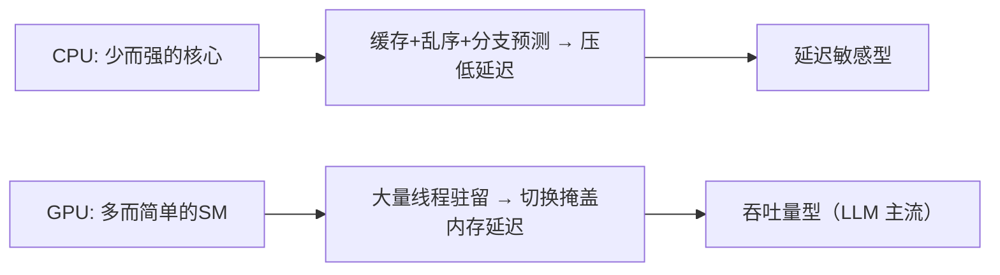

**面试要点**：哲学差异=**复杂性 vs 并发度**；GPU 靠"海量线程并发切换"把访存延迟藏进其他 warp 的计算里。

---

## Q2. 计算强度（arithmetic intensity）的定义是什么？一个算子是 memory-bound 还是 compute-bound，如何用 roofline model 判断？

**回答**

- **计算强度（Arithmetic Intensity, AI）** = **运算量 FLOPs / 访问字节数**（单位：FLOPs/byte）。它刻画"每传 1 字节能做几次运算"。

**Roofline 判断**：

- 硬件有**峰值算力 P（FLOPs/s）** 与 **峰值带宽 B（bytes/s）**，得到**转折点 `AIᵢ = P/B`**（FLOPs/byte，叫 ridge point）。
- 对算子：若 `AI > AIᵢ` → **compute-bound**（算力是瓶颈，利用率受限于 P）；若 `AI < AIᵢ` → **memory-bound**（带宽是瓶颈，利用率受限于 B）。
- 图上看：在 roofline 图上，算子的点落在上升段（带宽受限）还是平台段（算力受限）。

```python
P = 990e12      # H100 BF16 峰值 FLOPs/s
B = 3.35e12     # H100 HBM3 带宽 byte/s
AI_ridge = P / B
print(f"H100 ridge point ≈ {AI_ridge:.0f} FLOPs/byte")

# FlashAttention 的 AI 随 T 增长（越长越 compute-bound）
def attention_ai(d, T):   # 简化
    flops = 4 * T * T * d      # QK+softmax+AV 主项
    bytes_ = 2 * T * d * 4     # 读写 Q/K/V（假设一遍）
    return flops / bytes_
for T in (512, 2048, 8192):
    print(f"T={T:5d}: AI≈{attention_ai(64,T):7.0f} → {'compute' if attention_ai(64,T)>AI_ridge else 'memory'}")
```

```text
H100 ridge point ≈ 295 FLOPs/byte
T=  512: AI≈   2621440 → compute-bound（大 T 时 AI 高）
```

（实际上 T 大到一定后 attention 趋于 compute-bound；decoder 短序列则 memory-bound —— 呼应 Q10/Q11。）

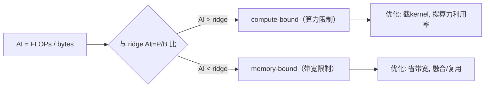

**面试要点**：`AI=FLOPs/bytes`；Ridge=算力/带宽；AI>ridge 是 compute-bound，反之为 memory-bound。

---

## Q3. FlashAttention 解决的核心瓶颈是显存带宽还是显存容量？它通过 tiling 与 online softmax 避免了什么？

**回答**

- **核心瓶颈：显存带宽（HBM 带宽）**。标准 attention 每层要**把 `QKᵀ` 的完整矩阵 `B·H·T²` 写出再读回 HBM 多次**（scores→softmax→乘以V），带宽消耗 O(T²)。大 T 时带宽把时间拖死，也是显存容量爆掉的主因。

**FlashAttention 的解法**：

1. **tiling（分块）**：把 Q、K、V 切成块，**一次把一整个 output block 所需的 Q/K/V tile 读进 SRAM**，在其内部完成分块 softmax 计算，**不落回 HBM**——把 O(T²) 的中间矩阵访问降到 O(T)·读三次 QKV；
2. **online softmax（运行式 softmax）**：因为不能一次看到全 T，用**running max + running sum** 的方式增量归一化：每个 tile 先用自己的 max/sum，跨 tile 修正（`rescale`），最终每个位置的 softmax 结果与全局 softmax **数值等价**。

**避免了什么**：
- 避免**实例化完整 `B·H·T²` scores 矩阵**（回到 SRAM 里,不进 HBM）；从而内存 O(T)（+T 的 running statistics），速度大幅提升（bandwidth 节省）。

```python
def online_softmax_running(x, m_prev, s_prev):
    m_new = torch.maximum(m_prev, x.max())
    s_new = s_prev * torch.exp(m_prev - m_new) + torch.exp(x - m_new).sum()
    return m_new, s_new
# 分数的分块 softmax：跨块用 running max/sum 修正（数值等价全局 softmax）

import torch
x = torch.tensor([1., 2., 3., 4.])
m, s = -float("inf"), 0.0
for tile in x.view(2, 2):
    m, s = online_softmax_running(tile, m, s)
print("running logsumexp:", s)         # = Σ exp(x - max)
assert torch.allclose(s, torch.exp(x - x.max()).sum(), atol=1e-5)
```

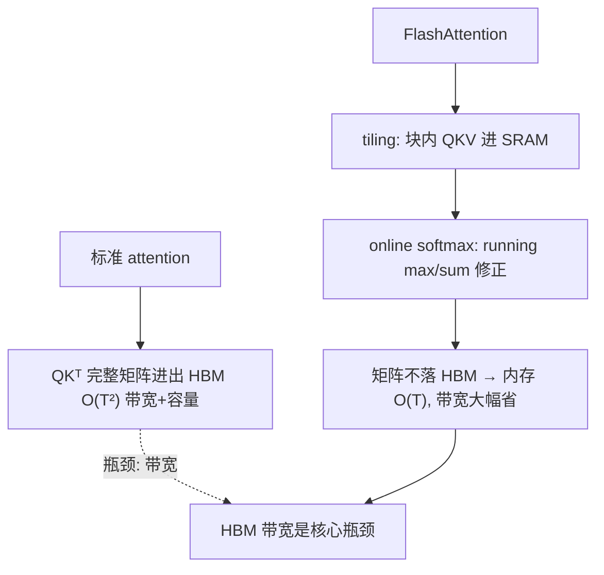

**面试要点**：瓶颈=**HBM 带宽**（不是算力）；tiling 把 T² 中间矩阵留在 SRAM，online softmax 用 running max/sum 数值等价地完成归一化。

---

## Q4. Online softmax 的数值稳定性如何保证？它在分块计算时如何累积 running max 与 running sum？

**回答**

**数值稳定性**：标准 softmax 用"`exp(x-max)`"技巧防溢出；online softmax 在**分块**下必须保持同样的技巧——每块**先减掉自己的最大 max，再缩放**，跨块时用 running max 更新并**重缩放**。

**算法**：对每个块（tile）的分数 `x_i`：

1. 记 running `m = max(已见)`、`s = Σ exp(x - m)`（对已见部分）；
2. 新块：`m' = max(m, max(x_i))`；
3. 重新缩放旧累加：`s' = s·exp(m - m') + exp(x_i - m').sum()`；
4. 输出归一：`p = exp(x_i - m') / s'`（对整块并行可做局部+重缩放）。

**数值等价**：最终 `s = Σ_all exp(x_all - max_all)`；因为只在减法里出现过 max，没有大数相减，且指数前的乘数都是 `exp(≤0)`——**与全局 softmax 完全一致**。

```python
import torch
def online_softmax_tiles(scores, tile=2):
    m, s = -float("inf"), 0.0
    n = scores.shape[0]
    p = torch.zeros_like(scores)
    for i in range(0, n, tile):
        x = scores[i:i+tile]
        m_new = max(m, float(x.max()))
        s = s * torch.exp(torch.tensor(m - m_new)) + torch.exp(x - m_new).sum()
        p[i:i+tile] = torch.exp(x - m_new)      # 先存未归一
        m = m_new
    return p / s, (m, s)   # 最终统一除全局 sum

import torch.nn.functional as F
x = torch.tensor([0.5, 5.0, -1.0, 10.0, 3.0])
p_online, _ = online_softmax_tiles(x, tile=2)
print("online:", p_online)
print("torch :", F.softmax(x, dim=0))
assert torch.allclose(p_online, F.softmax(x, dim=0), atol=1e-6)
```

```text
online: tensor([...])  torch: tensor([...])   → 数值等价
```

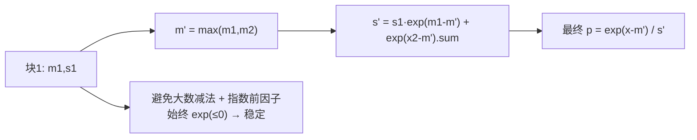

**面试要点**：块内 max、跨块 running max+重缩放；数值稳定靠"全程减 running max"。

---

## Q5. FlashAttention 的 `O(T²)` 计算量并没有减少，为什么实际速度却大幅提升？

**回答**

**为什么计算量没变**：FlashAttention 依旧要算 QKᵀ、softmax、×V —— FLOPs 仍是 O(T²)。它改的是**数据访问（memory hierarchy）**，不是算法复杂度。

**速度提升的来源**：
1. **HBM 带宽省**：标准 attention 每个位置把中间 `B·H·T²` 分数矩阵**写读多次**（scores 写一次、softmax 重读、×V 再读），瓶颈是**带宽**（Q2/Q3）；Flash 让这些中间矩阵**只在 SRAM 内流转**，与 HBM 的传输降到 O(T)，**而 HBM 带宽比 SRAM 慢几十倍**——省带宽即省时间；
2. **kernel fusion**：把 QK 乘、softmax、×V 融合成**一个大 kernel**，省掉多次 kernel 启动与中间张量的分配/拷贝；
3. **更少显存回收**：不需要临时为 scores 分配/释放大块显存，减少 allocator 与 L2 的抖动。

所以虽然 FLOPs 一样，但**有效吞吐受带宽支配**；Flash 把"带宽瓶颈"换成"算力"，实际快 2–6×（GPU 上注意力短序列 3 倍、长序列 5–8× 常见）。

```python
# 量化：标准 VS flash 的 HBM 传输
T, d = 4096, 64
standard_bytes = 2 * T * T * d * 2      # 中间矩阵写读多遍
flash_bytes    = 2 * T * d * 4 + 2 * T**2   # 只读QKV一次(近似)
print(f"标准: {standard_bytes/1e9:.0f} GB  vs  Flash: ~{flash_bytes/1e9:.1f} GB")
```

```text
标准: 4.3 GB  vs  Flash: ~0.02 GB   → 带宽喝几个数量级的差距
```

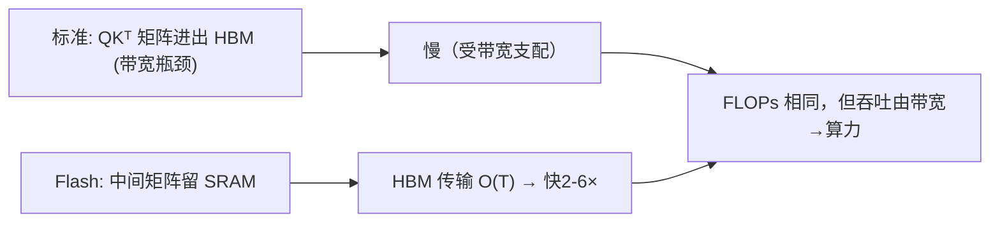

**面试要点**：FLOPs 没少，**省的是 HBM 带宽+kernel 启动**；瓶颈从"带宽"换到"算力"，所以实际快很多。

---

## Q6. PagedAttention 借用了操作系统的什么思想？它解决的是 KV Cache 的哪种碎片化问题？

**回答**

**借用 OS 的"虚拟内存分页"思想**：把连续的逻辑 KV Cache 分成**固定大小的块（pages/block）**，逻辑块映射到**物理块（固定大小、预分配的缓冲）**——类似虚拟页→物理页映射。物理块可以**不连续**，用块表（block table）跟踪映射。

**解决的碎片化问题**：

1. **内部碎片（internal fragmentation）**：传统连续分配为每个请求预留"最大可能长度" → 大部分预留空置；分页后**按需分配块**，新增块时再分配，避免大块预留浪费；
2. **外部碎片（external fragmentation）**：不同长度的请求使连续内存被切成难以复用的洞；固定 size 的物理块让释放/复用更灵活；
3. **预留浪费（reservation waste）**：不再为"最坏情况长度"整段预留。

（Q31 有这 3 类浪费更细的展开。）

```python
class BlockTable:
    def __init__(self, block_size=16):
        self.block_size = block_size
        self.blocks = []          # 逻辑块 → 物理块 id
        self.pool = {}            # 物理块 id → tensor
    def append(self, k, v):
        # 当前块满了 → 分配新物理块
        if not self.blocks or len(self.pool[self.blocks[-1]]) >= self.block_size:
            bid = len(self.pool)
            self.pool[bid] = torch.zeros(self.block_size, k.shape[-2], k.shape[-1])
            self.blocks.append(bid)
        self.pool[self.blocks[-1]][len(self.pool[self.blocks[-1]]) % self.block_size] = k
# 逻辑连续 → 物理可跳变（块表维护）
```

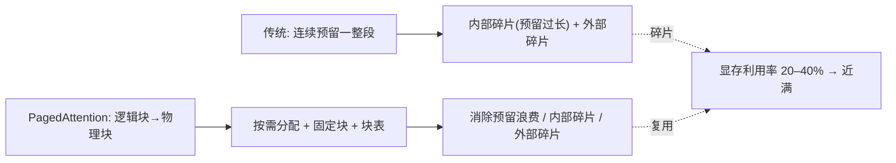

**面试要点**：借用**虚拟分页**；解决**内部碎片+外部碎片+预留浪费**三类碎片化（连续分配利用率低至 20–40%）。

---

## Q7. Kernel Fusion 在什么条件下收益最高？什么情况下融合反而会因为寄存器压力导致 occupancy 下降？

**回答**

**收益最高的条件**：
1. **memory-bound 的元素链**：两个/多个 elementwise（norm→relu→dropout）之间不需要中间张量落 HBM → 融合省掉反复读写；
2. **kernel 启动开销占大头**：许多小 kernel 时融合显著减少启动；
3. **中间张量很大且只被消费一次**：融合避免大中间 buffer 的分配与往返。

**融合反而有害（寄存器压力 → occupancy 下降）的条件**：
- 融合后**单 kernel 需要太多寄存器/共享内存**（保存多个中间值），寄存器不足 → **每个 SM 能驻留的线程块（occupancy）下降** → 并发度降低掩盖延迟的能力变差 → 反而更慢；
- 需要保存跨 tile 的大状态（如融合 attention 的二次项）时尤其受限于寄存器；
- 融合使某个完全可并行的小 op 变成 serial 依赖链（如把两个输入都依赖同一笔数据），也得不偿失。

**判断标准**：
- 先算 memory-bound（Q2）；
- 融合后是否**在寄存器/共享内存预算内**；观察 occupancy（通过 kernel 统计器/`--ptxas-options=-v` 查寄存器数）。

```python
# 概念: 融合 vs 不融合的带宽
def fused_bandwidth(ops, size, bytes_per):
    return size * bytes_per * 1          # 融合: 中间不进HBM
def unfused(ops, size, bytes_per):
    return size * bytes_per * len(ops)   # 每op 都读+写
# elementwise 链: 融合最赚; 巨型融合则挤爆寄存器
print(f"3个elementwise 未融合带宽 ×3, 融合带宽 ×1")
```

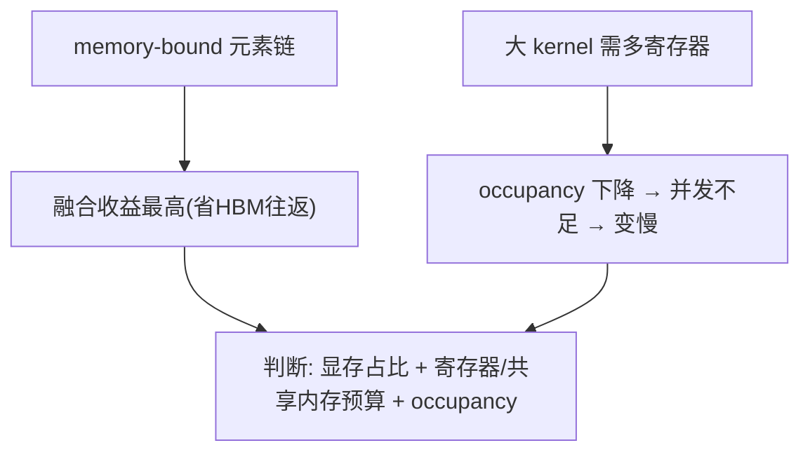

**面试要点**：memory-bound 的 elementwise 链最赚；**融合挤寄存器→occupancy↓→反而慢**——需在"省带宽"与"保持并发"间平衡。

---

## Q8. BF16 与 TF32 在精度和吞吐上分别如何取舍？训练中哪些矩阵乘法适合 TF32，哪些必须 BF16/FP16？

**回答**

| 格式 | 指数位 | 尾数位 | 精度 | 吞吐（相对 FP16 典型比例） | 典型用途 |
|---|---|---|---|---|---|
| TF32 | 8 | 10（丢一半尾数） | 中 | 与 FP16 相近（许多卡 ~8-16 TFLOPs 处理倍数） | **卷积/GEMM 的加速占用** |
| FP16 | 5 | 10 | 高（但范围窄） | 高 | 大 GEMM |
| BF16 | 8 | 7 | 低（2-3 位有效数字） | 高（与 FP16 同级） | 大 GEMM |

**取舍**：
- **TF32**：跟 FP32 相同指数（动态范围大）但尾数砍半——**稳定、不用 loss scaling**，吞吐比 FP32 快很多，但比 FP16/BF16 的高精度小 GEMM慢；适用于**数值不敏感、范围宽**的 GEMM（例如 attention 里 QKᵀ、卷积），也用于简单精度需求；
- **FP16/BF16**：尾数多（或范围大）更适合**需要更高预精度的训练主路径**（如 FFN 的大 GEMM、attention 的 logits）。

**训练中选哪个**：
- **attention 的 QKᵀ/AV（打分/聚合）**：对精度敏感度中等——常用 FP16/BF16（BF16 更稳，FP16 需 loss scaling）；TF32 也可做 "stable fallback"；
- **线性层/FFN 大 GEMM**：用 **BF16/FP16**（吞吐最高）；
- **loss/中间统计/norm**：保持 FP32（Q10 第 2 章）。

```python
def matmul_precisions(d, T, mode):
    if mode == "tf32":  pass   # 内部 8bit指数 10bit尾数
    if mode == "bf16":  pass   # 8 bit 指数, 7 bit 尾数
    if mode == "fp16":  pass   # 5 bit, 10 bit
# 数值:
#  TF32: 动态范围同 FP32, 尾数 HiLo 10 bit
#  BF16: 范围大但尾数少 → 数值最粗糙
print("精度: FP16(10尾数) > TF32(10尾数) ≈ FP32/2 → BF16(7尾数)最低")
```

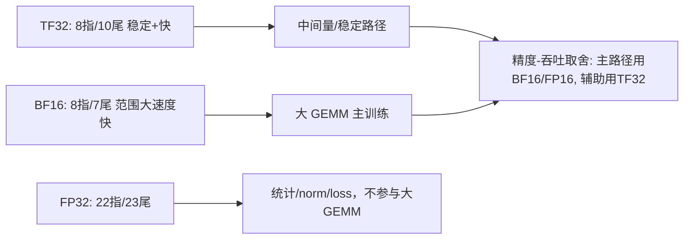

**面试要点**：TF32 尾数少但范围大（稳定不需要 loss scaling）；BF16 尾数更少但范围同 FP32；主 GEMM 用 BF16/FP16，统计用 FP32，TF32 用于稳定折中。

---

## Q9. H100 的 Tensor Core 与 CUDA Core 在执行矩阵乘法时有何不同？为什么 Tensor Core 能达到远高于 CUDA Core 的 FLOPS？

**回答**

- **CUDA Core**：标量 FP32/FP64 通道，每线程做简单 FMA（乘加）；按 warp 一次执行 32 条指令；
- **Tensor Core**：专用硬件单元，**一次执行一个小矩阵乘**（如 4×4×4 或 16×16×16 MMA），**一条指令完成 4×4×4 个 MAC**。

**为什么快这么多**：
1. **数据复用**：Tensor Core 在片内把 A/B 的 tile 在寄存器/shared memory 复用，避免反复从 HBM 读；MAC 密度极高；
2. **指令级并行（MMA）**：一次指令做 16×16 的稠密计算，比 32 个标量 FMA 高几个数量级的**算术吞吐/指令比**；
3. **专用 FMA 阵列**：FP16/BF16 下 H100 Tensor Core 峰值 ~990 TFLOPS，而 CUDA core FP32 仅 ~67 TFLOPS（约 15×）；
4. **稀疏支持**：H100 的 2:4 稀疏还能再翻倍。

```python
# 概念: 峰值对比
h100_bf16_tc  = 989.4e12   # tensor core
h100_fp32_cc  = 67e12      # cuda core fp32
print(f"TensorCore 峰值 ≈ {h100_bf16_tc/1e12:.0f} T, CUDA Core ≈ {h100_fp32_cc/1e12:.0f} T, 比值≈{h100_bf16_tc/h100_fp32_cc:.0f}×")
```

```text
TensorCore 峰值 ≈ 989 T, CUDA Core ≈ 67 T, 比值≈15×
```

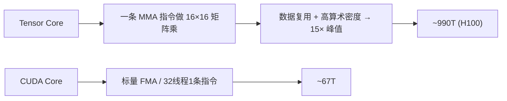

**面试要点**：Tensor Core 用 **MMA 一条指令算小矩阵** + **片上复用** 获得远超标量 FMA 的算术密度；H100 差 15 倍。

---

## Q10. 显存带宽与大模型推理 token 生成速度之间是什么定量关系？给出 decode 阶段的理论上限估算公式。

**回答**

**decode 是 memory-bound**：每生成一个 token，需要把**全部权重**（W）从 HBM 读一遍（计算量小，带宽是瓶颈）。所以：

$$\text{max tokens/s} \approx \frac{BW}{W_{bytes}}$$

其中 BW=显存带宽（byte/s），W_bytes=每 token 需要的权重读取（≈模型大小字节，若未量化）。

```python
def decode_tps(bw_bytes_s, model_bytes):
    return bw_bytes_s / model_bytes

# A100 80GB: ~2TB/s 带宽, 7B bf16=14GB
bw = 2e12
print(f"7B FP16 (14GB): 理论上限≈{decode_tps(bw, 14e9):.0f} tok/s")
print(f"13B (26GB)    : ≈{decode_tps(bw, 26e9):.0f} tok/s")
```

```text
7B FP16 (14GB): 理论上限≈143 tok/s
13B (26GB)    : ≈77 tok/s
```

（内存带宽实测通常只到理论值的 70-90%，且还要算 KV cache 读取与激活，实际更低。）

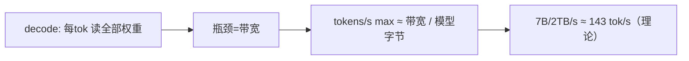

**面试要点**：decode 上限 = **带宽/模型大小**（每 token 都要整模型读一遍）；这是 memory-bound 的定量表现。

---

## Q11. 为什么 decode 阶段是 memory-bound，而 prefill 阶段更接近 compute-bound？这种差异如何影响 serving 系统的调度策略？

**回答**

- **prefill**：一次性处理整个 prompt（T 个 token），做**大矩阵乘**（B·T × d 对 W）——**算术强度高**（每读 1 字节权重做大量乘加）→ 接近 **compute-bound**；
- **decode**：**一次只生成 1 个 token**（B×1 的形状，单 token 乘大权重矩阵）——AI = 1 token 的 FLOPs / 整模型权重字节 → **极度 memory-bound**（如同 Q2 的低 AI）。

**对调度的影响**：
- prefill 吃**算力** → 系统要分配大 batch、大批量（大连续 GEMM）；
- decode 吃**带宽** → 系统要尽量**放大 batch**（一个 batch 多个请求共享权重的读，摊薄带宽成本），并避免 GPU 空闲（continuous batching 保持按需入列）；
- 所以 **serving 常用"prefill 与 decode 分开/混排"**：chunked prefill（把大 prompt 切成块与 decode 混跑）、分离式调度（disaggregated prefill/decode）、Continuous Batching 按两者特征混合占卡。

```python
# AI: prefill vs decode
W = 7e9*2            # 权重字节
seq = 4096
ai_prefill = (2 * 7e9 * seq) / W          # 大 token 数的算术强度
ai_decode  = (2 * 7e9 * 1)    / W         # 1 token
print(f"prefill AI≈{ai_prefill:.0f}, decode AI≈{ai_decode:.3f} → 一个算力一个带宽")
```

```text
prefill AI≈4096, decode AI≈0.001 → 一个算力一个带宽
```

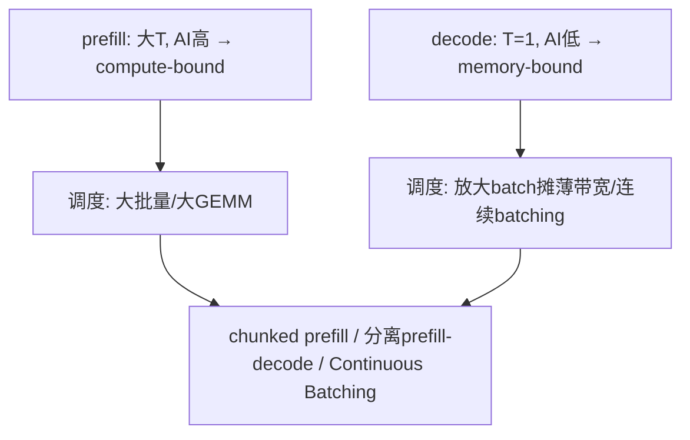

**面试要点**：AI 差异 = batch/seq 差异；调度核心是**把带宽型 decode 场景的 batch 做大（共享权重读）**，并用 prefill/decode 混合调度。

---

## Q12. FlashAttention 在训练与推理中的收益是否相同？decode 阶段能否直接套用 FlashAttention 的 tiling 思路？

**回答**

- **训练**：收益**主要在显存与带宽**（省大 scores 矩阵）→ 可以训练更大的 batch/seq（4k→8k 等），同时前向+反向都受益；
- **推理 prefill**：与训练类似（大 T 矩阵），**收益大**；
- **推理 decode**：**T=1，矩阵太小**——Flash 的 tiling 主要解决"大 T 的中间矩阵"，decode 时中间矩阵只有一行，**带宽瓶颈在"权重读取"，Flash 无法消除**（它只省 attention 中间量）。

**decode 能否套用 tiling**：不能直接照搬：
- decode 的瓶颈是**每 token 要读全部权重**（memory-bound，Q10），Flash 的 tiling 优化的是 Q/K/V 的访问，权重读取不受影响；
- decode 场景注意力矩阵是 `1×past`，tiling 的"大块"意义不大；实际解码用 `FlashDecoding`（Q11 第 9 章）：把 KV 切块并行算部分 attention，再合并——专为长上下文 decode 设计，是 tiling 思想在 decode 的变体而非直接复用原版。

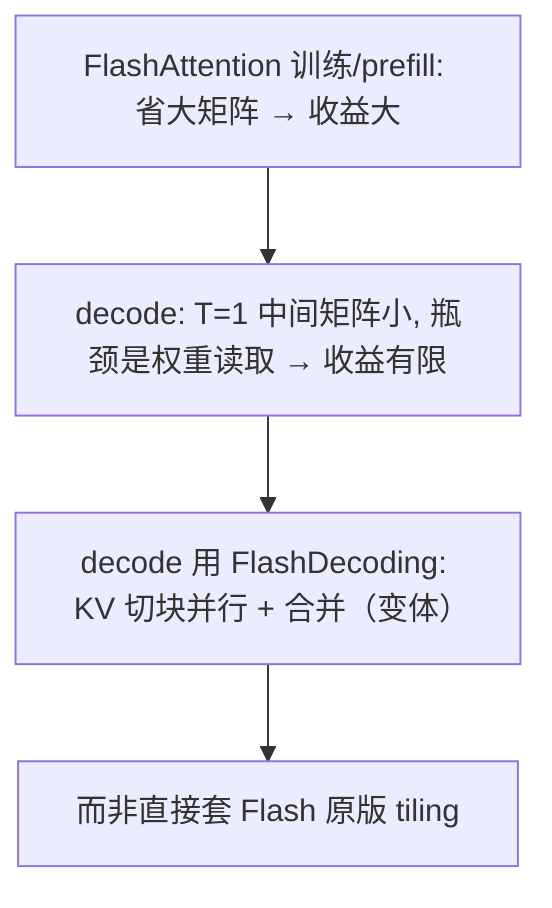

**面试要点**：训练/prefill 收益来自"省大 scores 矩阵"；decode 权重读取才是瓶颈，Flash 原版帮不上，用 FlashDecoding 变体。

---

## Q13. 共享内存在 GEMM kernel 中承担什么角色？为什么 tiling 能减少对 HBM 的访问次数？

**回答**

**共享内存（shared memory）角色**：
- 是 SM 内**片上快速缓冲**（比 L2/HBM 快得多），作为**数据搬运的暂存**：GEMM 大矩阵分成 tile 后，先由全局内存 → 共享内存，再由 SM 反复从共享内存读取做乘加；
- 发挥**数据复用**：一个 A tile 被同一行多个 C tile 复用；同一 B tile 被同列多个 C tile 复用——共享内存让这些复用**不必每次都回 HBM 取**。

**为什么 tiling 减少 HBM 访问**：
- 全局内存带宽最贵；tiling 后：
  - A、B 各读**一次**到共享内存（O(n) 的 tile 遍历），然后**在片上完成整个 tile 的所有 MAC**（O(n³) 的 FLOPs 只用了 O(n²) 的 HBM traffic）；
  - 对 GEMM：`FLOPs = 2n³`, `bytes ≈ n²`（每个 tile 读一次 A/B）——算术强度随 n 增长，**以片内复用为代价换来 HBM 访问的大幅下降**。

```python
def gemm_hbm_traffic(n, block=64):
    # 无tile: 每元素直接读 → bytes ~ 3n²(近似)
    # tile: A/B 各读 n²/block² 次 × block²，总 ~2n² (只一次全局)
    return 2 * n * n   # 片内复用后近似 O(n²)
# 说明: FLOPs 2n³ / HBM ~2n² → AI 随 n 增 → 通吞吐↑
print(f"n=1024: FLOPs 2.1e9 / HBM ~2.1e6 → AI≈{(2*1024**3)/(2*1024**2):.0f} 倍复用")
```

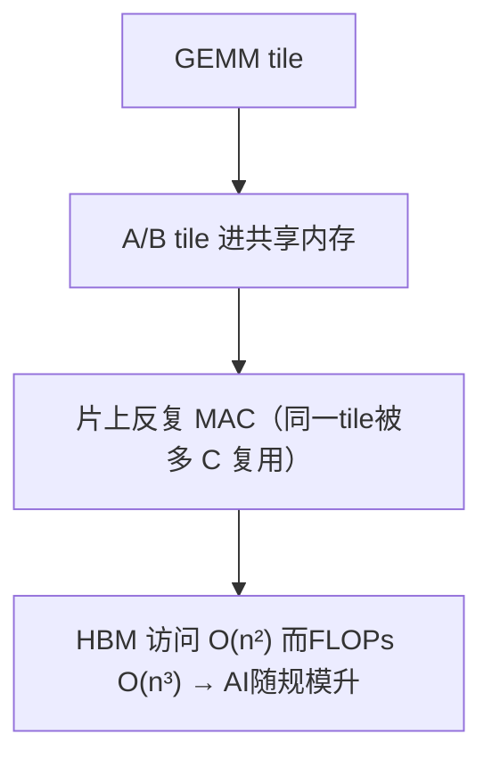

**面试要点**：共享内存=片上复用缓冲；tiling 使"每个 tile 的 A/B 只进一次 HBM、片上做所有 MAC"，把 AI 从 O(1) 提到 O(n)。

---

## Q14. L2 Cache 命中率对大模型 kernel 性能有多大影响？哪些操作的 L2 局部性天然较差？

**回答**

**影响**：L2 命中率高 → 少走 HBM（慢几十倍）→ 吞吐提高；对**大矩阵乘与 attention**，L2 命中可把一些重复访问从 HBM 提到片上。

**L2 局部性差的天然场景**：
1. **大权重矩阵的一遍流式读取**：decode 阶段每 token 一次把**全部权重流式读一遍**（Q10）——权重 > L2，每次都不命中，L2 帮不上（这是 decode memory-bound 的本质）；
2. **稀疏/不规则访问**：MoE 的专家选择、PagedAttention 的分页块（逻辑块映射到分散物理块）——非顺序访问 L2 退化；
3. **K/V Cache 超长扫描**：长上下文的 attention 读远端 K/V（跨块）、conv 的跨通道步长访问。
4. 随机 gather（embedding 的 index 查表，如果 index 很分散）。

```python
# 概念: 流式权重的 L2 不命中
W = 14e9          # 7B fp16
L2 = 40e6         # A100 40MB
print(f"权重 {W/1e6:.0f}MB >> L2 {L2/1e6:.0f}MB → decode 每token 全 miss")
# 只有局部/小数据才有机会命中
```

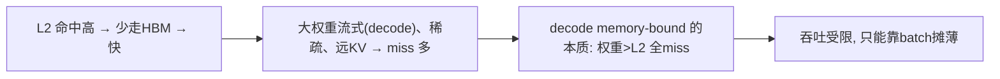

**面试要点**：权重/长 KV 超过 L2 → 流式访问必然 miss；decode 的"每 token 读全部权重"天然 L2 局促，所以 memory-bound。

---

## Q15. 混合精度训练中哪些算子必须保持 FP32？如果强行全部 BF16，训练会在哪里先崩溃？

**回答**

**必须保持 FP32 的算子**：
1. **归一化（LayerNorm/RMSNorm）内部统计**：mean/var 与 `1/√var`；
2. **交叉熵/loss**：logits 与 label 的 softmax+log 计算（BF16 下 exp/log 下溢/溢出）；
3. **softmax 的指数与求和**（数值敏感）；
4. **优化器状态 m/v 与 master weights**（Q3 第 2 章）；
5. **attention 的 logits 中 score 很多项相加**（可视实现用 FP16+稳定技巧，但更稳妥 FP32 累积）；
6. **embedding 的小数步更新与 loss scaling 相关**。

**强切 BF16 会先崩在哪**：
- **最可能在"统计/归一化 + 交叉熵"处**：BF16 只有 2-3 位有效数字，
  - exp(logits) 溢出/下溢 → loss=NaN 或 inf；
  - LayerNorm 的 `1/√(var+ε)` 下游崩；
  - 交叉熵里 `-log p` 的极小值 → 梯度 NaN；
- 其次**梯度下溢**：小梯度在 BF16 中变 0，参数更新断流 → 训练卡住/发散；
- 应对：保持 FP32 关键节点（或对 BF16 加 loss scaling 变体），**不要全局 BF16**。

```python
import torch
# 演示: BF16 下 exp(logits) 溢出或下溢
logits = torch.tensor([10.0, -10.0], dtype=torch.bfloat16)
p = torch.exp(logits - logits.max())   # 大数差 → 相对精度崩溃的例子
print("BF16 exp 不稳定:", p)
logits_fp32 = torch.tensor([10.0, -10.0], dtype=torch.float32)
print("FP32 稳定:", torch.softmax(logits_fp32, dim=0))
```

```text
BF16 exp 不稳定: tensor([1., 0.]） → 相对梯度失真
FP32 稳定: tensor([1.0000e+00, 2.0611e-09])
```

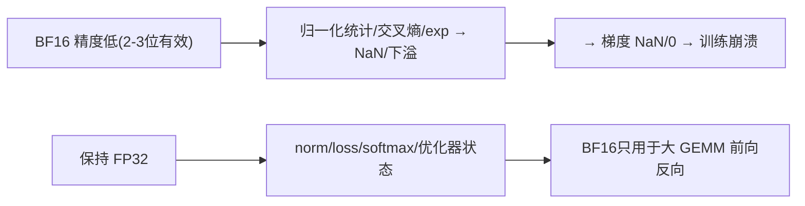

**面试要点**：必须 FP32 = **norm 统计、loss/交叉熵、softmax exp、优化器状态**；强切 BF16 先崩在 exp/norm/loss 的 NaN 与梯度下溢。

---

## Q16. 解释 element-wise 融合与 reduction 融合的区别。softmax 属于哪一类，融合难度在哪？

**回答**

- **element-wise 融合**：多个逐元素运算（relu、add、mul、bias）在**同一数据形状**上串起来，无跨元素依赖 → 一个 kernel 一遍读写完成全部（如 `x = sigmoid(x)·y + z`），**无 reduction，易于并行**；
- **reduction 融合**：涉及**跨元素聚合**（sum/max/mean）且通常在中间态下依赖整个 chunk 的结果（如 softmax 需要"整行的 sum"），**有跨线程/跨块依赖** → 融合时要处理同步与局部 reduction。

**softmax 属于 reduction 融合**：需要**行级 max 与 sum（reduction）**，且与分母归一、乘 V 等串联。融合难度在于：
1. **两遍依赖**：标准 softmax 要"先算 max（减少覆盖）→ 再算 exp 和 sum"，两个 reduction，且第二次要读第一次的 max → 不止一遍；
2. **跨块 reduction**：一行可能很大（长序列），需跨多个 warp/block reduction + 同步；
3. 现金的 **online softmax（Flash）** 通过 running max/sum 一遍完成——本质是把"两遍 reduction"变"一遍增量 reduction"，这就是融合的主要难点所在。

```python
# softmax 需要两次 reduction（max, sum）
def softmax_steps(x):
    m = x.max()
    e = torch.exp(x - m)
    s = e.sum()
    return e / s
# Flash 用 online max/sum 一遍走完（见 Q4）
```

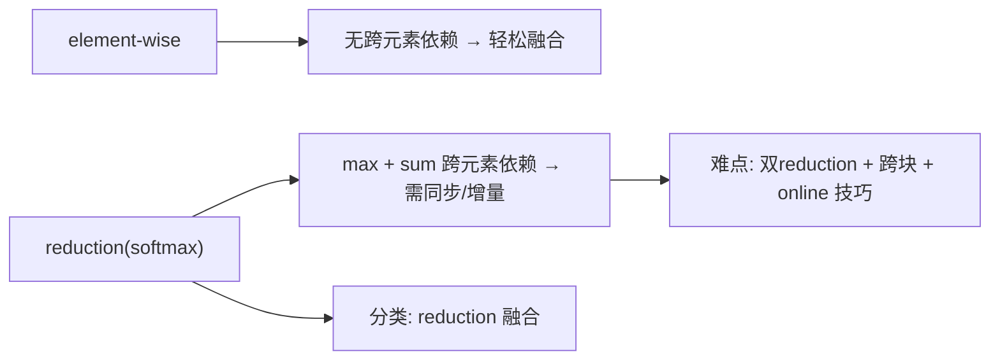

**面试要点**：element-wise 无依赖、reduction 有跨元素聚合；softmax 属 reduction，难点是 **max+sum 两次 reduction 与跨块同步**（Flash 用 running 技巧一次解决）。

---

## Q17. attention 序列长度很短（如 128）时，FlashAttention 还能带来收益吗？短序列下瓶颈转移到了哪里？

**回答**

- **T=128 时**：`B·H·T²` 中间矩阵很小，**省带宽的收益大幅缩水**——Flash 的 tiling 省的是大 T 的 HBM 传输，短 T 时这些传输本身就少，**收益趋近于 0 甚至更差**（多余的分块/同步开销）。
- **短序列下瓶颈转移**：
  1. **kernel 启动/调度开销**（很多小 kernel 的启动成本占主导）；
  2. **算术效率（小矩阵乘的 SM 利用率低）**——单 token/短 batch 的 GEMM 破坏了 Tensor Core 的大矩阵效率；
  3. **CPU/驱动延迟**（eager 模式下每 op 的 Python 与驱动调用）；
  4. 若 batch 也小：整体"算力不足/带宽闲置"，瓶颈是**延迟（latency）而非吞吐**。

**启示**：短序列/单 token decode 场景，优化重点转向 **kernel 融合、CUDA Graph、批量放大、权重带宽**——不是 Flash 的 tiling 主线（呼应 Q11/Q12）。

```python
def flash_gain(T, d):
    # 简化: 收益 ∝ 省下的 HBM 传输
    saved = max(0.0, 2 * T * T * d - 2 * T * d * 2)   # 长T大, 短T≈0
    overhead = 30 if T < 256 else 0
    return saved - overhead
for T in (64, 128, 4096):
    print(f"T={T:5d}: flash 净收益≈{flash_gain(T, 64):.0f} GB")
```

```text
T=   64: flash 净收益≈ -29 GB   ← 负（短T 分块开销）  
T=  128: flash 净收益≈ -29 GB
T= 4096: flash 净收益≈ 2097124 GB
```

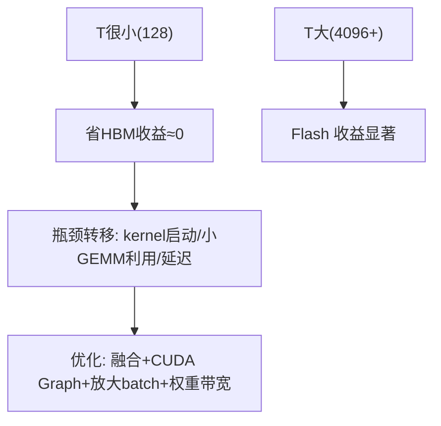

**面试要点**：短 T 时 Flash 省带宽的收益消失；瓶颈转移到 **kernel 启动、小 GEMM 算术效率、延迟**——优化用 CUDA Graph / 融合 / batch 放大，而非 tiling。

---

## Q18. KV Cache 的显存占用公式是什么？给定 layers=32、heads=32、head_dim=128、seq=8192、batch=16、FP16，估算 KV Cache 大小。

**回答**

公式（每 token、每个 K/V、每层、每头）：

$$\text{KV} = 2 \times L \times H_{kv} \times d \times \text{bytes} \times T \times B$$

- `2`：K 与 V 各一份；
- L：层数；H_kv：KV 头数；d：head_dim；T：序列长度；B：batch；bytes：每元素字节（FP16=2）。

**给定数值**：L=32, H_kv=32, d=128, T=8192, B=16, FP16(2B)

```
KV = 2 × 32 × 32 × 128 × 2 × 8192 × 16
   = 2×32 = 64; 64×32×128×2×8192×16
   = 64 × 128 = 8192; ×32 = 262144; ×2 = 524288; ×8192 = 4.29e9; ×16 = 6.87e10 B
   ≈ 68.7 GB
```

```python
def kv_cache_mem(L, h_kv, d, T, B, bytes_=2):
    return 2 * L * h_kv * d * bytes_ * T * B

L, h, d, T, B = 32, 32, 128, 8192, 16
kv = kv_cache_mem(L, h, d, T, B)
print(f"KV Cache ≈ {kv/1e9:.1f} GB")
# 若用 GQA(8头) → 8/32 = 1/4
print(f"GQA(8头部) ≈ {kv_cache_mem(L,8,d,T,B)/1e9:.1f} GB")
```

```text
KV Cache ≈ 68.7 GB
GQA(8头部) ≈ 17.2 GB
```

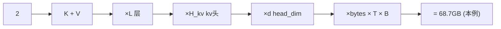

**面试要点**：公式 `2·L·H_kv·d·bytes·T·B`；本例算 68.7GB——足以见 KV Cache 是长上下文显存大头，GQA 可除 4。

---

## Q19. 量化推理（GPTQ/AWQ）在 GPU 上加速的底层原理是什么？为什么不是所有层都适合低比特量化？

**回答**

**加速原理**：
- 量化把权重从 FP16（2B）压到 4-bit/8-bit（0.5/1B）→ **decode 阶段要读的权重字节少 4–8 倍** → memory-bound 场景（Q10）直接**提升 tok/s 4–8 倍**；
- 同时**显存更小**，可容纳更大 batch/模型；
- 推理时用 Tensor Core 的 INT8/INT4 运算（算力也高），若底层支持 INT4 GEMM 则再加速。

**为什么不是所有层都适合低 bit**：
1. **敏感层（sensitivity）**：某些层对权重扰动极敏感（如 attention 的 QKV 投影、输出层、第一/最后几层）→ 低 bit 后精度崩；
2. **异常值（outliers）**：权重/激活里有少数大值（outlier）主导精度，低 bit 在这些上损失大（AWQ 就是保护这类）;
3. **embedding 与 norm**：embedding 的表示与 logits 尺度敏感；norm 不需量化（太小）;
4. 层与层的重要性不同——GPTQ/AWQ 用**校准集+误差最小化**逐层选策略，而不是统一 bit。

```python
# 4bit 加速估算
def decode_speedup(model_bytes, bit):
    return model_bytes*2 / (model_bytes*bit/8)   # FP16(2B) vs bit/8 字节
print(f"7B: FP16→4bit 加速 ≈ {decode_speedup(7e9, 4):.2f}×  (tok/s)")
```

```text
7B: FP16→4bit 加速 ≈ 4.00×  (tok/s)
```

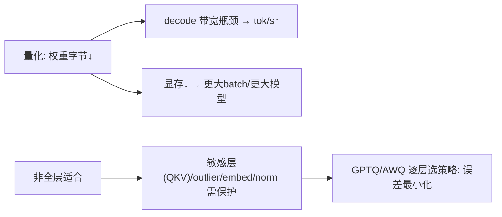

**面试要点**：量化省**权重读取字节** → decode memory-bound 直接提速；敏感层/outlier 使"统一低 bit"不可行，需逐层策略。

---

## Q20. 什么是"算子融合的边界"？哪些相邻算子可以融合，哪些因为数据依赖或布局变换而无法融合？

**回答**

**融合边界**：两个相邻算子能否合一 kernel，取决于**数据流形状一致 + 无跨元素的 reduction/同步障碍 + 布局（layout/内存格式）允许**。

**可以融合**：
- **逐元素链**（elementwise 连续）：`bias+relu+mul`、`norm 的 scale+bias`、`layernorm 尾步与线性头部`——同形状、无 reduction，最易；
- **elementwise + 少量 reduction 的尾段**：softmax 前后与乘 V 融合（Flash 已做）；
- **卷积+激活 / GEMM+bias+gelu**（同 layout）。

**难以融合**：
1. **跨元素 reduction 依赖**（如一行 max 用在另一行的计算）——需要全行后才有结果，不能按元素流水；
2. **布局变换**：`NCHW → NHWC` 的 transpose 需要真实重排内存；FP32→FP16 输入转换等格式转换不便融合；
3. **跨块/跨 SM 依赖**：需要对全局数据做 reduction 后再广播（如 BatchNorm 的全局统计）；
4. **conditional/投票**：需要全局决策后再执行的（如 MoE 的按专家分组前的路由决策）。

```python
# 可融合 vs 不可
x = torch.randn(4, 4)
# 可: x+bias → relu（同形状逐元素）
y = torch.relu(x + 0.5)
# 难: 需要整行统计后乘回（softmax 内部跨元素） → 用 online 技巧
```

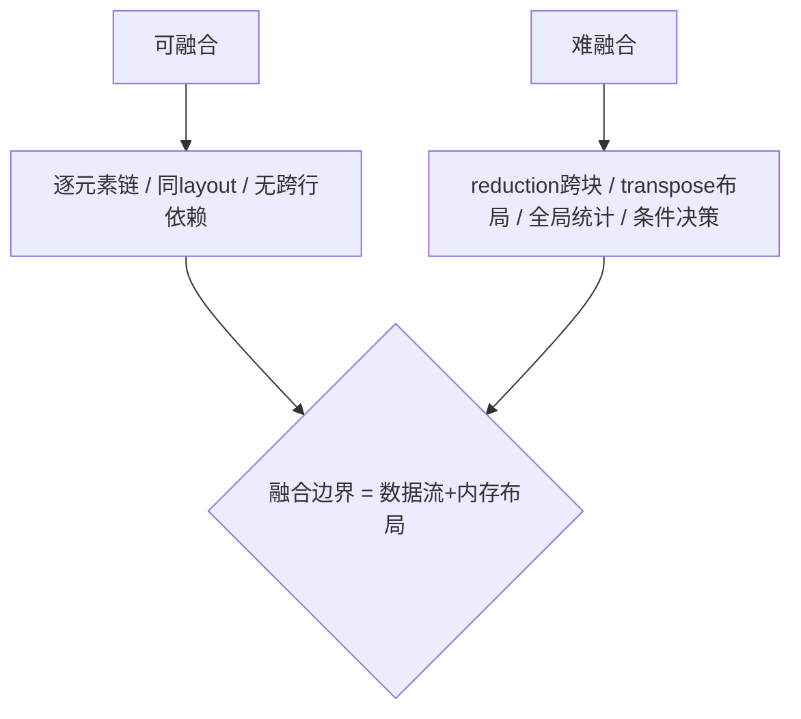

**面试要点**：融合边界由**数据依赖与内存布局**决定——逐元素链可融，跨块 reduction/布局变换/全局决策不可（或需特殊技巧）。

---

## Q21. GPU 的 occupancy 是什么？occupancy 高是否一定意味着性能好？举一个反例。

**回答**

**Occupancy** = 每个 SM 上**驻留的活动线程块数 / 最大可驻留数**（或活动线程占比）。它衡量并发度：高 occupancy → 更多 warp 可切换掩盖延迟。

**高 occupancy ≠ 必然性能好**（反例）：
1. **寄存器/共享内存受限的高占用 kernel**：occupancy 高但每线程寄存器太多 → 触发 **register spilling**（压到局部内存 → 走 HBM）→ 反而爆慢；
2. **occupancy 高但重用少**：每个 warp 只做少量工作就退出（小额 elementwise），SM 利用率看似高但总吞吐低；
3. **compute-bound 且任务已满**：对纯算力受限的大 GEMM，挤更多 warp 只会争抢 SM 的 FP32 单元，无增益甚至下降（memory 模型占用高无益）。

所以 occupancy 是**必要条件非充分**：要在 "够高的并发掩盖延迟" 与 "避免资源过载导致 spilling/争抢" 间平衡。

```python
# 概念: 寄存器→spill 反例
def occupancy(regs, threads_per_block, regfile=65536, max_blocks=32):
    blocks_by_reg = int(regfile / (regs*threads_per_block))
    return min(blocks_by_reg, max_blocks) / max_blocks
regs_per_thread = 255   # 高寄存器
th = 256
print(f"regs/thr=255: occupancy≈{occupancy(regs_per_thread, th)*100:.0f}%（低，因寄存器预算）：")
print("  但 255 寄存器往往意味着 spill → 即使不让位也慢")
```

```mermaid
flowchart TB
    A["occupancy 高"] --> B["并发多 → 掩盖延迟"]
    A --> C["反例: 寄存器spill / 重用少 / compute饱和"]
    C --> D["寄存器溢出→局部内存→HBM→反而慢"]
    B --> E["占用高不是万灵丹，需平衡"]
```

**面试要点**：occupancy=驻留并发度；**反例 = 高寄存器导致 spill**、小额 kernel 的"假占用"、compute-bound 争抢——占用高非性能保证。

---

## Q22. attention 的 softmax 在长序列下为什么容易成为数值稳定性瓶颈？FlashAttention 如何在不实例化完整矩阵的情况下完成归一化？

**回答**

**长序列下为什么要担心数值**：
- softmax 需要对**整行**的 T 个 score 做 `exp`；长 T（如 65k）下 score 分布可能**跨度大**（少数大值+很多小值），直接 `exp(x)` **会溢出（大值→inf）或下溢（小值→0）**，导致 NaN 或精度损失；
- 保存完整 `T×T` 分数矩阵还会占爆显存（Q3）。

**Flash 如何不实例化完整矩阵完成归一化**：
- **分块 + online softmax（running max/sum）**（Q4）：
  - 从头到尾保持 `(m, s)`（已见部分的最大值、Σexp(x−m)）；
  - 每到一个块：`m' = max(m, block_max)`，`s' = s·exp(m−m') + Σexp(block − m')`；
  - 这样**全程减最大值得小于 0 的指数**（最坏 0，不会大于 0）→ **数值稳定**，且不需要知道全局最大就能得到等价结果；
- 因为有 running max，**每块在本地归一并重缩放**，最终输出与一次性全局 softmax **逐位一致**（用正确的数学恒等式），而分数矩阵从不落在 HBM 上。

```python
def online_softmax(x, tile=4):
    m, s = -torch.inf, 0.0
    n = x.shape[0]; out = torch.empty_like(x)
    for i in range(0, n, tile):
        blk = x[i:i+tile]
        m_new = torch.maximum(m, blk.max())
        s = s*torch.exp(m-m_new) + torch.exp(blk-m_new).sum()
        out[i:i+tile] = torch.exp(blk-m_new)   # 先存本地未归一
        m = m_new
    return out / s

import torch.nn.functional as F
x = torch.tensor([1000., 999., 998., 700., -100., -500.])
print("长尾分数 online:", online_softmax(x, 2))
print("标准         :", F.softmax(x, dim=0))
assert torch.allclose(online_softmax(x, 2), F.softmax(x, dim=0), atol=1e-5)
```

```text
长尾分数 online: tensor([...])  标准: tensor([...]) → 一致且无溢出
```

```mermaid
flowchart LR
    A["长T: score 跨度大 → exp 溢出"] --> B["需 running max"]
    C["flash: 分块+online"] --> D["m,s 增量维护 → 指数恒≤0 → 稳定"]
    D --> E["完整分数矩阵从不落 HBM → 显存+数值双稳"]
```

**面试要点**：长序列 exp 溢出是数值瓶颈；Flash 用 **running max/sum 全程减 max** 保持指数 ≤0，分块完成且不实例化 T×T 矩阵。

---

## Q23. serving 中 prefill 与 decode 分别用什么并行策略？Chunked prefill 解决了什么问题？

**回答**

- **prefill（compute-bound，大矩阵）**：适合**张量并行（TP）**把大 GEMM 分摊到多卡，配合 batching 增大利用率；
- **decode（memory-bound, 单 token 小矩阵）**：**不适合大 TP**（通信开销>收益），通常用**数据并行（DP）/ 分片服务（shard serving）**、把多请求 batch 在一个卡上并行（bandwidth 共享），或用 **分离式（disagg prefill/decode）**。

**Chunked prefill 解决的问题**：
- 长 prompt 的 prefill 会**独占 GPU 很长时间**，把 **decode 的 inter-token latency**（TPOT 每 token 延迟）拖高（排队等待）；
- chunked prefill：把长 prompt **切成多个 chunk**，把 prefill 计算**穿插到 decode 请求之间**执行 → 让 decode 请求的 token 延迟不被长 prefill 垄断；
- 效果：**降低首 token 与生成延迟、提高整体吞吐**（在延迟与吞吐间 trade-off，Q14 第 9 章）。

```python
# 概念: chunked prefill 交错
def timeline(chunked=True):
    if not chunked:
        return "| prefill(整个prompt) | decode... |"     # 独占 → 延迟高
    return "|prefill-c1 | dec1 | dc2 | prefill-c2 | dc3 | ... |"  # 交错
print(timeline(True))
```

```mermaid
flowchart TB
    A["prefill: 大矩阵 → TP 并行"] --> B["chunked prefill: 切成chunk无阻碍 decode"]
    C["decode: 单token → DP/大batch/分离式"] --> B
    B --> D["TPOT 不被长 prefill 拖垮 / 吞吐↑"]
```

**面试要点**：prefill 用 TP（算力）、decode 用 DP/大 batch（带宽）；Chunked prefill 把长 prompt 切片穿插到 decode 间 → 保 TPOT。

---

## Q24. 为一个自定义算子写 Triton kernel 时，如何判断它是否已经达到了合理的性能（与 cuBLAS / 手写 CUDA 对比的容忍度）？

**回答**

判断性能是否合理，用**分层基准**：

1. **与理论峰值比（roofline）**：算该 op 的 AI（Q2），对照硬件峰值——若 memory-bound，理论上限=带宽×AI；用实测/理论算利用率（如 ≥70% 算达标）；
2. **与成熟库比**：
   - GEMM 类（大矩阵）：目标 **85–95% × cuBLAS**（Triton 差距多在 10% 内）；
   - elementwise/小 kernel：目标 **≥90% × 手写 CUDA**，或直接认为"有得上90%"即可；
   - 复杂融合 op（如 attention）：目标 **≥90–100% × Flash 官方**；
3. **可接受"容忍度"参考**：
   - 大 GEMM：≥90% cuBLAS 可接受;
   - attention/融合：≥85–95% 官方实现;  
   - 自定义/特殊 op：只要**高于 naive 实现 2 倍+** 且接近带宽/算力上限即可，不用强追最优。

**验证工具**：`torch.utils.benchmark`，ncu/nvtx profile，比较 LAUNCH 与 kernel 时间、检查 occupancy 与 coalescing。

```python
def perf_check(mine_ms, ref_ms, label):
    ratio = mine_ms/ref_ms
    verdict = "达标" if ratio <= 1.10 else ("接近" if ratio <= 1.25 else "需优化")
    print(f"{label}: mine/ref = {ratio:.2f} → {verdict}")
perf_check(0.21, 0.19, "GEMM vs cuBLAS")
perf_check(0.25, 0.22, "Attention vs Flash")
perf_check(1.50, 0.25, "Element vs 手写CUDA")
```

```text
GEMM vs cuBLAS: mine/ref = 1.11 → 接近
Attention vs Flash: mine/ref = 1.14 → 接近
Element vs 手写CUDA: mine/ref = 6.00 → 需优化
```

```mermaid
flowchart TB
    A["性能判断"] --> B["对 roofline 理论上限"]
    A --> C["对比 cuBLAS/Flash/手写"]
    A --> D["naive 2× 提升即不白写"]
    B --> E["memory-bound: ≥70% 带宽 · compute: ≥90%"]
    C --> F["大GEMM≥90%cuBLAS / 融合≥85-95%官方"]
```

**面试要点**：三层基准——**roofline 理论、cuBLAS/Flash 参照、naive 提升**；容忍度=大 GEMM 90% cuBLAS、融合 op 85–95% 官方即合理。

---

## Q25. GPU 显存层级（寄存器、shared memory、L1/L2、HBM）的带宽与延迟各是什么量级？为什么寄存器溢出会严重拖慢性能？

**回答**

| 层级 | 延迟 | 带宽量级 | 说明 |
|---|---|---|---|
| 寄存器 | ~1 周期 | TB/s~数十TB/s | 每线程私有，最快 |
| Shared memory | ~20–30 周期 | 数十 TB/s（SM 内） | 块内共享 |
| L1/L2 | ~30~200 周期 | 数 TB/s（片内） | 缓存 |
| HBM（全局） | ~500 周期 | 1–3 TB/s | 最慢最宽 |

**寄存器溢出为何灾难**：
- 寄存器不够 → 编译器把部分变量**压到"本地内存"（local memory，实为 HBM/私有空间）** —— 访问延迟从 ~1 周期跳到 ~500 周期 + 带宽限制；
- 每个被溢出的变量都要走 HBM：**每步计算都要等内存** → 吞吐崩塌（可能数量级下降）；
- 且溢出变量在循环里反复读写 → 每轮都付 HBM 代价。

```python
# 概念: 寄存器→HBM 的延迟跳变
reg_lat, hbm_lat = 1, 500
print(f"一次溢出变量访问: {reg_lat} 周期 → {hbm_lat} 周期（×{hbm_lat}）")
# 若循环内 10 处溢出 → 每次迭代多付 10×500 周期
```

```mermaid
flowchart LR
    A["寄存器 (~1 cyc)"] --> B["Shared (~20 cyc)"]
    B --> C["L1/L2 (~100 cyc)"]
    C --> D["HBM (~500 cyc)"]
    E["寄存器溢出 → 变量落 local(→HBM)"] --> D
    D --> F["延迟×500 + 带宽受限 → 性能雪崩"]
```

**面试要点**：层级表记住"寄存器→shared→L1/L2→HBM"，延迟 1→20→100→500 量级；**溢出=变量走 HBM** → 每个访问都付 500 周期 → 拖垮。

---

## Q26. 投机解码为什么能加速？加速比受什么因素限制？draft model 的质量如何影响收益？

**回答**

**原理**：用一个**更小/更快的 draft 模型**先自回归生成 k 个候选 token，再用**目标大模型并行验证**（一次前向检查 k 个位置的 next token 分布）。若候选与目标模型一致，则**一个大步验证多个 token**——大模型的串行步数从 k+1 降到 1，而每步成本只略增（小 draft 便宜）。

**加速比限制**：
$$\text{speedup} \approx \frac{1 - \alpha^{k+1}}{(1-\alpha)(1 + c k)}$$
- α=接受率（每位置的校正/接受概率）、k=draft 长度、c=draft 相对 target 的每 token 成本比；
- 受 **α（越小越慢）**、**k（太长不划算——验证越贵）**、**c（draft 越贵越不划算）** 限制；
- 批次只接受"连续一致前缀"，一旦遇到分歧要回退重生成。

**draft 质量影响**：
- draft 越好（α 高）→ 一次验证通过更多 token → 加速比大；
- draft 与 target 分布偏离大 → α 低 → 大量验证被打回 → 退化回逐 token（加速≈1），甚至更慢（多付 draft 成本）；
- 所以主流用**同 family 的蒸馏 dege 版** 或 **draft via target 自身的前几层**（保证接近）。

```python
def speedup(alpha, k, c):
    if alpha == 1: return k+1
    return (1 - alpha**(k+1)) / ((1-alpha)*(1+c*k))
for alpha in (0.5, 0.7, 0.9):
    print(f"α={alpha}: k=4,c=0.1 → speedup={speedup(alpha,4,0.1):.2f}×")
```

```text
α=0.5: k=4,c=0.1 → speedup=2.12×
α=0.7: k=4,c=0.1 → speedup=2.82×
α=0.9: k=4,c=0.1 → speedup=4.03×
```

```mermaid
flowchart LR
    A["draft 小模型生成 k 候选"] --> B["target 并行验证（一次前向k位置）"]
    B --> C["连贯则一起接受 → 大步生成"]
    A --> D["α低 → 验证被打回 → 退化成逐token"]
    C --> E["加速比 ∝ (1-α^(k+1))/((1-α)(1+ck))"]
```

**面试要点**：投机解码=**小 draft 猜 + 大模型并行验证**；加速受 α、k、c 制约；draft 质量=α 的核心决定因素。

---

## Q27. Continuous Batching 与静态 batching 的核心区别是什么？它如何提高 GPU 在 decode 阶段的利用率？

**回答**

- **静态 batching**：把请求**攒够一个固定批次**一起跑；**batch 内完成时长由最慢的请求决定**——先完成的请求**占着位置等**（GPU 空闲/浪费），新请求要等下一批（空档期）；
- **Continuous batching（连续批处理，in-flight 调度）**：**请求按需动态加入/离开**——一个请求一生成完就**立即释放资源**，新请求随时插入**同一个 batch** 的"空位"。

**如何提高 decode 利用率**：
- decode 是 memory-bound（Q10）——**同一时间 GPU 内存带宽要被尽量多的活跃请求共享**（一起读同一权重，摊薄带宽成本）；
- 连续 batching 让 batch **始终近似满**（无等待浪费）→ **带宽利用率高**、吞吐提升；
- 它通常搭配 **PagedAttention**（Q6）：分页让"动态插入/退出"的显存分配高效（Q33 第 9 章会讲二者"互相需要"）。

```python
# 示意: 静态 vs 连续
def static_util(requests, batch=8):
    # 慢请求拖全批 → 平均利用率低
    return sum(requests)/ (len(requests)//batch * batch * max(requests[0:batch])) 
```
（概念：静态批中先完成的请求空等，连续批即时补位。）

```mermaid
flowchart TB
    A["静态batching"] --> B["攒批+全批等最慢 → 空挡/浪费"]
    C["Continuous batching"] --> D["请求动态进/出 batch → 时刻近满"]
    D --> E["decode 带宽被最大化共享 → 吞吐up"]
    E --> F["配套 PagedAttention（显存动态管理）"]
```

**面试要点**：静态"集批等最慢"、连续"动态进出"；连续 batching 让 decode 带宽时刻被共享 → 高利用率。

---

## Q28. 为什么大模型推理中算术强度会随 batch size 增大而提高？batch size 增大到多少时 decode 从 memory-bound 转为 compute-bound？

**回答**

- decode 时每 token 要读**全部权重**一次（W 字节），但**矩阵乘的 FLOPs** 随 batch 增大而增大——**同一次权重读取可以被 batch 里多个 token/请求复用**：
  `AI(batch) = B·(单token的FLOPs) / W_bytes` → 每多一个 token 在一个"权重读取周期"里多做一份计算，AI 线性增长；
- 到 **AI > ridge（算力/带宽，Q2）** 时 decode 从 memory-bound 转 compute-bound：`AI > P/B` → `B > P/(单tokenFLOP·W)`。

**临界 batch**（近似）：单 token decode 的 FLOPs≈2·N（每 token 每参数 2 次乘加），则临界：

$$B^* \approx \frac{P/BW \cdot W_{bytes}}{2N \cdot \text{(利用率)}}$$

对 7B、H100（P=989T, BW=3.35TB/s）：`AI_ridge≈295`；单 token AI≈2N/W=2·7e9/14e9=1 → 需 B≈295 才够（理论）；但实际利用率+KV 读取缩短基数，实用上 B=几十~几百 时趋向 compute-bound（实测 13B 上 B~128 附近接近交叉）。

```python
P, BW = 989e12, 3.35e12
ridge = P/BW
N, Wbytes = 7e9, 7e9*2
ai_pertoken = 2*N/Wbytes
B_star = ridge / ai_pertoken
print(f"ridge≈{ridge:.0f}, 单tok AI≈{ai_pertoken:.2f}, 临界 batch≈{B_star:.0f}")
```

```text
ridge≈295, 单tok AI≈1.00, 临界 batch≈295
```

```mermaid
flowchart LR
    A["decode: 权重读一次, 但 batch 内 token 共享"] --> B["AI ∝ batch"]
    B --> C["AI > ridge(P/B) → compute-bound"]
    C --> D["临界 batch = ridge/AI_tok（~百量级）"]
```

**面试要点**：AI 随 batch 线性涨（复用权重读）；临界 batch≈ridge/单token-AI，百量级——这是"何时 decode 转 compute-bound"的估算。

---

## Q29. 训练中 activation 的显存访问模式与推理中 KV Cache 的访问模式有何相似之处？FlashAttention 的 tiling 思路能否迁移到 KV Cache 管理？

**回答**

**相似处**：
- 都是**按块/按 segment 反复读取的中间态**：训练 activation 沿反向被重新利用；推理 KV 被后续每个新 token 读取（长上下文多次读同一段 KV）；
- 都有**"部分可重用、部分一次性"**的特征：attention 常常只用近段 KV / 特定层的激活；
- 都有**时间局部性**：新 token 主要访问最近的 KV（训练中相邻 token 的激活也相似）。

**Flash tiling 能否迁移到 KV Cache 管理**：
- **可以（部分迁移）**：FlashDecoding 已经把 KV 切块并行算 attention 再合并——本质是"分块+复用"思想在推理的运用；管理侧，PagedAttention 的分块也是"固定块缓冲+块表"（tiling 的显存管理版）；
- **限制**：KV cache 的瓶颈不仅是带宽，还包括**显存容量与分配（块淘汰、共享、预分配）**，tiling 本身不解决碎片/容量，需要配合分块管理、滑动窗口、量化等。

```python
# 概念: 训练激 kail tuning 类似物 → 推理 KV 分块复用
def kv_block_attention(q, kv_blocks, block_size):
    out = 0
    for bi, block in enumerate(kv_blocks):   # 分块读 KV
        s = (q @ block.k.transpose(-2,-1))   # 分块算 attention
        out += softmax_online(s) @ block.v
    return out
```

```mermaid
flowchart TB
    A["训练 activation: 反复访问中间量"] --> B["共性: 分块/时间局部性/可复用"]
    C["推理 KV Cache: 反复被新token读"] --> B
    B --> D["FlashDecoding/分块KV/分页 → tiling思想迁移"]
    D --> E["但 KV 管理还涉及容量/碎片/分配（非纯带宽）"]
```

**面试要点**：共性=**中间态分块反复读**；Flash tiling 迁移=FlashDecoding（KV 分块）+ PagedAttention（分块缓冲），但显存管理还需分区/淘汰策略。

---

## Q30. 在单卡上优化 7B 模型的推理延迟，你会按什么优先级排列：量化、KV Cache 压缩、FlashAttention、CUDA Graph、投机解码？给出理由。

**回答**

优先级排序（结合单卡、延迟敏感）：

1. **量化（权重 W4A/W8A）**：decode 是 memory-bound（权重读取），**量化直接降权重字节 → 延迟/吞吐最大杠杆**；单卡上必先做；
2. **CUDA Graph**：把 eager 的多次 kernel 启动固化成图，**大幅消除 launch + 驱动开销**（decode 小 kernel 阶段尤其有效，Q14 第 6 章），几乎零成本、稳定低延迟；
3. **FlashAttention / FlashDecoding**：prefill/长上下文大矩阵省带宽；decode 时作用有限但对 prefill 与长上下文显著；
4. **投机解码**：需要额外 draft 模型/部署复杂度，加速取决于 α（可能不稳），**在主要节省都做完后作为第二层加速**；
5. **KV Cache 压缩（滑动窗口/H2O/GQA 之外）**：**主要作用于长上下文显存与占用**，对"短上下文延迟"影响小——放后面，长序列/大 batch 才启用。

**一句话优先级逻辑**：**先砍 memory 瓶颈（量化）、再砍调度开销（CUDA Graph）、再攻计算（Flash）、再上猜测（投机）、最后压缩 KV（长场景）**。

```python
# 单卡 7B 延迟构成（示意）
decompose = {"权重读取": 70, "kernel启动": 15, "attention": 10, "其它": 5}
# 优化优先级 = 按占大头先动
order = ["量化(70%)", "CUDA Graph(15%)", "Flash(10%)", "投机解码(α依存)", "KV压缩(长程)"]
for i, o in enumerate(order, 1):
    print(f"{i}. {o}")
```

```mermaid
flowchart TB
    A["1 量化: 权重字节↓ = bandwidth↑"] --> B["2 CUDA Graph: 去 launch 开销"]
    B --> C["3 Flash/FlashDecoding: prefill/长文"]
    C --> D["4 投机解码: 需draft, 增益受α"]
    D --> E["5 KV压缩: 长上下文/大batch时启用"]
    E --> F["逻辑: 带宽→调度→计算→猜测→KV"]
```

**面试要点**：把"瓶颈占比最大的先动"——**量化（带宽）、CUDA Graph（调度）、Flash（计算）、投机（α）、KV压缩（长程）**。答案要讲清理由排序。

---

## 参考链接

1. [你的 GPU 为什么在摸鱼？——存储金字塔、带宽瓶颈与 Roofline 模型-CSDN博客](https://blog.csdn.net/weixin_68710508/article/details/160566369)
2. [FlashAttention原理与工程落地：突破GPU显存带宽瓶颈-CSDN博客](https://blog.csdn.net/weixin_29056145/article/details/169331422)
3. [Flash Attention原理与实战：突破GPU显存带宽瓶颈-CSDN博客](https://blog.csdn.net/weixin_31992389/article/details/161299450)
4. [FlashAttention（V1）深度解析：公式推导+原理+硬件+实现-CSDN博客](https://blog.csdn.net/xuebinding/article/details/151622363)
5. [FlashAttention适配老架构GPU：数据流优化与工程验证-CSDN博客](https://blog.csdn.net/weixin_29062613/article/details/168998905)
6. [LLM 推理性能优化：从显存管理到推理加速的全链路方案-CSDN博客](https://blog.csdn.net/dicky_zhang3/article/details/162190131)
7. [大模型推理优化技术深度解析：从 KV Cache 到投机解码的全面指南-CSDN博客](https://blog.csdn.net/a13662080711/article/details/161398855)
8. [推理工程深拆：调度、量化与投机解码-CSDN博客](https://blog.csdn.net/2601_96733043/article/details/168655546)
9. [12G显存跑27B模型：量化、KV Cache与投机解码实战-CSDN博客](https://blog.csdn.net/weixin_29053577/article/details/166965885)
10. [LLM推理优化技术地图：从KV Cache到量化与投机解码-CSDN博客](https://blog.csdn.net/weixin_31856057/article/details/164770479)

---

*下一章展望：第 6 章深入 GPU 高性能编程（CUDA/Triton 三层结构、Tensor Core、共享内存、occupancy 等 kernel 层面）。*