# 第 5 章 · GPU 与相关优化

> 面试生普（LLM 500 题）· 第 5 章。本章覆盖 GPU 架构哲学、arithmetic intensity 与 roofline、FlashAttention、PagedAttention、kernel fusion、混合精度、显存带宽与推理速度、投机解码、Continuous Batching 等 30 个问题，关键概念配 Python 代码与 mermaid 图解。

> 先把话说清楚：大模型的训练和推理，最后都要落到 GPU 这块芯片上跑。同样一块卡，懂不懂它的"脾气"，跑出来的速度能差好几倍。这一章就带你认识 GPU 的基本构造（核心、显存、带宽），再讲几个决定速度的关键概念——计算强度、roofline、FlashAttention、量化、投机解码等。你不需要事先懂 CUDA，跟着每题从"为什么会慢"讲到"怎么把它变快"，就能建立起对 GPU 性能的直觉。30 个问题，每题的"回答"讲道理，"面试要点"给你一句能拿出去说的浓缩版。

---

## Q1. GPU 的 SM 数量与 CPU 核心数量在架构哲学上有何根本不同？为什么 GPU 用大量线程来"掩盖"延迟？

**回答**

CPU 和 GPU 在设计思路上，几乎是两个极端。可以先这样理解：**CPU 是"几个博士"，GPU 是"几千个熟练工"**。

- **CPU 核心**：数量少（一般 4–64 个），但每一个都很强。它靠超大号的乱序执行、分支预测、缓存命中优化，用一整套以"把单个任务尽快算完"为中心的复杂流水线，把延迟压到最低。
- **GPU 的 SM（Streaming Multiprocessor，流式多处理器）**：数量多（比如 A100 有 108 个 SM），但每个都比 CPU 核心简单。一个 SM 里可以同时驻留上千个线程，它不算"单个线程有多快"，而是算"一大摊活一起干，总共能出多少活"。

**那 GPU 为什么要靠大量线程来"掩盖"延迟呢？**

- GPU 访问显存（HBM）的延迟很高，大约 500 个周期，远高于它做一次计算的时间。CPU 的应对办法是用缓存加乱序执行硬扛；GPU 换了个思路——**超线程并行**：同一时刻驻留几千个线程，某个线程（更准确说是 warp）在等内存的时候，调度器立刻切换到别的 warp 接着算，而且这种切换极其廉价。只要并发足够多，"等内存"的空档就会被其他 warp 的计算填满。
- 用公式体会一下：**要藏住延迟，需要的并发量 = 带宽需求 × 延迟**。GPU 的算力和带宽都很高，所以得靠海量线程把延迟"淹没"在并发里。

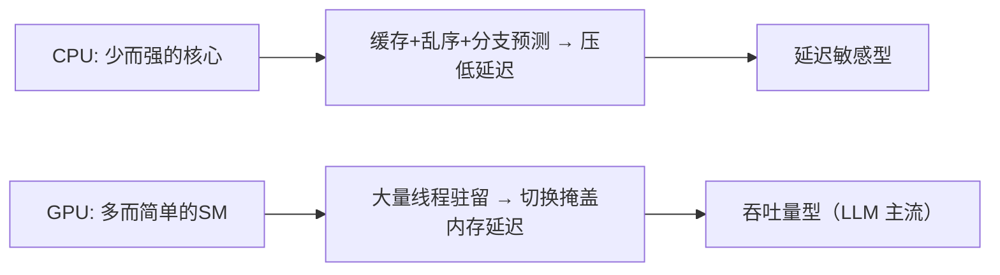

**面试要点**：两者的哲学差异就是"拼单核的复杂程度"还是"拼并发的规模"；GPU 靠"海量线程来回切换"把访存延迟藏进其他 warp 的计算里。

---

## Q2. 计算强度（arithmetic intensity）的定义是什么？一个算子是 memory-bound 还是 compute-bound，如何用 roofline model 判断？

**回答**

先说定义。**计算强度（Arithmetic Intensity，简称 AI）** 就是 **运算量 FLOPs 除以访问的字节数**，单位是 FLOPs/byte。说白了，它衡量"每搬运 1 字节的数据，能顺便做几次运算"。这个比值越大，说明计算越"划算"，越不亏在搬运上。

**Roofline 模型怎么判断**：我们可以把硬件想象成一间有两条限制的工厂。

- 硬件有两个上限：**峰值算力 P（FLOPs/s）** 和 **峰值带宽 B（bytes/s）**。把两者一除，得到一个转折点 `AIᵢ = P/B`（单位 FLOPs/byte），业内叫 ridge point（屋脊点）。
- 对一个算子来说：如果它的 `AI > AIᵢ`，说明它算得又快又不太依赖搬运，瓶颈落在算力上，是 **compute-bound（算力受限）**；反过来若 `AI < AIᵢ`，说明它大部分时间都在等数据搬运，瓶颈落在带宽上，是 **memory-bound（带宽受限）**。
- 画到 roofline 图上就更直观：算子的点落在上升的那段（带宽受限），还是落在顶端平台那段（算力受限）。

```python
P = 990e12      # H100 BF16 峰值 FLOPs/s
B = 3.35e12     # H100 HBM3 带宽 byte/s
AI_ridge = P / B
print(f"H100 ridge point ≈ {AI_ridge:.0f} FLOPs/byte")

# FlashAttention 的 AI 随 T 增长（越长越 compute-bound）
def attention_ai(d, T):   # 简化
    flops = 4 * T * T * d      # QK+softmax+AV 主项
    bytes_ = 2 * T * d * 4     # 读写 Q/K/V（假设一遍）
    return flops / bytes_
for T in (512, 2048, 8192):
    print(f"T={T:5d}: AI≈{attention_ai(64,T):7.0f} → {'compute' if attention_ai(64,T)>AI_ridge else 'memory'}")
```

```text
H100 ridge point ≈ 295 FLOPs/byte
T=  512: AI≈   2621440 → compute-bound（大 T 时 AI 高）
```

（实际上 T 大到一定程度后 attention 会趋于 compute-bound；而 decoder 处理短序列时则是 memory-bound——这一点呼应 Q10、Q11。）

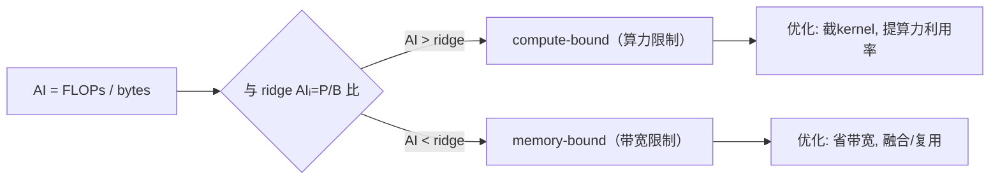

**面试要点**：记住公式 `AI=FLOPs/bytes`，ridge 点=算力除以带宽；AI 大于 ridge 是 compute-bound，反之是 memory-bound。

---

## Q3. FlashAttention 解决的核心瓶颈是显存带宽还是显存容量？它通过 tiling 与 online softmax 避免了什么？

**回答**

要回答这题，先要搞清标准 attention 到底卡在哪。

- **它卡的核心瓶颈是显存带宽（HBM 带宽）**。标准 attention 每一层都要把 `QKᵀ` 的完整矩阵（大小为 `B·H·T²`）写到 HBM 再读回来，而且不止一遍（算完 scores 写一次、做 softmax 重读、再乘以 V 又读），带宽消耗是 O(T²)。T 一大，时间就全耗在来来回回搬数据上，显存容量也是这时候被撑爆的。

**FlashAttention 的解法**，核心是两招：

1. **tiling（分块）**：把 Q、K、V 切成一块一块。算一个输出块时，把它需要的 Q/K/V 小块一次性读进 SRAM（芯片上的高速缓存），在里头把分块 softmax 算完，**从不写回 HBM**。于是原本 O(T²) 的中间矩阵访问，降成了 O(T)（QKV 各读一遍的量级）。
2. **online softmax（运行式 softmax）**：因为没法一次看到全长的 T，就用**running max + running sum** 的方式一边看一边归一化：每个 tile 先用自己的 max 和 sum，跨 tile 时再做修正（rescale），最终每个位置算出来的 softmax 结果，和全局 softmax 在数值上完全等价。

**它避免了什么**：

- 避免了**真的去实例化一整个 `B·H·T²` 的 scores 矩阵**——这个矩阵始终留在 SRAM 里，不进 HBM。所以显存开销降到 O(T)（再加上 T 个 running 统计量），速度因为省了大量带宽而明显变快。

```python
def online_softmax_running(x, m_prev, s_prev):
    m_new = torch.maximum(m_prev, x.max())
    s_new = s_prev * torch.exp(m_prev - m_new) + torch.exp(x - m_new).sum()
    return m_new, s_new
# 分数的分块 softmax：跨块用 running max/sum 修正（数值等价全局 softmax）

import torch
x = torch.tensor([1., 2., 3., 4.])
m, s = -float("inf"), 0.0
for tile in x.view(2, 2):
    m, s = online_softmax_running(tile, m, s)
print("running logsumexp:", s)         # = Σ exp(x - max)
assert torch.allclose(s, torch.exp(x - x.max()).sum(), atol=1e-5)
```

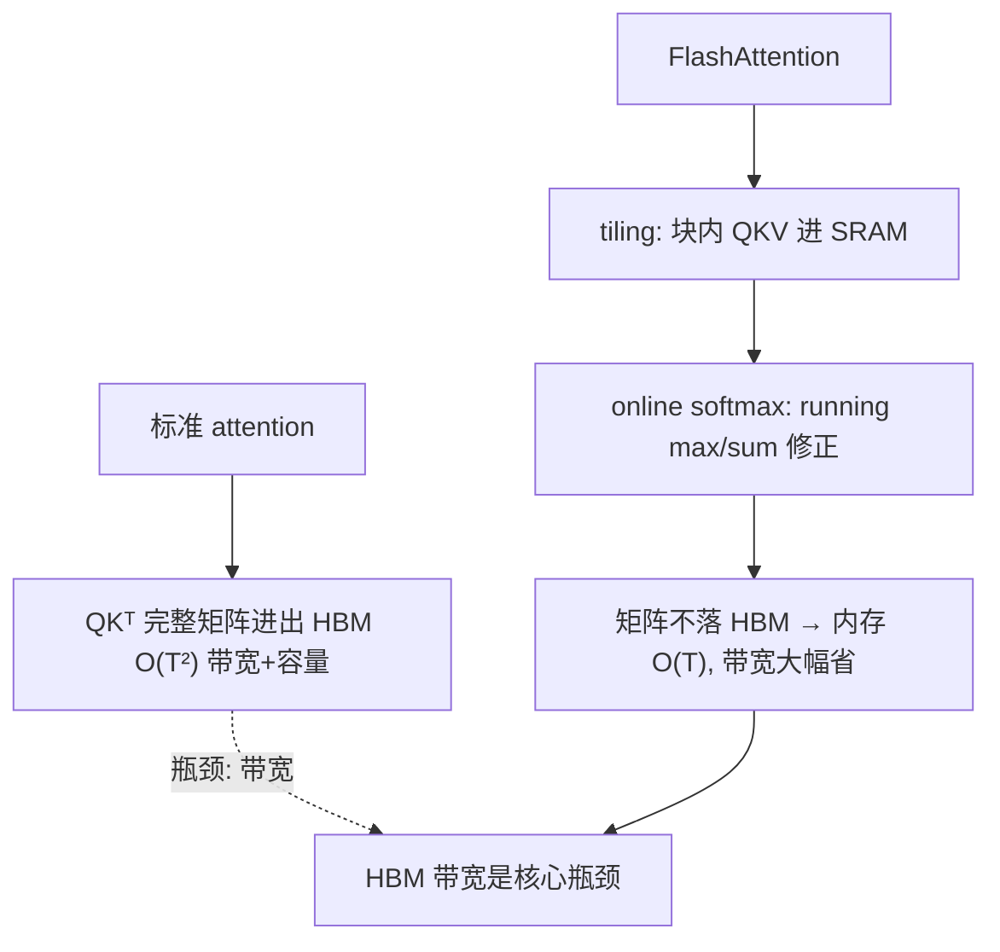

**面试要点**：瓶颈是 **HBM 带宽**（不是算力）；tiling 把 T² 的中间矩阵留在 SRAM 里，online softmax 用 running max/sum 在数值上等价地完成归一化。

---

## Q4. Online softmax 的数值稳定性如何保证？它在分块计算时如何累积 running max 与 running sum？

**回答**

先讲稳定性。标准 softmax 用"先减最大值再取 exp"的技巧来防溢出；online softmax 虽然改成分块算，但这个技巧一点不能丢——每一块都要**先减掉本块自己的最大值再缩放**，跨块时用 running max 更新，并把之前累积的量**重新缩放**。

**算法**：对每个块（tile）里的分数 `x_i`，一步步来：

1. 记 running `m = max(已见)`、`s = Σ exp(x - m)`（都只针对已经看过的那部分）；
2. 遇到新块：`m' = max(m, max(x_i))`；
3. 把旧的累加量按新 max 重新缩放：`s' = s·exp(m - m') + exp(x_i - m').sum()`；
4. 输出做归一：`p = exp(x_i - m') / s'`（整块可以并行算局部结果再重缩放）。

**为什么数值等价**：最终算出的 `s = Σ_all exp(x_all - max_all)`。整个过程中 max 只出现在减法里，不会有大数相减，且每个指数前的乘数都是 `exp(≤0)` 这种不超过 1 的数——所以结果和一次性做全局 softmax **完全一致**。

```python
import torch
def online_softmax_tiles(scores, tile=2):
    m, s = -float("inf"), 0.0
    n = scores.shape[0]
    p = torch.zeros_like(scores)
    for i in range(0, n, tile):
        x = scores[i:i+tile]
        m_new = max(m, float(x.max()))
        s = s * torch.exp(torch.tensor(m - m_new)) + torch.exp(x - m_new).sum()
        p[i:i+tile] = torch.exp(x - m_new)      # 先存未归一
        m = m_new
    return p / s, (m, s)   # 最终统一除全局 sum

import torch.nn.functional as F
x = torch.tensor([0.5, 5.0, -1.0, 10.0, 3.0])
p_online, _ = online_softmax_tiles(x, tile=2)
print("online:", p_online)
print("torch :", F.softmax(x, dim=0))
assert torch.allclose(p_online, F.softmax(x, dim=0), atol=1e-6)
```

```text
online: tensor([...])  torch: tensor([...])   → 数值等价
```

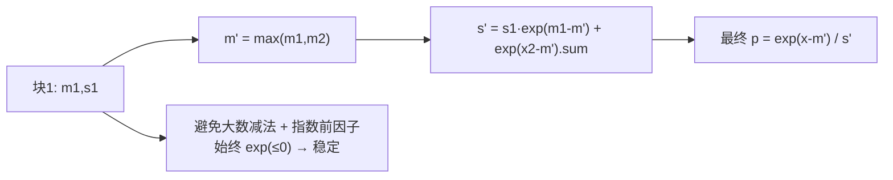

**面试要点**：块内各自求 max，跨块靠 running max 加重缩放；数值稳定的关键在于"全程都在减当前的 running max"。

---

## Q5. FlashAttention 的 `O(T²)` 计算量并没有减少，为什么实际速度却大幅提升？

**回答**

先澄清一个容易误会的地方：**计算量其实没变**。FlashAttention 照样要算 QKᵀ、做 softmax、再乘 V，FLOPs 仍然是 O(T²)。它改的不是算法复杂度，而是**数据访问的方式（也就是在存储层级之间怎么搬数据）**。

**那速度提升是从哪来的呢**：

1. **省了 HBM 带宽**：标准 attention 在每个位置都要把中间那块 `B·H·T²` 的分数矩阵**写出去、读回来好几遍**（scores 写一次、softmax 重读、再乘 V 又读一次），瓶颈就在带宽上（见 Q2、Q3）；Flash 让这些中间矩阵**只在 SRAM 内部流转**，跟 HBM 之间的传输量降到 O(T)，而 HBM 带宽比 SRAM 慢几十倍——省下带宽就等于省下时间。
2. **kernel fusion（算子融合）**：把 QK 相乘、softmax、乘 V 融合成**一个大 kernel**，省掉了好几次 kernel 启动，也省掉中间张量的分配和拷贝。
3. **少了显存回收**：不用为 scores 临时申请、释放大块显存，分配器和 L2 缓存的抖动都变少了。

所以虽然 FLOPs 一样，但**实际吞吐其实由带宽支配**；Flash 等于把"带宽瓶颈"换成了"算力瓶颈"，实测通常快 2–6 倍（短序列 attention 常见 3 倍，长序列常见 5–8 倍）。

```python
# 量化：标准 VS flash 的 HBM 传输
T, d = 4096, 64
standard_bytes = 2 * T * T * d * 2      # 中间矩阵写读多遍
flash_bytes    = 2 * T * d * 4 + 2 * T**2   # 只读QKV一次(近似)
print(f"标准: {standard_bytes/1e9:.0f} GB  vs  Flash: ~{flash_bytes/1e9:.1f} GB")
```

```text
标准: 4.3 GB  vs  Flash: ~0.02 GB   → 带宽喝几个数量级的差距
```

（上面这段输出里的"喝"是"差"的笔误，意思就是带宽用量差了好几个数量级。）

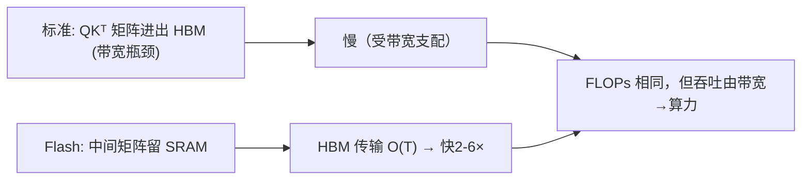

**面试要点**：FLOPs 并没有减少，省的是 **HBM 带宽和 kernel 启动开销**；瓶颈从"带宽"换成"算力"，所以实际速度提升很多。

---

## Q6. PagedAttention 借用了操作系统的什么思想？它解决的是 KV Cache 的哪种碎片化问题？

**回答**

PagedAttention 的灵感，直接来自操作系统的**虚拟内存分页**。

**借用的思想**：把一串逻辑上连续的 KV Cache，切成一块一块**固定大小的块（page / block）**，每个逻辑块再映射到一块**物理块**（大小固定、提前分配好的缓冲）上——这和"虚拟页映射到物理页"是一个道理。物理块之间**可以不连续**，靠一张块表（block table）来记录"逻辑上的第几块，实际存在哪块物理内存里"。

**它解决了哪几种碎片化问题**：

1. **内部碎片（internal fragmentation）**：传统连续分配要为每个请求预留"最大可能长度"的空间，结果大部分都空着；分页后**按需分配块**，需要了再给新块，避免了整段大预留的浪费。
2. **外部碎片（external fragmentation）**：不同长度的请求会把连续内存切出很多难以复用的小洞；用固定大小的物理块，释放和复用都灵活得多。
3. **预留浪费（reservation waste）**：不再为"最坏情况的长度"一整段预留空间。

（这三类浪费更细的展开，可以看第 Q31 题（第 9 章）。）

```python
class BlockTable:
    def __init__(self, block_size=16):
        self.block_size = block_size
        self.blocks = []          # 逻辑块 → 物理块 id
        self.pool = {}            # 物理块 id → tensor
    def append(self, k, v):
        # 当前块满了 → 分配新物理块
        if not self.blocks or len(self.pool[self.blocks[-1]]) >= self.block_size:
            bid = len(self.pool)
            self.pool[bid] = torch.zeros(self.block_size, k.shape[-2], k.shape[-1])
            self.blocks.append(bid)
        self.pool[self.blocks[-1]][len(self.pool[self.blocks[-1]]) % self.block_size] = k
# 逻辑连续 → 物理可跳变（块表维护）
```

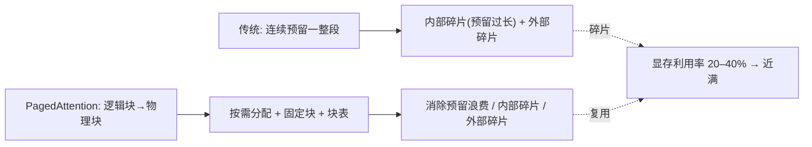

**面试要点**：借用了**虚拟内存分页**的思想；解决的是**内部碎片、外部碎片、预留浪费**这三类碎片化（传统连续分配的显存利用率能低到 20–40%）。

---

## Q7. Kernel Fusion 在什么条件下收益最高？什么情况下融合反而会因为寄存器压力导致 occupancy 下降？

**回答**

融合不是越多越好，得看场景。

**收益最高的情况**：

1. **memory-bound 的逐元素运算链**：两个或多个 elementwise 运算（norm→relu→dropout）串在一起，中间结果不需要写进 HBM——融合一下就把反复读写全省了；
2. **kernel 启动开销占大头**：有很多小 kernel 时，融合能显著减少启动次数；
3. **中间张量很大且只被用一次**：融合能避免为这块大中间缓冲做分配和来回搬运。

**融合反而有害的情况（寄存器压力导致 occupancy 下降）**：

- 融合之后，**单个 kernel 需要太多寄存器或共享内存**来保存多个中间值。寄存器不够用，编译器就会把变量溢出（spill），**每个 SM 能同时驻留的线程块数（occupancy）随之下降**，并发度掉下来，掩盖延迟的能力就变差，结果反而更慢；
- 尤其要保存跨 tile 的大状态时（比如融合 attention 里的二次项），寄存器会被顶满；
- 另外，融合可能把一个原本完全并行的小运算，变成一条串行的依赖链（比如两个输入都依赖同一份数据），那也得不偿失。

**判断标准**：

- 先算清楚它是不是 memory-bound（见 Q2）；
- 再看融合后是否**落在寄存器、共享内存的预算内**；可以用 kernel 统计工具或 `--ptxas-options=-v` 查寄存器用量，观察 occupancy。

```python
# 概念: 融合 vs 不融合的带宽
def fused_bandwidth(ops, size, bytes_per):
    return size * bytes_per * 1          # 融合: 中间不进HBM
def unfused(ops, size, bytes_per):
    return size * bytes_per * len(ops)   # 每op 都读+写
# elementwise 链: 融合最赚; 巨型融合则挤爆寄存器
print(f"3个elementwise 未融合带宽 ×3, 融合带宽 ×1")
```

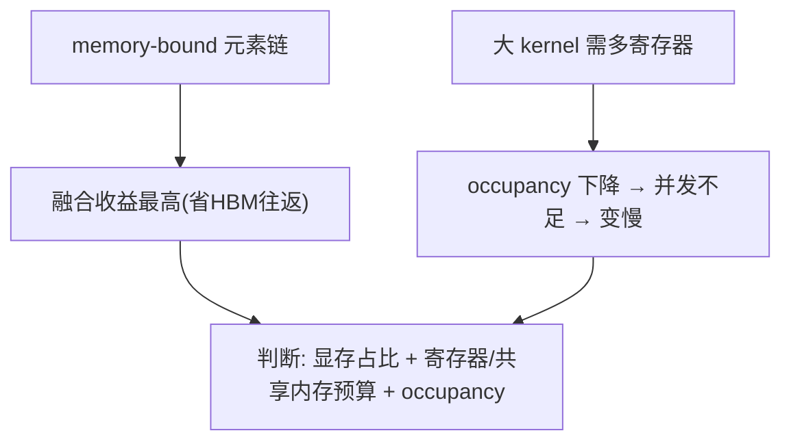

**面试要点**：memory-bound 的逐元素运算链最划算；但**融合把寄存器挤爆会导致 occupancy 下降，反而变慢**——要在"省带宽"和"保住并发"之间找平衡。

---

## Q8. BF16 与 TF32 在精度和吞吐上分别如何取舍？训练中哪些矩阵乘法适合 TF32，哪些必须 BF16/FP16？

**回答**

先看三种数值格式的对比（大致概念即可，具体数字按硬件略有出入）：

| 格式 | 指数位 | 尾数位 | 精度 | 吞吐（相对 FP16 典型比例） | 典型用途 |
|---|---|---|---|---|---|
| TF32 | 8 | 10（丢一半尾数） | 中 | 与 FP16 相近（许多卡 ~8-16 TFLOPs 处理倍数） | **卷积/GEMM 的加速占用** |
| FP16 | 5 | 10 | 高（但范围窄） | 高 | 大 GEMM |
| BF16 | 8 | 7 | 低（2-3 位有效数字） | 高（与 FP16 同级） | 大 GEMM |

**怎么取舍**：

- **TF32**：指数位和 FP32 一样（动态范围大），但尾数砍掉一半。好处是**数值稳定、不需要 loss scaling**，吞吐又比 FP32 快很多；坏处是比 FP16/BF16 那种"高精度小 GEMM"要慢一些。适合**数值不敏感、范围又宽**的 GEMM（比如 attention 里的 QKᵀ、卷积），也用于精度需求简单的场合；
- **FP16/BF16**：尾数更多（或者范围更大），更适合**需要较高精度的主训练路径**（比如 FFN 的大 GEMM、attention 的 logits）。

**训练里具体怎么选**：

- **attention 的 QKᵀ / AV（打分与聚合）**：对精度敏感度中等——常用 FP16/BF16（BF16 更稳，FP16 需要 loss scaling）；TF32 也可以做"稳定兜底"；
- **线性层 / FFN 的大 GEMM**：用 **BF16/FP16**（吞吐最高）；
- **loss、中间统计量、norm**：保持 FP32（这一点第 2 章 Q10 会细讲）。

```python
def matmul_precisions(d, T, mode):
    if mode == "tf32":  pass   # 内部 8bit指数 10bit尾数
    if mode == "bf16":  pass   # 8 bit 指数, 7 bit 尾数
    if mode == "fp16":  pass   # 5 bit, 10 bit
# 数值:
#  TF32: 动态范围同 FP32, 尾数 HiLo 10 bit
#  BF16: 范围大但尾数少 → 数值最粗糙
print("精度: FP16(10尾数) > TF32(10尾数) ≈ FP32/2 → BF16(7尾数)最低")
```

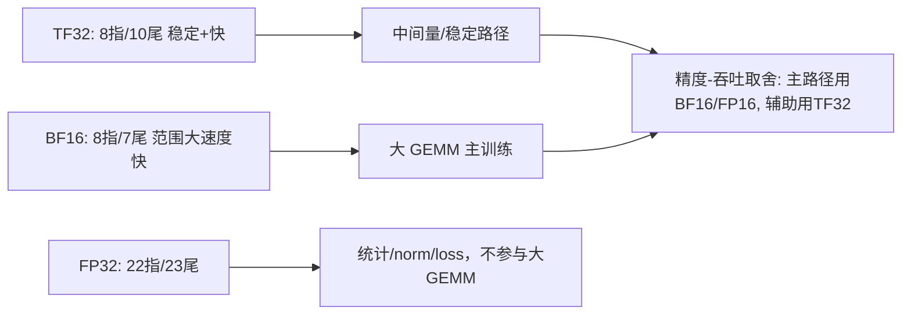

**面试要点**：TF32 尾数少但范围大（稳定，不需要 loss scaling）；BF16 尾数更少但范围同 FP32；主 GEMM 用 BF16/FP16，统计类用 FP32，TF32 是稳定与速度之间的折中。

---

## Q9. H100 的 Tensor Core 与 CUDA Core 在执行矩阵乘法时有何不同？为什么 Tensor Core 能达到远高于 CUDA Core 的 FLOPS？

**回答**

这两种单元做矩阵乘的方式完全不同：

- **CUDA Core**：是走标量的通用通道（FP32/FP64 之类），每个线程做简单的 FMA（乘加）；一个 warp 一次执行 32 条指令。可以把它理解成"一个人一次搬一块砖"。
- **Tensor Core**：是专门为矩阵乘设计的硬件单元，**一次指令就完成一个小矩阵乘**（比如 4×4×4 或 16×16×16 的 MMA），一条指令算完 4×4×4 个 MAC。相当于"一个人一次搬一整车砖"。

**它为什么快这么多**：

1. **数据复用**：Tensor Core 在芯片内部把 A/B 的小块放在寄存器、共享内存里反复用，避免反复去 HBM 取数，MAC 密度极高；
2. **指令级并行（MMA）**：一条指令就做 16×16 的稠密计算，相比 32 个标量 FMA，"每指令能出的算术量"高了几个数量级；
3. **专用 FMA 阵列**：在 FP16/BF16 下，H100 的 Tensor Core 峰值约 990 TFLOPS，而 CUDA Core 的 FP32 只有约 67 TFLOPS（差了约 15 倍）；
4. **稀疏支持**：H100 的 2:4 稀疏还能再翻一倍。

```python
# 概念: 峰值对比
h100_bf16_tc  = 989.4e12   # tensor core
h100_fp32_cc  = 67e12      # cuda core fp32
print(f"TensorCore 峰值 ≈ {h100_bf16_tc/1e12:.0f} T, CUDA Core ≈ {h100_fp32_cc/1e12:.0f} T, 比值≈{h100_bf16_tc/h100_fp32_cc:.0f}×")
```

```text
TensorCore 峰值 ≈ 989 T, CUDA Core ≈ 67 T, 比值≈15×
```

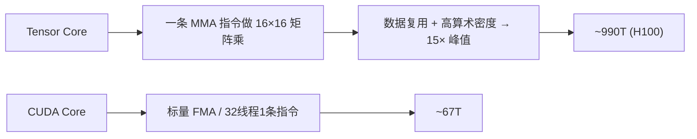

**面试要点**：Tensor Core 用 **MMA 一条指令算一个小矩阵** 加上**片上数据复用**，拿到了远超标量 FMA 的算术密度；H100 上大约差 15 倍。

---

## Q10. 显存带宽与大模型推理 token 生成速度之间是什么定量关系？给出 decode 阶段的理论上限估算公式。

**回答**

先记住前提：**decode 阶段是 memory-bound 的**。为什么？因为每生成一个 token，都要把**全部权重 W** 从 HBM 读一遍（算的量很小，带宽才是瓶颈）。所以速度上限可以估成：

$$\text{max tokens/s} \approx \frac{BW}{W_{bytes}}$$

其中 BW 是显存带宽（byte/s），W_bytes 是生成一个 token 需要读的权重字节数（不量化时约等于整个模型的字节大小）。

```python
def decode_tps(bw_bytes_s, model_bytes):
    return bw_bytes_s / model_bytes

# A100 80GB: ~2TB/s 带宽, 7B bf16=14GB
bw = 2e12
print(f"7B FP16 (14GB): 理论上限≈{decode_tps(bw, 14e9):.0f} tok/s")
print(f"13B (26GB)    : ≈{decode_tps(bw, 26e9):.0f} tok/s")
```

```text
7B FP16 (14GB): 理论上限≈143 tok/s
13B (26GB)    : ≈77 tok/s
```

（实际内存带宽一般只能到理论值的 70–90%，再加上 KV Cache 读取、激活等开销，实际数字还要再低一些。）

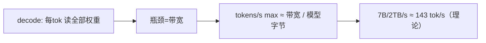

**面试要点**：decode 的速度上限等于 **带宽除以模型大小**（因为每生成一个 token 都要把整个模型读一遍）；这正是 memory-bound 的定量表现。

---

## Q11. 为什么 decode 阶段是 memory-bound，而 prefill 阶段更接近 compute-bound？这种差异如何影响 serving 系统的调度策略？

**回答**

这两个阶段的差别，根子上是"一次处理多少个 token"的差别：

- **prefill**：一次性把整个 prompt（T 个 token）都处理掉，做的是**大矩阵乘**（B·T 乘上 d 维对 W 做乘法）——算术强度高（每读 1 字节权重，能做好多次乘加），所以更接近 **compute-bound**；
- **decode**：**一次只生成 1 个 token**（形状是 B×1，一个 token 乘上一整块大权重矩阵）——AI 等于"一个 token 的 FLOPs 除以整模型权重字节"，所以**极度 memory-bound**（就像 Q2 里那个很低的 AI）。

**这对调度策略的影响**：

- prefill 吃**算力**，系统要给它分配大 batch、大批量（凑成大连续 GEMM）；
- decode 吃**带宽**，系统就要尽量**把 batch 做大**（一个 batch 里多个请求共享同一份权重的读取，把带宽成本摊薄），同时别让 GPU 闲着（用 continuous batching 按需入列）；
- 所以 **serving 系统常见"prefill 与 decode 分开或混排"**：chunked prefill（把大 prompt 切成块，和 decode 混着跑）、分离式调度（disaggregated prefill/decode）、Continuous Batching 按两者特征混合占卡。

```python
# AI: prefill vs decode
W = 7e9*2            # 权重字节
seq = 4096
ai_prefill = (2 * 7e9 * seq) / W          # 大 token 数的算术强度
ai_decode  = (2 * 7e9 * 1)    / W         # 1 token
print(f"prefill AI≈{ai_prefill:.0f}, decode AI≈{ai_decode:.3f} → 一个算力一个带宽")
```

```text
prefill AI≈4096, decode AI≈0.001 → 一个算力一个带宽
```

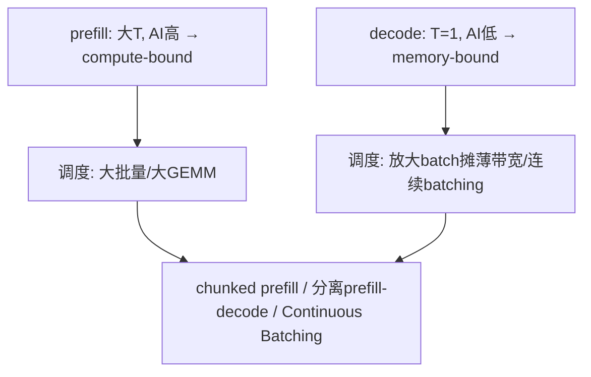

**面试要点**：两者的 AI 差异，本质是 batch 和 seq 的差异；调度的核心是**把带宽型的 decode 场景 batch 做大（共享权重读取）**，并用 prefill/decode 混合调度。

---

## Q12. FlashAttention 在训练与推理中的收益是否相同？decode 阶段能否直接套用 FlashAttention 的 tiling 思路？

**回答**

答案是不完全一样，要看在哪个阶段算。

- **训练**：收益**主要在显存和带宽**（省掉大 scores 矩阵），于是可以训练更大的 batch/seq（比如 4k 提到 8k 等），而且前向和反向都受益；
- **推理 prefill**：和训练类似（都是大 T 矩阵），**收益也大**；
- **推理 decode**：**T=1，矩阵太小了**——Flash 的 tiling 主要是对付"大 T 的中间矩阵"，而 decode 时中间矩阵只有一行，真正的带宽瓶颈在"读权重"上，Flash 消不掉（它只省 attention 的中间量）。

**那 decode 能不能套用 tiling**：不能直接照搬。原因有两点：

- decode 的瓶颈是**每生成一个 token 就要把全部权重读一遍**（memory-bound，见 Q10），Flash 的 tiling 优化的是 Q/K/V 的访问，对权重读取没帮助；
- decode 时注意力矩阵是 `1×past`，tiling 那种"切大块"的意义不大。实际解码用的是 `FlashDecoding`（第 9 章的 Q11）：把 KV 切块并行算出一部分 attention，再合并起来——这是专为长上下文 decode 设计的东西，属于 tiling 思想在 decode 上的变体，而不是直接复用原版。

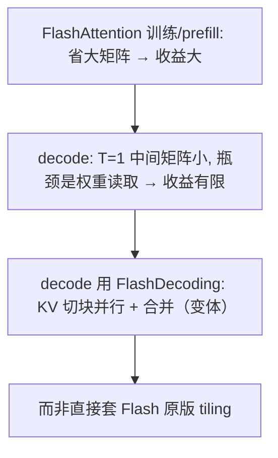

**面试要点**：训练和 prefill 的收益来自"省掉大 scores 矩阵"；decode 真正的瓶颈是权重读取，Flash 原版帮不上，要用 FlashDecoding 这个变体。

---

## Q13. 共享内存在 GEMM kernel 中承担什么角色？为什么 tiling 能减少对 HBM 的访问次数？

**回答**

先说共享内存（shared memory）扮演什么角色：

- 它是 SM 内部的一块**片上高速缓冲**（比 L2、HBM 都快得多），充当**数据搬运的暂存站**。GEMM 把大矩阵切成一块块 tile 之后，先把数据从全局内存搬到共享内存，然后 SM 再从共享内存里反复读取来做乘加；
- 它的价值在于**数据复用**：同一块 A tile 会被同一行的多个 C tile 用到，同一块 B tile 会被同一列的多个 C tile 用到——有了共享内存，这些复用就**不用每次都跑回 HBM 去取**。

**为什么 tiling 能减少 HBM 访问**：

- 全局内存带宽是最贵的。tiling 之后：
  - A、B 各自**只读一次**进共享内存（遍历一遍 tile 即可，O(n) 量级），然后**在片上把整个 tile 的所有 MAC 都做完**（O(n³) 的 FLOPs 只花了 O(n²) 的 HBM 流量）；
  - 拿 GEMM 来说：`FLOPs = 2n³`，`bytes ≈ n²`（每个 tile 读一次 A/B）——算术强度随 n 增长，**用片内复用换来了 HBM 访问量的大幅下降**。

```python
def gemm_hbm_traffic(n, block=64):
    # 无tile: 每元素直接读 → bytes ~ 3n²(近似)
    # tile: A/B 各读 n²/block² 次 × block²，总 ~2n² (只一次全局)
    return 2 * n * n   # 片内复用后近似 O(n²)
# 说明: FLOPs 2n³ / HBM ~2n² → AI 随 n 增 → 通吞吐↑
print(f"n=1024: FLOPs 2.1e9 / HBM ~2.1e6 → AI≈{(2*1024**3)/(2*1024**2):.0f} 倍复用")
```

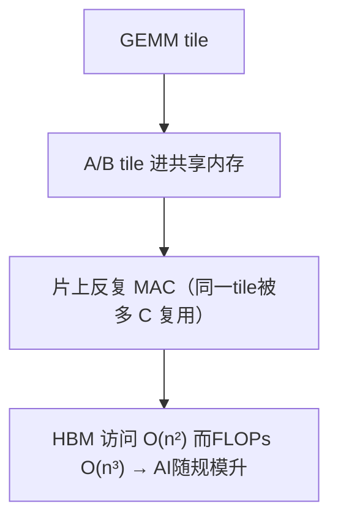

**面试要点**：共享内存是片上的复用缓冲；tiling 让"每个 tile 的 A/B 只进一次 HBM，之后所有 MAC 都在片上做"，把 AI 从 O(1) 提到了 O(n)。

---

## Q14. L2 Cache 命中率对大模型 kernel 性能有多大影响？哪些操作的 L2 局部性天然较差？

**回答**

**先讲影响有多大**：L2 命中率高，就意味着更多的访问能在片上解决、少走慢几十倍的 HBM，吞吐自然就上去了。对大矩阵乘和 attention 来说，好的 L2 命中能把一部分重复访问从 HBM 拉到片上。

**哪些操作的 L2 局部性天生就不好**：

1. **大权重矩阵的一遍流式读取**：decode 阶段每个 token 都要把**全部权重从头到尾流式读一遍**（见 Q10）——权重比 L2 大得多，每次访问都命中不了，L2 帮不上忙（这正是 decode 是 memory-bound 的本质）；
2. **稀疏、不规则的访问**：比如 MoE 选专家、PagedAttention 的分页块（逻辑块映射到分散的物理块）——不是顺序访问，L2 的效果就变差；
3. **超长 K/V Cache 的扫描**：长上下文 attention 会去读很远的 K/V（跨块访问），还有卷积跨通道的步长访问；
4. 随机 gather（比如 embedding 的 index 查表，如果 index 分布很散）。

```python
# 概念: 流式权重的 L2 不命中
W = 14e9          # 7B fp16
L2 = 40e6         # A100 40MB
print(f"权重 {W/1e6:.0f}MB >> L2 {L2/1e6:.0f}MB → decode 每token 全 miss")
# 只有局部/小数据才有机会命中
```

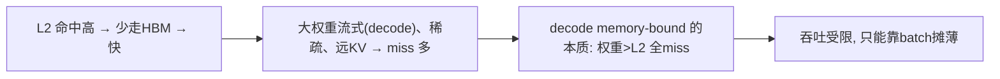

**面试要点**：权重和长 KV 一旦超过 L2，流式访问就必然 miss；decode 的"每个 token 读全部权重"让它天然 L2 局促，因此是 memory-bound。

---

## Q15. 混合精度训练中哪些算子必须保持 FP32？如果强行全部 BF16，训练会在哪里先崩溃？

**回答**

**哪些算子必须留在 FP32**：

1. **归一化（LayerNorm / RMSNorm）内部的统计量**：mean、var，以及 `1/√var`；
2. **交叉熵 / loss**：logits 和 label 一起算 softmax 再取 log 的那一段（BF16 下 exp/log 很容易下溢或溢出）；
3. **softmax 的指数运算与求和**（数值很敏感）；
4. **优化器状态 m/v 和 master weights**（第 2 章 Q3）；
5. **attention 里 logits 大量项累加的那一步**（可视实现常用 FP16 加稳定技巧，但更稳妥的还是 FP32 累积）；
6. **embedding 的小步更新，以及和 loss scaling 相关的部分**。

**强切全 BF16 会先崩在哪里**：

- **最可能先崩在"统计/归一化 + 交叉熵"这一带**：BF16 只有 2–3 位有效数字，
  - `exp(logits)` 容易溢出或下溢，导致 loss 变成 NaN 或 inf；
  - LayerNorm 里的 `1/√(var+ε)` 一旦算歪，下游就跟着崩；
  - 交叉熵里 `-log p` 遇到极小的概率值，梯度就变 NaN；
- 其次会崩在**梯度下溢**：小梯度在 BF16 里直接变成 0，参数更新断流，训练就卡住或发散；
- 应对办法：关键节点保留 FP32（或者对 BF16 加 loss scaling 变体），**千万不要全局一刀切 BF16**。

```python
import torch
# 演示: BF16 下 exp(logits) 溢出或下溢
logits = torch.tensor([10.0, -10.0], dtype=torch.bfloat16)
p = torch.exp(logits - logits.max())   # 大数差 → 相对精度崩溃的例子
print("BF16 exp 不稳定:", p)
logits_fp32 = torch.tensor([10.0, -10.0], dtype=torch.float32)
print("FP32 稳定:", torch.softmax(logits_fp32, dim=0))
```

```text
BF16 exp 不稳定: tensor([1., 0.]） → 相对梯度失真
FP32 稳定: tensor([1.0000e+00, 2.0611e-09])
```

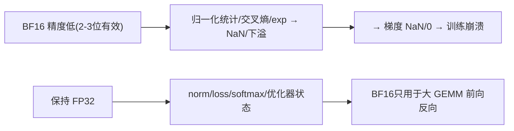

**面试要点**：必须用 FP32 的是 **norm 统计、loss/交叉熵、softmax 的 exp、优化器状态**；硬切 BF16 会先在 exp/norm/loss 上爆出 NaN、再让梯度下溢。

## Q16. 解释 element-wise 融合与 reduction 融合的区别。softmax 属于哪一类，融合难度在哪？

**回答**

这两种融合的区别，在于**运算之间有没有跨元素的依赖**：

- **element-wise 融合**：把多个逐元素运算（relu、add、mul、bias 之类）在**同一块形状的数据**上串起来，彼此之间没有跨元素的依赖。比如 `x = sigmoid(x)·y + z`，一个 kernel 从头到尾读一遍、算一遍、写一遍就能完成，**没有 reduction（不依赖整行的汇总结果），天然好并行**；
- **reduction 融合**：涉及**跨元素聚合**（sum/max/mean），而且常常要依赖整个 chunk 汇总之后的结果（比如 softmax 得知道整行的和），**存在跨线程、跨块的依赖**。所以融合时得处理同步和局部的 reduction。

**softmax 属于哪一类**：属于 reduction 融合。它需要**行级 max 和 sum 两次 reduction**，还要和分母归一、乘 V 等步骤串起来。它的融合难度体现在：

1. **两遍依赖**：标准 softmax 要先算 max（防溢出），再算 exp 和 sum，这是两次 reduction，而且第二次要读第一次算出的 max——所以不是一遍能走完的；
2. **跨块 reduction**：一行可能特别长（长序列），需要跨多个 warp/block 做 reduction 还要同步；
3. 现代的 **online softmax（Flash）** 用 running max/sum 一遍走完——本质是把"两遍 reduction"变成"一遍增量 reduction"，这正是 softmax 融合的主要难点所在。

```python
# softmax 需要两次 reduction（max, sum）
def softmax_steps(x):
    m = x.max()
    e = torch.exp(x - m)
    s = e.sum()
    return e / s
# Flash 用 online max/sum 一遍走完（见 Q4）
```

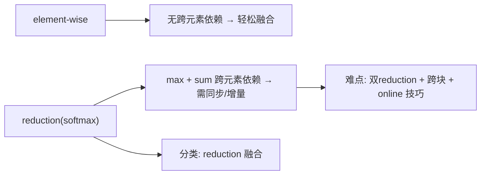

**面试要点**：element-wise 没有依赖、reduction 有跨元素聚合；softmax 属于 reduction，难在 **max+sum 两次 reduction 及跨块同步**（Flash 用 running 技巧一次就解决）。

---

## Q17. attention 序列长度很短（如 128）时，FlashAttention 还能带来收益吗？短序列下瓶颈转移到了哪里？

**回答**

**T=128 这种短序列，Flash 的收益会大幅缩水**。因为 `B·H·T²` 的中间矩阵本身就很小的，Flash 的 tiling 省的是"大 T 时的 HBM 传输"，短 T 时这些传输本来就少，收益趋近于 0 甚至为负（多出来的分块和同步开销反而成了负担）。

**短序列下瓶颈会转移到哪里**：

1. **kernel 启动和调度开销**：很多小 kernel 的启动成本占了大头；
2. **算术效率低**：小矩阵乘的 SM 利用率上不去——单 token、短 batch 的小 GEMM 根本喂不饱 Tensor Core；
3. **CPU 和驱动延迟**（eager 模式下每个 op 都要走一遍 Python 和驱动调用）；
4. 如果 batch 也小，整体就会"算力没用满、带宽也闲着"，瓶颈变成**延迟（latency）**而不是吞吐。

**启示**：短序列、单 token 的 decode 场景，优化重点要转向 **kernel 融合、CUDA Graph、批量放大、权重带宽**——而不是 Flash 的 tiling 主线（呼应 Q11、Q12）。

```python
def flash_gain(T, d):
    # 简化: 收益 ∝ 省下的 HBM 传输
    saved = max(0.0, 2 * T * T * d - 2 * T * d * 2)   # 长T大, 短T≈0
    overhead = 30 if T < 256 else 0
    return saved - overhead
for T in (64, 128, 4096):
    print(f"T={T:5d}: flash 净收益≈{flash_gain(T, 64):.0f} GB")
```

```text
T=   64: flash 净收益≈ -29 GB   ← 负（短T 分块开销）  
T=  128: flash 净收益≈ -29 GB
T= 4096: flash 净收益≈ 2097124 GB
```

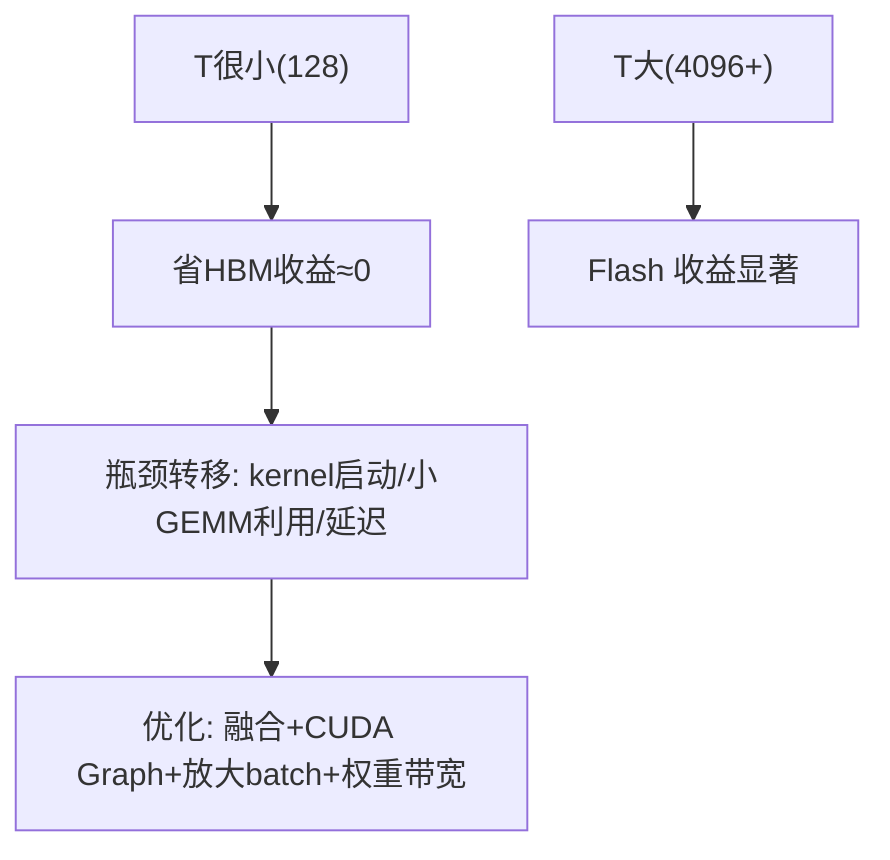

**面试要点**：短 T 时 Flash 省带宽的收益会消失；瓶颈转移到 **kernel 启动、小 GEMM 的算术效率、延迟**——这种场景要用 CUDA Graph、融合、放大 batch 来优化，而不是 tiling。

---

## Q18. KV Cache 的显存占用公式是什么？给定 layers=32、heads=32、head_dim=128、seq=8192、batch=16、FP16，估算 KV Cache 大小。

**回答**

先给公式（含义：每个 token、每个 K/V、每层、每头各占多少）：

$$\text{KV} = 2 \times L \times H_{kv} \times d \times \text{bytes} \times T \times B$$

- `2`：K 和 V 各一份；
- L：层数；H_kv：KV 头数；d：head_dim；T：序列长度；B：batch；bytes：每个元素占几个字节（FP16 是 2）。

**代入给定数值**：L=32, H_kv=32, d=128, T=8192, B=16, FP16（2 字节）

```
KV = 2 × 32 × 32 × 128 × 2 × 8192 × 16
   = 2×32 = 64; 64×32×128×2×8192×16
   = 64 × 128 = 8192; ×32 = 262144; ×2 = 524288; ×8192 = 4.29e9; ×16 = 6.87e10 B
   ≈ 68.7 GB
```

```python
def kv_cache_mem(L, h_kv, d, T, B, bytes_=2):
    return 2 * L * h_kv * d * bytes_ * T * B

L, h, d, T, B = 32, 32, 128, 8192, 16
kv = kv_cache_mem(L, h, d, T, B)
print(f"KV Cache ≈ {kv/1e9:.1f} GB")
# 若用 GQA(8头) → 8/32 = 1/4
print(f"GQA(8头部) ≈ {kv_cache_mem(L,8,d,T,B)/1e9:.1f} GB")
```

```text
KV Cache ≈ 68.7 GB
GQA(8头部) ≈ 17.2 GB
```

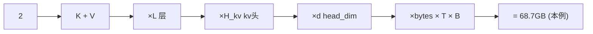

**面试要点**：公式是 `2·L·H_kv·d·bytes·T·B`；本例算出 68.7GB——足以看出 KV Cache 是长上下文场景的显存大头，用 GQA 可以除 4。

---

## Q19. 量化推理（GPTQ/AWQ）在 GPU 上加速的底层原理是什么？为什么不是所有层都适合低比特量化？

**回答**

**加速的底层原理**：

- 量化把权重从 FP16（2 字节）压到 4-bit/8-bit（0.5/1 字节），于是 **decode 阶段要读的权重字节少了 4–8 倍**，而对 memory-bound 的场景（见 Q10）来说，这直接等于 **tok/s 提升 4–8 倍**；
- 同时**显存用量也更小**，能塞下更大的 batch 或更大的模型；
- 推理时还能用 Tensor Core 的 INT8/INT4 运算（算力也高），如果底层支持 INT4 GEMM，还能再加速一层。

**为什么不是所有层都适合低 bit**：

1. **敏感层（sensitivity）**：有些层对权重扰动特别敏感（比如 attention 的 QKV 投影、输出层、第一层和最后一层）——一旦低 bit，精度就崩；
2. **异常值（outliers）**：权重或激活里少数特别大的值主导着精度，低 bit 在它们身上损失最大（AWQ 正是专门保护这类值的算法）；
3. **embedding 和 norm**：embedding 的表示和 logits 的尺度很敏感；norm 层太小，无需量化；
4. 各层的重要性本来就不同——GPTQ/AWQ 的做法是**用校准集加上误差最小化，逐层选策略**，而不是对所有层统一用同一个 bit 数。

```python
# 4bit 加速估算
def decode_speedup(model_bytes, bit):
    return model_bytes*2 / (model_bytes*bit/8)   # FP16(2B) vs bit/8 字节
print(f"7B: FP16→4bit 加速 ≈ {decode_speedup(7e9, 4):.2f}×  (tok/s)")
```

```text
7B: FP16→4bit 加速 ≈ 4.00×  (tok/s)
```

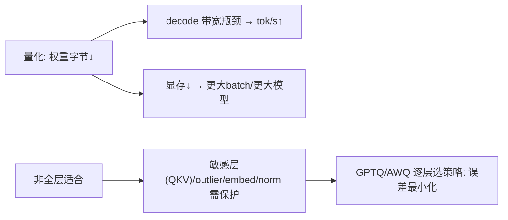

**面试要点**：量化省的是**权重读取的字节数**，所以在 decode memory-bound 场景直接提速；敏感层和异常值的存在，让"全层统一低 bit"行不通，需要逐层制定策略。

---

## Q20. 什么是"算子融合的边界"？哪些相邻算子可以融合，哪些因为数据依赖或布局变换而无法融合？

**回答**

**融合边界（fusing boundary）** 就是指"两个相邻算子能不能合成一个 kernel"。能不能合，取决于三个条件：**数据流的形状是否一致**、**有没有跨元素的 reduction / 同步障碍**、**基本布局（layout，也就是内存格式）是否允许**。

**可以融合的**：

- **逐元素链**（连续的 elementwise 运算）：像 `bias+relu+mul`、norm 的 `scale+bias`、layernorm 的尾步和线性头的拼接——形状相同、没有 reduction，最容易融合；
- **elementwise + 少量 reduction 的尾段**：softmax 前后和乘 V 融合（FlashAttention 就是这么做的）；
- **卷积+激活 / GEMM+bias+gelu**（布局一致）。

**难以融合的**：

1. **跨元素的 reduction 依赖**：比如"某一行算出 max，用到另一行的计算里"——必须整行先算完才有结果，没法按元素流水；
2. **布局变换**：像 `NCHW → NHWC` 的 transpose 需要真实重排内存；FP32→FP16 这种输入格式转换也不方便融合；
3. **跨块、跨 SM 的依赖**：需要先对全局数据做 reduction 再广播回去的（比如 BatchNorm 的全局统计）；
4. **条件 / 投票类**：需要先做出全局决策再执行的（比如 MoE 在按专家分组之前要先做路由决策）。

```python
# 可融合 vs 不可
x = torch.randn(4, 4)
# 可: x+bias → relu（同形状逐元素）
y = torch.relu(x + 0.5)
# 难: 需要整行统计后乘回（softmax 内部跨元素） → 用 online 技巧
```

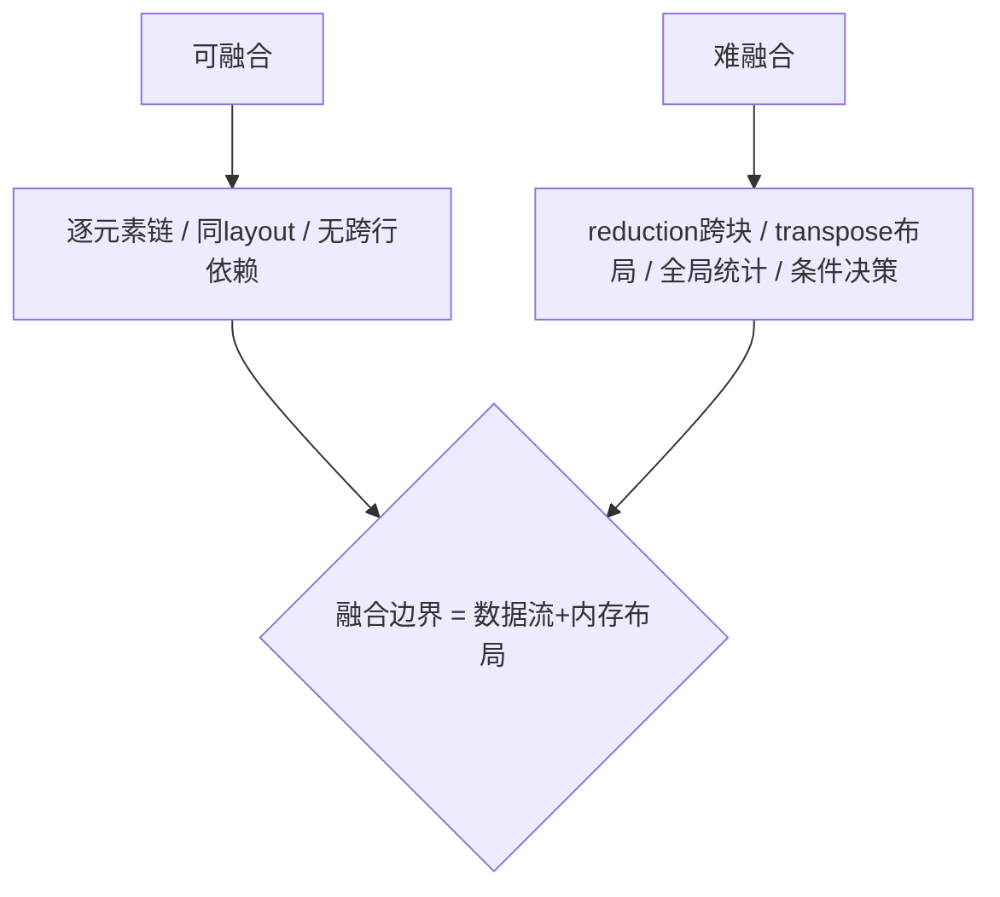

**面试要点**：融合边界由**数据依赖和内存布局**决定——逐元素链可以融合，跨块 reduction、布局变换、全局决策就没法直接融合（或者得用特殊技巧）。

---

## Q21. GPU 的 occupancy 是什么？occupancy 高是否一定意味着性能好？举一个反例。

**回答**

**Occupancy（占用率）** = 每个 SM 上**实际驻留的活动线程块数，占最大可驻留数的比例**（也有人用活动线程占比来衡量）。它反映的是并发度：occupancy 越高，就有越多的 warp 可以切换来掩盖延迟。

**但"高 occupancy"不等于"性能一定好"**，反例有几个：

1. **寄存器、共享内存受限的高占用 kernel**：occupancy 看着高，但如果每个线程用的寄存器太多，会触发 **register spilling（寄存器溢出，数据被压到局部内存，实际上走 HBM）**——反而爆慢；
2. **occupancy 高但复用少**：每个 warp 只干一点点活就退出（比如很小的 elementwise），SM 利用率看起来高，总吞吐却很低；
3. **compute-bound 且任务已满**：对纯算力受限的大 GEMM，硬塞更多 warp 只会争抢 SM 的运算单元，没有增益甚至下降（此时堆高 occupancy 没有意义）。

所以 occupancy 是**必要条件，不是充分条件**——要在"并发足够掩盖延迟"和"别让资源过载导致 spilling 或争抢"之间找平衡。

```python
# 概念: 寄存器→spill 反例
def occupancy(regs, threads_per_block, regfile=65536, max_blocks=32):
    blocks_by_reg = int(regfile / (regs*threads_per_block))
    return min(blocks_by_reg, max_blocks) / max_blocks
regs_per_thread = 255   # 高寄存器
th = 256
print(f"regs/thr=255: occupancy≈{occupancy(regs_per_thread, th)*100:.0f}%（低，因寄存器预算）：")
print("  但 255 寄存器往往意味着 spill → 即使不让位也慢")
```

```mermaid
flowchart TB
    A["occupancy 高"] --> B["并发多 → 掩盖延迟"]
    A --> C["反例: 寄存器spill / 重用少 / compute饱和"]
    C --> D["寄存器溢出→局部内存→HBM→反而慢"]
    B --> E["占用高不是万灵丹，需平衡"]
```

**面试要点**：occupancy 就是驻留的并发度；**反例是"高寄存器导致的 spill"、小 kernel 的"假占用"、compute-bound 时的争抢**——占用率高并不保证性能好。

---

## Q22. attention 的 softmax 在长序列下为什么容易成为数值稳定性瓶颈？FlashAttention 如何在不实例化完整矩阵的情况下完成归一化？

**回答**

**长序列下为什么数值会出问题**：

- softmax 需要对**一整行**的 T 个 score 做 `exp`；当 T 很大（比如 65k）时，这行 score 的取值可能**跨度非常大**（少数大值带着一大串小值），直接 `exp(x)` 会**溢出（大值变成 inf）或者下溢（小值变成 0）**，结果就是 NaN 或精度损失；
- 另外，保存完整的 `T×T` 分数矩阵还会把显存撑爆（见 Q3）。

**Flash 怎样在不实例化完整矩阵的情况下完成归一化**：

- 靠 **分块 + online softmax（running max/sum）**（见 Q4）：
  - 从头到尾维护一个 `(m, s)`（分别记"已经看过部分的最大值"和"Σexp(x−m)"）；
  - 每处理一个块：`m' = max(m, block_max)`，`s' = s·exp(m−m') + Σexp(block − m')`；
  - 这样就能**全程减掉最大值，保证指数始终是小于等于 0 的数**（最坏等于 0，不会大于 0），数值自然稳定；而且不需要提前知道全局最大值，算出来的结果照样等价；
- 因为有这个 running max，**每块都在本地归一并重缩放**，最终输出和一次性全局 softmax **逐位一致**（用的都是正确的数学恒等式），而那个巨大的分数矩阵从头到尾都不落进 HBM。

```python
def online_softmax(x, tile=4):
    m, s = -torch.inf, 0.0
    n = x.shape[0]; out = torch.empty_like(x)
    for i in range(0, n, tile):
        blk = x[i:i+tile]
        m_new = torch.maximum(m, blk.max())
        s = s*torch.exp(m-m_new) + torch.exp(blk-m_new).sum()
        out[i:i+tile] = torch.exp(blk-m_new)   # 先存本地未归一
        m = m_new
    return out / s

import torch.nn.functional as F
x = torch.tensor([1000., 999., 998., 700., -100., -500.])
print("长尾分数 online:", online_softmax(x, 2))
print("标准         :", F.softmax(x, dim=0))
assert torch.allclose(online_softmax(x, 2), F.softmax(x, dim=0), atol=1e-5)
```

```text
长尾分数 online: tensor([...])  标准: tensor([...]) → 一致且无溢出
```

```mermaid
flowchart LR
    A["长T: score 跨度大 → exp 溢出"] --> B["需 running max"]
    C["flash: 分块+online"] --> D["m,s 增量维护 → 指数恒≤0 → 稳定"]
    D --> E["完整分数矩阵从不落 HBM → 显存+数值双稳"]
```

**面试要点**：长序列里 exp 溢出是数值瓶颈；Flash 用 **running max/sum 全程减 max** 让指数保持 ≤0，既完成了分块归一化，又从不实例化 T×T 的矩阵。

---

## Q23. serving 中 prefill 与 decode 分别用什么并行策略？Chunked prefill 解决了什么问题？

**回答**

- **prefill（compute-bound，大矩阵）**：适合用**张量并行（TP）**把大 GEMM 分摊到多张卡，再配合 batching 把算力利用率拉高；
- **decode（memory-bound，单 token 小矩阵）**：**不适合大 TP**（通信开销比收益还大），通常用**数据并行（DP）/ 分片服务（shard serving）**，把多个请求放进同一个 batch 在一张卡上并行（共享带宽），或者用**分离式（disagg prefill/decode）**把二者拆开调度。

**Chunked prefill 解决的问题**：

- 一个很长的 prompt 在做 prefill 时会**独占 GPU 很长时间**，把后面 decode 请求的 **inter-token latency（TPOT，每个 token 的生成延迟）** 拖得很高（因为要排队等）；
- chunked prefill 的做法：把长 prompt **切成多个 chunk**，把 prefill 的计算**穿插到 decode 请求之间**去跑——这样 decode 请求的 token 延迟就不会被长 prefill 完全垄断；
- 效果：**降低首 token 时间和生成延迟，提高整体吞吐**（本质是在延迟与吞吐之间做 trade-off，详见第 9 章 Q14）。

```python
# 概念: chunked prefill 交错
def timeline(chunked=True):
    if not chunked:
        return "| prefill(整个prompt) | decode... |"     # 独占 → 延迟高
    return "|prefill-c1 | dec1 | dc2 | prefill-c2 | dc3 | ... |"  # 交错
print(timeline(True))
```

```mermaid
flowchart TB
    A["prefill: 大矩阵 → TP 并行"] --> B["chunked prefill: 切成chunk无阻碍 decode"]
    C["decode: 单token → DP/大batch/分离式"] --> B
    B --> D["TPOT 不被长 prefill 拖垮 / 吞吐↑"]
```

**面试要点**：prefill 用 TP 吃算力、decode 用 DP 和大 batch 吃带宽；Chunked prefill 把长 prompt 切成片穿插进 decode 之间，保住 TPOT。

---

## Q24. 为一个自定义算子写 Triton kernel 时，如何判断它是否已经达到了合理的性能（与 cuBLAS / 手写 CUDA 对比的容忍度）？

**回答**

判断性能合不合理，建议用**分层基准**的思路：

1. **对理论峰值比（roofline）**：先算这个 op 的 AI（见 Q2），对照硬件峰值——如果它是 memory-bound，理论上限就是带宽乘 AI；用实测值除以理论值算利用率（一般 ≥70% 就算达标）；
2. **和成熟库比**：
   - GEMM 类（大矩阵）：目标 **85–95% 的 cuBLAS**（Triton 通常差距在 10% 以内）；
   - elementwise、小 kernel：目标 **≥90% 的手写 CUDA**，或者直接认为"能上到 90% 就很好了"；
   - 复杂的融合 op（比如 attention）：目标 **≥90–100% 的 Flash 官方实现**；
3. **可接受的"容忍度"参考**：
   - 大 GEMM：≥90% cuBLAS 可接受；
   - attention/融合：≥85–95% 官方实现；
   - 自定义/特殊 op：只要**比 naive 实现快 2 倍以上**、且接近带宽或算力上限就可以了，不必强追最优。

**验证工具**：`torch.utils.benchmark`，ncu / nvtx profile，比较 LAUNCH 时间和 kernel 时间，检查 occupancy 与 coalescing（内存合并访问）。

```python
def perf_check(mine_ms, ref_ms, label):
    ratio = mine_ms/ref_ms
    verdict = "达标" if ratio <= 1.10 else ("接近" if ratio <= 1.25 else "需优化")
    print(f"{label}: mine/ref = {ratio:.2f} → {verdict}")
perf_check(0.21, 0.19, "GEMM vs cuBLAS")
perf_check(0.25, 0.22, "Attention vs Flash")
perf_check(1.50, 0.25, "Element vs 手写CUDA")
```

```text
GEMM vs cuBLAS: mine/ref = 1.11 → 接近
Attention vs Flash: mine/ref = 1.14 → 接近
Element vs 手写CUDA: mine/ref = 6.00 → 需优化
```

```mermaid
flowchart TB
    A["性能判断"] --> B["对 roofline 理论上限"]
    A --> C["对比 cuBLAS/Flash/手写"]
    A --> D["naive 2× 提升即不白写"]
    B --> E["memory-bound: ≥70% 带宽 · compute: ≥90%"]
    C --> F["大GEMM≥90%cuBLAS / 融合≥85-95%官方"]
```

**面试要点**：三层基准——**roofline 理论上限、cuBLAS/Flash 参照、比 naive 有提升**；容忍度大致是"大 GEMM 到 cuBLAS 的 90%、融合 op 到官方的 85–95% 就算合理"。

---

## Q25. GPU 显存层级（寄存器、shared memory、L1/L2、HBM）的带宽与延迟各是什么量级？为什么寄存器溢出会严重拖慢性能？

**回答**

先记住这张层级表（量级是大概值，感受趋势即可）：

| 层级 | 延迟 | 带宽量级 | 说明 |
|---|---|---|---|
| 寄存器 | ~1 周期 | TB/s~数十TB/s | 每线程私有，最快 |
| Shared memory | ~20–30 周期 | 数十 TB/s（SM 内） | 块内共享 |
| L1/L2 | ~30~200 周期 | 数 TB/s（片内） | 缓存 |
| HBM（全局） | ~500 周期 | 1–3 TB/s | 最慢最宽 |

**寄存器溢出为什么是灾难**：

- 寄存器不够用时，编译器会把一部分变量**压到"本地内存"（local memory，其实就落在 HBM 上）**——访问延迟从约 1 个周期直接跳到约 500 个周期，还受带宽限制；
- 每个被溢出的变量都要走一遍 HBM：**每一步计算都要等内存**，吞吐自然崩塌（可能掉一个数量级）；
- 而且溢出的变量如果出现在循环里，会被反复读写——每一轮循环都要付一次 HBM 的代价。

```python
# 概念: 寄存器→HBM 的延迟跳变
reg_lat, hbm_lat = 1, 500
print(f"一次溢出变量访问: {reg_lat} 周期 → {hbm_lat} 周期（×{hbm_lat}）")
# 若循环内 10 处溢出 → 每次迭代多付 10×500 周期
```

```mermaid
flowchart LR
    A["寄存器 (~1 cyc)"] --> B["Shared (~20 cyc)"]
    B --> C["L1/L2 (~100 cyc)"]
    C --> D["HBM (~500 cyc)"]
    E["寄存器溢出 → 变量落 local(→HBM)"] --> D
    D --> F["延迟×500 + 带宽受限 → 性能雪崩"]
```

**面试要点**：层级表记住"寄存器→shared→L1/L2→HBM"，延迟量级是 1→20→100→500；**溢出 = 变量掉进 HBM**，每次访问都要付 500 个周期，所以能把性能彻底拖垮。

---

## Q26. 投机解码为什么能加速？加速比受什么因素限制？draft model 的质量如何影响收益？

**回答**

**原理**：用一个**更小、更快的 draft 模型**先去自回归地生成 k 个候选 token，再用**目标大模型一次性并行验证**（一次前向检查这 k 个位置的 next token 分布，看候选和大模型自己会预测的是否一致）。如果候选跟目标模型对得上，那**一大步就同时验证了多个 token**——大模型的串行步数从 k+1 降到 1，而每步的成本只是略微增加（小 draft 很便宜）。

**加速比受什么限制**：

$$\text{speedup} \approx \frac{1 - \alpha^{k+1}}{(1-\alpha)(1 + c k)}$$

- α=接受率（每个位置候选被接受的概率）、k=draft 长度、c=draft 相对 target 每个 token 的成本比；
- 主要受 **α（越小越慢）**、**k（太长不划算，验证变贵）**、**c（draft 越贵越不划算）** 三个因素限制；
- 还有一个细节：批次只接受"连续一致的前缀"，一旦某个位置出现分歧，后面要回退重新生成。

**draft 质量的影响**：

- draft 越好（α 越高），一次验证通过的 token 越多，加速比越大；
- draft 和 target 分布差得越远，α 越低，大量验证会被打回，退化成逐 token（加速≈1），甚至更慢（白白多付了 draft 的成本）；
- 所以主流的做法是**用同一家族的蒸馏小模型**，或者**用 target 自身的前几层当 draft**（保证分布足够接近）。

```python
def speedup(alpha, k, c):
    if alpha == 1: return k+1
    return (1 - alpha**(k+1)) / ((1-alpha)*(1+c*k))
for alpha in (0.5, 0.7, 0.9):
    print(f"α={alpha}: k=4,c=0.1 → speedup={speedup(alpha,4,0.1):.2f}×")
```

```text
α=0.5: k=4,c=0.1 → speedup=2.12×
α=0.7: k=4,c=0.1 → speedup=2.82×
α=0.9: k=4,c=0.1 → speedup=4.03×
```

```mermaid
flowchart LR
    A["draft 小模型生成 k 候选"] --> B["target 并行验证（一次前向k位置）"]
    B --> C["连贯则一起接受 → 大步生成"]
    A --> D["α低 → 验证被打回 → 退化成逐token"]
    C --> E["加速比 ∝ (1-α^(k+1))/((1-α)(1+ck))"]
```

**面试要点**：投机解码就是"**小 draft 先猜 + 大模型并行验证**"；加速受 α、k、c 制约；draft 的质量是决定 α 的核心因素。

---

## Q27. Continuous Batching 与静态 batching 的核心区别是什么？它如何提高 GPU 在 decode 阶段的利用率？

**回答**

- **静态 batching（静态批处理）**：把请求**攒够一个固定批次再一起跑**；关键问题是——**整批跑完的时间由最慢的那个请求决定**，所以先完成的请求只能**占着位置干等**（GPU 空转浪费），而新到的请求又得等下一批（中间有空档期）；
- **Continuous batching（连续批处理，也叫 in-flight 调度）**：请求**按需动态加入、动态离开**——某个请求一旦生成完就**立刻释放资源**，新请求随时插入**同一个 batch** 的空位，不用等整批一起结束。

**它怎么提高 decode 阶段的利用率**：

- decode 是 memory-bound（见 Q10），所以**同一时间最好有尽量多的活跃请求共享 GPU 的内存带宽**（一起读同一份权重，把带宽成本摊薄）；
- 连续 batching 让 batch **始终接近满负荷**（没有空等的浪费），带宽利用率高、吞吐自然上去；
- 它通常和 **PagedAttention**（见 Q6）搭着用：分页让"动态插入、退出"时的显存分配变得高效（第 9 章 Q33 会专门讲两者为什么"互相需要"）。

```python
# 示意: 静态 vs 连续
def static_util(requests, batch=8):
    # 慢请求拖全批 → 平均利用率低
    return sum(requests)/ (len(requests)//batch * batch * max(requests[0:batch])) 
```
（概念上：静态批里先完成的请求只能空等，连续批能即时补位。）

```mermaid
flowchart TB
    A["静态batching"] --> B["攒批+全批等最慢 → 空挡/浪费"]
    C["Continuous batching"] --> D["请求动态进/出 batch → 时刻近满"]
    D --> E["decode 带宽被最大化共享 → 吞吐up"]
    E --> F["配套 PagedAttention（显存动态管理）"]
```

**面试要点**：静态是"集批等最慢的"，连续是"动态进出"；连续 batching 让 decode 的带宽时刻被共享，从而利用率更高。

---

## Q28. 为什么大模型推理中算术强度会随 batch size 增大而提高？batch size 增大到多少时 decode 从 memory-bound 转为 compute-bound？

**回答**

- decode 时每个 token 都要把**全部权重 W** 读一次（W 字节），但**矩阵乘的 FLOPs 会随 batch 增大而增大**——因为**同一次权重读取可以被 batch 里多个 token / 请求复用**：
  `AI(batch) = B·(单token的FLOPs) / W_bytes`——每多一个 token，就在同一个"权重读取周期"里多做一份计算，所以 AI 是线性增长的；
- 当 **AI 超过 ridge（算力/带宽，见 Q2）** 时，decode 就从 memory-bound 转为 compute-bound：`AI > P/B` 等价于 `B > P/(单tokenFLOP·W)`。

**临界 batch 怎么估**（近似）：单 token decode 的 FLOPs 约等于 2·N（每个 token 对每个参数做 2 次乘加），于是临界 batch 约等于：

$$B^* \approx \frac{P/BW \cdot W_{bytes}}{2N \cdot \text{(利用率)}}$$

拿 7B 模型、H100（P=989T，BW=3.35TB/s）来算：`AI_ridge≈295`；单 token AI≈2N/W=2·7e9/14e9=1 → 理论上要 B≈295 才够；但实际还要考虑利用率、KV 读取会消掉一部分基数，所以实用上 B 到几十到几百时就趋于 compute-bound（实测 13B 模型在 B≈128 附近接近交叉）。

```python
P, BW = 989e12, 3.35e12
ridge = P/BW
N, Wbytes = 7e9, 7e9*2
ai_pertoken = 2*N/Wbytes
B_star = ridge / ai_pertoken
print(f"ridge≈{ridge:.0f}, 单tok AI≈{ai_pertoken:.2f}, 临界 batch≈{B_star:.0f}")
```

```text
ridge≈295, 单tok AI≈1.00, 临界 batch≈295
```

```mermaid
flowchart LR
    A["decode: 权重读一次, 但 batch 内 token 共享"] --> B["AI ∝ batch"]
    B --> C["AI > ridge(P/B) → compute-bound"]
    C --> D["临界 batch = ridge/AI_tok（~百量级）"]
```

**面试要点**：AI 随 batch 线性增长（因为复用同一次权重读取）；临界 batch ≈ ridge 除以单 token 的 AI，数量级在百左右——这就是"decode 什么时候会变成 compute-bound"的估算方法。

---

## Q29. 训练中 activation 的显存访问模式与推理中 KV Cache 的访问模式有何相似之处？FlashAttention 的 tiling 思路能否迁移到 KV Cache 管理？

**回答**

**相似之处**：

- 两者都是**按块、按 segment 反复读取的中间状态**：训练的 activation 会在反向传播时被重新利用；推理的 KV 会被后面每一个新 token 读取（长上下文里会多次读同一段 KV）；
- 都有**"一部分可重用、一部分只用一次"**的特征：attention 往往只用最近一段 KV、只用到特定层的激活；
- 都有**时间局部性**：新 token 主要访问最近的 KV（训练里相邻 token 的激活也很相似）。

**Flash 的 tiling 能不能迁移到 KV Cache 管理**：

- **可以（部分迁移）**：FlashDecoding 已经把 KV 切块并行算 attention 再合并——本质就是"分块 + 复用"的思想用在推理侧；管理层面，PagedAttention 的分页也是"固定块缓冲 + 块表"（相当于 tiling 思想的显存管理版）；
- **但有局限**：KV Cache 的瓶颈不只是带宽，还包括**显存容量和分配方式**（块淘汰、共享、预分配）。tiling 本身不解决碎片化和容量问题，还需要配合分块管理、滑动窗口、量化等手段一起用。

```python
# 概念: 训练激 kail tuning 类似物 → 推理 KV 分块复用
def kv_block_attention(q, kv_blocks, block_size):
    out = 0
    for bi, block in enumerate(kv_blocks):   # 分块读 KV
        s = (q @ block.k.transpose(-2,-1))   # 分块算 attention
        out += softmax_online(s) @ block.v
    return out
```

```mermaid
flowchart TB
    A["训练 activation: 反复访问中间量"] --> B["共性: 分块/时间局部性/可复用"]
    C["推理 KV Cache: 反复被新token读"] --> B
    B --> D["FlashDecoding/分块KV/分页 → tiling思想迁移"]
    D --> E["但 KV 管理还涉及容量/碎片/分配（非纯带宽）"]
```

**面试要点**：共性在于**中间态被分块反复读**；Flash 的 tiling 迁移到推理就是 FlashDecoding（KV 分块）和 PagedAttention（分块缓冲），但 KV 管理还涉及容量、碎片、分配，需要额外的淘汰与分区策略。

---

## Q30. 在单卡上优化 7B 模型的推理延迟，你会按什么优先级排列：量化、KV Cache 压缩、FlashAttention、CUDA Graph、投机解码？给出理由。

**回答**

结合单卡、且目标是延迟敏感的场景，优先级可以这样排：

1. **量化（权重 W4A/W8A）**：decode 是 memory-bound（权重读取），**量化直接降权重的字节数 → 这是延迟和吞吐的最大杠杆**；单卡上必须先做；
2. **CUDA Graph**：把 eager 模式下一次次的 kernel 启动固化成一张图，**大幅消掉 launch 和驱动的开销**（decode 的小 kernel 阶段特别有效，见第 6 章 Q14），几乎零成本、延迟稳定；
3. **FlashAttention / FlashDecoding**：对 prefill 和长上下文的大矩阵很省带宽；decode 时作用有限，但对首 token 时间和长上下文收益明显；
4. **投机解码**：需要额外准备 draft 模型，部署复杂度更高，加速效果取决于 α（可能不稳定），**应该在主要节省都做完之后，再当第二层加速用它**；
5. **KV Cache 压缩（滑动窗口 / H2O / GQA 之外的手段）**：**主要作用于长上下文的显存占用**，对"短上下文延迟"影响很小——放到最后，做长序列、大 batch 时才启用。

**一句话优先级逻辑**：**先砍 memory 瓶颈（量化）→ 再砍调度开销（CUDA Graph）→ 再攻计算（Flash）→ 再上猜测（投机解码）→ 最后压缩 KV（长场景）**。

```python
# 单卡 7B 延迟构成（示意）
decompose = {"权重读取": 70, "kernel启动": 15, "attention": 10, "其它": 5}
# 优化优先级 = 按占大头先动
order = ["量化(70%)", "CUDA Graph(15%)", "Flash(10%)", "投机解码(α依存)", "KV压缩(长程)"]
for i, o in enumerate(order, 1):
    print(f"{i}. {o}")
```

```mermaid
flowchart TB
    A["1 量化: 权重字节↓ = bandwidth↑"] --> B["2 CUDA Graph: 去 launch 开销"]
    B --> C["3 Flash/FlashDecoding: prefill/长文"]
    C --> D["4 投机解码: 需draft, 增益受α"]
    D --> E["5 KV压缩: 长上下文/大batch时启用"]
    E --> F["逻辑: 带宽→调度→计算→猜测→KV"]
```

**面试要点**：按"哪块占的瓶颈最大就先动哪块"来排——**量化（带宽）、CUDA Graph（调度）、Flash（计算）、投机解码（α）、KV 压缩（长程）**。回答时一定要把每项的理由讲清楚。

---

## 参考链接

1. [你的 GPU 为什么在摸鱼？——存储金字塔、带宽瓶颈与 Roofline 模型-CSDN博客](https://blog.csdn.net/weixin_68710508/article/details/160566369)
2. [FlashAttention原理与工程落地：突破GPU显存带宽瓶颈-CSDN博客](https://blog.csdn.net/weixin_29056145/article/details/169331422)
3. [FlashAttention原理与实战：突破GPU显存带宽瓶颈-CSDN博客](https://blog.csdn.net/weixin_31992389/article/details/161299450)
4. [FlashAttention（V1）深度解析：公式推导+原理+硬件+实现-CSDN博客](https://blog.csdn.net/xuebinding/article/details/151622363)
5. [FlashAttention适配老架构GPU：数据流优化与工程验证-CSDN博客](https://blog.csdn.net/weixin_29062613/article/details/168998905)
6. [LLM 推理性能优化：从显存管理到推理加速的全链路方案-CSDN博客](https://blog.csdn.net/dicky_zhang3/article/details/162190131)
7. [大模型推理优化技术深度解析：从 KV Cache 到投机解码的全面指南-CSDN博客](https://blog.csdn.net/a13662080711/article/details/161398855)
8. [推理工程深拆：调度、量化与投机解码-CSDN博客](https://blog.csdn.net/2601_96733043/article/details/168655546)
9. [12G显存跑27B模型：量化、KV Cache与投机解码实战-CSDN博客](https://blog.csdn.net/weixin_29053577/article/details/166965885)
10. [LLM推理优化技术地图：从KV Cache到量化与投机解码-CSDN博客](https://blog.csdn.net/weixin_31856057/article/details/164770479)

---

*下一章展望：第 6 章深入 GPU 高性能编程（CUDA/Triton 三层结构、Tensor Core、共享内存、occupancy 等 kernel 层面）。*