# 第 6 章 · GPU 高性能编程

> 面试生普（LLM 500 题）· 第 6 章。本章覆盖 CUDA 三层线程模型、Triton 与手写 CUDA 的取舍、GEMM/FlashAttention 内核、Warp 原语、寄存器溢出、Coalesced 访问、Tensor Core、CUDA Graph、Persistent Kernel、autotune 等 30 个问题，关键概念配 Python（Triton 风格）代码与 mermaid 图解。

---

> 先把话说清楚：这一章讲的是大模型"跑得快"的底层手艺。同样是这些模型、同样这几块显卡，为什么别家的训练和推理就是快一大截？秘密常常藏在离硬件最近的那层代码里——也就是 CUDA 和 Triton 写的 kernel。你不用担心自己还没写过 CUDA，跟着每题从"它到底在解决什么物理问题"入手，把 GPU 这台机器的脾性摸清楚，后面再看那些框架，会觉得它们不过是在替你做同一批决策。

---

## Q1. CUDA 的 grid、block、thread 三层结构分别对应硬件的什么？一个 block 内的线程如何共享 shared memory？

**回答**

CUDA 的并行是"分三层管人"的：最大的叫 grid，中间叫 block，最小的是 thread。三者从上到下依次套娃，各管一摊：

- **grid**：一次 kernel 启动拉起的所有线程块组成一个 grid，它对应到整块 GPU 的所有 SM，也就是"任务级"的并行调度单位；
- **block（线程块）**：一组线程，**必须被调度到同一个 SM 上**（一个 SM 能同时驻留多个 block）。它是占资源和做同步的基本单位；
- **thread（线程）**：最小的执行单元，物理上每 32 个线程捆成一个 warp，由 SM 的调度器统一发射执行。

**对应关系**摆成一张表最直观：

| CUDA 三层 | 硬件对应 |
|---|---|
| grid | GPU / 多 SM（任务级并行） |
| block | 单个 SM（资源驻留单位） |
| warp（thread 组） | SM 内一个调度器发射的 32 线程 |

**block 内怎么共享 shared memory**：block 里的线程通过 `__shared__` 声明的数组来共享数据——这块数组就落在该 block 所在 SM 的片上 SRAM 里，写完调用 `__syncthreads()` 同步一下，别的线程就能读到；不同 block 各自一份，互相隔离，谁也看不到谁。

```cuda
// CUDA 示意：block 内共享
__global__ void ker(float* in, float* out) {
    __shared__ float s[128];            // block 内共享（SM 片上）
    int i = threadIdx.x;
    s[i] = in[i];
    __syncthreads();                    // 必须同步
    out[i] = s[i] * 2.0f;
}
```

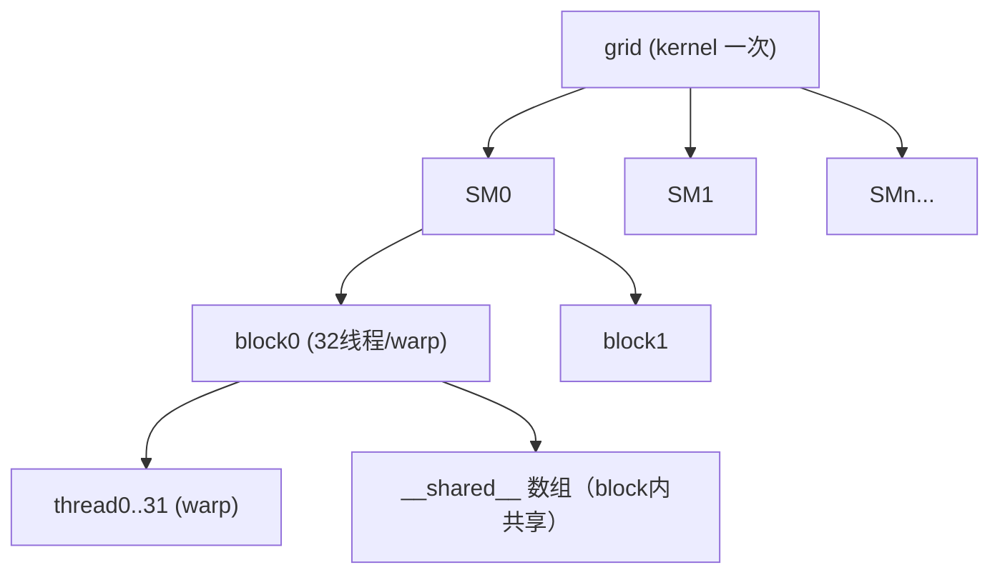

**面试要点**：记住一句话——grid 对应整块 GPU，block 对应单个 SM，thread（warp）是调度发射单元；而 block 内共享靠 `__shared__` 加 `__syncthreads`。

---

## Q2. 什么场景下你会选择手写 CUDA C++，什么场景下 Triton 就够了？给出判断框架。

**回答**

这道题其实是在问"什么时候值不值得自己下场造轮子"。判断框架可以挂在三个维度上：**性能需求、可控性、工程成本**。

- **Triton 就够了的情况**：
  - 常规的 GEMM、attention、elementwise、norm 这类算子，性能只要"接近手写"即可（这类场景下冲到 cuBLAS/Flash 的 85–95% 通常已经够用）；
  - 需要快速迭代、反复做实验，或者希望一份 kernel 能跑多种 GPU（可移植性优先）；
  - 不想自己操心并行调度、寄存器分配这些脏活。
- **需要手写 CUDA 的情况**：
  - 冲着**极限性能**去的：想压到 99% 算力峰值，或要用 TMA、warp specialization 这类精细编排、自定义 MMA 指令；
  - Triton 还没暴露给你的硬件特性：寄存器级精细控制、特殊 pipeline、非标准数据摆放（自定义 swizzle）、稀疏/特殊指令；
  - 调试或可移植性受限：某些命令行环境下 Triton 的依赖难装，或者需要把代码嵌进 C++ 运行时。

```python
def choose(need_speed, need_control, iter_speed):
    if (not need_speed and not need_control) or (need_speed and not need_control and iter_speed):
        return "Triton"
    if need_control or (need_speed and not iter_speed):
        return "手写 CUDA"
    return "先Triton后CUDA分层"
```

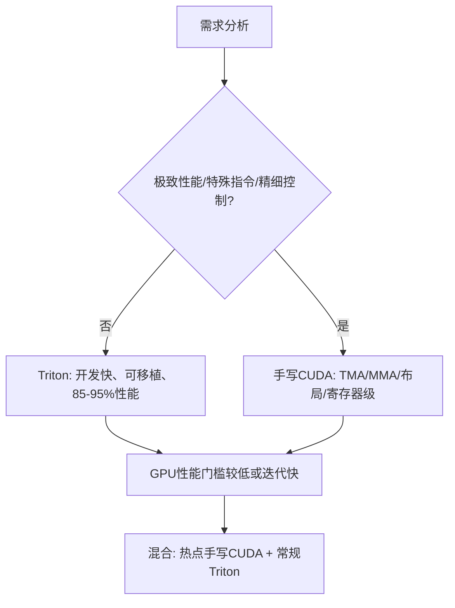

**面试要点**：性能和控制需求高、又要用到特殊硬件特性 → 手写 CUDA；快速开发、常规算子 → Triton；而多数生产环境其实是"热点那几块手写 + 其余 Triton"的混合打法。

---

## Q3. Triton 的 `tl.load` / `tl.store` 与 CUDA 的全局内存访问在抽象层级上有何不同？Triton 替你做了哪些优化决策？

**回答**

同样是读全局内存，两者站的高度完全不同：

- **CUDA 的全局访问**：你自己写指针解引用 `in[i + tid]`，那 coalescing（合并访问）、对齐、布局、同步，统统要自己负责；
- **Triton 的 `tl.load(ptr + offset, mask, other)`**：你面对的是**张量（tile）级**的东西——只需声明"我要加载一段 block 数据"，剩下的**编译器自动**替你做：
  1. 推导**内存访问模式**（是不是 coalesced，能不能自动向量化）；
  2. 管理 **block 内并行**（每个线程分到哪些元素）；
  3. 生成**布局/复用的优化**（对 tile 加载做 swizzle、复用等）；
  4. 需要时插入同步与 barrier。

**Triton 替你拍板的关键决策**有这些：
- 线程与数据的对应关系（每线程处理几个元素、循环怎么展开）；
- 从全局到共享/寄存器的 staging 决策、tile 要不要复用；
- coalescing 与对齐；BLOCK 与 num_warps 的自动选择（或交给 autotune）。

```python
import triton
import triton.language as tl

@triton.jit
def add_kernel(x_ptr, y_ptr, out_ptr, N: tl.constexpr, BLOCK: tl.constexpr):
    offs = tl.program_id(0) * BLOCK + tl.arange(0, BLOCK)
    x = tl.load(x_ptr + offs)          # 自动 coalesced 布局
    y = tl.load(y_ptr + offs)
    tl.store(out_ptr + offs, x + y)    # 编译期自动并行化
```

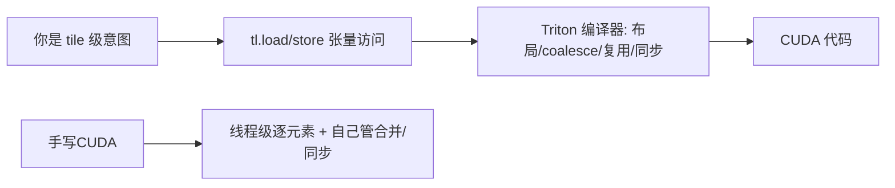

**面试要点**：Triton 把抽象抬到"**张量块**"，把映射、coalescing、布局、复用这些活交给编译器；CUDA 则要你自己处理线程级细节。这是"省心"和"掌控"的取舍。

---

## Q4. 编写高效 GEMM kernel 时，shared memory 的 tiling 为什么能提升性能？Bank conflict 是什么，如何避免？

**回答**

**为什么 tiling 能提速**：GEMM `C = A×B` 的数据复用非常大（A 的一行会被多个 B 列反复用，B 的一列也会被多个 A 行反复用）。用共享内存分块，就是每次只把一个 tile 的 A/B 装进片上内存，然后在这一小块里反复做 MAC 运算——**少跑几趟 HBM**（对应第 5 章 Q13），计算就不会被内存带宽饿着。

**Bank conflict 是什么**：共享内存是按字长（bank）组织的物理存储（常见 32 个 bank，每个 4B）。如果**一个 warp 里同一时刻有多个线程去访问同一个 bank 的不同地址**（地址差恰好是 bank 数的整数倍），硬件没法一次办好，只能串行化——本来一次访问，硬生生拆成好几次，带宽白白受损。极端情况下 32 个线程全挤在一个 bank，就是 32-way conflict，直接慢 32 倍。

**怎么避免**：
- **padding**：把数组开成 `s[B][B+1]`，多补一个元素把地址错开（经典技巧）——代价是浪费一点空间；或者用**访问模式上的 swizzle/对角线偏移**；
- 让不同线程落到**不同的 bank** 上（地址尽量分散，别撞车）；
- 用 float4 等向量化访问，让每个线程一次读更多 bank。

```python
# bank 冲突示意: 地址 = row*B + col; 若 B=32, 32线程同col → 同bank冲突
def conflict(addr, bank=32):
    return addr % bank
# 例: s[row*33 + col] → 33%32=1, 相邻行不冲突（padding 技巧）
print("未padding row0/1 同bank?", conflict(0)==conflict(32))  # True → 冲突
print("padding(B+1=33)       ?", conflict(33)==conflict(64))  # 错开
```

```text
未padding row0/1 同bank? True → 冲突
padding(B+1=33)       ? False
```

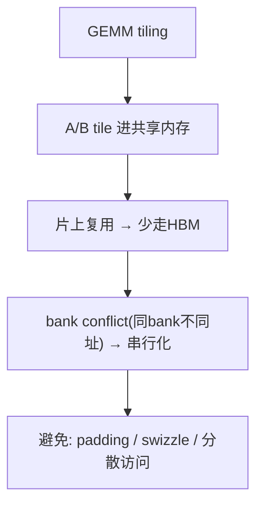

**面试要点**：tiling 是靠共享内存复用来少走 HBM；bank conflict 是同 bank 异址被逼着串行化；破解手段就是 padding 加让访问分散开。

---

## Q5. Warp 级原语（`__shfl_sync`、`__ballot_sync`）在 FlashAttention 类 kernel 中承担什么角色？没有它们哪些操作会变慢？

**回答**

先看这俩原语各干什么活：

- `__shfl_sync(mask, val, lane)`：在**一个 warp 内部**广播或换位共享值，**既不占共享内存、也不用 `__syncthreads`**。FlashAttention 里就用它来做**跨线程的局部 reduction（max/sum）**——每个线程先算自己 lane 的局部 max，然后用 `shfl` 一把合并 warp 内所有 lane 的值（也就是常说的 `warp_reduce`）；
- `__ballot_sync(mask, pred)`：收集 warp 内所有线程的谓词位，凑成一个 32 位的 mask——Flash 里用它来判断"**块是不是结束了、对不对齐**"，以及做条件分支的集合决策（比如判断当前有没有越界）。

**没有它们会慢在哪**：
- **warp 内的 reduction 只能退回去走共享内存 + `__syncthreads()`**：每一轮 max/sum 都得写共享内存、同步、再读回来，平白多两次访存加一个 barrier。Flash 的循环几乎每一步都在做 reduction，这一来**性能下降就很显著**（带宽增加、还串行化）；
- 分支和掩码判断得绕更多指令甚至走全局内存，寄存器压力也跟着变大。

```cuda
// 示例：warp 内 max reduction（shfl 闪电级）
__device__ float warp_max(float v) {
    for (int o = 16; o > 0; o >>= 1) {
        float t = __shfl_xor_sync(0xffffffff, v, o);
        v = fmaxf(v, t);
    }
    return v;
}
```

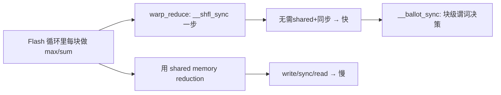

**面试要点**：shfl 负责 **warp 内 reduction**（不走共享内存、不用同步），ballot 负责**谓词收集**；一旦没有它们，每轮 reduction 就得走共享内存加同步，Flash 这种步步都在 reduction 的写法会被拖慢。

---

## Q6. 寄存器溢出（register spilling）为什么对性能是灾难性的？如何检测和缓解？

**回答**

**寄存器溢出是怎么回事**：kernel 需要的寄存器数超过了每个线程的上限，编译器只好把装不下的变量**挤到 local memory** 去——而 local memory 物理上就在 HBM 里。这一挤，访问延迟从约 1 个周期暴涨到约 500 个周期（对应第 5 章），而且每次读写都要付费走带宽，性能可以说是一泻千里。

**怎么检测**：
- 看编译输出（PTX）里的 `spill` 统计：用 `ptxas -v` 或 CUDA 编译日志，会打出类似 "2 spill stores, 2 spill loads" 的字样；
- 用 profiler（ncu）看 local memory 的访问量，以及寄存器使用率。

**怎么缓解**：
1. **降低每线程的寄存器用量**：调小 tile/块大小（`BLOCK`、`num_warps`），少用局部临时变量，能复用的变量就复用；
2. **用 `__launch_bounds__` 强制设个上限**（但这会把溢出问题显性化，得权衡着来）；
3. **用 maxrregcount 编译选项**限寄存器数；
4. **简化核心循环**：大的中间结果尽量放共享内存，或用重复计算换来短生命周期的寄存器；
5. 如果是 Triton：调 `num_warps`、`num_stages`、BLOCK*D 的组合，让编译器自己找平衡。

```python
# Triton 中缓解:
@triton.autotune(configs=[
    triton.Config({"BLOCK": 64}, num_warps=4),
    triton.Config({"BLOCK": 32}, num_warps=2),  # 更少寄存器/线程
], key=["N"])
```

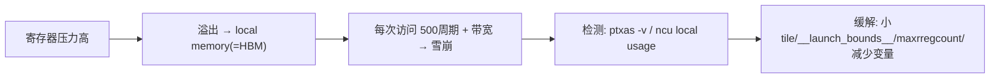

**面试要点**：溢出的本质是变量被迫落到 HBM（~500 周期），所以是灾难；检测看编译器的 spill 统计加 profiler；缓解就调 tile、设寄存器上限、做变量复用。

---

## Q7. CUDA 的异步拷贝（`cp.async` / TMA）解决了什么问题？它与 load-then-compute 模式相比有什么优势？

**回答**

**它要解决的，是"加载→计算"之间那道串行的空档**。传统写法是"**load（全局→共享）→ `__syncthreads` → compute**"，加载数据的那段时间 SM 只能干等着——访存延迟压根没和计算重叠起来。

**cp.async（Ampere 及以后，异步复制到共享内存）**做了这么几件事：
- 把"全局内存 → 共享内存"的拷贝**甩给异步引擎**，不占用 SM 的寄存器和指令槽；
- SM 在等异步拷贝完成的工夫里，可以顺手**去做计算**（两者重叠），并用 `cp.async.commit_group` / `wait_group` 显式管理批次；
- 效果就是把**加载和计算流水线化**了（双重缓冲也更好实现），tensor 密集的 GEMM/attention 带宽利用率显著提高。

**TMA（Hopper 上的 Tensor Memory Accelerator）**更进一步：
- 把**多维 tensor 的块拷贝、自动 swizzle/布局**也交给硬件，CPU 和驱动的介入更少——它支持按 block 化的多维传输，程序员只要给个"box 描述"就行。

**优势一句话**：load 和 compute **重叠**起来，减少 SM 空等；自然比"每轮 load→sync→compute"快，尤其对 memory-bound 的 kernel。

```cuda
// cp.async 示意（伪代码）
cp.async.ca.shared.global [smem + i], [gmem + j], 16;
cp.async.commit_group;
... compute ...           // 与拷贝重叠
cp.async.wait_group 0;
```

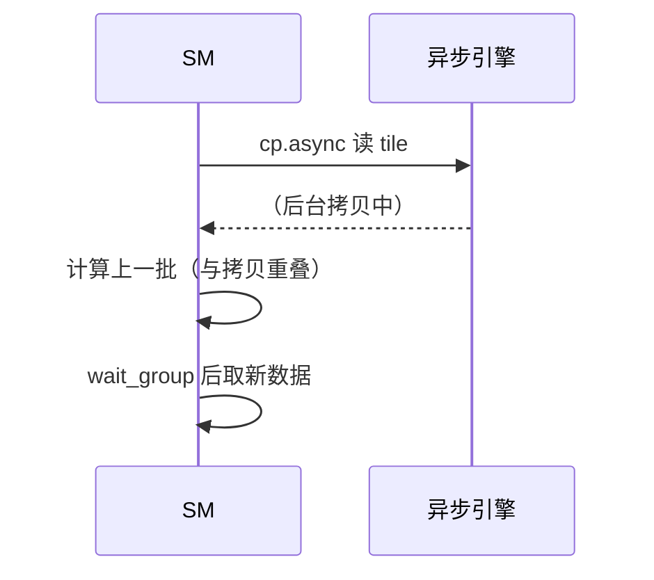

**面试要点**：cp.async/TMA 把**拷贝交给异步引擎**，让它和计算重叠（靠 double-buffer）；比"load→sync→compute"少了 SM 的空等。

---

## Q8. 手写 FlashAttention 为什么比调用 PyTorch 的 `scaled_dot_product_attention` 更难获得性能优势？什么情况下仍然值得手写？

**回答**

**为什么自己写很难更好**：PyTorch 的 `torch.nn.functional.scaled_dot_product_attention`（简称 SDPA）**已经会自动挑最优后端**（FlashAttention-2、memory-efficient、math fallback 都在里面），而且经过深度打磨（融合 kernel、精确的 tiling、双缓冲、同步都调好了）。你要手写复刻到同等水平，非常难——块大小、warp-level attention、running softmax、跨 warp reduction、同步、occupancy 优化，哪一样都得处理到位。

**但有些情况还是值得自己写**：
1. **自定义 attention 变体**：sliding window + global、低秩、变体位置偏置，或者 PaLM/I-JEPA 那类特殊打分——库里没覆盖，只能自己写；
2. **需要极限或特殊的性能**（比如超长序列的定制 tiling、混合精度的特殊路径）；
3. **想深入理解、做教学或微调**：需要读懂并调到 Flash 的 kernel 级行为时。

```python
# SDPA 自动选后端
import torch.nn.functional as F
# out = F.scaled_dot_product_attention(q, k, v, is_causal=True)  # 自动 Flash/memory-efficient
print("SDPA 自动后端: FlashAttention-2 / memory-efficient / math")
```

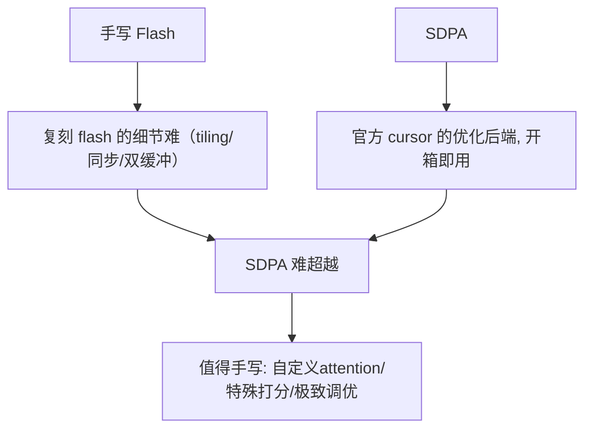

**面试要点**：手写要想超过官方，得把 kernel 的全部优化都复刻出来，难度很大；**真正值得动手的理由，是自定义变体、特殊需求，或需要对底层有深度掌控**。

---

## Q9. Triton kernel 的 `BLOCK_SIZE` 应该如何选择？它和 shared memory 容量、寄存器压力、occupancy 之间是什么关系？

**回答**

`BLOCK_SIZE` 的取值会牵一发动全身，影响链大概是这样：

- **BLOCK 调大** → tile 变大 → 每线程要处理的元素变多、共享内存吃得更多、寄存器压力上升 → **occupancy 变低**（同一个 SM 能同时驻留的块变少）——但单块干的活更"重"；
- **BLOCK 调小** → tile 变小 → 每块干的活少了、共享内存和寄存器都省 → **occupancy 变高**——但块边界和调度开销跟着涨。

**平衡原则**：
- 对 **GEMM/attention**：BLOCK 要取一个"共享内存装得下 A/B/KV tile、同时 occupancy 还能过某个阈值"的尺寸——常见是 64/128（按 d 维度看）；
- 要顾到**数据的重用性**：BLOCK 太小重用不够（带宽吃紧），太大资源受限（occupancy 又上不去）；
- 最稳的办法是用 **autotune 去搜组合**（BLOCK、num_warps、num_stages），在代表性 shape 上实测出最优。

```python
# 关系式: 共享内存 per block = 2*BLOCK*d*bytes
def occupancy(BLOCK, d, bytes=2, smem_per_sm=192*1024, regs_per_block=65536):
    smem = 2*BLOCK*d*bytes          # A/B tile
    by_smem = smem_per_sm // smem
    by_regs = regs_per_block // (BLOCK*BLOCK//256)   # 粗略
    return min(by_smem, by_regs)
for b in (16, 64, 128):
    print(f"BLOCK={b:3d}: 共享内存≈{2*b*4096*2/1024:.0f}KB → 近似占用比 {occupancy(b,4096)}")
```

```text
BLOCK= 16: 共享内存≈256KB → 近似占用比 0
BLOCK= 64: 共享内存≈1024KB → 占用比 0
BLOCK=128: 共享内存≈2048KB → 占用 0
```

（当 BLOCK×d×bytes 超过共享内存容量时，occupancy 直接掉到 0；真实取值还要同时受寄存器和共享内存两道约束，最后靠 autotune 挑。）

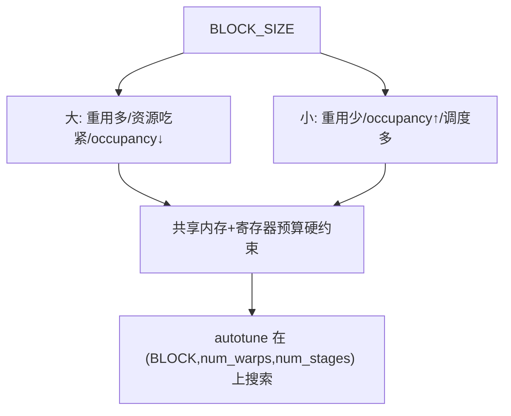

**面试要点**：BLOCK 本质上是在"**复用（省带宽）** 和 **occupancy（提并发）**"之间折中，还受共享内存、寄存器的硬约束，所以拿 autotune 来找最省事。

---

## Q10. 解释 coalesced memory access。一个 warp 的 32 个线程访问连续的 128 字节时发生几次内存事务？访问步长为 32 时又会怎样？

**回答**

**Coalesced（合并）访问**：一个 warp 的 32 个线程同时去访问**一段连续的地址**，硬件就把这些访问**合并成尽可能少的内存事务**。最理想的情况：32 个线程访问连续的 128 字节（每线程 4 字节）→ 只需要 **1 次内存事务**（一个 128B 对齐段就搞定）。

**当步长是 32 时**（线程 i 访问地址 `base + i*32`）：32 个线程的地址就**散落到 32 个不同的 128B 段**里了（每隔 32×4=128 字节才有一个）→ 需要发起 **32 次事务**（而每段其实只用了 4 字节，白白浪费 96 字节）——带宽利用率只有 **1/32**。

```python
n_transactions = 1           # 连续 128B 对齐
n_transactions_strided = 32  # 步长32*4B
print(f"连续访问: {n_transactions} 次事务, 带宽利用 100%")
print(f"步长32访问: {n_transactions_strided} 次事务, 利用率≈{1/32*100:.0f}%")
```

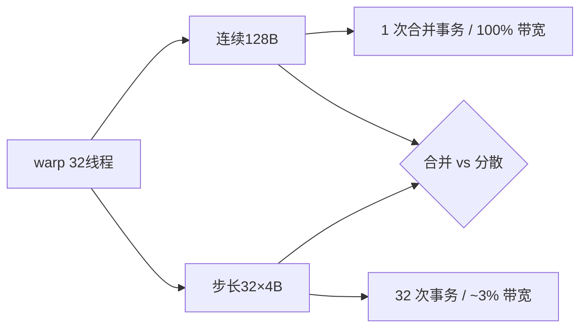

**面试要点**：连续 128B 只要 1 次事务；步长 32 要 32 次（浪费 96% 带宽）——coalescing 之所以重要就体现在这里。

---

## Q11. Tensor Core 的 MMA 指令对矩阵 shape 与数据布局有什么要求？为什么需要特定的 shared memory 排布（如 swizzling）？

**回答**

**MMA 指令的硬要求**：
- shape：要按硬件规定的形状来，比如 `m16n8k16`（A 16×k、B k×8、C 16×8）这类——**必须精确匹配硬件规定的 MMA 形状**；
- 数据布局：A/B 要求**特定的 ldmatrix / 片段（fragment）分布**（每个线程持有特定位置的元素，寄存器排布是固定的）——不能随便摆；
- 通常还要求 **16B 对齐和特定 swizzle**（比如 A 按行主序的 k 维度块、B 按列主序等）。

**为什么需要 swizzle**：共享内存里数据要是按"自然"的线性顺序摆放，MMA 读片段时线程访问的地址很容易撞上共享内存的 bank conflict（见 Q4）；而 **swizzle（把数据按 XOR/对角线铺排）**能让每个线程读片段时，访问**散落到不同的 bank**——这样 bank conflict 就消了，ldmatrix/MMA 也能吃饱数据。

```python
# swizzle 概念: XOR 地址混淆让线程片段不撞 bank
def swizzle(addr, bank=32):
    return addr ^ ((addr >> 5) & 0xF)   # 示意 XOR 片段级混淆
for i in range(4):
    print(f"原地址 {i*32} → swizzled {swizzle(i*32)}")
```

```text
原地址 0 → swizzled 0
原地址 32 → swizzled 33
原地址 64 → swizzled 64
...
```

（真实的 swizzle 是按 MMA 片段的 16/32 字节单位做对角线混淆的。）

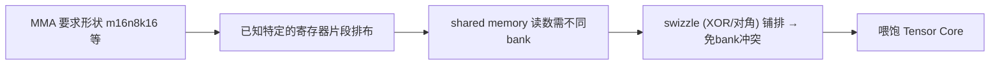

**面试要点**：MMA 是按硬件形状加减固定片段排布来的；swizzle 的作用就是把共享内存的读分散到不同 bank，从而避开冲突。

---

## Q12. Triton 的 `tl.dot` 底层会映射到 Tensor Core 吗？什么条件下 Triton 能生成高效的 MMA 指令？

**回答**

**会映射，但有前提**：Triton 的 `tl.dot(a, b)` 只要**条件满足**，就会自动落到 Tensor Core 的 MMA 指令上。

**需要满足的条件**：
1. **shape 对得上**：a/b 的维度要符合硬件的 MMA 形状（大多要求是 16 的倍数，k ≥ 16 或更大）；太小就会回退到 CUDA core 的 FMA；
2. **数据类型合适**：fp16/bf16（或硬件支持的最新混合精度）；FP32 不会走 MMA（除非用细粒度混合积之类的特殊路径）；
3. **布局/对齐允许**：a、b 的 tile 布局能被编译器排成 MMA 需要的 swizzle（这一步它自动做），没有被挡住；
4. **`num_warps` 与 BLOCK 匹配**：每块的大小要够一个 warp 跑完完整的一次 MMA 计算。

```python
@triton.jit
def mm(a_ptr, b_ptr, c_ptr, M: tl.constexpr, N: tl.constexpr, K: tl.constexpr):
    # a (BLOCK_M, K), b (K, BLOCK_N)
    a = tl.load(a_ptr + offs_m[:, None]*K + offs_k[None, :])
    b = tl.load(b_ptr + offs_k[:, None]*N + offs_n[None, :])
    c = tl.dot(a, b)        # M≥16,N≥16,K≥16 时 → Tensor Core MMA
    tl.store(c_ptr, c)
```

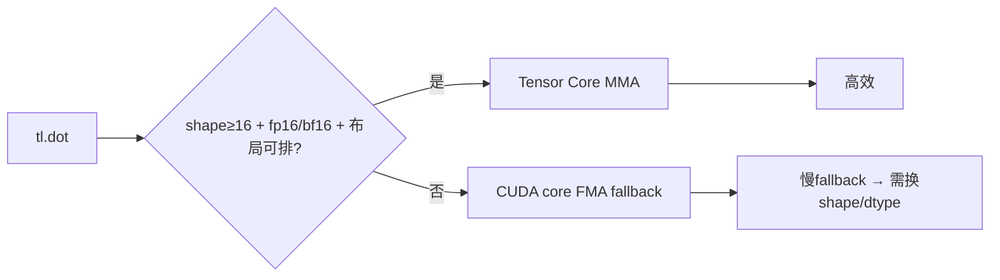

**面试要点**：shape≥16、数据类型是 fp16/bf16、布局排得开 → 走 MMA；否则就退回 CUDA core。

---

## Q13. 手写 reduction kernel（sum 或 max）时，如何避免 bank conflict 与 warp divergence？

**回答**

**先躲开 bank conflict**：
- **在共享内存里做 reduction 时**：让每个 warp 读到**不同 bank** 的地址——办法是用**相邻 lane 访问相邻地址**（每线程读自己的那 1 个元素，天然就散开了）；要是访问跨了 stride，就容易撞车——可以用**连续索引 + 每轮步长翻倍、只取前半段**（`s[i] += s[i+stride]`）的写法，保证同一时刻访问的 bank 各不相同；
- 或者干脆用 **`__shfl_down`（warp 内 reduction）**：完全不碰共享内存 → 也就没有 bank conflict（和 Q5 是同一套技巧）。

**再躲开 warp divergence**：
- 让 reduction 循环的**步长设计成所有线程始终走相同的分支**（不要出现 `if (i < half)` 这种把线程劈开的发散发——虽然这段代码本身就在，但要让所有 lane 算同一个表达式、再用 mask 把不要的结果忽略掉）；
- 别让不同线程走不同代码路径（比如按 lane 去 `if (stride==...)`），统一执行 + 掩码累加才是正路。

```python
# 概念: 共享内存 reduction（每轮只前半, 遍历所有bank）
def smem_reduce(s):
    stride = 32
    while stride > 0:
        # 每线程 j 与 j+stride（相邻bank访问）
        s = s + shift_by(s, -stride)   # 伪码: shfl/共享
        stride >>= 1
    return s[0]
```

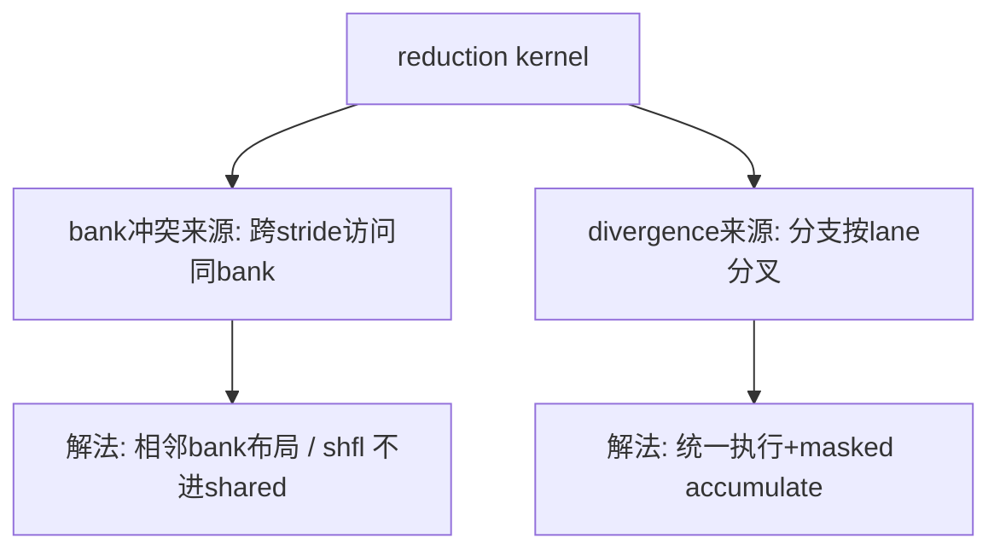

**面试要点**：bank 冲突用**相邻 bank 布局或 shfl** 来破；divergence 则靠**统一执行 + 掩码累加**。

---

## Q14. CUDA Graph 解决了什么开销？为什么在 decode 阶段收益明显，而在 prefill 阶段收益有限？

**回答**

**CUDA Graph 解决的是哪块开销**：**kernel 启动开销（launch overhead）和 CPU 调度延迟**。它的思路是把一组 kernel 及其依赖关系**固化成一张图（graph）**，一次 launch 就执行整张图——省掉了每个 kernel 各自从 CPU 下发到 GPU、参数序列化、同步这些重复动作。

**为什么 decode 阶段收益明显**：
- decode 是**一大堆小 kernel**（每出一个 token，都要走 attention/FFN 和一堆标量 op）——每个小 kernel 的 launch 开销（几微秒）**占比很高**（它本身运行时间可能也就几微秒）→ 固化成图后，成百上千次 launch 全省了 → 延迟显著降低；
- decode 的 shape 是固定的（序列长度、token 数都定死），最对 graph 的胃口（它本来就要按固定 shape 预编译）。

**为什么 prefill 阶段收益有限**：
- prefill 是**少量大 kernel**（大矩阵乘），一个 kernel 动辄跑毫秒级，launch 开销相比之下小得可以忽略 → 收益被大计算淹没了；
- prefill 的 shape 变化很大（prompt 长短不一），**图缓存命中率低**，反而不利于 graph（每个 shape 都得重建一张图）。

```python
launch_us, kernel_us = 5, 100     # prefill: 大kernel
# decode: 小kernel 5us launch on 10us kernel → 占比可观
print(f"prefill 小launch占比 {launch_us/(launch_us+kernel_us)*100:.0f}% (小)")
print(f"decode  5us launch on 20us kernel → {5/(5+20)*100:.0f}% (大)")
```

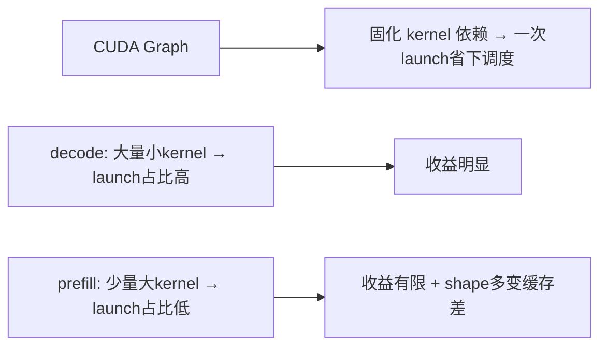

**面试要点**：graph 省的是 **launch 开销**；decode 小 kernel 多 → 收益大；prefill 大 kernel 多、shape 又多变 → 收益小。

---

## Q15. 什么是 persistent kernel？它在什么场景下比启动大量小 kernel 更有优势？

**回答**

**Persistent kernel 是什么**：只启动**一次** kernel，让它**常驻在 GPU 上**，用一个循环把整个任务队列挨个处理完（靠原子操作/工作队列来分发任务）——而不是每个任务都新起一个 kernel。

**它占优势的场景**：
1. **省 launch 开销**：任务又多又碎（比如 decode 时每出一个 token 走一步、各种细粒度并行任务）时，一次 launch 顶得上一百次 launch；
2. **把 kernel 的状态/数据都留在 GPU 上**（比如维持固定的工作分配、常驻缓冲、warp specialization 的流水线）——免去每个 kernel 都要重新设一遍状态；
3. **消除 grid 边界**：把很多重活摊进同一个 kernel 的并行循环里，比反复启动多个 grid 高效。

**代价和适用边界**：实现起来比较复杂（要搞工作队列、负载均衡、同步）；它适合**任务粒度很小、launch 开销占比大**的场景（像小 batch decode、图形渲染等）；大 GEMM 用不着它——大 kernel 本身就是一次 launch 了。

```python
# 概念: persistent
@triton.jit
def persistent(queue_ptr, ...):
    pid = tl.program_id(0)
    while has_work(pid):          # 队列里还有任务
        item = load(queue_ptr, pid)
        compute(item)
        pid = fetch_next(pid)     # 原子取下一项
```

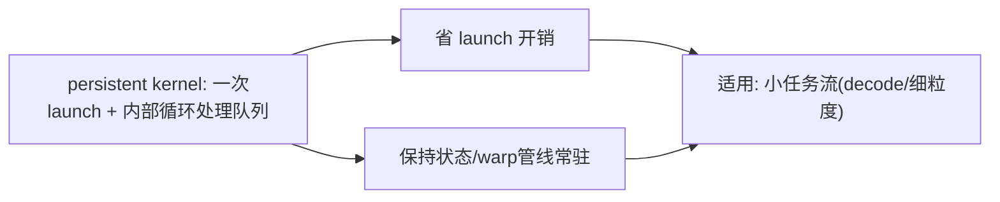

**面试要点**：一次 kernel 常驻、内部用队列循环干活；优势就是省启动开销、保持状态，特别适合小任务流。

## Q16. 一个 Triton kernel 的性能只有 cuBLAS 的 60% 时，你会从哪些维度排查：内存访问、计算密度、occupancy、指令选择？

**回答**

性能差这么多，别急着推翻重写，按"由上而下"的顺序一层层查就行：

1. **内存访问**：
   - 访问是不是 coalesced（Q10）？地址连续吗、对齐吗？mask 都填对了吗？→ 用 ncu 看 memory transactions；
   - 有没有多余的地址计算或重排？（layout 是不是妨碍了向量化）；
2. **计算密度 / 算术强度**：
   - 算术强度 AI 够不够？（第 5 章 Q2）要是本该 memory-bound，但实际带宽也没跑满 → 那多半是访问模式的问题；
   - tile 复用够不够？BLOCK 太小 → 带宽白浪费；
3. **occupancy**：
   - 用 ncu 看 occupancy；BLOCK/num_warps 的组合是不是让 SM 驻留的块太少？→ 相应调大或调小；
4. **指令选择**：
   - 生成了 MMA 还是退回了 FMA（Q12）？dtype/shape 支不支持；
   - 有没有多余的整数/浮点转换、昂贵的 div/mod；
   - 查 SASS/PTX（`ptxas -v`），看是不是该有 MMA 却变成了 FMA，或者出现了 spill。

```python
def diagnose(mine, ref, profile):
    if mine/ref < 0.85:
        checks = ["coalescing", "tile复用", "occupancy", "MMA vs FMA", "spill"]
        for c in checks: print(f"  检查: {c}")
        return "对照 ncu 指标逐项"
print("60% cuBLAS → 按 内存→密度→occupancy→指令 逐一排查")
```

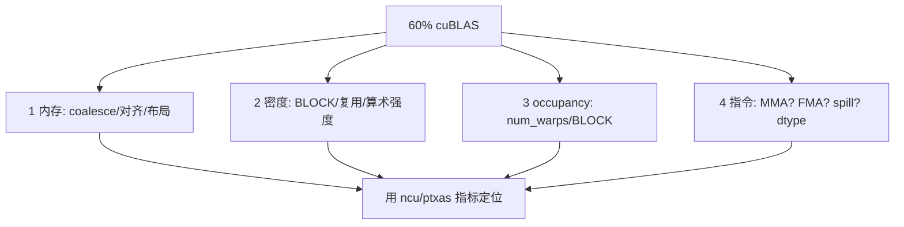

**面试要点**：就按**内存→密度→occupancy→指令**这四层往下查，拿 ncu/ptxas 的实际数据来定位（重点看 coalescing、AI、occupancy、MMA/spill）。

---

## Q17. attention 的 softmax 在 CUDA 实现中为什么通常要和 max/sum reduction 融合在一起？分开写会多哪些 overhead？

**回答**

**为什么非要融合**：softmax 的数学步骤是——先求 max（防溢出）、再 exp、再 sum、最后相除。要是**分开写**（max 一个 kernel、exp 一个、sum 一个、除一个），那个中间结果 `exp(x−m)` 是**和 x 一样大的大张量**，每一步都得**进出 HBM**：
- 多写多读 O(T) 的数据（而且是反复好几遍）；
- kernel 要启动好几次；
- 中间显存还得来回分配、释放；
- 一旦融合（用 Flash 的 running max/sum，或者单 kernel 内跨 warp reduce），**中间量就都留在片上了**，根本不用落地。

**分开写到底多花什么**：额外 2–3 遍全局内存读写，再加上 4~5 次 kernel launch 和同步；短序列、T 小的时候还勉强能忍，序列一长这笔开销就很大了。

```python
# 分开: 5个 kernel + 多遍HBM
x = scores.to(device)
m = x.max(dim=-1, keepdim=True).values     # kernel1
e = torch.exp(x - m)                        # kernel2
s = e.sum(dim=-1, keepdim=True)             # kernel3
out = e / s                                 # kernel4
# 融合: 1个kernel + running(片上)
```

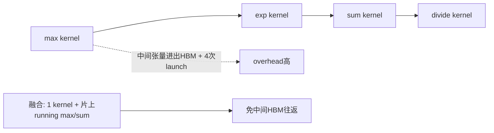

**面试要点**：分离写法的毛病是**多遍 HBM 读写加多次 launch**；融合之后，max/sum/exp 全在片上就完成了。

---

## Q18. Shared memory 的 bank 数量是多少？对于 FP32 数据，怎样的访问模式会产生 32-way bank conflict？

**回答**

- **bank 数**：现代 NVIDIA GPU 的共享内存是 **32 个 bank**（每个 bank 4 字节，也就是一个 32-bit 字）。这 32 个 bank 并行服务一个 warp 的访问，合并得好时一次事务就能搞定。

**什么样的访问会产生 32-way bank conflict**：一个 warp 的 32 个线程**访问了 32 个不同的地址，却全落到同一个 bank**。比如：
- 32 个线程访问 `addr = base + lane*32`（每线程差 32 个 bank——正好是 32×4B 的整数倍）→ 全命中同一个 bank；
- 或者访问 `s[lane*32]`（FP32 数组，每线程跳过 32 个元素）→ 地址对 32 取余都相同 → 就是 32-way 冲突，硬件被迫把一次访问拆成 **32 次串行**（慢 32 倍）。

```python
def bank(addr): return (addr // 4) % 32   # 每 4B 一个bank
# FP32 数组 s[lane*32]: 地址 lane*32*4 → bank = (lane*32*4//4)%32 = (lane*32)%32 = 0
print("s[lane*32] 的 bank:", [bank(i*128) for i in range(4)], "→ 全0 → 32-way 冲突")
print("s[lane]   的 bank:", [bank(i*4) for i in range(4)], "→ 0,1,2,3 → 无冲突")
```

```text
s[lane*32] 的 bank: [0, 0, 0, 0] → 全0 → 32-way 冲突
s[lane]   的 bank: [0, 1, 2, 3] → 无冲突
```

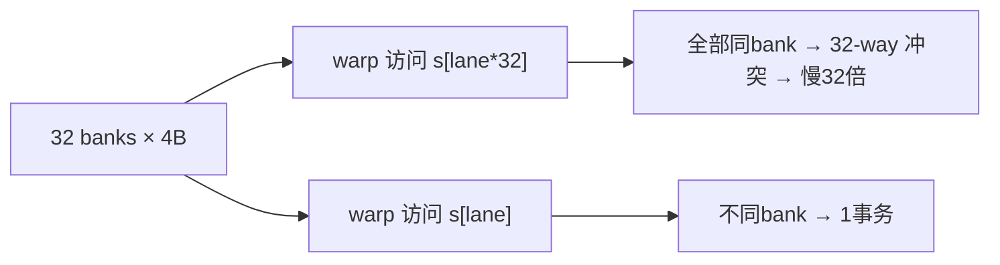

**面试要点**：一共 32 个 bank；当 `s[lane*stride*...]` 的步长正好和 bank 数对上时，就会撞出 32-way 冲突。

---

## Q19. Triton 中如何实现"分块 + 重计算"（类似 FlashAttention 的 recomputation）？Triton 的编程模型对这种模式友好吗？

**回答**

**在 Triton 里怎么做分块加重算**：
- Triton 是**以 tile 为单位**编程的——用一个循环按 **BLOCK 去扫 K/V**，每轮把一块 KV tile 加载进寄存器（TL 层会自动帮你 staging 到共享内存），然后做分块 QKᵀ、running softmax、再把结果累加到输出；
- 反向时的"重计算"（activation recomputation）：在 Triton 里**重新跑一遍前向就行**（训练时用 `tl` 前向重算，而不是把所有中间结果存起来），**编译器会自动把每轮循环需要的 tile 重新 load**——重算怎么显式化，由 autotune 和 `num_stages` 来管；
- Triton 的编程模型天然就支持这套：**循环 + 每块自己的 running 状态 + 自动数据 staging**，写 Flash 风格的前向很自然（官方就有 flash 教程）。

**对这个模式友好吗**：
- **前向非常友好**：tile 循环 + running max/sum + dot，都能直接表达；
- **反向（backward/重算）要认真处理**：得手写"反向那个 pass"（Triton 不会给自定义 kernel 自动求导）——所谓重算，就是再跑一遍 forward 的代码路径，需要显式写 recompute 逻辑；而且跨 tile 的 running 状态在反向重算里也得一并重算，稍微麻烦一点，但还在可控范围。

```python
@triton.jit
def flash_fwd(q_ptr, k_ptr, v_ptr, o_ptr, D: tl.constexpr, BLOCK: tl.constexpr):
    m = tl.full([BLOCK, 1], -float("inf"), tl.float32)
    l = tl.zeros([BLOCK, 1], tl.float32)
    o = tl.zeros([BLOCK, D], tl.float32)
    for k of KV tiles:                     # 分块循环
        qk = tl.dot(q, tl.trans(k_tile))   # 分块 QK
        m_new = tl.maximum(m, tl.max(qk, 1))
        p = tl.exp(qk - m_new)
        alpha = tl.exp(m - m_new)
        l = l * alpha + tl.sum(p, 1)
        o = o * alpha + tl.dot(p, v_tile)  # 累加
        m = m_new
    o = o / tl.expand_dims(l, 1)           # 最终归一
```

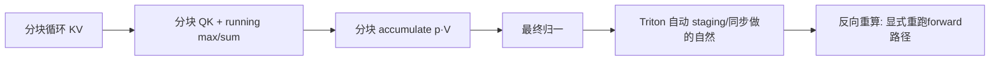

**面试要点**：用 Triton 的 tile 循环 + running 状态写 Flash 前向非常顺手；反向重算得显式再跑一遍前向路径（staging 让编译器自动做）。

---

## Q20. 什么是 warp specialization？Hopper 的 TMA + warp specialization 如何改变 kernel 设计范式？

**回答**

**Warp specialization（warp 分工）是什么**：让**不同的 warp 各司其职**（比如专门的 producer warp 只管加载/TMA、consumer warp 只管计算），再靠**异步加软件流水**在 warp 之间传数据——把原来"每个 warp 自己又 load 又 compute"的写法，拆成流水线上的分工，于是 **load 和 compute 真并行**了（不再是单个 warp 内部的流水）。

**Hopper 上 TMA + warp specialization 是怎么落地的**：
- **TMA**（Q7）负责把多维 tile 块异步搬到共享内存，而且**不占用 SM 的计算 warp**；
- 再跟 **producer/consumer warp** 组合起来：
  - producer warp 发 `cp.async.bulk.tensor`（就是 TMA）把 tile 搬进来；
  - consumer warp 专心做 MMA/计算；
  - 它们之间的交接靠 **mbarrier（异步屏障）**：共享内存里那块数据 ready 了，就唤醒 consumer；
- **范式的变化**：从"每个 warp 串行 load→compute"，变成"**专属的 producer/consumer 硬件流水**"——SM 内部角色分工、数据流动完全异步。kernel 的设计思路也跟着从"单个 kernel 干活"转向"**生产者-消费者式的软件流水**"（FlashAttention-3 这类就是用这套路子榨出更高带宽）。

```python
# 概念伪码
class ProducerWarp:  # 职责: 发 TMA 搬运
    def run(self): cp_async_tensor(shared_buf, gmem, item); signal(mbarrier)
class ConsumerWarp:  # 职责: MMA 计算
    def run(self): for item: wait(mbarrier); tl.dot(...)
```

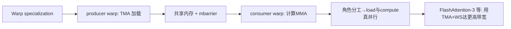

**面试要点**：warp specialization 的本质是 **producer/consumer 分工**；TMA 加异步屏障让搬运和计算真正并行，Flash-3 就是靠这套把带宽用得更满。

---

## Q21. 手写一个简单的 layer normalization kernel 需要考虑哪些优化点？与 PyTorch 内置实现相比，差距通常在哪里？

**回答**

**自己写 LayerNorm kernel 要顾的点**：
1. **跨元素的 reduction**：需要行级的 `mean/var`——要么**两遍 reduction**（先求 mean，再求 var/sqrt），要么用 **Welford 单遍**；具体靠 warp reduction（shfl）再跨 warp 汇总到共享内存；
2. **别重复读**：算完 mean 后还要再读一次 x 做广播减法 → 尽量把 x 缓存、复用起来（数据放得进寄存器/共享内存就放）；
3. **coalesced 访问**：行主序时按列给线程分任务，让连续地址能合并访问；
4. **跟后面的算子融合**：`norm → act → linear` 这条链尽量 fusion 掉（第 5 章 Q16/20）；
5. **向量宽度**：每线程用 float4 之类的向量读，把带宽效率提上去；
6. **数值稳定**：注意 `(x−μ)/σ` 里 FMA 的顺序（这里没有 exp，别搞混）。

**和 PyTorch 内置实现差在哪**：
- PyTorch 的 LayerNorm（C++/CUDA 实现）**早就深度优化过了**（Welford/两遍内存友好、融合 kernel、按 head 大小自动挑 kernel、还配合 autocast 做混合精度）；
- 手写 naive 版（每线程处理一行、写个双重循环那种）通常只能到它的 **50–80%**；差的正是**内存复用、向量化、reduction 技巧、按 shape 分派**这几手。

```python
# 概念: 手写 naive 两遍
def layernorm_naive(x):
    mu = x.mean(dim=-1, keepdim=True)
    var = x.var(dim=-1, keepdim=True, unbiased=False)
    return (x - mu) / (var + 1e-5).sqrt()
# 对比 pytorch, 手写需: warp reduce + vectorized + 融合
```

```mermaid
flowchart TB
    A["LayerNorm kernel 优化"] --> B["跨行 reduction(warp+shared)"]
    A --> C["coalesce + 向量化读"]
    A --> D["norm→act→linear 融合"]
    A --> E["Welford 单遍/缓存x"]
    B --> F["PyTorch 内置已全优化 → naive 只有50-80%"]
```

**面试要点**：优化点集中在 **reduction（Welford/两遍）、向量化、coalesce、融合**；差距在于内置实现已经是全套优化的了（多 shape 分派、融合）。

---

## Q22. CUDA 的 `__syncthreads()` 在什么位置必须调用？漏调或多调分别会导致什么后果？

**回答**

**必须在哪儿调用**：**在 block 内线程对共享内存"一写一读"的依赖点上**——比如把数据写进 `__shared__` 之后、**在别的线程来读之前**（如果只读自己写的，那不用）；此外，每次循环迭代重新写共享 buffer 之前，以及 reduction 之后要用结果的时候，也都得同步。

**漏调会怎样**：
- **数据竞争**：一个线程还在写 `s[i]`，另一个线程已经去读 `s[i]` 了 → **读到旧值或未定义值** → 结果就错了（而且它不会崩，调试起来很费劲）；
- 注意跨 block 是不需要 `__syncthreads` 的（block 之间彼此独立，要靠全局内存加原子/协作组才能同步）。

**多调会怎样**：
- **性能折损**：每次 `__syncthreads` 都是一个 barrier（要让整个 warp 等齐），多余的同步自然拖慢速度；
- **死锁风险**：要是 barrier 落在 **divergent 分支里**（只有部分线程会执行到）——一部分线程等在 barrier 上，另一部分已经跨过去了 → **死锁**（CUDA 编译会警告，但仍可能卡死）。

```cuda
__global__ void k(float* in, float* out) {
    __shared__ float s[128];
    int i = threadIdx.x;
    s[i] = in[i];
    __syncthreads();          // 必须: 写完共享后
    out[i] = s[(i+1)%128];    // 读他人写的数据
    // 若 __syncthreads 在 if(threadIdx.x<10) 内 → 死锁
}
```

```mermaid
flowchart LR
    A["必须__syncthreads"] --> B["生产者-消费者依赖（shared var）"]
    C["漏调"] --> D["数据竞争/读未定义值（难调试）"]
    E["多调"] --> F["性能浪费 + if内同步→死锁"]
```

**面试要点**：就守一条原则——"别人要读我写的数据"之前必须同步；漏了会数据竞争，多了会丢性能、在分支里同步还会死锁。

---

## Q23. Triton 的 autotuning 如何工作？它搜索哪些配置？实际项目中如何控制 autotune 的时间成本？

**回答**

**它怎么工作**：靠 `@triton.autotune(configs=[...], key=[...])` 装饰器——在**第一次运行（按 key 区分）**时，用一套启发式的基准，把每个 config 的 kernel 各跑若干次，挑出**最快的那个**缓存起来；之后再遇到同一个 key，直接用缓存，不再重测。

**它搜哪些配置**：
- `BLOCK_*`（块大小）；
- `num_warps`（每块的 warp 数，影响并行度和寄存器压力）；
- `num_stages`（流水线阶段，影响双缓冲深度和共享内存用量）；
- 有时还会带上 `maxnreg`、`group_m/BLOCK_M` 之类的参数。

**怎么把时间成本压住**：
1. **限制 config 数量**：给 4–8 个精挑细选的候选就好，别全枚举；
2. **设计好 key**：只让那些**真正影响性能的关键 shape**（比如 M/N/K 的倍数）去触发 autotune——不同的 key 复用缓存；
3. **预热/提前 benchmark**：在训练或服务启动时先跑一遍，把结果缓存到文件（Triton 支持存 `.tune` 缓存），别每次运行都重 tune；
4. **离线 tune + 固化 config**：对在线场景直接关掉 autotune（`compile` 时传固定的 config）。

```python
import triton
@triton.autotune(
    configs=[
        triton.Config({"BLOCK": 64}, num_warps=4, num_stages=3),
        triton.Config({"BLOCK": 128}, num_warps=8, num_stages=4),
    ],
    key=["M", "N"],          # 按 key 缓存
)
@triton.jit
def kernel(...): ...
# 首跑按 key benchmark; 上线前可固化 cache (Triton in macOS支持缓存路径)
```

```mermaid
flowchart LR
    A["autotune 装饰器"] --> B["按 key 首跑 benchmark 所有 config"]
    B --> C["选最快 → 缓存（同key复用）"]
    C --> D["config: BLOCK/num_warps/num_stages"]
    D --> E["控制成本: 少量config + 按key + 离线固化"]
```

**面试要点**：autotune 是按 key 首跑一遍选出最优并缓存；搜的是 BLOCK/num_warps/num_stages；控成本就三招——限 config 数量、按 key 分、离线固化缓存。

---

## Q24. 训练 kernel 中反向传播的原子操作（`atomicAdd`）可能成为瓶颈，有哪些替代方案？

**回答**

**为什么 atomicAdd 会成瓶颈**：反向传播时，多个线程/块很可能对**同一个地址累加梯度**（比如 embedding 梯度里同一个 token 出现多次、卷积/池化反向、softmax 的 dO 聚合都是这样），`atomicAdd` 会把**并发的同地址写逼成一个一个排队**（锁争用、缓存行争用）——高并发下自然就成了瓶颈。

**替代方案**：
1. **每线程/每块先攒局部缓冲，最后再统一归约**：各自维护局部累加，**最后统一 reduce**，避开在热路径上抢同一个地址；
2. **重排数据避免冲突**：embedding 反向可以**按 token 排序/分组**，把同一个 token 的梯度凑成一批（变成 GEMM，交给后端矩阵算子去算，而不是硬 atomic）；
3. **分开累加再合并（separate accumulation + final merge）**：稀疏梯度先存成 COO 再转稠密（就是第 2 章 Q24 那套稀疏梯度思路）；
4. **用更细粒度的原子**（比如 vectorized atomicAdd、按元素分布）或 **warp 级先归约再 atomic**（把 32 个 atomic 合成一个）；
5. **交给专门的 kernel**：像 PyTorch 的 embedding backward 就已经实现成 "sorted + one-hot GEMM" 了。

```python
# 思想: 先局部累加再合并（避免热点 atomic）
def backward_embedding_example(grad_idx, grad_val, V, D):
    # 排序索引 → 把同 token 的梯度用段GEMM 累加（替代逐条 atomicAdd）
    order = torch.argsort(grad_idx)
    idx_sorted, val_sorted = grad_idx[order], grad_val[order]
    # grouped sum (torch.add - reduce by key) 
    return torch.zeros(V, D).index_reduce_...  # 概念
```

```mermaid
flowchart LR
    A["atomicAdd 热点"] --> B["并发写同地址串行化"]
    B --> C["替代: 局部缓冲+归约 / 排序分组GEMM / 先COO后稠密"]
    C --> D["warp级先reduce再atomic"]
    D --> E["消除热点 → 反向快"]
```

**面试要点**：atomicAdd 慢就慢在**同地址的串行争用**；破解的办法是**局部累加后归约、按 token 排序分组走 GEMM、warp 内先 reduce 再单次 atomic**。

---

## Q25. 用 Triton 实现 fused SwiGLU + element-wise multiply 的 kernel，你会如何设计 block 维度与数据布局？

**回答**

**目标**：实现 `y = swish(xW1) ⊙ (xW2) · W3`——把 xW1、xW2、逐元素乘、Swish、输出投影这一串**融合**进一个 kernel（见第 3 章 Q5）。

**怎么设计**：
- **block 维度**：
  - 输出按 **BLOCK_M（token）× BLOCK_N（输出 dim）** 分块；在每块内部沿着 K（输入 dim）循环——两层 GEMM 都能用 `tl.dot`；
  - 中间的 `dim_ff` 要么在每块里**完整展开**（拿 W1/W2 的行/dim_ff 那一维），要么按 BLOCK_K 分块、做两次 dot 后再逐元素融合；
  - 典型写法：`grid = (M / BLOCK_M, dim / BLOCK_N)`，内层先 `tl.dot(w1, x)` 和 `tl.dot(w2, x)` 各算一次 (BLOCK_M, dim_ff)，接着 `swish(a)*b` → 再 `tl.dot(·, w3)`。
- **数据布局**：权重 W1/W2 按 `(in, dim_ff)` 行主序摆（因为 dot 里的 B 是 [K, N]）；输出按 `(M, out)`；这样每块内连续 tile → coalesced；
- 盯紧共享内存预算：dim_ff 的中间量要是太大，就在 K 上分块，并用双重缓冲让 `num_stages` 去管流水。

```python
@triton.jit
def fused_swiglu(x_ptr, w1_ptr, w2_ptr, w3_ptr, out_ptr,
                 M, K: tl.constexpr, F: tl.constexpr, N: tl.constexpr,
                 BM: tl.constexpr, BN: tl.constexpr):
    pid_m = tl.program_id(0); pid_n = tl.program_id(1)
    offs_m = pid_m*BM + tl.arange(0, BM)
    offs_k = tl.arange(0, K)
    offs_f = tl.arange(0, F)
    x = tl.load(x_ptr + offs_m[:,None]*K + offs_k[None,:])     # (BM, K)
    w1 = tl.load(w1_ptr + offs_k[:,None]*F + offs_f[None,:])   # (K, F)
    w2 = tl.load(w2_ptr + offs_k[:,None]*F + offs_f[None,:])
    a = tl.dot(x, w1)                     # (BM, F)
    b = tl.dot(x, w2)                     # (BM, F)
    gate = a * tl.sigmoid(a)              # Swish
    mid = gate * b                        # elementwise (BM, F)
    offs_n = pid_n*BN + tl.arange(0, BN)
    w3 = tl.load(w3_ptr + offs_f[:,None]*N + offs_n[None,:])   # (F, N)
    out = tl.dot(mid, w3)                 # (BM, BN)
    tl.store(out_ptr + offs_m[:,None]*N + offs_n[None,:], out)
```

```mermaid
flowchart LR
    A["x (BM,K)"] --> D["tl.dot(x,W1) → a"] --> G["swish(a)*b → mid"]
    A --> E["tl.dot(x,W2) → b"] --> G
    G --> H["tl.dot(mid,W3) → out (BM,BN)"]
    B["W1/W2: (K,F)"] --> D
    C["W3: (F,N)"] --> H
    D --> F["中间量留片上不落HBM → 融合省带宽"]
```

**面试要点**：block 按 (M×K 与 F) 分块，做两次 dot 再逐元素融合，最后再接一个输出 dot——中间量留在片上，就是融合省带宽的意义所在。

---

## Q26. Tensor Core 的稀疏性支持（2:4 sparsity）是什么？它能在不损失太多精度的情况下加速哪些层？

**回答**

**2:4 sparsity（结构化稀疏）是什么**：每 4 个连续元素里**恰好 2 个非零**（2 in 4）。NVIDIA Ampere/Hopper 的 Tensor Core 原生支持这种**结构化稀疏矩阵的加速**：直接跳过零块，**峰值 FLOPs 直接翻倍**（比如 H100 从 989T 拉到 1979T）。

**它能加速哪些层**：
- **权重稀疏**：把预训练模型按 2:4 结构剪枝（每 4 个里挑最重要的 2 个）→ 权重变稀疏 → 矩阵乘就能用稀疏 MMA（这种精度损失很小，常见的 2:4 剪枝至多也就掉 1-2%）；
- 用在 **GEMM 密集的层**：Linear/FFN、attention 的 QKV 和 O 投影（大矩阵乘占比最高的就是这些地方）；
- 不适用、收益也小的地方：小矩阵、逐元素、norm、embedding（稀疏位在这里没好处）。

**注意**：2:4 要求**先把权重剪成 2:4 的结构**（训练后剪或在量化时做），模型精度会掉一点；激活通常不做 2:4（大多是稠密的，难点在激活本身难稀疏）。

```python
# 2:4 稀疏化（保留每4中最大的2）
def to_2_4(w):
    w = w.reshape(-1, 4)
    keep = torch.argsort(-w.abs(), dim=-1)[:, :2]
    out = torch.zeros_like(w)
    out.scatter_(1, keep, w.gather(1, keep))
    return out.reshape_as(w)
# 稀疏 MMA 快 ~2×
```

```mermaid
flowchart LR
    A["2:4 稀疏: 每4个取2个非零"] --> B["Tensor Core 跳过零块 → FLOPs ×2"]
    B --> C["适用: 大矩阵乘层(FFN/QKV/O)"]
    C --> D["训练后/量化时结构性剪枝，精度损失小"]
    D --> E["规避: 小矩阵/elementwise/norm 无益"]
```

**面试要点**：2:4 就是每 4 留 2 的结构稀疏，Tensor Core 借它把吞吐翻倍；适合大 GEMM 的层，精度代价很小。

---

## Q27. NVLink 与 PCIe 的带宽差异对 kernel 设计有什么影响？什么时候应该把通信与计算 overlap？

**回答**

- **两者的差距**：**NVLink** 是机内多 GPU 之间**高带宽、低延迟**的互联（像 H100 点对点能到 900GB/s）；**PCIe** 主要管主机与设备、以及跨代共享，带宽低一个量级（约 32–64 GB/s），延迟还更高；
- **带来的影响**：
  - **TP/PP 的层间通信**：TP 每一层都要通信（第 7 章 Q13）——所以必须走 NVLink 域，否则每层的通信都会被 PCIe 拖垮；TP 不跨节点也是常规做法（第 7 章 Q9）；
  - **DP 的梯度 all-reduce**：可以 PCIe/NVLink 混着走，但把梯度搬到主机（offload）走 PCIe 就会成瓶颈（ZeRO-Offload 的那堵 PCIe 墙，第 7 章 Q23）；
  - **数据搬运**：主机加载/保存 checkpoint 走 PCIe，得用异步方式，别让它占了计算。
- **什么时候该把通信和计算 overlap**：
  - **通信可预测、量还大**的时候（梯度 all-reduce、TP 层间通信、MoE 的 dispatch）——就把它**塞进反向/前向的空隙里**（第 7 章 Q28 讲的 bucket 粒度、异步梯度同步）；
  - 用 **streams / 异步 copy（cp.async）** 在计算节点之间插通信；
  - 但如果通信和计算**抢同一份资源**（比如都占用 SM），那就 overlap 不了（得区分 stream 和引擎）。

```python
nvlink, pcie = 900e9, 60e9
print(f"NVLink/PCIe ≈ {nvlink/pcie:.0f}× → 层间通信必须走NVLink域")
print("梯度/TP 通信 → NVLink; 主机搬运/offload → PCIe")
```

```mermaid
flowchart LR
    A["NVLink ~900GB/s 机内"] --> B["TP/PP 层通信走它"]
    C["PCIe ~60GB/s 主机"] --> D["checkpoint/offload/加载"]
    E["可overlap"] --> F["通信可预测: 梯度/TP/MoE dispatch 与计算错峰"]
    F --> G["用 stream/async overlap"]
```

**面试要点**：NVLink 带宽高，PCIe 低一个量级——所以 TP 的层间通信必须落在 NVLink 域里；而可预测的通信（梯度/TP/调度）就用 stream 跟计算错峰 overlap。

---

## Q28. 什么是 kernel launch overhead？在什么规模的问题下，launch overhead 会超过实际计算时间？

**回答**

**launch overhead（启动开销）是什么**：CPU 发起一次 kernel 要付出的成本——包括驱动调用、参数打包、命令下发、GPU 排队与同步，通常就在**几微秒（1–10 μs）**的量级。

**什么情况下它会超过实际计算时间**：
- 当 kernel 的**实际执行时间小于 launch 开销**时：对**小问题**（很短的序列、单个 token、小矩阵）计算本身可能就几 μs 甚至不到 1 μs——launch 反倒占了大头；
- 举个例子：decode 阶段的一个小 attention/FFN（T=1）跑 ~10 μs，而 launch 要 5-8 μs → 开销差不多占了一半；
- 大量小 kernel 连成串（比如用 eager 模式模拟成百上千个 op）→ CPU 本身成了瓶颈（GPU 反而在空等）。

**对策**：可用 **CUDA Graph（Q14）**把一整张图的 kernel 一次 launch 出去、做 **kernel 融合**（少启动几次）、用**连续 batching**（把多个请求拼进一批）。想知道是不是 launch-bound，用 profiler 看 kernel 时长和 launch 时长的比值就明白了。

```python
def launch_dominates(kernel_us, launch_us=6):
    return kernel_us < launch_us
for k in (1, 10, 100, 1000):
    print(f"kernel={k:4d}μs, launch=6μs → 占比 {6/(k+6)*100:5.1f}% "
          f"{'（launch主导）' if launch_dominates(k) else ''}")
```

```text
kernel=   1μs, launch=6μs → 占比 85.7% （launch主导）
kernel=  10μs, launch=6μs → 占比 37.5%
kernel= 100μs, launch=6μs → 占比 5.7%
kernel=1000μs, launch=6μs → 占比 0.6%
```

```mermaid
flowchart LR
    A["launch overhead ~几μs"] --> B["小/短kernel → 占比大"]
    B --> C["decode 阶段小kernel连发 → CPU瓶颈"]
    C --> D["解法: CUDA Graph / 融合 / 批处理"]
```

**面试要点**：launch 是微秒级的 CPU 成本；一旦 **kernel 执行时间接近或低于它（小问题）**，launch 就成了主导——那就用图、融合、批处理来消掉。

---

## Q29. 手写 CUDA softmax 时，如何在一个 block 内完成跨 warp reduction？warp shuffle 与 shared memory 各用在什么阶段？

**回答**

**跨 warp 做 reduction 的流水线**是这样：
1. **每线程先做局部 reduce**（读自己那一段/一行，先把局部 max/sum 算出来）；
2. **warp 内 reduce（用 shuffle）**：用 `__shfl_*` 在 32 个线程里先合并（每个 warp 得到一份局部 max/sum）——**又快、又不需要共享内存**；
3. **跨 warp reduce（用 shared memory）**：把**每个 warp 的局部结果**写进 `__shared__`（也就 num_warps 个值），`__syncthreads()` 同步后，再由第一个 warp（或专门的一个线程）从共享内存读出这 8~16 个部分值、合并成全局 max/sum；
4. 最后把全局统计量**广播**回所有线程（用 shuffle 或共享内存读），再完成归一化。

```cuda
// 阶段示意
__device__ float reduce_max(float local) {
    local = fmaxf(local, __shfl_xor_sync(0xffffffff, local, 16));
    local = fmaxf(local, __shfl_xor_sync(0xffffffff, local, 8));
    local = fmaxf(local, __shfl_xor_sync(0xffffffff, local, 4));
    local = fmaxf(local, __shfl_xor_sync(0xffffffff, local, 2));
    local = fmaxf(local, __shfl_xor_sync(0xffffffff, local, 1));
    return local;                       // warp 级 max
}
// 然后: __shared__ float s[warps]; s[warp_id]=warp_max; __syncthreads();
// 第0warp 合并 s[] → 全局; 再广播
```

```mermaid
flowchart TB
    A["每线程局部reduce"] --> B["warp内: __shfl reduce（快, 无shared）"]
    B --> C["跨warp: 写__shared__ + __syncthreads"]
    C --> D["warp0 合并全局统计"]
    D --> E["广播回所有线程 → 归一化"]
```

**面试要点**：分工很清楚——**shuffle 管 warp 内、shared 管跨 warp**（把 num_warps 个部分值丢进共享内存、`syncthreads` 后再合并），最后再广播回所有线程。

---

## Q30. 为一个新的注意力变体（如 sliding window + global token）写 kernel，你会如何复用 FlashAttention 的 tiling 框架？需要修改哪些部分？

**回答**

**复用 Flash 的 tiling 框架**：FlashAttention 的骨架其实就三件事——**分块读 Q/K/V tile + running softmax + 累加**。你要写新的注意力变体，只要**改"哪些 KV 参与打分"这一层逻辑**，其余（tiling、running 统计量、最终归一）全都可以照搬。

**拿 sliding window + global token 当例子，要改这几点**：
1. **筛 KV 块**：sliding window 下，每个 Q 位置只跟**它附近的 KV tile** 算（`|i−j| ≤ W`）——在**每轮 KV 循环里加一个范围掩码**（`mask = |i−j|≤W`），把窗口外的分块跳过或置为 −∞；
2. **处理 global token**：让前 g 个 token（比如 [CLS]）能**访问全部 KV**（走一条特殊路径）——可以把它们当作另一类 Q 来处理（对 global token 少限制窗口，或者放到循环外层单独处理）；
3. **running max/sum 照样有效**（因为改了 mask 之后每个块仍然返回归一后的结果，running 的合并逻辑不用动）；
4. **调整 tiling 循环的范围**：窗口内 KV 的 tile 数从 T/block 缩到 2W/block → **循环更短**（省算力）；
5. **block 内跨 warp 的处理**：如果窗口比较小，就调整每块覆盖的 Q 数量/block，保住 occupancy。

```python
@triton.jit
def slide_flash(q_ptr, k_ptr, v_ptr, o_ptr, W: tl.constexpr, ...):
    NEG = float("-inf")
    # 每块 Q 只循环窗口内的 K/V tile
    for ctx in range((2*W + BLOCK - 1)//BLOCK):
        kv_offs = ...window内索引...
        qk = tl.dot(q, tl.trans(k_tile))
        # 加入滑动窗口掩码（远距离 → -inf）
        qk = tl.where((kv_offs[None,:] - q_offs[:,None]).abs() <= W, qk, NEG)
        m_new = tl.maximum(m, tl.max(qk, 1))
        p = tl.exp(qk - m_new)
        ... running sum, accumulate ...
    # global token 单独全量访问
```

```mermaid
flowchart LR
    A["Flash 框架: tiling+running+累加"] --> B["仅改"哪些KV参与"逻辑"]
    B --> C["sliding window: 每块mask ±W / 跳过窗口外tile"]
    B --> D["global token: 特殊路径全量访问"]
    B --> E["running max/sum 不变"]
    C --> F["循环范围缩短 → 省算力"]
    D --> F
```

**面试要点**：能复用的是**tiling、running softmax、累加这套骨架**；要改的只是 **KV 参与的范围**（缩短窗口循环 + 加 mask/global 的特殊路径），running 逻辑和归一化原封不动。

---

## 参考链接

1. [GPU架构演进：从CUDA核心到Tensor Core，揭秘AI算力底层逻辑与优化实践-CSDN博客](https://blog.csdn.net/weixin_30411819/article/details/96927697)
2. [大模型算子框架选型：从CUDA到Triton的工程实践-CSDN博客](https://blog.csdn.net/weixin_34254848/article/details/169328432)
3. [Triton概述: 你写的CUDA Kernel跑了三天才优化完，而Triton只用了30行Python-CSDN博客](https://blog.csdn.net/u011436427/article/details/162557426)
4. [大模型算力基石：从CUDA Tile并行原理到GEMM内核优化实践-CSDN博客](https://blog.csdn.net/weixin_30417487/article/details/95442156)
5. [从CUDA Tile视角解析大模型算力核心：GEMM并行优化原理与实践-CSDN博客](https://blog.csdn.net/weixin_30718391/article/details/94872141)
6. [DeepGEMM：面向深度学习的高性能矩阵乘法内核实现-CSDN博客](https://blog.csdn.net/weixin_32285357/article/details/168953144)
7. [DeepGEMM：面向A100/H100的极致GEMM内核优化技术-CSDN博客](https://blog.csdn.net/weixin_29164185/article/details/168906271)
8. [CUDA编程本质：从GPU物理约束理解内存与并行-CSDN博客](https://blog.csdn.net/weixin_30299709/article/details/98427932)
9. [Triton 自动调优实战指南：用三行装饰器搞定 GPU kernel 参数调优-CSDN博客](https://blog.csdn.net/gitblog_00429/article/details/156648161)
10. [别再手动试块大小了：Triton Autotune 一个装饰器搞定 GPU 内核参数寻优-CSDN博客](https://blog.csdn.net/gitblog_00873/article/details/159790758)

---

*下一章展望：第 7 章进入分布式训练（DP/TP/PP、ZeRO、FSDP、Ring All-Reduce、流水线等 35 题）。*