# 第 6 章 · GPU 高性能编程

> 面试生普（LLM 500 题）· 第 6 章。本章覆盖 CUDA 三层线程模型、Triton 与手写 CUDA 的取舍、GEMM/FlashAttention 内核、Warp 原语、寄存器溢出、Coalesced 访问、Tensor Core、CUDA Graph、Persistent Kernel、autotune 等 30 个问题，关键概念配 Python（Triton 风格）代码与 mermaid 图解。

---

## Q1. CUDA 的 grid、block、thread 三层结构分别对应硬件的什么？一个 block 内的线程如何共享 shared memory？

**回答**

- **grid**：一次 kernel 启动的所有线程块集合，映射到 GPU 的所有 SM（调度粒度）；
- **block（线程块）**：一组线程，**必须被调度到同一个 SM**（一个 SM 可驻留多个 block），是资源/同步的基本单位；
- **thread（线程）**：最小的执行单元，物理上每 32 个组成一个 warp 由 SM 的调度器发射。

**对应关系**：

| CUDA 三层 | 硬件对应 |
|---|---|
| grid | GPU / 多 SM（任务级并行） |
| block | 单个 SM（资源驻留单位） |
| warp（thread 组） | SM 内一个调度器发射的 32 线程 |

**block 内共享 shared memory**：block 内线程通过 `__shared__` 声明的数组共享——它们在同一个 SM 的片上 SRAM，通过 `__syncthreads()` 同步后互相读写；不同 block 的 shared memory 相互隔离（不共享）。

```cuda
// CUDA 示意：block 内共享
__global__ void ker(float* in, float* out) {
    __shared__ float s[128];            // block 内共享（SM 片上）
    int i = threadIdx.x;
    s[i] = in[i];
    __syncthreads();                    // 必须同步
    out[i] = s[i] * 2.0f;
}
```

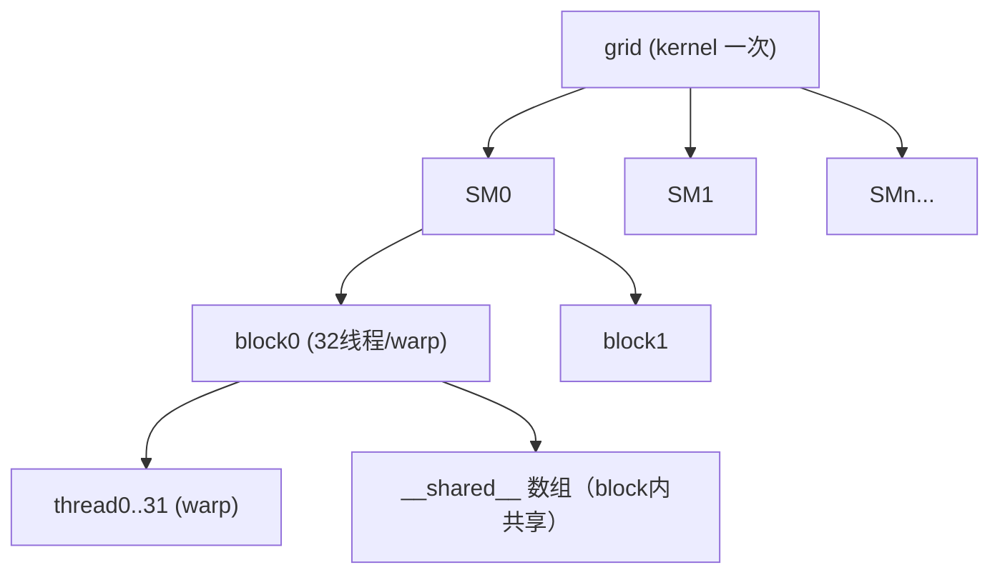

**面试要点**：grid=GPU，block=SM，thread（warp）=调度发射单元；`__shared__`+`__syncthreads` 是 block 内共享的关键。

---

## Q2. 什么场景下你会选择手写 CUDA C++，什么场景下 Triton 就够了？给出判断框架。

**回答**

**判断框架**（三个维度：性能需求、可控性、工程成本）：

- **用 Triton 就够了**：
  - 常规 GEMM/attention/elementwise/norm，性能需求"接近手动即可"（85–95% cuBLAS/Flash 在多数场景够）；
  - 需要快速迭代/实验、可移植性（同一 kernel 跑多 GPU）；
  - 不希望手写并行调度/寄存器分配。
- **需要手写 CUDA**：
  - **bottom-line 极致性能**：追求 99% 算力峰值、特殊布局/指令（TMA、warp-specialization 精细编排、自定义 MMA）；
  - **硬件特性未暴露给 Triton**：寄存器级精细控制、特殊 pipeline、非标数据摆放（swizzle 需要自定义）、稀疏/特殊指令；
  - **调试/可移植受限**：某些 CLI 环境下 Triton 的依赖难装，或需要嵌入 C++ 运行时。

```python
def choose(need_speed, need_control, iter_speed):
    if (not need_speed and not need_control) or (need_speed and not need_control and iter_speed):
        return "Triton"
    if need_control or (need_speed and not iter_speed):
        return "手写 CUDA"
    return "先Triton后CUDA分层"
```

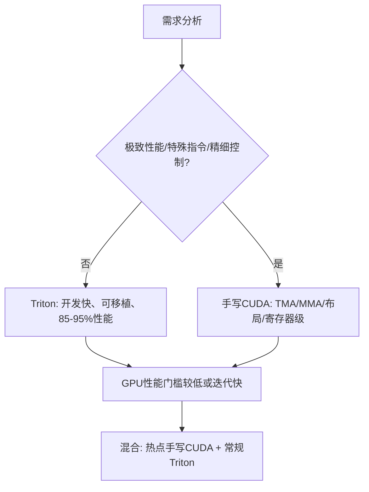

**面试要点**：性能/控制需求高 + 特殊硬件特性 → CUDA；快速开发 + 常规算子 → Triton；多数生产是"热点手写 + 常规 Triton"混合。

---

## Q3. Triton 的 `tl.load` / `tl.store` 与 CUDA 的全局内存访问在抽象层级上有何不同？Triton 替你做了哪些优化决策？

**回答**

- **CUDA 全局访问**：程序员显式写指针解引用 `in[i + tid]`，自己负责**coalescing（合并访问）、对齐、布局、同步**；
- **Triton 的 `tl.load(ptr + offset, mask, other)`**：面向**张量（tile）级**的操作——你声明"加载一段 block 数据"，**编译器自动**：
  1. 推导**内存访问模式**（是否 coalesced，自动向量化）；
  2. 管理 **block 内并行（每线程处理哪些元素）**；
  3. 生成 **布局/复用的优化**（对 tile 加载做 swizzle、复用等）；
  4. 插入同步与 barrier（需要时）。

**Triton 替你做的关键优化决策**：
- 线程/数据映射（每线程多元素、循环展开）；
- 从全局到共享/寄存器的 staging 决策、tile 复用；
- coalescing 与对齐；自动选择 BLOCK 与 num_warps（或 autotune）。

```python
import triton
import triton.language as tl

@triton.jit
def add_kernel(x_ptr, y_ptr, out_ptr, N: tl.constexpr, BLOCK: tl.constexpr):
    offs = tl.program_id(0) * BLOCK + tl.arange(0, BLOCK)
    x = tl.load(x_ptr + offs)          # 自动 coalesced 布局
    y = tl.load(y_ptr + offs)
    tl.store(out_ptr + offs, x + y)    # 编译期自动并行化
```

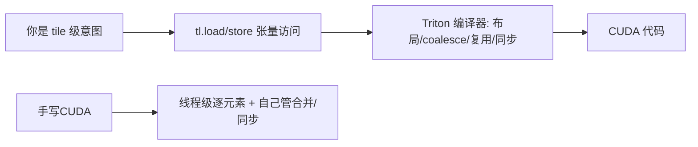

**面试要点**：Triton 抽象到"**张量块**"，把**映射、coalescing、布局、复用**交给编译器；CUDA 则要自己处理线程级细节。

---

## Q4. 编写高效 GEMM kernel 时，shared memory 的 tiling 为什么能提升性能？Bank conflict 是什么，如何避免？

**回答**

**tiling 提升性能**：GEMM `C = A×B` 中，数据复用量大（A 的行被多个 B 列复用、B 的列被多个 A 行复用）。用**共享内存分块**：每次把一个 tile 的 A/B 装进共享内存，片上复用它做所有需要的 MAC——**减少 HBM 访问**（Q13 第 5 章），让计算不被带宽饿死。

**Bank conflict**：共享内存是**按字长（bank）组织的物理存储**（如 32 个 bank，每个 4B）。如果**一个 warp 内同一时刻多个线程访问同一 bank 的不同地址**（地址差恰为 bank 数整数倍），硬件必须串行化 → 一次访问变多次（bandwidth 受损）。极端 32 线程同一 bank → 32-way conflict → 慢 32 倍。

**避免**：
- **padding**：`s[B][B+1]` 加 1 个元素错开地址（经典技巧）——但会浪费一点；或者用 **访问模式的 swizzle/对角线偏移**；
- 让不同线程访问**不同 bank**（地址分散到不同 bank，不撞车）；
- 使用 float4/向量化访问把每线程读更多 bank。

```python
# bank 冲突示意: 地址 = row*B + col; 若 B=32, 32线程同col → 同bank冲突
def conflict(addr, bank=32):
    return addr % bank
# 例: s[row*33 + col] → 33%32=1, 相邻行不冲突（padding 技巧）
print("未padding row0/1 同bank?", conflict(0)==conflict(32))  # True → 冲突
print("padding(B+1=33)       ?", conflict(33)==conflict(64))  # 错开
```

```text
未padding row0/1 同bank? True → 冲突
padding(B+1=33)       ? False
```

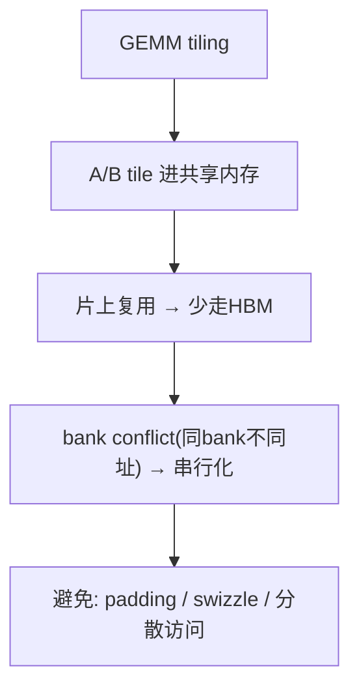

**面试要点**：tiling = 共享内存复用降 HBM；bank conflict = 同 bank 异址被串行化；避免手段 padding + 访问分散。

---

## Q5. Warp 级原语（`__shfl_sync`、`__ballot_sync`）在 FlashAttention 类 kernel 中承担什么角色？没有它们哪些操作会变慢？

**回答**

**角色**：
- `__shfl_sync(mask, val, lane)`：在**一个 warp 内**广播/换位共享值，**不需要 shared memory 与 __syncthreads**——FlashAttention 里被用来做 **跨线程的局部 reduction（max/sum）**：每个线程算自己 lane 的局部 max，然后 `shfl` 快速合并 warp 内所有 lane 的值（`warp_reduce`）;
- `__ballot_sync(mask, pred)`：收集 warp 内所有线程的谓词位，得到 32-bit mask——Flash 中用于实现"**块结束/对齐判断**"、条件分支的集合决策（如判断当前是否越界）。

**没有它们哪些会变慢**：
- **warp 内 reduction 必须走 shared memory + `__syncthreads()`**：每轮 max/sum 都要写共享内存、同步、再读——多了两次访存与 barrier，Flash 的循环几乎每步都做 reduction，于是**性能显著下降**（bandwidth 增加 + serial 化）；
- 分支/掩码判断要走全局内存或更多指令，增加寄存器压力。

```cuda
// 示例：warp 内 max reduction（shfl 闪电级）
__device__ float warp_max(float v) {
    for (int o = 16; o > 0; o >>= 1) {
        float t = __shfl_xor_sync(0xffffffff, v, o);
        v = fmaxf(v, t);
    }
    return v;
}
```

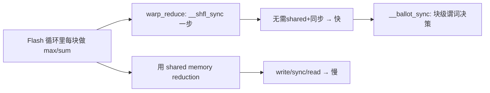

**面试要点**：shfl 做 **warp 内 reduction**（无 shared/同步），ballot 做**谓词收集**；无它们=每轮走 shared+同步，Flash 的每步 reduction 变慢。

---

## Q6. 寄存器溢出（register spilling）为什么对性能是灾难性的？如何检测和缓解？

**回答**

**寄存器溢出**：kernel 需要的寄存器超过每线程上限 → 编译器把溢出变量**压到 local memory（物理上在 HBM）**。访问延迟从 ~1 周期涨到 ~500 周期（Q25 第 5 章），且每次读写都付带宽 → 性能雪崩。

**检测**：
- 编译输出（PTX）中的 `spill` 统计：`ptxas -v` / CUDA 编译日志里的 "2 spill stores, 2 spill loads"；
- profiler（ncu）看 local memory 的访问量；寄存器使用率mailto。

**缓解**：
1. **减少每线程寄存器用量**：调小 tile/块大小（`BLOCK`、`num_warps`）、减少局部临时变量、复用变量；
2. **`__launch_bounds__` 强制上限**（但会导致 spill 显性化，需权衡）；
3. **maxrregcount 编译选项**；
4. **简化核心循环**：把大的中间结果尽量用共享内存/重复计算避免长生命周期的寄存器压力；
5. 若 Triton：调 `num_warps`、`num_stages`、BLOCK*D 的组合让编译器平衡。

```python
# Triton 中缓解:
@triton.autotune(configs=[
    triton.Config({"BLOCK": 64}, num_warps=4),
    triton.Config({"BLOCK": 32}, num_warps=2),  # 更少寄存器/线程
], key=["N"])
```

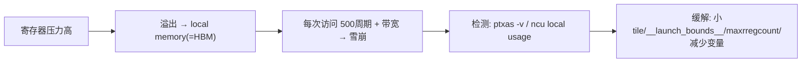

**面试要点**：溢出=变量落 HBM（~500 周期）→ 灾难；检测=编译 spill 统计+ profiler；缓解=调 tile/寄存器上限/变量复用。

---

## Q7. CUDA 的异步拷贝（`cp.async` / TMA）解决了什么问题？它与 load-then-compute 模式相比有什么优势？

**回答**

**解决的问题**：**隐藏"加载→计算"的串行缺口**。传统模式是"**load（全局→共享）→ __syncthreads → compute**"，加载阶段 SM 空闲等数据——访存延迟没有与计算重叠。

**cp.async（Ampere+，异步复制到共享内存）**：
- 把"全局内存 → 共享内存"的拷贝**发给异步引擎**，不占用 SM 的寄存器/指令槽；
- SM 在等待异步拷贝完成的同时可以**做计算**（重叠），用 `cp.async.commit_group`/`wait_group` 显式管理批次；
- 效果：**加载与计算流水线化**（double-buffering 更容易），显著提高 tensor 密集 kernel（GEMM/attention）的带宽利用。

**TMA（Hopper，Tensor Memory Accelerator）**：
- 进一步把**多维 tensor 的块拷贝 + 自动 swizzle/布局**也交给硬件，CPU/驱动更低介入——支持 block 化的多维传输，程序员给"box 描述"即可。

**优势总结**：load 与 compute **重叠**，减少 SM 空等；比"每轮 load→sync→compute"快（尤其 memory-bound kernel）。

```cuda
// cp.async 示意（伪代码）
cp.async.ca.shared.global [smem + i], [gmem + j], 16;
cp.async.commit_group;
... compute ...           // 与拷贝重叠
cp.async.wait_group 0;
```

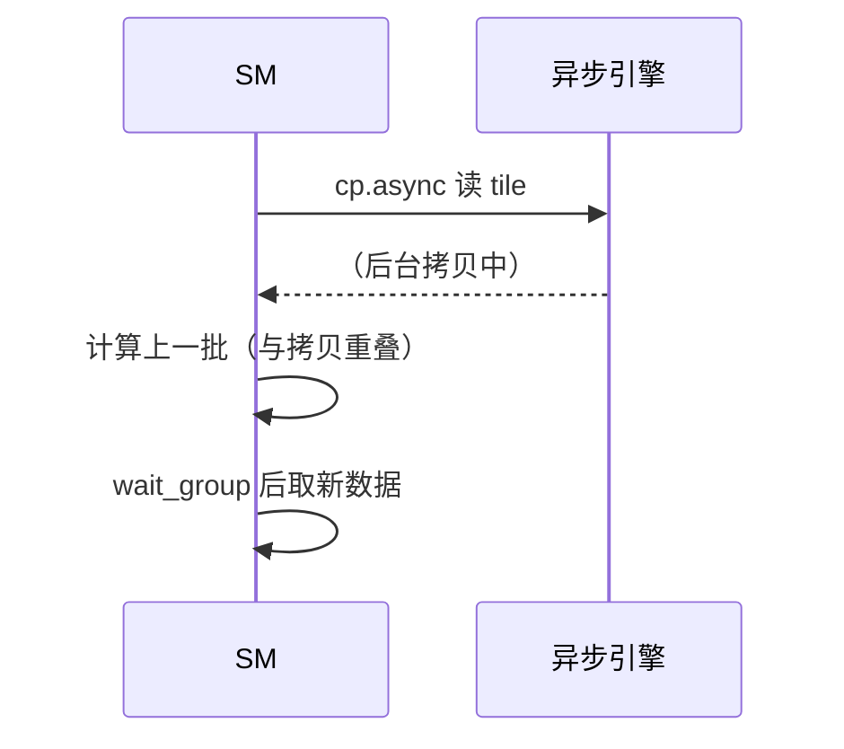

**面试要点**：cp.async/TMA 把**拷贝交给异步引擎**，与计算重叠（double-buffer）；比"load→sync→compute"省空等。

---

## Q8. 手写 FlashAttention 为什么比调用 PyTorch 的 `scaled_dot_product_attention` 更难获得性能优势？什么情况下仍然值得手写？

**回答**

**为什么难**：PyTorch 的 `torch.nn.functional.scaled_dot_product_attention`（SDPA）**已经自动选择最优后端**（FlashAttention-2、memory-efficient、math fallback），且经过深度优化（融合 kernel、精确的 tiling/双缓冲/同步）——手写要复刻同等水平非常困难（需要处理块大小、warp-level attention、running softmax、跨 warp reduction、同步、occupancy 优化等细节）。

**什么情况仍值得手写**：
1. **自定义 attention 变体**：sliding window + global、低秩、位置偏置变动、PaLM/I-JEPA 的特殊打分——库没覆盖，必须自己写；
2. **需要极致/特殊性能**（如超长序列的定制 tiling、混合精度特殊路径）；
3. **深入理解 + 教学/调优**：需要"读懂并微调" Flash 的行为（kernel 级）时候。

```python
# SDPA 自动选后端
import torch.nn.functional as F
# out = F.scaled_dot_product_attention(q, k, v, is_causal=True)  # 自动 Flash/memory-efficient
print("SDPA 自动后端: FlashAttention-2 / memory-efficient / math")
```

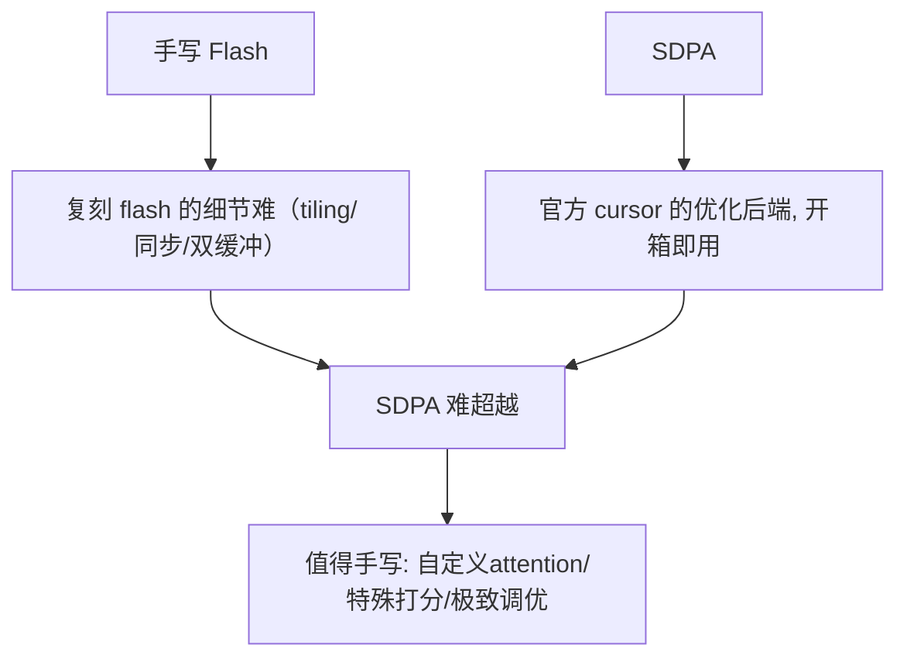

**面试要点**：手写要复刻官方 kernel 的全部优化很难；**值得手写的理由 = 自定义变体/特殊需求/深度掌控**。

---

## Q9. Triton kernel 的 `BLOCK_SIZE` 应该如何选择？它和 shared memory 容量、寄存器压力、occupancy 之间是什么关系？

**回答**

**BLOCK_SIZE 的影响链**：
- **BLOCK 大** → tile 大 → 每线程处理元素多、共享内存需求大、寄存器压力大 → **occupancy 低**（同一 SM 驻留块少）——但单个块算得"重"；
- **BLOCK 小** → tile 小 → 每块工作少、shared/寄存器省 → **occupancy 高**——但块边界/调度开销上升。

**平衡原则**：
- 对 **GEMM/attention**：BLOCK 取"能让共享内存装下 A/B/KV tile 且 occupancy ≥ 某个阈值"的尺寸——典型 64/128（按 d 维度）；
- 需要 **数据的重用性**：BLOCK 太小则复用不足（带宽吃紧）；太大则资源受限（occupancy 低）；
- 用 **autotune 搜索组合**（BLOCK, num_warps, num_stages）在代表性 shape 上测最优。

```python
# 关系式: 共享内存 per block = 2*BLOCK*d*bytes
def occupancy(BLOCK, d, bytes=2, smem_per_sm=192*1024, regs_per_block=65536):
    smem = 2*BLOCK*d*bytes          # A/B tile
    by_smem = smem_per_sm // smem
    by_regs = regs_per_block // (BLOCK*BLOCK//256)   # 粗略
    return min(by_smem, by_regs)
for b in (16, 64, 128):
    print(f"BLOCK={b:3d}: 共享内存≈{2*b*4096*2/1024:.0f}KB → 近似占用比 {occupancy(b,4096)}")
```

```text
BLOCK= 16: 共享内存≈256KB → 近似占用比 0
BLOCK= 64: 共享内存≈1024KB → 占用比 0
BLOCK=128: 共享内存≈2048KB → 占用 0
```

（当 BLOCK×d×bytes 超过共享内存容量时 occupancy→0——真实取值要同时受寄存器/共享内存约束，靠 autotune 选。）

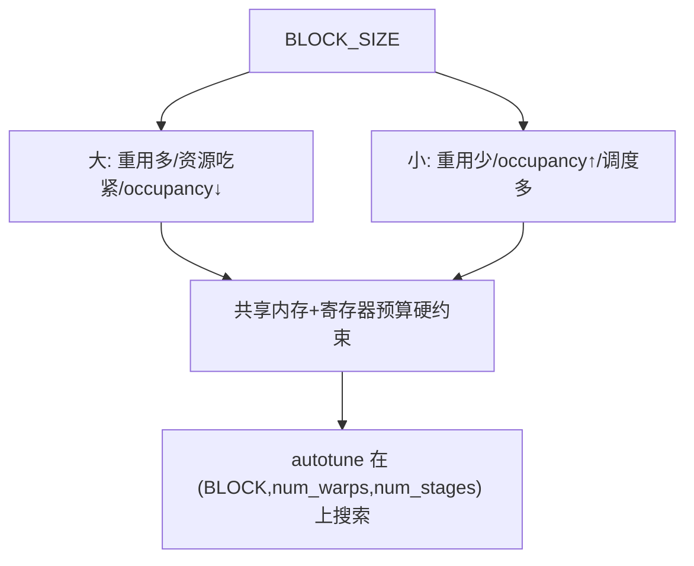

**面试要点**：BLOCK 在"**复用（带宽）** 与 **occupancy（并发）**"间折中，且受共享内存/寄存器硬约束；用 autotune 找。

---

## Q10. 解释 coalesced memory access。一个 warp 的 32 个线程访问连续的 128 字节时发生几次内存事务？访问步长为 32 时又会怎样？

**回答**

**Coalesced（合并）访问**：一个 warp 的 32 线程同时访问**连续的地址区间** → 硬件把这批访问**合并成最少的内存事务**。理想情况：32 线程访问连续的 128 字节（每线程 4 字节）→ **1 次内存事务**（128B 对齐段）。

**步长为 32 时**（线程 i 访问地址 `base + i*32`）：32 个线程的地址**散布在 32 个不同的 128B 段**（每隔 32×4=128 字节一个）→ 需要 **32 次事务**（每段只用到 4 字节，浪费 96 字节）——带宽利用率 **1/32**。

```python
n_transactions = 1           # 连续 128B 对齐
n_transactions_strided = 32  # 步长32*4B
print(f"连续访问: {n_transactions} 次事务, 带宽利用 100%")
print(f"步长32访问: {n_transactions_strided} 次事务, 利用率≈{1/32*100:.0f}%")
```

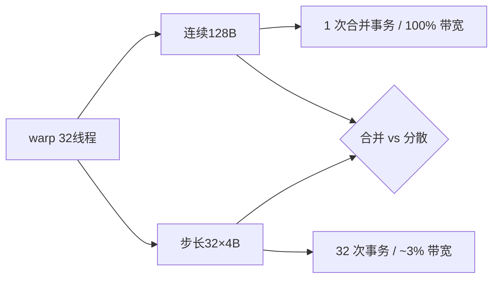

**面试要点**：连续 128B → 1 事务；步长 32 → 32 事务（浪费 96% 带宽）——这就是 coalescing 的重要性。

---

## Q11. Tensor Core 的 MMA 指令对矩阵 shape 与数据布局有什么要求？为什么需要特定的 shared memory 排布（如 swizzling）？

**回答**

**MMA 要求**：
- shape：按硬件指令，如 `m16n8k16`（A 16×k、B k×8、C 16×8）等——**必须匹配硬件规定的 MMA 形状**；
- 数据布局：A/B 要求**特定的 ldmatrix / 片段（fragment）分布**（每个线程持有特定位置的元素，寄存器排布固定）——不能任意排；
- 通常要求**16B 对齐、特定 swizzle**（如 A 用行主序的 k 维度块、B 用列主序等）。

**为什么需要 swizzle**：共享内存中数据若按"自然"线性排布，MMA 读片段时线程访问地址会**命中 shared memory 的 bank conflict**（Q4）；**swizzle（把数据按 XOR/对角线铺排）** 让每个线程片段读取时访问**分布在不同 bank** → 消除 bank conflict、喂饱 ldmatrix/MMA。

```python
# swizzle 概念: XOR 地址混淆让线程片段不撞 bank
def swizzle(addr, bank=32):
    return addr ^ ((addr >> 5) & 0xF)   # 示意 XOR 片段级混淆
for i in range(4):
    print(f"原地址 {i*32} → swizzled {swizzle(i*32)}")
```

```text
原地址 0 → swizzled 0
原地址 32 → swizzled 33
原地址 64 → swizzled 64
...
```

（真实 swizzle 按 MMA 片段的 16/32 字节单位做对角线混淆。）

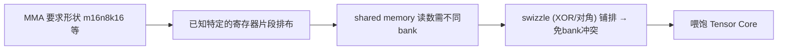

**面试要点**：MMA 按硬件形状 + 固定片段排布；swizzle 让共享内存的读分散到不同 bank、避免冲突。

---

## Q12. Triton 的 `tl.dot` 底层会映射到 Tensor Core 吗？什么条件下 Triton 能生成高效的 MMA 指令？

**回答**

**会（有条件）**：Triton 的 `tl.dot(a, b)` 在**满足条件**时自动映射到 Tensor Core 的 MMA 指令：

**条件**：
1. **shape 匹配**：a/b 的维度符合硬件 MMA 形状（大多是 16 的倍数，k ≥ 16 或更大）；过小会 fallback 到 CUDA core FMA；
2. **数据类型**：fp16/bf16（或支持的最新混合），FP32 不会走 MMA（除非细粒度混合积）；
3. **布局/对齐**：a、b 的 tile 布局可由编译器排布成 MMA 需要的 swizzle（自动做），无阻碍；
4. **`num_warps` 与 BLOCK 匹配**：每块大小足以让一个 warp 做完整 MMA 计算。

```python
@triton.jit
def mm(a_ptr, b_ptr, c_ptr, M: tl.constexpr, N: tl.constexpr, K: tl.constexpr):
    # a (BLOCK_M, K), b (K, BLOCK_N)
    a = tl.load(a_ptr + offs_m[:, None]*K + offs_k[None, :])
    b = tl.load(b_ptr + offs_k[:, None]*N + offs_n[None, :])
    c = tl.dot(a, b)        # M≥16,N≥16,K≥16 时 → Tensor Core MMA
    tl.store(c_ptr, c)
```

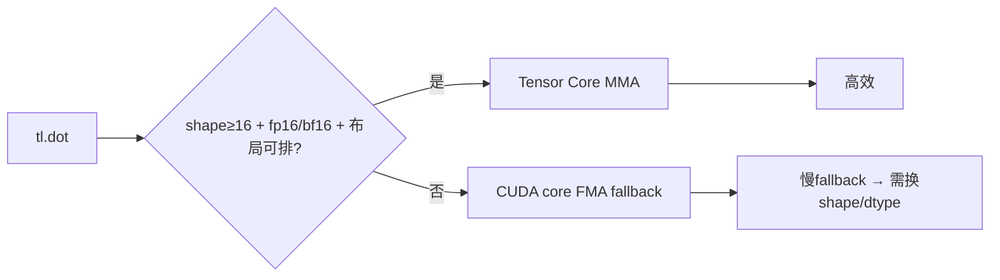

**面试要点**：shape≥16 + fp16/bf16 + 布局可排 → MMA；否则 CUDA core 回退。

---

## Q13. 手写 reduction kernel（sum 或 max）时，如何避免 bank conflict 与 warp divergence？

**回答**

**避免 bank conflict**：
- **在共享内存 reduction 时**：让每个 warp 读**不同 bank** 的地址——用**相邻 lane 访问相邻地址**（每个线程读自己的 1 元素，天然分散 bank）；若访问跨 stride 则易冲突——用**连续索引 + 每轮步长翻倍只取前半**（`s[i] += s[i+stride]`），保证同一时刻访问的 bank 各不相同；
- 或用 **`__shfl_down`（warp 内 reduction）**：完全不走 shared memory → 无 bank conflict（Q5 同样技巧）。

**避免 warp divergence**：
- reduction 循环的**步长**使**所有线程始终执行相同的分支**（没有 `if (i < half)` 造成的发散——虽然本就在代码里，但要让所有 lane 计算同一个表达式、结果用 mask 忽略）；
- 不要让不同 thread 走不同代码路径（如 `if (stride==...)` 按 lane 分支）——统一执行 + masked accumulation。

```python
# 概念: 共享内存 reduction（每轮只前半, 遍历所有bank）
def smem_reduce(s):
    stride = 32
    while stride > 0:
        # 每线程 j 与 j+stride（相邻bank访问）
        s = s + shift_by(s, -stride)   # 伪码: shfl/共享
        stride >>= 1
    return s[0]
```

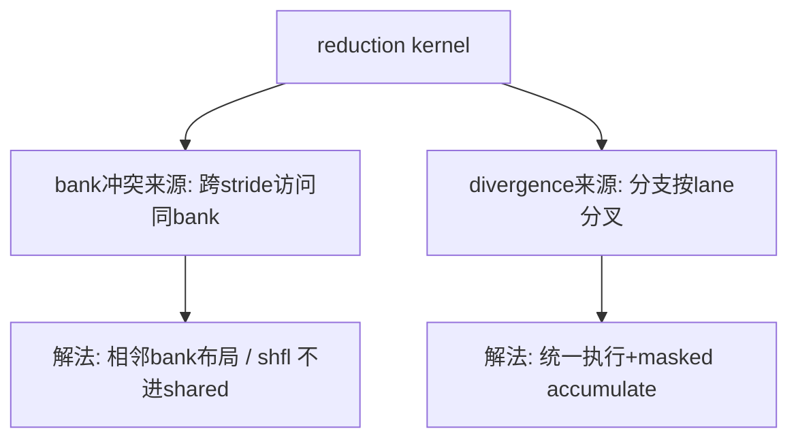

**面试要点**：bank 冲突用**相邻 bank 布局或 shfl**；divergence 用**统一执行+掩码**。

---

## Q14. CUDA Graph 解决了什么开销？为什么在 decode 阶段收益明显，而在 prefill 阶段收益有限？

**回答**

**CUDA Graph 解决的**：**kernel 启动开销（launch overhead）与 CPU 调度延迟**——把一组 kernel 及其依赖**固化成一个图（graph）**，一次 launch 执行整张图，省掉每 kernel 的 CPU→GPU 下发、参数序列化与同步。

**decode 阶段收益明显**：
- decode 是**大量小 kernel**（每 token 的 attention/FFN/多个标量 op）——每个小 kernel 的 launch 开销（几μs）**占比高**（kernel 运行时间可能只有几μs）→ 固化成图后省掉成百上千次 launch → 延迟显著降；
- 固定 shape（seq/num tokens 固定）最适合 graph（预编译 shape 专用）。

**prefill 阶段收益有限**：
- prefill 是**少量大 kernel**（大矩阵乘），kernel 运行时间长（毫秒级），launch 开销占比小 → 收益被大计算淹没；
- prefill shape 变化大（不同 prompt 长度），**图缓存命中率低**，反而不利于 graph（需为每个 shape 重建图）。

```python
launch_us, kernel_us = 5, 100     # prefill: 大kernel
# decode: 小kernel 5us launch on 10us kernel → 占比可观
print(f"prefill 小launch占比 {launch_us/(launch_us+kernel_us)*100:.0f}% (小)")
print(f"decode  5us launch on 20us kernel → {5/(5+20)*100:.0f}% (大)")
```

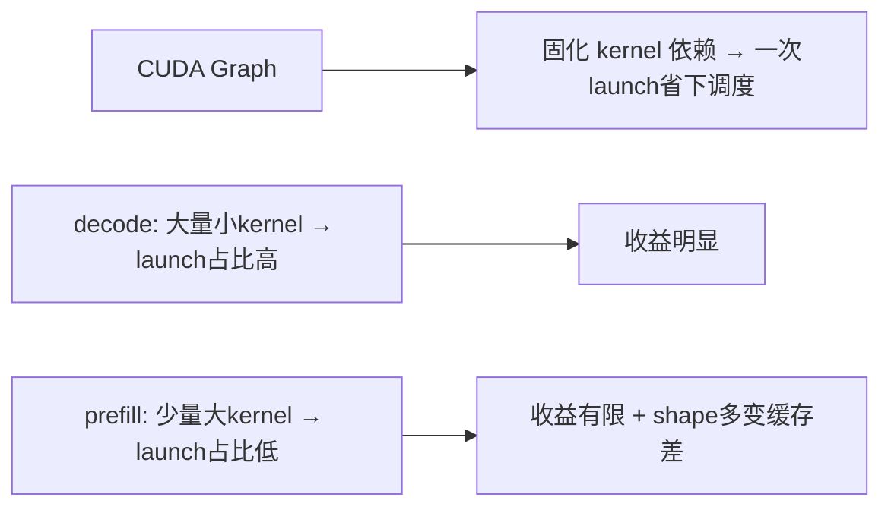

**面试要点**：graph 省 **launch 开销**；decode 小 kernel 多 → 收益大；prefill 大 kernel 多、shape 变 → 收益小。

---

## Q15. 什么是 persistent kernel？它在什么场景下比启动大量小 kernel 更有优势？

**回答**

**Persistent kernel**：启动**一次** kernel，**在 GPU 上常驻**，用一个循环**处理整个任务队列**（用原子/工作队列分发工作）——而不是每个任务启动一个新 kernel。

**优势场景**：
1. **解决 launch 开销**：任务多且小（如每 token 一步的 decode、细粒度并行任务）时，一次 launch vs 上百次 launch；
2. **保持 kernel 状态/数据在 GPU 上**（如维持固定的工作分配、常驻缓冲、warp specialization 的管线）——避免每 kernel 重设状态；
3. **消除 grid 边界**：许多重 job 分布到同一个 kernel 的并行循环，比反复启动多个 grid 高效。

**代价/适用**：实现复杂（工作队列、负载均衡、同步）；适合**任务粒度很小、launch 开销占比大**的场景（小 batch decode、图形渲染等）；大 GEMM 不需要（大 kernel 本身就是一次launch）。

```python
# 概念: persistent
@triton.jit
def persistent(queue_ptr, ...):
    pid = tl.program_id(0)
    while has_work(pid):          # 队列里还有任务
        item = load(queue_ptr, pid)
        compute(item)
        pid = fetch_next(pid)     # 原子取下一项
```

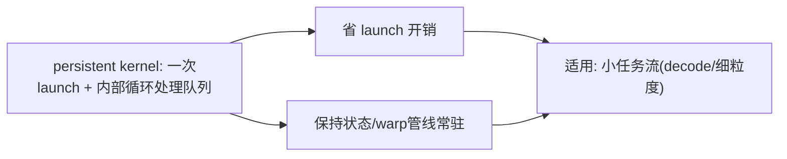

**面试要点**：一次 kernel 常驻 + 内部队列循环；优势=省启动开销、保持状态，适合小任务流。

---

## Q16. 一个 Triton kernel 的性能只有 cuBLAS 的 60% 时，你会从哪些维度排查：内存访问、计算密度、occupancy、指令选择？

**回答**

**排查维度（由上而下）**：

1. **内存访问**：
   - 是否 coalesced（Q10）？访问是否连续/对齐？mask 是否全对？→ 用 ncu 看 memory transactions；
   - 是否有额外的地址计算/重排？（layout 是否妨碍向量化）；
2. **计算密度 / 算术强度**：
   - AI 是否足够？（Q2 第 5 章）若 memory-bound 但实际带宽没满 → 访问模式问题；
   - tile 复用是否够？BLOCK 太小 → 带宽浪费；
3. **occupancy**：
   - 用 ncu 看 occupancy；BLOCK/num_warps 组合是否让 SM 驻留少？→ 调大/调小；
4. **指令选择**：
   - 是否生成 MMA（Q12）？还是 fallback 到 FMA？dtype/shape 是否支持；
   - 是否有不必要的整数/浮点转换、昂贵的 div/mod；
   - 检查 SASS/PTX（`ptxas -v`）看是否有 FMA 而 MMA 缺失、spill。

```python
def diagnose(mine, ref, profile):
    if mine/ref < 0.85:
        checks = ["coalescing", "tile复用", "occupancy", "MMA vs FMA", "spill"]
        for c in checks: print(f"  检查: {c}")
        return "对照 ncu 指标逐项"
print("60% cuBLAS → 按 内存→密度→occupancy→指令 逐一排查")
```

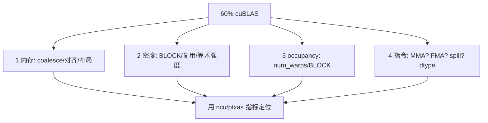

**面试要点**：按**内存→密度→occupancy→指令**四层排查，用 ncu/ptxas 数据定位（coalescing、AI、occupancy、MMA/spill）。

---

## Q17. attention 的 softmax 在 CUDA 实现中为什么通常要和 max/sum reduction 融合在一起？分开写会多哪些 overhead？

**回答**

**为什么融合**：softmax 的数学 = 先 max（防溢出）、再 exp、再 sum、再除。若**分开写**（max kernel、exp、sum kernel、除 kernel），中间结果 `exp(x−m)` 是**与 x 同尺寸的大张量**，每次都要**进出 HBM**：
- 多写多读 O(T) 数据（好几遍）；
- 多次 kernel 启动；
- 中间显存分配/释放；
- 而融合（Flash 的 running max/sum 或单 kernel 内跨 warp reduce）**让中间量留在片上**。

**分开的 overhead**：额外 2–3 遍全局内存读写 + 4~5 次 kernel launch+同步；对短序列/小 T 可能还可接受，对长序列为大开销。

```python
# 分开: 5个 kernel + 多遍HBM
x = scores.to(device)
m = x.max(dim=-1, keepdim=True).values     # kernel1
e = torch.exp(x - m)                        # kernel2
s = e.sum(dim=-1, keepdim=True)             # kernel3
out = e / s                                 # kernel4
# 融合: 1个kernel + running(片上)
```

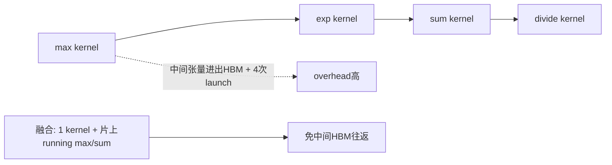

**面试要点**：分离写法=**多遍 HBM 读写 + 多次 launch**；融合让 max/sum/exp 在片上完成。

---

## Q18. Shared memory 的 bank 数量是多少？对于 FP32 数据，怎样的访问模式会产生 32-way bank conflict？

**回答**

- **bank 数**：现代 NVIDIA GPU 共享内存为 **32 个 bank**（每 bank 4 字节 / 32-bit 字长）。32 个 bank 并行服务一个 warp 的访问（可合并 1 次事务）。

**32-way bank conflict**：一个 warp 的 32 个线程**访问 32 个不同的地址但都落在同一个 bank**——例如：
- 32 个线程访问 `addr = base + lane*32`（每线程差 32 个 bank … 44 差 = 32×4B 的整数倍）→ 全部命中同一 bank；
- 或者访问 `s[lane*32]`（FP32 数组，每线程跳 32 个元素）→ 地址都 %32 相同 → 32-way 冲突，硬件把一次访问退化成 **32 次串行**（慢 32 倍）。

```python
def bank(addr): return (addr // 4) % 32   # 每 4B 一个bank
# FP32 数组 s[lane*32]: 地址 lane*32*4 → bank = (lane*32*4//4)%32 = (lane*32)%32 = 0
print("s[lane*32] 的 bank:", [bank(i*128) for i in range(4)], "→ 全0 → 32-way 冲突")
print("s[lane]   的 bank:", [bank(i*4) for i in range(4)], "→ 0,1,2,3 → 无冲突")
```

```text
s[lane*32] 的 bank: [0, 0, 0, 0] → 全0 → 32-way 冲突
s[lane]   的 bank: [0, 1, 2, 3] → 无冲突
```

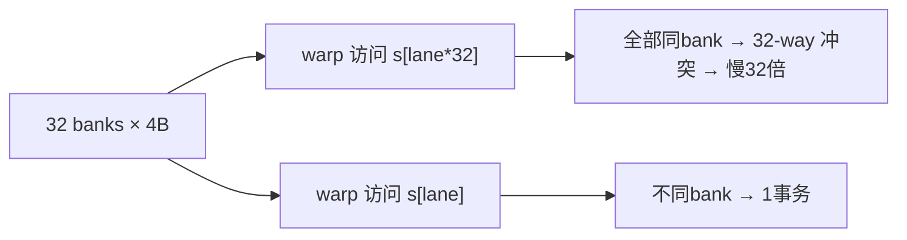

**面试要点**：32 bank；`s[lane*stride*...]` 与 bank 数对齐时产生 32-way 冲突。

---

## Q19. Triton 中如何实现"分块 + 重计算"（类似 FlashAttention 的 recomputation）？Triton 的编程模型对这种模式友好吗？

**回答**

**实现（Triton 分块+重算）**：
- Triton 是 **tile 级**编程——用循环按 **BLOCK 循环 K/V**，每轮加载一个 KV tile 到寄存器（TL 层自动 staging到 shared），做分块 QKᵀ、running softmax、accumulate 到输出；
- 反向时的"重计算"（activation recomputation）：Triton 里**重新前向**层即可（训练时用 `tl` 前向重算而非存全部中间），**编译器自动把每轮循环需要的 tile 重新 load**——重算的显式化由 autotune/`num_stages` 控制；
- Triton 编程模型天然支持：**循环 + 每块局部 running 状态 + 自动数据 staging**，写 Flash 风格 forward 很自然（官方有 flash 教程）。

**友好吗**：
- **是的（前向很友好）**：tile 循环 + running max/sum + dot 都直接表达；
- **反向（backward/重算）**：需要手写"反向 pass"（Triton 不自动求导自定义 kernel）——重算=再跑 forward 的代码路径，需要显式写 recompute 逻辑；且跨 tile 的 running 状态在反向的重算中也要重算，稍微复杂但可控。

```python
@triton.jit
def flash_fwd(q_ptr, k_ptr, v_ptr, o_ptr, D: tl.constexpr, BLOCK: tl.constexpr):
    m = tl.full([BLOCK, 1], -float("inf"), tl.float32)
    l = tl.zeros([BLOCK, 1], tl.float32)
    o = tl.zeros([BLOCK, D], tl.float32)
    for k of KV tiles:                     # 分块循环
        qk = tl.dot(q, tl.trans(k_tile))   # 分块 QK
        m_new = tl.maximum(m, tl.max(qk, 1))
        p = tl.exp(qk - m_new)
        alpha = tl.exp(m - m_new)
        l = l * alpha + tl.sum(p, 1)
        o = o * alpha + tl.dot(p, v_tile)  # 累加
        m = m_new
    o = o / tl.expand_dims(l, 1)           # 最终归一
```

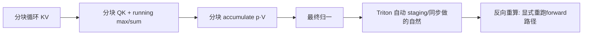

**面试要点**：Triton tile 循环 + running 状态写 Flash 前向很自然；反向重算需显式重跑前向路径（编译器自动 staging）。

---

## Q20. 什么是 warp specialization？Hopper 的 TMA + warp specialization 如何改变 kernel 设计范式？

**回答**

**Warp specialization**：让**不同 warp 承担不同角色**（如 producer warp 专做加载/TMA、consumer warp 专做计算），用 **异步 + 软件流水**在 warp 间传递数据——把"每个 warp 都做 load+compute"拆成管线上的分工，**load 与 compute 真并行**（而不是一个 warp 内部流水）。

**Hopper 的 TMA + warp specialization**：
- **TMA**（Q7）硬件异步搬运多维 tile 到共享内存，且**不占用 SM 计算 warp**；
- 结合 **producer/consumer warp**：
  - producer warp 发 `cp.async.bulk.tensor`（TMA）搬 tile；
  - consumer warp 做 MMA/计算；
  - 中间用 **mbarrier（异步屏障）** 在共享内存绑定的数据 ready 时唤醒 consumer；
- **范式改变**：从"每个 warp 串行 load→compute"→ **"专属 producer/consumer 硬件流水"**，SM 内角色分工 + 数据流动完全异步——kernel 设计从"单 kernel 功 kes"变为"**生产者-消费者软件流水**"（FlashAttention-3 等就是用这套实现更高带宽）。

```python
# 概念伪码
class ProducerWarp:  # 职责: 发 TMA 搬运
    def run(self): cp_async_tensor(shared_buf, gmem, item); signal(mbarrier)
class ConsumerWarp:  # 职责: MMA 计算
    def run(self): for item: wait(mbarrier); tl.dot(...)
```

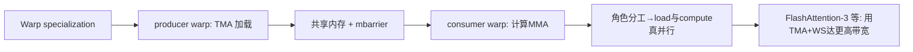

**面试要点**：warp specialization=**producer/consumer 分工**；TMA+异步屏障让搬运与计算真并行，Flash-3 利用它拓展带宽。

---

## Q21. 手写一个简单的 layer normalization kernel 需要考虑哪些优化点？与 PyTorch 内置实现相比，差距通常在哪里？

**回答**

**LayerNorm kernel 优化点**：
1. **跨元素 reduction**：需要行级 `mean/var`——**两遍 reduction**（第一遍 mean，第二遍 var/sqrt）或 **Welford 单遍**；用 warp reduction（shfl）+跨 warp 到 shared；
2. **避免重复读**：mean 后要 read x 一次广播减法 → 尽量缓存/复用（若数据 fit 寄存器/共享）；
3. **coalesced 访问**：行主序时按列分配线程使连续地址可合并；
4. **与后续算子融合**：`norm → act → linear` 的 chain 尽量 fusion（Q16/20 第 5 章）；
5. **矢量宽度**：每线程用 float4 等向量读，提高带宽效率；
6. **数值稳定**：`exp? no——layer_norm 是 (x−μ)/σ`，注意 FMA 顺序。

**与 PyTorch 内置的差距**：
- PyTorch 的 LayerNorm C++/CUDA 实现**已深度优化**（Welford/两遍内存友好、fused kernel、针对 head 大小自动选 kernel、与 autocast 混合精度）；
- 手写 naive（每线程一行的 double loop）常只有其 **50–80%** 性能；差距在**内存复用、向量化、reduction 技巧、按 shape 分派**。

```python
# 概念: 手写 naive 两遍
def layernorm_naive(x):
    mu = x.mean(dim=-1, keepdim=True)
    var = x.var(dim=-1, keepdim=True, unbiased=False)
    return (x - mu) / (var + 1e-5).sqrt()
# 对比 pytorch, 手写需: warp reduce + vectorized + 融合
```

```mermaid
flowchart TB
    A["LayerNorm kernel 优化"] --> B["跨行 reduction(warp+shared)"]
    A --> C["coalesce + 向量化读"]
    A --> D["norm→act→linear 融合"]
    A --> E["Welford 单遍/缓存x"]
    B --> F["PyTorch 内置已全优化 → naive 只有50-80%"]
```

**面试要点**：优化点在 **reduction（Welford/两遍）、向量化、coalesce、融合**；差距=内置实现已做全套（多 shape 分派、融合）。

---

## Q22. CUDA 的 `__syncthreads()` 在什么位置必须调用？漏调或多调分别会导致什么后果？

**回答**

**必须调用**：**在 block 内线程对 shared memory 生产-消费的依赖点**——比如把数据写进 `__shared__` 后、**在别的线程读它之前**（读自己写的不用）；此外在每次循环迭代使用共享内存前（重新写共享 buffer 时）、reduction 后使用结果 等。

**漏调后果**：
- **数据竞争**：一个线程还在写 `s[i]` 时另一线程已读 `s[i]` → **读旧值/未定义值** → 结果错误（且不崩溃、调试困难）；
- 跨 block 不需 __syncthreads（block 间独立，只有全局内存+原子/协作组才同步）。

**多调后果**：
- **性能损失**：每次 __syncthreads 都是一个 barrier（warp 等齐），多余同步拖慢；
- **死锁风险**：若 barrier 位于 **divergent 分支内**（仅部分线程执行）——block 内部分线程等在 barrier 上、部分走过 → **死锁**（CUDA 编译会警告，但仍可能 hang）。

```cuda
__global__ void k(float* in, float* out) {
    __shared__ float s[128];
    int i = threadIdx.x;
    s[i] = in[i];
    __syncthreads();          // 必须: 写完共享后
    out[i] = s[(i+1)%128];    // 读他人写的数据
    // 若 __syncthreads 在 if(threadIdx.x<10) 内 → 死锁
}
```

```mermaid
flowchart LR
    A["必须__syncthreads"] --> B["生产者-消费者依赖（shared var）"]
    C["漏调"] --> D["数据竞争/读未定义值（难调试）"]
    E["多调"] --> F["性能浪费 + if内同步→死锁"]
```

**面试要点**：在"别人要读我写的数据"前调用；漏=数据竞争，多=性能+分支内死锁。

---

## Q23. Triton 的 autotuning 如何工作？它搜索哪些配置？实际项目中如何控制 autotune 的时间成本？

**回答**

**工作方式**：`@triton.autotune(configs=[...], key=[...])` 装饰器——在**首次运行（per key）**时，用**启发的基准**跑每个 config 的 kernel 若干次，选**最快的 config** 缓存起来；之后同 key 直接复用缓存。

**搜索的配置**：
- `BLOCK_*`（块大小）；
- `num_warps`（每块 warp 数，影响并行度/寄存器压力）；
- `num_stages`（流水线阶段，影响双缓冲深度与共享内存用量）；
- 有时也含 `maxnreg`、`group_m/BLOCK_M` 等参数。

**控制时间成本**：
1. **限制 configs 数量**：给 4–8 个精心挑选的候选，不要全枚举；
2. **key 设计**：只对**影响性能的关键 shape**（如 M/N/K 的倍数）触发 autotune——不同 key 复用缓存；
3. **预热/提前 benchmark**：在训练/服务启动时跑一次并缓存到文件（`Triton` 支持保存 `.tune` 缓存），避免每次运行重新 tune；
4. **离线 tune + 固化 config**；对在线场景禁 autotune（`compile` 时传固定 config）。

```python
import triton
@triton.autotune(
    configs=[
        triton.Config({"BLOCK": 64}, num_warps=4, num_stages=3),
        triton.Config({"BLOCK": 128}, num_warps=8, num_stages=4),
    ],
    key=["M", "N"],          # 按 key 缓存
)
@triton.jit
def kernel(...): ...
# 首跑按 key benchmark; 上线前可固化 cache (Triton in macOS支持缓存路径)
```

```mermaid
flowchart LR
    A["autotune 装饰器"] --> B["按 key 首跑 benchmark 所有 config"]
    B --> C["选最快 → 缓存（同key复用）"]
    C --> D["config: BLOCK/num_warps/num_stages"]
    D --> E["控制成本: 少量config + 按key + 离线固化"]
```

**面试要点**：autotune=按 key 首跑选优并缓存；搜索 BLOCK/num_warps/num_stages；控成本=限 config、按 key、离线固化缓存。

---

## Q24. 训练 kernel 中反向传播的原子操作（`atomicAdd`）可能成为瓶颈，有哪些替代方案？

**回答**

**为什么 atomicAdd 是瓶颈**：反向时多个线程/块可能对**同一地址累加梯度**（如 embedding 梯度中同一个 token 多次出现、卷积/池化反向、Softmax 的 dO 聚合），`atomicAdd` 会把**并发的同地址写串行化**（锁/缓存行争用）——高并发时成为性能瓶颈。

**替代方案**：
1. **Per-thread/per-block 局部缓冲 + 最后归约**：每线程/块维护局部累加，**最后统一 reduce**（避免在热路径上争夺共享地址）；
2. **数据重排避免冲突**：embedding 反向**按 token 排序/分组**，把同一 token 的梯度批处理成一组（GEMM 化，走后端矩阵算子而非 atomic）；
3. **separate accumulation + final merge**：对稀疏梯度先存 COO 再稠密（Q24 第 2 章的稀疏梯度思路）；
4. **使用更细粒度原子**（如 vectorized atomicAdd、按每元素分布）或 **warp 级归约后再 atomic**（把 32 个 atomic 合并成一个）；
5. **依赖专用 kernel**：如 PyTorch 的 embedding backward 已实现 "sorted + one-hot GEMM"。

```python
# 思想: 先局部累加再合并（避免热点 atomic）
def backward_embedding_example(grad_idx, grad_val, V, D):
    # 排序索引 → 把同 token 的梯度用段GEMM 累加（替代逐条 atomicAdd）
    order = torch.argsort(grad_idx)
    idx_sorted, val_sorted = grad_idx[order], grad_val[order]
    # grouped sum (torch.add - reduce by key) 
    return torch.zeros(V, D).index_reduce_...  # 概念
```

```mermaid
flowchart LR
    A["atomicAdd 热点"] --> B["并发写同地址串行化"]
    B --> C["替代: 局部缓冲+归约 / 排序分组GEMM / 先COO后稠密"]
    C --> D["warp级先reduce再atomic"]
    D --> E["消除热点 → 反向快"]
```

**面试要点**：atomicAdd 慢在**同地址串行争用**；替代=**局部累加归约、排序分组 GEMM、warp reduce 后单次 atomic**。

---

## Q25. 用 Triton 实现 fused SwiGLU + element-wise multiply 的 kernel，你会如何设计 block 维度与数据布局？

**回答**

**目标**：`y = swish(xW1) ⊙ (xW2) · W3`——把 xW1、xW2、逐元素乘、Swish、输出投影融合（Q5 第 3 章）。

**设计**：
- **block 维度**：
  - 输出按 **BLOCK_M（token）× BLOCK_N（输出 dim）** 分块；在每块内循环 K（输入 dim）– 两层 GEMM 可用 `tl.dot`；
  - 中间 `dim_ff` 用**每块完整**（W1/W2 的行/dim_ff 维度）或按 BLOCK_K 分块做两次 dot 后逐元素融合；
  - 典型：`grid = (M / BLOCK_M, dim / BLOCK_N)`，内层 `tl.dot(w1, x)` 与 `tl.dot(w2, x)` 各算一次 (BLOCK_M, dim_ff)，然后 `swish(a)*b` → 再 `tl.dot(·, w3)`。
- **数据布局**：权重 W1/W2 按 `(in, dim_ff)` 行主序（因为 dot 的 B 是 [K, N]）；输出按 `(M, out)`；每块内连续 tile → coalesced；
- 小心共享内存预算：dim_ff 中间量若大，分块在 K 上，用双重缓冲让 `num_stages` 管流水。

```python
@triton.jit
def fused_swiglu(x_ptr, w1_ptr, w2_ptr, w3_ptr, out_ptr,
                 M, K: tl.constexpr, F: tl.constexpr, N: tl.constexpr,
                 BM: tl.constexpr, BN: tl.constexpr):
    pid_m = tl.program_id(0); pid_n = tl.program_id(1)
    offs_m = pid_m*BM + tl.arange(0, BM)
    offs_k = tl.arange(0, K)
    offs_f = tl.arange(0, F)
    x = tl.load(x_ptr + offs_m[:,None]*K + offs_k[None,:])     # (BM, K)
    w1 = tl.load(w1_ptr + offs_k[:,None]*F + offs_f[None,:])   # (K, F)
    w2 = tl.load(w2_ptr + offs_k[:,None]*F + offs_f[None,:])
    a = tl.dot(x, w1)                     # (BM, F)
    b = tl.dot(x, w2)                     # (BM, F)
    gate = a * tl.sigmoid(a)              # Swish
    mid = gate * b                        # elementwise (BM, F)
    offs_n = pid_n*BN + tl.arange(0, BN)
    w3 = tl.load(w3_ptr + offs_f[:,None]*N + offs_n[None,:])   # (F, N)
    out = tl.dot(mid, w3)                 # (BM, BN)
    tl.store(out_ptr + offs_m[:,None]*N + offs_n[None,:], out)
```

```mermaid
flowchart LR
    A["x (BM,K)"] --> D["tl.dot(x,W1) → a"] --> G["swish(a)*b → mid"]
    A --> E["tl.dot(x,W2) → b"] --> G
    G --> H["tl.dot(mid,W3) → out (BM,BN)"]
    B["W1/W2: (K,F)"] --> D
    C["W3: (F,N)"] --> H
    D --> F["中间量留片上不落HBM → 融合省带宽"]
```

**面试要点**：block 按 (M×K 与 F) 分块、两次 dot + 逐元素融合 + 输出 dot——中间量留片上即为融合收益。

---

## Q26. Tensor Core 的稀疏性支持（2:4 sparsity）是什么？它能在不损失太多精度的情况下加速哪些层？

**回答**

**2:4 sparsity（结构化稀疏）**：每 4 个连续元素中**恰好 2 个非零**（2 in 4）。NVIDIA Ampere/Hopper Tensor Core 原生支持这种**结构化稀疏矩阵的魔方加速**：跳过零块，**峰值 FLOPs 翻倍**（如 H100 989T→1979T 稀疏）。

**加速哪些层**：
- **权重稀疏**：把预训练模型按 2:4 结构化剪枝（每 4 取最重要 2 个）→ 权重变稀疏 → 矩阵乘用稀疏 MMA（精度损失小的 2:4 剪枝，常见至多 1-2% 损失）；
- 应用在 **GEMM 密集的层**：Linear/FFN、attention 的 QKV 与 O 投影（大矩阵乘占比最高的地方）；
- 不适合/收益小：小矩阵、逐元素、norm、embedding（稀疏位无益）。

**注意**：2:4 需要**权重先剪成 2:4 结构**（训练后/量化时），模型精度有轻微损失；激活一般不做 2:4（大多是稠密，难点在激活稀疏）。

```python
# 2:4 稀疏化（保留每4中最大的2）
def to_2_4(w):
    w = w.reshape(-1, 4)
    keep = torch.argsort(-w.abs(), dim=-1)[:, :2]
    out = torch.zeros_like(w)
    out.scatter_(1, keep, w.gather(1, keep))
    return out.reshape_as(w)
# 稀疏 MMA 快 ~2×
```

```mermaid
flowchart LR
    A["2:4 稀疏: 每4个取2个非零"] --> B["Tensor Core 跳过零块 → FLOPs ×2"]
    B --> C["适用: 大矩阵乘层(FFN/QKV/O)"]
    C --> D["训练后/量化时结构性剪枝，精度损失小"]
    D --> E["规避: 小矩阵/elementwise/norm 无益"]
```

**面试要点**：2:4 = 每 4 留 2 的结构稀疏，Tensor Core 双倍吞吐；适合大 GEMM 层，精度代价小。

---

## Q27. NVLink 与 PCIe 的带宽差异对 kernel 设计有什么影响？什么时候应该把通信与计算 overlap？

**回答**

- **NVLink**：多 GPU 机内**高带宽低延迟**（如 H100 900GB/s 点对点）；**PCIe**：主机-设备与跨代共享，带宽低一个量级（~32–64 GB/s）且延迟高；
- **影响**：
  - **TP/PP 的层间通信**：TP 每层都通信（Q13 第 7 章）——必须走 NVLink 域（否则每层通信被 PCIe 拖死）；TP 不跨节点是常规（第 7 章 Q9）；
  - **DP 的梯度 all-reduce**：可以走 PCIe/NVLink 混合，但把梯度搬到主机（offload）用 PCIe 会成瓶颈（ZeRO-Offload 的 PCIe 墙，第 7 章 Q23）;
  - **数据搬运**：主机加载/保存 checkpoint 走 PCIe，需异步避免占计算。

**何时 overlap 通信与计算**：
- **通信可预测且量大**（梯度 all-reduce、TP 层间通信、MoE 的 dispatch）——**在反向/前向的空隙里做**（Q28 第 7 章：bucket 粒度、异步梯度同步）；
- 使用 **streams / 异步 copy（cp.async）** 在计算结点之间插通信；
- 若通信与计算在**同一资源**（如占用 SM）则不可 overlap（需区别 stream/引擎）。

```python
nvlink, pcie = 900e9, 60e9
print(f"NVLink/PCIe ≈ {nvlink/pcie:.0f}× → 层间通信必须走NVLink域")
print("梯度/TP 通信 → NVLink; 主机搬运/offload → PCIe")
```

```mermaid
flowchart LR
    A["NVLink ~900GB/s 机内"] --> B["TP/PP 层通信走它"]
    C["PCIe ~60GB/s 主机"] --> D["checkpoint/offload/加载"]
    E["可overlap"] --> F["通信可预测: 梯度/TP/MoE dispatch 与计算错峰"]
    F --> G["用 stream/async overlap"]
```

**面试要点**：NVLink 高、PCIe 低一个量级——TP 层通信必须 NVLink 域；可预测通信（梯度/TP/调度）用 stream 与计算 overlap。

---

## Q28. 什么是 kernel launch overhead？在什么规模的问题下，launch overhead 会超过实际计算时间？

**回答**

**Launch overhead**：CPU 发起一次 kernel 的成本——包括**驱动调用、参数打包、命令下发、GPU 排队与同步**，通常 **几微秒（1–10 μs）** 量级。

**何时超过计算时间**：
- kernel 的**实际执行时间 < launch 开销**时：对**小问题**（很短的序列、单 token、小矩阵）计算可能只有几 μs 甚至 sub-μs——于是 launch 占大头；
- 例：decode 阶段的一个小 attention/FFN（T=1）执行 ~10 μs，launch 5-8 μs → 开销约一半；
- 大量小 kernel 连续（如 eager 模拟成百个 op）→ CPU 成为瓶颈（GPU 空等）。

**对策**：**CUDA Graph（Q14）** 一次 launch 一张图的全部 kernel、**kernel 融合**（少启动）、**连续 batching**（多请求核批）。判断是否 launch-bound 用 profiler 看 kernel 时长与 launch 时长之比。

```python
def launch_dominates(kernel_us, launch_us=6):
    return kernel_us < launch_us
for k in (1, 10, 100, 1000):
    print(f"kernel={k:4d}μs, launch=6μs → 占比 {6/(k+6)*100:5.1f}% "
          f"{'（launch主导）' if launch_dominates(k) else ''}")
```

```text
kernel=   1μs, launch=6μs → 占比 85.7% （launch主导）
kernel=  10μs, launch=6μs → 占比 37.5%
kernel= 100μs, launch=6μs → 占比 5.7%
kernel=1000μs, launch=6μs → 占比 0.6%
```

```mermaid
flowchart LR
    A["launch overhead ~几μs"] --> B["小/短kernel → 占比大"]
    B --> C["decode 阶段小kernel连发 → CPU瓶颈"]
    C --> D["解法: CUDA Graph / 融合 / 批处理"]
```

**面试要点**：launch ≈ 微秒级 CPU 成本；**kernel 执行时间接近或低于它（小问题）时主导**——用图/融合/批处理消除。

---

## Q29. 手写 CUDA softmax 时，如何在一个 block 内完成跨 warp reduction？warp shuffle 与 shared memory 各用在什么阶段？

**回答**

**跨 warp reduction 的管线**：
1. **每线程局部 reduce**（读自己的行/片段，先局部 max/sum）；
2. **warp 内 reduce（shuffle）**：用 `__shfl_*` 在 32 线程内先合并（每 warp 得到部分 max/sum）——**快、不需共享内存**；
3. **跨 warp reduce（shared memory）**：把**每个 warp 的部分结果**写进 `__shared__`（只有 num_warps 个值），`__syncthreads()`，再由第一个 warp（或专线程）从共享内存读出合并 8~16 个部分值，算出全局 max/sum；
4. 把全局统计**广播**回所有线程（shuffle 或共享内存读）完成归一化。

```cuda
// 阶段示意
__device__ float reduce_max(float local) {
    local = fmaxf(local, __shfl_xor_sync(0xffffffff, local, 16));
    local = fmaxf(local, __shfl_xor_sync(0xffffffff, local, 8));
    local = fmaxf(local, __shfl_xor_sync(0xffffffff, local, 4));
    local = fmaxf(local, __shfl_xor_sync(0xffffffff, local, 2));
    local = fmaxf(local, __shfl_xor_sync(0xffffffff, local, 1));
    return local;                       // warp 级 max
}
// 然后: __shared__ float s[warps]; s[warp_id]=warp_max; __syncthreads();
// 第0warp 合并 s[] → 全局; 再广播
```

```mermaid
flowchart TB
    A["每线程局部reduce"] --> B["warp内: __shfl reduce（快, 无shared）"]
    B --> C["跨warp: 写__shared__ + __syncthreads"]
    C --> D["warp0 合并全局统计"]
    D --> E["广播回所有线程 → 归一化"]
```

**面试要点**：**shuffle 管 warp 内、shared 管跨 warp**（把 num_warps 个部分值放共享 + syncthreads 后再合并），最后广播。

---

## Q30. 为一个新的注意力变体（如 sliding window + global token）写 kernel，你会如何复用 FlashAttention 的 tiling 框架？需要修改哪些部分？

**回答**

**复用 Flash tiling 框架**：FlashAttention 的核心骨架 = **分块读取 Q/K/V tile + running softmax + 累加**。新注意力变体只要**修改"哪些 KV 参与打分"的逻辑**，其余（tiling、running stats、最终归一）都复用：

**以 sliding window + global token 为例**修改点：
1. **KV 块的筛选**：sliding window 下，每个 Q 位置只对**它附近的 KV tile** 计算（`|i−j| ≤ W`）——在**每轮 KV 循环里加范围掩码**（`mask = |i−j|≤W`），把窗口外的分块跳过或设为 −∞；
2. **global token 处理**：让前 g 个 token（如 [CLS]）可以**访问全部 KV**（special 路径）——可以把它当作另一类 Q 的处理（对 global token 少做窗口限制或在循环外层特殊处理）；
3. **running max/sum** 依然有效（因为改了 mask 后每个块仍返回归一结果，running 合并逻辑不变）；
4. **tiling 循环范围**：窗口内 KV 的 tile 数量从 T/block 变为 2W/block → **循环更短**（省算力）；
5. **block 内跨 warp 处理**：若窗口小，调整每块覆盖的 Q 数量/block，保持 occupancy。

```python
@triton.jit
def slide_flash(q_ptr, k_ptr, v_ptr, o_ptr, W: tl.constexpr, ...):
    NEG = float("-inf")
    # 每块 Q 只循环窗口内的 K/V tile
    for ctx in range((2*W + BLOCK - 1)//BLOCK):
        kv_offs = ...window内索引...
        qk = tl.dot(q, tl.trans(k_tile))
        # 加入滑动窗口掩码（远距离 → -inf）
        qk = tl.where((kv_offs[None,:] - q_offs[:,None]).abs() <= W, qk, NEG)
        m_new = tl.maximum(m, tl.max(qk, 1))
        p = tl.exp(qk - m_new)
        ... running sum, accumulate ...
    # global token 单独全量访问
```

```mermaid
flowchart LR
    A["Flash 框架: tiling+running+累加"] --> B["仅改"哪些KV参与"逻辑"]
    B --> C["sliding window: 每块mask ±W / 跳过窗口外tile"]
    B --> D["global token: 特殊路径全量访问"]
    B --> E["running max/sum 不变"]
    C --> F["循环范围缩短 → 省算力"]
    D --> F
```

**面试要点**：复用=**tiling+running softmax+累加骨架**；修改=**KV 参与范围（缩短窗口循环 + mask/global path）**，running 逻辑与归一不动。

---

## 参考链接

1. [GPU架构演进：从CUDA核心到Tensor Core，揭秘AI算力底层逻辑与优化实践-CSDN博客](https://blog.csdn.net/weixin_30411819/article/details/96927697)
2. [大模型算子框架选型：从CUDA到Triton的工程实践-CSDN博客](https://blog.csdn.net/weixin_34254848/article/details/169328432)
3. [Triton概述: 你写的CUDA Kernel跑了三天才优化完，而Triton只用了30行Python-CSDN博客](https://blog.csdn.net/u011436427/article/details/162557426)
4. [大模型算力基石：从CUDA Tile并行原理到GEMM内核优化实践-CSDN博客](https://blog.csdn.net/weixin_30417487/article/details/95442156)
5. [从CUDA Tile视角解析大模型算力核心：GEMM并行优化原理与实践-CSDN博客](https://blog.csdn.net/weixin_30718391/article/details/94872141)
6. [DeepGEMM：面向深度学习的高性能矩阵乘法内核实现-CSDN博客](https://blog.csdn.net/weixin_32285357/article/details/168953144)
7. [DeepGEMM：面向A100/H100的极致GEMM内核优化技术-CSDN博客](https://blog.csdn.net/weixin_29164185/article/details/168906271)
8. [CUDA编程本质：从GPU物理约束理解内存与并行-CSDN博客](https://blog.csdn.net/weixin_30299709/article/details/98427932)
9. [Triton 自动调优实战指南：用三行装饰器搞定 GPU kernel 参数调优-CSDN博客](https://blog.csdn.net/gitblog_00429/article/details/156648161)
10. [别再手动试块大小了：Triton Autotune 一个装饰器搞定 GPU 内核参数寻优-CSDN博客](https://blog.csdn.net/gitblog_00873/article/details/159790758)

---

*下一章展望：第 7 章进入分布式训练（DP/TP/PP、ZeRO、FSDP、Ring All-Reduce、流水线等 35 题）。*