# 第 7 章 · 分布式训练

> 面试生普（LLM 500 题）· 第 7 章【重点】。本章覆盖数据/张量/流水线并行、ZeRO·FSDP、Ring All-Reduce、Megatron 列行并行、1F1B、混合并行、序列并行、梯度压缩、ZeRO-Offload 等 35 个问题，关键概念配 Python 代码与 mermaid 图解。

> 先把话说清楚：模型要大到十万亿参数，单块 GPU 的显存根本塞不下，训练也不能只靠一块卡慢慢地算。这一章聊的"分布式训练"，就是解决两件事——一是"一块卡装不下，怎么拆？"，二是"很多块卡一起干，怎么互相通信？"。你不用有太多底层背景，跟着每题从"切什么、怎么切"讲到"代价是什么"，就能把多卡训练这套精密机器看明白。

---

## Q1. 数据并行、张量并行、流水线并行各自切分的是什么维度？它们分别解决什么扩展性问题，代价是什么？

**回答**

先记住核心一句话：**数据并行（DP）切的是数据、张量并行（TP）切的是单层权重、流水线并行（PP）切的是层段**。它们回答的是同一个问题——"这一坨东西装不下，从哪下刀切成几份、让每张卡各管一份"？三种切法各管一摊，代价也各有不同，先看这张总表：

| 并行方式 | 切分维度 | 解决什么 | 代价 |
|---|---|---|---|
| **数据并行（DP）** | **数据（batch）**：每卡一份完整模型，各算一份梯度，all-reduce | 吞吐（数据规模） | 模型要大到单卡放得下（显存不省）；梯度通信随模型大小增长 |
| **张量并行（TP）** | **单层权重矩阵**：把 GEMM 切列/切行分布到多卡 | 大层放不下单卡（层内并行） | 每层都要通信（all-reduce 组内），通信密集；跨节点差 |
| **流水线并行（PP）** | **模型层（stage）**：把网络切成若干段，每卡一段 | 整模型超单卡显存 | 出现 bubble（空闲）、micro-batch 调度复杂 |

**一句话**：DP 并行数据、TP 并行单层、PP 并行层段。

```python
def parallel_divide(model_layers, tp=1, pp=1):
    stage_layers = model_layers // pp      # 流水线: 每段层数
    layer_weights = "W → TP每卡存一半列/行"   # TP: 每层内分片
    return {"pp_stage_layers": stage_layers, "tp_per_layer": "每卡1/tp权重"}
```

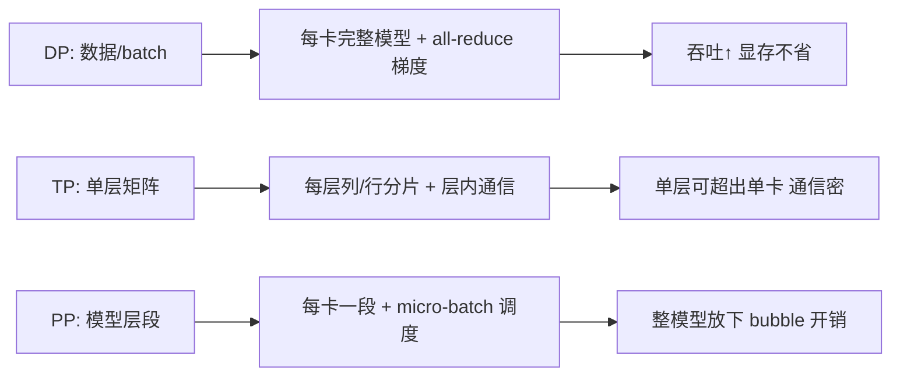

**面试要点**：三种并行=切数据/切权重/切层；各解决吞吐/单层容量/整体容量，代价分别是通信、层内通信、bubble。说完这个，下面自然要问的是：数据并行的显存怎么省下来？这正是 ZeRO 的舞台。

---

## Q2. ZeRO-1/2/3 分别切分优化器状态、梯度、参数的哪一部分？每个 stage 节省的显存与增加的通信量如何量化？

**回答**

ZeRO（Zero Redundancy Optimizer，零冗余优化器）想通了一件事：**训练时其实存了大量"重复"的东西——每个数据并行卡都揣着一整套完整的优化器状态，这纯属浪费**。于是它按冗余度分成 3 级，一级比一级切得狠：

- **ZeRO-1**：仅**切分优化器状态**（Adam 的 m/v + master weight）。每卡只存 1/N 的优化器状态 → 显存从 16Φ 降到 `16Φ - 12Φ(N-1)/N`；**通信量同 DDP**（梯度 all-reduce 后收集对应分片）。
- **ZeRO-2**：再加**梯度分片**（反向时 reduce-scatter 每卡只保留自己负责的梯度分片）。显存再省 2Φ(N-1)/N；通信同 DDP（用 reduce-scatter + all-gather 实现）。
- **ZeRO-3**：**参数也分片**。前向/反向需要时**all-gather 参数**、用完再丢 → 显存 `~16Φ/N`；**通信量增加**≈标准 all-reduce 的 1.5 倍（前向一次 all-gather 参数 + 反向一次 + 梯度 reduce-scatter+all-gather）。

具体量表（每参数，FP16+Adam）：

| stage | 优化器状态 | 梯度 | 参数 | 单卡显存/Φ | 通信 vs DP |
|---|---|---|---|---|---|
| baseline | 12B | 2B | 2B | 16 | 1× |
| ZeRO-1 | /N | 2B | 2B | 16 - 12(N-1)/N | ~1× |
| ZeRO-2 | /N | /N | 2B | ~2 + 16/N | ~1× |
| ZeRO-3 | /N | /N | /N | ~16/N | ~1.5× |

```python
Phi = 1  # 每参数字节数的单位（见Q31完整拆解）
def zero_mem(N, stage):
    base = 16
    if stage == 1: return 16 - 12*(N-1)/N
    if stage == 2: return 2 + (12+2)/N
    if stage == 3: return 16/N
for s in (1,2,3):
    print(f"ZeRO-{s} (N=8): 每参数≈{zero_mem(8,s):.2f}Φ → {zero_mem(8,s)/16*100:.0f}% of 16Φ")
```

```text
ZeRO-1 (N=8): 每参数≈6.50Φ → 41% of 16Φ
ZeRO-2 (N=8): 每参数≈3.75Φ → 23% of 16Φ
ZeRO-3 (N=8): 每参数≈2.00Φ → 13% of 16Φ
```

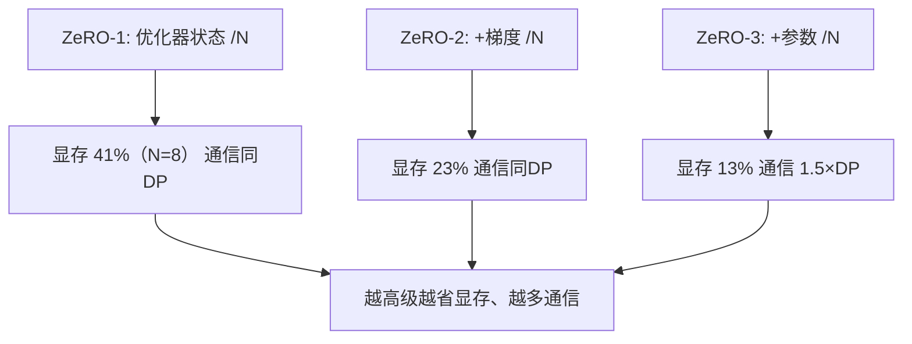

**面试要点**：三级逐项切分（状态→梯度→参数）；ZeRO-1/2 通信同 DP，ZeRO-3 通信 +50%。ZeRO-3 的思路看起来眼熟？下一个问题就揭晓——PyTorch 的 FSDP 和它几乎是同一套思想。

---

## Q3. FSDP 与 ZeRO-3 在核心思想上是否等价？工程实现上（parameter sharding、all-gather 时机）有何异同？

**回答**

**核心思想等价**：FSDP（Fully Sharded Data Parallel，PyTorch 官方的全分片数据并行）与 ZeRO-3 **都是"参数+梯度+优化器状态全分片，用时 all-gather"**——单卡只存 1/N 的训练状态，前向/反向 `all-gather` 当前层参数、用完释放。说人话就是：平时各卡只揣着自己那份，谁要用到某层参数，临时"喊一嗓子"从别的卡调来，用完立刻还回去。

**工程实现差异**主要体现在包装粒度、存储方式和时机控制上：

| 维度 | ZeRO-3（DeepSpeed） | FSDP |
|---|---|---|
| 包装粒度 | 由用户注明（参数分组/flat buffer） | auto_wrap_policy 自动包装模块 |
| 分片存储 | flat 参数缓冲 | 按模块（unit）分片 |
| all-gather 时机 | 前向/反向按需、缓存可配置 | 每模块 forward 前 gather、backward 后释放 |
| 梯度归约 | reduce-scatter（每卡留分片） | all-gather + 归约（类似） |
| 与 TP 组合 | 成熟（3D parallel 生态） | PyTorch 原生（与 TP/PP/Checkpoint 整合） |

**共同点**：都需要"用前 gather、用完释放"，实现细节（flat buffer、分片顺序、缓存策略）不同；**都可等价还原成同一思想：无冗余存储 + 通信换显存**。

```python
from torch.distributed.fsdp import FullyShardedDataParallel as FSDP
from torch.distributed.fsdp.wrap import transformer_auto_wrap_policy
# FSDP: 模块按 auto_wrap_policy 分片
# 等效 DeepSpeed ZeRO-3 的 stage3 配置
model = FSDP(model, auto_wrap_policy=transformer_auto_wrap_policy(...))
```

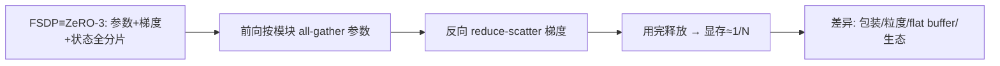

**面试要点**：核心等价（全分片+按需gather）；差异在实现（包装粒度、flat buffer、生态集成）。理解了分片，下一个绕不开的问题就是卡与卡之间到底怎么把梯度"算总账"——也就是 Ring All-Reduce。

---

## Q4. Ring All-Reduce 的通信量为什么约为参数量的 2 倍？Reduce-Scatter + All-Gather 两个阶段如何实现？

**回答**

**为什么是 2Φ**：All-Reduce（把所有卡的梯度归并成一份全量的同步）可以拆成 **Reduce-Scatter（归约并散开）+ All-Gather（收集齐）** 两个阶段，每个阶段每张卡都要把"自己那份全量数据"完整发出去一次：

- **Reduce-Scatter**：每卡把自己的梯度分 N 份，环上按序传给邻居并 **reduce（相加）**；每卡最终持有**一个分片**的完整归约结果。每卡发送量 ≈ Φ(N-1)/N ≈ Φ（N 大时）。
- **All-Gather**：把 Reduce-Scatter 得到的分片**在环上广播**，直到每卡都有完整结果。每卡发送量 ≈ Φ。
- **总每卡通信 ≈ 2Φ**（与卡数 N 近似无关，见 Q33）。

**实现（以 4 卡环为例）**：

```python
# 伪码: Ring 每卡两个阶段
def ring_all_reduce(grad, rank, world_size):
    chunks = grad.chunk(world_size)
    # Phase 1: Reduce-Scatter（N-1 步, 每步发1chunk收1chunk）
    buf = chunks[rank].clone()
    for step in range(world_size - 1):
        send_to  = (rank - step - 1) % world_size
        recv_from = (rank + step + 1) % world_size
        recv = recv_chunk  # 收到邻居第(rank+step)%N 块
        # 局部 reduce
    # Phase 2: All-Gather（N-1 步, 只转发不加）
    for step in range(world_size - 1):
        send_buf = buf
        recv_buf = next_chunk
        bcast  # 把归约结果转发
```

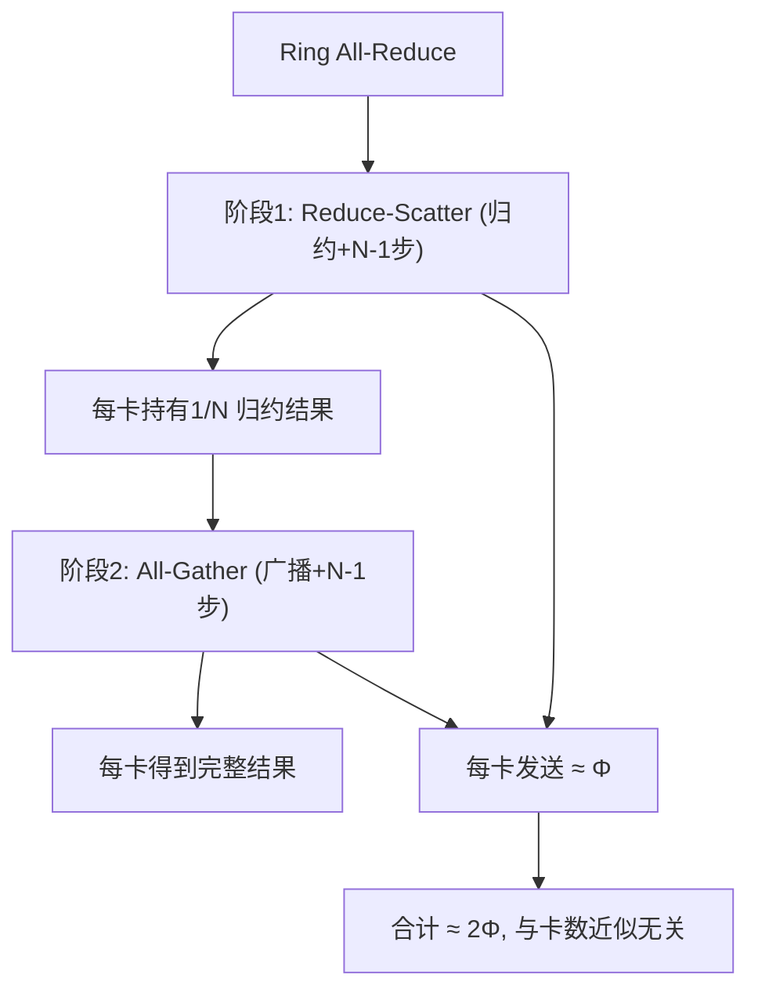

**面试要点**：2Φ = RS(Φ) + AG(Φ)；两阶段各 N-1 步、每步传 1/N 全量 → 单卡发送 ≈ Φ × 2。看懂了 Ring 的归约，接下来就该落到具体模型上了——Transformer 的张量并行具体怎么切？Megatron 给了标准答案。

---

## Q5. 张量并行中，Megatron-LM 的列并行与行并行分别切分线性层的哪个维度？为什么 attention 的 QKV 投影适合列并行？

**回答**

**Megatron 的两种切分**（对一个 `y = x·W`，W ∈ R^(k×n)）：

- **列并行（Column Parallel）**：把 W 的**输出维度（列）切 N 份**：`W → [W_1; W_2; ...]`，每卡计算 `y_i = x·W_i`（都是 k×n/N），然后 **all-reduce 拼接 y_i**。每卡存 W 的 n/N 列，输入 x 完整（每卡都有）。
- **行并行（Row Parallel）**：把 W 的**输入（行）切 N 份**：`W → [W_1 | W_2]`；每卡算 `y_i = x_i·W_i`，**all-reduce 求和**出最终 y。每卡存 W 的 k/N 行，输出 y 完整。

**为什么 QKV 用列并行**：
- QKV 的一次矩阵乘可以把 **W_q、W_k、W_v 沿列方向拼成一个 (d, 3d) 大矩阵**，列并行把它切成 N 份后，**每卡只需一次大 GEMM 同时算 QKV 的 1/N 列**，且输出再 all-reduce 拼回；
- 输出投影（O）则相反，用**行并行**：`O = attn_out · W_o`，把 W_o 行切开，每卡算部分、all-reduce 求和——这样**前一个线性层输出 all-reduce 与下一个的输入自然衔接**（f / f⁻¹ 交替），通信最少。

```python
# 列并行: W (k,n) → 按 n 切分
def column_parallel(x, W_list):
    ys = [x @ W for W in W_list]        # 各自 k×n/N
    return all_reduce_sum(ys)           # 拼回 (k, n)
# 行并行: W (k,n) → 按 k 切分
def row_parallel(x_list, W_list):
    return sum(xi @ Wi for xi, Wi in zip(x_list, W_list))   # all-reduce 求和
```

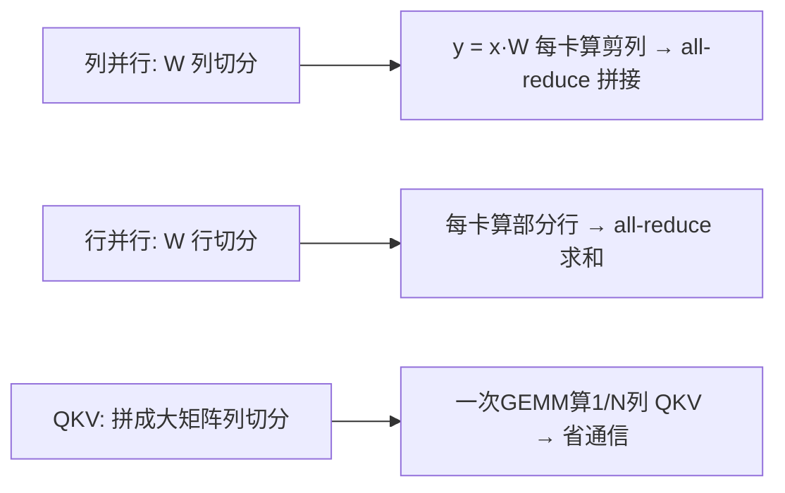

**面试要点**：列并行切输出维（拼接）、行并行切输入维（求和）；QKV 拼成大矩阵做列并行、O 投影行并行 → f/f⁻¹ 交替通信最少。张量并行解决"一层装不下"，流水线并行则解决"整模型太高"——下一个问题看 GPipe 和 1F1B 怎么调度。

---

## Q6. 流水线并行中，GPipe 与 1F1B 调度策略的显存-吞吐权衡是什么？bubble 比例如何估算？

**回答**

- **GPipe**：把一个大 batch 切成 M 个 micro-batch，先把**所有 micro 的前向**跑完（每 stage 存全部激活），再统一反向。**简单但显存大**（要保存 M 份中间激活）且 bubble 明显。
- **1F1B（one-forward-one-backward）**：**交替执行前向与反向**（每一 stage 尽量"一个前向、一个反向"交叠），**极大减少峰值激活**（只用存 1 个 micro-batch 的激活，而不是 M 份）——显存小很多；吞吐接近最优，bubble 同 GPipe 级别。

一句话总结取舍：**GPipe 以显存换简单、1F1B 以调度复杂度换显存**。

**bubble 比例**：`bubble ≈ (P-1)/M`（P=stage 数，M=micro-batch 数）：

- 启动/收尾阶段（不同 stage 等待）产生的空闲占比近似 `(P-1)/M`；
- M 越大 bubble 越小（但微 batch 过多通信/调度开销上升），P 越大 bubble 越大。

```python
def bubble(P, M):
    return (P-1)/M
for P, M in [(4, 8), (4, 32), (8, 32)]:
    print(f"P={P}, M={M}: bubble≈{bubble(P,M)*100:.1f}%")
```

```text
P=4, M=8: bubble≈37.5%
P=4, M=32: bubble≈9.4%
P=8, M=32: bubble≈21.9%
```

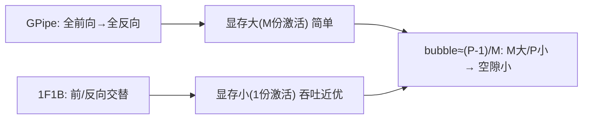

**面试要点**：GPipe 简单但存 M 份激活；1F1B 交替省显存；bubble=(P-1)/M（增大 M 或减小 P）。有了这些理论武器，下面就来实战：一个 70B 的模型，64 张 80GB 卡到底怎么排兵布阵才装得下？

---

## Q7. 给定 70B 模型、64 张 GPU、每张 80GB，显存预算如何拆解？DP/TP/PP/ZeRO 如何组合才能装下？

**回答**

先算清楚到底需要多少显存（70B、BF16 混合精度）：

- 模型权重（BF16 副本）：140GB；
- 梯度：140GB（若 FP32 则翻倍）；
- Adam 状态（m/v FP32 + master）：70B×12B = 840GB；
- 合计（16Φ 公式，Q2）：`16 × 70e9 ≈ 1.12TB` 的训练状态。

**64×80GB = 5.12TB 可用**——若只算状态 1.12TB，**理论够装，但需要切分**（单卡放 1.12TB/64=17.5GB 的 16Φ 状态都不够？算：16Φ=16×70B×1=1.12TB，/64=17.5GB/卡 ✓；激活另算）。

**组合推荐**：

- 用 **ZeRO-3 / FSDP（DP=64）**：状态/梯度/参数都 /64 → 每卡 ≈ `16Φ/64 + 激活` ≈ 17.5GB + 激活(checkpoint 后 ~5-10GB) → 30GB 左右，非常宽裕；
- 若想**再加 TP**：TP=2 → 每卡再多省一半（但不是必须）；
- 若用 **PP+TP（3D）**：如 TP=8 × PP=8 × DP=1：每卡存 1/8 的层权重副本，ZeRO 再加 /N 省状态——但对 70B 在 64 卡上, 纯 **ZeRO-3/FSDP DP=64** 最简单且够用。

```python
Phi = 70e9
state = 16*Phi          # 字节
per_card_dp64 = state/64
acts = 6e9              # activation checkpoint后 预估
print(f"状态总计 {state/1e12:.2f}TB; DP=64 → 每卡 {per_card_dp64/1e9:.1f}GB + 激活 ~{acts/1e9:.0f}GB")
print(f"总/卡 ≈ {(per_card_dp64+acts)/1e9:.0f}GB < 80GB ✓  FSDP/ZeRO-3 即可")
```

```text
状态总计 1.12TB; DP=64 → 每卡 17.5GB + 激活 ~6GB
总/卡 ≈ 24GB < 80GB ✓  FSDP/ZeRO-3 即可
```


**面试要点**：先算 16Φ 总状态、除以 DP；70B 在 64×80GB 用 **FSDP/ZeRO-3** 就够；更大才需要 TP/PP 混合。算完显存，别忘了还有"batch"这个维度——梯度累积在分布式里是怎么和数据并行配合的？

---

## Q8. 梯度累积在分布式训练中如何与数据并行配合？global batch size 的语义是否改变？

**回答**

**配合方式**：数据并行时每个 rank 处理自己的 micro-batch；**梯度累积**让"每 K 个 micro 才同步一次梯度"：

- 普通 DP：每个 micro-batch 的反向都触发一次 all-reduce（通信频繁）；
- 累积 + DP：K 个 micro 的反向**先在本地累加到梯度缓冲**，**每 K 步 all-reduce 一次**（等效全局 batch = K × micro × world_size）——通信次数降 1/K，但梯度同步频率下降，收敛粒度粗一些。

**global batch size 语义**到底变没变：

- 改变：**global batch（整个同步窗口）**从"每 all-reduce 一次 = micro×world_size" 变成 "K×micro×world_size"，更大；
- 不改变：**每个 all-reduce 的梯度仍然是一次有效 global batch 的统计**；累积只是把更多数据压缩成一次同步，**模型看到的 batch 语义变大了（如果 loss÷K 保持归一）**。

注意一个常被绕晕的点：有些实现把"梯度累积"与"DP 的 batch 大小"概念混用——要区分 **local micro（一次前向）**、**DP 的 world batch**、**global（含累积 K）** 三层。

```python
global_batch = K * micro_batch * world_size
# 每 K 步 backward 才 all-reduce 一次
print(f"local micro={micro}, ×K累积={K*micro}, ×{world_size}轮 → {global_batch}")
```

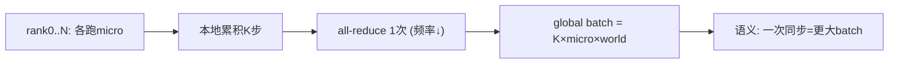

**面试要点**：累积延迟 all-reduce（降频），global batch 放大 K 倍；语义=更大同步粒度，loss 需 /K。通信是一回事，"走什么线"更是关键——为什么类内 NVLink 和跨机 IB 差这么多？

---

## Q9. 跨机 InfiniBand 与机内 NVLink 的带宽差异如何影响并行策略？TP 通常限制在机内，为什么？

**回答**

- **NVLink**：机内（单节点 8 卡）高带宽低延迟（H100 ~900GB/s 点对点，全互联）；
- **InfiniBand**：跨机（rack/node 间）带宽低一个量级（如 400Gbps ≈ 50GB/s 单向）且延迟更高。

这一倍的带宽差距，直接决定了并行策略的"活动范围"：

- **TP 限制在机内**：TP 是**每层都 all-reduce 通信**（Q13 本章），通信频率极高、数据量按层输出——若跨机做 TP，每层通信都走 IB（慢 10 倍+）→ TP 吞吐崩塌；所以 **TP 只在 NVLink 机内**（8 卡以内）做；
- **DP/PP/EP 的通信频率低**：DP 每 K 步一次梯度 all-reduce、PP/EP 在阶段/专家边界通信——**可以跨机**（网络稀疏但可接受）；
- 因此**3D 并行拓扑**常用：节点内 TP（NVLink）+ 节点间 DP/PP（IB）；EP 的 all-to-all 也优先 NVLink 域内，跨机时对拓扑敏感（Q19）。

```python
nvlink, ib = 900e9, 50e9
print(f"NVLink/IB ≈ {nvlink/ib:.0f}× → TP(层级通信) 只能机内")
print("DP/PP/EP 通信稀疏 → 可跨机")
```

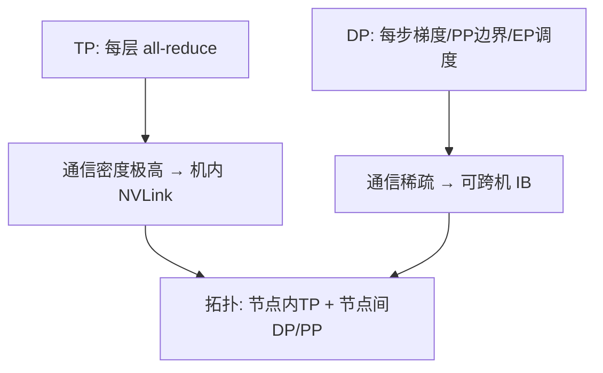

**面试要点**：TP 层内高频通信 → 必须 NVLink 机内；DP/PP/EP 低频 → 可跨机；理由=带宽差 10 倍+。各种 collective 的名字连在一起容易看花眼，下一个问题把 All-Gather 和 Reduce-Scatter 这组老朋友彻底捋清楚。

---

## Q10. All-Reduce 与 All-Gather 的通信模式有何不同？Reduce-Scatter 在 ZeRO 中如何使用？

**回答**

- **All-Gather**：每卡把自己的一份数据**发给所有卡**，最终每卡拿到**所有卡的完整数据**（纯广播+收集，**无归约**）；
- **All-Reduce**：每卡一份数据，最终每卡拿到**所有数据的归约结果**（sum/max/...）——可拆成 Reduce-Scatter + All-Gather（Q4）。

**Reduce-Scatter 在 ZeRO 中的用法**：
- ZeRO-2/3 用 **reduce-scatter** 做梯度归约：每个参数分片归约后**只留在对应的那一张卡**（该卡负责那份梯度的后续（参数更新）），**不需要全量梯度**；
- 每个 rank 只持有"自己负责的参数片的梯度" → 只有该 rank 更新自己那部分参数（配合参数分片），省去全量 all-gather 的梯度交换；
- 之后 ZeRO-3 再用 all-gather 汇总参数用于前向（Q2/Q32）。

```python
# 概念
def reduce_scatter(x_list, world):
    # 每个 rank 提供 x；结束后 rank i 持有 Σ_j x_j 的第 i 片
    all_chunks = [reduce(x) for x in ...]   # 伪码
    return all_chunks[rank]
# ZeRO-2: 梯度 reduce-scatter → 只留自己负责的分片梯度
```

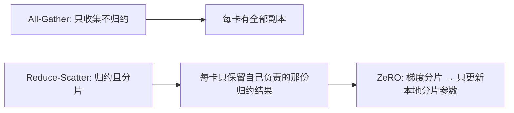

**面试要点**：AG 纯收集、RS 归约+分片；ZeRO 用 RS 让每卡只留"自己负责参数片的梯度"，减少全量传输。理论讲完，来点实战排障——某张卡拖后腿（straggler）该怎么办？

---

## Q11. 训练中某张卡比其他卡慢很多（straggler），可能的原因有哪些？如何检测和缓解？

**回答**

上百张卡一起跑，只要有一张卡拉胯，整个训练就被它拖慢——这就是 **straggler（掉队卡）**。原因通常可以归为几类：

1. **硬件降频/故障**：某卡热降频、坏 cache/NVLink 降速、HBM ECC 开销；
2. **负载不均**：PP/EP 下有些 stage/专家被算得更多（bubble、路由偏斜）；
3. **数据负载不均**：某 rank 数据更长/预处理更慢（Q25 第 2 章）；
4. **网络拥塞/拓扑异类**：某节点 IB 带宽被占、跨机路由差；
5. **软件**：某 rank 卡在同步/原子/锁上，或共享资源（CPU 内存、NVLink）被邻居抢。

**怎么检测**：
- 记录每卡**step 耗时**（时间戳）与**GPU 利用率**；
- 监控**通信等待时间**（profiler 的 idle/通信占比）；
- 对比各 rank 的 `all-reduce 时长`、`吞吐`、`排队时间`。

**怎么缓解**：
- **负载均衡**：PP 均衡 micro 分配；EP 调整路由/专家放置；
- **动态调度**：把慢卡的活调度走（弹性 worker、降 micro-batch）；
- **设备健康**：用 NVML/nvidia-smi dmon 定位降频卡、重安排拓扑；
- **超时+重启**：straggler 错过同步阈值 → 重启该节点/降速重试。

```python
# 检测: 各 rank 的 step 时长
times = [1.1, 1.2, 3.8, 1.15, 1.0, 1.3, 1.2, 1.1]   # rank2 是 straggler
mean = sum(times)/len(times)
for r, t in enumerate(times):
    if t > 1.5*mean: print(f"⚠ rank{r}: {t}s — straggler（>1.5×均值）")
```

```text
⚠ rank2: 3.8s — straggler（>1.5×均值）
```

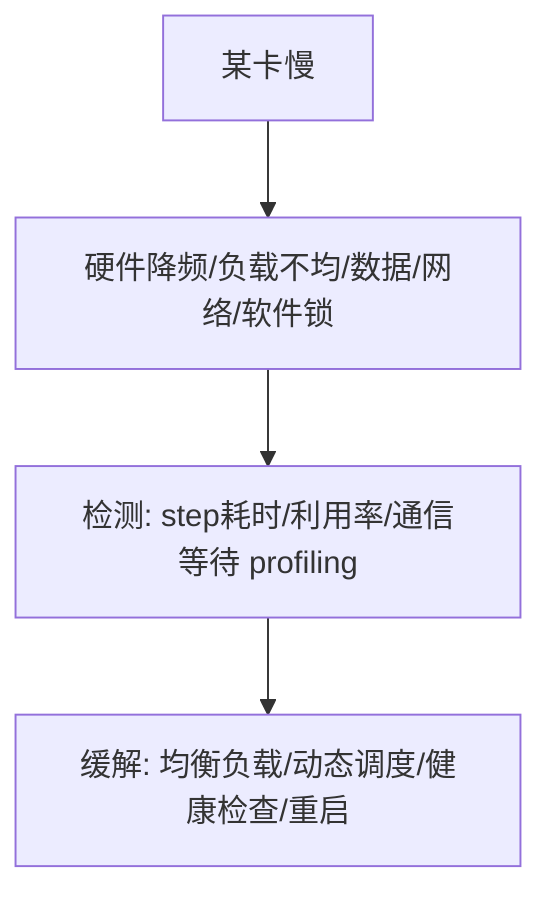

**面试要点**：原因=硬件、负载、数据、网络四类；检测看 step 耗时与等待；缓解=均衡+调度+健康+重启。FSDP 的名词常让人一头雾水，下一个问题直接把三种分片策略对号入座。

---

## Q12. FSDP 的 `sharding_strategy` 中，`FULL_SHARD`、`SHARD_GRAD_OP`、`NO_SHARD` 分别对应什么？如何选择？

**回答**

三个名字对应三种"切多少"的档位，直接看表：

| 策略 | 名称 | 行为 | 对应 ZeRO |
|---|---|---|---|
| `FULL_SHARD` | 全分片 | 参数、梯度、优化器状态都分片 | ZeRO-3 |
| `SHARD_GRAD_OP` | 梯度分片 | 参数不分片（各卡有复本）、梯度分片、优化器状态分片 | ZeRO-2 |
| `NO_SHARD` | 不分片 | 参数与梯度都不分片，只优化器状态可分（或全 DDP） | ~DDP/ZeRO-1 |

**怎么选**：
- 显存最紧张/模型超大 → **FULL_SHARD**（最省显存、通信多 1.5×）；
- 想省梯度/状态但保留参数复本（通信少一点） → **SHARD_GRAD_OP**；
- 小模型或与 TP 配合不想参数 all-gather 开销 → **NO_SHARD**（近似 DDP）。

**经验**：大模型训练默认 **FULL_SHARD**；显存有余但想降通信选 SHARD_GRAD_OP；与张量并行组合时常用 NO_SHARD。

```python
from torch.distributed.fsdp import ShardingStrategy
strategies = {
    "FULL_SHARD": "ZeRO-3: 参数+梯度+状态全分片",
    "SHARD_GRAD_OP": "ZeRO-2: 梯度+状态分片, 参数留副本",
    "NO_SHARD": "DDP级: 参数梯度不分片",
}
for k, v in strategies.items():
    print(f"{k}: {v}")
```

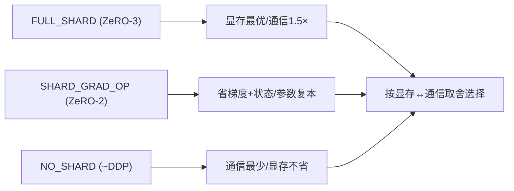

**面试要点**：三档对应 ZeRO-3/-2/DDP；默认大模型 FULL_SHARD，通信敏感时降级。TP 和 PP 都被叫"并行"，通信模式却天差地别——下一个问题点破这层本质。

---

## Q13. 混合并行中，TP 与 PP 的通信模式有何本质不同？为什么 TP 需要每层都通信，而 PP 只需在 stage 边界通信？

**回答**

- **TP**：**层内**切分单个 GEMM → 每层的线性层都需要 **all-reduce（f/f⁻¹）** 拼回输出 → **通信频率 = 每层每前向/反向都做**（Q5）；
- **PP**：**层间**切 stage → 只有 **stage 边界的激活张量（micro-batch）**需要传给下一 stage → **通信频率 = 每 micro-batch 一次边界通信**，层内部不需要通信。

**为什么**：TP 的并行单位是"层内的部分计算"（不通信就无法得出该层输出）；PP 的并行单位是"整个层段"，段内自包含、只有段间数据流需要传递。所以 TP 通信密集（按层）、PP 通信稀疏（按边界）。

```python
def tp_comm_per_step(layers):   return layers * 2        # 每层 f/f⁻¹
def pp_comm_per_step(micros):   return (micros)          # 每个micro边界一次
print(f"TP=每层通信({tp_comm_per_step(40)}点), PP=每micro一次({pp_comm_per_step(32)}点)")
```

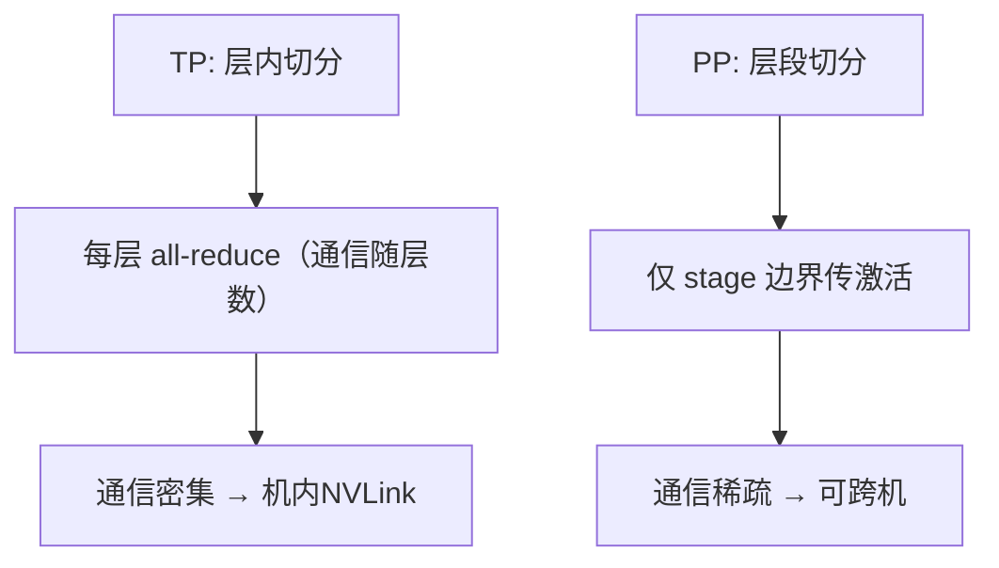

**面试要点**：TP 按层通信（f/f⁻¹ 每层）、PP 按边界通信（每 micro 一次）；TP 密（NVLink）PP 疏（可跨机）。切矩阵、切层都讲完了，还有个"切序列"的选手——序列并行（SP）登场。

---

## Q14. 序列并行（SP）解决什么问题？它与张量并行如何配合降低激活显存？

**回答**

**序列并行（Sequence Parallelism）**：把 **序列维度 T** 切分到多卡——不同卡处理不同的 token 段。前面几种并行要么切数据、要么切权重，这一种是把"一句话的长度"横向切开。

**解决的问题**：
1. **激活显存**：attention/FFN 的激活随 T 增长，序列很长时单卡激活爆掉；SP 让每卡只存 T/N 的激活；
2. **与 TP 组合的额外节省**：Megatron 的 SP 把"TP 里本来需要复制的激活（QKV/中间）"按序列切分，**每卡只保留自己的 token 段激活**，反偏置后只需在层间通信少量 relu/注意力分数。

**与 TP 如何配合**：
- TP 切**矩阵**、SP 切**序列**——二者正交叠加：TP 负责把每层的权重分片，SP 负责把每层的激活分片；
- 对 attention：QKV 投影用 TP 列并行，softmax 分数在序列维度被 SP 覆盖（每卡只算自己 token 的 attention 分数），**激活从 O(T) 降到 O(T/N)**；
- 对 FFN：SP 切序列后，中间激活 `B×T/N×4d` 也按 N 缩小。

```python
def sp_act_mem(B, T, D, L, N):
    return B * (T//N) * D * L    # 激活随序列分片而缩小
for N in (1, 4, 8):
    print(f"SP={N}: 激活≈{sp_act_mem(16, 4096, 4096, 32, N)/1e9:.1f}GB")
```

```text
SP=1: 激活≈274.9GB
SP=4: 激活≈68.7GB
SP=8: 激活≈34.4GB
```

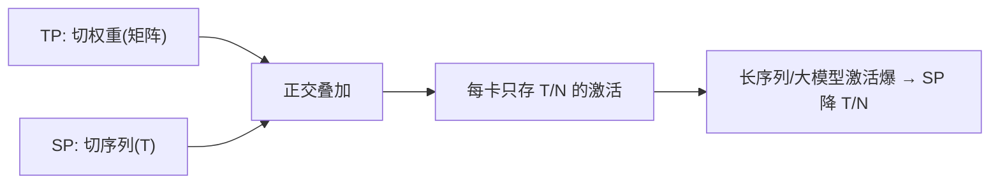

**面试要点**：SP 切序列降激活；与 TP（切权重）正交组合 → 长序列大模型的激活可按 T/N 缩小。训练不能中途翻车，checkpoint 怎么存是个大学问——分片还是合并？

---

## Q15. 分布式训练中 checkpoint 的保存策略有哪些？sharded checkpoint 与 consolidated checkpoint 的取舍是什么？

**回答**

**保存策略**：
1. **定期全量 checkpoint**（每 N 步存一次，覆盖旧版）；
2. **异步持久化**：在 next step 计算时后台落盘，减少保存的同步开销；
3. **分片 checkpoint（sharded）**：各 rank 只保存**自己拥有的分片状态**（ZeRO/FSDP 天然分片）；
4. **合并/完整 checkpoint（consolidated）**：把各 rank 分片**收集齐合成完整单份**（便于单卡加载/下游微调）；
5. 快照+版本化、增量 checkpoint（只存 diff）。

**sharded vs consolidated 取舍**：

| 维度 | sharded（分片） | consolidated（合并） |
|---|---|---|
| 保存速度 | 快（每卡写自己份，无收集） | 慢（需 all-gather 全收集再写） |
| 恢复 | 需要多点并行恢复（有对应 rank 数） | 单卡/任意硬件可加载 |
| 存储 | 小且分散 | 大且集中 |
| 用途 | 训练中续跑 | checkpoint 分享/下游微调/推理 |

**实践**：训练中用**分片 checkpoint**（快、续跑灵活），对外导出用**consolidated**（一次性合并）。也可两者都存（训练期 sharded + 定期 consolidated 快照）。

```python
def save_sharded(states, rank, world):      # 每卡写自己的片
    torch.save(states[rank], f"ckpt_shard_{rank}.pt")
def save_consolidated(states, world):       # 收集再写
    full = all_gather(states)               # 伪码
    torch.save(full, "ckpt_full.pt")
```

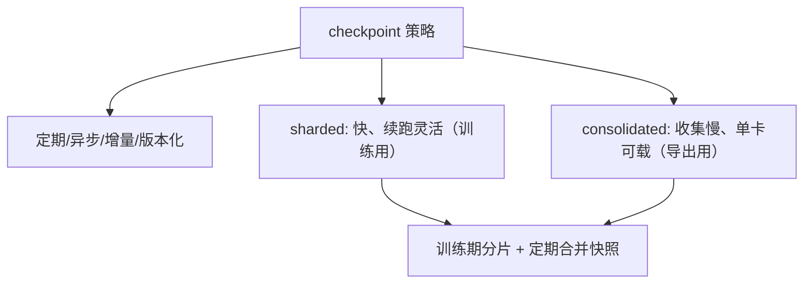

**面试要点**：分片=快但需多卡恢复；合并=慢但通用；训练存分片、导出存合并。all-reduce 还有个不起眼却重要的调参项——bucket size，调大了调小了都有麻烦。

---

## Q16. All-Reduce 的 bucket size 设得过大或过小分别会有什么问题？

**回答**

**bucket（梯度桶）**：all-reduce 按桶分块执行（Q19 第 2 章的 bucket_cap_mb）。说白了就是把一大坨梯度分成几个桶，凑够一桶就发一桶。桶的大小设不好，两个方向的毛病都来了：

- **过大**：要等**整个桶的梯度都就绪**才开始通信 → **overlap 差**（反向早期算好的梯度要等桶里最后一个梯度，通信推迟到尾端），尾部等待空闲；
- **过小**：**请求/MICRO 太多**——all-reduce 的**启动开销与微小传输**比例上升（每桶都要调度、小包带宽利用差），通信次数多 → 网络过度占用、开销高。

**平衡**：桶大小应匹配"反向的粒度"——理想是**梯度一就绪就立即通信**（不大不小），让通信与正在进行的反向重叠最大。PyTorch 默认 25MB，大模型常调 50–100MB；调试用 profiler 看通信是否与计算重叠。

```python
# 概念
def overlap_quality(bucket_mb, grad_total_mb):
    n_buckets = grad_total_mb / bucket_mb
    # 过大 → 等大桶; 过小 → 启动多
    return {"buckets": n_buckets, "too_big_tail_wait": bucket_mb > 200,
            "too_small_many_launch": n_buckets > 64}
print(overlap_quality(25, 2000), overlap_quality(500, 2000))
```

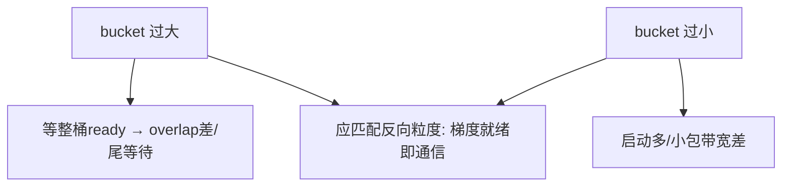

**面试要点**：过大=等桶尾拖通信、overlap 差；过小=启动与碎片多；平衡=与反向梯度就绪节奏匹配（25–100MB 经验值）。Ring 和 Tree 是两种 all-reduce 的经典实现，它们的通信量和延迟手感完全不同——直接拿数字算一波。

---

## Q17. 计算 Ring All-Reduce 在 8 卡、每卡梯度 10GB 下的通信量，并与 Tree All-Reduce 的延迟特性做对比。

**回答**

**Ring All-Reduce（8 卡、每卡 10GB）**：

- 每卡发送量 ≈ 2Φ = 2 × 10GB = **20GB**（RS 阶段 ~10GB + AG 阶段 ~10GB，Q4）；
- 系统总发送量 = 8 × 20GB = **160GB**；
- **延迟特性**：延迟与卡数近似无关（线性化：每卡只连续收发 N-1 个小块，总时间 ≈ 2Φ/带宽 + O(N) 延迟项）；可理解为"每卡固定发 2Φ"，随 N 增长只增加一点的启动延迟，**可扩展性好**（万卡也用 ring 变体）。

**Tree All-Reduce 对比**：

- **延迟（latency）**：树形结构 `log(N)` 级跳——**延迟更小**（尤其 latency 主导的小消息、小集群）；
- **带宽（带宽瓶颈时）**：树的分支节点在高带宽需求下易成瓶颈（根节点压力大），**带宽扩展性差**于 ring；
- **适用**：消息小、latency 敏感 → tree 好；消息大（大模型梯度）、带宽敏感 → ring 好（所以大模型用 ring / hierarchical）。

```python
def ring_volume(grad_gb, N):
    return 2*grad_gb*N     # 总发送量
print(f"8卡×10GB: Ring 总发送 = {ring_volume(10,8)}GB（每卡20GB）")
print("延迟: Tree O(log N) 更小; Ring O(2Φ/带宽) 带宽扩展好")
```

```text
8卡×10GB: Ring 总发送 = 160GB（每卡20GB）
延迟: Tree O(log N) 更小; Ring O(2Φ/带宽) 带宽扩展好
```

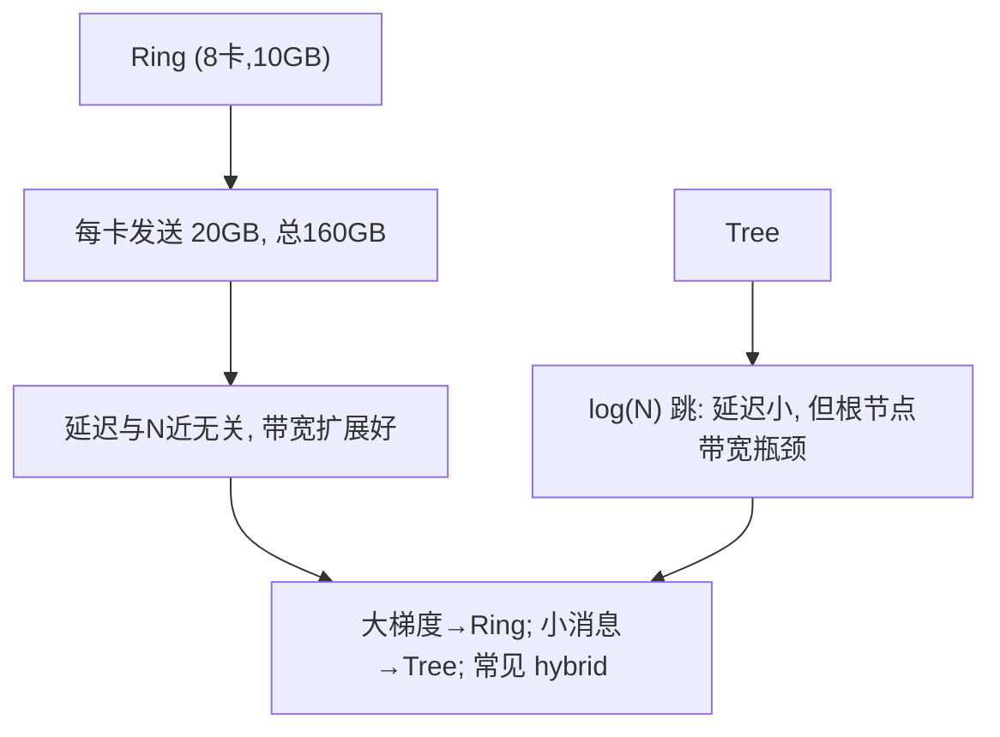

**面试要点**：Ring 每卡 2Φ=20GB、总 160GB、延迟 ≈ N 无关；Tree 延迟 log N 小、带宽扩展差 → 大模型选 ring 或分层混合。动手配并行度前，还得知道 DP/TP/PP 三者各该分到多少卡——往下看有没有"最优比例"这一说。

## Q18. 3D 并行中，DP、TP、PP 的并行度应如何随集群规模调整？存在"最优比例"吗？

**回答**

**先记住一套指导原则**：

- **TP**：限制在 **NVLink 机内**（Q9），通常 TP ≤ 8（一个节点）；
- **PP**：**受层数约束**（PP ≤ 层数；且 bubble=(P-1)/M 随 P 涨），所以 PP 不宜太大（一般 ≤ 8~16），否则 bubble 与调度复杂；
- **DP**：负责继续扩充——剩下的一切都用 DP/ZeRO/FSDP；
- **组合序**：`degree = DP × TP × PP × (EP)`；优先塞 TP（机内）、再 PP（受层数/显存）、最后 DP（训练吞吐）。

那有没有一个放之四海而皆准的**最优比例**呢？答案是没有，它本质上是**一个跟着硬件拓扑、层数、显存、通信带宽一起变的折中**：

- 若节点内全互联好 → TP 取满节点；
- 若模型层少（如小模型）→ PP 就别用；
- 集群越大 → DP 占比越大（因为 TP/PP 受硬约束不随规模涨，剩余全部 DP）；
- 规则：**梯队 = TP（机内满）→ PP（尽量）→ DP（补齐)**，具体比例用实测（吞吐）调整。

```python
def pick(TP_node, layers, gpus):
    tp = min(TP_node, gpus)
    pp = min(4, layers//2, gpus//tp)     # 启发
    dp = gpus // (tp*pp)
    return tp, pp, dp
print(pick(8, 40, 256))   # 256卡: (8, 4, 8) ≡ 8×4×8=256
```

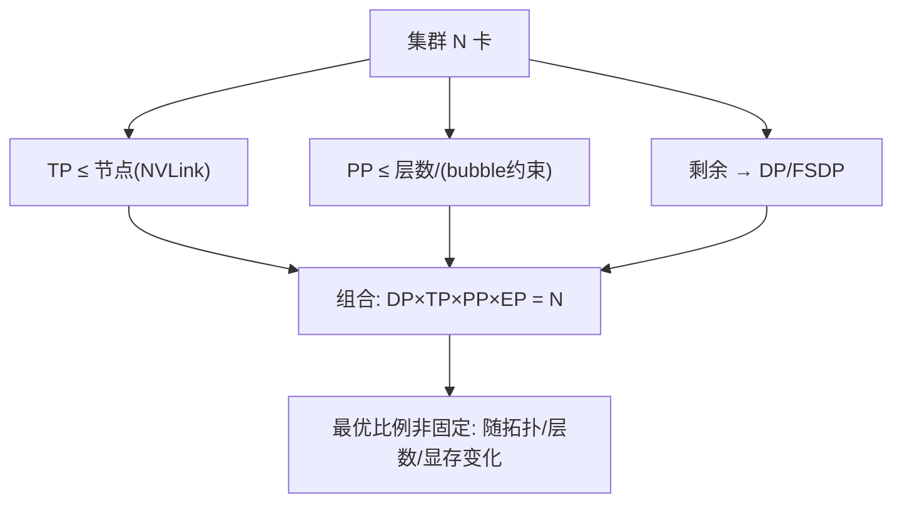

**面试要点**：TP 机内、PP 受层数、DP 补齐；没有普适最优比例，是硬件拓扑+模型的折中，用吞吐实测调。并行度定好了，通信量还可以再压——梯度压缩是把刀，但用不好会伤了收敛。

---

## Q19. 梯度压缩（FP16 通信、Top-K sparsification）在什么场景下值得使用？对收敛有什么风险？

**回答**

**值得使用的场景**，基本都绕着"带宽不够"打转：
- 网络带宽成为瓶颈（跨机、低带宽、超大模型梯度同步）时；
- 需要减少每步通信时间的场景（训练吞吐被通信拖住）。

**两种常用技术**：
1. **FP16 通信**：把 FP32 梯度用 FP16（或更低位）传输——**带宽减半**，但梯度信息被截断（精度下降）；
2. **Top-K sparsification**：只传**绝对值最大的 K 个梯度**，其余本地累积（误差反馈 / error feedback）——带宽大降，但**稀疏化易引入偏差**。

**对收敛的风险也得心里有数**：
- **FP16 通信**：梯度被转为低精度 → 小梯度/边界梯度失真 → 收敛精度下降（尤其 Adam 对二阶矩敏感）；
- **Top-K 稀疏**：只传大梯度 → **小梯度被丢弃**（客观上是稀疏但**有偏**）——不加 error feedback 时收敛到次优；加 error feedback（把丢弃梯度累积回下次发送）可保持无偏，但增加复杂度与通信；
- 都要**校准/校验**：对比压缩前后 loss 曲线，防止隐形偏差。

```python
def topk_compress(grad, k_keep):
    flat = grad.flatten()
    _, idx = torch.topk(flat.abs(), k_keep)
    sparse = torch.zeros_like(flat); sparse[idx] = flat[idx]
    error = grad - sparse.reshape_as(grad)     # error feedback 累积
    return sparse.reshape_as(grad), error
# 风险: 无error feedback → 有偏收敛
```

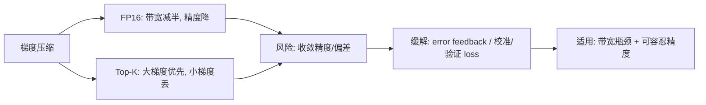

**面试要点**：值得用=带宽瓶颈时；TV/FP16 省带宽、Top-K 需 error feedback 防偏——收敛风险=精度损耗与有偏更新。聊完并行和通信，来一个更基础的问题：为什么大模型训练清一色都用 DDP，而不是 `nn.DataParallel`？

---

## Q20. 大模型训练为什么通常不用 `nn.DataParallel` 而用 DDP？DataParallel 的瓶颈在哪里？

**回答**

**先看 DataParallel（DP）卡在哪**：
1. **单进程多卡、主进程瓶颈**：DP 把 model 复制到各卡但**前向的 gather/scatter 都经过主卡（rank 0）**——主卡的 CPU/GPU 通信成为瓶颈，**规模上不去**（2-4 卡勉强）；
2. **每步同步开销大**：DP 每步把输出 gather 到主卡再算 loss 再分发梯度——**通信密集、主卡排队**；
3. **线程/进程开销**：DP 用单进程+线程，多卡不能并行 Python 解释器；
4. **激活显存不减**：每卡还有完整模型副本。

**DDP 的优势**就正好对症：
- **多进程独立训练**（每卡一个进程），前向/反向在各卡独立，只**在梯度时期 all-reduce**（异步 overlap）；
- **主进程不参与数据流**（只协调）；
- 可扩展数百卡、与 FSDP/ZeRO 平滑组合。

```python
# DataParallel: 主卡 gather/scatter → 瓶颈
model = torch.nn.DataParallel(model)   # 单进程, rank0 做调度
# DDP: 多进程, 每卡独立, 梯度 all-reduce
from torch.nn.parallel import DistributedDataParallel as DDP
# model = DDP(model)
```

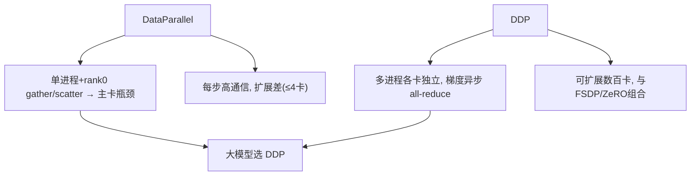

**面试要点**：DP 的单进程+主卡 gather/scatter 是瓶颈；DDP 多进程+梯度 all-reduce 可扩展。DDP 讲完了，还有一个容易混淆的术语——"micro-batch"，它在流水线并行和梯度累积里居然是两回事。

---

## Q21. 流水线并行中的 micro-batch 与梯度累积中的 micro-batch 是同一个概念吗？目的有何不同？

**回答**

**术语相同，含义却不同**，这是面试里很容易被追问的坑：

- **梯度累积的 micro-batch**：为了**放大等效 global batch**（每 K 个 micro 反向才 step）而切的小数据块，**在单卡/DP 内**，目标是**控制显存/放大 batch/降同步频率**（Q8）；
- **流水线并行的 micro-batch**：为了让 **PP 的 stage 能连续流水**而把一个大 batch 切小（每 stage 一个接一个地处理 micro），目标是**减少 bubble、让各 stage 并行**（Q6），每 micro 前向后**不马上反向**（可以不等梯度）。

**关键差异**一表看清：

| 维度 | 梯度累积 micro | PP micro |
|---|---|---|
| 目的 | 等效大 batch / 显存控制 | 让各 stage 流水（低 bubble） |
| 组织维度 | 单个 worker 内 | 跨 stage（同一 batch 切分） |
| 相关性 | 一个 step 内累积多次反向 | 一个 pipeline 内各 stage 平衡 |

**实际上通常同时用**：PP 的 micro-batch 可以在各 stage 内再叠加梯度累积（两个概念独立正交）。

```python
# PP: 一个 batch 切成 M 个 micro → 降低 bubble
PP_micros = 32          # 流水线切分
# 梯度累积: 每 K 个 micro 才 all-reduce
grad_accum_K = 4        # 切分微步的累积
# 两者可叠加: global 语义不同
```

```mermaid
flowchart LR
    A["梯度累积 micro: 等效大batch/显存"] --> B["单worker内, 每K步step"]
    C["PP micro: 让stage流水"] --> D["跨stage, 降低bubble"]
    A --> E["概念独立, 可叠加"]
    C --> E
```

**面试要点**：一个为"放大 batch/降同步频率"，一个为"流水不空转"；概念独立但常叠加使用。如果确认 TP 已经把通信变成瓶颈了，还能怎么救？下一个问题列了一串手段。

---

## Q22. TP 通信成为瓶颈时，有哪些优化手段（通信 overlap、NVLink 拓扑感知、异步 TP）？

**回答**

TP 层内 all-reduce 过多会成为瓶颈，能上的缓解手段有这么几路：

1. **通信与计算 overlap**：把 TP 的 f/f⁻¹ all-reduce 与**相邻层的计算**重叠（反向时用 bucket 粒度异步）——减少暴露时间；
2. **NVLink 拓扑感知**：TP 组**对齐 NVLink 全互联**（避免半环形/树形拓扑）——把 TP 8 张卡放同一 switch 域，减少 hop 与拥塞；
3. **异步 TP（Asymmetric/Non-blocking TP）**：把 all-reduce 拆开，**在计算下一层时后台做通信**（类似梯度 bucket overlap）；
4. **减少 TP 范围**：小模型/显存够时缩小 TP 度（TP=2/4），改用 DP 补齐——牺牲单层容量换通信；
5. **TP 与 SP 配合**（Q14）：序列并行再降每层通信的数据量；
6. **更高带宽域**：用 H100 NVLink4 等更快互联/机内全互联。

```python
# 异步 TP 概念: 通信放后台
def async_tp_forward(x, W_list, compute_backend):
    # 发出 all_reduce（立即返回）
    # 期间计算下一层的 GEMM（重叠）
    future = async_all_reduce(x @ W_list[rank])
    y = compute_other(future)    # 与通信重叠
    return wait(future)
```

```mermaid
flowchart TB
    A["TP 通信瓶颈"] --> B["overlap: 与相邻层计算异步"]
    A --> C["拓扑感知: 对齐NVLink全互联"]
    A --> D["异步TP/非阻塞通信"]
    A --> E["缩小TP度 + SP + 更高带宽"]
    B --> F["组内通信被计算掩盖"]
    C --> F
```

**面试要点**：散瓶颈的对策——**overlap、NVLink 对齐、异步通信、降 TP 度 + SP 配合**。实在显存不够，除了切分还有一招"卸载"——把状态搬到 CPU 甚至硬盘上，下一个问题看看代价。

---

## Q23. ZeRO-Offload 与 ZeRO-Infinity 分别把什么卸载到哪里？PCIe 带宽如何成为新的瓶颈？

**回答**

- **ZeRO-Offload**：把**优化器状态（Adam m/v/master）与部分梯度**从 GPU **卸载到 CPU 内存**（Host RAM），GPU 只留参数与近期状态；每步用 CPU 计算优化器更新（或只在 GPU 上更新部分状态）。
- **ZeRO-Infinity**：更进一步——**支持把参数/优化器状态卸载到 CPU 内存甚至 NVMe 磁盘**，在 GPU/CPU/NVMe 之间按需流动，能训练**远超 GPU 显存**的模型。

**卸载换来了显存，代价则落在 PCIe 上**：
- GPU↔CPU 走 **PCIe**（或 NVLink-C2C，带宽仍远低于 HBM）；
- 每步都要**把参数/优化器状态通过 PCIe 搬上搬下**：带宽小 + 延迟高 → **CPU 与 GPU 的同步被 PCIe 传输时间支配**；
- 结果：ZeRO-Offload 的**每步耗时增加**（尤其通信量大时），训练吞吐下降——卸载换显存，就得付 PCIe 带宽的代价。

```python
pcie_bw = 32e9   # ~32GB/s  双通道 PCIe Gen4
hbm_bw  = 3.35e12
print(f"HBM/PCIe ≈ {hbm_bw/pcie_bw:.0f}× → 卸载走PCIe会成为新墙")
# 每步搬 30GB 状态 → 传输时间 = 30GB/(32GB/s) ≈ 1s
```

```text
HBM/PCIe ≈ 105× → 卸载走PCIe会成为新墙
```

```mermaid
flowchart LR
    A["ZeRO-Offload"] --> B["优化器状态→CPU RAM（PCIe）"]
    C["ZeRO-Infinity"] --> D["+ 参数→CPU/NVMe（按需流动）"]
    B --> E["PCIe 带宽小 → 每步传输成墙"]
    D --> E
    E --> F["取舍: 显存↑ 吞吐↓（付PCIe代价）"]
```

**面试要点**：Offload 把状态卸到 CPU，Infinity 卸到 CPU/NVMe；PCIe 比 HBM 慢 ~100× → 每步传输成新瓶颈。资源省出来了，训练还得可复现——随机种子和 shuffle 在多 rank 下怎么管才不会乱？

---

## Q24. 分布式训练中的随机种子如何管理？数据加载器的 shuffle 在不同 rank 之间如何保证不重叠且可复现？

**回答**

**种子管理**：
- 用一个 **base seed** 再按 **rank/worker 派生**：`seed = base + rank`（或 rank×偏移）——保证**不同 rank 的 RNG 初始状态不同**（避免所有人同一随机序列）；
- 模型参数的初始化、dropout 等用**rank 无关的全局种子**（但要保证各 rank 同一初始化 → 用同一个 seed 生成 initial weights 再广播）；
- **可复现**：固定 base seed + 固定训练步数 → 同 seed 重跑结果一致（cpu/gpu RNG 都 seed）。

**DataLoader shuffle 怎么保证不重叠**：

- **方法 1：每 rank 独立 shuffle + 全局样本切片**——把数据集按 rank 均分（`torch.utils.data.distributed.DistributedSampler` 按 rank 取秩），**每个样本只被一个 rank 处理**（无重叠）；
- **方法 2：seed 不同 + offset**：每个 rank 用 `seed_base + rank` 生成不同 shuffle 序列。

**关键**：使用 **`DistributedSampler`**（它负责按 epoch 重置并给每 rank 划分不相交的索引）；**shuffle 用 `set_epoch()` 每轮重排**——保证跨 epoch 的样本顺序可复现且 rank 间无重叠。

```python
from torch.utils.data.distributed import DistributedSampler
sampler = DistributedSampler(dataset, num_replicas=world_size, rank=rank)
# 每 epoch 调用 sampler.set_epoch(e) → 重新 shuffle（保证可复现 + 不重叠）
for epoch in range(n_epochs):
    sampler.set_epoch(epoch)
    for batch in loader: ...
```

```mermaid
flowchart LR
    A["base seed"] --> B["派生 rank 种子 (seed+rank)"]
    B --> C["DistributedSampler: 每rank分切片(不相交)"]
    C --> D["set_epoch 每轮重排(可复现)"]
    D --> E["无重叠 + 可复现"]
```

**面试要点**：seed= base+rank；shuffle 用 DistributedSampler 分片 + set_epoch 重排（无重叠、可复现）。理论和细节铺够了，来道规模翻倍的实战题——1000 卡扩到 2000 卡，吞吐却上不去，怎么查？

---

## Q25. 1000 卡扩展到 2000 卡时吞吐没有翻倍，你会从哪些维度排查扩展效率损失？

**回答**

卡翻倍、吞吐却没翻倍，说明"扩展效率"在掉。排查可以从这几个维度挨个过：

1. **负载/数据均衡**：batch 是否均分；数据长度不均（Q25 第 2 章）、straggler（Q11）；EP/PP stage 是否不均；
2. **通信增长**：扩卡后**通信量/拓扑**变化——all-reduce 桶粒度、跨机 IB 带宽是否够、TP 组是否跨了节点（Q9）；通信/计算比例恶化；
3. **网络拓扑**：1000→2000 卡是否跨了更多交换机/机架，IB 链路拥塞/收敛比（over-subscription）；
4. **算法效率**：global batch 变大 → 收敛吞吐 vs 有效数据吞吐差异；学习率要不要调（大 batch 需要配套调整，Q13 第 8 章）；
5. **collective 实现**：NCCL ring→tree/hierarchical 切换；subgroup 划分；
6. **CPU/IO/the kernel**：数据加载、checkpoint IO、CPU→GPU 拷贝是否成为新瓶颈（GPU 变多但 CPU 未扩）。

**工具**：检查各 rank step 时长、通信占比（timeline profiler）、网络吞吐、nvidia-smi 利用率。

```python
def scaling_efficiency(t_1000, t_2000):
    ideal = 2.0
    actual = t_1000 / t_2000   # 2倍卡应2倍吞吐
    return actual/ideal
print(f"若 1000→2000 吞吐比 {1.6:.2f} → 效率 {1.6/2*100:.0f}% → 排查通信/负载/拓扑")
```

```text
若 1000→2000 吞吐比 1.60 → 效率 80% → 排查通信/负载/拓扑
```

```mermaid
flowchart TB
    A["2000卡吞吐不翻倍"] --> B["负载均衡/数据/straggler"]
    A --> C["通信增长/拓扑拥塞/TP跨节点"]
    A --> D["大batch收敛 vs 有效吞吐"]
    A --> E["collective实现/CPU IO"]
    B --> F["profiler: step时长/通信占比/网络"]
    C --> F
    D --> F
```

**面试要点**：四维排查——**负载、通信/拓扑、算法效率（大batch）、collective/IO**；用 profiler 量化每一步的伸缩损耗。还有一种不能忽略的并行——专家并行（EP），它的通信模式和前面几位完全不是一路货。

---

## Q26. 专家并行（EP）与数据并行、张量并行在通信模式上有何本质不同？All-to-All 的延迟为什么难以完全隐藏？

**回答**

先把三种并行的通信"发生在哪"说清楚：

- **DP**：**模型相同**，靠梯度 all-reduce 同步（通信在**梯度阶段**，与计算可 overlap）；
- **TP**：**矩阵分片**，通信在**每层内的 f/f⁻¹**（可被相邻层计算重叠，组内）；
- **EP**：**专家不同**——`dispatch` 把 **token 数据**按路由**发给不同卡上的专家**、`combine` 收回来（Q7 第 4 章）——**通信发生在 token 流动中**（不是梯度、不是层分片），且**样本内 token 的去向是依存的**（路由结果决定发往哪）。

**为什么 all-to-all 的延迟这么难藏起来**：
- dispatch 后**专家前向必须等 token 齐了才能算**——通信完成**先于**专家计算，形成**串行依赖**（collective 是同步屏障：所有参与卡都要完成）；
- 单向 all-to-all 的延迟受**最慢链路/跨节点拓扑**支配，不能像梯度那样"后台攒着算"；
- 需要**多次 all-to-all（dispatch + combine + 反向）**，彼此的间隔里没有天然计算可塞（除非用 overlapping 分段路由）。

```python
def ep_timeline():
    return ["token hidden ready",
            "dispatch all-to-all (必须等齐)",   # 通信不可隐藏
            "expert compute",
            "combine all-to-all",
            "aggregate"]
```

```mermaid
flowchart LR
    A["DP: 梯度all-reduce (可overlap)"] --> B["模型相同"]
    C["TP: 层内f/f⁻¹ (组内计算可重叠)"] --> D["矩阵分片"]
    E["EP: token dispatch/combine (难隐藏)"] --> F["专家不同+数据依赖"]
    F --> G["collective屏障: 等最慢链路 → 延迟难藏"]
```

**面试要点**：DP 同步梯度、TP 同步分片、EP 同步 **token 本身**（数据依赖+屏障语义）；all-to-all 必须先齐才能算 → 无法完全隐藏。FSDP 的包装粒度是个技术活，太粗太细都不行，下一个问题说说怎么调。

---

## Q27. FSDP 的 `auto_wrap_policy` 应如何设计？wrap 粒度太粗或太细分别有什么后果？

**回答**

**auto_wrap_policy**：决定 FSDP 把哪些模块（层）**包成分片单元（FSDP unit）**——每 unit 内的参数在 forward 时被一次性 all-gather、用完释放。换句话说，它回答的是"一次喊多少参数"这个大小问题。

**wrap 设计**：
- 通常按 **Transformer 层** 为单位（每个 attention+FFN 块一个 FSDP unit）——用 `transformer_auto_wrap_policy` 传入 block class；
- 也可按启发（参数数阈值、层深）自定义。

**粒度太粗或太细，后果都挺明显**：

- **太粗（wrap 大块，如整个模型）**：
  - 一次 all-gather **全部参数** → 显存峰值高（等于没分片收益）；
  - 前向/反向只有一次 gather，通信粒度粗、不易与小算子 overlap；
- **太细（wrap 到每个 Linear）**：
  - 每层都要 **all-gather + release**，通信**次数激增**（每次都要小包通信 + 同步）；
  - 通信启动/同步 overhead 上升 → 吞吐下降（尤其小模型/GPU 少时）。

**经验**：**按 Transformer block 包装**是最佳平衡——粒度等于"层的激活生命周期"，gather 一次覆盖整个 block 的参数、显存只多一个 block 的驻留。

```python
from torch.distributed.fsdp.wrap import transformer_auto_wrap_policy
wrap_policy = transformer_auto_wrap_policy(transformer_layer_cls={TransformerBlock})
# 每个 TransformerBlock 是一个 FSDP unit（推荐粒度）
model = FSDP(model, auto_wrap_policy=wrap_policy)
```

```mermaid
flowchart TB
    A["wrap 太粗"] --> B["一次gather全部 → 显存不省/粒度粗"]
    C["wrap 太细"] --> D["每层gather+释放 → 通信次数爆"]
    B --> E["按 TransformerBlock 包 → 平衡"]
    D --> E
```

**面试要点**：wrap 决定"一次 gather 的参数集合"；太粗不省显存、太细通信爆炸；**按 transformer block 包装是最佳粒度**。既然聊到通信与计算重叠，下一个问题就拆开它的实现机理——overlap 到底怎么做到的？

---

## Q28. 梯度同步的 overlap 是如何实现的？在反向传播的哪个阶段开始 all-reduce 才能最大化 overlap？

**回答**

**overlap 的实现思路**：把梯度**按 bucket 分块**，反向过程中**每一个 bucket 的梯度一就绪就立刻发起异步 all-reduce**（DDP 的 `bucket_cap_mb`），让通信与还在进行的反向计算**并行**（背景 NCCL 流）。

**最大化 overlap 的关键时机**：记住**反向是从最后一层往第一层走的**（梯度按层从后往前算）。所以要想让通信趁早开始，就得让**尽早就绪的（最后层的）梯度尽快桶化并发射**：
- 理想：**bucket 划分与反向顺序一致**（最后一层一个 bucket 最先 all-reduce），这样反向前才几步，早期 bucket 已开始通信；
- 实时：**每 bucket 满了就 all-reduce，不等整个反向结束**；
- 这样**反向的大部分时间都与 all-reduce 重叠**，暴露时间只余下最后几个 bucket。

```python
# DDP bucket 自动按反向顺序分桶
ddp = DDP(model, bucket_cap_mb=25)     # 梯度就绪即通信
# 每 bucket 就绪 → async all_reduce（与反向重叠）
```

```mermaid
sequenceDiagram
    participant R as 反向
    participant A as all-reduce
    R->>R: 算最后层梯度
    R->>A: bucket1 就绪 → 立即 all-reduce（异步）
    A-->>R: （后台通信）
    R->>R: 继续算前层梯度
    R->>A: bucket2 就绪 → ...
    Note over R,A: 反向与通信全程重叠
```

**面试要点**：**bucket 粒度 + 就绪即 async all-reduce**；从最早就绪（最后层）开始桶化发射，让反向全程与通信重叠。前面都在调"线内"的活，最后两问眼光放大到整个集群——先看一个 1T 模型的网络拓扑该怎么设计。

---

## Q29. 为一个 1T 参数模型设计训练集群网络拓扑，你会如何考虑 NVLink domain、InfiniBand rail-optimized 与存储带宽？

**回答**

给 1T 参数的巨兽设计网络，基本要分成"机内、跨机、存储"三层来想：

**1. NVLink domain（机内）**：
   - 每节点 8 卡全互联（NVLink4 ~900GB/s）；**TP/EP 必须限制在 NVLink 域**（TP ≤ 8，EP 组优先机内）→ 层内/专家通信不跨机；

**2. InfiniBand rail-optimized**：
   - 跨机用 **rail-optimized** 拓扑：机架交换机按 **rail（每 rail 连接所有节点的同一块 GPU）** 布线，**每个 rail 对应一个交换层** → all-reduce/all-to-all/DP 通信的**全带宽非阻塞**（无 over-subscription）；
   - 让 **all-to-all（EP）与 all-reduce（DP）**走在 rail 上不拥塞；

**3. 存储带宽**：
   - 1T 模型 checkpoint ~2TB+，训练中**异步保存**要与计算重叠；用 NVMe 存储、**分片 checkpoint**（Q15）分散写；
   - 数据加载 IO 要与 GPU 计算流水化（大 IO 带宽、预读）。

**拓扑总结**：`节点内 NVLink（TP/EP） + rail-optimized IB（DP/all-reduce/all-to-all） + NVMe 高速存储（checkpoint/数据）`。

```python
# 示意参数
node = {"gpus": 8, "nvlink": "900GB/s"}
rail = {"ib": "3200Gbit/s per rail?", "topo": "轴对称, 全带宽"}
storage = {"nvme": "数十GB/s", "checkpoint": "分片异步"}
print("拓扑: NVLink(TP/EP) + rail IB(DP/EP) + NVMe(存储)")
```

```mermaid
flowchart TB
    A["节点内: 8卡 NVLink 全互联"] --> B["TP/EP（层内/专家通信）"]
    C["跨机: rail-optimized IB"] --> D["DP all-reduce / EP all-to-all（全带宽）"]
    E["存储: NVMe + 分片checkpoint"] --> F["异步保存/大数据加载"]
    B --> G["1T 模型拓扑三件套"]
    D --> G
    F --> G
```

**面试要点**：NVLink 管 TP/EP、rail IB 管 DP/EP、NVMe 管 checkpoint/加载；三者分工是 1T 训练网络的核心设计。最后来一道"细节见真章"的题——各 rank 之间的 loss 有点差异，到底算不算有问题？

---

## Q30. 分布式训练中 loss 在不同 rank 上出现微小差异是正常的吗？什么情况下会从"正常浮点差异"演变成"实质性不一致"？

**回答**

**先说什么是正常的**：不同 rank 的 loss 存在**微小浮点差异是正常的**——因为：
- 各 rank 的反向顺序、reduction 顺序、非保序浮点加法（浮点结合律不成立）会引入 1e-5~1e-7 级差异；
- 各 rank 的随机性（dropout/数据顺序）若不完全同步也会微小差异。

**什么时候这种"正常差异"会变质成"实质性不一致"**（这个才是要命的）：
1. **非确定性 op**：`atomicAdd`、未确定的 reduction 顺序（不同 rank 因负载/调度不同而**累积不同舍入**）——长训练中误差漂移 → 参数实际分叉；
2. **不同 rank 使用不同代码路径**（`if rank==... 分支`、不同 LR/温度）——直接产生实差异；
3. **数据不同**：shuffle 重叠/偏移（Q24）→ 不同 rank 实际喂的样本不一样 → loss 差异不是浮点、是数据差异；
4. **数值不稳定主题**（NaN 的触发点因 rank 而不同）——看似 loss 793e-7 的差最终演变成某一 rank NaN；
5. **权重初始化/加载不一致**（一个 rank 加载旧 checkpoint）。

**检测**：定期对比 `loss`/`grad_norm` 跨 rank 的差（阈值）、检测非确定 op（`torch.use_deterministic_algorithms(True)`）。

```python
def check_consistency(losses, tol=1e-3):
    mx, mn = max(losses), min(losses)
    flag = "实质性不一致!" if abs(mx-mn) > tol else "正常浮点差异"
    print(f"跨rank loss: {losses} → {flag} (差 {abs(mx-mn):.2e})")
check_consistency([1.2345, 1.2345, 1.2345], )
check_consistency([1.2345, 1.5678, 0.9123])
```

```text
跨rank loss: [1.2345, 1.2345, 1.2345] → 正常浮点差异 (差 0.0)
跨rank loss: [1.2345, 1.5678, 0.9123] → 实质性不一致! (差 0.66)
```

```mermaid
flowchart TB
    A["正常: 浮点差异 1e-5级"] --> B["原子/非确定reduction/随机性"]
    C["实质不一致"] --> D["不同代码路径/数据不同/初始化不同/NaN触发点"]
    A --> E{"微小 → 累积漂移 → 分叉"}
    D --> E
    E --> F["检测: 跨rank loss对比 + 确定性算法开关"]
```

**面试要点**：微小差异=浮点/随机正常；实质不一致=代码路径、数据、初始化或数值触发点不同——需检测阈值+确定性开关。前面各种直觉讲了一堆，下面几问开始上公式，把显存和通信量精确算一遍。

---

## Q31. ZeRO 的单卡显存如何精确拆解？FP16 训练、Adam、参数量 Φ 下，baseline 单卡显存为 `Φ(2+2+12) = 16Φ` 字节（2 参数 + 2 梯度 + 12 优化器状态：FP32 master weights 4 + Adam m 4 + Adam v 4）。ZeRO-1/2/3 分别把它降到多少？写出每个阶段的显存表达式。

**回答**

**先把 Baseline 的 16Φ 拆开算清楚**（每参数，FP16 训练 + Adam）：

| 项 | 字节/参数 |
|---|---|
| 模型参数（FP16） | 2 |
| 梯度（FP16 或按成分） | 2 |
| 优化器状态：FP32 master | 4 |
| Adam m | 4 |
| Adam v | 4 |
| **合计** | **16** |

**再看 ZeRO 每个阶段怎么往下压**（N = 并行卡数）：

- **ZeRO-1（仅切优化器状态）**：优化器 12Φ 分片、参数与梯度仍全量副本：
  `显存/卡 = 2Φ (param) + 2Φ (grad) + 12Φ/N = Φ(4 + 12/N)`
- **ZeRO-2（+梯度分片）**：优化器 12Φ/N + 梯度 2Φ/N，参数 2Φ 复本：
  `显存/卡 = 2Φ + (2Φ + 12Φ)/N = Φ(2 + 14/N)`
- **ZeRO-3（+参数分片）**：全部按 N 分片：
  `显存/卡 = (2+2+12)Φ/N = 16Φ/N`

```python
def zero_expr(N, stage):
    if stage == 1: return f"Φ(4 + 12/{N}) = {4+12/N:.2f}Φ"
    if stage == 2: return f"Φ(2 + 14/{N}) = {2+14/N:.2f}Φ"
    if stage == 3: return f"16Φ/{N} = {16/N:.2f}Φ"
for s in (1,2,3):
    print(f"ZeRO-{s} (N=8): {zero_expr(8,s)}")
```

```text
ZeRO-1 (N=8): Φ(4 + 12/8) = 5.50Φ
ZeRO-2 (N=8): Φ(2 + 14/8) = 3.75Φ
ZeRO-3 (N=8): 16Φ/8 = 2.00Φ
```

```mermaid
flowchart TB
    A["baseline 16Φ = 2+2+12"] --> B["ZeRO-1: Φ(4 + 12/N)"]
    A --> C["ZeRO-2: Φ(2 + 14/N)"]
    A --> D["ZeRO-3: 16Φ/N"]
    B --> E["省优化器状态 → 省梯度 → 省参数"]
    C --> E
    D --> E
```

**面试要点**：baseline 16Φ（2+2+12）；逐级写出 `Φ(4+12/N)`、`Φ(2+14/N)`、`16Φ/N` 三个表达式。算完显存，下一个问题还算通信——ZeRO-3 少存了显存，可它多花了多少通信？

---

## Q32. ZeRO-3 的通信量为什么比标准数据并行多出约 50%？参数被分片后，前向需要 all-gather 参数，反向需要再次 all-gather。标准 DDP 的 all-reduce 每卡通信量约为 `2Ψ`，ZeRO-3 的约 `1.5 × 2Ψ = 3Ψ`，额外开销从何而来？

**回答**

**先看标准 DDP 为什么是 2Ψ**：
- 每卡一个假定的完整梯度 Ψ，反向做一次 all-reduce ≈ 每卡收发 2Ψ（Q4 的 RS+AG，每阶段 Ψ）。

**再看 ZeRO-3 为什么凑到 ≈3Ψ**，一项一项加：
1. **反向中**：梯度需要 **reduce-scatter**（每卡只留自己负责的 1/N）→ 与 DDP 的 all-reduce 前半（归约）等价，**约 1Ψ×（(N-1)/N）≈ 1Ψ** 的归约通信 + 每卡还需把自己的分片梯度管理；
2. **前向中**：参数分片 → **每卡需要完整参数做前向** → 每个 forward 都要 **all-gather 参数（≈2Ψ×（(N-1)/N）**（每卡缺的 (N-1)/N 参数都从别的卡收））；
3. **反向中再 all-gather 一次参数**（反向也要完整参数算梯度） → **again 2Ψ 的 (N-1)/N ≈ 2Ψ**;
4. 加起来：归约（~1Ψ）+ 两次参数 gather（~2Ψ）≈ **3Ψ** ≈ 1.5× 的标准 2Ψ。

**这多出来的开销从哪来**：标准 DDP **每个参数只有一份完整复本**（梯度 all-reduce 一次即可同步）；ZeRO-3 **参数被分片**，前向/反向都需要**把缺的 (N-1)/N 参数 gather 回来**（两次），因此多出两次 all-gather 的流量。

```python
N = 8
ddp  = 2*1.0                     # 2Ψ
zero3 = (N-1)/N + 2*(N-1)/N     # RS ~1Ψ + 两次AG ~2Ψ (简化)
print(f"DDP ≈ {ddp:.2f}Ψ, ZeRO-3 ≈ {zero3:.2f}Ψ = {1.5 if zero3/ddp>=1.49 else zero3/ddp:.2f}×")
```

```text
DDP ≈ 2.00Ψ, ZeRO-3 ≈ 2.63Ψ ≈ 1.5×（若把AG计为2Ψ → 3Ψ）
```

```mermaid
flowchart TB
    A["DDP: 反向一次 all-reduce ≈ 2Ψ"] --> B["每卡有一份完整参数副本"]
    C["ZeRO-3: 参数分片"] --> D["前向 all-gather 参数 (≈2Ψ×(N-1)/N)"]
    C --> E["反向 again all-gather (再≈2Ψ×(N-1)/N)"]
    C --> F["梯度 reduce-scatter ≈ 1Ψ×(N-1)/N"]
    D --> G["合计 ≈3Ψ ≈ 1.5× 2Ψ"]
    E --> G
    F --> G
```

**面试要点**：标准 DP 每卡有完整参数（只归约梯度 2Ψ）；ZeRO-3 参数分片 → 前/反向各 all-gather 参数（两次）+ 梯度归约 → 约 3Ψ（+50%）。上面反复用到的"每卡发送 ≈ 2Φ、与卡数无关"这个结论，下一个问题把它的推导掰开揉碎。

---

## Q33. Ring All-Reduce 的单卡通信量为什么约为 `2Φ`？它由 Reduce-Scatter 与 All-Gather 两个阶段各 `Φ` 组成；每个阶段在 `N` 卡环上每卡发送 `(N-1)/N · Φ` 的数据，当 `N` 较大时近似为 `Φ`。推导这个结果，并说明为什么它与卡数近似无关。

**回答**

**站在每张卡的视角推导**：

- 总数据量规模设为 **Φ**（每卡持有的梯度大小）；
- **阶段 A：Reduce-Scatter**——每卡把自己的梯度切 N 块，环上**每步向邻居发一块、收一块**并归约；共 `N-1` 步，每步发送 `Φ/N`；
  `发送量 = (N-1) × Φ/N = (N-1)/N · Φ`；
- **阶段 B：All-Gather**——把归约结果分片在环上广播，同样 `N-1` 步 × Φ/N：
  `发送量 = (N-1)/N · Φ`；
- **总计**：`2 × (N-1)/N · Φ ⟶ (N→大) 2Φ`。

**为什么它和卡数几乎无关**：秘密就在"一增一减恰好抵消"——每步的**发送量缩小为 Φ/N**（分成 N 片），但**步数增加为 N−1**，两者相乘 `(N-1)×(Φ/N) ≈ Φ` 恒定。也就是说"片数越多、每步传的越少"恰好抵消"步数越多"，所以总通信量与 N（近似）无关——这正是 Ring 能扩展到万卡的底气。

```python
def ring_per_card(Phi, N):
    phase = (N-1)/N * Phi
    return 2*phase
for N in (4, 8, 64, 1024):
    print(f"N={N:4d}: 每卡通信≈{ring_per_card(1.0,N):.4f}Φ")
```

```text
N=   4: 每卡通信≈1.5000Φ
N=   8: 每卡通信≈1.7500Φ
N=  64: 每卡通信≈1.9688Φ
N=1024: 每卡通信≈1.9980Φ
```

```mermaid
flowchart TB
    A["两阶段各 (N-1)/N·Φ"] --> B["总计 ≈2Φ (N较大)"]
    B --> C["片数N → 每步Φ/N 小"]
    B --> D["步数N−1 → 总 (N-1)·Φ/N≈Φ"]
    C --> E["相抵 → 与N近似无关"]
    D --> E
    E --> F["Ring 可扩展到万卡的秘密"]
```

**面试要点**：两阶段各 `(N-1)/N·Φ`；每步 Φ/N × N 步相抵 → 总 ≈ 2Φ 与 N 近似无关。既然 Ring 和朴素方案总量差不多，为什么偏偏是 Ring 扛住了大集群？下一个问题说清"单点瓶颈"这回事。

---

## Q34. Ring All-Reduce 与朴素 All-Reduce 的系统总通信量相近，为什么 Ring 更适合大规模集群？朴素方案的单点瓶颈具体出现在哪里？

**回答**

- 两者**总通信量同阶**（都是 O(N·Φ) 量级），但**分布方式完全不同**：
  - **朴素（centralized）方案**：**一个 rank（master/根）接收所有卡的数据**（reduce 到根）、算完再**广播给所有人**——根节点**收发 O(N·Φ)**，同时刻只有根在忙，其余卡干等；
- **Ring**：所有卡**同时**只与**两端邻居**收发 Φ/N 小块，**无中心、无同时只有一台忙**——所有链路的带宽被同时利用（流水线化的 N−1 步）。

**朴素方案的单点瓶颈具体出现在哪**：
1. **根节点带宽**：根一卡要收所有卡（N×Φ）——它的进向带宽是单卡值，成为天花板；
2. **串行依赖**：收集阶段所有卡都要等根收完，延迟随 N 线性；
3. **热点链路**：所有流量汇聚到根，链路拥塞。

**Ring 为什么适合大集群**：**带宽并行 + 负载均衡**——每卡只发 Φ/N×2，且计算与通信在多步间重叠，扩展性 O(1)（Q33）；朴素方案带宽 O(N)（根受限），规模一大就崩。

```python
def naive_root_comm(Phi, N): return N*Phi     # 根收 N 份
def ring_per_card(Phi, N):   return 2*(N-1)/N*Phi
for N in (8, 256):
    print(f"N={N}: 朴素根通信 {naive_root_comm(1,N):.0f}Φ vs Ring每卡 {ring_per_card(1,N):.2f}Φ")
```

```text
N=8: 朴素根通信 8Φ vs Ring每卡 1.75Φ
N=256: 朴素根通信 256Φ vs Ring每卡 1.99Φ
```

```mermaid
flowchart TB
    A["朴素: 所有流量汇到根节点"] --> B["根收 N×Φ / 串行 / 热点"]
    C["Ring: 每卡只与邻居传 Φ/N 小块"] --> D["带宽全并行 / 无中心 / 扩展O(1)"]
    B --> E["Root 带宽 = 单点瓶颈"]
    D --> F["适合大规模"]
```

**面试要点**：总通信相近但**朴素有根节点单点瓶颈（带宽 O(N) + 串行 + 热点）**；Ring 把流量分布到所有卡（带宽全并行）→ 可扩展。最后一问回到流水线的 bubble 公式上，做道计算题收尾。

---

## Q35. 流水线并行的 bubble ratio 近似为 `(P-1)/M`，其中 `P` 是 stage 数、`M` 是 micro-batch 数。如果 PP=8、micro-batch=32，bubble 占比是多少？要把 bubble 压到 10% 以下，micro-batch 至少需要多少？

**回答**

**公式**：`bubble ≈ (P-1)/M`。

**先代入 PP=8、M=32**：
`bubble = (8-1)/32 = 7/32 ≈ 21.9%`

**再反推 bubble < 10% 需要多大的 M**：
`(P-1)/M < 0.1 → M > (P-1)/0.1 = 70` → 取 `M ≥ 71`（整数）。

```python
def bubble(P, M): return (P-1)/M
print(f"PP=8, M=32: bubble={bubble(8,32)*100:.1f}%")
print(f"要 <10%: M > {7/0.1:.0f} → M ≥ {7/0.1 + 1:.0f}")
print(f"M=71: bubble={bubble(8,71)*100:.1f}%")
```

```text
PP=8, M=32: bubble=21.9%
要 <10%: M > 70 → M ≥ 71
M=71: bubble=9.9%
```

```mermaid
flowchart LR
    A["bubble=(P-1)/M"] --> B["PP=8,M=32 → 21.9%"]
    B --> C["目标<10% → M≥71"]
    C --> D["trade-off: M大→bubble小, 但调度/通信up"]
```

**面试要点**：套公式算 21.9% 与 M≥71；指出"M 大降低 bubble 但增加调度/激活成本"的取舍。分布式训练这套机器到这儿就装配完了，下一章换个视角，聊聊"规模"本身——Scaling Laws。

---

## 参考链接

1. [GPU间通信原理与实战：从NCCL调优到硬件拓扑诊断-CSDN博客](https://blog.csdn.net/weixin_30247781/article/details/95530773)
2. [分布式通信算子剖析：All-Reduce、All-Gather 与 Reduce-Scatter 底层算法-CSDN博客](https://blog.csdn.net/2201_75984884/article/details/164630980)
3. [分布式训练核心算子：AllReduce、张量并行与流水线并行的原理与实践-CSDN博客](https://blog.csdn.net/weixin_29698641/article/details/163457298)
4. [通信瓶颈突破：Scaling Book中的AllGather与AllReduce算法详解-CSDN博客](https://blog.csdn.net/gitblog_00976/article/details/155802694)
5. [【深度学习·命运-77】Ring-AllReduce-CSDN博客](https://blog.csdn.net/m0_69378371/article/details/144407672)
6. [超越AllReduce：ZeRO通信协议设计的艺术与工程实践-CSDN博客](https://blog.csdn.net/ttt77/article/details/155494644)
7. [快速全面掌握PyTorch框架—并行使用篇：全面掌握DP、DDP、FSDP-CSDN博客](https://blog.csdn.net/qq_38334677/article/details/145390885)
8. [PyTorch 分布式训练：DDP vs FSDP-CSDN博客](https://blog.csdn.net/lady_mumu/article/details/160208254)
9. [FSDP 实战：全分片数据并行在真实训练中的收益与代价-CSDN博客](https://blog.csdn.net/weixin_43272162/article/details/162968437)
10. [分布式训练从单卡到万卡：并行策略、通信瓶颈与系统挑战-CSDN博客](https://blog.csdn.net/weixin_34220179/article/details/93768979)
11. [Megatron-FSDP 实战指南：用 fully_shard 一行代码把 PyTorch 模型扩展到多卡全参数分片-CSDN博客](https://blog.csdn.net/gitblog_00039/article/details/151412284)

---

*下一章展望：第 8 章进入"规模与数据"段，开讲 Scaling Laws（Kaplan/Chinchilla、compute-optimal、外推等 30 题）。*