# 第 8 章 · Scaling Laws

> 面试生普（LLM 500 题）· 第 8 章。本章覆盖 Kaplan 2020 vs Chinchilla 2022、compute-optimal、token/参数分配、幂律外推、数据质量、涌现、多模态/MoE scaling 等 30 个问题，关键概念配 Python 代码与 mermaid 图解。

---

## 先把话说清楚：什么是 Scaling Laws？

你要是问一个做大模型的人："到底该把模型做多大、喂多少数据？" 他大概率会提到一个词——**Scaling Laws（规模定律）**。说白了，它就是一套"凭经验总结出来的数学规律"，用来回答一个很实在的问题：**当我把参数堆多、数据加多，模型到底能变强多少？** 而且这种"变强"不是凭感觉，而是能用幂律公式大致算出来的。

这章最出名的两个"门派"，一个叫 **Kaplan 2020**（OpenAI 那篇），一个叫 **Chinchilla 2022**（DeepMind 后来居上）。它们的核心分歧就一句话：手里这盘算力，到底该多买"参数"还是多买"数据"？Kaplan 说参数优先，Chinchilla 说两者得齐头并进。这个分歧直接改变了过去几年整个行业"怎么烧钱训模型"的做法。

所以这章不只是嘴上谈理论——它回答的全是很接地气的问题：给定预算怎么分配才最划算？小模型做实验能不能外推出大模型？为什么数据质量一变，曲线就跟着动？"涌现"这种突然开窍的现象跟平滑的定律矛盾吗？读完这 30 题，你就能拿这套账本去跟面试官算一笔"该不该继续训"的账了。

> 阅读提示：每题先看「**回答**」把道理弄明白，面试前再扫一眼「**面试要点**」——那就是可以背下来直接答题的浓缩版。

---

## Q1. Kaplan 2020 与 Chinchilla 2022 的 Scaling Law 结论有何关键差异？Chinchilla 推翻了什么实践？

**回答**

先认识两位主角，它俩结论的差别，本质上是"算力预算该往哪边砸"的差别：

- **Kaplan 2020（OpenAI）**：拟合出来的是 loss ≈ `E + A/N^α + B/D^β`。它发现**模型规模 N 才是老大**——算力预算 `C` 往上加的时候，**该优先去加参数 N**，数据 D 慢慢涨就够了（具体是 `N ∝ C^0.73`，`D ∝ C^0.27`）。用大白话讲它的结论："**训练要偏重参数，数据可以少一点。**"
- **Chinchilla 2022（DeepMind）**：拿了一套大得多的数据重新标定，结论反了过来——**N 和 D 应该按 `N ∝ C^0.5`、`D ∝ C^0.5` 等速度一起长**。也就是说，在 **compute-optimal（算力最优）** 的配置下，参数量和 token 数**大致成比例地一起变大**。它的结论是："**训练数据要比以前那些做法多得多**（大概每参数 20 个 token 的量级），之前那批大模型普遍训得不够。"

**那 Chinchilla 到底推翻了什么？**

- 推翻了"**多堆参数远比多喂数据管用**"这个流行结论 → 落到实践上，就是大批模型的训练 token 数猛增（比如 GPT-3 175B 只用了 300B tokens，而 Chinchilla 建议的量级约 3.5T）；
- 推翻了"**先用小数据把大模型训一遍也划算**"的做法 → 大家转向 **N≈D**（参数和 token 大致相当）的平衡配置。

```python
def alloc(C):
    return {"kaplan_N": C**0.73, "kaplan_D": C**0.27,
            "chin_N": C**0.5, "chin_D": C**0.5}
print(alloc(10))  # 算力↑10倍: Kaplan 主要加参, Chinchilla 双加
```

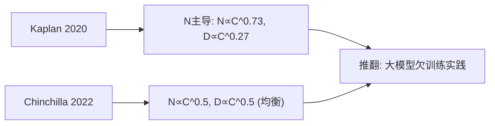

**面试要点**：Kaplan 是参数主导；Chinchilla 是 N≈D；关键差异就落在"算力预算怎么在 N 和 D 之间分配"上。

---

## Q2. Chinchilla 的 compute-optimal 结论用一句话概括是什么？固定算力 `C` 下，参数量 `N` 与 token 数 `D` 大致按什么比例分配？

**回答**

**一句话版本**：**在给定算力 C 的前提下，参数量和训练 token 数应该按相近的比例一起扩张，两者对 loss 的贡献几乎是对称的**（也就是 `N^* ∝ C^0.5`、`D^* ∝ C^0.5`）。你可以理解成：算力这块蛋糕，分给"模型"和"数据"的份量差不多大。

**分配比例**：固定算力 `C ≈ 6ND`，最优的时候：

- `N^* ≈ (C/(6·k))^0.5`，`D^* ≈ (C·k/6)^0.5`，其中 `k` 就是那个"每个参数配多少 token"的目标比值；
- 经典的经验数字是**约每参数 20 个 token**（在 `C ≈ 6ND` 下，`D/N≈20` 是常被引用的经验值），当然具体多少会随算力大小略有浮动。

```python
import math
def chinchilla(C, ratio=20):
    N = math.sqrt(C/(6*ratio))
    D = math.sqrt(C*ratio/6)
    return N, D, 6*N*D   # (参, tok, 实际FLOPs)
N, D, flops = chinchilla(1e24)
print(f"C=1e24: N≈{N/1e9:.0f}B 参, D≈{D/1e12:.1f}T tok, 6ND≈{flops:.1e}")
```

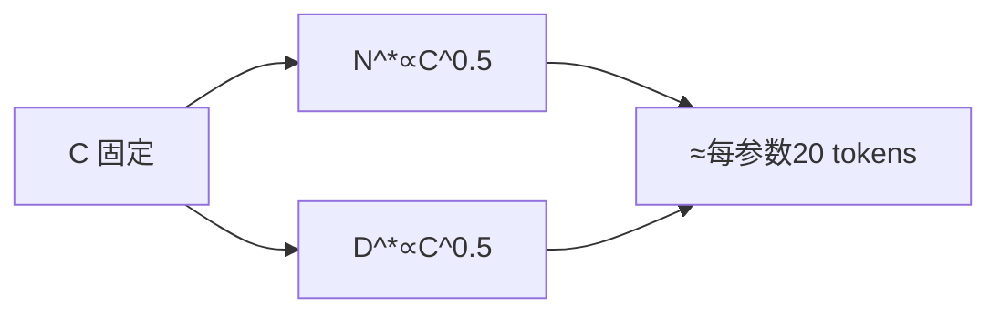

**面试要点**：compute-optimal 就是"N 与 D 等速缩放"；比例大约是每参数几十个 token（20 这个量级）。

---

## Q3. "20 tokens per parameter"这个经验法则从何而来？什么条件下成立，什么条件下会偏离？

**回答**

先说它怎么来的：Chinchilla 在固定算力 `C≈6ND` 的条件下，对 loss 关于 `(N,D)` 求最优分配，最后得到**在 compute-optimal 时，D/N 差不多是个常数**——引用得最多的就是"约 20 tokens/参"这一条。

**它成立得满足这些条件**：目标是**语言建模的 loss（PPL）** + 处于 **compute-optimal（预算已经定死）** + 标准自回归训练 + 数据质量已经成熟。

**那什么时候会偏离呢？** 主要有几类情况：

1. **目标不再是 PPL**：如果你要的是**推理成本最优**，那会偏向大模型少 token（Q7/Q18）；如果你要的是更强的下游能力，也可能偏向小模型多 token；
2. **数据质量受限**：高质量 token 不够用 → 被迫少喂一点 token（Q17）；
3. **架构不一样**：MoE 要用**激活参数**来算（Q12）；多模态、代码这些能力的数据配比也和纯文本不同；
4. **压根没有"最优预算"这回事**：如果算力能无限涨，这个比例本身也会随 C 慢慢漂移；不同数据域（代码、多语言）的最优比例也不一样。

```python
def tokens_per_param(MODE):
    return {"ppl_optimal": 20, "infer_optimal": 8, "data_limited": 5}.get(MODE, "—")
print("language PPL 最优 ≈ 20/参；按推理/数据受限会偏离")
```

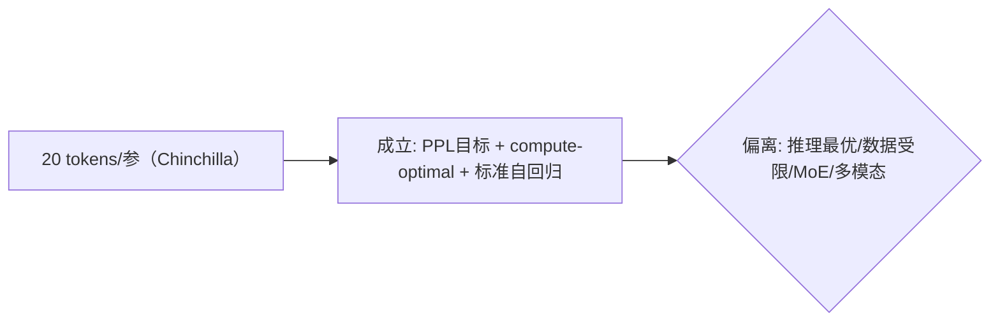

**面试要点**：20 这个数来自 Chinchilla 的 compute-optimal；成立条件是"语言 PPL + 预算最优"；一旦目标、架构或数据变了，就会偏离。

---

## Q4. 算力预算翻 10 倍，按 Chinchilla 最优，参数量与 token 数各应增加多少倍？`N^* ∝ C^0.5`、`D^* ∝ C^0.5` 的直观含义是什么？

**回答**

**按 `N^* ∝ C^0.5`、`D^* ∝ C^0.5` 来算**：C 变成 10 倍 → N 和 D 各自变成 `10^0.5 ≈ 3.16` 倍。

**验算一下**：`6 × (3.16N) × (3.16D) ≈ 6 × 10 × ND = 10C` ✓，对得上。

**这个结论的直观含义**：

- 算力是**开平方根地**转化到规模上的——你想让参数量翻 3.16 倍，得把算力翻 10 倍（收益是次线性的，loss 的下降速度就是那条幂律）；
- N 和 D 的指数都是 `^0.5`，是**对称**的，这说明在 compute-optimal 下，加参数和加数据带来的边际收益**差不多**——所以两者应该手拉手一起扩。

```python
import math
C0, C1 = 1, 10
r = (C1/C0)**0.5
print(f"C×10 → N、D 各 ×{r:.2f}")
# 检查 6*N*D = 6*(3.16N)*(3.16D) = 10*C
```

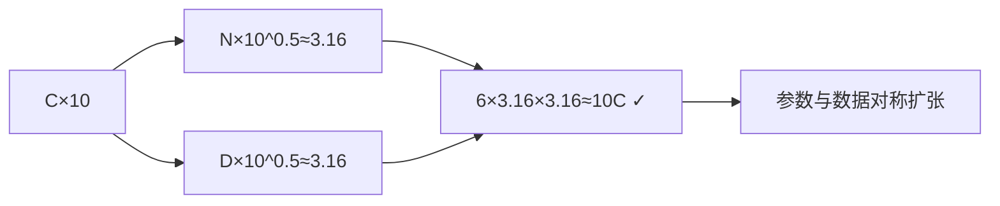

**面试要点**：C×10 → N、D 各 ×3.16；含义是参数和数据的边际收益对称、增长次线性（指数 0.5）。

---

## Q5. 拟合 Scaling Law 通常用哪几个变量？`L(N,D) = E + A/N^α + B/D^β` 中每一项的物理含义是什么？

**回答**

**用哪几个变量**：最常见的做法是用 **loss（L）** 去对 **参数量（N）** 和 **token 数（D）** 做拟合；有时候也会用算力 C 的代理量（也就是 `6ND`）来帮忙。

**公式里三项各是啥意思**：

- `E`：**不可约损失（irreducible entropy）**——就是数据本身带来的"底噪"（比如自然语言本身的熵），哪怕 N、D 都大到无穷，loss 也压不下去的那块地板；
- `A/N^α`：**模型容量项**——参数越多 loss 越低，指数 α 控制着"容量收益"有多灵敏（α 越大越敏感）；
- `B/D^β`：**数据规模项**——数据越多 loss 越低，指数 β 控制着"数据收益"；
- （至于两项之间的互作或残差，通常就并入这两项里，或者再补一个系数。）

**一句话翻译这三项**：它就是"语言的底噪" + "模型大小的收益" + "数据量的收益"三者之和。

```python
import math
def L(N, D, E=1.0, A=400, B=400, alpha=0.34, beta=0.28):
    return E + A/N**alpha + B/D**beta
for N in (1e6, 1e8):
    print(f"N={N:.0e}: loss={L(N, 1e10):.3f}")
```

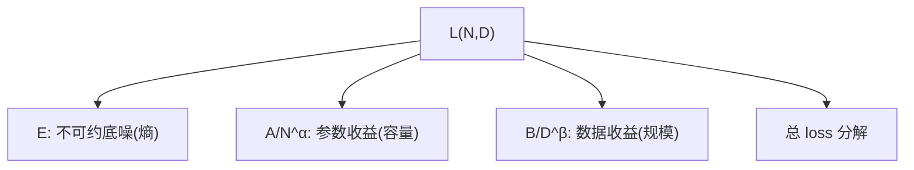

**面试要点**：变量是 N、D（外加 C）；E 是底噪、`A/N^α` 是容量收益、`B/D^β` 是数据收益。

---

## Q6. 如何用少量小规模实验（1M、10M、100M 参数）外推 10B 模型的 loss？外推失效的常见原因有哪些？

**回答**

**具体怎么操作**：

- 先在小参数量上（比如 1M、10M、100M），每个规模再配几档不同的数据量，各训一批小模型；
- 用这些结果去拟合 `L(N, D) = E + A/N^α + B/D^β`，把 `(E, A, α, B, β)` 这几个参数解出来；
- 再把 `N=10B` 和预算对应的 `D` 代进公式，**预测大模型的 loss**——Chinchilla 和 Scaling Laws 那一批文献，正是这么干的。

**那为什么外推会失效？** 常见的坑有这几条：

1. **架构/结构和外推目标对不上**：小模型和大模型的超参（深度/宽度比、学习率、batch）不一样，拟合的时候又没把它们固定住；
2. **数据变了**：小实验用的数据和大训练用的数据，配比、质量不一样（Q9）；
3. **拟合区间之外乱外推**：幂律只是一种近似，当 N 跨越三个数量级（从 1M 到 10B）时，指数本身都可能漂移；一旦超出拟合区间，模型就不灵了；
4. **超参没对齐**：不同规模用了不同的 lr、优化器或 epoch → 收敛程度不一致；
5. **训练不足/欠拟合**：小模型没训够，loss 还没进入幂律区，外推自然失真。

```python
# 拟合小模型 → 外推大模型（示意）
def fit_and_predict(E, A, alpha, B, beta, N_big, D_big):
    return E + A/N_big**alpha + B/D_big**beta
print("预测 10B loss ≈", round(fit_and_predict(1.0, 400, 0.34, 400, 0.28, 1e10, 1e11), 3))
```

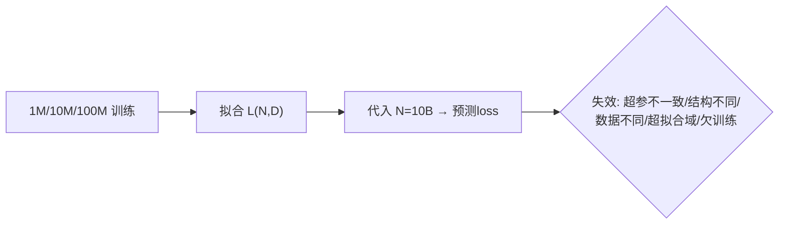

**面试要点**：先拿小模型学出幂律，再往外推；失效的原因无非是"超参/结构/数据/拟合域对不上"这几类，再加上没训够。

---

## Q7. Chinchilla 最优是"训练最优"，但推理成本呢？如果考虑部署成本，最优的 `N` 与 `D` 会如何偏移？

**回答**

先把两个"最优"分清楚：

- **训练最优（compute-optimal）**：在"训练算力 C 固定"的前提下把 loss 压到最小（此时 N≈D，比较均衡）；
- **推理成本考虑**：模型一旦部署，**每生成一个 token 都要付出资源**（读权重、带 KV、算延迟）——而推理成本是和 **N（参数量）成正比的**（decode 时要遍历权重，第 5 章会细讲）。

**那推理最优会让 N、D 往哪边偏？**

- 跟训练最优比，推理最优倾向于**参数更少 + 训练 token 更多**（`N` 往下走、`D` 往上走）：说白就是用"训练更久一点"去换"推理时权重小一点"；
- 因为推理是**被反复使用**的（训一次、推亿次），花钱是按"推理次数 × N"算的 → N 的边际成本被放大了 → 结论自然就是「**小模型、多喂数据**」；
- 落到实践：那些"怀揣大量 token 的小模型"（比如 Llama-3 8B 就训了 15T token），正是**出于推理成本考量**、主动偏离 Chinchilla 训练最优的例子（Q8）。

```python
# 训练最优 vs 推理最优的 N/D 偏移
def infer_optimal(C, ratio):
    # 训练最优 ~20 tok/param; 推理最优 ~更小N更大D
    return {"train": (C/(6*20))**0.5, "infer_D": (C*50/6)**0.5}   # 示意
print("推理最优: 参数更少、token 更多")
```

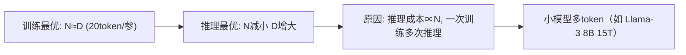

**面试要点**：推理成本跟 N 成正比 → 逻辑就修正成"小参数、多 token"；这就是 Chinchilla 训练最优与部署时最优之间的偏移。

---

## Q8. Llama 系列训练了远超 Chinchilla 最优的 token 数（8B 模型训 15T tokens），是否违反 Scaling Law？如何解释？

**回答**

**不违反，它是故意偏离训练最优的。** 看下面几条就明白了：

1. **目标是推理/部署最优（Q7）**：Llama 家族**压根不追求"固定算力下最低的 PPL"**，它要的是"**在给定的推理算力下，小参数模型能强到什么程度**"——于是用**海量 token** 把小参数模型推到能力上限，这样推理的时候才便宜；
2. **多喂 token 确实能拉高能力**：token 足够充裕时，继续加大 D，loss 的巩固和泛化还是有效的（loss 里的 `B/D^β` 这一项还会继续降，只是斜率低于"参数最优"那种做法）；
3. **还用上了 MoE / 知识蒸馏等手段**：让 token 被更充分地利用（Llama-4 用 MoE，就是"总参大、激活小 + 多 token"这一思路的延伸）；
4. 对大多数用户来说，**部署便宜**远比"理论上的最优"更重要。

**结论**：Chinchilla 追求的是"训练算力最省时的 loss 最小"；Llama 是"绕过训练最优、直奔推理成本"的设计——两者并不打架，只是**目标函数不一样**。

```python
def loss_at(conD, D, N, E, A, alpha, B, beta):
    return E + A/N**alpha + B/D**beta
print("N=8B,D=15T loss:", round(loss_at(None, 15e12, 8e9, 1, 400, .34, 400, .28), 3))
print("→ 明显低于 D=2T（训练更贵但更面向推理的取舍）")
```

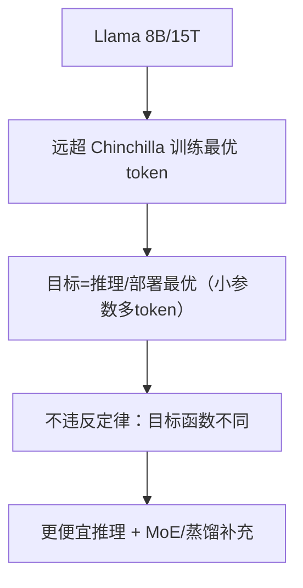

**面试要点**：不违反——**目标从"训练最优 PPL"换成了"推理成本最优"**，token 充裕时牺牲训练最优、换部署便宜。

---

## Q9. Scaling Law 对数据质量是否敏感？数据质量提升时拟合曲线会怎样变化？

**回答**

**非常敏感**。Scaling Law 里的那些系数（α、β、E），都是从**某一特定数据分布**上拟合出来的；同样多的 token，**数据质量高 → loss 就更低**——数据质量就相当于幂律里那个"分母"的质量。

**那数据质量变高，曲线会怎么动？**

1. **不可约底噪 E 往下走**：数据越干净，噪声项越小；
2. **`B/D^β` 这一项相当于"往左挪"**：同样的 D，得到的 loss 更小（好数据相当于白送你一些"有效 token"）——可以把它理解成数据轴被**压缩/平移**了：`D_eff = q^γ·D`（q 就是质量）；
3. **指数 β 不一定变**：曲线的形状（幂指数）通常挺稳，变的往往是截距或者位置；
4. **高质量数据带来加速**：质量一提高，每个 token 的"收益"就变大 → **同样的预算下 PPL 更低，或者到同样的目标需要更少的 token**——这也是"清洗数据比闷头堆量更值"的根据。

```python
def loss_quality(D, q, E, A, N, alpha, B, beta):
    Deff = q**0.5 * D          # 质量等价拉升有效 token（示意）
    return E + A/N**alpha + B/Deff**beta
print("低质(q=1):", round(loss_quality(1e10, 1, 1, 400, 1e8, .34, 400, .28), 3))
print("高质(q=2):", round(loss_quality(1e10, 2, 1, 400, 1e8, .34, 400, .28), 3))
```

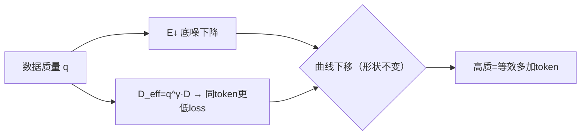

**面试要点**：数据质量会改变 E（底噪），并等效地放大 D（有效 token）；曲线是整条往下移，而不是形状变了。

---

## Q10. 什么是 emergence 现象？Scaling Law 的平滑幂律与能力涌现之间是否存在矛盾？

**回答**

**Emergence（涌现）指的是**：规模一旦超过某个**临界点**，某些能力会从"几乎为零"**突然一下跳到**明显水平（下游指标出现断崖式的变化，比如从基本乱答到能解多位数算术、从不会到会做某类推理题）。这种突变，**用平滑的幂律是解释不了的**——小规模上指标一直稳稳是零，根本不像幂律预测的那种连续增长。

**那它和幂律矛盾吗？** 其实不矛盾，关键在于分清两个层面：

- **两者不在同一个层面上打架**：一直存在的那条平滑幂律，刻画的是**连续指标**（loss/PPL）；而**涌现通常出现在离散的下游指标**里（答对/没答对、通过/没通过这类）；
- **核心解释**：下游的"涌现"，往往是**幂律 loss → 下游指标 的非线性映射**造成的——loss 平滑地降到某个阈值附近后，映射到"通过/不通过"这种判断时，就表现出**像 sigmoid 那样的阈值突变**，看起来像是"涌"出来的；但底下的 loss 始终是平滑幂律；
- 所以"平滑的 loss + 看起来很陡的指标"完全自洽：涌现是**指标的非线性**，不是 loss 本身不平滑。

```python
import math
def downstream_acc(loss):
    # 幂律 loss → 通过率的阈值型映射
    return 1/(1 + math.exp(-15*(0.5-loss)))
for l in (0.49, 0.51, 0.54):
    print(f"loss={l:.2f} → 下游通过率 ≈{downstream_acc(l):.0%}")
# loss 从 .49 → .51 只是小变化, 通过率却从~46%→~54%→88%（突变观感）
```

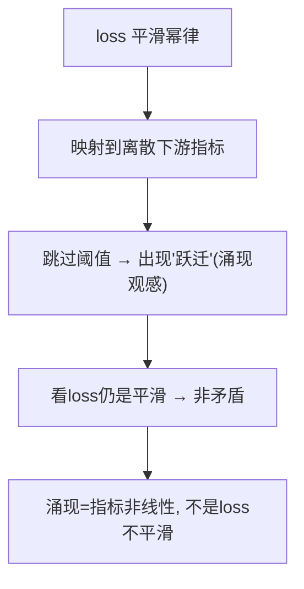

**面试要点**：涌现是**下游离散指标**出现的阈值突变；底层 loss 是平滑幂律——两者通过"非线性的指标映射"衔接起来，并不矛盾。

---

## Q11. 给定 `C = 6ND`，如果 `N=10B`，Chinchilla 最优下 `D` 约为多少？训练总 FLOPs 约为多少？

**回答**

按 Chinchilla 的 compute-optimal（比例取 20 tokens/参左右）来算：

- `D ≈ 20 × N = 20 × 10e9 = 200e9 = 200B tokens`；
- `C = 6ND = 6 × 10e9 × 200e9 = 1.2e22 ≈ 12 ZFLOPs`（这里 1 Z = 1e21）。

```python
N = 10e9
D = 20 * N
C = 6 * N * D
print(f"N=10B → D≈{D/1e9:.0f}B tokens, C≈{C/1e21:.1f} ZFLOPs (6ND)")
```

```text
N=10B → D≈200B tokens, C≈1.2e22 ≈ 12 ZFLOPs (6ND)
```

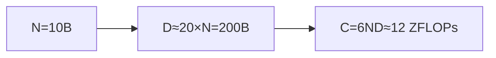

**面试要点**：Chinchilla 比例取 20 → D≈200B；`C=6ND≈1.2e22 FLOPs`。

---

## Q12. 多模态模型、MoE 模型的 Scaling Law 与 Dense 语言模型有何不同？激活参数量还是总参数量进入幂律？

**回答**

**先说 MoE 的情况**：

- 更合理的是让**激活参数（active params）进入幂律**——因为推理和训练花的 FLOPs，是由**激活部分**决定的；
- 但**总参数的"容量/记忆"作用也会进来**（总参越多，在同样激活下 loss 越低）——业界的做法是**把 active 和 total 一起用**（也就是 `loss(active, total, data)`），或者干脆只用 active 版的 `C≈6·active·D`；
- 倾向性的结论是：**loss 对"激活参数 + 数据"的幂律依然成立**，总参则作为一个额外的强因子（质量因子）。

**再看多模态**：

- 每个模态的**数据规模 D 不一样**（图像/音频 vs 文本），得按模套**各自的幂律**；
- compute-optimal 变得复杂起来：文本的 token、图像的 patch 这些**不同的数据单位**，对应着不同的 loss 项；
- 跨模态之间对齐/互操作有独立的开销，并不是简单的一条幂律能打发的。

**整体结论**：MoE 用**【激活参数】作为跟 FLOPs 相关的幂律变量（总参当质量项）**；多模态则要做 **per-modality（按模态）的分解**。

```python
def moe_scaling(active, total, D, E, A, alpha, B, beta):
    return E + A/active**alpha + B/D**beta + 0.1/total**0.1   # 总参弱项
print("MoE 激活幂律 + 总参弱项；多模态按模态分解")
```

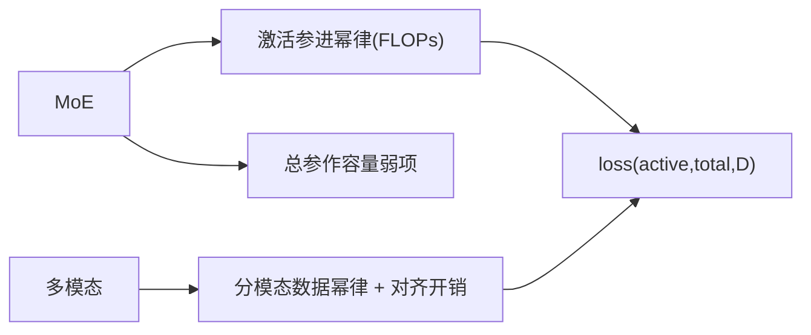

**面试要点**：MoE 拿激活参数做跟 FLOPs 相关的变量（总参当质量项）；多模态则要按模态分别拆开数据项。

---

## Q13. 学习率与 batch size 是否也需要随模型规模按 Scaling Law 调整？有哪些经验规则？

**回答**

**需要调，但它不是唯一的变量**：训练超参（lr、batch）随规模一起变，能让"曲线"保持稳当；文献里的建议，基本都绕不开 **"μP（maximal update parametrization，最大更新参数化）/ critical batch（临界 batch）"** 这一套思想。

**几条经验规则**：

1. **batch size**：用 **critical batch size** 来定——`B_crit ≈ B^*·(loss 下降)`；batch 一变大，损失函数的一次机会变异大约就是 `≈ B/B_crit`；大模型可以用更大的 batch（比如 0.5M–4M tokens），只要 loss 曲线别崩就行；
2. **学习率**：大致满足 `lr_max ≈ (B/B_crit) 的函数`——**batch 越大，lr 就得越大**（经验上按 `lr_coeff·(B/B_crit)` 走），或者干脆把大模型的 lr 从 3e-4 调到 1e-3；
3. **warmup**：随模型规模一起增长（warmup 步数占训练总步数的比例，会随规模变化）；
4. **更精细的做法**：用 **μP** 保证超参跨规模都稳定（最大更新参数化），或者先在小规模上把超参扫一遍、再外推。

```python
def lr_batch_rule(B, B_crit, lr_base=3e-4):
    return lr_base * (B/B_crit)**0.5   # 经验：batch↑ → lr↑（次线性）
for B in (2e5, 1e6, 4e6):
    print(f"B={B:.0e}: 建议lr≈{lr_batch_rule(B, 2e5):.2e}")
```

```text
B=2e5: 建议lr≈3.00e-04
B=1e6: 建议lr≈6.71e-04
B=4e6: 建议lr≈1.34e-03
```

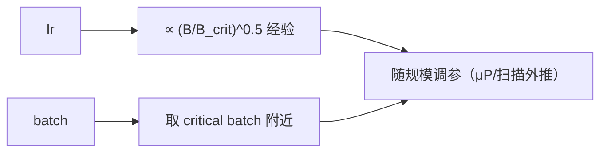

**面试要点**：batch 取 critical batch（可以随规模增大）、lr 随 batch 一起变大（次线性的经验公式）、warmup 随规模走；μP 能让超参跨规模保持稳定。

---

## Q14. 小规模实验显示 loss 已进入"不可约损失"平台时，外推到大模型这个平台会平移吗？

**回答**

**可能会平移（也就是降低）**，原因有这么几层：

- 那个"不可约损失 E"，本质上是从小规模拟合出来的**一个参数**——它取决于**数据分布和模型容量的极限**；
- 大模型**容量更大，能更好地逼近数据分布** → 同样的数据下，大模型能达到更低的"实际底噪"（即便 E 的估计机制没变，容量一上来，那个"有效不可约项"也会跟着降）；
- 但也可能有反方向：如果**数据本身熵很高**（噪声大），E 自然也高——这时平台就是被数据拽着，不会因为 N 大了多少而大幅下降；
- 结论：**E 在大模型上通常会更低一些（不会原样卡死在那个平台上）**——但能降多少，还是受数据质量的限制（Q9/Q17）。

```python
def plateau_shift(N, E_data):
    return E_data + 2.0/N**0.5     # 大模型 → E 降低（数据质量下界）
for N in (1e6, 1e11):
    print(f"N={N:.0e}: 平台值≈{plateau_shift(N, 1.0):.4f}")
```


**面试要点**：小模型的平台 ≠ 大模型的平台——容量一提高，E 就会往下挪；但最终还是被数据熵这个下界兜着。

---

## Q15. 如何设计 Scaling 实验的网格？模型规模、数据规模、学习率各取几个点才能可靠拟合？

**回答**

**设计原则**：要**把 N 和 D 的乘积网格一起扫**（别只变其中一个），同时把超参保持在一个能解释的范围内：

- **模型规模 N**：取 3–5 个点（按等比/对数刻度来，比如 1M/4M/16M/64M/256M），覆盖大约 2 个数量级；
- **数据规模 D**：每个 N 再配 **3–5 档 token 总量**（比如 100M/500M/1B/5B），让 (N,D) 形成一个**因子设计**（不一定要全组合，可以用"对角线扫描"来降成本，但前提是得能同时把两个幂都拟合出来）；
- **学习率**：每个 (N,D) 组合都做一次 **peak lr 扫描**（比如 1e-4 / 3e-4 / 1e-3）；最好用 μP，或者"按相对数据量推出最优"，来减少搜索的维度；
- **batch**：固定 critical batch，或者让它随 D 同步变化；
- **词表/其他配置**：tokenizer 和架构都得保持一致（对应 Q6 里那些失效点）。

**想可靠拟合，经验是**：

- 至少要有 **10–20 个 (N,D) 点**（30 个以上更稳）；
- 用**对数空间**来扫描；至于到底用"最后一步 loss"还是"最优 loss"，前后口径要统一（Q16）；
- 验证一下**拟合残差**和外推效果（留一部分点专门用来做外推检验）。

```python
import itertools
def design_grid(Ns, Ds):
    return [(n, d) for n in Ns for d in Ds]   # 全因子（或取对角子集）
print(len(design_grid([1e6,4e6,16e6], [1e8, 1e9])))
```

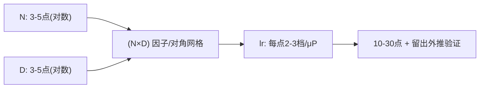

**面试要点**：N×D 网格（各 3–5 个点、按对数取）+ peak lr 扫描；20 个点以上才比较可靠，还要留出点来做外推验证。

## Q16. Scaling Law 的拟合为什么通常用"最后一步 loss"而不是"最优 loss"？两者在高学习率下有何差异？

**回答**

**为什么大家爱用最后一步 loss**，有三个实际好处：

1. **可复现、也稳定**：最后一步 loss 是**训练结束那一刻的确定值**，省得为了找"最优 loss"还得回头去扫训练过程中每一个窗口；
2. **对计算友好**：拟合时只要记"终止那一步"就行，不用把一堆 best checkpoint 都存下来；
3. **口径一致**：各个规模都用同一套终止规则，幂律里的那些变量才好对齐。

**到了高学习率下，两者会拉开差距**：

- **最后一步 loss** 只是终点的一个快照（有可能**还没收敛**——lr 大的话，末尾还在那儿上下抖）；
- **最优 loss（训练过程中的最小值）** 更接近"这个 (N,D) 能达到的上限"——lr 大时训练会先冲过头再回落，所以理论上最优 loss 可能更低；
- **大 lr 时的差距**：最后一步 loss > 最优 loss（因为大 lr 带来的噪声和过冲）；小 lr 时两者就比较接近了；
- 所以如果用的是最后一步，不同 lr 会**污染幂律拟合**（各规模收敛程度不一样）——因此拟合时要么**保持统一的 lr 策略**，要么就采用那种"收敛已经充分、再取最后一步"的口径。

```python
# 大 lr: final loss > min loss; 小 lr: 接近
print("大lr: final(高) vs min(低)→差大; 小lr: 两者接近")
print("拟合口径须统一（都用final或都用min）")
```

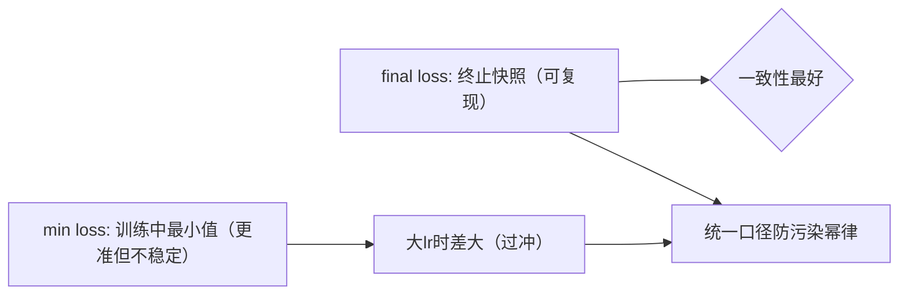

**面试要点**：final loss 可复现、口径也统一；min loss 更准，但大 lr 时两者差得不少——拟合的时候必须把口径固定住。

---

## Q17. 数据受限场景下（高质量 token 不够），Scaling Law 应如何修正？重复训练数据如何影响幂律指数？

**回答**

**数据受限时怎么修正**：

- 有效 token 得打上**质量/多样性的折扣**：记作 `L(N, D_eff)`，其中 `D_eff = q·D`（q 就是质量因子，见 Q9）；
- 如果 D 实在加不上去，那最优策略就转向**提升数据的多样性、做好去重**（第 10 章的内容），把 q 抬上去，而不是硬堆 D；
- 推理预算固定时，数据受限的情况下**应该把 N 减下来**（小模型在有限 token 下更快摸到平台）——这就偏离了 Chinchilla 那种"N↔D 均衡"的思路。

**那重复训练数据会怎样**：

- 简单重复（同一份数据反复训）**并不等于新数据**——第 2 遍对 loss 的边际收益会**断崖式锐减**；
- 反映在幂律指数上：重复会让 D 的**有效指数 β 变小**（看起来像是"幂律失灵"）——第 k 遍的数据，其实只贡献了 `D/k^γ` 的有效量；
- 经验上：**在高 token 预算下，重复训练明显低效**，甚至会把噪声也记进去、导致过拟合 → 所以得限制重复次数（Llama 也就是把数据重跑几遍而已）。

```python
def loss_repeated(D, rep, E, A, N, alpha, B, beta):
    Deff = D / (rep**0.6)          # 重复 → 有效数据缩水（示意）
    return E + A/N**alpha + B/Deff**beta
for rep in (1, 2, 4):
    print(f"重复{rep}遍: loss≈{loss_repeated(1e10, rep, 1, 400, 1e8, .34, 400, .28):.4f}")
```

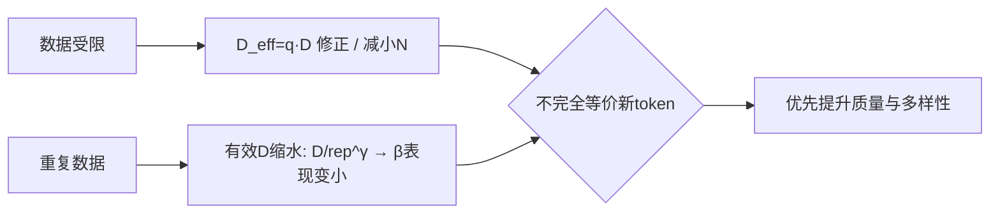

**面试要点**：受限时用 `D_eff` 修正、可以减 N；重复会让有效的 D 缩水（β 变小），它并不等价于新的 token。

---

## Q18. "推理最优"与"训练最优"如何取舍？固定推理预算时，应选更大模型配更少 token，还是更小模型配更多 token？

**回答**

- **训练最优（Chinchilla）**：固定的是训练算力 → 追求 N≈D 的均衡（每参数 20 token）；
- **推理最优**：固定的是**推理预算**（每 token 的推理成本正比于 N）→ 推理时掏的是 **N × 请求次数**，所以自然偏向**参数更小 + 训练 token 更多**：训练好歹是一次性的，推理却是无数次——省下 N，省的就是"每一次推理"的成本。

**结论**：在固定推理预算下（假设推理总成本 = 权重开销 × 请求数），应该选**较小的模型配较多的 token**——一直用到"token 多到边际收益已经低于再用下一个更大模型"的时候，才换成更大的 N。

**给个直觉**：推理最优的 D/N 通常比训练最优的更大（也就是更偏"多 token/参"）；小模型"被训得更透"，换来的是"推理更便宜"。

```python
def infer_cost(N, requests, bytes=2):
    return N*bytes*requests   # 推理总成本 ∝ N×请求数
N_options = {"7B": 7e9, "13B": 13e9}
reqs = 100e6
for k, N in N_options.items():
    print(f"{k}: 推理成本≈{infer_cost(N, reqs)/1e12:.0f} TB读（显然N小则低）")
```


**面试要点**：推理成本正比于 N → 固定推理预算时该选**小参数、多 token**；而训练最优则是 N≈D。

---

## Q19. 如何判断一个模型已经"过参数化"或"欠训练"？从 loss、下游指标、训练 token 数三者关系分析。

**回答**

- **过参数化（over-parameterized / 欠训练）**：**模型容量 > 数据**——给定了 N，D 却太少。怎么判断：**训练 loss 还没收敛**（或者训练/验证 gap 很大）、继续加 token 依然能看到 loss 往下掉的斜率；对照 Scaling Law 就是 `D < 20×N`（或者离 compute-optimal 差得远）；再就是**下游指标没跟上**它这个参数级别本该达到的水平。
- **欠参数化（under-parameterized）**：D 相对 N 太多了，在 D 这一侧早就平了 → 加数据收益小，该去加参数了。

**具体看这几个指标**：

1. **训练 loss 与 scaling 预测值的差距**：差得大 → 配置失衡；
2. **train/val gap**：gap 大（训练好、验证差）→ 可能是过头了（数据重复/过拟合那条线）；
3. **继续加 D 的收益曲线**：还在往下滑 = 欠训练；已经平了 = 过参数化；
4. **下游位次**：拿它的 benchmark 成绩跟同参数规模的标杆比比看。

```python
def is_undertrained(N, D):
    ratio = D/N
    if ratio < 15: return "过参数化(欠训练): 数据 < 20token/参"
    if ratio > 40: return "欠参数化(数据充裕): 加参更划算"
    return "接近 compute-optimal"
for N, D in [(1e10, 1e11), (1e10, 5e11)]:
    print(f"N={N/1e9:.0f}B D={D/1e12:.1f}T → {is_undertrained(N,D)}")
```

```text
N=10B D=100B → 过参数化(欠训练): 数据 < 20token/参
N=10B D=500B → 欠参数化(数据充裕): 加参更划算
```

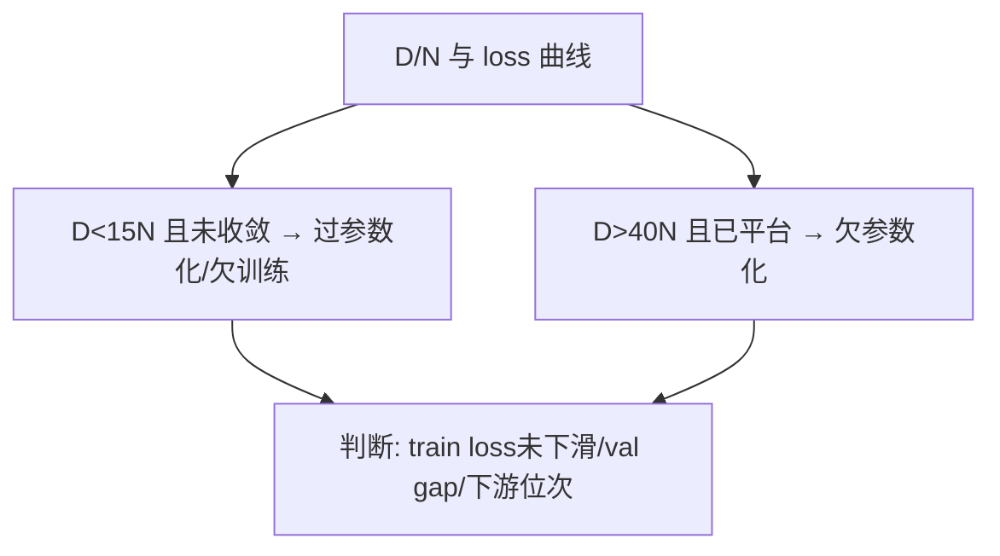

**面试要点**：用 **D/N 比例 + 收敛状态 + 下游位次**这三方面一起来判断，到底是"过参数化（欠训练）"还是"欠参数化"。

---

## Q20. Scaling Law 能否预测下游任务表现（MMLU、HumanEval）？如果不能，缺了什么？

**回答**

**不能直接、精确地预测**——因为 Scaling Law 拟合的是 **loss/PPL**，而下游任务考的是**离散、非线性的映射**（也就是 Q10 说的涌现）。

**缺的东西有这么几块**：

1. **任务特异性**：MMLU/HumanEval 跟 PPL 之间不是个简单函数——不同任务对容量、数据、知识密度的敏感度差得远（在同一个 loss 点上，A 任务可能 50 分，B 任务却能到 90 分）；
2. **对齐/制导**：下游分数还会受 SFT/RLHF（也就是后训练）影响，而 Scaling Law 只约定了预训练的 loss；
3. **数据覆盖**：基准里考的那些特定知识/技能，预训练数据到底覆盖了没有；
4. **涌现阈值**：能力可能突然跃迁（Q10）——幂律的 loss 没法线性外推到指标上去。

**正确的用法**：先用 Scaling Law 预测 loss，再**单独建一条 loss→task 的转换/校准关系**（或者干脆直接对 task 做小规模外推），**千万别拿幂律直接去外推 MMLU**。

```python
def task_from_loss(loss):   # 非线性（示意）
    return max(0, 100*(loss**2.2))   # 非单调/阈值型
print("loss=0.5 → task 分≈?", round(task_from_loss(0.5),0), "（非线性）")
```

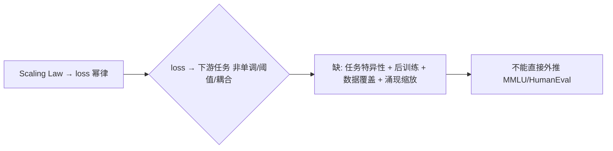

**面试要点**：Scaling 预测的是 loss、不是任务分；缺的是"loss→指标的非线性映射 + 任务特异性 + 后训练 + 涌现"这几样。

---

## Q21. Chinchilla 实验中 70B 模型训 1.4T tokens 击败 280B 训 300B tokens，这个结论对工业界的直接影响是什么？

**回答**

**核心结论**：同样的算力下，**训练数据比参数更值得重视**——70B/1.4T（约每参数 20 token）在多数任务上都赢过 280B/300B（约每参数 1 token），后者属于"欠训练"，容量明明有余，数据却没用够。

**对工业界的直接影响，可以列这么几条**：

1. **放弃"无脑扩大参数"**：改成参数和数据一起扩；训练 token 数从几百 B 一路涨到 T 级；
2. **数据工程的地位显著提升**：你需要**海量高质量、去重、多语种的数据**——数据收集、清洗、配比，反而成了比"堆 GPU 网络"更关键的工程；
3. **算力预算从"全砸给模型"转为"模型 + 数据双份"**：训练成本里，数据获取和过滤的占比明显上升；
4. **重训/继续预训练的决策变了**：更倾向于"把现有数据用足"，而不是"换个更大的模型"（Q26）；
5. 后来的 Llama、Qwen 等等，都印证了这一点——**token 用量被大幅上调**。

```python
C_chinchilla = 6*70e9*1.4e12
C_280b      = 6*280e9*300e9
print(f"70B/1.4T: {C_chinchilla:.1e} FLOPs vs 280B/300B: {C_280b:.1e}")
print("→ 同算力下多token小模型更优")
```

```mermaid
flowchart LR
    A["70B/1.4T 胜 280B/300B"] --> B["数据≫参数（同算力）"]
    B --> C["工业影响: 加大数据工程/多token/重训决策"]
    C --> D["后续模型 token 量大增（Llama等）"]
```

**面试要点**：同样算力下，"数据多于参数"反而赢；它推动了数据工程的地位提升和训练 token 用量的上调。

---

## Q22. 把模型宽度与深度分开看，哪一个对 loss 幂律指数影响更大？有统一结论吗？

**回答**

- **目前是有分歧的**：
  - 一部分工作（Hoffmann/Chinchilla 这一类）是拿"**总参数量**"把宽度×深度整体抽象掉，**不细分**；
  - 另一些更细粒度的研究（比如讲 "Scaling depth vs width" 的）发现，**深度和宽度分开来看，幂律指数并不一样**——通常**深度对 loss 的收益更"昂贵"**（层数更深，就得配更多的层内残差和优化手段），而宽度相对来说更容易往上堆；
- **有没有统一结论？** 目前**没有一个公认的、明确的唯一指数**——在主基调相同的前提下，能观察到一些近似规律：宽度太大 → 过参数化收益就变平了；深度太深 → 收益一开始来得快，但渐渐饱和（而且深度的残差体系本身还有额外成本）；最优的**宽/深比，在不同数据、不同任务下并不固定**（比如 Seq2Seq 和纯 LM 就不一样）；
- 工程上，大家主要还是靠**总参数量 + 深度/宽度比 的联合经验**来定。

```python
def depth_width_scaling(N, alpha_d, alpha_w):
    return {"若深度主导": ..., "若宽度主导": ...}   # 无统一单一指数
print("没有统一唯一指数——深度/宽度分开看收益不同（经验各异）")
```

```mermaid
flowchart LR
    A["深度 vs 宽度"] --> B["深度: 收益初期快/渐饱和/残差成本"]
    A --> C["宽度: 相对易堆/过参化平缓"]
    B --> D["统一指数? 无公论（取决于数据/任务）"]
    C --> D
```

**面试要点**：没有统一指数；通常是"深度收益贵、还会渐渐饱和，宽度好堆、但容易过参数化"，最优的宽深比只能靠经验来定。

---

## Q23. MoE 的 Scaling Law 中，"总参数"与"激活参数"哪个是更好的 scaling 变量？

**回答**

**激活参数（active params）才是 FLOPs/训练成本的正确代理**，所以**它更适合当幂律里的 scaling 变量**：

- **loss 的"本钱"约等于 激活参数 × 数据**（`C ≈ 6·active·D`）：每处理一个 token，真正花钱的是激活的那部分（也就是 FLOPs）；
- **总参数提供的是"容量/记忆"**：同样的激活下，总参越多 → loss 略微更低（知识密度更厚），但它只是个**次级因子**（不能单独当主变量，否则会高估能力——总共 230B、激活 20B 的模型，可不能按 230B 去拟合 FLOPs 的 loss）；
- 相关论文（MoE scaling）的做法是：拟合 `loss(active, total, D)`，或者拿 `active` 当主变量、`total` 作"质量修正"。

**结论**：**激活参数是主 scaling 变量**（它决定计算成本），总参数是次级质量因子；面试时一定要点出这个区分——"显存按 total 算、算力按 active 算"（第 4 章的 Q15）。

```python
def moe_scaling_use(active, total):
    print(f"激活 {active/1e9}B 是 FLOPs 主变量; 总参 {total/1e9}B 是容量弱项")
moe_scaling_use(21e9, 236e9)   # DeepSeek-V2 例
```

```mermaid
flowchart LR
    A["激活参数"] --> B["主导: 决定FLOPs/算力成本(幂律主轴)"]
    C["总参数"] --> D["次级: 容量/记忆(弱项修正)"]
    B --> E["scaling 用 active + total 双因子"]
    D --> E
```

**面试要点**：激活参是主变量（代表计算成本），总参作容量弱项；显存按 total、算力按 active。

---

## Q24. Scaling Law 的指数为什么在不同数据分布、不同分词器下会变化？跨数据集外推可靠吗？

**回答**

**为什么指数会变**：幂律里的系数，是从**某一组特定的 (数据分布, 分词器, 架构)** 上取样拟合出来的——

- 数据的**熵/复杂度**不一样 → "容量收益"的斜率（α）和"数据收益"的斜率（β）就不一样；
- **分词器会改变计数单位的粒度**：token 本身就是"数据单位"，分词器一换 → token 和文本语义之间的对应关系变了，D 轴的含义也就跟着变了（同样是 N 下固定数量的 token，对应的真实信息量其实不同）；
- 架构的后缀（logits 头、激活方式）也会影响 N↔loss 之间的换算。

**跨数据集外推靠不靠谱**：

- **不可靠**：从 Text 外推到 Code、或者从英文外推到多语种，指数和截距都可能漂移；
- **更靠谱的做法**：**必须在新数据上重新拟合（哪怕规模小一点）**，或者用 "Aggregated scaling" 把多个数据集联合起来拟合；
- 等把索引/单位统一了（同样的 tokenizer、同样的指标），**同一分布族内部是可以外推的**；跨分布就得小心了（Q29 多语言里问的是同一个事）。

```python
def fit_index(domain):
    return {"英文": 0.34, "代码": 0.28, "多语": 0.30}.get(domain)
print("不同数据域的 α 不同 → 跨数据集直接用不可靠")
```

```mermaid
flowchart LR
    A["数据分布/分词器/架构"] --> B["影响幂律指数 α,β"]
    B --> C["指数随域漂移"]
    C --> D["跨数据集外推不可靠 → 需重新拟合/同族内"]
```

**面试要点**：指数依赖数据分布和分词器；跨数据集直接套用不可靠——得在同一分布族内重新拟合。

---

## Q25. 训练 loss 突然偏离 Scaling 预测曲线，通常意味着什么？数据污染、架构改动、数值问题如何区分？

**回答**

**偏离意味着什么**：loss 跟拟合曲线出现了**系统性的错位**（不再按幂律走），说明某个假设已经失效了。排查时可以从这几个方向下手：

1. **数据污染**：验证/测试集跟训练数据重叠了（模型已经见过同类题目）→ **验证 loss 异常下降、训练-验证 gap 缩小**；特征是：loss 异常低 + 对应 benchmark 分数虚高；
2. **架构改动**：动了层数/宽度/归一化/位置编码 → **scaling 的常数或指数会变**（曲线整体平移，或者斜率变了）；特征是：改动之后从头收敛的状态还一致，但幂律的截距漂了；
3. **数值问题**：lr 爆炸、出现 NaN/inf、loss scale、梯度裁剪过头 → **loss 会在某个规模上突然跳变/回弹**；特征是：大规模或低精度时冒出 NaN，loss 曲线来回震荡；
4. **评估口径**：测的到底是 train loss 还是 val loss，指标有没有统一（Q16）。

**怎么区分**：就靠控制变量——**固定架构、换数据**（用来查污染：看 gap 和分数）、**固定数据、换架构**（看幂律常数）、**查数值**（看 NaN/lr/scale）。

```python
def diagnose(d_val_gap, benchmark_score, snan):
    if d_val_gap < 0.05 and benchmark_score > 0.9: return "数据污染/重叠"
    if snan:                                      return "数值问题(NaN/lr)"
    return "架构改动/scaling常数偏移"
print(diagnose(0.03, 0.95, False))
```

```mermaid
flowchart TB
    A["loss 偏离曲线"] --> B{"gap很小+分数虚高?"} 
    B -->|是| C["数据污染"]
    A --> D{"NaN/震荡/回弹?"} --> E["数值问题"]
    A --> F{"整体平移/斜率变"} --> G["架构改动"]
    B --> H["控制变量区分"]
```

**面试要点**：污染 → gap 小 + 分数虚高；架构 → 平移/斜率变；数值 → NaN/震荡；用"固定一维"的办法来区分。

---

## Q26. 如何用 Scaling Law 指导"是否继续训练一个已有模型"的决策？继续训练的边际收益如何估算？

**回答**

**决策分这么几步走**：

1. **先给它定位**：把当前这个 `(N, D_trained)` 在拟合曲线上找到对应的位置——再训 ΔD 之后，loss 大致会降多少，约等于幂律上的增量 `∂L/∂D·ΔD`；
2. **算边际收益**：`loss(D+ΔD) − loss(D)`——这就是"沿着继续训练这条路"能捞到的收益；
3. **拿去跟替代方案比**（换更大的模型 / 提数据质量 / 做微调）：
   - 如果 `∂L/∂D` 已经很平了（数据收益的幂律快到尾巴了）→ 那还不如加参数，或者去提数据质量；
   - 如果 D 离 optimal 还很远、斜率还很陡 → 继续训，是有回报的；
4. **数据质量 ≠ 数量**：如果瓶颈卡在质量上，堆更多 D 收益很小，应该先去过滤/配比（第 10 章）；
5. **留意重复训练**：如果同一批数据已经训过了 → 有效的 D 会缩水（Q17）。

```python
def margin(D, delta, N, E, A, alpha, B, beta):
    Ld = E + A/N**alpha + B/(D+delta)**beta
    L  = E + A/N**alpha + B/D**beta
    return L - Ld
print("继续训 ΔD=1T 的收益:", round(margin(1e12, 1e12, 1e10, 1,400,.34,400,.28), 4))
print("若收益<0.05 → 考虑换增加参数/数据质量")
```

```mermaid
flowchart LR
    A["当前(N,D) 位置"] --> B["估算 ∂L/∂D·ΔD（继续训练收益）"]
    B --> C{"与换模型/提质量对比"}
    C --> D["斜率陡 → 可继续训"]
    C --> E["斜率平/质量瓶颈 → 换路线"]
```

**面试要点**：用幂律的导数估算 ΔD 带来的收益斜率；再跟"换更大的模型 / 提数据质量"比一比性价比，来做决策。

---

## Q27. 合成数据是否改变了 Scaling Law 的适用边界？什么条件下合成数据可以"替代"真实 token？

**回答**

**适用边界（有条件地适用）**：

- 如果合成数据**分布跟真实数据一致、而且带来了新信息**（比如代码生成、推理链的自生成），那它可以被建模成**更高密度/更高质量的 token**（也就是 `D_eff = q·D` 里的 q 大）——Scaling Law 依然适用（只不过"数据的特性"变了）；
- 但如果合成数据**只是在重复已知分布、毫无多样性**（比如一个自回归模型在那儿复读自己），那就是**低信息密度**（`D_eff` 小），甚至会闹出"污水循环"、分布塌缩（模型越训越同质化）。

**想用它"替代"真实 token，得满足这些条件**：

1. **覆盖真实分布，并且**保证多样性（去重/版本要多样）；
2. **质量可校验**（靠自蒸馏或强教师），用在那些**数据稀疏但合成可控**的领域（代码、数学、程序验证）；
3. **有信息增益**（不是在复制训练集），还得有难度分布（用 self-play 不断升级难题）；
4. 它是真实数据的**补充，而不是全部**（得混合着来）。

**结论**：合成数据改变的是幂律里"数据质量/信息"的那个系数，而不是定律本身；盲目地合成反而会塌缩（第 10 章的 Q16）。

```python
def synth_eff(D_synth, diversity):
    return D_synth * (0.3 if diversity < 0.5 else 2.0)
print("高多样性合成 → D_eff 放大；低多样性 → 缩水/重复")
```

```mermaid
flowchart LR
    A["合成数据"] --> B{"信息增益/多样性?"}
    B -->|是| C["D_eff 放大（质量更高）→ 幂律仍适用"]
    B -->|否| D["重复/塌缩（D_eff 缩水）"]
    C --> E["合成≠等价真数据：按有效信息入幂律"]
    D --> E
```

**面试要点**：合成数据改的是幂律里的"有效 D"；前提是多样性、可校验、有信息增益；否则就会塌缩。

---

## Q28. 两个模型 A（7B，2T tokens）与 B（13B，1T tokens），仅凭 Scaling Law 能判断谁更强吗？还需要什么信息？

**回答**

**光凭 Scaling Law，没法直接下判断**：

- A：7B/2T（比例约 286 token/参，数据富余、属于欠参数化）；
- B：13B/1T（比例约 77 token/参，数据相对偏少）；
- Scaling Law 只能给出**各自在 (N,D) 下的 loss**：粗算一下两者算力差不多（`6·7·2=84` vs `6·13·1=78`，FLOPs 相近）→ **谁的 loss 更低其实并不确定**（这取决于：(1) 是否在 compute-optimal 附近，(2) 曲线的具体参数）。

**还缺哪些信息**：

1. **数据质量/配比**（是不是同一个分布？A 的数据是不是更多样）；
2. **训练充分度**（两者都收敛了吗？各自离最优还有多远）；
3. **后处理**（有没有做 SFT/RLHF）；
4. **目标**（是要下游任务，还是纯看 loss）；
5. Scaling 曲线的**具体参数**（α、β、E）——同样的"参数/token"，会因为数据不同而有差别。

```python
def losses(N, D):
    E, A, alpha, B, beta = 1.0, 400, 0.34, 400, 0.28
    return E + A/N**alpha + B/D**beta
for n,d in [(7e9,2e12),(13e9,1e12)]:
    print(f"N={n/1e9}B D={d/1e12}T → loss≈{losses(n,d):.4f}")
# 算力相近; loss 高低取决于数据质量与收敛态
```

```mermaid
flowchart LR
    A["A: 7B/2T vs B: 13B/1T"] --> B["同算力 (~80 FLOPs)"]
    B --> C{"谁强看: 数据质量/收敛/后训/目标"}
    C --> D["仅凭 Scaling 不能判定孰强"]
```

**面试要点**：两者算力相近、比例不同——谁更强，取决于数据质量、收敛程度和下游目标；Scaling 只能给出各自的 loss。

---

## Q29. 多语言场景下，Scaling Law 是按语言分别拟合还是统一拟合？低资源语言的幂律指数通常如何表现？

**回答**

- **倾向于分开、或者按语言族来拟合**：
  - 高资源和低资源语言的**数据分布熵不一样** → 用一套统一的 (N,D) 幂律，会把这种差异掩盖掉；
  - 更合理的做法：对每种语言（或语言族）分别拟合各自的 L(D)、L(N)，或者在全局幂律里加一个 **per-language（按语言）的词量和数据占比项**（低资源语言的数据占比低 → 这一项就特别大）。
- **低资源语言一般会怎样**：
  - **有效 token 少 → loss 降得慢（β 的影响被放大）**：数据收益那条幂律，在低资源语言上更像是"过参数化"（也就是 N 相对 D 太大了）；
  - **想改善就必须把它的占比提上去**：用温度采样/欠采样（第 10 章的 Q17）把高资源语言稀释掉、把低资源语言拉起来，等价于"提高低资源语言的 `D_eff`"；
  - 通常**低资源语言的 loss 平台更高**（熵大/数据少），而它的幂律指数对"数据占比"极其敏感。

```python
def multilingual_scaling(D_hi, D_lo, N, E, A, alpha, B, beta):
    return {"高资源": E + A/N**alpha + B/D_hi**beta,
            "低资源": E + A/N**alpha + B/D_lo**beta}
r = multilingual_scaling(5e11, 1e9, 1e10, 1,400,.34,400,.28)
print("高资源 loss:", round(r["高资源"],3), " 低资源 loss:", round(r["低资源"],3))
```

```mermaid
flowchart TB
    A["多语言 Scaling"] --> B["分语言/族拟合（或+per-lang项）"]
    B --> C["低资源: 有效数据少 → 平台高 + 对配比敏感"]
    C --> D["改善: 提升低资源D_eff(升温/欠采)"]
```

**面试要点**：按语言族拟合更稳；低资源语言的有效 D 小 → loss 平台高、对数据配比很敏感。

---

## Q30. 向面试官解释"Chinchilla 之后我们为什么还在训更大的模型"，你会用哪三个论点组织回答？

**回答**

**三个论点，串起来讲**：

1. **目标函数变了（推理最优，Q7/Q18）**：Chinchilla 最小化的是"固定训练算力下的 loss"；而工业界更在乎**部署/推理成本**——一次训练、无数次推理，"小参数多 token"能让每次推理都便宜，所以大家**宁可去训大 token，也不怕偏离训练最优**（Llama-4 用 MoE，把激活进一步降下来）；
2. **能力随总规模增长，不止是语言建模**：更大的模型会带来**记忆/知识密度、长上下文、多模态、推理能力**等等好处，这些并不是单靠一条 loss 幂律就能刻画的（涌现、任务非线性，Q10/Q20）——**在总参上扩张**，依旧能解锁新能力；
3. **数据和算力都在涨**：现实世界里可用的高质量数据和算力，是一年比一年多的，compute-optimal 的**原点本身在移动**（E 和 `D_eff` 都在上升）——在更大的 D 下，"该用多大的 N"这个最优点也跟着往上移；**模型必须跟着长大，才吃得下更大的数据**。

**收个尾**：Chinchilla 不是"别再训大模型了"，而是"在给定预算内怎么分配最优"；在大数据、低成本推理、多能力诉求的背景下，适度地超配（oversizing）依然是有道理的。

```python
def three_args():
    return ("1 推理最优；", "2 能力/涌现/多模态；", "3 数据算力原点在移动")
print(three_args())
```

```mermaid
flowchart TB
    A["还在训更大模型"] --> B["1 推理/部署最优（小参多token也划算）"]
    A --> C["2 更大模型解锁能力（涌现/知识/多模态）"]
    A --> D["3 数据算力原点在移动（最优点上移）"]
    B --> E{"三个论点组织回答"}
    C --> E
    D --> E
```

**面试要点**：三个论点——**目标不同（推理最优）、能力超越 loss、数据算力原点在位移**；最后点明 Chinchilla 是"预算内的分配"，不是"禁止用大参数"。

---

## 参考链接

1. [GPT-5瓶颈本质：Scaling Law失效与Token经济崩溃-CSDN博客](https://blog.csdn.net/aodanchui1057/article/details/102008709)
2. [【Transformer】Scaling_Law_大模型涌现能力的规律-CSDN博客](https://blog.csdn.net/2302_78391795/article/details/166990548)
3. [什么是 Scaling Law？大模型的「涌现能力」是怎么回事？-CSDN博客](https://blog.csdn.net/qq1137623160/article/details/162793672)
4. [幂律的预言：Kaplan 与 Chinchilla 的算力账本 —— Scaling Laws 与最优配比-CSDN博客](https://blog.csdn.net/tsh2005974tsh/article/details/162562453)
5. [09d-斯坦福 CS336 作业三：缩放定律（Scaling Laws）-CSDN博客](https://blog.csdn.net/2301_79239314/article/details/162223644)

---

*下一章展望：第 9 章进入推理系统（Prefill/Decode、KV Cache、PagedAttention、Continuous Batching、投机解码、量化等 35 题）。*