# 第 8 章 · Scaling Laws

> 面试生普（LLM 500 题）· 第 8 章。本章覆盖 Kaplan 2020 vs Chinchilla 2022、compute-optimal、token/参数分配、幂律外推、数据质量、涌现、多模态/MoE scaling 等 30 个问题，关键概念配 Python 代码与 mermaid 图解。

---

## Q1. Kaplan 2020 与 Chinchilla 2022 的 Scaling Law 结论有何关键差异？Chinchilla 推翻了什么实践？

**回答**

- **Kaplan 2020（OpenAI）**：拟合 loss ≈ `E + A/N^α + B/D^β`，发现**模型规模 N 是主导**——算力预算`C`增加时**应优先加参数 N**、数据 D 增长相对缓慢（`N ∝ C^0.73`，`D ∝ C^0.27`）。结论："**训练要偏重参数，数据可以少**"。
- **Chinchilla 2022（DeepMind）**：用更大的拟合集重新标定，发现 **N 与 D 应按**`N ∝ C^0.5`、`D ∝ C^0.5`**等速增长**——即**compute-optimal** 下参数量与 token 数**大致成比例**（共同跨大）。结论："**训练数据要远多于此前实践**（20 tokens/parameter 量级），此前大模型普遍欠训练"。

**Chinchilla 推翻了什么**：
- 推翻了"**增加参数远比增加数据有效**"的结论 → 实践上大量模型训练 token 数大增（如 GPT-3 175B 用 300B tokens < Chinchilla 推荐 ~3.5T）；
- 推翻了"先用小数据训练大模型也划算"的做法 → 转向 **N≈D** 的平衡。

```python
def alloc(C):
    return {"kaplan_N": C**0.73, "kaplan_D": C**0.27,
            "chin_N": C**0.5, "chin_D": C**0.5}
print(alloc(10))  # 算力↑10倍: Kaplan 主要加参, Chinchilla 双加
```

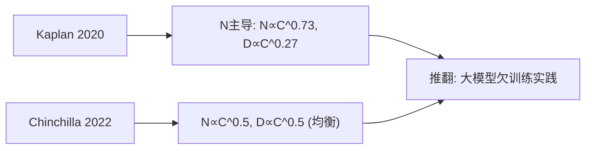

**面试要点**：Kaplan 参数主导；Chinchilla N≈D；关键差异="算力预算如何分配 N/D"。

---

## Q2. Chinchilla 的 compute-optimal 结论用一句话概括是什么？固定算力 `C` 下，参数量 `N` 与 token 数 `D` 大致按什么比例分配？

**回答**

**一句话**：**在给定算力 C 下，参数量与训练 token 数应按相似比例扩张，两者对 loss 的贡献几乎对称**（`N^* ∝ C^0.5`，`D^* ∝ C^0.5`）。

**分配比例**：固定 C ≈ `6ND`，最优时：

- `N^* ≈ (C/(6·k))^0.5`，`D^* ≈ (C·k/6)^0.5`，其中 `k` 是目标 token/参数比；
- 经典数：**约每参数 20 tokens**（C ≈ 6ND，D/N≈20 是常见经验值），但随算力不同略有波动。

```python
import math
def chinchilla(C, ratio=20):
    N = math.sqrt(C/(6*ratio))
    D = math.sqrt(C*ratio/6)
    return N, D, 6*N*D   # (参, tok, 实际FLOPs)
N, D, flops = chinchilla(1e24)
print(f"C=1e24: N≈{N/1e9:.0f}B 参, D≈{D/1e12:.1f}T tok, 6ND≈{flops:.1e}")
```

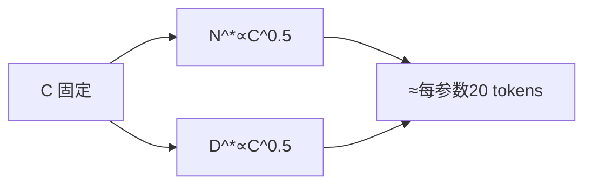

**面试要点**：compute-optimal="N 与 D 等速缩放"；比例≈每参数数十 token（20 量级）。

---

## Q3. "20 tokens per parameter"这个经验法则从何而来？什么条件下成立，什么条件下会偏离？

**回答**

**来源**：Chinchilla 在固定算力 `C≈6ND` 下，拟合 loss 对 `(N,D)` 的最优分配，得到 **compute-optimal 下 D/N 约为常数**（常见的 ≈20 tokens/参，用于引言里的"一条规则"）。

**成立条件**：Klinde 是**语言建模 loss（PPL）为目标** + **compute-optimal（预算已定）** + **标准自回归** + 成熟数据质量。

**偏离条件**：

1. **目标不是 PPL**：要**推理成本最优**时偏大模型少 token（Q7/Q18）；要更强下游能力时可能偏小模型多 token；
2. **数据质量受限**：高质量 token 不够 → 被迫少 token（Q17）；
3. **架构不同**：MoE 用**激活参数**算（Q12）；多模态/代码等能力配比不同；
4. **没有最优预算**：若算力无限增长，比例本身也会随 C 缓慢漂移；不同数据域（代码、多语言）最优比例不同。

```python
def tokens_per_param(MODE):
    return {"ppl_optimal": 20, "infer_optimal": 8, "data_limited": 5}.get(MODE, "—")
print("language PPL 最优 ≈ 20/参；按推理/数据受限会偏离")
```

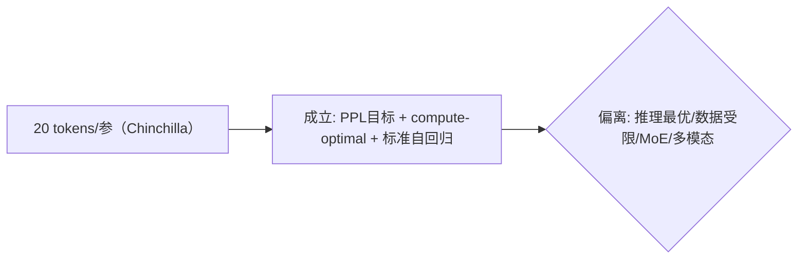

**面试要点**：20 来自 Chinchilla 的 compute-optimal；成立条件=语言 PPL+预算最优；偏离=目标/架构/数据变化。

---

## Q4. 算力预算翻 10 倍，按 Chinchilla 最优，参数量与 token 数各应增加多少倍？`N^* ∝ C^0.5`、`D^* ∝ C^0.5` 的直观含义是什么？

**回答**

**按 `N^* ∝ C^0.5`，`D^* ∝ C^0.5`**：C 变 10 倍 → N、D 各变 `10^0.5 ≈ 3.16` 倍。

**验证**：`6 × (3.16N) × (3.16D) ≈ 6 × 10 × ND = 10C` ✓。

**直观含义**：
- 算力**平方根地**转化到规模——想让参数量翻 3.16 倍需要算力翻 10 倍（收益次线性，`loss` 降速 = 幂律）；
- N 与 D **对称**（都 ^0.5），说明在 compute-optimal 下加参数与加数据的边际收益**相当**——二者应同步扩张。

```python
import math
C0, C1 = 1, 10
r = (C1/C0)**0.5
print(f"C×10 → N、D 各 ×{r:.2f}")
# 检查 6*N*D = 6*(3.16N)*(3.16D) = 10*C
```

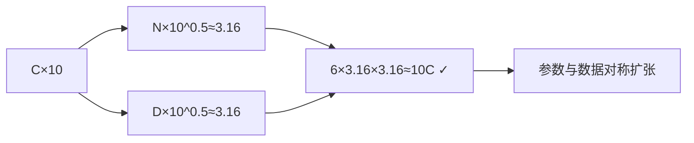

**面试要点**：C×10 → N、D 各 ×3.16；含义=参数与数据的边际收益对称、次线性（0.5 指数）。

---

## Q5. 拟合 Scaling Law 通常用哪几个变量？`L(N,D) = E + A/N^α + B/D^β` 中每一项的物理含义是什么？

**回答**

**变量**：通常用 **loss（L）** 对 **参数量（N）** 与 **token 数（D）** 拟合；也可用算力 C 的代理（`6ND`）。

**公式三项**：

- `E`：**不可约损失（irreducible entropy）**——数据本身的（如自然语言熵），即使 N、D→∞ 也降不下去的底；
- `A/N^α`：**模型容量项**——增加参数降低 loss，指数 α 控制容量收益（越大越敏感）；
- `B/D^β`：**数据规模项**——增加数据降低 loss，指数 β 控制数据收益；
- （互作/残差通常并入这两项或加第三个系数。）

**物理含义**：三部分 = "语言的底噪" + "模型大小收益" + "数据量收益"。

```python
import math
def L(N, D, E=1.0, A=400, B=400, alpha=0.34, beta=0.28):
    return E + A/N**alpha + B/D**beta
for N in (1e6, 1e8):
    print(f"N={N:.0e}: loss={L(N, 1e10):.3f}")
```

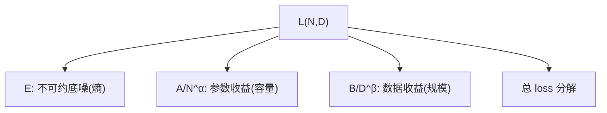

**面试要点**：三个变量 N、D（+C）；E=底噪、A/N^α=容量、B/D^β=数据收益。

---

## Q6. 如何用少量小规模实验（1M、10M、100M 参数）外推 10B 模型的 loss？外推失效的常见原因有哪些？

**回答**

**方法**：
- 在小参数量（如 1M/10M/100M）、各配几个数据量训练一系列小模型；
- 拟合 `L(N, D) = E + A/N^α + B/D^β` 得到 `(E, A, α, B, β)`；
- 用拟合公式**代入 N=10B、D 外推到预算**预测大模型 loss——Chinchilla/Scaling Laws 文献正是这么做的。

**外推失效的常见原因**：
1. **架构/结构与外推不一致**：小模型与大模型超参（深度/宽度比、lr、batch）不同，拟合时没固定；
2. **数据变化**：小实验与小/大训练的数据配比、质量不同（Q9）；
3. **拟合域外推**：幂律只是近似，N 跨 3 个量级（1M→10B）时指数本身可能漂移；超出拟合区间时模型失效；
4. **超参不匹配**：不同规模用了不同 lr/优化器/epoch → 收敛度不一致；
5. **训练不足/欠拟合**：小模型训练不够，loss 没到幂律区，外推失真。

```python
# 拟合小模型 → 外推大模型（示意）
def fit_and_predict(E, A, alpha, B, beta, N_big, D_big):
    return E + A/N_big**alpha + B/D_big**beta
print("预测 10B loss ≈", round(fit_and_predict(1.0, 400, 0.34, 400, 0.28, 1e10, 1e11), 3))
```

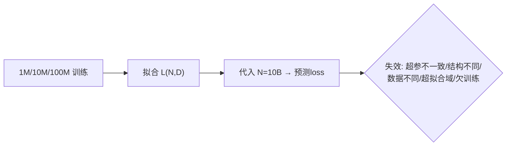

**面试要点**：先学小模型拟合幂律，再外推；失效=超参/结构/数据/拟合域不一致 + 欠训练。

---

## Q7. Chinchilla 最优是"训练最优"，但推理成本呢？如果考虑部署成本，最优的 `N` 与 `D` 会如何偏移？

**回答**

- **训练最优（compute-optimal）**：在"固定训练算力 C"下最小化 loss（N≈D 均衡）；
- **推理成本考虑**：部署要**为每个推理 token 付出资源**（权重读取、KV、延迟）——推理成本随 **N（参数量）正比**（decode 按权重遍历，Q10 第 5 章）。

**推理最优会怎样**：
- 相比训练最优，推理最优倾向于**更小参数量 + 更多训练 token**（`N` 变小、`D` 变大）：用"训练更久"换"推理时权重小"；
- 因为推理是**反复使用**的（一次训练、亿次推理），付费按推理次数×N 算 → N 的边际成本上升 → 应「**小模型多数据**」；
- 实践中：训练大量 token 的"小模型"（如 Llama-3 8B 用 15T token）就是在**推理成本考量下**偏离 Chinchilla 训练最优的例子（Q8）。

```python
# 训练最优 vs 推理最优的 N/D 偏移
def infer_optimal(C, ratio):
    # 训练最优 ~20 tok/param; 推理最优 ~更小N更大D
    return {"train": (C/(6*20))**0.5, "infer_D": (C*50/6)**0.5}   # 示意
print("推理最优: 参数更少、token 更多")
```

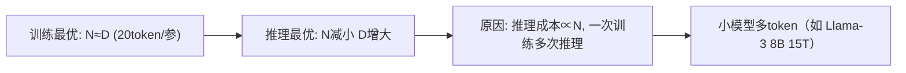

**面试要点**：推理成本 ∝ N → 逻辑修正为"小参数多 token"；Chinchilla 训练最优 vs 部署时的偏移。

---

## Q8. Llama 系列训练了远超 Chinchilla 最优的 token 数（8B 模型训 15T tokens），是否违反 Scaling Law？如何解释？

**回答**

**不违反，是有意偏离训练最优**：

1. **目标是推理/部署最优（Q7）**：Llama 家族**不追求固定算力下的最低 PPL**，而是追求"**在给定推理算力下，小参数能强到哪**"——用**巨大 token 数**把小参数模型推到能力上限，推理便宜；
2. **多 token 拉高能力**：在 token 充裕时，加大 D 的边际巩固与泛化仍有效（loss 的 `B/D^β` 项继续降，只是低于参数最优的斜率）；
3. **还用了 MoE / 知识蒸馏等**：让 token 更充分地被利用（Llama-4 用 MoE 就是"总参大、激活小 + 多 token"的延伸）；
4. 对主流用户，**部署便宜**远比理论最优更重要。

**结论**：Chinchilla 是最小化训练算力下的 loss；Llama 是"跳过训练最优、面向推理成本"的设计——两者不冲突，是**目标函数不同**。

```python
def loss_at(conD, D, N, E, A, alpha, B, beta):
    return E + A/N**alpha + B/D**beta
print("N=8B,D=15T loss:", round(loss_at(None, 15e12, 8e9, 1, 400, .34, 400, .28), 3))
print("→ 明显低于 D=2T（训练更贵但更面向推理的取舍）")
```

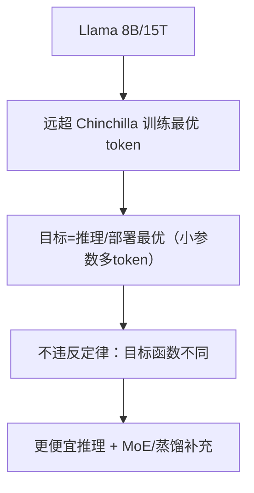

**面试要点**：不违反——**目标从"训练最优 PPL"转到"推理成本最优"**，token 充裕时牺牲训练最优换部署便宜。

---

## Q9. Scaling Law 对数据质量是否敏感？数据质量提升时拟合曲线会怎样变化？

**回答**

**敏感**：Scaling Law 的系数（α、β、E）都是从**特定数据分布**上拟合的；同样 token 数下，**数据质量高 → loss 更低**——数据是幂律里的"分母质量"。

**数据质量提升时曲线的变化**：

1. **不可约底噪 E 下降**：更干净的数据减少噪声项；
2. **B/D^β 等效「左移」**：同样 D 得到更小 loss（数据质量相当于白给 "有效 token"）——相当于把数据轴**压缩/迁移**：`D_eff = q^γ·D`（q 为质量）；
3. **指数 β 未必变**：形状（幂指数）通常稳健，但截距/位移动；
4. **高质数据的加速**：质量提升使"每个 token 的收益"变大 → **相同预算下 PPL 更低或到达目标需要的 token 更少**——这也是"数据清洗比堆量更值"的依据。

```python
def loss_quality(D, q, E, A, N, alpha, B, beta):
    Deff = q**0.5 * D          # 质量等价拉升有效 token（示意）
    return E + A/N**alpha + B/Deff**beta
print("低质(q=1):", round(loss_quality(1e10, 1, 1, 400, 1e8, .34, 400, .28), 3))
print("高质(q=2):", round(loss_quality(1e10, 2, 1, 400, 1e8, .34, 400, .28), 3))
```

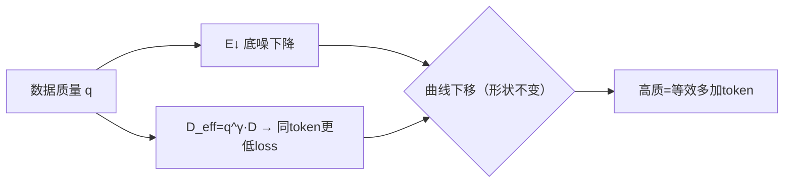

**面试要点**：数据质量改变 E（底噪）并等效放大 D（有效 token）；曲线下移而非形状改变。

---

## Q10. 什么是 emergence 现象？Scaling Law 的平滑幂律与能力涌现之间是否存在矛盾？

**回答**

**Emergence（涌现）**：当规模超过某一**临界点**时，某些能力从"~0"**突然跃迁**到显著水平（下游指标断崖，如从随机到解多位数算术、从不会到会某些推理题）——**用平滑幂律无法解释**（在小规模上指标恒为零，不像幂律预测的连续增长）。

**是否矛盾**：
- **两个层面不直接矛盾**：持久存在的"三者"是对**连续指标**（loss/PPL）的幂律；而**涌现常出现在离散的下游指标**（命中/通过类）；
- 关键解释：下游的"涌现"往往是**幂律的 loss→指标的非线性映射**——当 loss 平滑下降到某个阈值后，映射到"通过/未通过"时产生**阈值突变**（sigmoid 式），看上去像涌入；底层的 loss 仍是平滑幂律；
- 所以"平滑 loss + 涌现指标"并不矛盾：涌现是**指标的非线性**，不是 Loss 的不平滑。

```python
import math
def downstream_acc(loss):
    # 幂律 loss → 通过率的阈值型映射
    return 1/(1 + math.exp(-15*(0.5-loss)))
for l in (0.49, 0.51, 0.54):
    print(f"loss={l:.2f} → 下游通过率 ≈{downstream_acc(l):.0%}")
# loss 从 .49 → .51 只是小变化, 通过率却从~46%→~54%→88%（突变观感）
```

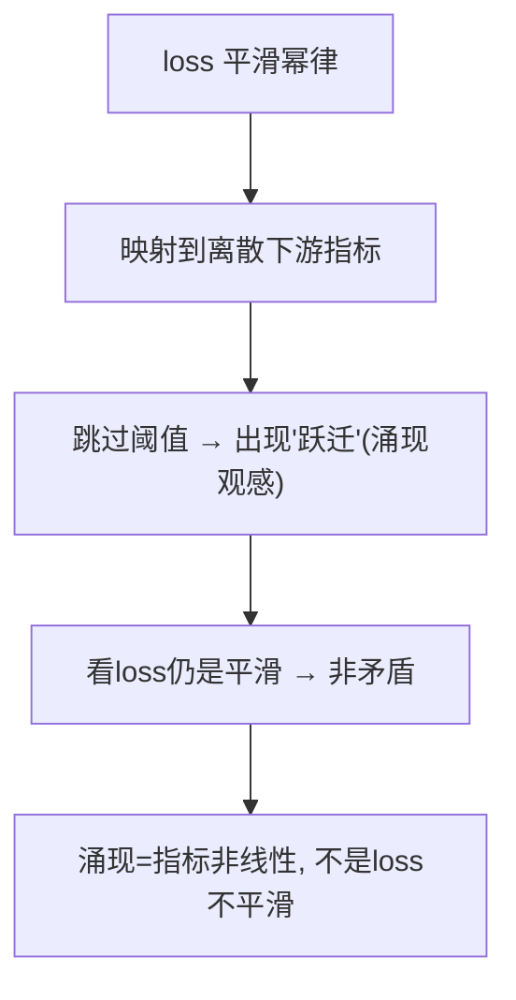

**面试要点**：涌现是**下游离散指标**的阈值突变；底层 loss 幂律平滑——两者通过"非线性的指标映射"衔接，不矛盾。

---

## Q11. 给定 `C = 6ND`，如果 `N=10B`，Chinchilla 最优下 `D` 约为多少？训练总 FLOPs 约为多少？

**回答**

Chinchilla compute-optimal（ratio≈20 tokens/param）：

- `D ≈ 20 × N = 20 × 10e9 = 200e9 = 200B tokens`；
- `C = 6ND = 6 × 10e9 × 200e9 = 1.2e22 ≈ 12 ZFLOPs`（1 Z = 1e21）。

```python
N = 10e9
D = 20 * N
C = 6 * N * D
print(f"N=10B → D≈{D/1e9:.0f}B tokens, C≈{C/1e21:.1f} ZFLOPs (6ND)")
```

```text
N=10B → D≈200B tokens, C≈1.2e22 ≈ 12 ZFLOPs (6ND)
```

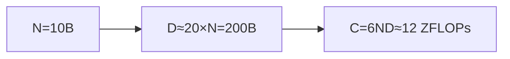

**面试要点**：Chinchilla ratio 20 → D≈200B；C=6ND≈1.2e22 FLOPs。

---

## Q12. 多模态模型、MoE 模型的 Scaling Law 与 Dense 语言模型有何不同？激活参数量还是总参数量进入幂律？

**回答**

**MoE**：
- **激活参数（active params）进幂律**更合理——因为推理/训练 FLOPs 由**激活**决定；
- 但**总参的"容量/记忆"也进入**（总参多→ 同激活下 loss 低）——业界做法**同时用 active 与 total**（loss(active, total, data)）或只用 active 的 C≈6·active·D；
- 结论倾向：**loss 对"激活参 + 数据"的幂律仍成立**，总参作为额外强系（质量因子）。

**多模态**：
- 各模态的**数据规模 D 不同**（图像/音频 vs 文本），需要**分模态幂律**；
- compute-optimal 变得复杂：文本的 token、图像的 patch 等**不同数据单位**对应不同 loss 项；
- 跨模态的互操作（对齐）有独立开销，不是简单的单一 FIr 幂律。

**总体**：MoE 用**【激活参】作为 FLOPs 相关的幂律变量（总参当质量项）**；多模态则需 **per-modality 分解**。

```python
def moe_scaling(active, total, D, E, A, alpha, B, beta):
    return E + A/active**alpha + B/D**beta + 0.1/total**0.1   # 总参弱项
print("MoE 激活幂律 + 总参弱项；多模态按模态分解")
```

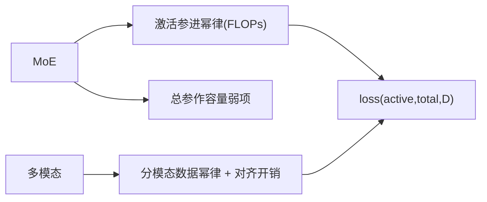

**面试要点**：MoE 用激活参做 FLOPs 相关变量（总参做质量）；多模态要按模态分解数据项。

---

## Q13. 学习率与 batch size 是否也需要随模型规模按 Scaling Law 调整？有哪些经验规则？

**回答**

**需要，但不是唯一**：训练超参（lr、batch）随规模变化能保持"曲线"健壮；文献的建议遵循**"μP（maximal update parametrization）/ critical batch"**思想：

**经验规则**：
1. **batch size**：用 **critical batch size**——`B_crit ≈ B^*·(loss 下降)`；增大 batch 在损失函数上的一次机会变异 `≈ B/B_crit`；大模型可用更大 batch（如 0.5M–4M tokens），只要 loss 曲线不崩；
2. **学习率**：接近 `lr_max ≈ (B/B_crit) 的函数`——**batch 越大用越大的 lr**（经验 `lr_coeff·(B/B_crit)`），或按 **3e-4→1e-3** 大模型调高；
3. **warmup**：随模型规模增长（warmup 步数/训练总步数比例随规模变化）；
4. **精确**：用 **μP** 保证超参跨规模稳定（最大更新参数化），或做小规模超参扫描后外推。

```python
def lr_batch_rule(B, B_crit, lr_base=3e-4):
    return lr_base * (B/B_crit)**0.5   # 经验：batch↑ → lr↑（次线性）
for B in (2e5, 1e6, 4e6):
    print(f"B={B:.0e}: 建议lr≈{lr_batch_rule(B, 2e5):.2e}")
```

```text
B=2e5: 建议lr≈3.00e-04
B=1e6: 建议lr≈6.71e-04
B=4e6: 建议lr≈1.34e-03
```

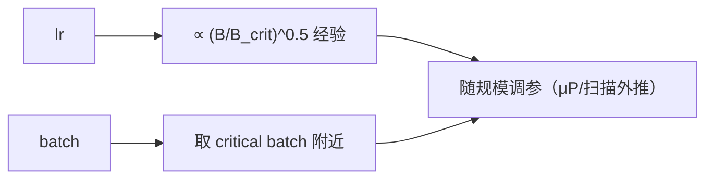

**面试要点**：batch 用 critical batch（随规模可增）、lr 随 batch 增大（次线性经验）、warmup 随规模；μP 可跨规模稳定。

---

## Q14. 小规模实验显示 loss 已进入"不可约损失"平台时，外推到大模型这个平台会平移吗？

**回答**

**可能平移（降低）**：

- "不可约损失 E" 是从小规模拟合出的**参数**——它依赖**数据分布与模型容量极限**；
- 大模型**容量更大、能更好逼近数据分布** → 同样的数据下，大模型能达到更低的"实际底噪"（即使 E 的估计机制不变，容量的提高让"有效不可约项"降低）；
- 另一个方向：若**数据本身熵高**（噪声多），E 也高——平台会因数据主导，不随 N 大幅下降；
- 结论：**E 在大模型上通常更低（不会原样平移卡死在平台）**——但下降幅度受数据质量限制（Q9/Q17）。

```python
def plateau_shift(N, E_data):
    return E_data + 2.0/N**0.5     # 大模型 → E 降低（数据质量下界）
for N in (1e6, 1e11):
    print(f"N={N:.0e}: 平台值≈{plateau_shift(N, 1.0):.4f}")
```


**面试要点**：小模型平台 ≠ 大模型平台——容量提高让 E 下移；但受数据熵下界约束。

---

## Q15. 如何设计 Scaling 实验的网格？模型规模、数据规模、学习率各取几个点才能可靠拟合？

**回答**

**设计原则**：**同时扫描 N 与 D 的乘积网格**（不要只变一个），保持超参在可解释范围：

- **模型规模 N**：取 3–5 个点（等比/对数刻度，如 1M/4M/16M/64M/256M），覆盖 ~2 个数量级；
- **数据规模 D**：每个 N 配 **3–5 个 token 总量**（如 100M/500M/1B/5B），让（N,D）形成**因子设计**（不要全组合，用"对角线扫描"降成本，但要能同时拟合两个幂）；
- **学习率**：每个 (N,D) 用 **peak lr 扫描**（如 1e-4 / 3e-4 / 1e-3）；最好用 μP 或"相对数据量推出最优"减少维度；
- **batch**：固定 critical batch 或随 D 同步；
- **词表/卓别**：保持 tokenizer 与架构一致（Q6 失效项）。

**可靠拟合经验**：
- 至少 **10–20 个 (N,D) 点**（30+ 更稳）；
- 用**对数空间**扫描；用 **最后 step loss** 还是最优 loss 要一致（Q16）；
- 验证**拟合残差**与外推（留一部分点外推检验）。

```python
import itertools
def design_grid(Ns, Ds):
    return [(n, d) for n in Ns for d in Ds]   # 全因子（或取对角子集）
print(len(design_grid([1e6,4e6,16e6], [1e8, 1e9])))
```

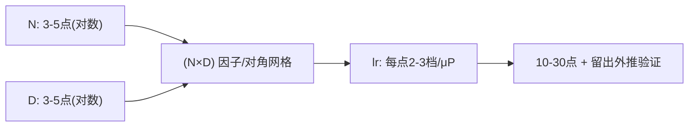

**面试要点**：N×D 网格（各 3–5 点对数）+ peak lr 扫描；20 点以上可靠，留出点做外推验证。

---

## Q16. Scaling Law 的拟合为什么通常用"最后一步 loss"而不是"最优 loss"？两者在高学习率下有何差异？

**回答**

**为什么用最后一步 loss**：
1. **可复现/稳定**：最后一步 loss 是**训练终止点的确定值**，避免"最优 loss"需要对训练中窗口再做扫描；
2. **计算友好**：拟合用"一步终止"即可，不用保存多个 best checkpoint；
3. **一致性**：各规模都用同一终止规则 → 幂律变量对齐。

**高学习率下的差异**：
- **最后一步 loss** 是终止时快照（可能**还没收敛**——大 lr 在末尾仍有波动）；
- **最优 loss（训练中最小）** 更接近"该 (N,D) 上限能力"——大 lr 训练中会有**早期过冲**后回落，理论上最优 loss 可能更低；
- **大 lr 时差距**：最后一步 loss > 最优 loss（因为大 lr 的噪声/过冲）；小 lr 时两者接近；
- 若用最后一步，不同 lr 会**污染幂律拟合**（收敛度不同）——所以拟合要**保持统一 lr 策略**、或用收敛充分但"最后一步"的口径。

```python
# 大 lr: final loss > min loss; 小 lr: 接近
print("大lr: final(高) vs min(低)→差大; 小lr: 两者接近")
print("拟合口径须统一（都用final或都用min）")
```

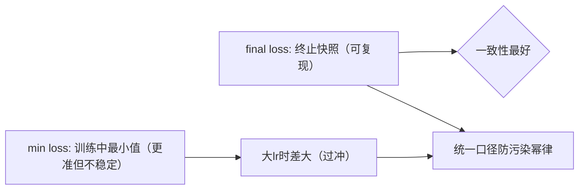

**面试要点**：final loss 可复现且口径统一；min loss 更准但大 lr 时两者差大——拟合须固定口径。

---

## Q17. 数据受限场景下（高质量 token 不够），Scaling Law 应如何修正？重复训练数据如何影响幂律指数？

**回答**

**数据受限的修正**：
- 有效 token 需要用**质量/多样性折扣**：`L(N, D_eff)`，`D_eff = q·D`（q 为质量因子，Q9）；
- 若 D 无法提高，最优转向**增加数据多样性/去重**（第 10 章）以提升 q 而非堆 D；
- 推理预算固定时，数据受限下**应减小 N**（更小模型在有限 token 下更快到平台）——偏离 Chinchilla 的"N↔D 均衡"。

**重复数据的影响**：
- 简单重复（同一份训多次）**不等价于新数据**——第 2 遍对 loss 的边际收益**锐减**；
- 幂律指数：重复会让 D 的**有效指数 β 变小**（看似"幂律失效"）——第 k 遍数据只贡献 `D/k^γ` 的有效量；
- 经验：**重复训练在高 token 预算下明显低效**，甚至引入过拟合（记忆噪声）→ 限制重复次数（Llama 只 rerun 数据几遍内）。

```python
def loss_repeated(D, rep, E, A, N, alpha, B, beta):
    Deff = D / (rep**0.6)          # 重复 → 有效数据缩水（示意）
    return E + A/N**alpha + B/Deff**beta
for rep in (1, 2, 4):
    print(f"重复{rep}遍: loss≈{loss_repeated(1e10, rep, 1, 400, 1e8, .34, 400, .28):.4f}")
```

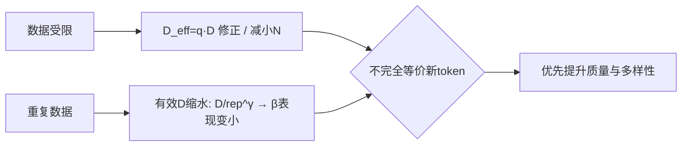

**面试要点**：受限用 D_eff 修正、可减 N；重复让有效 D 缩水（β 变小），非等价新 token。

---

## Q18. "推理最优"与"训练最优"如何取舍？固定推理预算时，应选更大模型配更少 token，还是更小模型配更多 token？

**回答**

- **训练最优（Chinchilla）**：固定训练算力 → N≈D 均衡（20 token/参）；
- **推理最优**：固定**推理预算**（每 token 推理成本 ∝ N）→ 推理时付的是 **N×请求次数**，所以倾向**更小参数 + 更多训练 token**：训练反正是一次性，推理是无数次——省 N 是在省"每次推理"的成本。

**结论**：固定推理预算（设推理总成本 = 权重开销 × 请求），应选**较小模型配较多 token**——直到"训练到 token 过多导致边际收益低于下个更大模型"才换更大 N。

**直觉**：推理最优点 D/N 通常大于训练最优点（更多 token/参）；小模型的"训练更彻底"换"推理更便宜"。

```python
def infer_cost(N, requests, bytes=2):
    return N*bytes*requests   # 推理总成本 ∝ N×请求数
N_options = {"7B": 7e9, "13B": 13e9}
reqs = 100e6
for k, N in N_options.items():
    print(f"{k}: 推理成本≈{infer_cost(N, reqs)/1e12:.0f} TB读（显然N小则低）")
```


**面试要点**：推理成本∝N → 固定推理预算时选**小参数多 token**；训练最优则 N≈D。

---

## Q19. 如何判断一个模型已经"过参数化"或"欠训练"？从 loss、下游指标、训练 token 数三者关系分析。

**回答**

- **过参数化（over-parameterized / 欠训练）**：**模型容量 > 数据**——给定 N，D 太少。判断：
  - **训练 loss 未收敛**（或 training/val gap 很大）、再训 token 仍在下 loss 斜率；
  - 相对 Scaling Law：`D < 20×N`（或与 compute-optimal 差距大）；
  - 下游指标**没有跟上**其参数级别应有水平（同一的 benchmark 该参数应达到的位次）。
- **欠参数化（under-parameterized）**：D 相对 N 过多、在 D 上已经很平台 → 加数据收益小，应加参。

**判断指标**：
1. **training loss vs scaling 预测**：位移大 → 配置失衡；
2. **train/val gap**：gap 大（训练好验证差）→ 或过度（数据重复/过拟合线）；
3. **继续增 D 的收益曲线**：仍在下滑=欠训练；平了=过参数化；
4. **下游位次**：相比参数规模的标杆。

```python
def is_undertrained(N, D):
    ratio = D/N
    if ratio < 15: return "过参数化(欠训练): 数据 < 20token/参"
    if ratio > 40: return "欠参数化(数据充裕): 加参更划算"
    return "接近 compute-optimal"
for N, D in [(1e10, 1e11), (1e10, 5e11)]:
    print(f"N={N/1e9:.0f}B D={D/1e12:.1f}T → {is_undertrained(N,D)}")
```

```text
N=10B D=100B → 过参数化(欠训练): 数据 < 20token/参
N=10B D=500B → 欠参数化(数据充裕): 加参更划算
```

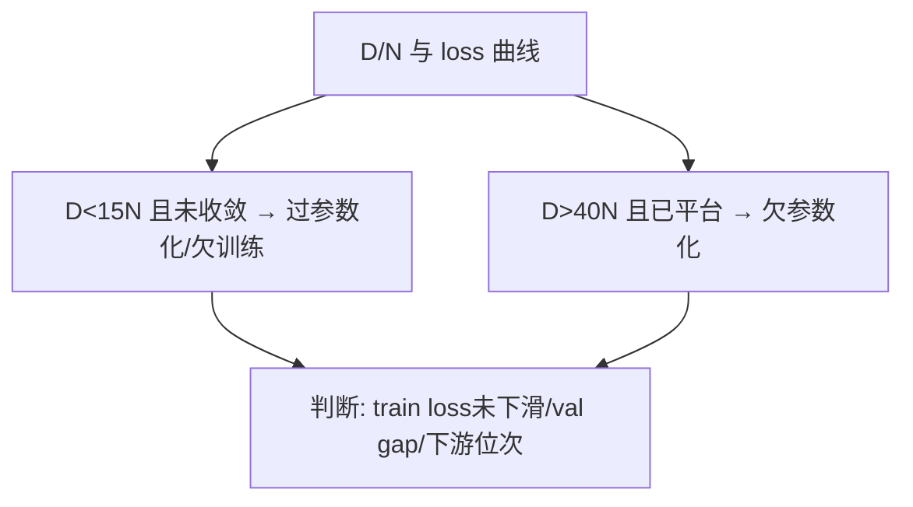

**面试要点**：用 **D/N 比例 + 收敛态 + 下游位次** 三方判断"过参数化（欠训练）"或"欠参数化"。

---

## Q20. Scaling Law 能否预测下游任务表现（MMLU、HumanEval）？如果不能，缺了什么？

**回答**

**不能直接精确预测**——Scaling Law 拟合的是**loss/PPL**，而下游任务是**离散、非线性映射**（Q10 的涌现）。

**缺了什么**：
1. **任务特异性**：MMLU/HumanEval 与 PPL 的关系不是简单函数——不同任务对容量/数据/知识密度的敏感度迥异（某个 loss 点下 A 任务 50 分、B 任务 90 分）；
2. **对齐/制导**：下游分数受 SFT/RLHF 影响（后训练），Scaling Law 只约预训练 loss；
3. **数据覆盖**：基准含特定知识/技能，图预训练数据是否覆盖；
4. **涌现阈值**：能力可能突然跃迁（Q10）——幂律 loss 无法线性外推到指标。

**用法**：用 Scaling Law 预测 loss，再**单独建立 loss→task 的转换/校准**（或直接对 task 做小规模外推），**不能混用幂律直接外推 MMLU**。

```python
def task_from_loss(loss):   # 非线性（示意）
    return max(0, 100*(loss**2.2))   # 非单调/阈值型
print("loss=0.5 → task 分≈?", round(task_from_loss(0.5),0), "（非线性）")
```

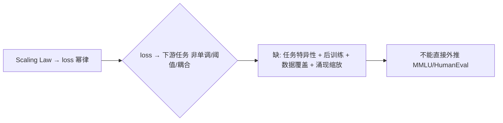

**面试要点**：Scaling 预测 loss 而非任务分；缺"loss→指标的非线性映射 / 任务特异性 / 后训练 / 涌现"。

---

## Q21. Chinchilla 实验中 70B 模型训 1.4T tokens 击败 280B 训 300B tokens，这个结论对工业界的直接影响是什么？

**回答**

**核心结论**：同样算力下，**训练数据比参数更该被重视**——70B/1.4T（20 token/参）比 280B/300B（~1 token/参）在多数任务上更优（后者"欠训练"，容量富余却没用够数据）。

**工业界直接影响**：
1. **放弃"无脑扩大参数"**：转向同时扩大数据；训练 token 数从几百 B 涨到 T 级；
2. **数据工程地位提升**：需要**海量高质量、去重、多语种数据**——数据收集/清洗/配比成为比"堆 GPU 网络"更关键的工程；
3. **算力预算从"全给模型"转向"模型+数据双份"**：训练成本中数据获取与过滤占比上升；
4. **重训/继续预训练决策**：优先"用足现有数据"而非"换更大模型"（Q26）；
5. 后续的 Llama、Qwen 等都印证——**token 用量大幅上调**。

```python
C_chinchilla = 6*70e9*1.4e12
C_280b      = 6*280e9*300e9
print(f"70B/1.4T: {C_chinchilla:.1e} FLOPs vs 280B/300B: {C_280b:.1e}")
print("→ 同算力下多token小模型更优")
```

```mermaid
flowchart LR
    A["70B/1.4T 胜 280B/300B"] --> B["数据≫参数（同算力）"]
    B --> C["工业影响: 加大数据工程/多token/重训决策"]
    C --> D["后续模型 token 量大增（Llama等）"]
```

**面试要点**：同算力下"数据多于参数"胜；推动数据工程与训练 token 用量上调。

---

## Q22. 把模型宽度与深度分开看，哪一个对 loss 幂律指数影响更大？有统一结论吗？

**回答**

- **存在分歧**：
  - 部分工作（Hoffmann/Chinchilla 类）用"**总参数量**"统一抽象宽度×深度，**不细分**；
  - 一些细粒度研究（如 "Scaling depth vs width"）发现**深度与宽度分开看有不同的幂律指数**——通常**深度对 loss 的收益更"昂贵"**（深度更多要配套更多层内残差/优化），宽度相对容易堆；
- **统一结论**：**没有公认的明确唯一指数**——同一主导下，以下近似观测：
  - 宽度过大 → 过参数化收益平缓；
  - 深度过深 → 收益初期快但渐饱和（且深度的残差体系有额外成本）；
  - 最优**宽/深比在不同数据、不同任务不恒等**（如 Seq2Seq 与纯 LM 有差异）；
- 工程上仍然以**总参数量与深度/宽度比的联合经验**为主。

```python
def depth_width_scaling(N, alpha_d, alpha_w):
    return {"若深度主导": ..., "若宽度主导": ...}   # 无统一单一指数
print("没有统一唯一指数——深度/宽度分开看收益不同（经验各异）")
```

```mermaid
flowchart LR
    A["深度 vs 宽度"] --> B["深度: 收益初期快/渐饱和/残差成本"]
    A --> C["宽度: 相对易堆/过参化平缓"]
    B --> D["统一指数? 无公论（取决于数据/任务）"]
    C --> D
```

**面试要点**：无统一指数；一般"深度收益贵且渐饱和、宽度易堆但易过参数化"，最优宽深比经验化。

---

## Q23. MoE 的 Scaling Law 中，"总参数"与"激活参数"哪个是更好的 scaling 变量？

**回答**

**激活参数（active params）是 FLOPs/训练成本的正确代理**，因此**更适合作为幂律的 scaling 变量**：

- **loss 的资本 ≈ 激活参数 × 数据**（C ≈ 6·active·D）：**每 token 真正花钱的是激活部分**（FLOPs）；
- **总参数提供"容量/记忆"**：同激活下总参多 → loss 略低（知识密度更厚），但它是**次级因子**（不能单独当主变量，否则会高估能力——总 230B 激活 20B 不该按 230B 拟合 FLOPs 的 loss）；
- 论文（MoE scaling）：fit `loss(active, total, D)` 或用 `active` 当主 index + `total` 作"质量修正"。

**结论**：**激活参数是主 scaling 变量**（决定计算成本），总参数作为次级质量因子；面试要给出"显存按 total、算力按 active"的区分（Q15 第 4 章）。

```python
def moe_scaling_use(active, total):
    print(f"激活 {active/1e9}B 是 FLOPs 主变量; 总参 {total/1e9}B 是容量弱项")
moe_scaling_use(21e9, 236e9)   # DeepSeek-V2 例
```

```mermaid
flowchart LR
    A["激活参数"] --> B["主导: 决定FLOPs/算力成本(幂律主轴)"]
    C["总参数"] --> D["次级: 容量/记忆(弱项修正)"]
    B --> E["scaling 用 active + total 双因子"]
    D --> E
```

**面试要点**：激活参是主变量（计算成本），总参作容量弱项；显存按 total、算力按 active。

---

## Q24. Scaling Law 的指数为什么在不同数据分布、不同分词器下会变化？跨数据集外推可靠吗？

**回答**

**为什么指数变化**：
- 幂律系数是从**特定 (数据分布, 分词器, 架构)** 上抽样的——数据**熵/复杂度**不同 → "容量收益"斜率（α）与"数据收益"斜率（β）不同；
- **分词器改变单位粒度**：token 本身是"数据单位"，分词器不同 → token 与文本语义的映射不同，D 轴的含义变了（N 固定的 token 数对应不同真实信息量）；
- 架构后缀（logits 头、激活）也影响 N↔loss 的换算。

**跨数据集外推**：
- **不可靠**：从 Text 外推到 Code、或从英文外推到多语，指数与截距都可能漂移；
- **更可靠的方式**：**必须在新数据上重新拟合（哪怕小规模）**，或用"Aggregated scaling"结合多数据集拟合；
- 索引/单位统一（相同 tokenizer、相同指标）后，**同一分布族内可外推**；跨分布要谨慎（Q29 多语言同问）。

```python
def fit_index(domain):
    return {"英文": 0.34, "代码": 0.28, "多语": 0.30}.get(domain)
print("不同数据域的 α 不同 → 跨数据集直接用不可靠")
```

```mermaid
flowchart LR
    A["数据分布/分词器/架构"] --> B["影响幂律指数 α,β"]
    B --> C["指数随域漂移"]
    C --> D["跨数据集外推不可靠 → 需重新拟合/同族内"]
```

**面试要点**：指数依赖数据分布与分词器；跨数据集直接套用不可靠——需在同分布族内重拟合。

---

## Q25. 训练 loss 突然偏离 Scaling 预测曲线，通常意味着什么？数据污染、架构改动、数值问题如何区分？

**回答**

**偏离含义**：loss 与拟合曲线的**系统性位移**（不按幂律走）说明某假设失效。排查方向：

1. **数据污染**：验证/测试集与训练重叠（模型见过同类题）→ **验证 loss 下降异常、训练-验证 gap 缩小**；特征：loss 异常低 + 对应 benchmark 分数虚高；
2. **架构改动**：改了层数/宽度/归一化/位置编码 → **scaling 常数/指数变化**（曲线整体平移或斜率变）；特征：改动后从头收敛态一致但幂律截距漂移；
3. **数值问题**：lr 爆炸、NaN/inf、loss scale、梯度裁剪过头 → **loss 在某一规模突然跳变/回弹**；特征：大规模/低 precision 时 gnn 出 NaN、loss 曲线震荡；
4. **评估口径**：测的是 train loss 还是 val、是否统一指标（Q16）。

**区分法**：控制变量——**固定架构换数据**（污染检测：看 gap/分数）、**固定数据换架构**（看幂律常数）、**查数值**（NaN/lr/scale）。

```python
def diagnose(d_val_gap, benchmark_score, snan):
    if d_val_gap < 0.05 and benchmark_score > 0.9: return "数据污染/重叠"
    if snan:                                      return "数值问题(NaN/lr)"
    return "架构改动/scaling常数偏移"
print(diagnose(0.03, 0.95, False))
```

```mermaid
flowchart TB
    A["loss 偏离曲线"] --> B{"gap很小+分数虚高?"} 
    B -->|是| C["数据污染"]
    A --> D{"NaN/震荡/回弹?"} --> E["数值问题"]
    A --> F{"整体平移/斜率变"} --> G["架构改动"]
    B --> H["控制变量区分"]
```

**面试要点**：污染→gap小+分数虚高；架构→平移/斜率；数值→NaN/震荡；用"固定一维"诊断。

---

## Q26. 如何用 Scaling Law 指导"是否继续训练一个已有模型"的决策？继续训练的边际收益如何估算？

**回答**

**决策法**：
1. **推算当前 (N, D_trained)** 在拟合曲线的**位置**：再训 ΔD 后 loss 下降量 ≈ 幂律上的增量 `∂L/∂D·ΔD`；
2. **估算边际收益**：`loss(D+ΔD) − loss(D)`——这是"继续训练这条路上的收益"；
3. 与**替代方案比**（换更大模型 / 换数据质量 / 微调）的收益对比：
   - 若 `∂L/∂D` 已很缓（数据收益的幂律尾巴）→ 不如加参或提数据质量；
   - 若 D 离 optimal 还很远、斜率陡 → 继续训有回报；
4. **数据质量≠数量**：若瓶颈是质量，堆更多 D 收益小，应先过滤/配比（第 10 章）；
5. **注意重复训练**：已经在同一数据上训过 → 有效 D 缩水（Q17）。

```python
def margin(D, delta, N, E, A, alpha, B, beta):
    Ld = E + A/N**alpha + B/(D+delta)**beta
    L  = E + A/N**alpha + B/D**beta
    return L - Ld
print("继续训 ΔD=1T 的收益:", round(margin(1e12, 1e12, 1e10, 1,400,.34,400,.28), 4))
print("若收益<0.05 → 考虑换增加参数/数据质量")
```

```mermaid
flowchart LR
    A["当前(N,D) 位置"] --> B["估算 ∂L/∂D·ΔD（继续训练收益）"]
    B --> C{"与换模型/提质量对比"}
    C --> D["斜率陡 → 可继续训"]
    C --> E["斜率平/质量瓶颈 → 换路线"]
```

**面试要点**：用幂律导数估算 ΔD 收益斜率；与"换更大模型/提数据质量"做性价比决策。

---

## Q27. 合成数据是否改变了 Scaling Law 的适用边界？什么条件下合成数据可以"替代"真实 token？

**回答**

**适用边界（有条件）**：
- 合成数据若**分布与真实一致且带来新信息**（如代码生成、推理链的自生成），**可被建模为更高密度/更高质量的 token**（D_eff = q·D 大）——Scaling Law 仍适用（只是"数据特性"变化）；
- 若合成数据**只重复已知分布/无多样性**（如自回归模型复读自己）→ **低信息密度**（D_eff 小），甚至"污水循环"导致分布塌缩（模型规模 → 同质化）。

**能替代真实 token 的条件**：
1. **覆盖真实分布且**保证多样性（去重/版本多样）；
2. **质量可校验**（自蒸馏/强教师），用于**数据稀疏但合成可控**的领域（代码、数学、程序验证）；
3. **信息增益**（不是复制训练集）、有难度分布（self-play 升级难题）；
4. 作为真实数据的**补充而非全部**（混合配比）。

**结论**：合成数据**改变"数据质量/信息"进幂律的系数**而非定律本身；盲目合成会塌缩（Q16 第 10 章）。

```python
def synth_eff(D_synth, diversity):
    return D_synth * (0.3 if diversity < 0.5 else 2.0)
print("高多样性合成 → D_eff 放大；低多样性 → 缩水/重复")
```

```mermaid
flowchart LR
    A["合成数据"] --> B{"信息增益/多样性?"}
    B -->|是| C["D_eff 放大（质量更高）→ 幂律仍适用"]
    B -->|否| D["重复/塌缩（D_eff 缩水）"]
    C --> E["合成≠等价真数据：按有效信息入幂律"]
    D --> E
```

**面试要点**：合成改变幂律里的"有效 D"，前提=多样性+可校验+信息增益；否则塌缩。

---

## Q28. 两个模型 A（7B，2T tokens）与 B（13B，1T tokens），仅凭 Scaling Law 能判断谁更强吗？还需要什么信息？

**回答**

**不能直接判断**：
- A：7B/2T（ratio≈286 token/参，数据富余、欠参数化）；
- B：13B/1T（ratio≈77 token/参，数据相对少）；
- Scaling Law 只能给出**各自在 (N,D) 下的 loss**：计算后大致同算力（6·7·2=84 vs 6·13·1=78 FLOPs 相近）→ **谁的 loss 更低不确定**（取决于 (1) 是否在 compute-optimal 附近，(2) 曲线参数）。

**还缺的信息**：
1. **数据质量/配比**（同分布？A 的数据是否更多样）；
2. **训练充分度**（是否都收敛/各自离最优多远）；
3. **后处理**（SFT/RLHF）；
4. **目标**（下游任务 vs 纯 loss）；
5. Scaling 曲线的**具体参数**（α、β、E）——同一个"参数/token"下因数据不同而有差别。

```python
def losses(N, D):
    E, A, alpha, B, beta = 1.0, 400, 0.34, 400, 0.28
    return E + A/N**alpha + B/D**beta
for n,d in [(7e9,2e12),(13e9,1e12)]:
    print(f"N={n/1e9}B D={d/1e12}T → loss≈{losses(n,d):.4f}")
# 算力相近; loss 高低取决于数据质量与收敛态
```

```mermaid
flowchart LR
    A["A: 7B/2T vs B: 13B/1T"] --> B["同算力 (~80 FLOPs)"]
    B --> C{"谁强看: 数据质量/收敛/后训/目标"}
    C --> D["仅凭 Scaling 不能判定孰强"]
```

**面试要点**：两者同算力、比值不同——能不能强取决定于数据质量/收敛/下游目标，Scaling 只给各自的 loss。

---

## Q29. 多语言场景下，Scaling Law 是按语言分别拟合还是统一拟合？低资源语言的幂律指数通常如何表现？

**回答**

- **倾向分开/分语言族**：
  - 高资源与低资源语言的**数据分布熵不同** → 统一的 (N,D) 幂律掩盖差异；
  - 更合理：对每语言（或语言族）拟合各自的 L(D)、L(N)，或在全局幂律里加入 **per-language 词量与数据占比项**（低资源语言数据占比低 → 该项超大）。
- **低资源语言的表现**：
  - **有效 token 少 → loss 下降慢（大 β 影响）**：数据收益的幂律在低资源语言上更像"过参数化"（N 相对 D 过大）；
  - **改进需要提高占比**：温度采样/欠采（第 10 章 Q17）稀释高资源、拉升低资源，等价于"提高低资源的 D_eff"；
  - 通常**低资源语言的 loss 平台更高**（熵大/数据少），其幂律指数对"数据占比"非常敏感。

```python
def multilingual_scaling(D_hi, D_lo, N, E, A, alpha, B, beta):
    return {"高资源": E + A/N**alpha + B/D_hi**beta,
            "低资源": E + A/N**alpha + B/D_lo**beta}
r = multilingual_scaling(5e11, 1e9, 1e10, 1,400,.34,400,.28)
print("高资源 loss:", round(r["高资源"],3), " 低资源 loss:", round(r["低资源"],3))
```

```mermaid
flowchart TB
    A["多语言 Scaling"] --> B["分语言/族拟合（或+per-lang项）"]
    B --> C["低资源: 有效数据少 → 平台高 + 对配比敏感"]
    C --> D["改善: 提升低资源D_eff(升温/欠采)"]
```

**面试要点**：分语言族拟合更稳；低资源语言有效 D 小 → loss 平台高、对数据配比敏感。

---

## Q30. 向面试官解释"Chinchilla 之后我们为什么还在训更大的模型"，你会用哪三个论点组织回答？

**回答**

**三个论点**：

1. **目标函数不同（推理最优，Q7/Q18）**：Chinchilla 最小化固定训练算力下的 loss；工业界更关心**部署/推理成本**——一次训练、无数次推理，"小参数多 token"让每次推理便宜，所以**宁可训大 token 也不怕偏离训练最优**（Llama-4 用 MoE 进一步降激活）；
2. **能力随总规模不止语言建模**：更大模型带来**记忆/知识密度、长上下文、多模态、推理能力**等的收益并非单一 loss 幂律能刻画（涌现、任务非线性，Q10/Q20）——**在总参上扩张**仍能解锁新能力；
3. **数据和算力都在增长**：真实世界的**可用高质量数据与算力**逐年增长，compute-optimal 的**原点在移动**（E 与 D_eff 上升）——在更大的 D 下，"该用多大 N"的最优点也随之上移；**模型必须跟着长大**才吃得下更大数据。

**收尾**：Chinchilla 不是"别训大模型"，而是"定预算内的最优分配"；在大数据/低成本推理/多能力诉求下，适度超参（oversizing）依然合理。

```python
def three_args():
    return ("1 推理最优；", "2 能力/涌现/多模态；", "3 数据算力原点在移动")
print(three_args())
```

```mermaid
flowchart TB
    A["还在训更大模型"] --> B["1 推理/部署最优（小参多token也划算）"]
    A --> C["2 更大模型解锁能力（涌现/知识/多模态）"]
    A --> D["3 数据算力原点移动（最优点上移）"]
    B --> E{"三个论点组织回答"}
    C --> E
    D --> E
```

**面试要点**：三个论点——**目标不同（推理最优）、能力超越loss、数据算力原点位移**；最后点明 Chinchilla 是"预算内分配"不是"禁止大参数"。

---

## 参考链接

1. [GPT-5瓶颈本质：Scaling Law失效与Token经济崩溃-CSDN博客](https://blog.csdn.net/aodanchui1057/article/details/102008709)
2. [【Transformer】Scaling_Law_大模型涌现能力的规律-CSDN博客](https://blog.csdn.net/2302_78391795/article/details/166990548)
3. [什么是 Scaling Law？大模型的「涌现能力」是怎么回事？-CSDN博客](https://blog.csdn.net/qq1137623160/article/details/162793672)
4. [幂律的预言：Kaplan 与 Chinchilla 的算力账本 —— Scaling Laws 与最优配比-CSDN博客](https://blog.csdn.net/tsh2005974tsh/article/details/162562453)
5. [09d-斯坦福 CS336 作业三：缩放定律（Scaling Laws）-CSDN博客](https://blog.csdn.net/2301_79239314/article/details/162223644)

---

*下一章展望：第 9 章进入推理系统（Prefill/Decode、KV Cache、PagedAttention、Continuous Batching、投机解码、量化等 35 题）。*