# 第 9 章 · 推理

> 面试生普（LLM 500 题）· 第 9 章【重点】。本章覆盖 Prefill/Decode、KV Cache、PagedAttention、Continuous Batching、投机解码、GPTQ/AWQ、KV 压缩、FlashDecoding、TTFT/TPOT、vLLM 调度等 35 个问题，关键概念配 Python 代码与 mermaid 图解。

> 先把话说清楚：这一章聊的是"模型训练好以后，怎么让它又快又省地把答案一个字一个字吐出来"，也就是**推理（inference）**和**在线服务（serving）**。训练只管把模型喂胖，推理才是模型真正上岗干活的地方——用户每问一句话，背后都是这一整套流程在跑。你会听到一堆名词：KV Cache、PagedAttention、连续批处理、投机解码……别被吓到，它们说到底都在解决同一个矛盾：显存有限、带宽有限，可用户又想要又快又便宜。跟着每道题先看"它在抠什么成本"，再看"用什么招省下来"，读完你就能把一个大模型推理引擎的骨架说个大概。

---

## Q1. Prefill 与 Decode 两个阶段的计算特征有何本质区别？为什么 Decode 是 memory-bound 而 Prefill 更接近 compute-bound？

**回答**

大模型生成文本，其实是两个阶段在接力，它们"吃"的资源完全不一样：

- **Prefill（预填充）**：一次性把用户输入的整段 prompt（T 个 token）全处理掉——这是**大矩阵乘** `(B·T, d) × (d, d)`，算术强度高（每读一个字节的权重，能做好多次乘加）→ **接近 compute-bound**（算力受限，Q2/Q11 第 5 章）；
- **Decode（解码）**：**每次只生成 1 个 token**，走的是 `(B, d) × (d, d)`——算术强度 `AI ≈ 1`（每生成一个 token 的 FLOPs 除以完整权重读取量），是极其吃显存的 **memory-bound**（带宽受限，Q10/Q28 第 5 章）。

**本质区别**，其实就两点：

- **算力/带宽的 AI 差**：prefill 的 AI 随 T 增长（大 GEMM），decode 的 AI 固定得很低（就 1 个 token 去乘一大坨权重）；
- **瓶颈落在哪**：prefill 被算力支配，decode 被**带宽（读权重 + 读 KV Cache）**支配（Q20 本章）。

```python
def ai(T, N, bytes_w):
    return 2*N*T/(N*2 + T*total_kv)   # 简化示意
print("prefill AI 高（大T）; decode AI≈O(1)（1 token）")
```

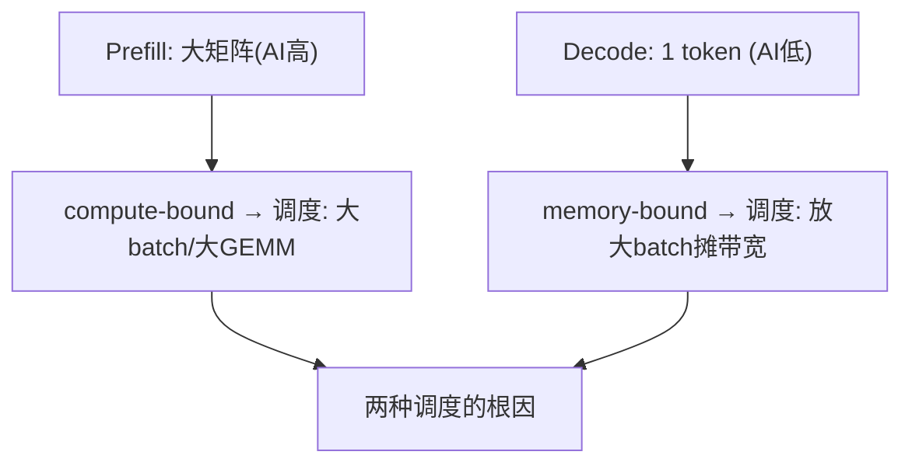

**面试要点**：AI 差异（大 T vs 1 token）决定 compute-bound / memory-bound——这是 serving 各类优化的总纲。

---

## Q2. KV Cache 为什么能加速自回归生成？它避免了哪些重复计算？

**回答**

先说什么是**自回归生成**：第 t+1 步要算 `attn(Q_{t+1}, K_{[:t+1]}, V_{[:t+1]})`——Q 只有新加的那一个，可 K/V 却得凑齐**全部历史**。

- **不缓存（naive）**：每步都把**整个前缀**（所有历史 token）重新过一遍模型，把它们的所有 K/V 重新算一遍——**每步都是一次 O(前缀长度) 的重算**，而且越生成越长、越算越慢；整体复杂度 O(T²)。
- **KV Cache**：**把每个位置算过一次的 K/V 存下来**，下一步只需**算新加那一个 token 的 K/V**、追加到缓存里，attention 直接用缓存里的历史 K/V —— **省掉的正是"重复计算历史上所有 token 的 K/V 投影"这件事**，每步从 O(T) 降到 O(1)（只剩新增 token 的投影 + 对缓存的 attention）。

**到底避免了哪些重复**：历史上那些线性投影（W_k/W_v 和每个历史 token 的矩阵乘），以及它们参与后续层的前向——都只算一次就存着复用，再也不必重来。

```python
# 无缓存: 每步重算前缀
def naive_forward(x_all):
    # 第t步: 对 x[:t] 重新算一遍 K/V 投影
    return recompute_kv(x_all)
# 有缓存: 增量
def kv_cache_forward(x_t, kv_cache):
    k = W_k(x_t); v = W_v(x_t)
    kv_cache['k'].append(k); kv_cache['v'].append(v)
    return attention(q, kv_cache)   # 只用新增token的投影
```

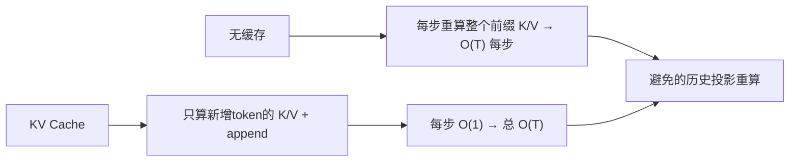

**面试要点**：KV Cache 把"每步重算全部历史 K/V"降为"只算新增 token 投影 + append"——O(T²)→O(T)。

---

## Q3. 给定 layers=80、KV heads=8、head_dim=128、seq=32k、batch=8、FP16，估算 KV Cache 显存占用。

**回答**

**公式**：`KV = 2 × L × H_kv × d × bytes × T × B`（Q18 第 5 章）。

把数字代进去：L=80、H_kv=8、d=128、T=32768、B=8、FP16(2B)：

```
KV = 2 × 80 × 8 × 128 × 2 × 32768 × 8
   = (2×80×8×128×2) = 327680
   327680 × 32768 = 1.0737e10
   1.0737e10 × 8 = 8.5899e10 B ≈ 85.9 GB
```

```python
def kv_mem(L, hkv, d, T, B, bytes_=2):
    return 2 * L * hkv * d * bytes_ * T * B
print(f"KV Cache ≈ {kv_mem(80, 8, 128, 32*1024, 8)/1e9:.1f} GB")
```

```text
KV Cache ≈ 85.9 GB
```

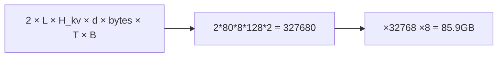

**面试要点**：套公式 `2·L·H_kv·d·bytes·T·B`；答案是约 86GB（长序列时 KV 超大可见一斑）。

---

## Q4. PagedAttention 的"分页"思想具体解决了 KV Cache 的哪种碎片化问题？逻辑块与物理块如何映射？

**回答**

**它解决的是碎片化**：传统做法是按**请求各自分配一整段连续显存**，可问题在于——谁也不知道这个请求最后会生成多长。于是：

- **内部碎片**：按最坏长度预留一大段 → 结果实际只用了其中一小块，剩下全空着；
- **外部碎片**：不同请求的连续块长短不一，释放后腾出来的缝缝补补凑不成一块 → 内存里到处是空洞；
- **预留浪费**：一上来就提前占住一大段。

**分页方案**是这么干的：把 KV Cache 切成**固定大小的块（block）**——逻辑上每个请求都有自己的**逻辑块序列**，物理上这些块可以**不连续**、散落在提前挖好的池子里，用一张 **block table（逻辑块号 → 物理块号）** 来对号入座。需要多少就**按需分配多少物理块**（跟操作系统虚拟内存的页一个道理）。

```python
class PagedKV:
    def __init__(self, block_size=16):
        self.blocks = []            # 物理块池
        self.block_table = {}       # 请求逻辑块 → 物理块id
    def alloc(self, req_id):
        pid = len(self.blocks)      # 物理块可非连续
        self.blocks.append(torch.zeros(block_size, ...))
        self.block_table[(req_id, next_logical)] = pid
    # 逻辑 [0,1,2] → 物理 [5,0,8]（不连续, 块表映射）
```

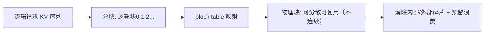

**面试要点**：固定块 + 逻辑-物理块表映射；解决内部碎片、外部碎片、预留浪费。

---

## Q5. PagedAttention 的"块共享"在什么场景下节省显存？多轮对话与并行采样如何利用它？

**回答**

**块共享（block sharing / CoW，写时复制）**说的是这么件事：当多个**请求的 KV 前缀完全一样**时，让它们**共用同一组物理块**（各自的块表都指向同一批物理块），这样前缀就只用存一份，不必重复。

**哪些场景用得上**：

1. **多轮对话（prefix reuse）**：新一轮输入 = 历史对话前缀 + 新 prompt——历史部分的 KV 早就缓存过了，**直接复用物理块**（把上一轮的块共享给下一轮），只算新加的部分；
2. **并行采样 / 多候选生成（beam/multiple samples）**：同一个 prompt 开多个采样线程，它们**共享 prompt 的 KV 块**，各自只独立生成自己那段——前缀块一份、生成块各存各的；
3. **相同 system prompt / few-shot 这类等长前缀**也同理。

**共享怎么实现（CoW）**：共享的块本身只读；生成过程中若某个请求要改共享前缀（写到超出共享的部分），才把这部分复制一份（copy-on-write）——这样既省显存又不出错。

```python
# 多请求共享前缀物理块
shared_phys = allocate_block(prompt_kv)        # 一份
reqA.block_table = [shared_phys] + allocate(genA)
reqB.block_table = [shared_phys] + allocate(genB)   # 复用同一前缀
# 共享块只读; 超出共享处 copy-on-write
```

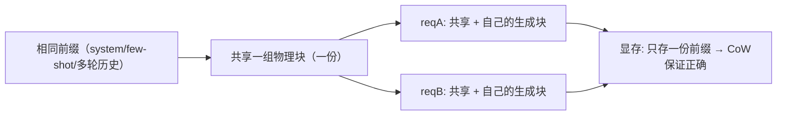

**面试要点**：共享"相同前缀的物理块"（CoW）——多轮对话的 prefix reuse、并行采样/beam 都省显存。

---

## Q6. Continuous Batching 解决了静态 batching 的什么浪费？它和 PagedAttention 之间是什么关系？

**回答**

**静态 batching 的浪费**在于，它硬凑一批、一批到底：

- 一个 batch 里**最慢的那个请求会拖住全批**（跑完的只能干等）；
- 新来的请求必须等下一批（于是有了**入批空档**）；
- batch 是固定的 → decode 的带宽没法被连续共享（Q27 第 5 章）。

**Continuous Batching（连续批处理）**的思路是让请求**动态地进批、出批**（一生成完立刻释放、新请求随时插进来），GPU 时间几乎被榨满。

**它和 PagedAttention 的关系**是**互相需要**：

- Continuous Batching 要想"随时进随时出"，就得能**动态分配/释放显存**——而 PagedAttention 恰好提供了**分页的细粒度分配**，两者天然配套；
- 反过来，PagedAttention 要是没有 Continuous Batching，它"按需切块"的吞吐优势也没法在动态批调度里发挥出来（批次固定时，分页能省的很有限）；
- 所以 vLLM 把它们**一起实现**（分页分配 + 连续入批），"调度 + 分页存储"互为前提（Q33 本章）。

```python
# 概念
static = "攒满批 → 全批等最慢 → 浪费"
continuous = "请求即时进/出 → 时刻近满"
paged = "分页块分配 → 动态release/alloc 支持continuous"
print(f"{static} | {continuous} + {paged}")
```

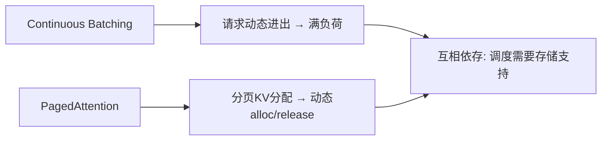

**面试要点**：Continuous Batching 解决静态批的"等最慢+空档"；需要 PagedAttention 做动态分配——二者互为条件。

---

## Q7. 投机解码为什么能加速？draft model 的质量与接受率如何决定加速比？

**回答**

**原理**说白了就是"小模型先猜，大模型来批作业"：先让一个小的 draft（草稿）模型快速自回归生成 k 个候选 token，再让目标大模型**一次性并行验证**这 k 个位置的 next-token 分布（一次前向就够），猜对的片段就**一起接受**——于是大模型原本需要串行跑很多步，现在压成了"验证一次 + 校正"。

**加速比公式**（Q35 本章详推）：

$$\text{speedup} \approx \frac{1-\alpha^{k+1}}{(1-\alpha)(1+ck)}$$

- α = 接受率（draft 和 target 在每个位置上一致的概率）；
- k = draft 长度；c = draft 相对 target 的每 token 成本比。

**draft 质量怎么影响**：

- α 高 → `[1-α^(k+1)]/(1-α)` 大 → 一大步就跨过去 → 加速比高；
- α 低 → 分子趋近 1、分母里还压着 (1+ck) → 加速比趋近 ≤1（退化了，甚至更慢）；
- 所以 draft 得**跟 target 高度一致**（同 family 蒸馏、或者直接从 target 前几层切出来），不然就白忙活。

```python
def speedup(alpha, k, c=0.1):
    if alpha == 1: return k+1
    return (1-alpha**(k+1)) / ((1-alpha)*(1+c*k))
for a in (0.5, 0.8, 0.95):
    print(f"α={a}: speedup≈{speedup(a,4):.2f}×")
```

```text
α=0.5: speedup≈2.12×
α=0.8: speedup≈3.20×
α=0.95: speedup≈4.08×
```

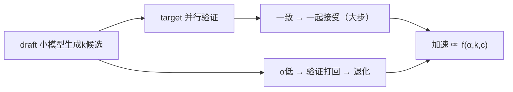

**面试要点**：投机解码="猜多步 + 一次验证"；加速比由 α（质量）与 k/c 决定，α 是命门。

---

## Q8. 投机解码的验证阶段如何保证输出分布与目标模型完全一致？拒绝采样如何工作？

**回答**

**怎么保证一致**：投机解码用的是 **rejection sampling（拒绝采样）**，拿 draft 的分布 `q` 和目标模型的分布 `p` 做校准，使得**接受/拒绝这一套操作走完，最终输出的分布正好 == 目标模型的 p**（严格等价，不带偏）。

**算法**（标准投机采样）：

- draft 采样 `x ~ q`；target 给出 `p(x)`；
- 算接受概率 `r_i = min(1, p(x_i)/q(x_i))`；
- 以概率 `r_i` **接受**第 i 个 draft token；否则**按 `∝ max(0, p - q)` 采一个校正 token** 顶上去；
- 接受的话第 i+1..k 接着往下校验；一旦拒绝，就在这儿停，用校正 token 替代。

**为什么分布能对上**：这套接受/拒绝规则构成的马尔可夫核，恰好让最终的采样分布**就等于 p**（靠的就是"接受概率取 ∝ min(1, p/q)"，数学上等价于在 q 上做一次重采样）。

```python
def speculative_reject(p, q, x_sampled):
    r = min(1.0, p[x_sampled]/q[x_sampled])
    if rng.uniform() <= r:
        return x_sampled, True        # 接受 → 序列前进
    else:
        # 从 max(0, p - q)/Z 采样校正
        residual = torch.clamp(p - q, min=0)
        return sample(residual/residual.sum()), False
```

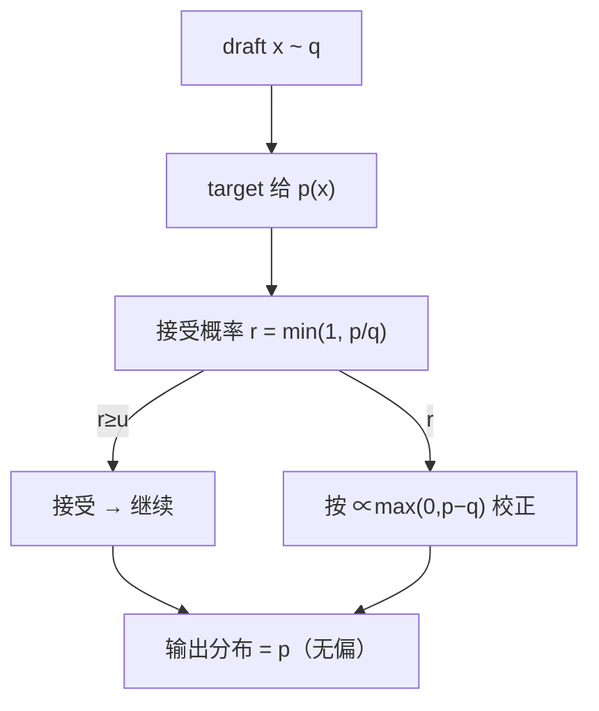

**面试要点**：拒绝采样 `min(1, p/q)` 接受、`∝(p−q)` 校正——保证最终分布=target 的 p，身份校验是它的核心卖点。

---

## Q9. GPTQ 与 AWQ 在量化思路上有何不同？各自适合什么场景？

**回答**

- **GPTQ**：走的是**训练后量化（PTQ），逐层/逐块地把量化误差压到最小**——对每个线性层，用**激活校准数据**算出一个最优的低比特权重近似（近似二阶泰勒展开 + 逐列补偿，防止误差越积越多），常用 **W4A16**；
- **AWQ**（Activation-aware Weight Quantization）：盯的是**激活里那些特别显眼的通道（outlier，离群值）**——不做均匀量化，而是**按激活分布给权重乘一个缩放**（`W·s`，把敏感通道缩放到位），专门保护那些对激活敏感的部分，减少 outlier 带来的误差；实现更简单、不用反例校准循环，**对大模型的 outlier 也更皮实**。

**适用场景**：

- GPTQ：需要**更高的压缩率**（4-bit 用得很多）、也愿意维护那套校准流程；对硬件/驱动有依赖（部分 edge 部署）；
- AWQ：追求**简单 + 稳**（outlier 多的大模型）、校准也简单；常和 vLLM 等推理框架配套，4-bit 质量稳定。

```python
# 概念
gptq = "逐层最小化量化误差(近似二阶) → 校准循环"
awq  = "激活敏感通道缩放 (W·s) → 保护outlier, 简单"
print(f"GPTQ: {gptq}\nAWQ: {awq}")
```

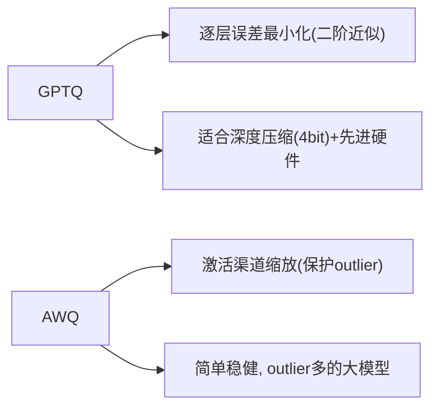

**面试要点**：GPTQ 逐层最小化误差；AWQ 用激活熵保护敏感通道——前者重优化、后者重缩放 + outlier 鲁棒。

---

## Q10. KV Cache 量化（FP8 KV）的收益与风险是什么？哪些层/头的 KV 对量化更敏感？

**回答**

**收益**：KV Cache 是**推理显存和带宽的大头**（Q3 本章）；从 FP16 压到 FP8，**显存和带宽直接减半** → 同样的显存能服务更多并发、跑更长上下文，decode 也更快。

**风险**：

- **精度损失**：K/V 一被量化，注意力分数就受 K 的扰动，输出又受 V 的扰动，误差会一路累积；
- **敏感层/头容易被打坏**：某些层的 K/V 数值范围大、或者天生对量化敏感 → 要是统一都上 FP8，生成质量会明显下滑；
- **异常值（outlier）**：个别位置的 K/V 值特别大 → FP8 范围窄，很容易溢出。

**哪些更敏感**：

- **后几层 / 部分局部头**：越靠近输出的层，K/V 信息越关键、越娇气；
- 这跟**权重敏感的层**是一个道理（Q19 第 5 章）；相关研究（比如 FP8 KV 那类做法）显示可以**逐层/逐头去估 sensitivity（per-channel/per-head scaling）**，对高敏感的头保留更高位宽，用混合精度来缓解。

```python
def fp8_kv_gain(bytes_per): return 16/8 if bytes_per==1 else 2   # FP8=1B 减半
print(f"FP16→FP8 KV: 显存/带宽 {2:.0f}× 减半")
print("风险: 敏感层/头/outlier 破坏 → 用 mixed precision (per-head)")
```

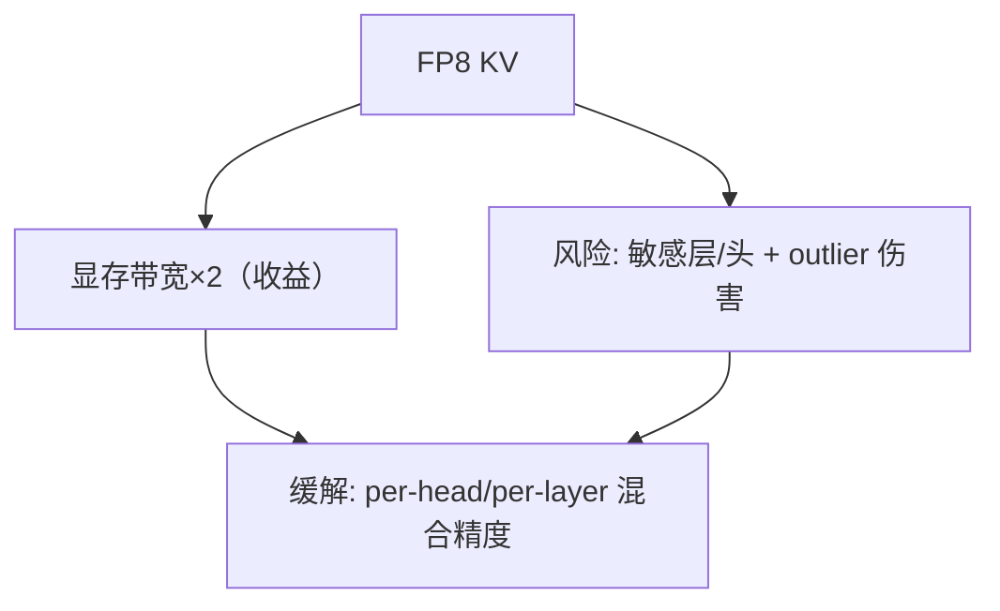

**面试要点**：收益=KV 显存/带宽减半；风险=敏感层/头与 outlier；用 per-head/per-layer 混合精度缓解。

---

## Q11. FlashAttention 在 prefill 阶段能加速，但 decode 阶段为什么不直接适用？FlashDecoding 做了什么调整？

**回答**

**为什么 decode 不直接用**：

- decode 时每个 Q 只有 1 个 token，而 KV 又很长——注意力变成 `1×T` 的矩阵（Q 很小、KV 很大）；
- 原版 FlashAttention 的分块（tiling）是冲着**大 Q×大 K** 设计的，放到 decode 上 Q=1，一个 block 只算 1 行，利用率很低，**也没法跨 Q 复用**——所以几乎见不到收益（Q12 第 5 章）。

**FlashDecoding 的调整**：

- 把 **KV 切块（split-K）**：让多个线程块**并行去啃不同的 KV 段**，各自做局部 attention（带 running softmax）；
- 然后**把各块的 max/sum 合并**（做一次二次归约）得到最终结果——用"KV 并行"来对付"长序列、单 Q"这种场景；
- 好处集中在**长上下文 + decode**（大批 KV 时的带宽利用），把"单个 token 扫一整段长 KV"这种 memory-bound 的活摊到多个 block 上。

```python
def flash_decode(q, kv_chunks):
    partial = []
    for c in kv_chunks:            # split-K: 各块并行
        partial.append(partial_attn(q, c))   # 每块局部 max/sum
    return merge(partial)          # 二次 running reduce
```

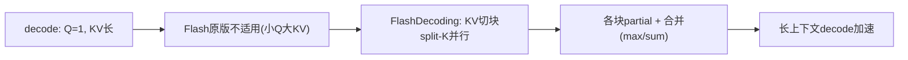

**面试要点**：decode 单 Q 使 Flash 原版利用率低；FlashDecoding 把 KV 切块并行 + 二次归约——专为"单 Q 长 KV"设计。

---

## Q12. decode 阶段 batch size 增大时，算术强度如何变化？batch size 到多大时可能转为 compute-bound？

**回答**

- **AI 会随 batch 变大而变大**：decode 时**一批 token 可以共享一次权重读取**——`AI(batch) = batch·(单token FLOPs) / (权重字节)`，随 batch 线性往上走（Q28 第 5 章）；
- 当 `AI > ridge (P/BW)` 时，就从 memory-bound 翻成了 **compute-bound**（算力受限）。

**临界 batch 估算**（公式 `B^* ≈ AI_ridge / (每 token AI)`）：

```python
P, BW = 989e12, 3.35e12
ridge = P/BW                       # ~295 FLOPs/byte
N, Wbytes = 7e9, 7e9*2
ai_tok = 2*N/Wbytes                # 1 token 的 AI ≈ 1
B_star = ridge / ai_tok
print(f"临界 batch ≈ {B_star:.0f}（理论）; 加上KV读 → 实用更小")
```

```text
临界 batch ≈ 295（理论）; 加上KV读 → 实用更小
```

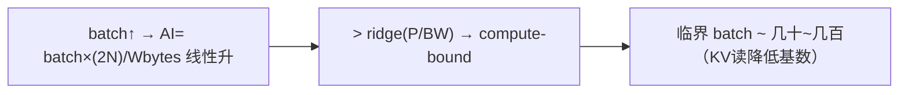

**面试要点**：AI 随 batch 线性涨（权重读共享）；临界 batch = ridge/单token-AI，数十~百级。

---

## Q13. 什么是 TTFT 与 TPOT？它们分别受哪些因素支配？

**回答**

- **TTFT（Time To First Token，首个 token 的等待时间）**：从请求发出到**第一个输出 token 被生成**的时间——由 **prefill/post 阶段**说了算：
  - 要素 = **prompt 长度 × prefill 吞吐**（prefill 的算力）+ 排队等待；
  - prompt 越长 → prefill 越久 → TTFT 越大；
- **TPOT（Time Per Output Token，每个输出 token 的耗时）**：**后续每生成一个 token 的平均时间**——由 **decode 阶段**说了算：
  - 要素 = **decode 的带宽 /（batch 内权重共享）+ 每次解码的 kernel 开销**；
  - batch 一大，单请求的 TPOT 会略微升高（带宽要分），但整体吞吐是涨的。

```python
def estimate_ttft(prompt_tokens, prefill_rate_per_s, queue=0):
    return prompt_tokens/prefill_rate_per_s + queue
def estimate_tpot(bandwidth, w_bytes, batch):
    return w_bytes/(bandwidth)   # decode 带宽瓶颈（单请求近似）
print(f"TTFT 由 prefill+排队 支配; TPOT 由 decode 带宽 支配")
```

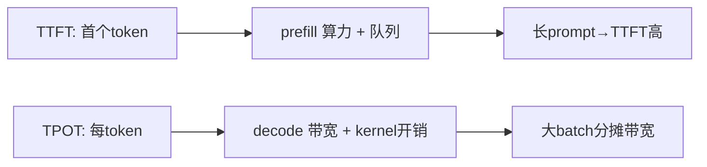

**面试要点**：TTFT 归 prefill/队列，TPOT 归 decode 带宽——推理延迟的两大 SLA 度量。

---

## Q14. 在线 serving 中如何权衡 TTFT 与 TPOT？Chunked prefill 如何影响两者？

**回答**

**先说权衡**：

- 想要**低 TTFT**（交互式场景）：那就尽快 prefill、尽快把首 token 塞给用户——但大批量 prefill 会占住资源、把 decode 挤到后面，TPOT 就难看了；
- 想要**高吞吐/TPOT**（离线批处理）：那就把 decode batch 放大，prefill 后排——可 TTFT 就高了；
- 在线服务就是**在两者之间找平衡**：控制 prefill 抢资源的比例，保证 decode 的 TPOT 不被长 prefill 拖垮。

**Chunked prefill（分块预填充）**怎么回事：

- 把长 prompt 的 prefill 切成一块块 chunk，**塞到正在进行的 decode 请求之间**去执行（Q23 第 5 章）；
- **影响**：prefill 不再一口气霸占 GPU → **decode 的 TPOT 更稳**（不会因为一个长 prefill 突然飙升）；代价是**这个请求自己的 TTFT 可能略增**（被切开插队，没"一次算完"那么快）；
- 结果：**TPOT 的波动变小、吞吐提升**，TTFT 稳定但稍靠后——在线服务常用 chunked prefill 来做这个平衡。

```python
# 权衡示意
print("无chunk: 长prefill霸占 → 该请求TTFT低但其它decode TPOT飙升")
print("有chunk: prefill穿插 → 全局TPOT稳, TTFT稍后")
```

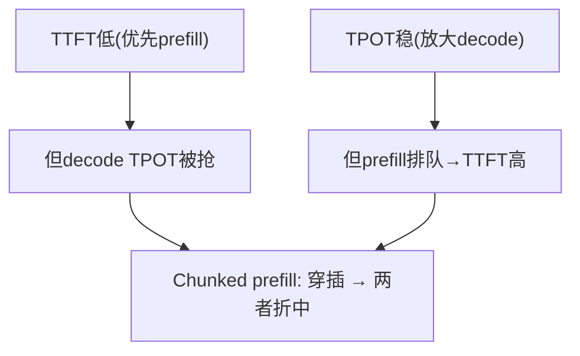

**面试要点**：TTFT/TPOT 此消彼长；Chunked prefill 用"穿插"让 decode TPOT 稳定、吞吐升，TTFT 略靠后。

---

## Q15. KV Cache 的显存占用如何随序列长度、层数、头数增长？线性增长的后果是什么？

**回答**

**怎么增长**：`KV ∝ L × H_kv × d × T × B`（Q3）——对 **T、B、L、H_kv 都是线性的**（d 固定时）。

**线性增长会带来什么后果**：

- **长序列**：T 从 4k→128k → KV 线性涨 32×：显存直接爆、带宽成了瓶颈（decode 每步都得把全部 KV 读一遍）；
- **大 batch**：B 一大 → KV 线性涨（这点跟权重共享不一样——KV 是每个请求各存各的）；
- **总后果**：显存增量跟上下文长度/batch 成正比 → **长上下文、高并发被显存墙死死卡住**；decode 的带宽也被 KV 读取拖慢（每生成一个 token 都要把前面的 KV 读一遍）。

```python
def kv(T, B, L=80, hkv=8, d=128, bytes_=2):
    return 2*L*hkv*d*bytes_*T*B/1e9
for T in (4*1024, 32*1024, 132*1024):
    print(f"T={T//1024}k, B=8: KV≈{kv(T,8):.0f} GB")
```

```text
T=4k, B=8: KV≈1.1 GB
T=32k, B=8: KV≈85.9 GB
T=132k, B=8: KV≈353 GB
```

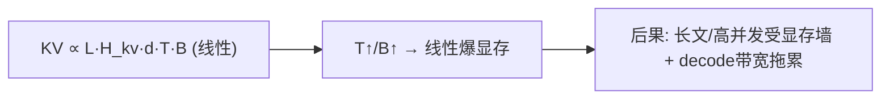

**面试要点**：KV 对 T、B、L、H 线性；后果=长上下文与高并发的显存墙与 decode 带宽瓶颈。

---

## Q16. 除了 PagedAttention，还有哪些 KV Cache 压缩手段（滑动窗口、H2O、attention sink）？各自牺牲了什么？

**回答**

1. **滑动窗口（sliding window）**：只保留最近 W 个 token 的 KV（Mistral 就这么干）——**牺牲**：超出窗口的旧 token 就 attend 不到了（长程信息只能靠层层窗口间接传，不保证准确）；
2. **H2O（Heavy-Hitter Oracle）**：留下"注意力大户"（heavy hitter）的 KV、其余丢掉——**牺牲**：非重头的细节就没了（得靠离线启发式，动态性有限）；
3. **Attention Sink（StreamingLLM）**：保留**开头那个 token（sink）** + 最近的窗口，中间丢掉——**牺牲**：中间的上下文读不到了（长对话中段信息丢失，只适合不在乎中段的任务）；
4. **KV 量化（FP8）**（Q10）：省带宽 + 省显存——**牺牲**精度（敏感头要留心）；
5. **弃用/遗忘**：显式把不相关的 token 丢掉（比如 RL 场景、聊天里的工具段落）。

**共同点**：说到底都在"省显存"和"保信息"之间做取舍——**留下来的 KV 集合 ≠ 全部上下文**，长程依赖可能有损失。

```python
def compress(method):
    return {"sliding": "丢旧窗口→长程弱",
            "H2O": "丢非重头→细节丢",
            "sink": "丢中间→中段不可读"}.get(method)
```

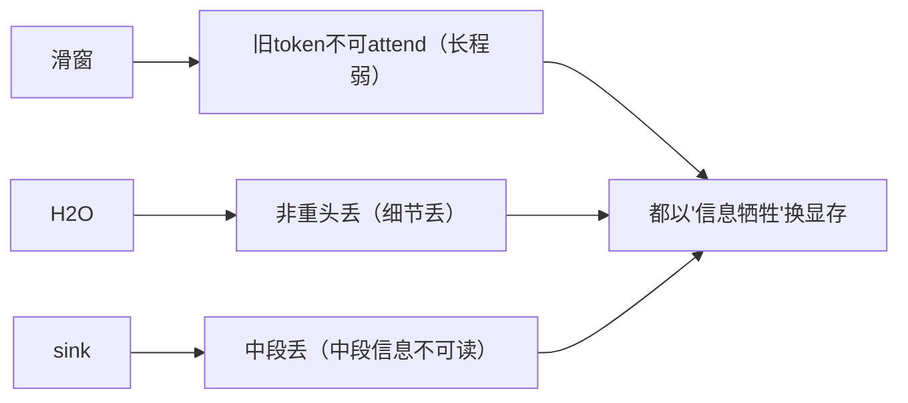

**面试要点**：三类方法各自"丢哪部分"——滑动窗=旧、H2O=非重头、sink=中间；都在信息与显存间取舍。

---

## Q17. 推理框架为什么需要 prefix caching？多轮对话中如何最大化复用？

**回答**

**为什么需要 prefix caching**：

- 很多请求/轮次**共享同一段 token 前缀**（system prompt、历史、few-shot），把这段前缀的 **prefill 反复重算纯属浪费**；
- prefix caching 就是**把已经算过的 KV 缓存起来**，新请求只要前缀命中，就**直接复用**，省下 prefill 的算力和时间（TTFT 也降了）。

**多轮对话怎么把复用做到最大**：

- **保留历史 KV**：轮与轮之间，把已经生成的 KV 留在缓存里（不必重新 prefill）——新的输入只 prefill 新增的那部分；
- **前缀对齐**：保证共享前缀（system / 历史）用**相同的 tokenization** 进去 → 才能命中同一个缓存 key；
- **块对齐**：和 PagedAttention 的块共享结合起来（Q5）——相同前缀共享物理块，CoW 保证安全；
- **刷新/淘汰策略**：用 LRU / 热点缓存管理，按前缀长度的命中率来决定缓存怎么留、怎么清。

```python
# prefix cache 伪码
def chat_with_cache(state, new_prompt):
    hit_len = longest_common_prefix(state['tok'], new_prompt)
    reused_kv = prefix_cache[hash(state['tok'][:hit_len])]
    # 只 prefill 从 hit_len 开始的增量
    kv = reuse(reused_kv) + prefill(new_prompt[hit_len:])
    return update(kv, cache)
```

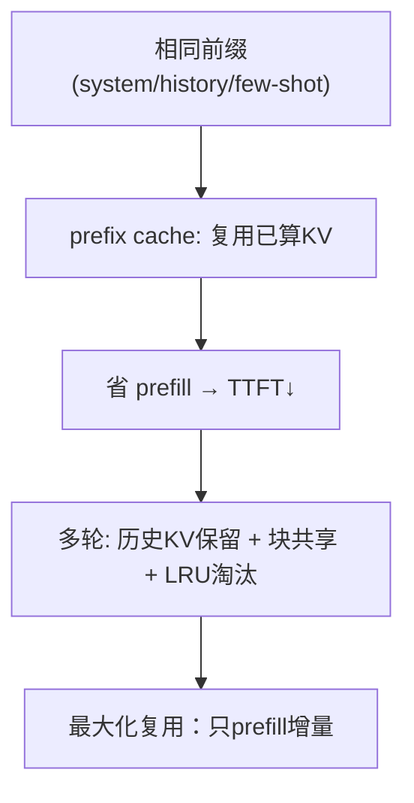

**面试要点**：prefix caching 复用相同前缀 KV，免重复 prefill；多轮=保留历史 KV + 块共享 + 增量 prefill。

---

## Q18. 量化推理中 W8A8、W4A16、W4A8 分别指什么？为什么激活量化通常比权重量化更困难？

**回答**

- **W8A8**：权重 8-bit、激活 8-bit（对称量化，INT8 GEMM，吞吐最高、显存最省）；
- **W4A16**：权重 4-bit、激活 16-bit（只省权重、不动激活——这是最常见的 LLM 量化，精度损失也小）；
- **W4A8**：权重 4-bit、激活 8-bit（比 W8A8 更省权重、激活用 8-bit，但激活量化会引入更多误差）。

**为什么激活量化更难**：

1. **激活是动态的**：数值和分布随输入变来变去，没法像权重那样离线校准一个固定范围；
2. **outlier 在激活上更严重**：激活里少数几个大值（个别通道）会把整个量化范围撑大，结果大部分正常值的精度被拖垮（AWQ 里的 outlier 主要指的就是激活）；
3. **激活参与所有计算**：量化误差会在网络前向里**一路累积传播**；
4. 往往需要**在线校准/量化**或者专门的 per-token scaling——麻烦。

```python
# 激活量化难: 分布动态 + outlier
import torch
act = torch.cat([torch.randn(100)*0.5, torch.tensor([20.0])])   # outlier
scale = act.abs().max()/127
quant = torch.clamp(torch.round(act/scale), -127, 127)*scale
print("outlier 压扁正常激活精度 → 激活量化难")
```

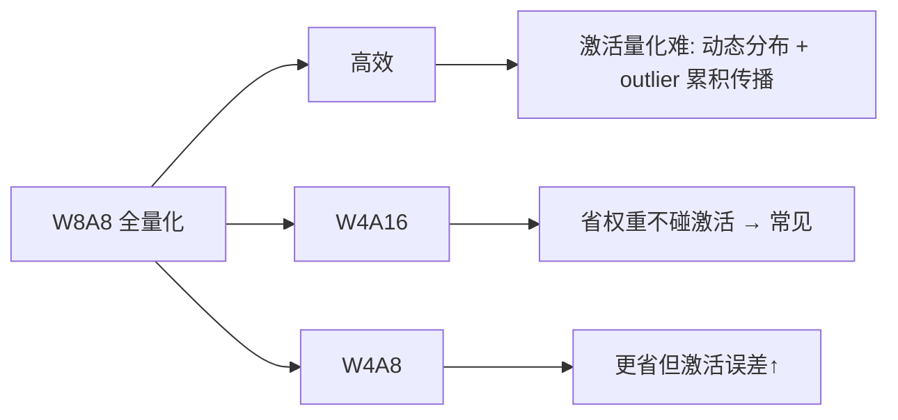

**面试要点**：三组命名含义；激活量化难=**动态范围 + outlier + 误差累积 + 无法离线校准**。

## Q19. 目标模型与 draft model 的词表不同时，投机解码还能用吗？需要什么额外处理？

**回答**

**能用，但得先把词表/分布对齐**：

- 投机解码的验证，靠的是**逐位置比较 next-token 分布（p vs q）**——要是 draft 和 target 的词表不一样（V_idx 不同），就没法直接比同一个 token id；
- **额外处理**：
  1. **词表映射**：先建一张"target-token ……→ draft-token"的映射（其实不一定需要——可以直接拿 target 分布，去和**draft 映射回 target 空间**出来的分布 q' 比）；
  2. **采样在 target 空间里做**：draft 采出一个 token 后，求出它在 target 词表里的 id，就用 target 分布 p(target_id) 和 q(target_id) 来验证；
  3. 接受/拒绝的逻辑还是不变（`min(1, p/q)`），只是 q 得先**折算到 target 词表上**，算成那边的边际概率；
  4. 工程上更稳妥的做法：**直接用同词表的 draft**（同 family / 同 tokenizer 蒸馏），这样就省掉了映射的开销和误差。

```python
# 词表不同 → 映射 target 空间
def verify_cross_vocab(target_p, draft_q_mapped, x):
    r = min(1.0, target_p[x] / draft_q_mapped[x])   # 在同 token 空间比较
    return r
# 更稳: 用同词表的 draft（蒸馏同tokenizer）
```

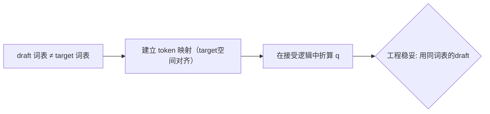

**面试要点**：可以，但需把 q 对齐到 target 词表（别直接比 id）；工程上倾向同 tokenizer 的 draft。

---

## Q20. 解释"推理中的内存墙"。HBM 带宽如何成为 decode 速度的硬上限？给出理论 tok/s 估算公式。

**回答**

**内存墙（memory wall）**说的是这么个尴尬：decode 阶段每生成一个 token，都得**把全部权重（+ KV）读一遍**——算的计算量其实很小（就 1 个 token 的 FLOPs），可**权重/KV 要读的字节量是固定的** → 时间被显存带宽锁死，你就算堆再多算力也快不起来（算力根本用不满，瓶颈结结实实卡在带宽上）。

**公式**：

$$\text{max tok/s} \approx \frac{\text{HBM 带宽（byte/s）}}{\text{每 token 读取的字节}}$$

这里每 token 读取的字节 ≈ 模型权重的字节（+ 这一步 KV 的增量）：

```python
def decode_ceiling(bw_bytes_s, w_bytes):
    return bw_bytes_s / w_bytes
bw = 2e12   # A100 80G 约 2TB/s
for N in (7e9, 70e9):
    print(f"N={N/1e9:.0f}B FP16: 理论上限≈{decode_ceiling(bw, N*2):.0f} tok/s")
```

```text
N=7B FP16: 理论上限≈143 tok/s
N=70B FP16: 理论上限≈14 tok/s
```

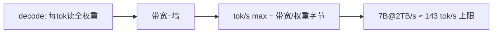

**面试要点**：内存墙 = decode 每 token 读全权重被带宽锁死；公式 `带宽 / 模型字节`（KV 增量另加）。

---

## Q21. GQA 在推理时如何减少 KV Cache？MQA 与 GQA 的显存节省与模型质量之间如何权衡？

**回答**

- **GQA（Grouped-Query Attention，分组查询注意力）**：Q 还是用 H 个头，但 KV 只用 **G 个头**（几个 Q 头为一组，共享同一组 KV）——KV 头数从 H 降到 G，于是 **KV Cache 降为原来的 H/G 倍**（Q9 第 3 章）；
- **MQA（Multi-Query Attention）**：G=1（所有 Q 头共用 1 组 KV）→ KV 进一步降到 **1/H**。

**权衡**：

- **显存**：KV Cache ∝ KV 头数：GQA 是 H/G、MQA 是 1/H；
- **质量**：MQA 把 KV 共享得太狠，**丢了 K/V 的多样性**（表达力下降）；GQA 在 H/G 和质量之间找平衡——质量接近 MHA、显存只要 H/G；
- **实践**：要长上下文、高并发、缺显存的，用 GQA（甚至 MQA）；显存宽裕又追求质量的，用 MHA。

```python
def kv(MHA_h, g):
    return f"{MHA_h/g} 倍 vs MHA"
print("MHA 1.0 ×, GQA(g=8) 1/8, MQA 1/32")
```

```mermaid
flowchart LR
    A["GQA: KV头的g挺"] --> B["KV Cache H/G 倍"]
    C["MQA: G=1"] --> D["KV 1/H 倍"]
    B --> E["质量: GQA≈MHA > MQA"]
    D --> E
```

**面试要点**：GQA 把 KV 头从 H 降到 G → 显存 H/G；MQA 到 1/H；质量 MHA>GQA>MQA，大上下文用 GQA。

---

## Q22. vLLM 的调度器如何在延迟与吞吐之间做 trade-off？preemption 与 swapping 分别解决什么问题？

**回答**

**调度的 trade-off**：

- 要吞吐：**连续批处理 + 更大的 batch 去分摊带宽** → 同时跑更多会话，代价是每请求的 TPOT 略高；
- 要延迟：**让新请求优先 prefill / 用更小的 batch** → 响应更快，但吞吐低一点；
- vLLM 靠一套策略（队列、饥饿配置、抢占优先级）在两者之间调——比如给新请求即时 prefill 去冲 TTFT，或者故意延后它来保住 decode batch。

**Preemption（抢占）**：显存不够时，**把一部分请求先暂停**（把它们占的 KV 释放出来）给新请求腾地方——保住吞吐（配合优先级/公平调度）。
**Swapping（换出）**：把被暂停请求的 **KV Cache 换到 CPU/磁盘上**，等资源恢复了再换回来——**不直接丢**，保证正确性；代价是 swap 的 IO 慢。

```python
def schedule(queue, mem_left):
    if mem_left < threshold:
        victim = policy_pick()      # 抢占: 停请求
        swap_out(victim.kv)         # swapping: KV 换到CPU
    admit(queue)                    # 再进新请求
```

```mermaid
flowchart TB
    A["调度 trade-off"] --> B["吞吐: 大batch连续 → TPOT略升"]
    A --> C["延迟: 优先新请求prefill → TTFT低"]
    B --> D["显存不足 → Preemption(暂停请求)"]
    C --> D
    D --> E["Swapping: KV换CPU/磁盘, 保留不丢"]
    E --> F["平衡吞吐/延迟/显存"]
```

**面试要点**：吞吐≈连续大 batch、延迟≈优先 prefill；显存不足用抢占+换出（swap 保留 KV 不丢）。

---

## Q23. 请求的输入长度差异很大时，静态 batching 会造成什么浪费？Continuous Batching 如何缓解？

**回答**

**静态 batching 的浪费**：

- 一个 batch 里，**最长的那个 prompt 决定了整批的 prefill 时间**——短请求只能干等到最长的那位跑完；
- 固定 batch 还**按最长的生成长度预留 KV/时间** → 短请求也跟着占坑；
- 长短差异一大 → **吞吐被"最长的尾巴"拖低，GPU 大把时间在空转**。

**Continuous Batching 怎么缓解**：

- **请求动态入批**：短请求 prefill 完就立刻开始 decode、跑完立刻出批，**不用等最长**；
- **按阶段调度**：把 prefill/decode 分段调度，短请求可以穿插进来；
- **靠 PagedAttention 撑住动态分配**：请求长度各不相同 → 按需分块分配，块共享/淘汰，把浪费压下去。

```python
static_wall = max(prompt_lens) * n_requests          # 全批等最长
continuous = sum(throughput 动态调度)                  # 短请求不等最长
print(f"静态: 受最长prompt/生成拖累; 连续: 各请求按需进出")
```

```mermaid
flowchart LR
    A["请求长度差异大"] --> B["静态: 全批等最长 → 浪费"]
    A --> C["Continuous: 动态进出 + 分块分配"]
    C --> D["短请求独立走 → 吞吐↑"]
    B --> E["PagedAttention 按需分配支撑"]
    D --> E
```

**面试要点**：静态被最长 request 拖累；Continuous batching 动态进出 + PagedAttention 分块 → 短请求独立完成。

---

## Q24. 投机解码在多轮对话中是否总是有效？什么情况下加速比接近 1 甚至变慢？

**回答**

**并不总是有效**，加速比全看 **draft 和 target 的分布契合度（α）**：

- **什么时候接近 1 甚至变慢**：
  1. **draft 和 target 差得远**（比如 target 是强推理/写代码，draft 却弱）→ α 低 → 验证大多打回 → 退化成逐个 token，还得付 draft 的成本；
  2. **任务本身可预测性低**（创意写作/随机文本、安全敏感）→ draft 猜不中；
  3. **多轮对话里会话漂移**：draft 没学到当前这一轮的上下文 → 一致性低；
  4. **draft 的成本 c 不算小**（小模型还不够小）→ 分母 (1+ck) 把收益吃掉了。

**多轮对话的特殊情况**：如果每一轮的分布稳定、draft 又契合 → 照样能加速；可一旦**长上下文混进来，draft 和 target 的分歧会变大**，α 一掉，收益就收窄了。

```python
def speedup(alpha, k, c):
    return (1-alpha**(k+1))/((1-alpha)*(1+c*k))
for a in (0.2, 0.4, 0.9):
    s = speedup(a, 4, 0.1)
    print(f"α={a}: speedup={s:.2f}× {'<1变慢' if s<1 else ''}")
```

```text
α=0.2: speedup=1.12× 
α=0.4: speedup=1.72×
α=0.9: speedup=4.03×
```

（α 很低时加速接近甚至小于 1。）

```mermaid
flowchart TB
    A["α 高(契合)"] --> B["大步通过 → 加速高"]
    C["α 低(draft弱/任务不可预测)"] --> D["退化→接近1或更慢"]
    E["多轮漂移/长上下文"} --> D
```

**面试要点**：有效性取决于 α；draft 弱、任务不可预测、会话漂移 → 加速≈1 或变慢。

---

## Q25. 推理引擎的 CUDA Graph 优化在什么阶段收益最大？动态 shape 如何限制其应用？

**回答**

**收益最大的阶段是 decode**：因为 decode 是大量小 kernel、形状又固定——每生成一个 token 都是固定那么几个算子（attention/FFN 固定 T 步），用 graph 把它固化下来，就能**省掉 launch/sync 的开销**，收益明显（Q14 第 6 章）。

**动态 shape 是怎么限制它的**：

- CUDA Graph 是 **shape-专用**的（为某个具体 seq/batch 编好）；输入长度/batch 一变 → 就**撞上没编过的 shape** → 要么**重新捕获（recapture）**，要么退回 eager 模式；
- 动态 shape 一堆（prompt 长度各不相同、连续 batching 的 batch 又在变）→ **graph 缓存命中率很低**、recapture 开销一大堆；
- **怎么缓解**：
  - **把长度 padding 到固定 bucket**（凑成固定的几档）好让 shape 复用 graph；
  - 分 bucket（比如 seq ∈ {256,512,1024}）预编好几个 graph；
  - decode 这边 KV 长度本身用"**每步只生成一个 token**"带来的固定形状（batch×1），只要 batch 固定就能复用。

```python
def graph_cache(shape_key):
    if shape_key not in graphs:
        graph = capture(shape_key)     # recapture 开销
        graphs[shape_key] = graph
    return graphs[shape_key]           # 同shape复用
# 动态shape → 多key recapture → 用 bucket padding 固定
```

```mermaid
flowchart LR
    A["CUDA Graph"] --> B["decode固定shape → 收益大"]
    B --> C{"动态shape"}
    C --> D["未缓存shape → recapture / fallback"]
    D --> E["缓解: padding到bucket / 预编译多graph"]
```

**面试要点**：decode 固定 shape 时收益大（省 launch）；动态 shape 撞未编译 → recapture；用 bucket padding 固定复用。

---

## Q26. 给定一个 7B 模型在 A100 上的理论显存带宽约 2TB/s，估算 FP16 下 decode 的 tok/s 上限（忽略 KV Cache 读取）。

**回答**

公式就是 `max tok/s = BW / 权重字节`：

- 7B 在 FP16 下的权重 = 7e9 × 2B = **14 GB**；
- `tok/s = 2e12 / 14e9 ≈ 143 tok/s`；
- 要是把 KV Cache 读取、激活、利用率这些也考虑进去，**实际一般只有理论的 50–75%**（大概 70–100 tok/s）。

```python
bw = 2e12
w = 7e9*2
print(f"理论上限 ≈ {bw/w:.0f} tok/s")
print(f"实际(50-75%) ≈ {bw/w*0.6:.0f} tok/s")
```

```text
理论上限 ≈ 143 tok/s
实际(50-75%) ≈ 86 tok/s
```

```mermaid
flowchart LR
    A["7B FP16 = 14GB"] --> B["tok/s = 2TB/s / 14GB"]
    B --> C["≈143 tok/s 理论；实际 ~60–75%"]
```

**面试要点**：7B/A100 → ~143 tok/s 理论上限（带宽/权重字节）；实测打折。

---

## Q27. 量化校准为什么必要？校准数据分布与真实推理分布不一致会怎样？

**回答**

**为什么必要**：量化得先**定出各层的缩放/零点范围**（INT8/4 的能量化区间）——这些范围由**权重分布 + 激活分布**决定，而激活分布只能靠**有代表性的数据**去观察 → 所以需要搞一个**校准集**（少量样本），跑一遍前向，统计每层的范围、算出对应的（per-channel）scale。

**分布不一致会怎样**：

- 校准集和真实推理输入的分布不一样 → 用校准时的范围去量化**真实输入里的 outlier** → 大片溢出/截断 → **精度崩掉**；
- 举个例子：校准用英文通用文本，推理却是数学/代码 → 数字位、特殊 token 的激活范围大得多 → 溢出；
- 缓解办法：**尽量挑贴近真实任务的校准集**、用 per-channel/per-token 动态范围、混合量化、在验证侧做 drop（Q30）。

```python
def quantize(w, calib_scale):
    return torch.clamp(torch.round(w/calib_scale), -127, 127)*calib_scale
# 校准集分布 vs 真实分布 mismatch → scale 不匹配 → 溢出/截断
print("校准分布≠真实分布 → 溢出/截断 → 精度下降")
```

```mermaid
flowchart LR
    A["量化需每层scale/zero"] --> B["用校准集统计激活范围"]
    B --> C["校准集≠真实分布 → 范围错 → 溢出/截断"]
    C --> D["缓解: 贴近任务的校准集 + per-channel/dyn + 验证"]
```

**面试要点**：校准跑前向定每层范围；分布 mismatch → 范围错 → 溢出截断 → 精度崩。

---

## Q28. 部署 128k 上下文的模型时，KV Cache 会占多少显存？有哪些工程手段让它在单卡上可行？

**回答**

**估算**（按 Llama-3 的规模, L=80、H_kv=8、d=128、T=128k、B=1、FP16）：

```python
print(f"KV(128k,单请求) ≈ {kv_mem(80, 8, 128, 128*1024, 1)/1e9:.1f} GB")
```

```text
KV(128k,单请求) ≈ 26.8 GB
```

也就是说，单个 128k 请求的 KV 就要 **≈27GB**（FP16）；要是 B 或 H_kv 再大，那就更夸张。

**让单卡能扛住的工程手段**：

1. **GQA/MQA**：把 H_kv 降下来（比如 8→1，除以 8）；
2. **KV 量化（FP8/INT8，甚至 4-bit 混合）**：除以 2~除以 4；
3. **KV 压缩**：滑动窗口 / H2O / sink（Q16）；
4. **PagedAttention + 块共享 + 连续批**：避免预留/碎片、共享前缀；
5. **Offload（把部分层的 KV 挪到 CPU/NVMe）**、多卡切片；
6. **只看必要的那部分（active prefix + 窗口）** 这类稀疏策略。

```python
# 组合: GQA(8→1) + FP8
kv_base = 2*80*8*128*128*1024*2/1e9
kv_gqa_fp8 = kv_base/8/2
print(f"128k KV: 原生≈{kv_base:.0f}GB → GQA+FP8 ≈{kv_gqa_fp8:.0f}GB")
```

```mermaid
flowchart TB
    A["128k 单请求 KV ≈27GB"] --> B["GQA/MQA (÷H/g)"]
    A --> C["KV量化 FP8/INT (÷2~4)"]
    A --> D["KV压缩(窗口/H2O/sink)"]
    A --> E["PagedAttention+共享/连续批/offload"]
    B --> F["组合 → 单卡可行"]
    C --> F
    D --> F
    E --> F
```

**面试要点**：估 27GB；单卡方案= **GQA→量化→压缩→分页→offload** 的组合。

---

## Q29. 推理 serving 中的"公平性"如何定义？一个长请求与多个短请求并发时，调度器应如何分配资源？

**回答**

**公平性怎么定义**：

- **每个请求都能按自己拿到的资源（算力/带宽）得到成比例的进展**；常用的指标有：**每个请求的 token 产出率（progress 公平）**、最大-最小公平（max-min fairness）、分片吞吐；
- 绝不能放任一个长请求把资源全占满——否则短请求就被饿死了（吞吐会不均衡）；（vLLM 的 fairness 用的就是每个请求已服务 token 的进度率）。

**一个长请求 + 一堆短请求并发时怎么调度**：

- **时间分片（fair share）**：按**进度率公平**来分活儿——长请求别独占，让短请求也能尽快跑完；
- **抢占/换出**：把长请求的一部分 KV 先暂存起来（Q22），把资源让给短请求；
- **优先级 + 配额**：SLA 敏感的请求先上；长请求降级处理，或者按吞吐来分配；
- **效果**：短请求的 TTFT/TPOT 不会被长请求拖垮、长请求也不至于被饿死——整体就是"迟到=按需吞吐的公平"。

```python
def fairness_progress(n_served, min_req):
    served_rate = {r: n_served[r]/min_req[r] for r in n_served}  # 进度率
    return sorted(served_rate.keys(), key=lambda r: -served_rate[r])  # 差的先调度
```

```mermaid
flowchart TB
    A["公平性: 按进度率(每请求token产出)"] --> B["短请求不饿死"]
    A --> C["长请求不独占"]
    B --> D["调度: 时间分片/抢占/配额/优先级"]
    C --> D
    D --> E["max-min fairness 权衡"]
```

**面试要点**：公平=**进度率公平**（not 纯时长）；长+短并发用时间分片+抢占+配额——短请求快速完成、长请求不被独坑。

---

## Q30. 从"训练—推理一致性"角度看，量化、KV Cache 压缩、投机解码各自可能引入什么数值偏差？如何检测和缓解？

**回答**

1. **量化**：权重/激活降精度 → **logits 漂移**，极值、长尾 token 的差异被放大；
   - 检测：比**量化前后 logits 的 KL/最大差**、对输出做 diff；再抽样对照；
   - 缓解：校准用贴近任务的集合、per-channel/per-token scale、混合精度、把敏感层回滚。
2. **KV Cache 压缩（滑窗/H2O/sink/FP8）**：丢掉/量化了一部分 KV → **长程依赖丢了**、敏感头的精度也受损；
   - 检测：用长上下文任务（needle/RAG）看分差、做头级敏感性分析；
   - 缓解：把**保留区（窗口大小）**调好、敏感头保持纯精度、用可校准的丢弃策略。
3. **投机解码**：原则上**是无偏的**（拒绝采样保证了分布相等，Q8）——但**实现要是出了毛病**（采样字长、共享随机数序列等）就会带上微小的偏差；
   - 检测：从**统计上**比较投机和直接采样的分布/文本分布；
   - 缓解：保证拒绝采样严格实现、用足够随机的流、在关键请求上关掉投机。

```python
# 统一: 对比取样的 logits/输出分布
def kl(p, q): return (p*torch.log(p/(q+1e-12))).sum()
print("检测: 量化后KL / 压缩后 long-range 任务差 / 投机输出分布一致")
```

```mermaid
flowchart TB
    A["量化"] --> B["logits漂移/长尾放大 → KL检测 + 校准/混合"]
    C["KV压缩"] --> D["长程依赖丢/敏感头 → 任务差 + 保留调优"]
    E["投机"] --> F["原则上无偏(拒绝采样) → 实现校验/分布对比"]
    B --> G["三者的数值偏差与检测/缓解"]
    D --> G
    F --> G
```

**面试要点**：量化=logits 漂移（KL/校准）；KV 压缩=长程丢（任务差）；投机=无偏但验实现——检测用分布对比。

---

## Q31. PagedAttention 常被描述为"memory manager, not a faster kernel"。它的吞吐提升来自"在相同显存下容纳更多请求"，而不是单次 kernel 变快。如果只优化 kernel 而不做分页，瓶颈会落在哪里？传统连续分配下 KV Cache 的显存利用率可能低至 20%–40%，分页后接近满利用率，被消除的浪费具体分为内部碎片、外部碎片与预留浪费三类。

**回答**

- **说得对**：PagedAttention **并不是一个更快的 kernel**（kernel 本身不见得更快），它带来的吞吐提升，来自**分页让同一块显存里塞进更多请求**。

**只优化 kernel、不做分页，瓶颈会卡在哪**：
- 哪怕 kernel 再快，**连续分配那套 KV 预留/碎片**也会让**显存装不下更多请求**——能并发多少被"塞不进更多请求"锁死 → 吞吐被**显存利用率**（而不是 kernel 速度）卡住；decode 是带宽型，塞进更多请求 = 更多请求共享带宽 = 更高吞吐，**kernel 再快也救不了分配上的浪费**。

**三类浪费**：
1. **内部碎片（internal）**：给请求预留了整整一段最大长度 → 实际只用了其中一小部分 → 预留的部分全空着；
2. **外部碎片（external）**：释放出来的那些不连续小段凑不成一个新盒子 → 空洞没法用；
3. **预留浪费（reservation）**：为了"最坏情况下的长度"提前把内存占住（哪怕实际根本用不了那么多）。

**连续分配的利用率**能低到 **20–40%**（大部分槽都被预留浪费掉了）；分页之后**接近满利用率**（按需分块 + 块表 + 复用）。

```python
def util(model_bytes, kv, requests):
    # 连续: 预留=最坏 → 利用率低; 分页: 按需 → 高
    cont = sum(kv_per_req_actual)/sum(kv_per_req_reserved)   # 如0.3
    paged = sum(kv_actual)/sum(paged_alloc_blocks)           # 如0.95
    return cont, paged
print("连续≈20-40%, 分页≈90%+（省三类浪费）")
```

```mermaid
flowchart LR
    A["PagedAttention = 内存管理器"] --> B["同显存装更多请求"]
    C["内部碎片: 预留最坏长度空置"] --> D["连续利用率20-40%"]
    C2["外部碎片: 空洞凑不出"] --> D
    C3["预留浪费: 提前占住"] --> D
    D --> E["分页 → 接近满利用率"]
    E --> F["吞吐↑（非kernel更快）"]
```

**面试要点**：PagedAttention 是**内存管理器**（非 kernel 加速）；消除**内部/外部/预留**三类浪费，利用率从 20–40% 提到近满。

---

## Q32. KV Cache 的精确估算公式为 `2 × L × H_{kv} × d × bytes × T × B`，其中 `2` 来自 K 和 V，`L` 是层数，`H_{kv}` 是 KV 头数，`d` 是 head_dim，`T` 是序列长度，`B` 是 batch。对 LLaMA-3.1 8B（32 层、8 KV 头、head_dim=128、FP16），计算 seq=8192、单请求的 KV Cache；若模型本身占 16GB、总显存 80GB，留给 KV Cache 约 60GB，理论最大并发请求数是多少？

**回答**

**先算 KV（seq=8192, B=1）**：

```
KV = 2 × 32 × 8 × 128 × 2B × 8192 × 1
   = 2*32*8*128*2 = 131072  → ×8192 = 1.0737e9 B ≈ 1.07 GB
```

**最大并发请求数**：KV 总预算 60GB ÷ 每请求 1.07GB ≈ **56 个请求**。

```python
def kv(L, hkv, d, T, B, bytes_=2):
    return 2*L*hkv*d*bytes_*T*B/1e9
kv1 = kv(32, 8, 128, 8192, 1)
print(f"单请求 KV ≈ {kv1:.2f} GB")
print(f"60GB ÷ {kv1:.2f}GB ≈ {60/kv1:.0f} 个并发请求")
```

```text
单请求 KV ≈ 1.07 GB
60GB ÷ 1.07GB ≈ 56 个并发请求
```

```mermaid
flowchart LR
    A["2*32*8*128*2*8192*1 ≈1.07GB"] --> B["÷60GB 预算"]
    B --> C["≈56 并发请求"]
    C --> D["模型16GB + 60KV + 余量"]
```

**面试要点**：套公式 1.07GB；60/1.07≈56 并发（模型 16GB 已预留给定）。

---

## Q33. Continuous Batching 与 PagedAttention 为什么"需要彼此"？没有 Continuous Batching，分页的细粒度资源管理能否单独发挥吞吐优势？没有分页，Continuous Batching 的动态入批会受什么限制？

**回答**

**它们为什么需要彼此**：

- Continuous Batching 里"请求随时进、随时出"，这就得**显存按需动态分配/释放**——而 PagedAttention 正好提供了分块按需分配；
- 反过来，PagedAttention 的块共享/按需分配，也只有在 **连续批的动态入批**下才有意义（批次固定的话，分页那点灵活收益兑现不了）。

**没有 Continuous Batching，分页能单独发挥吞吐优势吗**：
- **很有限**：批次固定时，请求进进出出不频繁 → 分页带来的"按需分配/动态释放"收益很小；就算分页把预留浪费消掉了，**批内等待**（等最慢的、等整批）照样让显存/带宽空着 → 吞吐还是提不动。

**没有分页，Continuous Batching 会受什么限制**：
- 动态入批时，**显存分配只能是"最坏预留"**（或者大块连续分配）→ **碎片/浪费大量冒出来**，能塞的请求数骤降；
- **一入批就得留整段** → 没法共享前缀、没法按需释放 → 动态批"随时进出"就很难实现（分配满了只能拒绝）；
- 结论：**两者互为必要条件**——吞吐 = 动态调度 × 分页存储。

```python
print("CS 无Paged: 预留/碎片 → 动态入批受限")
print("Paged 无CS: 批次固定 → 分页收益小")
print("结论: 互相依赖（调度×存储）")
```

```mermaid
flowchart LR
    A["Continuous Batching"] --> B["需要"按需分配""]
    C["PagedAttention"] --> D["提供分块按需/共享"]
    B --> E["互不可缺: 吞吐 = 调度 × 存储"]
    D --> E
    E --> F["缺一个 → 吞吐受限"]
```

**面试要点**：CS 需要动态存储、Paged 需要动态调度——二者互不可缺，吞吐是"调度机制 × 存储机制"的乘积。

---

## Q34. Chunked Prefill 解决的是什么问题？它如何保护 inter-token latency 不被长 prompt 的 prefill 阶段拖垮？它与 Continuous Batching 是同一层的东西吗？

**回答**

**它解决的问题**：**长 prompt 的 prefill 会独占 GPU 太久**，把并发 decode 的 TPOT 拖垮（每个 token 的延迟蹭蹭飙升）——一个 30k token 的 prefill，能让别的请求的生成活活停几十步。

**它怎么保护 inter-token latency**：
- 把长 prompt **切成 chunk**，**穿插到正在执行的 decode 请求之间**分片跑；
- prefill 不再一口气占满 GPU → decode 请求就能在 prefill chunk 的空隙里继续吐 token → **TPOT 稳稳压在阈值内**；
- 代价是：单个 prefill 的 TTFT 会略增（被切开插队了）——用可控的 TTFT，换来全批稳定的生成延迟。

**它和 Continuous Batching 是同一层吗**：
- **不是一层，是配合关系**：
  - Continuous Batching 是**请求级的调度层**（谁进/谁出 batch）；
  - Chunked Prefill 是 **prefill 内部的算子/执行粒度**（把一个 prefill 切成可以穿插的 chunk）；
  - **两者正交、互补**：CS 把 prefill 和 decode 混排，chunked prefill 则让"混排进来的 prefill"不至于更大规模地打断 decode。

```python
# 时间线: chunked
print("无chunk: | prefill(长)    | decode... |   → 长prefill 停住decode")
print("有chunk: | p1|d|d|p2|d|p3|d|...  → decode 每步都被喂")
```

```mermaid
flowchart TB
    A["问题: 长prefill独占 → decode TPOT被拖垮"] --> B["Chunked: 切成chunk穿插decode"]
    B --> C["decode 持续产出 → TPOT稳; TTFT稍后"]
    C --> D["层次: CS=请求调度; Chunked=prefill粒度 → 正交配合"]
    D --> E["配合使用"]
```

**面试要点**：Chunked prefill 保 **TPOT 不被长 prefill 拖垮**（穿插）；它不是 Continuous Batching（CS 是请求层、Chunked 是 prefill 粒度），二者正交配合。

---

## Q35. 投机解码的加速比近似为 `speedup ≈ (1-α^(k+1)) / ((1-α)(1+ck))`，其中 `α` 是接受率、`k` 是 draft 长度、`c` 是 draft 相对 target 的成本比。当 `α` 很低时，加速比为什么趋近于 1 甚至小于 1？什么条件下增加 `k` 反而有害？

**回答**

**α 低时为什么趋近 1、甚至小于 1**：
- α→0 时，`(1−α^(k+1))/(1−α) → 1`（分子里的 α^(k+1)≈0）→ 加速比 ≈ `1/(1+ck)` < 1；
- 意思是：draft 几乎猜不中 → 大多被打回，退化成"target 自己一个一个生成"（还白掏了 draft 的成本 ck）→ **比不用还慢**。

**什么条件下增加 k 反而有害**：
- **α 稳定**时，`1+ck` 随 k 线性增长，而 `1−α^(k+1)` 随 k 渐渐饱和（α<1 时上限也就是 1）——**当 α 不够高**时：增大 k 只是把分母（draft 成本/验证）做大，分子（能连续通过的轮数）几乎不涨 → speedup 反而下降；
- 只有当 **α 很高**（0.9+）时，更长的 k 才换来更多"连续通过"的可能，k 才有益；α 中等时，选个适中的 k 就好。

```python
def speedup(alpha, k, c=0.1):
    return (1-alpha**(k+1))/((1-alpha)*(1+c*k))
for a in (0.3, 0.9):
    ks = [(k, round(speedup(a,k),3)) for k in (1,2,4,8)]
    print(f"α={a}: {ks}")
# α=0.3 → k增大 speedup 反而降; α=0.9 → k增大升
```

```text
α=0.3: [(1,1.10), (2,1.13), (4,1.13), (8,1.09)]
α=0.9: [(1,1.81), (2,2.72), (4,4.03), (8,6.07)]
```

```mermaid
flowchart LR
    A["α低 → (1-α^(k+1))/(1-α)→1"] --> B["speedup ≈1/(1+ck)<1"]
    B --> C["白付draft成本 → 反而慢"]
    D["k↑ 且 α不高 → 分母↑分子饱和"] --> C
    E["α高 → k↑ 才有更多连续通过 → k有益"] --> F["k 选择取决于α"]
```

**面试要点**：α→0 时加速≈`1/(1+ck)` ≤1（退化+付 draft 成本）；k 增大的收益依赖 α——α 不高时 k 越大越亏（分母涨分子饱和）。

---

## 参考链接

1. [长上下文推理提速：Prefill加速核心原理与vLLM/SGLang实战对比-CSDN博客](https://blog.csdn.net/weixin_30907935/article/details/96656127)
2. [推理工程深拆：调度、量化与投机解码-CSDN博客](https://blog.csdn.net/2601_96733043/article/details/168655546)
3. [推理的四重门：KV Cache、Prefill/Decode、Continuous Batching 与 PagedAttention-CSDN博客](https://blog.csdn.net/tsh2005974tsh/article/details/162644288)
4. [Nano vLLM推理框架解析（schedule篇）-CSDN博客](https://blog.csdn.net/yyfloveqcw/article/details/159618672)
5. [揭秘LLM千亿级推理：分布式架构与核心优化机制全解析-CSDN博客](https://blog.csdn.net/wangjunaijiao/article/details/158427845)

---

*下一章展望：第 10 章进入数据工程（Common Crawl 到预训练、去重、MinHash、配比、PII 等 30 题）。*