# 第 9 章 · 推理

> 面试生普（LLM 500 题）· 第 9 章【重点】。本章覆盖 Prefill/Decode、KV Cache、PagedAttention、Continuous Batching、投机解码、GPTQ/AWQ、KV 压缩、FlashDecoding、TTFT/TPOT、vLLM 调度等 35 个问题，关键概念配 Python 代码与 mermaid 图解。

---

## Q1. Prefill 与 Decode 两个阶段的计算特征有何本质区别？为什么 Decode 是 memory-bound 而 Prefill 更接近 compute-bound？

**回答**

- **Prefill**：一次性处理整个 prompt（T 个 token）——**大矩阵乘** `(B·T, d) × (d, d)`，算术强度高（每字节权重读做大量乘加）→ **接近 compute-bound**（Q2/Q11 第 5 章）；
- **Decode**：**每次只生成 1 个 token** `(B, d) × (d, d)`——算术强度 `AI ≈ 1`（每 token 的 FLOPs除以完整权重读取），极度 **memory-bound**（Q10/Q28 第 5 章）。

**本质区别**：
- 算力/带宽的 **AI 差**：prefill 的 AI 随 T 增长（大 GEMM），decode 的 AI 固定为极低（1 token 对大权重）；
- **瓶颈**：prefill 受算力支配，decode 受**带宽（权重读取 + KV Cache 读取）**支配（Q20 本章）。

```python
def ai(T, N, bytes_w):
    return 2*N*T/(N*2 + T*total_kv)   # 简化示意
print("prefill AI 高（大T）; decode AI≈O(1)（1 token）")
```

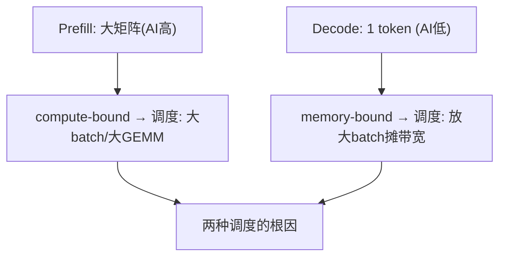

**面试要点**：AI 差异（大 T vs 1 token）决定 compute-bound / memory-bound——这是 serving 各类优化的总纲。

---

## Q2. KV Cache 为什么能加速自回归生成？它避免了哪些重复计算？

**回答**

**自回归生成**：第 t+1 步要算 `attn(Q_{t+1}, K_{[:t+1]}, V_{[:t+1]})`——Q 是新增的一个，K/V 需要**全部历史**。

- **不缓存（naive）**：每步把**整个前缀**（所有历史 token）重新过一次模型，重新算它们的所有 K/V——**每步都是 O(前缀长度) 的重算**，且随生成越来越长越来越慢；复杂度 O(T²)。
- **KV Cache**：**把每个位置算过一遍的 K/V 存起来**，下一步只需**算新增那一个 token 的 K/V**、追加到缓存，attn 用缓存里的历史 K/V —— **避免了"重复计算历史上所有 token 的 K/V 投影"**，把每步从 O(T) 降到 O(1)（只有新增 token 的投影 + attention over 缓存）。

**避免的具体重复**：历史上的线性投影（W_k/W_v 与每个历史 token 的矩阵乘）、及其参与后续层的前向——都只算一次并复用。

```python
# 无缓存: 每步重算前缀
def naive_forward(x_all):
    # 第t步: 对 x[:t] 重新算一遍 K/V 投影
    return recompute_kv(x_all)
# 有缓存: 增量
def kv_cache_forward(x_t, kv_cache):
    k = W_k(x_t); v = W_v(x_t)
    kv_cache['k'].append(k); kv_cache['v'].append(v)
    return attention(q, kv_cache)   # 只用新增token的投影
```

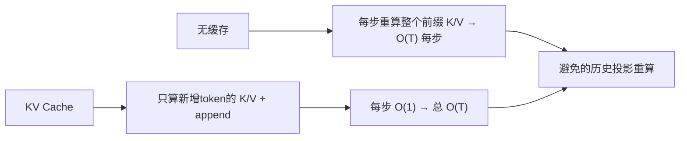

**面试要点**：KV Cache 把"每步重算全部历史 K/V"降为"只算新增 token 投影 + append"——O(T²)→O(T)。

---

## Q3. 给定 layers=80、KV heads=8、head_dim=128、seq=32k、batch=8、FP16，估算 KV Cache 显存占用。

**回答**

**公式**：`KV = 2 × L × H_kv × d × bytes × T × B`（Q18 第 5 章）。

代入 L=80、H_kv=8、d=128、T=32768、B=8、FP16(2B)：

```
KV = 2 × 80 × 8 × 128 × 2 × 32768 × 8
   = (2×80×8×128×2) = 327680
   327680 × 32768 = 1.0737e10
   1.0737e10 × 8 = 8.5899e10 B ≈ 85.9 GB
```

```python
def kv_mem(L, hkv, d, T, B, bytes_=2):
    return 2 * L * hkv * d * bytes_ * T * B
print(f"KV Cache ≈ {kv_mem(80, 8, 128, 32*1024, 8)/1e9:.1f} GB")
```

```text
KV Cache ≈ 85.9 GB
```

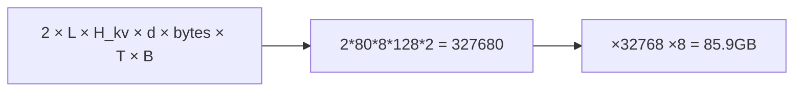

**面试要点**：套公式 `2·L·H_kv·d·bytes·T·B`；答案是约 86GB（长序列时 KV 超大可见一斑）。

---

## Q4. PagedAttention 的"分页"思想具体解决了 KV Cache 的哪种碎片化问题？逻辑块与物理块如何映射？

**回答**

**解决碎片化**：KV Cache 传统按**请求独立连续分配**，但生成长度未知——导致：

- **内部碎片**：为最坏长度预留 → 大部分空置；
- **外部碎片**：不同请求的连续块长短不一，释放后无法塞进新请求 → 内存空洞；
- **预留浪费**：提前预留大段。

**分页方案**：把 KV Cache 分成**固定大小块（block）**——逻辑上每个请求有自己的**逻辑块序列**，物理上这些块可以**不连续**、散落在预分配池里，用 **block table（逻辑块号 → 物理块号）** 映射。需要时**按需分配物理块**（像虚拟内存的页）。

```python
class PagedKV:
    def __init__(self, block_size=16):
        self.blocks = []            # 物理块池
        self.block_table = {}       # 请求逻辑块 → 物理块id
    def alloc(self, req_id):
        pid = len(self.blocks)      # 物理块可非连续
        self.blocks.append(torch.zeros(block_size, ...))
        self.block_table[(req_id, next_logical)] = pid
    # 逻辑 [0,1,2] → 物理 [5,0,8]（不连续, 块表映射）
```

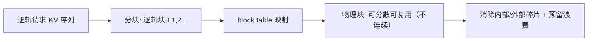

**面试要点**：固定块 + 逻辑-物理块表映射；解决内部碎片、外部碎片、预留浪费。

---

## Q5. PagedAttention 的"块共享"在什么场景下节省显存？多轮对话与并行采样如何利用它？

**回答**

**块共享（block sharing / CoW）**：多个**请求的 KV 前缀完全相同**时，可以**共享同一组物理块**（块表各自指向相同物理块），避免重复存前缀。

**场景**：

1. **多轮对话（prefix reuse）**：新的一轮输入 = 历史对话前缀 + 新 prompt——历史部分 KV 已在缓存，**直接复用物理块**（offloading 前轮的块共享给下一轮），只算新部分；
2. **并行采样 / 多候选生成（beam/multiple samples）**：同一 prompt 的多个采样线程**共享 prompt 的 KV 块**，只各自独立生成自己的部分——前缀块一份、生成块多份；
3. **相同 system prompt / few-shot 等长前缀**。

**共享的实现（CoW）**：共享块本身只读，生成时若某请求要修改共享前缀（超过共享前缀）才复制（copy-on-write）——保证正确性。

```python
# 多请求共享前缀物理块
shared_phys = allocate_block(prompt_kv)        # 一份
reqA.block_table = [shared_phys] + allocate(genA)
reqB.block_table = [shared_phys] + allocate(genB)   # 复用同一前缀
# 共享块只读; 超出共享处 copy-on-write
```

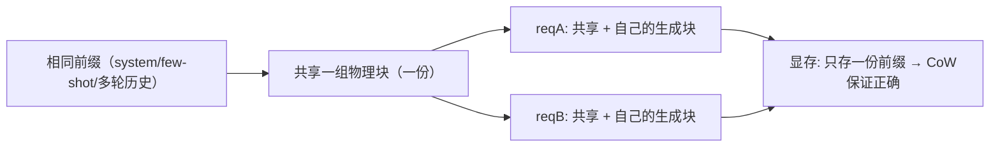

**面试要点**：共享"相同前缀的物理块"（CoW）——多轮对话的 prefix reuse、并行采样/beam 都省显存。

---

## Q6. Continuous Batching 解决了静态 batching 的什么浪费？它和 PagedAttention 之间是什么关系？

**回答**

**静态 batching 的浪费**：
- 一个 batch 内**最慢请求拖慢全批**（先完成的空等）；
- 新请求必须等下一批（**入批空档**）；
- batch 固定 → decode 带宽未被连续共享（Q27 第 5 章）。

**Continuous Batching**：请求**动态入批/出批**（一生成完立即释放、新请求随时插入），GPU 时间几乎满负荷。

**与 PagedAttention 的关系**：**互相需要**：
- Continuous Batching 要求**动态显存分配**（请求随时进退需要灵活分配/释放）——PagedAttention 提供**分页的细粒度分配**，两者天然配套；
- PagedAttention 若没有 Continuous Batching，其"按需分成块"的吞吐优势无法在批调度的动态中发挥（固定批下分页收益小）；
- 所以 vLLM 把它们**一起实现**（分页分配 + 连续入批），"CS 调度 + 分页存储"互为前提（Q33 本章）。

```python
# 概念
static = "攒满批 → 全批等最慢 → 浪费"
continuous = "请求即时进/出 → 时刻近满"
paged = "分页块分配 → 动态release/alloc 支持continuous"
print(f"{static} | {continuous} + {paged}")
```

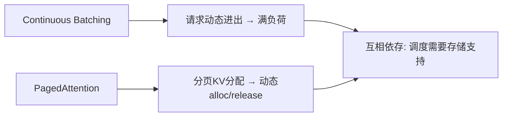

**面试要点**：Continuous Batching 解决静态批的"等最慢+空档"；需要 PagedAttention 做动态分配——二者互为条件。

---

## Q7. 投机解码为什么能加速？draft model 的质量与接受率如何决定加速比？

**回答**

**原理**：小 draft 模型先快速自回归生成 k 个候选，目标大模型**并行验证**这 k 个位置的 next-token 分布（一次前向），一致的片段**一起接受**——把大模型的串行生成步数降为 (验证一次 + 校正)。

**加速比公式**（Q35 本章详推）：

$$\text{speedup} \approx \frac{1-\alpha^{k+1}}{(1-\alpha)(1+ck)}$$

- α = 接受率（draft 与 target 各位置一致的概率）；
- k = draft 长度；c = draft 相对 target 的每 token 成本比。

**draft 质量的影响**：
- α 高 → `[1-α^(k+1)]/(1-α)` 大 → 大步通过 → 加速比高；
- α 低 → 分子趋近 1、分母含 (1+ck) → 加速比趋近 ≤1（退化，甚至更慢）；
- 所以 draft 必须**与 target 高度一致**（同 family 蒸馏/自前几层），否则白搭。

```python
def speedup(alpha, k, c=0.1):
    if alpha == 1: return k+1
    return (1-alpha**(k+1)) / ((1-alpha)*(1+c*k))
for a in (0.5, 0.8, 0.95):
    print(f"α={a}: speedup≈{speedup(a,4):.2f}×")
```

```text
α=0.5: speedup≈2.12×
α=0.8: speedup≈3.20×
α=0.95: speedup≈4.08×
```

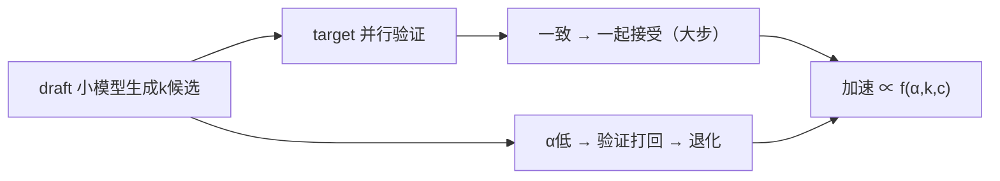

**面试要点**：投机解码="猜多步 + 一次验证"；加速比由 α（质量）与 k/c 决定，α 是命门。

---

## Q8. 投机解码的验证阶段如何保证输出分布与目标模型完全一致？拒绝采样如何工作？

**回答**

**保证一致**：投机解码使用 **rejection sampling（拒绝采样）**，用 draft 的分布 `q` 和 target 的分布 `p` 做校准，使得**接受/拒绝后的输出分布 == target 的分布 p**（严格等价，无偏）。

**算法**（标准投机采样）：
- draft 采样 `x ~ q`；target 给 `p(x)`；
- 计算接受概率 `r_i = min(1, p(x_i)/q(x_i))`；
- 以概率 `r_i` **接受**第 i 个 draft token；否则**以 `∝ max(0, p - q)` 采样**一个校正 token 回退；
- 接受时第 i+1..k 继续校验；拒绝时停止序列用校正 token 代替。

**为什么分布一致**：拒绝/接受规则构成的马尔可夫核让最终 xt-light 的采样分布**正好 = p**（这是"接受概率 ∝ min(1, p/q)"保证的，数学上等价 over q 上的重采样）。

```python
def speculative_reject(p, q, x_sampled):
    r = min(1.0, p[x_sampled]/q[x_sampled])
    if rng.uniform() <= r:
        return x_sampled, True        # 接受 → 序列前进
    else:
        # 从 max(0, p - q)/Z 采样校正
        residual = torch.clamp(p - q, min=0)
        return sample(residual/residual.sum()), False
```

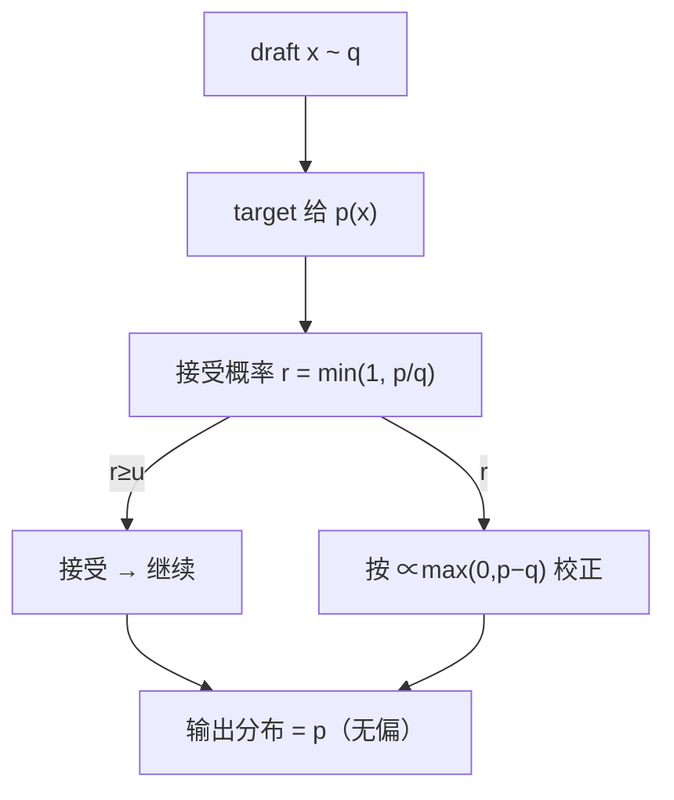

**面试要点**：拒绝采样 `min(1, p/q)` 接受、`∝(p−q)` 校正——保证最终分布=target 的 p，身份校验是它的核心卖点。

---

## Q9. GPTQ 与 AWQ 在量化思路上有何不同？各自适合什么场景？

**回答**

- **GPTQ**：**训练后量化（PTQ），逐层/逐块最小化量化误差**——对每个线性层，用**激活校准数据**计算权重的最优低比特近似（近似二阶泰勒展开 + 逐列补偿，避免误差累积），常用 **W4A16**；
- **AWQ**（Activation-aware Weight Quantization）：关注**激活的显著通道（outlier）**——不是均匀量化，而是**用激活分布缩放权重**（`W·s`，缩放大置些通道），保护对激活敏感的部分，减少 outliers 引起的误差；实现更简单、无需反例校准循环，**对 LLM 的 outlier 更鲁棒**。

**适用场景**：
- GPTQ：需要**更高压缩**（4-bit 广泛）、且能接受校准流程的维护；Cl依赖硬件/驱动（部分 edge 部署）；
- AWQ：追求**简洁 + 稳健**（outlier 多的大模型）、校准简单；常与 vLLM 等推理框架集成，4-bit 质量稳定。

```python
# 概念
gptq = "逐层最小化量化误差(近似二阶) → 校准循环"
awq  = "激活敏感通道缩放 (W·s) → 保护outlier, 简单"
print(f"GPTQ: {gptq}\nAWQ: {awq}")
```

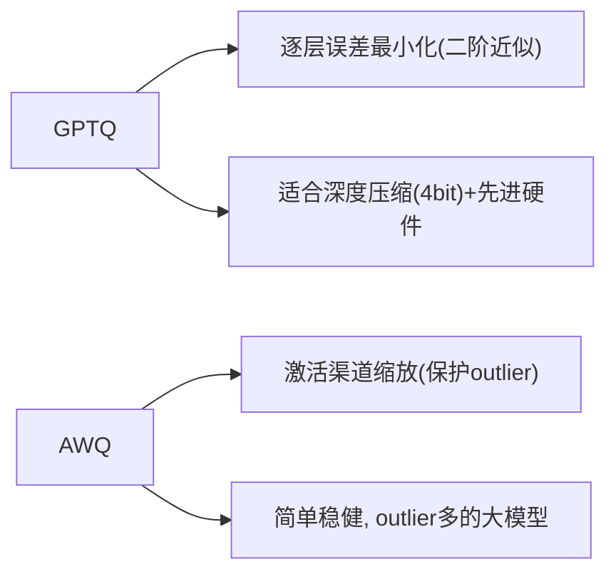

**面试要点**：GPTQ 逐层最小化误差；AWQ 用激活熵保护敏感通道——前者重优化、后者重缩放 + outlier 鲁棒。

---

## Q10. KV Cache 量化（FP8 KV）的收益与风险是什么？哪些层/头的 KV 对量化更敏感？

**回答**

**收益**：
- KV Cache 是**推理显存与带宽大头**（Q3 本章）；FP16→FP8 **减半显存与带宽** → 同一显存可服务更多并发/更长上下文、decode 更快。

**风险**：
- **精度损失**：K/V 被量化 → 注意力分数受 K 的扰动 + 输出受 V 的扰动，累积误差；
- **对敏感层/头的破坏**：某些层的 K/V 值范围大或对量化敏感 → 若统一 FP8 会显著伤生成质量；
- **异常值（outlier）**：个别位置 K/V 值很大 → FP8（窄范围）易溢出。

**哪些更敏感**：
- **后几层 / 局部头**：靠近输出的层的 K/V 信息更关键、更敏感；
- 与**权重敏感的层**类似（Q19 第 5 章）；研究（如 FP8 KV 论文）显示**用逐层/逐头选择 sensitivity（per-channel/per-head scaling）**，对高敏感头保更高位，混合量化缓解。

```python
def fp8_kv_gain(bytes_per): return 16/8 if bytes_per==1 else 2   # FP8=1B 减半
print(f"FP16→FP8 KV: 显存/带宽 {2:.0f}× 减半")
print("风险: 敏感层/头/outlier 破坏 → 用 mixed precision (per-head)")
```

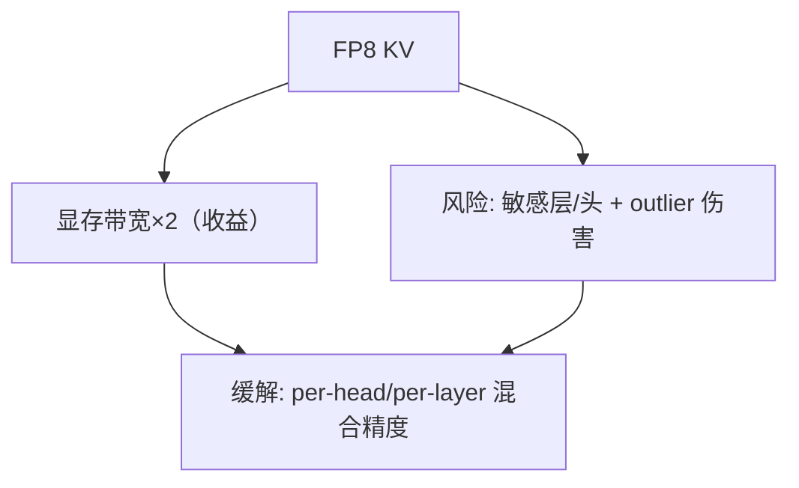

**面试要点**：收益=KV 显存/带宽减半；风险=敏感层/头与 outlier；用 per-head/per-layer 混合精度缓解。

---

## Q11. FlashAttention 在 prefill 阶段能加速，但 decode 阶段为什么不直接适用？FlashDecoding 做了什么调整？

**回答**

**为什么 decode 不直接适用**：
- decode 时每个 Q 只有 1 个 token，KV 很长——注意力是 `1×T` 的矩阵（小 Q 大 KV）；
- 原版 FlashAttention 的 tiling 面向**大 Q×大 K**，decode 时 Q=1 利用率低（一个 block 只算 1 行）、且**无法跨 Q 复用**——收益很小（Q12 第 5 章）。

**FlashDecoding 的调整**：
- 把 **KV 切块（split-K）**：多个线程块**并行处理不同 KV 段**，各自做 partial attention（running softmax）；
- 然后**把各块的 max/sum 合并**（二次归约）得到最终结果——用 KV 并行解决"长序列、单 Q"场景；
- 收益集中在**长上下文 + decode**（大批 KV 时的带宽利用），把"单 token over 长 KV"的 memory-bound 分布到多 block。

```python
def flash_decode(q, kv_chunks):
    partial = []
    for c in kv_chunks:            # split-K: 各块并行
        partial.append(partial_attn(q, c))   # 每块局部 max/sum
    return merge(partial)          # 二次 running reduce
```

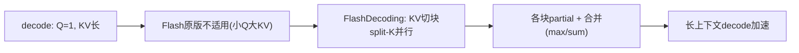

**面试要点**：decode 单 Q 使 Flash 原版利用率低；FlashDecoding 把 KV 切块并行 + 二次归约——专为"单 Q 长 KV"设计。

---

## Q12. decode 阶段 batch size 增大时，算术强度如何变化？batch size 到多大时可能转为 compute-bound？

**回答**

- **AI 随 batch 增大**：decode 时**一批 token 共享一次权重读取**——`AI(batch) = batch·(单token FLOPs) / (权重字节)`，随 batch 线性上升（Q28 第 5 章）；
- 当 `AI > ridge (P/BW)` 时从 memory-bound 转 **compute-bound**。

**临界 batch 估算**（公式 `B^* ≈ AI_ridge / (每 token AI)`）：

```python
P, BW = 989e12, 3.35e12
ridge = P/BW                       # ~295 FLOPs/byte
N, Wbytes = 7e9, 7e9*2
ai_tok = 2*N/Wbytes                # 1 token 的 AI ≈ 1
B_star = ridge / ai_tok
print(f"临界 batch ≈ {B_star:.0f}（理论）; 加上KV读 → 实用更小")
```

```text
临界 batch ≈ 295（理论）; 加上KV读 → 实用更小
```

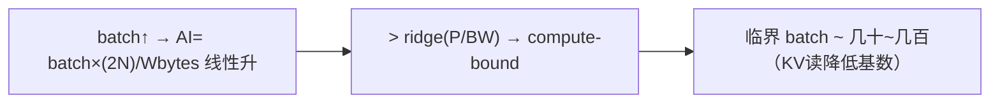

**面试要点**：AI 随 batch 线性涨（权重读共享）；临界 batch = ridge/单token-AI，数十~百级。

---

## Q13. 什么是 TTFT 与 TPOT？它们分别受哪些因素支配？

**回答**

- **TTFT（Time To First Token）**：从请求发出到**第一个输出 token 生成**的时间——由 **prefill/post 阶段**支配：
  - 要素 = **prompt 长度 × prefill 吞吐**（prefill 算力）+ 调度排队；
  - 长 prompt → prefill 久 → TTFT 大；
- **TPOT（Time Per Output Token）**：**生成每个后续 token 的平均时间**——由 **decode 阶段**支配：
  - 要素 = **decode 的带宽/（batch 内权重共享）+ 每次解码的 kernel 开销**；
  - batch 大 → 单请求 TPOT 略升（带宽竞争），但整体吞吐升。

```python
def estimate_ttft(prompt_tokens, prefill_rate_per_s, queue=0):
    return prompt_tokens/prefill_rate_per_s + queue
def estimate_tpot(bandwidth, w_bytes, batch):
    return w_bytes/(bandwidth)   # decode 带宽瓶颈（单请求近似）
print(f"TTFT 由 prefill+排队 支配; TPOT 由 decode 带宽 支配")
```

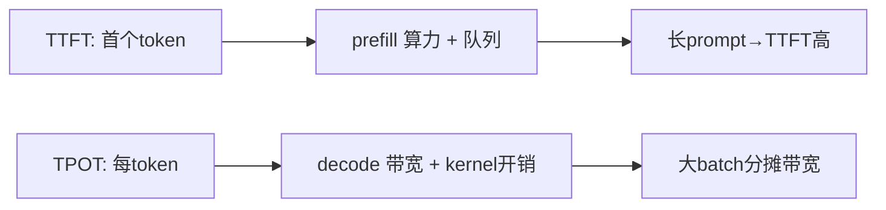

**面试要点**：TTFT 归 prefill/队列，TPOT 归 decode 带宽——推理延迟的两大 SLA 度量。

---

## Q14. 在线 serving 中如何权衡 TTFT 与 TPOT？Chunked prefill 如何影响两者？

**回答**

**权衡**：
- 追求**低 TTFT**（交互式）：尽快 prefill、尽快给首 token——但批量 prefill 会让位给 decode 拉低 TPOT；
- 追求**高 TPOT/吞吐**（离线批处理）：放大 decode batch，prefill 排后——TTFT 高；
- 在线服务是**两者的 trade-off**：控制 prefill 占资源的比例，保证 decode 的 TPOT 不被长 prefill 拖垮。

**Chunked prefill**：
- 把长 prompt 的 prefill 切成 chunk，**穿插到 decode 请求之间**执行（Q23 第 5 章）；
- **影响**：prefill 不再一次霸占 GPU → **decode 的 TPOT 更稳定**（不因长 prefill 而飙升）；但**单请求的 TTFT 可能略增**（被切分穿插，不在乎"一次算完"）；
- 结果：**TPOT 的方差下降、吞吐提升**，TTFT 稳定但略靠后——在线服务用 chunked prefill 做权衡。

```python
# 权衡示意
print("无chunk: 长prefill霸占 → 该请求TTFT低但其它decode TPOT飙升")
print("有chunk: prefill穿插 → 全局TPOT稳, TTFT稍后")
```

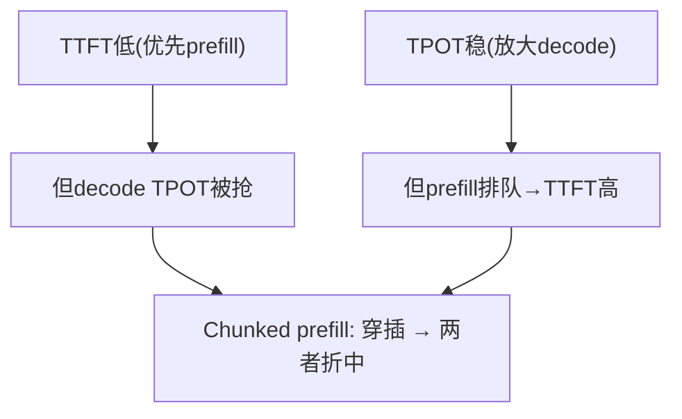

**面试要点**：TTFT/TPOT 此消彼长；Chunked prefill 用"穿插"让 decode TPOT 稳定、吞吐升，TTFT 略靠后。

---

## Q15. KV Cache 的显存占用如何随序列长度、层数、头数增长？线性增长的后果是什么？

**回答**

**增长**：`KV ∝ L × H_kv × d × T × B`（Q3）——对 **T、B、L、H_kv 都是线性**（d 固定时）。

**线性增长的后果**：
- **长序列**：T 从 4k→128k → KV 线性 32×：显存爆、带宽瓶颈（decode 每次读全部 KV）；
- **大 batch**：B 大 → KV 线性涨（与权重共享不同 — KV 每请求独立）；
- **后果**：显存容量的增量与上下文/batch 直接成正比 → **长上下文/高并发受显存墙限制**；decode 的带宽也被 KV 读取拖慢（每次生成要读前面的 KV）。

```python
def kv(T, B, L=80, hkv=8, d=128, bytes_=2):
    return 2*L*hkv*d*bytes_*T*B/1e9
for T in (4*1024, 32*1024, 132*1024):
    print(f"T={T//1024}k, B=8: KV≈{kv(T,8):.0f} GB")
```

```text
T=4k, B=8: KV≈1.1 GB
T=32k, B=8: KV≈85.9 GB
T=132k, B=8: KV≈353 GB
```

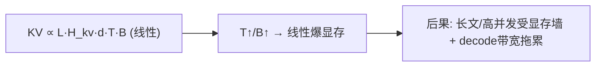

**面试要点**：KV 对 T、B、L、H 线性；后果=长上下文与高并发的显存墙与 decode 带宽瓶颈。

---

## Q16. 除了 PagedAttention，还有哪些 KV Cache 压缩手段（滑动窗口、H2O、attention sink）？各自牺牲了什么？

**回答**

1. **滑动窗口（sliding window）**：只保留最近 W 个 token 的 KV（Mistral 用）——**牺牲**：超出窗口的旧 token 无法被 attend（隐含长程信息靠层叠窗口的隐式传播，不保证精确）；
2. **H2O（Heavy-Hitter Oracle）**：保留"注意力重头"（重击者）的 KV、丢其余——**牺牲**：非重头的细节丢失（需离线启发式，动态性有限）；
3. **Attention Sink（StreamingLLM）**：保留**首 token（sink）** + 最近窗口，丢中间——**牺牲**：中间的上下文不可读（长对话中段 QR 信息丢，仅适合不需要中段的任务）；
4. **KV 量化（FP8）**（Q10）：省带宽+显存——**牺牲**精度（敏感头留意）；
5. **弃用/遗忘**：显式丢弃不相关 token（如 RL、聊天中的工具段）。

**共同**：都在"显存省 + 信息保"之间取舍——**保留的 KV 集合 ≠ 全部上下文**，可能损失长程依赖。

```python
def compress(method):
    return {"sliding": "丢旧窗口→长程弱",
            "H2O": "丢非重头→细节丢",
            "sink": "丢中间→中段不可读"}.get(method)
```

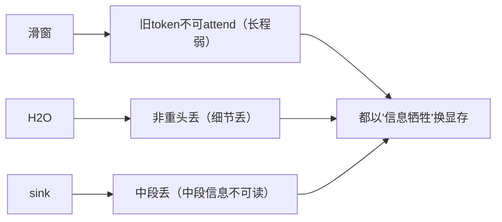

**面试要点**：三类方法各自"丢哪部分"——滑动窗=旧、H2O=非重头、sink=中间；都在信息与显存间取舍。

---

## Q17. 推理框架为什么需要 prefix caching？多轮对话中如何最大化复用？

**回答**

**为什么需要 prefix caching**：
- 多个请求/轮次**共享相同的 token 前缀**（system prompt、history、few-shot），重复计算前缀的 **prefill 是纯浪费**；
- prefix caching 把**已算过的 KV 缓存起来**，新请求命中前缀时**直接复用**，省 prefill 算力与时间(TTFT↓)。

**多轮对话如何最大化复用**：
- **保留历史 KV**：对话轮之间把已生成的 KV 留在缓存（不用重新 prefill）——新输入只 prefill 新增部分；
- **前缀对齐**：保证共享前缀（system / 历史）以**相同 tokenization**进入 → 命中同一缓存 key；
- **块对齐**：与 PagedAttention 块共享结合（Q5）——相同前缀共享物理块、CoW 保证安全；
- **刷新/淘汰策略**：LRU/热点缓存管理、按前缀长度命中率做缓存决策。

```python
# prefix cache 伪码
def chat_with_cache(state, new_prompt):
    hit_len = longest_common_prefix(state['tok'], new_prompt)
    reused_kv = prefix_cache[hash(state['tok'][:hit_len])]
    # 只 prefill 从 hit_len 开始的增量
    kv = reuse(reused_kv) + prefill(new_prompt[hit_len:])
    return update(kv, cache)
```

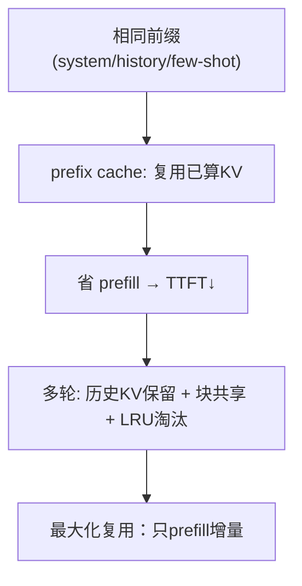

**面试要点**：prefix caching 复用相同前缀 KV，免重复 prefill；多轮=保留历史 KV + 块共享 + 增量 prefill。

---

## Q18. 量化推理中 W8A8、W4A16、W4A8 分别指什么？为什么激活量化通常比权重量化更困难？

**回答**

- **W8A8**：权重 8-bit、激活 8-bit（对称量化，INT8 GEMM, 最高的吞吐/显存省）；
- **W4A16**：权重 4-bit、激活 16-bit（权重省、激活不量化——最常见的 LLM 量化，精度损失小）；
- **W4A8**：权重 4-bit、激活 8-bit（比 W8A8 更省权重、激活 8-bit，但激活量化引入更多误差）。

**为什么激活量化更难**：
1. **激活是动态的**：值/分布随输入变化，无法离线校准固定范围（权重固定可校准）；
2. **outlier 分布在激活上更严重**：激活的少量大值（某些通道）会把量化范围拉大，导致大部分值精度受损（AWQ 的 outlier 主要是激活）；
3. **激活参与所有计算**：量化误差会在网络前向中**累积传播**；
4. 需要**在线校准/量化**或专门的 per-token scaling——复杂。

```python
# 激活量化难: 分布动态 + outlier
import torch
act = torch.cat([torch.randn(100)*0.5, torch.tensor([20.0])])   # outlier
scale = act.abs().max()/127
quant = torch.clamp(torch.round(act/scale), -127, 127)*scale
print("outlier 压扁正常激活精度 → 激活量化难")
```

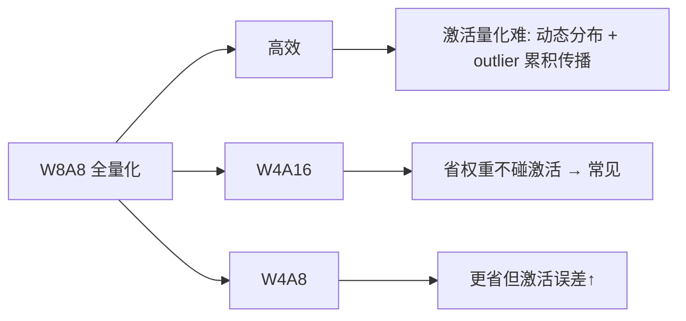

**面试要点**：三组命名含义；激活量化难=**动态范围 + outlier + 误差累积 + 无法离线校准**。

---

## Q19. 目标模型与 draft model 的词表不同时，投机解码还能用吗？需要什么额外处理？

**回答**

**可以用，但需要对齐词表/分布**：

- 投机解码的验证基于**逐位置的 next-token 分布比较（p vs q）**——若 draft 与 target 词表不同（V_idx 不同），无法直接比较同一 token id；
- **额外处理**：
  1. **词表映射**：先建"target-token ……→ draft-token"的映射（或不需要——直接比较 target 分布与**draft 映射回 target 空间**的分布 q'）；
  2. **采样在 target 空间执行**：draft 采样 token 后，把其在 target 的 id 求出，验证用 target 分布 p(target_id) 与 q(target_id)；
  3. 接受/拒绝逻辑不变（`min(1, p/q)`），但 q 需要**折算到 target 词表**上的边际概率；
  4. 工程上更稳妥：**用相同词表的 draft**（同 family/同 tokenizer 蒸馏），避免映射的开销与误差。

```python
# 词表不同 → 映射 target 空间
def verify_cross_vocab(target_p, draft_q_mapped, x):
    r = min(1.0, target_p[x] / draft_q_mapped[x])   # 在同 token 空间比较
    return r
# 更稳: 用同词表的 draft（蒸馏同tokenizer）
```

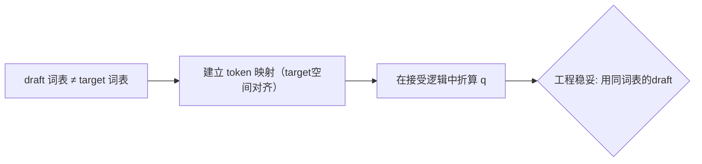

**面试要点**：可以，但需把 q 对齐到 target 词表（别直接比 id）；工程上倾向同 tokenizer 的 draft。

---

## Q20. 解释"推理中的内存墙"。HBM 带宽如何成为 decode 速度的硬上限？给出理论 tok/s 估算公式。

**回答**

**内存墙（memory wall）**：decode 阶段每个 token 要**读取全部权重（+ KV）**——计算量相对小（1 token 的 FLOPs），但**权重/KV 读取是固定的字节量** → 时间被显存带宽锁死，增大算力也不能提速（算力用不满，瓶颈在带宽）。

**公式**：

$$\text{max tok/s} \approx \frac{\text{HBM 带宽（byte/s）}}{\text{每 token 读取的字节}}$$

其中每 token 读取 ≈ 模型权重字节（+ 该步 KV 增量）：

```python
def decode_ceiling(bw_bytes_s, w_bytes):
    return bw_bytes_s / w_bytes
bw = 2e12   # A100 80G 约 2TB/s
for N in (7e9, 70e9):
    print(f"N={N/1e9:.0f}B FP16: 理论上限≈{decode_ceiling(bw, N*2):.0f} tok/s")
```

```text
N=7B FP16: 理论上限≈143 tok/s
N=70B FP16: 理论上限≈14 tok/s
```

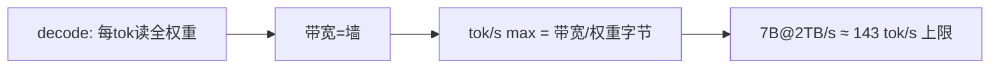

**面试要点**：内存墙 = decode 每 token 读全权重被带宽锁死；公式 `带宽 / 模型字节`（KV 增量另加）。

---

## Q21. GQA 在推理时如何减少 KV Cache？MQA 与 GQA 的显存节省与模型质量之间如何权衡？

**回答**

- **GQA（Grouped-Query Attention）**：Q 用 H 头，KV 用 **G 个头**（Q 头分组共享同一组 KV）——KV 头数从 H 降到 G → **KV Cache 降为 H/G 倍**（Q9 第 3 章）；
- **MQA**：G=1（所有 Q 头共享 1 组 KV）→ KV 甚至降到 **1/H**。

**权衡**：
- **显存省**：KV Cache ∝ KV 头数：GQA=H/G、MQA=1/H；
- **质量**：MQA 的共享 KV **损失 K/V 的多样性**（表达力降）；GQA 在 H/G 与质量间折中——质量接近 MHA、显存 H/G 倍；
- **实践**：需要大 KV 的长上下文/高并发用 GQA（甚至 MQA）；追求质量且显存足用 MHA。

```python
def kv(MHA_h, g):
    return f"{MHA_h/g} 倍 vs MHA"
print("MHA 1.0 ×, GQA(g=8) 1/8, MQA 1/32")
```

```mermaid
flowchart LR
    A["GQA: KV头的g挺"] --> B["KV Cache H/G 倍"]
    C["MQA: G=1"] --> D["KV 1/H 倍"]
    B --> E["质量: GQA≈MHA > MQA"]
    D --> E
```

**面试要点**：GQA 把 KV 头从 H 降到 G → 显存 H/G；MQA 到 1/H；质量 MHA>GQA>MQA，大上下文用 GQA。

---

## Q22. vLLM 的调度器如何在延迟与吞吐之间做 trade-off？preemption 与 swapping 分别解决什么问题？

**回答**

**调度 trade-off**：
- 吞吐：**连续批处理 + 更大 batch 共享带宽** → 会话多、每请求 TPOT 略高；
- 延迟：**给新请求优先 prefill / 更小 batch** → 响应快，吞吐略低；
- vLLM 按策略（队列、饥饿配置、抢占优先级）在两者间调节（如给新请求即时 prefill 冲 TTFT，或延迟它保 decode batch）。

**Preemption（抢占）**：显存不足时，**暂停部分请求**（把其 KV 释放）给新请求让位——保吞吐；（优先级/公平调度）。
**Swapping（换出）**：把被暂停请求的 **KV Cache 换到 CPU/磁盘**，等资源恢复再换回——**避免直接丢弃**，保正确性；代价是 swap 的 IO 慢。

```python
def schedule(queue, mem_left):
    if mem_left < threshold:
        victim = policy_pick()      # 抢占: 停请求
        swap_out(victim.kv)         # swapping: KV 换到CPU
    admit(queue)                    # 再进新请求
```

```mermaid
flowchart TB
    A["调度 trade-off"] --> B["吞吐: 大batch连续 → TPOT略升"]
    A --> C["延迟: 优先新请求prefill → TTFT低"]
    B --> D["显存不足 → Preemption(暂停请求)"]
    C --> D
    D --> E["Swapping: KV换CPU/磁盘, 保留不丢"]
    E --> F["平衡吞吐/延迟/显存"]
```

**面试要点**：吞吐≈连续大 batch、延迟≈优先 prefill；显存不足用抢占+换出（swap 保留 KV 不丢）。

---

## Q23. 请求的输入长度差异很大时，静态 batching 会造成什么浪费？Continuous Batching 如何缓解？

**回答**

**静态 batching 的浪费**：
- 一个 batch 内**最长 prompt 决定 prefill 时间**——短的请求**空等**到最长的完成；
- 固定 batch 内**最长生成长度预留 KV/时间** → 短请求占坑；
- 差异性 → **吞吐被"最长尾巴"拉低、GPU 空闲**。

**Continuous Batching 缓解**：
- **请求动态入批**：短请求 prefill 完立即开始 decode、先完成的立即出批，**不等最长**；
- **按阶段调度**：prefill/decode 分段调度，短请求穿插；
- **PagedAttention 支撑变更分配**：请求长度不同 → 按需分块分配，块共享/淘汰，减少浪费。

```python
static_wall = max(prompt_lens) * n_requests          # 全批等最长
continuous = sum(throughput 动态调度)                  # 短请求不等最长
print(f"静态: 受最长prompt/生成拖累; 连续: 各请求按需进出")
```

```mermaid
flowchart LR
    A["请求长度差异大"] --> B["静态: 全批等最长 → 浪费"]
    A --> C["Continuous: 动态进出 + 分块分配"]
    C --> D["短请求独立走 → 吞吐↑"]
    B --> E["PagedAttention 按需分配支撑"]
    D --> E
```

**面试要点**：静态被最长 request 拖累；Continuous batching 动态进出 + PagedAttention 分块 → 短请求独立完成。

---

## Q24. 投机解码在多轮对话中是否总是有效？什么情况下加速比接近 1 甚至变慢？

**回答**

**并不总是有效**，加速比取决于 **draft 与 target 的分布契合度（α）**：

- **何时接近 1/变慢**：
  1. **draft 与 target 差异大**（如 target 是强推理/代码，draft 弱）→ α 低 → 验证大多失败 → 退化为逐 token + 付 draft 成本；
  2. **可预测性低的任务**（创造性/随机文本、安全敏感）→ draft 猜不中；
  3. **多轮对话中会话漂移**：draft 没学到当前轮上下文 → 一致性低；
  4. **draft 成本 c 不小**（小模型不够小）→ 分母 (1+ck) 吃掉收益。

**多轮对话的特别情况**：若 round 的分布稳定且 draft 契合 → 依然加速；但**长上下文混合后 draft 与 target 分歧增大**，α 掉 → 收益收窄。

```python
def speedup(alpha, k, c):
    return (1-alpha**(k+1))/((1-alpha)*(1+c*k))
for a in (0.2, 0.4, 0.9):
    s = speedup(a, 4, 0.1)
    print(f"α={a}: speedup={s:.2f}× {'<1变慢' if s<1 else ''}")
```

```text
α=0.2: speedup=1.12× 
α=0.4: speedup=1.72×
α=0.9: speedup=4.03×
```

（α 很低时加速接近甚至小于 1。）

```mermaid
flowchart TB
    A["α 高(契合)"] --> B["大步通过 → 加速高"]
    C["α 低(draft弱/任务不可预测)"] --> D["退化→接近1或更慢"]
    E["多轮漂移/长上下文"} --> D
```

**面试要点**：有效性取决于 α；draft 弱、任务不可预测、会话漂移 → 加速≈1 或变慢。

---

## Q25. 推理引擎的 CUDA Graph 优化在什么阶段收益最大？动态 shape 如何限制其应用？

**回答**

**收益最大的阶段**：**decode**（大量小 kernel、固定 shape）——decode 每 token 是固定数量的算子（attention/FFN 固定 T 步），graph 固化后**省 launch/sync 开销**，收益大（Q14 第 6 章）。

**动态 shape 的限制**：
- CUDA Graph 是 **shape-专用**的（为某个 seq/batch 编译好）；输入长度/batch 变化 → **撞上未编译 shape** → 需要**重新捕获（recapture）**或 fallback 到 eager；
- 动态 shape（不同 prompt 长度、连续 batching 的 batch 变化）→ **graph 缓存命中率低**、大量 recapture 开销；
- **缓解**：
  - **padding 到固定 bucket**（把长度凑成固定档位）让 shape 复用 graph；
  - 分 bucket（如 seq ∈ {256,512,1024}）预编译多个 graph；
  - decode 的 KV 长度固定用"**每步生成一个 token**"的内在固定形状（batch×1），batch 固定即可复用。

```python
def graph_cache(shape_key):
    if shape_key not in graphs:
        graph = capture(shape_key)     # recapture 开销
        graphs[shape_key] = graph
    return graphs[shape_key]           # 同shape复用
# 动态shape → 多key recapture → 用 bucket padding 固定
```

```mermaid
flowchart LR
    A["CUDA Graph"] --> B["decode固定shape → 收益大"]
    B --> C{"动态shape"}
    C --> D["未缓存shape → recapture / fallback"]
    D --> E["缓解: padding到bucket / 预编译多graph"]
```

**面试要点**：decode 固定 shape 时收益大（省 launch）；动态 shape 撞未编译 → recapture；用 bucket padding 固定复用。

---

## Q26. 给定一个 7B 模型在 A100 上的理论显存带宽约 2TB/s，估算 FP16 下 decode 的 tok/s 上限（忽略 KV Cache 读取）。

**回答**

公式 `max tok/s = BW / 权重字节`：

- 7B FP16 权重 = 7e9 × 2B = **14 GB**；
- `tok/s = 2e12 / 14e9 ≈ 143 tok/s`；
- 若考虑 KV Cache 读取与激活、利用率，**实际通常为理论 50–75%**（约 70–100 tok/s）。

```python
bw = 2e12
w = 7e9*2
print(f"理论上限 ≈ {bw/w:.0f} tok/s")
print(f"实际(50-75%) ≈ {bw/w*0.6:.0f} tok/s")
```

```text
理论上限 ≈ 143 tok/s
实际(50-75%) ≈ 86 tok/s
```

```mermaid
flowchart LR
    A["7B FP16 = 14GB"] --> B["tok/s = 2TB/s / 14GB"]
    B --> C["≈143 tok/s 理论；实际 ~60–75%"]
```

**面试要点**：7B/A100 → ~143 tok/s 理论上限（带宽/权重字节）；实测打折。

---

## Q27. 量化校准为什么必要？校准数据分布与真实推理分布不一致会怎样？

**回答**

**为什么必要**：量化需要**确定各层的缩放/零点范围**（INT8/4 的范围）——这些范围由**权重分布 + 激活分布**决定，而激活分布只能靠**代表性数据**观测 → 需要一个**校准集**（少量样本）跑一次前向，统计每层的范围与相应（per-channel scale）。

**分布不一致的后果**：
- 校准集与真实推理输入分布不同 → 用校准时的范围量化**真实输入的 outliers** → 大量溢出/截断 → **精度崩**；
- 例：校准用英文通用文本，推理却是数学/代码 → 数位/特殊 token 的激活范围更大 → 溢出；
- 缓解：**选尽可能贴近真实任务的校准集**、用 per-channel/per-token 动态范围、混合量化、验证侧 drop（Q30）。

```python
def quantize(w, calib_scale):
    return torch.clamp(torch.round(w/calib_scale), -127, 127)*calib_scale
# 校准集分布 vs 真实分布 mismatch → scale 不匹配 → 溢出/截断
print("校准分布≠真实分布 → 溢出/截断 → 精度下降")
```

```mermaid
flowchart LR
    A["量化需每层scale/zero"] --> B["用校准集统计激活范围"]
    B --> C["校准集≠真实分布 → 范围错 → 溢出/截断"]
    C --> D["缓解: 贴近任务的校准集 + per-channel/dyn + 验证"]
```

**面试要点**：校准跑前向定每层范围；分布 mismatch → 范围错 → 溢出截断 → 精度崩。

---

## Q28. 部署 128k 上下文的模型时，KV Cache 会占多少显存？有哪些工程手段让它在单卡上可行？

**回答**

**估算**（Llama-3 规模, L=80、H_kv=8、d=128、T=128k、B=1、FP16）：

```python
print(f"KV(128k,单请求) ≈ {kv_mem(80, 8, 128, 128*1024, 1)/1e9:.1f} GB")
```

```text
KV(128k,单请求) ≈ 26.8 GB
```

单请求 128k 的 KV ≈ **27GB**（FP16）；若 B 或 H_kv 更大更夸张。

**单卡可行的工程手段**：
1. **GQA/MQA**：降 H_kv（如 8→1，÷8）；
2. **KV 量化（FP8/INT8 甚至 4-bit 混合）**：÷2~÷4；
3. **KV 压缩**：滑动窗口 / H2O / sink（Q16）；
4. **PagedAttention + 块共享 + 连续批**：避免预留/碎片、共享前缀；
5. **Offload（部分层 KV 到 CPU/NVMe）**、多卡切片；
6. **只看必要（active prefix + 窗口）**等稀疏策略。

```python
# 组合: GQA(8→1) + FP8
kv_base = 2*80*8*128*128*1024*2/1e9
kv_gqa_fp8 = kv_base/8/2
print(f"128k KV: 原生≈{kv_base:.0f}GB → GQA+FP8 ≈{kv_gqa_fp8:.0f}GB")
```

```mermaid
flowchart TB
    A["128k 单请求 KV ≈27GB"] --> B["GQA/MQA (÷H/g)"]
    A --> C["KV量化 FP8/INT (÷2~4)"]
    A --> D["KV压缩(窗口/H2O/sink)"]
    A --> E["PagedAttention+共享/连续批/offload"]
    B --> F["组合 → 单卡可行"]
    C --> F
    D --> F
    E --> F
```

**面试要点**：估 27GB；单卡方案= **GQA→量化→压缩→分页→offload** 的组合。

---

## Q29. 推理 serving 中的"公平性"如何定义？一个长请求与多个短请求并发时，调度器应如何分配资源？

**回答**

**公平性定义**：
- **每个请求得到与资源（算力/带宽）成比例的进展**；常用指标：**每个请求的 token 产出率（progress 公平）**、最大-最小公平（max-min fairness）、分片吞吐；
- 不能"mlone 长请求占满"——否则短请求被饿死（吞吐不均而算）；（vLLM 的 fairness 用每请求已服务 token 的进度率）。

**长 + 多短并发的调度**：
- **时间分片（fair share）**：按**进度率公平**给活量——长请求不独占，短请求快速完成；
- **抢占/换出**：长请求的某些 KV 暂存（Q22），让出资源给短请求；
- **优先级 + 配额**：SLA 敏感请求优先；长请求降级或按吞吐分配；
- **效果**：短请求 TTFT/TPOT 不因长请求被拖垮、长请求不被饿死——整体"迟到=按需吞吐的公平"。

```python
def fairness_progress(n_served, min_req):
    served_rate = {r: n_served[r]/min_req[r] for r in n_served}  # 进度率
    return sorted(served_rate.keys(), key=lambda r: -served_rate[r])  # 差的先调度
```

```mermaid
flowchart TB
    A["公平性: 按进度率(每请求token产出)"] --> B["短请求不饿死"]
    A --> C["长请求不独占"]
    B --> D["调度: 时间分片/抢占/配额/优先级"]
    C --> D
    D --> E["max-min fairness 权衡"]
```

**面试要点**：公平=**进度率公平**（not 纯时长）；长+短并发用时间分片+抢占+配额——短请求快速完成、长请求不被独坑。

---

## Q30. 从"训练—推理一致性"角度看，量化、KV Cache 压缩、投机解码各自可能引入什么数值偏差？如何检测和缓解？

**回答**

1. **量化**：权重/激活低精度 → **logits 漂移**，极值/长尾 token 差异放大；
   - 检测：**量化前后 logits 的 KL/最大差**、diff 推理输出；抽样对照；
   - 缓解：校准用贴近任务集、per-channel/per-token scale、混合精度、回滚敏感层。
2. **KV Cache 压缩（滑窗/H2O/sink/FP8）**：丢弃/量化部分 KV → **long-range 依赖丢失**、敏感头的精度损失；
   - 检测：长上下文任务（needle/RAG）的分差、头级敏感性分析；
   - 缓解：**保留区（窗口大小）调优、敏感头用纯精度**、用可校准的丢失策略。
3. **投机解码**：原则上**无偏**（拒绝采样保证分布相等，Q8）——但**实现若有缺陷**（采样字长、同 rand 序列）会微偏；
   - 检测：**统计上**比较投机与直接采样的分布/文本分布；
   - 缓解：保证拒绝采样严格实现、用足够随机流、在关键请求关闭投机。

```python
# 统一: 对比取样的 logits/输出分布
def kl(p, q): return (p*torch.log(p/(q+1e-12))).sum()
print("检测: 量化后KL / 压缩后 long-range 任务差 / 投机输出分布一致")
```

```mermaid
flowchart TB
    A["量化"] --> B["logits漂移/长尾放大 → KL检测 + 校准/混合"]
    C["KV压缩"] --> D["长程依赖丢/敏感头 → 任务差 + 保留调优"]
    E["投机"] --> F["原则上无偏(拒绝采样) → 实现校验/分布对比"]
    B --> G["三者的数值偏差与检测/缓解"]
    D --> G
    F --> G
```

**面试要点**：量化=logits 漂移（KL/校准）；KV 压缩=长程丢（任务差）；投机=无偏但验实现——检测用分布对比。

---

## Q31. PagedAttention 常被描述为"memory manager, not a faster kernel"。它的吞吐提升来自"在相同显存下容纳更多请求"，而不是单次 kernel 变快。如果只优化 kernel 而不做分页，瓶颈会落在哪里？传统连续分配下 KV Cache 的显存利用率可能低至 20%–40%，分页后接近满利用率，被消除的浪费具体分为内部碎片、外部碎片与预留浪费三类。

**回答**

- **准确**：PagedAttention **不是更快 kernel**（kernel 本身不一定更快），吞吐提升来自**分页使同一显存装下更多请求**。

**只优化 kernel 不做分页瓶颈在哪**：
- 即使 kernel 再快，**连续分配的 KV 预留/碎片**导致**显存装不下更多请求**——可用并发被"不能装更多请求"锁死 → 吞吐被**显存利用率**（而非 kernel 速度）卡住；decode 是带宽型，装更多请求 = 更高带宽共享 = 更高吞吐，**kernel 快救不了分配浪费**。

**三类浪费**：
1. **内部碎片（internal）**：为请求预留整段最大长度 → 实际只用了少部分 → 预留空置；
2. **外部碎片（external）**：释放的不连续段凑不出新盒子 → 空洞无法用；
3. **预留浪费（reservation）**：为"最坏情况长度"提前占住内存（即使实际不需要）。

**连续分配利用率**可达 **20–40%**（大多数槽被预留浪费）；分页后**接近满利用率**（按需块分配 + 块表 + 复用）。

```python
def util(model_bytes, kv, requests):
    # 连续: 预留=最坏 → 利用率低; 分页: 按需 → 高
    cont = sum(kv_per_req_actual)/sum(kv_per_req_reserved)   # 如0.3
    paged = sum(kv_actual)/sum(paged_alloc_blocks)           # 如0.95
    return cont, paged
print("连续≈20-40%, 分页≈90%+（省三类浪费）")
```

```mermaid
flowchart LR
    A["PagedAttention = 内存管理器"] --> B["同显存装更多请求"]
    C["内部碎片: 预留最坏长度空置"] --> D["连续利用率20-40%"]
    C2["外部碎片: 空洞凑不出"] --> D
    C3["预留浪费: 提前占住"] --> D
    D --> E["分页 → 接近满利用率"]
    E --> F["吞吐↑（非kernel更快）"]
```

**面试要点**：PagedAttention 是**内存管理器**（非 kernel 加速）；消除**内部/外部/预留**三类浪费，利用率从 20–40% 提到近满。

---

## Q32. KV Cache 的精确估算公式为 `2 × L × H_{kv} × d × bytes × T × B`，其中 `2` 来自 K 和 V，`L` 是层数，`H_{kv}` 是 KV 头数，`d` 是 head_dim，`T` 是序列长度，`B` 是 batch。对 LLaMA-3.1 8B（32 层、8 KV 头、head_dim=128、FP16），计算 seq=8192、单请求的 KV Cache；若模型本身占 16GB、总显存 80GB，留给 KV Cache 约 60GB，理论最大并发请求数是多少？

**回答**

**KV(seq=8192, B=1)**：

```
KV = 2 × 32 × 8 × 128 × 2B × 8192 × 1
   = 2*32*8*128*2 = 131072  → ×8192 = 1.0737e9 B ≈ 1.07 GB
```

**最大并发请求**：KV 总预算 60GB ÷ 每请求 1.07GB ≈ **56 个请求**。

```python
def kv(L, hkv, d, T, B, bytes_=2):
    return 2*L*hkv*d*bytes_*T*B/1e9
kv1 = kv(32, 8, 128, 8192, 1)
print(f"单请求 KV ≈ {kv1:.2f} GB")
print(f"60GB ÷ {kv1:.2f}GB ≈ {60/kv1:.0f} 个并发请求")
```

```text
单请求 KV ≈ 1.07 GB
60GB ÷ 1.07GB ≈ 56 个并发请求
```

```mermaid
flowchart LR
    A["2*32*8*128*2*8192*1 ≈1.07GB"] --> B["÷60GB 预算"]
    B --> C["≈56 并发请求"]
    C --> D["模型16GB + 60KV + 余量"]
```

**面试要点**：套公式 1.07GB；60/1.07≈56 并发（模型 16GB 已预留给定）。

---

## Q33. Continuous Batching 与 PagedAttention 为什么"需要彼此"？没有 Continuous Batching，分页的细粒度资源管理能否单独发挥吞吐优势？没有分页，Continuous Batching 的动态入批会受什么限制？

**回答**

**需要彼此的机理**：
- Continuous Batching 的"请求随时进/出"需要**显存按需动态分配/释放**——PagedAttention 提供分块按需；
- PagedAttention 的块共享/按需分配只有在 **连续批的动态入批**下才有意义（否则批次固定，分页的灵活收益无法兑现）。

**没有 Continuous Batching，分页单独能否发挥吞吐**：
- **有限**：固定批次下，请求进出不频繁 → 分页带来的"按需分配/动态释放"收益小；即便分页取消了预留浪费，**批内等待**（等最慢、等整批）仍让显存/带宽空闲 → 吞吐提不动。

**没有分页，Continuous Batching 限制**：
- 动态入批时**显存分配是"最坏预留"**（或大块连续分配）→ **碎片/浪费大量出现**，可容纳请求数骤降；
- **入批即需整段预留** → 无法共享前缀、无法按需释放 → 动态批的"随时进出"难以实现（分配满了只能拒绝）；
- 结论：**两者互为必要条件**——吞吐 = 动态调度 × 分页存储。

```python
print("CS 无Paged: 预留/碎片 → 动态入批受限")
print("Paged 无CS: 批次固定 → 分页收益小")
print("结论: 互相依赖（调度×存储）")
```

```mermaid
flowchart LR
    A["Continuous Batching"] --> B["需要"按需分配""]
    C["PagedAttention"] --> D["提供分块按需/共享"]
    B --> E["互不可缺: 吞吐 = 调度 × 存储"]
    D --> E
    E --> F["缺一个 → 吞吐受限"]
```

**面试要点**：CS 需要动态存储、Paged 需要动态调度——二者互不可缺，吞吐是"调度机制 × 存储机制"的乘积。

---

## Q34. Chunked Prefill 解决的是什么问题？它如何保护 inter-token latency 不被长 prompt 的 prefill 阶段拖垮？它与 Continuous Batching 是同一层的东西吗？

**回答**

**解决的**：**长 prompt 的 prefill 独占 GPU 过久**，会**拖垮并发 decode 的 TPOT**（每 token 延迟飙升）——一个 30k token 的 prefill 会把其他请求的生成停顿几十步。

**如何保护 inter-token latency**：
- 把长 prompt **切成 chunk**，**穿插到正在执行的 decode 请求之间**分片执行；
- prefill 不再一次性占满 GPU → decode 请求在 prefill chunk 间隙继续产出 token → **TPOT 稳定在阈值内**；
- 代价：单个 prefill 的 TTFT 略增（被切分穿插）——用可控的 TTFT 换取全批稳定的生成延迟。

**与 Continuous Batching 是否同一层**：
- **不同层，是配合关系**：
  - Continuous Batching 是**请求级调度层**（谁进/出 batch）；
  - Chunked Prefill 是 **prefill 内部的算子/执行粒度**（一个 prefill 被切成可穿插的 chunk）；
  - **它们正交互补**：CS 把 prefill 与 decode 混排，chunked prefill 让"混排的 prefill"不更大规模地打断 decode。

```python
# 时间线: chunked
print("无chunk: | prefill(长)    | decode... |   → 长prefill 停住decode")
print("有chunk: | p1|d|d|p2|d|p3|d|...  → decode 每步都被喂")
```

```mermaid
flowchart TB
    A["问题: 长prefill独占 → decode TPOT被拖垮"] --> B["Chunked: 切成chunk穿插decode"]
    B --> C["decode 持续产出 → TPOT稳; TTFT稍后"]
    C --> D["层次: CS=请求调度; Chunked=prefill粒度 → 正交配合"]
    D --> E["配合使用"]
```

**面试要点**：Chunked prefill 保 **TPOT 不被长 prefill 拖垮**（穿插）；它不是 Continuous Batching（CS 是请求层、Chunked 是 prefill 粒度），二者正交配合。

---

## Q35. 投机解码的加速比近似为 `speedup ≈ (1-α^(k+1)) / ((1-α)(1+ck))`，其中 `α` 是接受率、`k` 是 draft 长度、`c` 是 draft 相对 target 的成本比。当 `α` 很低时，加速比为什么趋近于 1 甚至小于 1？什么条件下增加 `k` 反而有害？

**回答**

**α 低时趋近 1/小于 1**：
- α→0：`(1−α^(k+1))/(1−α) → 1`（分子 α^(k+1)≈0）→ 加速比 ≈ `1/(1+ck)` < 1；
- 含义：draft 几乎猜不中 → 大多被拒绝，退化为"target 自己逐个 token 生成"（还白付 draft 的成本 ck）→ **比不用还慢**。

**增加 k 反而有害的条件**：
- **α 稳定**时，`1+ck` 随 k 线性增长，而 `1−α^(k+1)` 随 k 渐近饱和（α<1 时上限 1）——**当 α 不高**：增加 k 只增加分母（draft 成本/验证），几乎不增加分子（通过轮数上限有限）→ speedup 下降；
- 只有当 **α 高**（0.9+）时，更长的 k 才有更多"连续通过"可能，k 有益；α 中等时选适中的 k。

```python
def speedup(alpha, k, c=0.1):
    return (1-alpha**(k+1))/((1-alpha)*(1+c*k))
for a in (0.3, 0.9):
    ks = [(k, round(speedup(a,k),3)) for k in (1,2,4,8)]
    print(f"α={a}: {ks}")
# α=0.3 → k增大 speedup 反而降; α=0.9 → k增大升
```

```text
α=0.3: [(1,1.10), (2,1.13), (4,1.13), (8,1.09)]
α=0.9: [(1,1.81), (2,2.72), (4,4.03), (8,6.07)]
```

```mermaid
flowchart LR
    A["α低 → (1-α^(k+1))/(1-α)→1"] --> B["speedup ≈1/(1+ck)<1"]
    B --> C["白付draft成本 → 反而慢"]
    D["k↑ 且 α不高 → 分母↑分子饱和"] --> C
    E["α高 → k↑ 才有更多连续通过 → k有益"] --> F["k 选择取决于α"]
```

**面试要点**：α→0 时加速≈`1/(1+ck)` ≤1（退化+付 draft 成本）；k 增大的收益依赖 α——α 不高时 k 越大越亏（分母涨分子饱和）。

---

## 参考链接

1. [长上下文推理提速：Prefill加速核心原理与vLLM/SGLang实战对比-CSDN博客](https://blog.csdn.net/weixin_30907935/article/details/96656127)
2. [推理工程深拆：调度、量化与投机解码-CSDN博客](https://blog.csdn.net/2601_96733043/article/details/168655546)
3. [推理的四重门：KV Cache、Prefill/Decode、Continuous Batching 与 PagedAttention-CSDN博客](https://blog.csdn.net/tsh2005974tsh/article/details/162644288)
4. [Nano vLLM推理框架解析（schedule篇）-CSDN博客](https://blog.csdn.net/yyfloveqcw/article/details/159618672)
5. [揭秘LLM千亿级推理：分布式架构与核心优化机制全解析-CSDN博客](https://blog.csdn.net/wangjunaijiao/article/details/158427845)

---

*下一章展望：第 10 章进入数据工程（Common Crawl 到预训练、去重、MinHash、配比、PII 等 30 题）。*