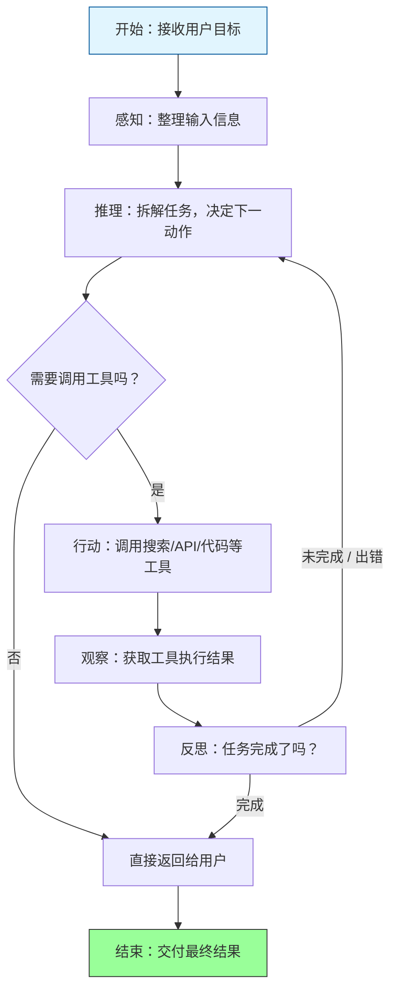

# 初识智能体 —— 智能体定义、类型、范式与应用

> 面试生普（LLM 500 题）· 初识智能体篇。本章共 30 个问题，覆盖智能体是什么、和大模型/AI 助手的区别、核心特征、基本架构、常见类型、应用场景、工作循环、与传统自动化的区别、局限挑战，以及手撕 Python 智能体入门示例。正文面向“会一点编程语言和深度学习基础，除此之外没有任何其他背景”的读者，重要概念配大白话解释和 Python 代码。

---

## Q1. 什么是智能体（Agent）？它和我们平时用的大模型（LLM）、AI 助手有什么本质区别？

**回答**

先说大白话：**智能体（Agent），就是一个“会行动、会协作、会学习的数字员工”。** 它不像大模型那样只会“答题”，而是能围绕一个目标连续地做事——比如帮你订机票、写代码并跑通、整理文档发邮件，甚至和其他智能体一起协作完成一个项目。

为了彻底搞清楚智能体是什么，咱们得先把三层概念掰开了说，不然很容易把它们混在一起：

**第一层：大型语言模型（LLM）。**
LLM 本质上是一个“超级语言引擎”。你给它一段文字，它给你返回一段文字。GPT、DeepSeek、通义千问这些模型都属于这一层。它的特点是：**被动响应、没有记忆、不会主动行动。** 你问它“明天天气怎么样？”，它可能告诉你“我无法获取实时天气”，因为它本身没有眼睛去看窗外，也没有手去打开天气APP。

**第二层：AI 助手（比如 ChatGPT、豆包、文小言）。**
AI 助手是在大模型外面包了一层交互界面和记忆管理。它能跟你多轮对话，但本质上依然是“人问、AI 答”的被动模式，干活的边界止步于“文字回应”。你让它“帮我订张去上海的机票”，它最多给你几个携程链接，替你下单这件事它做不了。

**第三层：智能体。**
智能体是能够**自主感知环境、独立制订计划、调用工具、执行行动**，并在结果反馈中动态调整策略的 AI 系统。它有四大核心特征（下面 Q4 会详细展开）：

- **自主目标分解**：接到高层指令后，能自行拆成一串可执行的子任务；
- **工具调用能力**：能调用搜索引擎、数据库、API、代码执行器甚至其他 AI 模型；
- **闭环行动能力**：形成“感知 → 规划 → 行动 → 反馈 → 修正”的完整自主决策循环；
- **持久记忆与状态管理**：可以跨会话保持上下文贯通，像个真正“在上班”的角色。

用个比喻你就懂了：

- **大模型**是“大脑”：只会思考、会表达，但不动手。
- **AI 助手**是“会说话的大脑”：有个聊天界面，能陪你唠嗑，但还是不动手。
- **智能体**是“会行动、会协作、会学习的数字员工”：大脑加上眼睛、手脚、记忆，能独立把事情办成。

举个生活中的例子：

> 你对大模型说：“我要去北京出差三天。”它可能回复：“北京是个好地方，建议你去故宫、长城……”（只给建议，不办事）
>
> 你对智能体说：“我要去北京出差三天，帮我订机票和酒店，把行程写进日历，还要把机票信息发给助理。”智能体就会：查航班 → 比价 → 下单 → 选酒店 → 写日历 → 发邮件，一条龙干完，中间还要你点头确认关键步骤。

**面试要点**：智能体 ≠ 大模型，也不等于 AI 助手。大模型是能力底座，AI 助手是交互入口，智能体是把能力转化为生产力的**执行形态**，核心差别在于是否具备“面向目标的闭环行动能力”。

---

## Q2. 智能体和大模型、AI 助手的关系可以用一张图总结吗？

**回答**

可以。下面这张图把三者的关系和区别串起来，你看一眼就懂：

```
+---------------------+      +-----------------------+      +---------------------------+
|     大模型 (LLM)      |      |      AI 助手          |      |      智能体 (Agent)       |
|   “超级语言引擎”     |      |   “会说话的大脑”      |      | “会行动、会协作、会学习”    |
|                     |      |                       |      |     的数字员工              |
| 被动响应              |      | 多轮对话              |      | 自主目标分解              |
| 没有记忆              |      | 有界面+记忆管理       |      | 工具调用能力              |
| 不会主动行动          |      | 人问、AI 答           |      | 闭环行动能力              |
| 只输出文字            |      | 边界止步于文字回应    |      | 持久记忆与状态管理          |
+----------+----------+      +-----------+-----------+      +------------+--------------+
           |                           |                           |
           |  往外包一层界面和记忆     |  再往外加工具、规划、行动 |
           |                           |                           |
           v                           v                           v
    只会“答题”                  只会“聊天”                   会“办事”
```

用大白话总结三句话：

1. **大模型**是“大脑”：只会思考、会表达，但不动手。
2. **AI 助手**是“会说话的大脑”：有个聊天界面，能陪你唠嗑，但还是不动手。
3. **智能体**是“会行动、会协作、会学习的数字员工”：大脑加上眼睛、手脚、记忆，能独立把事情办成。

**面试要点**：面试时别只背定义，要能举出每种关系的实际例子，比如“大模型给你写代码，AI 助手陪你讨论代码问题，智能体直接帮你把代码写完、跑通、提交到 GitHub”。

---

## Q3. 智能体的四大核心特征分别是什么？用大白话解释一下。

**回答**

智能体之所以能“办事”，靠的是四大核心特征。我们一个个来，用大白话配合生活中的例子，手把手拆清楚。

### 特征 1：自主目标分解（自己拆活儿）

你给智能体一个大目标，比如“帮我调研竞品并写一份分析报告”。它不会原地发呆，而是会自动把这件事拆成小步骤：

1. 搜索市场上的主要竞品；
2. 对每个竞品，收集产品功能、定价、用户评价；
3. 整理数据，做对比分析；
4. 生成结构化报告；
5. 保存为文档。

**大白话**：就像你给一个实习生下了一句“整理一下这周的市场资料”，聪明的实习生自己知道要先找资料、再整理、再做表格，不需要你每一步都盯着。

### 特征 2：工具调用能力（有手有脚）

大模型本身是个“孤岛”，只会处理文字，没法直接改变现实世界。智能体给它装上了“手脚”，能调用外部工具：

- **搜索工具**：上网查最新信息；
- **代码执行器**：写 Python 代码算复杂数学题、画图表；
- **API 调用**：调日历 API、邮件 API、数据库 API；
- **文件操作**：读写 Excel、PDF、Word。

**大白话**：大模型是“只动嘴”的员工，智能体是“会用 Excel、会发邮件、会查数据库”的员工。

### 特征 3：闭环行动能力（做完查一查，错了一改一改）

智能体不是一条路走到黑，而是走一个圈：

**感知 → 规划 → 行动 → 观察 → 反思 → 修正 → 再行动……直到任务完成。**

比如智能体帮你订机票，它先搜到了几个航班，但发现最便宜的那个已经没票了（观察），于是它会调整计划，去看第二便宜的（修正），再下单（行动），直到票订出来为止。

**大白话**：就像人做事，不是盲目往前冲，做完一步会回头看看效果，不满意就改一改，直到搞定。

### 特征 4：持久记忆与状态管理（不失忆症）

普通大模型对话，聊多了就忘前面说了什么（除非把历史记录全部塞回去，又贵又慢）。智能体有自己的记忆系统，能记住：

- 你的偏好（比如你喜欢窗边座位、不喝咖啡）；
- 任务进展（已经订了机票，还没订酒店）；
- 出错经验（上次调用那个接口超时了，这次先重试）。

**大白话**：智能体不像金鱼七秒钟记忆，它能“记得自己在干什么”，跨会话也能接着上次干的活继续干。

下面用一张 ASCII 图把四大特征串起来，你就能看到智能体的“长相”了：

```
                 +---------------------+
                 |      用户目标       |
                 | "帮我订机票+写日程" |
                 +----------+----------+
                            |
                            v
                 +---------------------+
                 |   自主目标分解      |  <-- 把大目标拆成子任务
                 | (查航班 -> 比价 ->  |  <-- 像项目经理排工期
                 |  订票 -> 写日历)     |
                 +----------+----------+
                            |
                            v
                 +---------------------+
                 |     工具调用        |  <-- 调搜索、API、代码执行器
                 |  (搜索/邮件/日历)   |
                 +----------+----------+
                            |
                            v
                 +---------------------+
                 |   闭环行动 (ReAct)  |  <-- 感知→规划→行动→观察→修正
                 +----------+----------+
                            |
                            v
                 +---------------------+
                 |   持久记忆与状态    |  <-- 记住偏好、进展、出错经验
                 +---------------------+
                            |
                            v
                 +---------------------+
                 |     任务完成        |  <-- 交付最终结果
                 +---------------------+
```

**面试要点**：四大特征分别是“自主拆活儿”“会用工具”“做完查一查”“不失忆症”。缺任何一条，都很难称得上一个合格的智能体。

---

## Q4. 智能体的基本架构由哪几部分组成？各部分干什么的？

**回答**

如果把智能体比作一个人，它的架构大致可以分成五大部分：**大脑（推理/规划）、感知（输入）、行动（工具/输出）、记忆（经验）、人格（角色设定）**。下面咱们逐个说，并且用 Python 代码把最核心的“感知 → 推理 → 行动”循环写出来，让你摸着门路入门。

### 1. 大脑（Brain / 推理规划模块）

大脑是智能体的核心，通常由一个大语言模型（LLM）担任。它负责：

- 理解用户说什么；
- 把复杂目标拆成小步骤；
- 决定下一步调用什么工具、做什么动作；
- 看工具返回的结果，判断任务是不是完成了。

没有大脑，智能体就是一串死板的脚本；有了大脑，它才能“灵活应变”。

### 2. 感知（Perception / 输入模块）

感知模块负责把外部世界的信息转成大脑能听懂的语言。包括：

- 用户输入的文字（聊天、邮件、文档）；
- 外部系统推送的消息（API 回调、定时器触发）；
- 传感器数据（如果是机器人，还有摄像头、麦克风）。

感知模块把这些信息整理成 Prompt，喂给大脑。

### 3. 行动（Action / 工具执行模块）

行动模块是智能体的“手脚”。大脑决定做什么之后，行动模块负责去干：

- 调用搜索引擎 API；
- 执行一段 Python 代码；
- 发一封邮件、写一个文件；
- 调用数据库查询。

行动完成后，结果会喂回给大脑，供下一轮决策参考。

### 4. 记忆（Memory / 经验模块）

记忆模块让智能体“不失忆”。通常分三层：

- **短期记忆**：当前对话的上下文，塞进 Prompt 里让大模型直接看到；
- **长期记忆**：重要信息存到向量数据库，需要时检索出来（这就是 RAG 的思想，后面章节会专门讲）；
- **情境记忆**：过去做过的任务、遇到的错误和解决办法，用来避免重复犯同样的错。

### 5. 人格/角色（Profile / 角色设定）

人格模块决定智能体“说话是什么语气、扮演什么角色”。比如你可以设定它是“资深 Python 工程师”、“温柔的心理咨询师”或“严肃的财务审计员”，它就会按这个人设来回复和行动。

---

### 手撕一个最简单的智能体（Python）

下面这段代码实现了一个极简版智能体，它具备：**感知用户输入、大脑决策、调用计算器工具、观察结果、循环直到完成**。你只要有一个兼容 OpenAI 接口的 API Key 就能跑通（这里用占位符演示，不依赖真实网络）。

```python
"""
最简智能体示例：感知 -> 推理 -> 行动 -> 观察 -> 修正循环
只演示框架，真正的大模型调用需要替换成真实的 API。
"""

import json
from typing import List, Dict


class SimpleCalculator:
    """一个极简工具：只能做加减乘除，模拟外部 API。"""

    def run(self, expression: str) -> str:
        try:
            # 安全起见，这里只演示，实际不要对用户输入直接 eval
            result = eval(expression, {"__builtins__": {}}, {})
            return f"计算结果：{result}"
        except Exception as e:
            return f"计算失败：{e}"


class MiniAgent:
    def __init__(self, name: str = "小助手"):
        self.name = name
        self.tools = {"calculator": SimpleCalculator()}
        # 短期记忆：本次会话的对话历史
        self.memory: List[Dict[str, str]] = []

    def perceive(self, user_input: str) -> None:
        """感知：把用户输入存入短期记忆。"""
        self.memory.append({"role": "user", "content": user_input})
        print(f"[感知] 收到用户输入：{user_input}")

    def think(self) -> str:
        """
        推理：大脑决定下一步做什么。
        这里简化为规则演示；真实场景中会调用 LLM 生成 JSON 指令。
        """
        last = self.memory[-1]["content"] if self.memory else ""
        if "计算" in last or "算一算" in last:
            # 从文本里粗略提取算式（演示用，实际用 LLM + Function Calling）
            expr = last.replace("计算", "").replace("算一算", "").strip()
            return json.dumps({"tool": "calculator", "args": {"expression": expr}})
        return json.dumps({"tool": "none", "args": {}})

    def act(self, decision: str) -> str:
        """行动：根据大脑决策调用对应工具。"""
        cmd = json.loads(decision)
        tool_name = cmd.get("tool")
        args = cmd.get("args", {})

        if tool_name == "none":
            return "无需调用工具，直接回答用户。"

        if tool_name in self.tools:
            print(f"[行动] 调用工具：{tool_name}，参数：{args}")
            return self.tools[tool_name].run(**args)
        return f"未知工具：{tool_name}"

    def observe(self, result: str) -> None:
        """观察：把工具返回的结果存入记忆，供下一轮参考。"""
        self.memory.append({"role": "assistant", "content": result})
        print(f"[观察] 工具返回：{result}")

    def run(self, user_input: str, max_steps: int = 5) -> str:
        """主循环：感知 -> 推理 -> 行动 -> 观察，直到完成或达到步数上限。"""
        self.perceive(user_input)
        for step in range(max_steps):
            print(f"\n----- 第 {step + 1} 轮循环 -----")
            decision = self.think()
            print(f"[推理] 决策：{decision}")
            result = self.act(decision)
            self.observe(result)

            if "无需调用工具" in result or "计算结果" in result:
                return f"【{self.name}】任务完成：{result}"

        return f"【{self.name}】达到最大步数，未能完成任务。"


if __name__ == "__main__":
    agent = MiniAgent("算术小助手")
    answer = agent.run("请帮我算一下 (23 + 47) * 2 等于多少")
    print("\n" + "=" * 40)
    print(answer)
```

**运行输出示例（概念版）：**

```
[感知] 收到用户输入：请帮我算一下 (23 + 47) * 2 等于多少

----- 第 1 轮循环 -----
[推理] 决策：{"tool": "calculator", "args": {"expression": "(23 + 47) * 2"}}
[行动] 调用工具：calculator，参数：{'expression': '(23 + 47) * 2'}
[观察] 工具返回：计算结果：140

========================================
【算术小助手】任务完成：计算结果：140
```

这段代码把智能体最核心的“感知 → 推理 → 行动 → 观察”循环写死了，虽然真实的智能体会用 LLM 来生成决策 JSON（通过 Function Calling / Tool Use），但骨架是一样的。

**面试要点**：智能体基本架构 = 大脑（LLM 推理）+ 感知（输入整理）+ 行动（工具调用）+ 记忆（短期/长期）+ 人格（角色设定）。五大模块缺一不可，闭环是“感知→推理→行动→观察→修正”。

---

## Q5. 智能体有哪几种常见类型？怎么分类？

**回答**

“智能体”这个词范围很广，一千个人眼中可能有一千种智能体。为了不让大家晕，业界通常按**功能、载体、协作方式**三个维度来分类。下面咱们一个个拆，用大白话配例子。

### 按功能分：会话型 vs 任务导向型

这是最常见的划分，对应两种不同的“上班模式”。

| 类型 | 大白话定义 | 典型例子 |
|------|-----------|---------|
| **会话型智能体** | 擅长“聊”，像个知识渊博又好说话的朋友，适合问答、陪伴、情绪价值 | 客服机器人、心理咨询助手、语言学习伙伴 |
| **任务导向型智能体** | 擅长“干”，围绕一个明确目标拆任务、调工具、出结果，适合执行具体工作 | 订机票智能体、自动写代码并跑通的编程助手、数据分析师智能体 |

**举例**：

- 你问客服智能体“退货流程是什么？”，它从知识库里找答案告诉你，这就是**会话型**；
- 你告诉智能体“帮我把这周的销售数据整理成表格，算出环比增长，发邮件给老板”，它自己调 Excel 工具、写 Python 代码、调邮件 API，这就是**任务导向型**。

### 按载体分：数字型 vs 物理型

| 类型 | 大白话定义 | 典型例子 |
|------|-----------|---------|
| **数字型智能体** | 只在计算机里“活”，不直接碰到物理世界 | 聊天机器人、自动写代码的 Agent、数据分析 Agent |
| **物理型智能体** | 装在硬件里，能感知并影响现实世界 | 自动驾驶汽车、工厂机械臂、送餐机器人、无人机 |

**大白话**：数字型智能体的“身体”是代码和 API，物理型智能体的“身体”是传感器、电机和轮子。

### 按协作方式分：单智能体 vs 多智能体系统

| 类型 | 大白话定义 | 典型例子 |
|------|-----------|---------|
| **单智能体（Single-Agent）** | 一个 Agent 包打天下，从头到尾自己干 | 一个写作助手，从大纲到成文都它一个人搞定 |
| **多智能体系统（Multi-Agent System）** | 多个 Agent 各司其职，像部门一样分工协作 | 一个“产品经理 Agent”拆需求，“开发 Agent”写代码，“测试 Agent”找 Bug，最后“经理 Agent”验收 |

**多智能体的 ASCII 图示意：**

```
        用户目标：开发一个任务管理 App
                 |
                 v
        +------------------+
        | 产品经理 Agent   |  <-- 拆需求，写 PRD
        +--------+---------+
                 |
                 v
        +------------------+
        | 架构师 Agent     |  <-- 设计技术方案
        +--------+---------+
                 |
                 v
        +------------------+      +------------------+
        | 前端开发 Agent   |      | 后端开发 Agent   |  <-- 并行写代码
        +------------------+      +------------------+
                 |                         |
                 v                         v
        +-------------------------------------------+
        | 测试 Agent                                |  <-- 写用例，跑测试，找 Bug
        +-------------------------------------------+
                 |
                 v
        +------------------+
        | 经理 Agent       |  <-- 验收，决定是否上线
        +------------------+
```

**大白话**：单智能体适合简单、单一场景；多智能体适合复杂、需要分工协作的场景。但多智能体也有麻烦——Agent 之间要沟通、可能互相推诿、错误可能传递，调试比单智能体难。

### 小结表：三种分类一览

| 分类维度 | 常见类型 | 核心特征 | 适合场景 |
|----------|---------|---------|---------|
| 按功能 | 会话型 / 任务导向型 | 擅长聊 vs 擅长干 | 客服/问答 vs 订票/数据分析 |
| 按载体 | 数字型 / 物理型 | 只在电脑里 vs 能动弹硬件 | 软件助手 vs 自动驾驶/机器人 |
| 按协作 | 单智能体 / 多智能体 | 一人包打天下 vs 部门分工协作 | 简单任务 vs 复杂项目 |

**面试要点**：智能体按功能分“会话型/任务导向型”，按载体分“数字型/物理型”，按协作分“单智能体/多智能体”。面试时别只背定义，要能举出每种类型的实际例子。

---

## Q6. 智能体能做什么？常见的应用场景有哪些？

**回答**

智能体的应用场景非常广，一句话概括：**凡是需要“理解需求 → 拆解步骤 → 调用工具 → 反复试错 → 交付结果”的工作，都可以用智能体。** 下面咱们按行业举几个最贴近生活的例子，每个都用大白话讲清楚它具体在干什么。

### 场景 1：虚拟助手 / 个人助理

比如 Siri、谷歌助手、Alexa 的升级版。以前的语音助手只能“设个提醒、回答天气”，智能体版本的助手能：

- “帮我下周一上午 10 点跟张经理约个会，查一下大家都有空的时间，发邀请函”；
- “把这三个 PDF 合并成一份报告，重点部分标出来，发到我的邮箱”；
- “帮我订下周五去上海的高铁票，窗边座位，把行程单存在云盘里”。

**大白话**：从“会说话的闹钟”变成“能办事的秘书”。

### 场景 2：软件开发与编程助手

智能体在软件行业能干不少事：

- **自动写代码并跑通**：你给个需求“写个爬虫抓取新闻标题并存 CSV”，智能体自己写 Python 代码、运行、报错就自己改，最后把代码交给你；
- **代码审查（Code Review）**：智能体读你的代码，找出潜在 Bug、性能问题、安全漏洞，还给出修改建议；
- **自动生成测试用例**：根据你的代码，智能体写测试脚本，跑一遍看看通过没。

**大白话**：像个不需要睡觉的初级程序员，能写代码、能找 Bug、能写测试。

### 场景 3：客户服务与客服

传统客服机器人只能匹配关键词回复固定话术，智能体客服能：

- 理解用户模糊的描述（“我买的那个东西坏了” → 它自动去查你的订单）；
- 查订单、查物流、发起退款、换货；
- 如果问题太复杂，自动转人工客服，并且把前面的对话摘要交给人工，不用用户重复讲一遍。

**大白话**：从“按 1 选中文，按 2 选英语”的语音导航，变成“能理解你在说什么、能帮你真正解决问题”的客服。

### 场景 4：自动驾驶与无人机

这是物理型智能体的典型代表：

- 感知：摄像头、雷达、激光雷达盯着路面、行人、其他车辆；
- 决策：该不该变道、该不该减速、红灯要不要停；
- 行动：转向、加速、刹车。

**大白话**：汽车不再只是个机械工具，它变成了一个“懂路况、会开车”的数字员工。

### 场景 5：医疗保健

智能体在医疗领域可以辅助（注意是辅助，不是替代医生）：

- 帮医生整理病历，从聊天记录里提取症状；
- 查最新的医学论文和治疗指南，给医生提供参考方案；
- 提醒患者按时吃药，记录副作用，异常时通知家属或医生。

**大白话**：像个勤快的护士，帮忙跑腿查资料，但最终诊断还得靠医生。

### 场景 6：网络安全

- 监控网络流量，发现异常访问模式；
- 自动隔离可疑设备，防止病毒扩散；
- 分析日志，找出可能的黑客入侵痕迹。

**大白话**：像个 24 小时在岗的网络保安，发现可疑情况就立刻处理。

### 场景 7：教育

- 根据每个学生的进度和薄弱点，定制化学习计划；
- 批改作业，给出具体的错误分析和改进建议；
- 答疑解惑，学生随时可以问问题，智能体耐心解释，不厌烦。

**大白话**：像个永远有耐心的家教老师，因材施教。

---

### 应用场景速查表

| 领域 | 智能体在干什么 | 带来的价值 |
|------|--------------|-----------|
| 个人助理 | 订机票、开会、整理文档、发邮件 | 解放双手，节省时间 |
| 软件开发 | 写代码、审代码、写测试、找 Bug | 提高开发效率，降低出错率 |
| 客户服务 | 答问、查订单、退款、转人工 | 7×24 小时在线，用户不用重复陈述 |
| 自动驾驶 | 感知路况、决策、控制车辆 | 释放双手，提升交通安全 |
| 医疗保健 | 整理病历、查指南、提醒吃药 | 辅助医生，提高就医效率 |
| 网络安全 | 监控流量、隔离威胁、分析日志 | 实时响应，减少人工巡检 |
| 教育 | 定制学习计划、批改作业、答疑 | 因材施教，老师负担减轻 |

**面试要点**：智能体能做的事很广，核心是“围绕目标自主完成多步任务”。面试时建议挑 2~3 个你最熟悉的场景，具体讲智能体在其中调用了什么工具、经历了怎样的“感知→规划→行动”循环，这样更有说服力。

---

## Q7. 智能体的典型工作循环是什么？能不能用一张图串起来？

**回答**

智能体干活不是“一次性吐出答案就完事”，而是一个**循环往复**的过程。业界把这个循环叫作“感知 → 推理 → 行动 → 观察 → 反思（修正）”，也有人简称为 ReAct 循环（下一章会专门讲 ReAct，这里先打个预防针）。

下面咱们把每一步都用大白话说清楚，再配一个 mermaid 流程图，让你一眼看懂整个循环长什么样。

### 循环的五个步骤

#### 步骤 1：感知（Perceive）—— 看清世界在说什么

智能体先得“睁开眼睛”接收信息。感知的内容包括：

- 用户发来的消息（“帮我订张机票”）；
- 外部系统传来的数据（航班查询结果、天气预报）；
- 定时器触发的事件（每天早上 8 点提醒）。

感知模块把这些原始信息整理成大模型能听懂的 Prompt，喂给“大脑”。

**大白话**：就是“先搞清楚用户要干什么，周围环境怎么样”。

#### 步骤 2：推理（Reason / Plan）—— 决定下一步做什么

大脑（LLM）根据感知到的信息，结合记忆里的经验，思考：

- 用户的目标到底是什么？
- 需要拆成几个子任务？
- 下一步该调用什么工具，还是直接回答用户？
- 上一步的动作是否成功，需要调整吗？

推理的结果通常是一个“动作指令”，比如“调用搜索工具查北京航班”或“直接告诉用户天气不错”。

**大白话**：就是“大脑在琢磨，接下来干啥，怎么干最顺”。

#### 步骤 3：行动（Act）—— 真正出去干活

根据推理的结果，智能体调用对应的工具去执行：

- 调用搜索 API 查信息；
- 执行一段 Python 代码算数；
- 调用日历 API 写入行程；
- 发一封邮件。

行动是智能体区别于纯聊天机器人的关键——**它不光嘴上说，手上也干**。

**大白话**：就是“动手去做，不光空谈”。

#### 步骤 4：观察（Observe）—— 看看干出了什么结果

工具执行完了，会返回一个结果。观察模块把这个结果拿过来，交给大脑：

- 搜索到了三个航班，价格分别是 800、1200、1500 元；
- 代码运行出错了，提示“变量未定义”；
- 邮件发送成功，对方已收到。

观察的结果会存入记忆，成为下一轮推理的依据。

**大白话**：就是“做完一步，回头看看效果怎么样”。

#### 步骤 5：反思与修正（Reflect / Correct）—— 不满意就改一改

大脑看完观察结果，做出判断：

- 任务完成了吗？（航班订好了 → 结束）
- 还没完成，需要调整策略吗？（最便宜的航班没票了 → 换第二便宜的）
- 上一步出错了，怎么修正？（代码报错 → 改代码再运行）

如果任务还没完成，循环回到步骤 2，重新推理、行动、观察，直到完成或达到最大尝试次数。

**大白话**：就是“做完查一查，错了一改一改，直到搞定”。

---

### 循环流程图（Mermaid）



**ASCII 简易版：**

```
用户目标 → 感知 → 推理 → 行动 → 观察 → 反思
                              ↑              ↓
                              └────── 未完成/出错 ──┘
                                  ↓
                            直接回答 / 交付结果
```

---

### 用 Python 代码串起整个循环

下面是一个更完整的“感知→推理→行动→观察→反思”循环框架，比上一章的 MiniAgent 更接近真实智能体的主循环：

```python
"""
智能体主循环：感知 -> 推理 -> 行动 -> 观察 -> 反思
演示用框架，真实场景中 think() 会调用 LLM + Function Calling。
"""

import json
from typing import List, Dict, Optional


class SearchTool:
    """模拟搜索工具"""

    def run(self, query: str) -> str:
        # 这里只是模拟，真实场景调用搜索 API
        return f"搜索结果：关于 '{query}' 的相关信息（模拟数据）"


class CalculatorTool:
    """模拟计算器工具"""

    def run(self, expression: str) -> str:
        try:
            result = eval(expression, {"__builtins__": {}}, {})
            return f"计算结果：{result}"
        except Exception as e:
            return f"计算错误：{e}"


class AgentLoop:
    def __init__(self, name: str = "循环智能体"):
        self.name = name
        self.tools = {
            "search": SearchTool(),
            "calculator": CalculatorTool(),
        }
        self.memory: List[Dict[str, str]] = []
        self.max_steps = 10

    def perceive(self, user_input: str):
        """感知：把用户输入放入记忆"""
        self.memory.append({"role": "user", "content": user_input})
        print(f"[感知] {user_input}")

    def think(self) -> Optional[dict]:
        """
        推理：根据记忆决定下一步动作。
        这里用简化的规则演示，真实场景应调用 LLM 生成 JSON。
        """
        if not self.memory:
            return None

        last_user = ""
        for m in reversed(self.memory):
            if m["role"] == "user":
                last_user = m["content"]
                break

        # 粗略规则：演示用，实际要靠 LLM 判断
        if "搜索" in last_user or "查" in last_user:
            query = last_user.replace("搜索", "").replace("查", "").strip()
            return {"action": "tool", "tool": "search", "args": {"query": query}}
        elif "计算" in last_user or "算" in last_user:
            expr = last_user.replace("计算", "").replace("算", "").strip()
            return {"action": "tool", "tool": "calculator", "args": {"expression": expr}}
        else:
            # 认为任务可以直接回答
            return {"action": "final", "answer": "已理解您的需求，但需要更多信息才能继续。"}

    def act(self, decision: dict) -> str:
        """行动：执行工具或给出最终答案"""
        if decision["action"] == "final":
            return f"[最终答案] {decision['answer']}"

        tool_name = decision["tool"]
        args = decision["args"]
        print(f"[行动] 调用 {tool_name}，参数 {args}")

        if tool_name in self.tools:
            return self.tools[tool_name].run(**args)
        return f"未知工具：{tool_name}"

    def observe(self, result: str):
        """观察：把结果放入记忆"""
        self.memory.append({"role": "assistant", "content": result})
        print(f"[观察] {result}")

    def reflect(self) -> bool:
        """
        反思：判断是否完成。
        演示版：只要出现“计算结果”或“搜索结果”就认为完成。
        真实版：调用 LLM 判断任务目标是否达成。
        """
        last = self.memory[-1]["content"] if self.memory else ""
        if "计算结果" in last or "搜索结果" in last:
            return True
        return False

    def run(self, user_input: str) -> str:
        self.perceive(user_input)
        for step in range(self.max_steps):
            print(f"\n=== 第 {step + 1} 轮循环 ===")
            decision = self.think()
            if decision is None:
                break

            if decision["action"] == "final":
                return decision["answer"]

            result = self.act(decision)
            self.observe(result)

            if self.reflect():
                return f"【{self.name}】任务完成。最后结果：{result}"

        return f"【{self.name}】达到最大步数，未完成任务。"


if __name__ == "__main__":
    agent = AgentLoop("小循环")
    # 场景 1：计算
    print(agent.run("请帮我计算 (15 + 25) * 3 等于多少"))
    print("\n" + "=" * 50)
    # 场景 2：搜索（模拟）
    agent2 = AgentLoop("小循环")
    print(agent2.run("帮我搜索一下今天的天气情况"))
```

**运行输出示例（概念版）：**

```
=== 第 1 轮循环 ===
[感知] 请帮我计算 (15 + 25) * 3 等于多少
[行动] 调用 calculator，参数 {'expression': '(15 + 25) * 3'}
[观察] 计算结果：120
【小循环】任务完成。最后结果：计算结果：120

==================================================
=== 第 1 轮循环 ===
[感知] 帮我搜索一下今天的天气情况
[行动] 调用 search，参数 {'query': '今天的天气情况'}
[观察] 搜索结果：关于 '今天的天气情况' 的相关信息（模拟数据）
【小循环】任务完成。最后结果：搜索结果：关于 '今天的天气情况' 的相关信息（模拟数据）
```

**面试要点**：智能体工作循环 = “感知 → 推理 → 行动 → 观察 → 反思（修正）”，并会循环往复直到任务完成。这是理解 ReAct、Plan-and-Solve 等后续范式的基础，面试时务必能说清楚每一步在干什么。

---

## Q8. 智能体和传统自动化软件（RPA、脚本）有什么区别？

**回答**

很多人会混淆：智能体和传统自动化软件（比如 RPA、写好的 Python 脚本）不都是“让机器自动干活”吗？区别其实很大，核心差别在于**“是死板执行规则”还是“会灵活推理决策”**。

下面咱们从几个最直观的维度来对比，并举生活中的例子。

### 核心区别对比表

| 维度 | 传统自动化（RPA/脚本） | LLM 驱动的智能体 |
|------|----------------------|----------------|
| **执行逻辑** | 固定规则，输入 A 永远输出 B（确定性） | 根据上下文动态决策，同样的输入可能走不同路径（非确定性） |
| **面对异常** | 遇到没预设的情况直接报错或卡住 | 能根据错误信息自行调整，尝试别的路径 |
| **理解能力** | 只认结构化指令，不懂自然语言 | 能理解模糊的自然语言需求（“帮我优化一下销售流程”） |
| **跨系统整合** | 需提前写好每个系统的对接代码 | 能动态决定调用哪个 API、什么时候调用 |
| **学习改进** | 不能自我改进，需要人改代码 | 能基于反馈反思、修正，逐步优化行为 |
| **开发门槛** | 需程序员写代码、调试 | 业务人员用自然语言描述需求，部分可低代码配置 |

---

### 生活中的例子对比

**场景：每天早晨自动爬取行业新闻，发摘要到微信。**

#### 传统自动化（RPA/脚本）做法：

```python
# 伪代码：固定流程，一条路走到黑
def daily_news_bot():
    # 步骤 1：固定时间定时启动
    # 步骤 2：访问固定的几个新闻网站
    for url in FIXED_URLS:
        html = fetch(url)
        # 步骤 3：用固定的正则/ XPath 抓标题
        titles = extract_titles(html)
    # 步骤 4：拼成固定格式的消息
    message = "\n".join(titles)
    # 步骤 5：发到固定的微信机器人
    send_to_wechat(message)
```

**问题**：如果某个新闻网站改版了，XPath 失效，脚本就直接报错，不会自己去找新的抓取规则；如果用户临时说“今天只想看 AI 相关的新闻”，脚本也做不到，因为它只认预设的网站和规则。

#### 智能体做法：

```python
# 伪代码：智能体会根据情况动态调整
def daily_news_agent():
    # 感知：读取用户今天的偏好（“只看 AI 新闻”）
    preference = read_user_preference()
    
    # 推理：决定去哪些网站搜，用什么关键词
    plan = llm_plan(f"用户想看 {preference} 的新闻，制定抓取计划")
    
    # 行动：动态调用搜索工具、新闻 API
    results = []
    for step in plan:
        data = call_tool(step.tool, step.args)
        results.append(data)
    
    # 观察：看抓到的内容是否有用
    quality = llm_evaluate(results, preference)
    
    # 反思：如果质量不够，换关键词再抓
    if quality.score < 0.7:
        plan = llm_plan(f"质量不够，重新调整搜索关键词，偏好：{preference}")
        # 循环继续...
    
    # 最终：生成摘要发送
    summary = llm_summarize(results)
    send_to_wechat(summary)
```

**大白话**：传统自动化像个“只会按既定路线跑的火车”，轨道坏了一点就停不下来；智能体像个“会看地图、会绕路的出租车司机”，堵车了知道换条路，目的地变了也能重新规划。

---

### 什么时候用传统自动化，什么时候用智能体？

| 场景 | 推荐方案 | 原因 |
|------|---------|------|
| 每天定时把数据库导出成 Excel，格式固定 | 传统脚本 / RPA | 流程固定、确定性高，用智能体浪费钱且慢 |
| 根据用户自然语言描述，自动生成报告并发邮件 | 智能体 | 需要理解模糊需求、动态调用工具 |
| 把 ERP 和 CRM 两个系统的数据按固定规则同步 | 传统集成 / 脚本 | 接口固定，不需要 AI 推理 |
| 客服根据用户问题，自动查订单、退款、转人工 | 智能体 | 用户问法五花八门，需要灵活决策 |

**面试要点**：传统自动化是“确定性执行预设规则”，智能体是“非确定性、基于 LLM 的动态决策”。两者不是非此即彼，实际生产中常混合使用：规则明确的部分用脚本/RPA，需要理解和决策的部分用智能体。

---

## Q9. 智能体有哪些局限性和挑战？用得好要注意什么？

**回答**

智能体很强大，但绝非万能。如果你只听它的优点，不了解它的坑，上手容易踩雷。下面咱们用大白话把智能体的主要局限和挑战挑明，并给出实用建议。

### 挑战 1：幻觉（胡说八道）

大模型最大的毛病就是**幻觉**——它有时会自信满满地编造不存在的事实。智能体继承了这个毛病，而且更危险，因为智能体不仅会胡说，还可能**基于胡说去行动**。

**例子**：智能体帮你订机票，它可能幻觉出一个不存在的航班号，然后真的去尝试预订，或者把你的个人信息填错。

**应对**：关键步骤（付款、删除数据、发重要邮件）必须加“人工确认”环节，不要让智能体完全自主处理涉钱涉密操作。

---

### 挑战 2：常识缺乏和世界理解不深

智能体虽然会读很多书，但它不具备人类的常识和对物理世界的深刻理解。

**例子**：你让智能体“帮我把冰箱里的牛奶拿出来”，如果它没有机械臂和传感器，它根本不知道冰箱在哪、牛奶长什么样、怎么打开冰箱门。即使是纯数字任务，它也可能不明白“为什么周末的股市是闭市的”这种常识。

**应对**：不要指望智能体处理需要深度常识或身体体验的任务，把它当“助手”而非“替代人类”。

---

### 挑战 3：道德困境和偏见

智能体的决策基于训练数据和算法，如果数据里有偏见，它可能复制甚至放大偏见。

**例子**：一个招聘智能体可能因为历史数据里男性工程师多，就倾向于推荐男性候选人；一个贷款智能体可能因为某些地区历史违约率高，就拒绝该地区所有人的贷款。

**应对**：在涉及招聘、贷款、医疗等敏感领域，必须有人工复核，并定期审计智能体的决策是否公平。

---

### 挑战 4：对数据的高度依赖

智能体的知识上限取决于大模型的训练数据，它不会实时知道训练截止日期后的事情，也无法直接获取你公司内部的私有文档（除非配合 RAG 和工具）。

**例子**：你问智能体“我们公司上周的销售额是多少”，它大概率回答不知道，因为这个数据不在它的训练集里。

**应对**：结合 RAG（检索增强生成）和知识库，让智能体先去查外部/私有数据，再基于数据回答，而不是凭空编造。

---

### 挑战 5：安全和失控风险

智能体拥有“调用工具、执行行动”的能力，如果权限给得太大，一旦出错或被攻击，危害会被放大。

**例子**：智能体有权限调用“删除数据库”接口，如果它误判了任务，可能把重要数据删了；或者恶意用户通过提示词注入（Prompt Injection）诱导智能体执行危险操作。

**应用**：遵循“最小权限原则”，只给智能体它真正需要的工具权限；对破坏性操作加二次确认；做好输入过滤和输出审计。

---

### 挑战 6：调试和可解释性难

传统程序出错了，可以打断点、看日志，一步步找到哪一行代码出问题。智能体的决策过程在大模型里面，像个“黑箱”，很难解释“为什么它会做这个决定”。

**例子**：智能体突然决定换一家供应商，你不知道它是因为价格、质量，还是因为它幻觉了某条信息。

**应对**：记录完整的执行轨迹（每一步的感知、推理、行动、观察），方便事后复盘；关键决策要求智能体输出理由，不只给结果。

---

### 实用建议：用得好的智能体要注意什么？

下面是一份上手 checklist，建议照着做：

1. **从小任务开始**：先让智能体处理低风险、可回滚的任务（比如写文案、整理数据），不要一上来就让它管理财务。
2. **加人工确认**：涉及付款、删除、发送对外邮件等操作，必须有人点“确认”才执行。
3. **限制工具权限**：只开放智能体真正需要的 API，不要一股脑给全权限。
4. **记录完整日志**：每一步的输入、输出、决策理由都要存下来，出了问题好排查。
5. **设置最大步数**：防止智能体陷入死循环，比如最多尝试 10 轮就停下来报告人工。
6. **不要过度依赖**：智能体是助手，不是救世主，关键决策和道德判断还是得人来做。

---

### 局限性速查表（ASCII 版）

```
智能体的主要局限：
┌─────────────────────────────────────────────────────────┐
│ 1. 幻觉：可能自信地编造事实，甚至基于假信息采取行动     │
│ 2. 常识缺乏：不理解物理世界和日常常识                   │
│ 3. 偏见与道德：可能复制训练数据中的不公平偏见           │
│ 4. 数据依赖：不知道训练集以外的私有/实时信息            │
│ 5. 安全风险：工具权限过大可能造成误删或被恶意利用       │
│ 6. 调试困难：决策过程像黑箱，难解释“为什么这么做”       │
└─────────────────────────────────────────────────────────┘
```

**面试要点**：智能体的局限包括幻觉、常识缺乏、偏见、数据依赖、安全风险、调试困难。面试时不要只吹智能体多强，要能说出它的边界和踩坑避雷策略，这体现工程成熟度。

---

## Q10. 怎么用 Python 写一个能联网查天气的简单智能体？

**回答**

光讲不练假把式。这一节咱们动手写一个**最小可用智能体**：它能理解用户关于天气的自然语言请求，调用公开天气 API 查询，把结果用大白话告诉用户。整个过程贯穿“感知 → 推理 → 行动 → 观察”的完整循环。

> **准备工作**：你需要一个天气 API 的密钥。可以去 OpenWeatherMap（https://openweathermap.org/api）免费注册一个 API Key。如果暂时不想申请，代码里也内置了“离线模拟模式”，不联网也能跑通，先摸清框架再接真实 API。

---

### 完整代码

```python
"""
联网查天气的简单智能体
功能：用户用自然语言问天气，智能体调用 OpenWeatherMap API 查询，
      并用大白话组织回答。支持离线模拟模式（无需真实 API Key 也能跑）。
"""

import os
import json
import requests
from typing import List, Dict, Optional


class WeatherTool:
    """天气查询工具：调用 OpenWeatherMap API，或在离线模式下返回模拟数据。"""

    def __init__(self, api_key: Optional[str] = None, offline: bool = False):
        self.api_key = api_key
        self.offline = offline
        # 模拟数据库：城市 -> 天气
        self.mock_data = {
            "北京": {"天气": "晴朗", "温度": "15°C", "湿度": "30%"},
            "上海": {"天气": "多云", "温度": "22°C", "湿度": "65%"},
            "广州": {"天气": "阵雨", "温度": "28°C", "湿度": "80%"},
            "深圳": {"天气": "晴朗", "温度": "26°C", "湿度": "70%"},
        }

    def run(self, city: str) -> str:
        if self.offline or not self.api_key:
            data = self.mock_data.get(city)
            if data:
                return f"{city}今天{data['天气']}，温度{data['温度']}，湿度{data['湿度']}。（离线模拟数据）"
            return f"抱歉，离线模式下没有 {city} 的天气数据。"

        # 真实 API 调用
        url = "https://api.openweathermap.org/data/2.5/weather"
        params = {"q": city, "appid": self.api_key, "units": "metric", "lang": "zh_cn"}
        try:
            resp = requests.get(url, params=params, timeout=10)
            resp.raise_for_status()
            data = resp.json()
            weather = data["weather"][0]["description"]
            temp = data["main"]["temp"]
            humidity = data["main"]["humidity"]
            return f"{city}今天{weather}，温度{temp}°C，湿度{humidity}%。"
        except Exception as e:
            return f"查询 {city} 天气失败：{e}"


class WeatherAgent:
    """天气智能体：感知用户请求 -> 推理提取城市 -> 行动查天气 -> 观察结果 -> 回答。"""

    def __init__(self, name: str = "天气小助手", offline: bool = False):
        self.name = name
        self.weather_tool = WeatherTool(offline=offline)
        # 短期记忆：本次会话历史
        self.memory: List[Dict[str, str]] = []
        self.max_steps = 5

    def perceive(self, user_input: str):
        """感知：把用户输入存入记忆"""
        self.memory.append({"role": "user", "content": user_input})
        print(f"[感知] 收到用户输入：{user_input}")

    def think(self) -> Optional[dict]:
        """
        推理：从用户输入中提取城市名，决定是否调用天气工具。
        这里用简单的规则和关键词匹配演示；真实场景可用 LLM + Function Calling。
        """
        if not self.memory:
            return None

        last_user = ""
        for m in reversed(self.memory):
            if m["role"] == "user":
                last_user = m["content"]
                break

        # 非常粗糙的城市提取（演示用），真实项目建议用 NER 或 LLM
        common_cities = [
            "北京", "上海", "广州", "深圳", "杭州", "南京", "武汉", "成都",
            "重庆", "西安", "沈阳", "哈尔滨", "长春", "天津", "苏州", "无锡"
        ]
        found_city = None
        for city in common_cities:
            if city in last_user:
                found_city = city
                break

        if found_city:
            return {"action": "tool", "tool": "weather", "args": {"city": found_city}}
        elif "天气" in last_user:
            return {"action": "ask", "message": "请问您想查询哪个城市的天气？"}
        else:
            return {"action": "final", "answer": "我是天气小助手，可以帮您查询城市天气，比如问‘北京今天天气怎么样’。"}

    def act(self, decision: dict) -> str:
        """行动：调用天气工具或直接回答"""
        if decision["action"] == "final":
            return f"[最终答案] {decision['answer']}"
        if decision["action"] == "ask":
            return f"[需要用户补充] {decision['message']}"

        tool_name = decision["tool"]
        args = decision["args"]
        print(f"[行动] 调用工具：{tool_name}，参数：{args}")

        if tool_name == "weather":
            return self.weather_tool.run(**args)
        return f"未知工具：{tool_name}"

    def observe(self, result: str):
        """观察：把工具结果存入记忆"""
        self.memory.append({"role": "assistant", "content": result})
        print(f"[观察] 工具返回：{result}")

    def reflect(self) -> bool:
        """反思：判断是否已经得到天气结果并可以回答用户"""
        last = self.memory[-1]["content"] if self.memory else ""
        # 只要结果里包含城市天气相关关键词，就认为完成
        keywords = ["°C", "天气", "湿度", "失败", "抱歉"]
        return any(k in last for k in keywords)

    def run(self, user_input: str) -> str:
        """主循环：感知 -> 推理 -> 行动 -> 观察 -> 反思"""
        self.perceive(user_input)
        for step in range(self.max_steps):
            print(f"\n=== 第 {step + 1} 轮循环 ===")
            decision = self.think()
            if decision is None:
                break

            if decision["action"] == "final":
                return decision["answer"]
            if decision["action"] == "ask":
                # 需要用户补充信息，这里直接把问题返给用户（演示结束）
                return decision["message"]

            result = self.act(decision)
            self.observe(result)

            if self.reflect():
                # 组织成友好的自然语言回答
                return f"【{self.name}】{result}"

        return f"【{self.name}】达到最大尝试次数，未能完成查询。"


if __name__ == "__main__":
    # 离线模式：不需要真实 API Key，直接跑
    agent = WeatherAgent("天气小助手", offline=True)

    print(agent.run("北京今天天气怎么样？"))
    print("\n" + "=" * 50)
    print(agent.run("帮我查一下上海的天气"))
    print("\n" + "=" * 50)
    print(agent.run("成都最近天气如何"))
```

**运行输出示例（离线模式）：**

```
[感知] 收到用户输入：北京今天天气怎么样？

=== 第 1 轮循环 ===
[行动] 调用 weather，参数 {'city': '北京'}
[观察] 工具返回：北京今天晴朗，温度15°C，湿度30%。（离线模拟数据）
【天气小助手】北京今天晴朗，温度15°C，湿度30%。（离线模拟数据）

==================================================
[感知] 收到用户输入：帮我查一下上海的天气

=== 第 1 轮循环 ===
[行动] 调用 weather，参数 {'city': '上海'}
[观察] 工具返回：上海今天多云，温度22°C，湿度65%。（离线模拟数据）
【天气小助手】上海今天多云，温度22°C，湿度65%。（离线模拟数据）

==================================================
[感知] 收到用户输入：成都最近天气如何

=== 第 1 轮循环 ===
[行动] 调用 weather，参数 {'city': '成都'}
[观察] 工具返回：抱歉，离线模式下没有成都的天气数据。
【天气小助手】抱歉，离线模式下没有成都的天气数据。
```

---

### 如果要接真实天气 API

把 `offline=True` 改成 `offline=False`，并传入真实的 `api_key`：

```python
agent = WeatherAgent("天气小助手", offline=False)
# 需要把你的 OpenWeatherMap API Key 填进去
agent.weather_tool.api_key = "你的-API-Key"
```

然后 `agent.run("北京今天天气怎么样？")` 就会真正联网查询，返回真实天气。

---

### 这段代码演示了什么？

1. **感知**：把用户的自然语言请求（“北京今天天气怎么样”）收入记忆；
2. **推理**：从文本里识别出意图是“查天气”，提取出城市“北京”；
3. **行动**：调用 `WeatherTool` 去调用天气 API（或离线模拟）；
4. **观察**：把 API 返回的天气数据存入记忆；
5. **反思**：判断结果里是否包含天气信息，包含就直接组织成友好语言回答用户。

这是一个“玩具级”智能体，但它的骨架——感知→推理→行动→观察→反思——和工业级智能体是一样的。后面章节我们会把这个框架慢慢加强：接入真实 LLM 做推理、加入长期记忆、支持多工具调用、支持 ReAct 等经典范式。

**面试要点**：手撕一个最小智能体的核心是“定义工具类 + 感知推理行动观察循环 + 记忆”。面试时如果能现场写出类似上面的代码框架，并解释每一步在干什么，是很好的加分项。

---

## Q12. 智能体的未来发展方向是什么？

**回答**

智能体的发展方向，可以用四个关键词概括：**更自主、更多模态、更协作、更可信**。

### 1. 更自主：从“需要人盯着”到“能自我管理”

现在的智能体很多还需要人在关键步骤点确认，未来的智能体会更自主地完成长周期任务。比如：

- **长期目标自主拆解**：用户只说一句“帮我筹备一次旅行”，智能体能自主拆成“签证→机票→酒店→行程→行李清单”几十个子任务，并按顺序执行，中间只在涉及付款时请人确认。
- **自我纠错与自我优化**：智能体能发现自己卡住了（比如搜不到结果），自主换个关键词再试，或者调用其他工具绕过障碍，不需要人工干预。

### 2. 更多模态：从“只看文字”到“看、听、说、做”

现在的智能体大多基于文本交互，未来会原生支持多模态：

- **视觉感知**：智能体能“看”屏幕、看图片、看视频，比如直接帮你分析一张Excel图表、看懂一个网页布局。
- **语音交互**：智能体能听懂你说话，也能用自然的语音回答你，不需要打字。
- **动作执行**：对于物理型智能体（机器人、自动驾驶），多模态意味着它能“看懂”环境并“动手”去做。

### 3. 更协作：从“单兵作战”到“多智能体团队”

单个智能体能力有限，未来的趋势是多个智能体组成“团队”协作：

- **角色分工**：一个“产品经理 Agent”拆需求，“开发 Agent”写代码，“测试 Agent”找 Bug，“经理 Agent”验收。
- **信息共享**：多个智能体通过共享记忆和消息总线协作，避免信息孤岛。
- **人机协作**：智能体不取代人类，而是作为“人类的副驾驶”，人类负责决策和把关，智能体负责执行和辅助。

### 4. 更可信：从“黑箱”到“可解释、可审计”

随着智能体进入金融、医疗、法律等敏感领域，可信度成为核心：

- **可解释**：智能体每一步的决策都能追溯，能解释“为什么这么做”。
- **可审计**：完整的执行日志保存，出了问题能回溯到哪一步出错。
- **安全对齐**：智能体的行为符合人类的价值观和法律法规，不越界、不泄密。

---

### 用 ASCII 图表示智能体的发展路径

```
今天                      未来
─────                     ─────
单模态（文本）             多模态（文+图+声+视）
单智能体                  多智能体团队协作
需人工盯着                更自主，长周期任务
黑箱决策                  可解释、可审计、可信赖
应用场景窄                渗透到金融、医疗、法律、教育等敏感领域
```

**面试要点**：智能体的未来方向是“更自主、更多模态、更协作、更可信”。面试时能结合具体场景（比如多智能体团队开发软件、多模态智能体看图说话）来阐述，会更有说服力。

---

## Q13. 如何评估一个智能体是否优秀？

**回答**

评估智能体优秀与否，不能只看“聪不聪明”，要从多个维度看。下面是一个实用的评估框架：

### 维度 1：任务完成率（最核心）

- 给智能体一个明确目标（比如“帮我订张北京到上海的机票”），看它能不能最终完成。
- 成功率 = 成功任务数 / 总任务数。
- 优秀的智能体在常见任务上的成功率应该接近 90% 以上。

### 维度 2：工具调用准确率

- 智能体调用工具时，选对了工具吗？参数传对了吗？
- 如果它该调搜索工具却调了计算器，或者调用API时漏了必要参数，就算失误。

### 维度 3：推理质量

- 智能体拆解任务的步骤是否合理？有没有逻辑漏洞？
- 遇到意外情况时，能否自主调整计划，而不是一条路走到黑？

### 维度 4：资源消耗

- 完成同一个任务，消耗了多少 Token？花了多少时间？经过了多少步骤？
- 优秀的智能体在完成同等任务时，资源消耗更低。

### 维度 5：安全性和可控性

- 会不会越界操作（比如删除了不该删的文件）？
- 会不会泄露敏感信息？
- 关键步骤有没有人工确认？

### 维度 6：鲁棒性

- 遇到网络抖动、工具报错、用户输入乱码时，会不会直接崩溃？
- 能否自动重试或降级处理？

---

### 评估得分卡（ASCII 版）

```
智能体优秀程度评分卡（每项 0-10 分）：

┌─────────────────────┬──────────┬─────────────────────────┐
│   评估维度          │   得分   │   优秀线（参考）          │
├─────────────────────┼──────────┼─────────────────────────┤
│ 任务完成率          │    __    │   ≥ 90%                   │
│ 工具调用准确率      │    __    │   ≥ 95%                   │
│ 推理质量            │    __    │   逻辑清晰，少犯错        │
│ 资源消耗            │    __    │   Token 消耗合理，快      │
│ 安全性和可控性      │    __    │   无越界，无泄密          │
│ 鲁棒性              │    __    │   异常情况下不崩溃        │
└─────────────────────┴──────────┴─────────────────────────┘
```

**面试要点**：评估智能体不能只看单一指标，要从“任务完成、工具使用、推理质量、资源消耗、安全性、鲁棒性”多个维度综合判断。

---

## Q14. 智能体需要多少个大模型调用？

**回答**

这个问题没有固定答案，取决于任务的复杂度和智能体的设计。下面咱们用大白话拆开说：

### 简单任务：1~3 次调用

比如“帮我查北京今天天气”，智能体可能只需要：

1. 调用 LLM 理解用户意图（提取“北京”“天气”）；
2. 调用天气 API（不算 LLM 调用）；
3. 调用 LLM 组织回答。

总共 2~3 次 LLM 调用，很快，成本也低。

### 中等任务：5~20 次调用

比如“帮我写个Python脚本爬取新闻并存CSV”，智能体可能需要：

1. 理解需求、拆解步骤；
2. 写第一版代码；
3. 调用代码执行器运行；
4. 看到报错，调用 LLM 修改代码；
5. 再次运行，直到通过；
6. 生成最终解释。

总共可能 5~20 次 LLM 调用，中间可能有多轮“写代码→运行→报错→修改”的循环。

### 复杂任务：50~200+ 次调用

比如“帮我调研竞品并写一份分析报告”，智能体可能需要：

1. 搜索竞品列表（多次搜索）；
2. 打开多个竞品官网提取信息；
3. 整理对比表格；
4. 写报告大纲；
5. 分章节写内容；
6. 反思润色。

每一步都可能调用 LLM，总共轻松超过 50 次，甚至上百次。

---

### 影响调用次数的因素

| 因素 | 说明 |
|------|------|
| 任务复杂度 | 任务越复杂，需要的推理步骤越多，调用次数越多 |
| 智能体范式 | ReAct 边想边做，每步都要调 LLM；Plan-and-Solve 先规划再执行，调用相对集中 |
| 反思次数 | 如果加入了 Reflection 机制，每做完一步都要反思，调用次数会增加 |
| 工具调用失败率 | 工具调用失败导致重试，会增加 LLM 调用次数 |

---

### 成本控制建议

1. **简单任务别用复杂范式**：查天气这种事，直接用固定脚本或简单 Prompt，别上 ReAct。
2. **设置最大步数**：防止智能体无限循环，比如最多 10 轮就停下来。
3. **缓存中间结果**：相同的搜索查询不要重复调用，缓存起来复用。
4. **选对模型**：简单任务用小模型（便宜、快），复杂任务才用大模型。

**面试要点**：智能体的大模型调用次数随任务复杂度而变化，简单任务几次，复杂任务上百次。面试时能说出“设置最大步数、缓存中间结果、选对模型”这些成本控制方法，会加分。

---

## Q15. 如何选择适合做智能体大脑的大模型？

**回答**

智能体的“大脑”就是大模型，选对了模型，智能体才聪明、稳、省钱。下面咱们用大白话讲怎么选。

### 选择维度对比表

| 维度 | 说明 | 对智能体的重要性 |
|------|------|-----------------|
| 推理能力 | 能否理解复杂指令、拆解任务、逻辑推理 | ⭐⭐⭐⭐⭐（最重要） |
| 工具调用能力 | 是否原生支持 Function Calling / Tool Use | ⭐⭐⭐⭐⭐（关键） |
| 上下文窗口 | 能容纳多长的对话历史和工具输出 | ⭐⭐⭐⭐（重要） |
| 生成速度 | 响应快慢，影响用户体验 | ⭐⭐⭐⭐（重要） |
| 成本 | 每次调用的 Token 费用 | ⭐⭐⭐⭐（重要） |
| 稳定性 | 输出格式是否稳定，不容易跑偏 | ⭐⭐⭐⭐（重要） |

---

### 不同场景的模型选型建议

| 场景 | 推荐模型类型 | 原因 |
|------|-------------|------|
| 简单查询（查天气、算数） | 小模型（如 GPT-3.5、通义千问轻量版） | 便宜、快，能力足够 |
| 中等复杂任务（写代码、写报告） | 中型模型（如 GPT-4、Claude 3 Sonnet、DeepSeek） | 推理能力强，工具调用稳定 |
| 复杂多步任务（调研、编程助手） | 大模型（如 GPT-4 Turbo、Claude 3 Opus、DeepSeek-V2） | 推理最强，上下文窗口大 |
| 需要本地部署、数据私有 | 开源模型（如 Llama-3、Qwen-72B、本地部署） | 数据不出门，可私有化 |
| 多模态任务（看图、看屏幕） | 多模态大模型（如 GPT-4V、Claude 3、Qwen-VL） | 能理解图像和视频 |

---

### 关键指标：工具调用能力

选模型时，一定要测它的**Function Calling / Tool Use**能力：

- 模型能否准确识别“该调用哪个工具”？
- 模型能否按正确格式输出工具调用参数（如 JSON）？
- 工具调用失败后，模型能否根据错误信息自行修正？

如果模型的工具调用能力差，智能体就很容易“调错工具、传错参数”，做不成复杂任务。

**面试要点**：选智能体大脑模型时，要看推理能力、工具调用能力、上下文窗口、速度、成本。工具调用能力是智能体的关键，一定要重点测试。

---

## Q16. 智能体的提示词（Prompt）怎么写？

**回答**

提示词是智能体的“灵魂”，决定了它的人设、行为规则和输出格式。写好提示词，智能体才能干好活。下面咱们用大白话讲怎么写。

### 提示词的四大要素

| 要素 | 说明 | 例子 |
|------|------|------|
| **角色（Role）** | 智能体是谁，干什么的 | “你是一名资深 Python 工程师，专门帮用户写代码和找 Bug。” |
| **任务（Task）** | 智能体要完成什么 | “用户会给你一个需求，请你写出 Python 代码，并解释代码逻辑。” |
| **约束（Constraints）** | 不能做什么、必须注意什么 | “不要使用已废弃的库；代码要有注释；遇到安全风险要提醒用户。” |
| **输出格式（Output Format）** | 回答长什么样 | “请用 Markdown 格式输出，代码用代码块包裹。” |

---

### 一个高质量提示词模板（XML 风格）

```xml
<角色>
你是一名智能体助手，专门帮用户处理日常办公任务。
</角色>

<任务>
1. 理解用户的自然语言请求；
2. 判断是否需要调用外部工具；
3. 如果需要，决定调用哪个工具和参数；
4. 基于工具返回结果，给用户友好的回答。
</任务>

<可用工具>
- search_tianqi(城市名): 查询城市天气
- calculator(数学表达式): 计算数学表达式
- send_email(收件人, 主题, 内容): 发送邮件
</可用工具>

<约束>
- 如果用户请求涉及付款或删除数据，必须先询问用户确认；
- 不要编造不存在的工具或API；
- 回答要简洁，不要啰嗦。
</约束>

<输出格式>
先说明你的理解，然后给出行动建议或直接回答。
如果需要调用工具，请说明调用哪个工具和原因。
</输出格式>
```

---

### 写提示词的常见坑

| 坑 | 说明 | 避免方法 |
|----|------|---------|
| 太模糊 | “请尽量做好” | 改为“输出必须包含标题、正文、结尾” |
| 太长 | 提示词几千字，模型重点不突出 | 精简核心指令，把次要信息放进知识库 |
| 逻辑脆弱 | “如果A且B且C则D” | 改为“给出边界和目标，让模型自己推理” |
| 缺少示例 | 模型不知道输出长什么样 | 加 2~3 个 few-shot 示例 |

**面试要点**：提示词要有角色、任务、约束、输出格式四大要素。避免模糊、过长、脆弱逻辑。面试时能现场写出一个结构化的提示词模板，会很有说服力。

---

## Q17. 智能体的记忆怎么设计？

**回答**

智能体的记忆设计，直接决定了它“记不记得”你之前说过什么。下面咱们从短期记忆和长期记忆两个层次讲。

### 短期记忆（当前会话上下文）

短期记忆就是当前对话的历史记录，直接塞进 Prompt 让模型看到。

**设计要点**：
- **滑动窗口**：只保留最近 N 轮对话，防止上下文太长爆 Token。
- **重要信息优先**：把系统提示词、关键约束放在前面，容易被模型看到。
- **压缩摘要**：如果对话太长，可以用模型把早期对话压缩成摘要，替换掉原始记录。

### 长期记忆（跨会话保存）

长期记忆保存在数据库或向量库里，不同会话之间可以共享。

**设计要点**：
- **结构化存储**：把用户偏好、历史决策等结构化存储（如 JSON、数据库表），不要只靠向量检索。
- **允许覆盖**：同一类信息（比如“预算”）新值应该覆盖旧值，避免矛盾。
- **带时间戳**：知道哪条记忆是新的，哪条是旧的。

---

### 记忆设计示例（Python）

```python
"""
智能体记忆设计示例：短期记忆（滑动窗口）+ 长期记忆（结构化JSON）
"""

import json
from datetime import datetime
from typing import List, Dict, Any


class ShortTermMemory:
    """短期记忆：当前会话的消息历史，滑动窗口。"""

    def __init__(self, max_messages: int = 20):
        self.messages: List[Dict[str, str]] = []
        self.max_messages = max_messages

    def add(self, role: str, content: str) -> None:
        self.messages.append({
            "role": role,
            "content": content,
            "timestamp": datetime.now().isoformat()
        })
        # 超过上限，删最旧的
        if len(self.messages) > self.max_messages:
            self.messages = self.messages[-self.max_messages:]

    def get_context(self, last_n: int = 10) -> str:
        recent = self.messages[-last_n:]
        return "\n".join([f"{m['role']}: {m['content']}" for m in recent])


class LongTermMemory:
    """长期记忆：结构化存储用户偏好、历史决策等。"""

    def __init__(self, path: str = "./memory.json"):
        self.path = path
        self.data: Dict[str, List[Dict[str, Any]]] = {
            "user_preferences": [],
            "decisions": [],
            "facts": []
        }
        self._load()

    def _load(self) -> None:
        try:
            with open(self.path, "r", encoding="utf-8") as f:
                self.data = json.load(f)
        except (FileNotFoundError, json.JSONDecodeError):
            pass

    def _save(self) -> None:
        with open(self.path, "w", encoding="utf-8") as f:
            json.dump(self.data, f, ensure_ascii=False, indent=2)

    def remember(self, kind: str, content: str, override_key: str = None) -> None:
        """记录一条长期记忆，同 override_key 的新值覆盖旧值。"""
        if kind not in self.data:
            self.data[kind] = []

        item = {
            "content": content,
            "timestamp": datetime.now().isoformat()
        }

        if override_key:
            self.data[kind] = [it for it in self.data[kind]
                               if it.get("override_key") != override_key]
            item["override_key"] = override_key

        self.data[kind].append(item)
        self._save()

    def recall(self, kind: str = None, keyword: str = None,
               limit: int = 5) -> List[Dict[str, Any]]:
        """检索长期记忆。"""
        results = []
        kinds = [kind] if kind else self.data.keys()
        for k in kinds:
            for it in self.data.get(k, []):
                if keyword is None or keyword.lower() in it["content"].lower():
                    results.append(it)
        results.sort(key=lambda x: x.get("timestamp", ""), reverse=True)
        return results[:limit]


# 使用示例
if __name__ == "__main__":
    stm = ShortTermMemory(max_messages=10)
    stm.add("user", "我喜欢窗边座位")
    stm.add("assistant", "好的，已记录您喜欢窗边座位。")
    print("短期记忆上下文：")
    print(stm.get_context())

    ltm = LongTermMemory("./demo_memory.json")
    ltm.remember("user_preferences", "喜欢窗边座位，不喝咖啡",
                 override_key="user_diet_preference")
    print("\n长期记忆检索：")
    for it in ltm.recall(kind="user_preferences", keyword="咖啡"):
        print(f"  [{it['timestamp']}] {it['content']}")
```

---

### 记忆设计的三个原则

1. **不要全塞进 Prompt**：上下文窗口有限，只放当前需要的信息。
2. **结构化优先于向量化**：结论、状态、偏好这种结构化信息，用数据库存更准确，不要只靠向量检索（向量库擅长“找原话”，不擅长“记住结论”）。
3. **允许覆盖和更新**：用户的偏好会变，记忆系统要支持新值覆盖旧值。

**面试要点**：短期记忆用滑动窗口控制 Token；长期记忆用结构化存储支持覆盖和更新；不要把所有记忆都依赖向量数据库。

---

## Q18. 智能体的工具怎么扩展？

**回答**

工具是智能体的“手脚”，工具越多、越好用，智能体能干的事就越多。下面咱讲怎么扩展工具。

### 工具扩展的基本流程

1. **定义工具功能**：明确这个工具做什么，输入什么，输出什么。
2. **实现工具代码**：写一个 Python 函数或类，封装具体的 API 调用或操作。
3. **注册到工具注册表**：把工具加入智能体可用的工具列表。
4. **在提示词中说明**：告诉智能体这个工具叫什么、什么时候用、怎么用。
5. **测试和迭代**：让智能体实际调用，看效果，不断优化。

---

### 手撕一个可扩展的工具注册表（Python）

```python
"""
工具注册表示例：支持动态注册和调用工具
"""

from typing import Any, Callable, Dict, Optional
from abc import ABC, abstractmethod


class Tool(ABC):
    """工具基类"""

    def __init__(self, name: str, description: str):
        self.name = name
        self.description = description

    @abstractmethod
    def run(self, *args, **kwargs) -> str:
        """执行工具，返回结果字符串"""
        ...


class SearchTool(Tool):
    """搜索工具示例"""

    def __init__(self):
        super().__init__(
            name="search",
            description="搜索指定关键词的相关信息，适合查询实时知识"
        )

    def run(self, query: str) -> str:
        # 这里只是模拟，真实场景调用搜索 API
        return f"[搜索结果] 关于 '{query}' 的相关信息（模拟数据）"


class CalculatorTool(Tool):
    """计算器工具示例"""

    def __init__(self):
        super().__init__(
            name="calculator",
            description="计算数学表达式，适合做加减乘除等运算"
        )

    def run(self, expression: str) -> str:
        try:
            result = eval(expression, {"__builtins__": {}}, {})
            return f"[计算器] {expression} = {result}"
        except Exception as e:
            return f"[计算器] 计算失败：{e}"


class ToolRegistry:
    """工具注册表：管理所有可用工具"""

    def __init__(self):
        self.tools: Dict[str, Tool] = {}

    def register(self, tool: Tool) -> None:
        """注册一个工具"""
        self.tools[tool.name] = tool
        print(f"[工具注册表] 已注册工具：{tool.name} - {tool.description}")

    def get(self, name: str) -> Optional[Tool]:
        """按名查找工具"""
        return self.tools.get(name)

    def list_tools(self) -> list:
        """列出所有已注册工具"""
        return list(self.tools.keys())

    def call(self, name: str, *args, **kwargs) -> str:
        """调用指定工具，异常不抛出，返回错误信息"""
        tool = self.get(name)
        if tool is None:
            return f"[错误] 未知工具：{name}"
        try:
            return tool.run(*args, **kwargs)
        except Exception as e:
            return f"[错误] 工具 {name} 调用失败：{e}"


# 使用示例
if __name__ == "__main__":
    registry = ToolRegistry()
    registry.register(SearchTool())
    registry.register(CalculatorTool())

    print("已注册工具:", registry.list_tools())

    # 调用搜索工具
    print("\n", registry.call("search", "北京今天天气"))

    # 调用计算器工具
    print("\n", registry.call("calculator", "(23 + 47) * 2"))

    # 调用不存在的工具
    print("\n", registry.call("unknown_tool", "x"))
```

---

### 工具扩展的注意事项

| 注意事项 | 说明 |
|---------|------|
| 工具不要太多 | 工具太多会让智能体“选工具时犹豫”，建议最小可行工具集 |
| 工具描述要清晰 | 提示词里的工具描述决定智能体能否选对工具 |
| 异常要捕获 | 工具调用失败不要崩溃，返回错误信息让智能体重试 |
| 敏感操作要确认 | 付款、删除等破坏性操作要加人工确认 |

**面试要点**：工具扩展的核心是“定义工具类 → 注册到注册表 → 提示词中说明 → 测试迭代”。面试时能现场写出一个可扩展的工具注册表，会很有加分。

---

## Q19. 智能体的安全怎么保证？

**回答**

智能体拥有“调用工具、执行行动”的能力，如果安全做得不好，一旦出错或被攻击，危害会被放大。下面咱们讲智能体安全的几个关键方面。

### 安全维度对照表

| 维度 | 说明 | 应对措施 |
|------|------|---------|
| **最小权限** | 只给智能体真正需要的工具权限 | 不要一股脑给全权限，涉及付款/删除等关键操作单独拎出来 |
| **人工确认** | 关键操作前暂停，等人确认 | 发邮件、付款、删除数据前，要求人点“确认” |
| **输入过滤** | 防止恶意用户通过提示词注入诱导智能体干坏事 | 对用户输入做过滤，禁止危险指令 |
| **输出审计** | 记录智能体每一步的决策和行动 | 出了问题能回溯，知道是哪一步出错了 |
| **沙箱隔离** | 代码执行在受限环境里 | 用 Docker 沙箱运行代码，限制网络和文件系统访问 |

---

### 常见安全风险和应对

| 风险 | 说明 | 应对 |
|------|------|------|
| 提示词注入 | 恶意用户通过精心构造的输入，诱导智能体执行危险操作 | 输入过滤、系统提示词设置边界、人工确认 |
| 误删数据 | 智能体误判，调用了删除文件或数据库的接口 | 最小权限、删除操作加二次确认、数据备份 |
| 隐私泄露 | 智能体把用户敏感信息发到了不该发的地方 | 敏感信息脱敏、输出审计、访问控制 |
| 幻觉导致错误 | 智能体自信地编造事实，然后基于胡说去行动 | 关键步骤人工复核、基于 RAG 的事实核查 |

---

### 手撕一个简单的安全拦截器（Python）

```python
"""
安全拦截器示例：在工具调用前做安全检查
"""

from typing import Any, Dict, List
from functools import wraps


class SecurityInterceptor:
    """安全拦截器：拦截危险操作，要求人工确认"""

    def __init__(self):
        # 需要人工确认的危险操作
        self.dangerous_operations = {
            "delete_file", "delete_database", "send_email",
            "make_payment", "write_system_file"
        }
        # 已确认的操作记录（防止重复确认）
        self.confirmed_operations: set = set()

    def check(self, tool_name: str, args: Dict[str, Any]) -> tuple:
        """
        检查工具调用是否安全。
        返回：(是否允许, 提示信息)
        """
        if tool_name in self.dangerous_operations:
            # 生成操作指纹
            op_key = f"{tool_name}:{str(args)}"
            if op_key not in self.confirmed_operations:
                return False, f"⚠️ 安全拦截：即将执行危险操作 '{tool_name}'，参数：{args}。需要人工确认后才能执行。"
        return True, "安全检查通过"

    def confirm(self, op_key: str) -> None:
        """标记操作已被人工确认"""
        self.confirmed_operations.add(op_key)


# 使用示例
if __name__ == "__main__":
    interceptor = SecurityInterceptor()

    # 模拟一个危险操作
    allowed, msg = interceptor.check("delete_file", {"path": "/important/data.txt"})
    print(msg)  # 应该提示需要人工确认

    # 模拟人工确认后
    interceptor.confirm("delete_file: {'path': '/important/data.txt'}")
    allowed, msg = interceptor.check("delete_file", {"path": "/important/data.txt"})
    print(msg)  # 应该提示安全检查通过
```

---

### 安全检查清单（ASCII 版）

```
智能体安全检查清单：

┌─────────────────────────────────────────────────────────┐
│ □ 只给智能体真正需要的工具权限（最小权限原则）           │
│ □ 付款、删除、发对外邮件等关键操作加人工确认             │
│ □ 对用户输入做过滤，防止提示词注入                       │
│ □ 代码执行在沙箱里，限制网络和文件系统访问               │
│ □ 记录完整执行轨迹，出了问题能回溯                       │
│ □ 定期审计智能体的决策和行为                             │
└─────────────────────────────────────────────────────────┘
```

**面试要点**：智能体安全的核心是“最小权限、人工确认、输入过滤、输出审计、沙箱隔离”。面试时能说出至少3个安全风险及对应措施，会体现工程成熟度。

---

## Q21. 智能体适合什么样的人使用？

**回答**

智能体不只是程序员的玩具，不同背景的人都能用，只是使用方式不同。下面咱们按人群分类说：

### 1. 非技术人员（产品经理、运营、商务、行政）

**适用方式**：使用低代码平台（Coze、Dify、n8n），拖拽节点、配置提示词，不需要写代码。

**能做什么**：
- 做一个客服机器人，回答客户常见问题；
- 做一个内容创作助手，写小红书文案、朋友圈文案；
- 做一个数据整理助手，把Excel数据汇总成报告。

**门槛**：极低，半天就能上手，做出一个能用的原型。

### 2. 有编程基础的开发者

**适用方式**：使用 Python + 智能体框架（LangChain、LangGraph、AutoGen、AgentScope），手撕代码，深度定制。

**能做什么**：
- 做一个编程助手，自动写代码、跑测试、找 Bug；
- 做一个数据分析助手，自动查数据库、生成图表、写分析报告；
- 做一个多智能体协作系统，模拟产品经理+开发+测试的团队。

**门槛**：中等，需要懂 Python、懂 API 调用、懂基础的提示词工程。

### 3. AI 研究员和算法工程师

**适用方式**：基于大模型做微调（SFT）、强化学习（GRPO、PPO），研究智能体的推理能力、规划能力、多智能体协作机制。

**能做什么**：
- 研究智能体如何更好地使用工具；
- 研究多智能体如何协作解决复杂任务；
- 研究智能体的自我反思和自我进化机制。

**门槛**：高，需要深度学习背景，懂模型训练和强化学习。

---

### 不同人群的选型建议（ASCII 图）

```
人群              推荐工具/平台          门槛      能做什么
─────             ─────────────          ─────   ─────
非技术人员        Coze / Dify / n8n      极低      客服、文案、数据整理
有编程基础        Python + LangGraph     中等      编程助手、数据分析、多Agent协作
AI研究员          PyTorch + SFT/GRPO     高        智能体理论研究、模型训练
```

**面试要点**：智能体不只是程序员的工具，低代码平台让非技术人员也能用，编程框架让开发者能深度定制，算法工程师可以从底层研究。面试时能结合自己的背景说“我会怎么用智能体”，会更有个人特色。

---

## Q22. 学习智能体需要什么基础？

**回答**

想学智能体，不需要从零成为 AI 专家，但掌握一些基础会让你学得更快。下面是一个阶梯式的学习路径：

### 第一层：必备基础（必须会）

1. **会一门编程语言（推荐 Python）**：
   - 会写函数、类、循环、条件判断；
   - 会安装第三方库（pip install）；
   - 会读写文件、处理 JSON 数据。

2. **会用大模型（会写提示词）**：
   - 知道怎么跟大模型对话，怎么写清晰的指令；
   - 知道 few-shot 示例怎么给。

3. **会用搜索引擎和文档**：
   - 遇到报错知道怎么查文档、怎么搜解决方案。

### 第二层：进阶基础（学智能体时逐步补）

1. **API 调用基础**：
   - 知道什么是 API、怎么调用 REST API；
   - 知道 API Key、请求头、请求体、响应体。

2. **Python 常用库**：
   - `requests`：发HTTP请求；
   - `json`：处理JSON数据；
   - `openai` 或其他大模型 SDK：调用大模型。

3. **基础的 Linux 命令**：
   - 知道怎么在终端运行 Python 脚本，怎么查看日志。

### 第三层：进阶基础（做复杂智能体时需要）

1. **向量数据库和 RAG**：
   - 知道什么是 Embedding、向量检索；
   - 知道 RAG（检索增强生成）的基本流程。

2. **强化学习基础**：
   - 知道 SFT、PPO、GRPO 的基本概念；
   - 知道奖励模型、策略优化。

3. **前端基础（可选）**：
   - 如果想给智能体做网页界面，会一点 HTML/JS。

---

### 学习路径建议（ASCII 图）

```
第1周：会用大模型 + 会 Python 基础
    │
    ▼
第2周：学会调用 API + 写第一个最小智能体（查天气）
    │
    ▼
第3周：学 ReAct / Plan-and-Solve 范式 + 手撕代码
    │
    ▼
第4周：学 LangGraph / AutoGen 框架 + 做多Agent协作
    │
    ▼
第5周：学记忆系统 + RAG + 工具扩展
    │
    ▼
第6周：学智能体评估 + 安全 + 部署
```

**面试要点**：学习智能体不需要从零成为 AI 专家，会 Python + 会用大模型 + 会调 API 就能起步。后续再逐步补向量数据库、强化学习等进阶知识。

---

## Q23. 智能体会取代程序员吗？

**回答**

简短回答：**不会完全取代，但会极大地改变程序员的工作方式。** 智能体更像是一个“超级助手”或“副驾驶”，而不是程序员的替代品。

### 为什么不会完全取代？

| 程序员的能力 | 智能体能做到吗？ | 说明 |
|-------------|----------------|------|
| 理解业务需求 | 部分能做 | 智能体能读需求文档，但不一定理解业务背后的深层意图 |
| 设计系统架构 | 部分能做 | 智能体能给出架构建议，但复杂系统的权衡（trade-off）还需要人 |
| 写代码 | 能做 | 智能体写代码能力很强，但代码质量不一，需要人审查 |
| 调试和修复 Bug | 部分能做 | 智能体能读报错、改代码，但复杂 Bug 还需要人分析 |
| 做技术决策 | 不能做 | 技术选型、团队协作、项目管理都需要人 |
| 对结果负责 | 不能做 | 代码上线出了问题，最终责任在人，不在智能体 |

---

### 智能体会怎么改变程序员的工作？

**从“手写每一行代码”到“指挥智能体写代码”**

以前：程序员每一行代码都要亲手写，从数据库 Schema 到前端按钮。

以后：程序员更多是“架构师+审核员”，定义需求、拆解任务、指挥智能体写代码，然后审查、测试、部署。

**从“单兵作战”到“人机协作”**

以前：一个程序员负责一个模块，遇到问题去问同事。

以后：一个程序员可以带着几个智能体助手（写代码的、写测试的、找 Bug 的、写文档的），像带团队一样干活。

---

### 程序员该怎么应对？

1. **学会用智能体工具**：掌握 Cursor、Copilot、LangGraph 等工具，让智能体成为你的助手。
2. **提高架构和设计能力**：代码生成越来越容易，系统设计、权衡、决策的价值越来越高。
3. **保持代码审查能力**：智能体写的代码不一定对，你要能看懂、能测、能改。
4. **关注业务和产品**：纯写代码的价值在下降，理解业务、解决用户问题的价值在上升。

**面试要点**：智能体不会完全取代程序员，但会改变程序员的工作方式。程序员要从“代码撰写者”转变为“智能体指挥官+系统架构师+代码审核员”。

---

## Q24. 智能体会取代客服吗？

**回答**

简短回答：**不会完全取代，但会承担大部分重复性、标准化的客服工作，人类客服会转向更复杂、更需要情感沟通的场景。**

### 智能体客服擅长做什么？

| 场景 | 智能体客服表现 |
|------|--------------|
| 回答常见问题（退货政策、运费、营业时间） | ⭐⭐⭐⭐⭐（很快、准确、7×24小时） |
| 查订单、查物流 | ⭐⭐⭐⭐⭐（能自动调用订单系统） |
| 简单的退款申请 | ⭐⭐⭐⭐（流程固定，可以自动化） |
| 引导用户使用产品 | ⭐⭐⭐⭐（可以分步骤教用户） |

### 智能体客服不擅长做什么？

| 场景 | 原因 |
|------|------|
| 情感安抚（用户非常愤怒） | 智能体没有真实情感，很难平复用户情绪 |
| 复杂的异常处理 | 规则之外的情况，智能体可能不知道怎么办 |
| 需要人情味的沟通 | 某些用户就是想和真人说话，不是为了解决问题，是为了被倾听 |
| 涉及法律、投诉升级 | 需要人类客服或法律人员做最终决定 |

---

### 最佳实践：人机协作的客服模式

```
用户咨询
    │
    ▼
┌─────────────┐
│ 智能体客服   │──→ 处理常见问题、查订单、简单退款
│  (第一线)    │
└──────┬──────┘
       │ 无法处理 / 用户要求转人工
       ▼
┌─────────────┐
│  人类客服    │──→ 处理复杂投诉、情感安抚、异常情况
│  (第二线)    │
└─────────────┘
```

**大白话**：智能体客服处理“常规事务”，人类客服处理“特殊情况”。这样既提高了效率，又保留了人情味。

**面试要点**：智能体客服适合重复性、标准化的工作；人类客服适合复杂、情感化的工作。最佳实践是人机协作，智能体做第一线，人类做第二线。

---

## Q25. 如何开始做第一个智能体项目？

**回答**

不要一开始就想做一个“能包打天下”的智能体，那太难了，容易半途而废。建议按“从小到大、从简单到复杂”的步骤来：

### 第一步：选一个小而具体的任务

不要选“帮我做一个企业级助手”这种大而泛的任务，选一个具体、可验证的任务，比如：

- “帮我查今天天气并给出穿衣建议”；
- “帮我把会议纪要整理成待办事项列表”；
- “帮我写一个Python脚本，爬取新闻标题并存 CSV”。

### 第二步：拆解任务步骤

把任务拆成“感知→推理→行动→观察”的步骤。比如“查天气并给穿衣建议”：

1. 感知：用户说“查北京天气”；
2. 推理：需要调用天气工具，提取城市“北京”；
3. 行动：调用天气 API 获取天气；
4. 观察：得到天气结果（晴朗，15°C）；
5. 推理：根据天气给穿衣建议（15°C 建议穿外套）；
6. 行动：返回给用户。

### 第三步：选工具和平台

- 如果你不会写代码：用 Coze 或 Dify，拖拽搭建；
- 如果你会 Python：用 LangChain 或手撕简单代码；
- 如果你需要多智能体协作：用 LangGraph 或 AutoGen。

### 第四步：手撕代码或搭建平台

写一个最小可用版本（MVP），跑通“用户输入→智能体响应”的全链路。不要追求完美，先跑通再说。

### 第五步：测试和迭代

找几个真实场景测试，看看智能体哪里做错了，哪里可以优化。不断调整提示词、增加工具、修复 Bug。

### 第六步：部署和使用

把智能体部署到可用的地方（网页、微信、飞书、钉钉等），让真实用户使用，收集反馈。

---

### 一个“第一个智能体项目”的时间线建议（ASCII）

```
第1天：选任务 + 拆解步骤 + 选平台
    │
    ▼
第2-3天：写代码/搭平台 + 跑通 MVP
    │
    ▼
第4-5天：测试 + 修复 Bug + 优化提示词
    │
    ▼
第6-7天：部署 + 让真实用户试用 + 收集反馈
    │
    ▼
第2周：根据反馈增加功能 + 做第二个项目
```

**面试要点**：做第一个智能体项目，关键是“从小开始、快速跑通、快速迭代”。不要一开始就追求完美，先做一个 MVP，再根据反馈慢慢完善。

---

## Q26. 智能体和工作流（Workflow）有什么区别？

**回答**

智能体和工作流经常被混淆，但它们是两种不同的范式：

| 维度 | 工作流（Workflow） | 智能体（Agent） |
|------|------------------|----------------|
| **控制权** | 流程是预先编排好的，每一步都固定 | 智能体自己决定下一步做什么 |
| **确定性** | 输入 A 永远输出 B（确定性） | 同样的输入可能走不同路径（非确定性） |
| **面对异常** | 遇到没预设的情况直接卡住 | 能根据结果自主调整，尝试别的路径 |
| **适合场景** | 流程固定、合规要求高的业务（如报销审批） | 需要理解、决策、灵活执行的任务（如调研、编程） |

### 用大白话打个比方

- **工作流**像“火车”，轨道铺好了，火车只能沿着轨道跑，轨道断了就停不下来；
- **智能体**像“出租车”，知道目的地，堵车了知道换条路，目的地变了也能重新规划。

### 什么时候用哪个？

- 流程固定、每一步都明确、需要合规审计：用工作流；
- 需要理解自然语言、动态调用工具、步骤不确定：用智能体。

实际生产中，两者常混合使用：规则明确的部分用工作流，需要推理决策的部分用智能体。

**面试要点**：工作流是“按既定路线跑”，智能体是“会动态决策”。两者不是非此即彼，实际常混合使用。

---

## Q27. 智能体能离线运行吗？

**回答**

能，但有一定条件和限制。

### 能离线运行的情况

如果你使用**开源大模型**（如 Llama-3、Qwen-72B、DeepSeek 等）并**本地部署**，智能体就可以完全离线运行：

- 大模型运行在本地 GPU/CPU 上；
- 工具调用使用本地服务或内网 API；
- 记忆存储在本地数据库（SQLite、向量数据库本地版）。

### 不能完全离线的情况

如果你使用**云端 API 模型**（如 GPT-4、Claude、通义千问云端版），智能体必须联网才能调用模型，无法完全离线。

### 离线部署的优缺点

| 优点 | 缺点 |
|------|------|
| 数据不出门，隐私更好 | 模型能力可能不如云端大模型 |
| 不需要网络，可在内网环境运行 | 部署和运维成本高（需要 GPU 服务器） |
| 不受云端 API 限额和价格影响 | 模型更新需要手动部署 |

**面试要点**：智能体能离线运行，前提是使用本地部署的开源大模型。云端 API 模型必须联网。离线部署适合数据敏感、内网环境的场景。

---

## Q28. 智能体的成本怎么算？

**回答**

智能体的成本主要由三部分组成：**大模型调用成本、工具调用成本、基础设施成本**。

### 1. 大模型调用成本（最大头）

大模型按 Token 收费，通常分输入 Token 和输出 Token。不同模型价格不同：

| 模型类型 | 示例 | 价格量级（参考） |
|---------|------|----------------|
| 小模型 | GPT-3.5、通义千问轻量版 | 较低（约 $0.5-2 / 1M tokens） |
| 中型模型 | GPT-4、Claude 3 Sonnet | 中等（约 $3-15 / 1M tokens） |
| 大模型 | GPT-4 Turbo、Claude 3 Opus | 较高（约 $15-60 / 1M tokens） |

### 2. 工具调用成本

调用搜索 API、数据库、短信、邮件等第三方服务，按次数或流量收费。

### 3. 基础设施成本

服务器、数据库、向量数据库、监控等运维成本。

---

### 一个简单的成本估算示例

假设一个智能体客服，每天处理 1000 个对话，每个对话平均 5000 Token（输入+输出），使用中型模型（约 $5 / 1M tokens）：

- 每天成本 = 1000 × 5000 × $5 / 1,000,000 = $25
- 每月成本 ≈ $25 × 30 = $750

如果使用小模型（约 $1 / 1M tokens）：
- 每月成本 ≈ $150

**成本控制建议**：
- 简单任务用小模型，复杂任务才用大模型；
- 设置最大步数，防止无限循环烧 Token；
- 缓存中间结果，避免重复调用；
- 监控 Token 消耗，设置预算告警。

**面试要点**：智能体成本主要由大模型调用（Token）主导。成本控制的核心是“选对模型、控制步数、缓存结果、监控消耗”。

---

## Q29. 如何把智能体集成到现有系统？

**回答**

把智能体集成到现有系统，通常有三种方式：

### 方式 1：API 集成（最常见）

把智能体封装成一个 HTTP API，现有系统通过 HTTP 调用它。

```
现有系统（网页/APP/ERP）
        │
        │ HTTP POST /api/agent/chat
        ▼
┌─────────────────┐
│  智能体服务      │────→ 调用大模型 + 工具
│  (FastAPI/Flask) │
└─────────────────┘
        │
        │ 返回 JSON 结果
        ▼
现有系统展示结果给用户
```

**优点**：解耦好，现有系统不需要改太多，智能体可以独立部署。

### 方式 2：插件/中间件集成

如果现有系统是某个平台（如飞书、钉钉、微信、Slack），可以开发一个插件或机器人，直接在平台里和用户对话。

```
用户在飞书里发消息
        │
        ▼
飞书机器人平台
        │
        ▼
智能体服务（通过 Webhook 接收消息）
        │
        ▼
返回结果给飞书，展示给用户
```

**优点**：用户无需切换应用，直接在熟悉的平台里使用。

### 方式 3：嵌入式集成

把智能体的代码直接嵌入到现有应用的代码里，作为一个模块调用。

**优点**：性能最好，没有网络延迟。
**缺点**：耦合度高，现有系统需要改代码。

---

### 集成时需要注意的问题

| 问题 | 说明 |
|------|------|
| 认证鉴权 | 现有系统的用户身份怎么传给智能体？ |
| 数据脱敏 | 传给智能体的数据里有没有敏感信息？ |
| 超时处理 | 智能体响应可能比较慢，现有系统要设置合理的超时 |
| 错误处理 | 智能体出错了，现有系统要怎么降级或提示用户？ |

**面试要点**：集成方式有 API 集成、插件/中间件集成、嵌入式集成三种。集成时要注意认证、数据脱敏、超时、错误处理。

---

## Q30. 给初学者的学习建议是什么？

**回答**

如果你是初学者，想学习智能体，下面是一个实用的建议清单：

### 1. 先跑通，再深究

不要一开始就啃理论，先找一个现成的智能体框架（LangChain、LangGraph、AutoGen）或低代码平台（Coze、Dify），跑通一个“查天气”或“写文案”的小 Demo。跑通了，你才知道智能体大概长什么样。

### 2. 从一个具体任务开始

不要想做“全能助手”，选一个小而具体的任务，比如“帮我查天气”、“帮我整理会议纪要”。小任务容易成功，成功了才有信心继续。

### 3. 先用低代码，再写代码

如果你不太会写代码，先用 Coze 或 Dify 拖拽搭建，感受智能体是什么；等你熟悉了，再用 Python 写代码，了解底层原理。

### 4. 重点理解三个核心概念

- **感知→推理→行动→观察** 的工作循环；
- **工具调用** 是智能体和普通聊天机器人的区别；
- **记忆** 是智能体不失忆的关键。

这三个概念搞懂了，你就理解了智能体的本质。

### 5. 不要忽视安全和成本

从一开始就养成好习惯：关键操作加人工确认、设置最大步数防止死循环、监控 Token 消耗防止成本失控。

### 6. 多做项目，少看理论

智能体是一个非常实践导向的领域，看一百遍教程不如自己做一个能跑的 Demo。每做一个项目，你都会学到新东西。

---

### 学习资源建议

| 类型 | 推荐 |
|------|------|
| 文档 | LangChain 官方文档、LangGraph 官方文档、AutoGen 官方文档 |
| 课程 | Deeplearning.ai 的 AI Agent 课程、各大云厂商的智能体开发教程 |
| 社区 | GitHub 上的智能体开源项目、Hugging Face 的 Agent 社区 |
| 实践 | 自己动手做 3~5 个不同类型的智能体 Demo |

---

### 给初学者的一句话（ASCII 图）

```
不要想做一个“全能助手”，
先做一个“能查天气”的智能体；
不要想一次写完所有代码，
先跑通一个“用户输入→智能体回答”的链路；
不要只看教程不写代码，
自己动手做 3~5 个 Demo 才是王道。
```

**面试要点**：给初学者的建议是“先跑通、从小任务开始、先低代码后写代码、理解三个核心概念、注意安全和成本、多做实践项目”。

---

## Q31. 智能体的学习资源和社区有哪些？

**回答**

学习智能体，除了自己动手写代码，还可以利用现成的资源和社区，少走弯路。

### 官方文档和教程

| 资源 | 说明 |
|------|------|
| LangChain 官方文档 | 最全面的智能体开发框架文档，有大量示例 |
| LangGraph 官方文档 | 状态图驱动的智能体工作流，适合复杂流程 |
| AutoGen 官方文档 | 微软的多智能体对话框架，适合快速原型 |
| Coze/Dify 官方文档 | 低代码平台，适合非技术人员快速上手 |

### 开源项目和社区

| 平台 | 说明 |
|------|------|
| GitHub | 搜索 "AI Agent"、"LangGraph"、"AutoGen" 等关键词，能找到很多开源项目 |
| Hugging Face | 有很多智能体相关的模型和数据集 |
| Reddit r/LocalLLaMA | 讨论本地部署大模型和智能体的社区 |
| 各大云厂商社区 | 阿里云、腾讯云、百度云等都有智能体开发专区 |

### 学习建议

1. 先读官方文档的 Quick Start，跑通一个 Demo；
2. 在 GitHub 上找一个类似你想做的项目，阅读代码；
3. 加入社区，遇到问题时去提问；
4. 关注大模型和智能体的最新论文（如 arXiv 上的 Agent 相关论文）。

**面试要点**：学习智能体要多利用官方文档、开源项目和社区，不要闭门造车。多读优秀的开源代码，比只看教程更有效。

---

## 本章小结：智能体的核心概念一张图搞懂

**回答**

本章咱们从零开始聊了智能体是什么、和大模型/AI 助手的区别、四大核心特征、基本架构、常见类型、应用场景、工作循环、与传统自动化的区别、局限挑战，最后还手撕了一个能查天气的 Python 智能体，并探讨了未来发展方向、评估方法、成本控制、集成方式和学习建议。

为了让你记得牢，我把本章最重要的知识点浓缩成下面这张“概念大图”和速查表。

---

### 智能体概念全景图（ASCII）

```
                              +-----------------------+
                              |      用户目标         |
                              | "帮我订机票+查天气"   |
                              +-----------+-----------+
                                          |
                                          v
    +-----------------------------------------------------------+
    |                    智能体基本架构                        |
    |                                                          |
    |  +----------+    +----------+    +----------+           |
    |  | 感知模块 |    | 推理模块 |    | 行动模块 |           |
    |  | (输入)   |--->| (大脑LLM)|--->| (工具)   |           |
    |  +----------+    +----------+    +----------+           |
    |                                                          |
    |  +----------+    +----------+                            |
    |  | 记忆模块 |    | 人格模块 |                            |
    |  | (短期/   |    | (角色)   |                            |
    |  | 长期记忆)|    +----------+                            |
    |  +----------+                                           |
    +-----------------------------------------------------------+
                                          |
                                          v
    +-----------------------------------------------------------+
    |               工作循环：感知 → 推理 → 行动 → 观察         |
    |                    → 反思（修正） → 循环                  |
    +-----------------------------------------------------------+
                                          |
                                          v
    +-----------------------------------------------------------+
    |              四大核心特征                                 |
    |  1. 自主目标分解  2. 工具调用能力  3. 闭环行动能力       |
    |  4. 持久记忆与状态管理                                     |
    +-----------------------------------------------------------+
                                          |
                                          v
    +-----------------------------------------------------------+
    |              常见类型                                     |
    |  按功能：会话型 / 任务导向型                                |
    |  按载体：数字型 / 物理型                                    |
    |  按协作：单智能体 / 多智能体                                |
    +-----------------------------------------------------------+
                                          |
                                          v
    +-----------------------------------------------------------+
    |              应用场景                                     |
    |  虚拟助手 / 编程助手 / 客服 / 自动驾驶 / 医疗 / 安全 / 教育 |
    +-----------------------------------------------------------+
```

---

### 本章速查表（30个知识点速记）

| 知识点 | 一句话大白话 | 面试常考点 |
|--------|------------|-----------|
| 智能体 vs 大模型 | 大模型只会答题，智能体会办事 | 能否说清三层区别 |
| 四大核心特征 | 自主拆活儿、会用工具、做完查一查、不失忆 | 能否分别举例说明 |
| 基本架构 | 感知 + 推理（大脑） + 行动 + 记忆 + 人格 | 能否画出架构图或写出循环框架 |
| 工作循环 | 感知 → 推理 → 行动 → 观察 → 反思 | 能否说清每一步在干什么 |
| 类型分类 | 会话/任务、数字/物理、单/多 | 能否举例每种类型 |
| 与传统自动化区别 | 传统按死规则跑，智能体会灵活推理 | 能否对比确定性 vs 非确定性 |
| 局限挑战 | 幻觉、常识缺乏、偏见、数据依赖、安全、调试难 | 能否说出至少 3 个局限及应对 |
| Python 入门 | 工具类 + 感知推理行动观察循环 + 记忆 | 能否现场写出最小智能体框架 |
| 未来发展 | 更自主、更多模态、更协作、更可信 | 能否结合场景阐述 |
| 评估维度 | 任务完成、工具使用、推理能力、资源消耗、鲁棒性、安全性 | 能否说出各维度关键指标 |
| 大模型调用成本 | 简单任务几次，复杂任务上百次 | 能否说出成本控制方法 |
| 大模型选型 | 推理能力、工具调用能力、上下文窗口、速度、成本 | 能否针对场景给出选型建议 |
| 提示词写法 | 角色、任务、约束、输出格式四大要素 | 能否现场写出结构化提示词 |
| 记忆设计 | 短期滑动窗口 + 长期结构化存储 | 能否说出两层记忆的区别 |
| 工具扩展 | 定义工具类 → 注册表 → 提示词说明 → 测试迭代 | 能否现场写出工具注册表 |
| 安全保证 | 最小权限、人工确认、输入过滤、输出审计、沙箱隔离 | 能否说出至少 3 个安全风险及对策 |
| 工作流 vs 智能体 | 工作流按既定路线，智能体会动态决策 | 能否对比两者区别 |
| 离线运行 | 开源大模型本地部署可离线，云端 API 必须联网 | 能否说明条件和限制 |
| 集成方式 | API 集成、插件/中间件集成、嵌入式集成 | 能否说出三种方式及优缺点 |
| 学习建议 | 先跑通、从小任务开始、先低代码后写代码、多做实践 | 能否给出阶梯式学习路径 |

---

### 下章预告

下一章《智能体发展史》我们将聊智能体是怎么一步步演进来的：从 20 世纪 80-90 年代的符号主义智能体，到基于规则的专家系统，再到 AutoGPT 引发的 LLM 智能体大爆发，以及 ReAct、Plan-and-Solve 等范式是如何改变智能体范式的。敬请期待！

---

> **本章正文结束。** 如需继续，请阅读《智能体发展史》章节。

---

