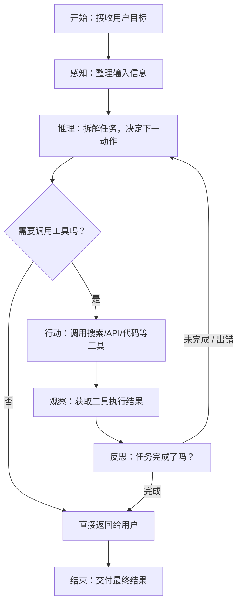

# 初识智能体 —— 智能体定义、类型、范式与应用

> 面试生普（LLM 500 题）· 初识智能体篇。本章覆盖智能体是什么、和大模型/AI助手的区别、核心特征、基本架构、常见类型、应用场景、工作循环、与传统自动化的区别、局限挑战，以及一个手撕 Python 智能体的入门示例，共 10 个问题。正文面向“会一点编程语言和深度学习基础，除此之外没有任何其他背景”的读者，重要概念配大白话解释和 Python 代码。

---

## Q1. 什么是智能体（Agent）？它和我们平时用的大模型（LLM）、AI 助手有什么本质区别？

**回答**

先说大白话：**智能体（Agent），就是一个“会行动、会协作、会学习的数字员工”。** 它不像大模型那样只会“答题”，而是能围绕一个目标连续地做事——比如帮你订机票、写代码并跑通、整理文档发邮件，甚至和其他智能体一起协作完成一个项目。

为了彻底搞清楚智能体是什么，咱们得先把三层概念掰开了说，不然很容易把它们混在一起：

**第一层：大型语言模型（LLM）。**
LLM 本质上是一个“超级语言引擎”。你给它一段文字，它给你返回一段文字。GPT、DeepSeek、通义千问这些模型都属于这一层。它的特点是：**被动响应、没有记忆、不会主动行动。** 你问它“明天天气怎么样？”，它可能告诉你“我无法获取实时天气”，因为它本身没有眼睛去看窗外，也没有手去打开天气APP。

**第二层：AI 助手（比如 ChatGPT、豆包、文小言）。**
AI 助手是在大模型外面包了一层交互界面和记忆管理。它能跟你多轮对话，但本质上依然是“人问、AI 答”的被动模式，干活的边界止步于“文字回应”。你让它“帮我订张去上海的机票”，它最多给你几个携程链接，替你下单这件事它做不了。

**第三层：智能体。**
智能体是能够**自主感知环境、独立制订计划、调用工具、执行行动**，并在结果反馈中动态调整策略的 AI 系统。它有四大核心特征（下面 Q2 会详细展开）：

- **自主目标分解**：接到高层指令后，能自行拆成一串可执行的子任务；
- **工具调用能力**：能调用搜索引擎、数据库、API、代码执行器甚至其他 AI 模型；
- **闭环行动能力**：形成“感知 → 规划 → 行动 → 反馈 → 修正”的完整自主决策循环；
- **持久记忆与状态管理**：可以跨会话保持上下文贯通，像个真正“在上班”的角色。

用个比喻你就懂了：

- **大模型**是“大脑”：只会思考、会表达，但不动手。
- **AI 助手**是“会说话的大脑”：有个聊天界面，能陪你唠嗑，但还是不动手。
- **智能体**是“会行动、会协作、会学习的数字员工”：大脑加上眼睛、手脚、记忆，能独立把事情办成。

举个生活中的例子：

> 你对大模型说：“我要去北京出差三天。”它可能回复：“北京是个好地方，建议你去故宫、长城……”（只给建议，不办事）
>
> 你对智能体说：“我要去北京出差三天，帮我订机票和酒店，把行程写进日历，还要把机票信息发给助理。”智能体就会：查航班 → 比价 → 下单 → 选酒店 → 写日历 → 发邮件，一条龙干完，中间还要你点头确认关键步骤。

**面试要点**：智能体 ≠ 大模型，也不等于 AI 助手。大模型是能力底座，AI 助手是交互入口，智能体是把能力转化为生产力的**执行形态**，核心差别在于是否具备“面向目标的闭环行动能力”。

---

## Q2. 智能体的四大核心特征分别是什么？用大白话解释一下。

**回答**

智能体之所以能“办事”，靠的是四大核心特征。我们一个个来，用大白话配合生活中的例子，手把手拆清楚。

### 特征 1：自主目标分解（自己拆活儿）

你给智能体一个大目标，比如“帮我调研竞品并写一份分析报告”。它不会原地发呆，而是会自动把这件事拆成小步骤：

1. 搜索市场上的主要竞品；
2. 对每个竞品，收集产品功能、定价、用户评价；
3. 整理数据，做对比分析；
4. 生成结构化报告；
5. 保存为文档。

**大白话**：就像你给一个实习生下了一句“整理一下这周的市场资料”，聪明的实习生自己知道要先找资料、再整理、再做表格，不需要你每一步都盯着。

### 特征 2：工具调用能力（有手有脚）

大模型本身是个“孤岛”，只会处理文字，没法直接改变现实世界。智能体给它装上了“手脚”，能调用外部工具：

- **搜索工具**：上网查最新信息；
- **代码执行器**：写 Python 代码算复杂数学题、画图表；
- **API 调用**：调日历 API、邮件 API、数据库 API；
- **文件操作**：读写 Excel、PDF、Word。

**大白话**：大模型是“只动嘴”的员工，智能体是“会用 Excel、会发邮件、会查数据库”的员工。

### 特征 3：闭环行动能力（做完查一查，错了一改一改）

智能体不是一条路走到黑，而是走一个圈：

**感知 → 规划 → 行动 → 观察 → 反思 → 修正 → 再行动……直到任务完成。**

比如智能体帮你订机票，它先搜到了几个航班，但发现最便宜的那个已经没票了（观察），于是它会调整计划，去看第二便宜的（修正），再下单（行动），直到票订出来为止。

**大白话**：就像人做事，不是盲目往前冲，做完一步会回头看看效果，不满意就改一改，直到搞定。

### 特征 4：持久记忆与状态管理（不失忆症）

普通大模型对话，聊多了就忘前面说了什么（除非把历史记录全部塞回去，又贵又慢）。智能体有自己的记忆系统，能记住：

- 你的偏好（比如你喜欢窗边座位、不喝咖啡）；
- 任务进展（已经订了机票，还没订酒店）；
- 出错经验（上次调用那个接口超时了，这次先重试）。

**大白话**：智能体不像金鱼七秒钟记忆，它能“记得自己在干什么”，跨会话也能接着上次干的活继续干。

下面用一张 ASCII 图把四大特征串起来，你就能看到智能体的“长相”了：

```
                 +---------------------+
                 |      用户目标       |
                 | "帮我订机票+写日程" |
                 +----------+----------+
                            |
                            v
                 +---------------------+
                 |   自主目标分解      |  <-- 把大目标拆成子任务
                 | (查航班 -> 比价 ->  |  <-- 像项目经理排工期
                 |  订票 -> 写日历)     |
                 +----------+----------+
                            |
                            v
                 +---------------------+
                 |     工具调用        |  <-- 调搜索、API、代码执行器
                 |  (搜索/邮件/日历)   |
                 +----------+----------+
                            |
                            v
                 +---------------------+
                 |   闭环行动 (ReAct)  |  <-- 感知→规划→行动→观察→修正
                 +----------+----------+
                            |
                            v
                 +---------------------+
                 |   持久记忆与状态    |  <-- 记住偏好、进展、出错经验
                 +---------------------+
                            |
                            v
                 +---------------------+
                 |     任务完成        |  <-- 交付最终结果
                 +---------------------+
```

**面试要点**：四大特征分别是“自主拆活儿”“会用工具”“做完查一查”“不失忆症”。缺任何一条，都很难称得上一个合格的智能体。

---

## Q3. 智能体的基本架构由哪几部分组成？各部分干什么的？

**回答**

如果把智能体比作一个人，它的架构大致可以分成五大部分：**大脑（推理/规划）、感知（输入）、行动（工具/输出）、记忆（经验）、人格（角色设定）**。下面咱们逐个说，并且用 Python 代码把最核心的“感知 → 推理 → 行动”循环写出来，让你摸着门路入门。

### 1. 大脑（Brain / 推理规划模块）

大脑是智能体的核心，通常由一个大语言模型（LLM）担任。它负责：

- 理解用户说什么；
- 把复杂目标拆成小步骤；
- 决定下一步调用什么工具、做什么动作；
- 看工具返回的结果，判断任务是不是完成了。

没有大脑，智能体就是一串死板的脚本；有了大脑，它才能“灵活应变”。

### 2. 感知（Perception / 输入模块）

感知模块负责把外部世界的信息转成大脑能听懂的语言。包括：

- 用户输入的文字（聊天、邮件、文档）；
- 外部系统推送的消息（API 回调、定时器触发）；
- 传感器数据（如果是机器人，还有摄像头、麦克风）。

感知模块把这些信息整理成 Prompt，喂给大脑。

### 3. 行动（Action / 工具执行模块）

行动模块是智能体的“手脚”。大脑决定做什么之后，行动模块负责去干：

- 调用搜索引擎 API；
- 执行一段 Python 代码；
- 发一封邮件、写一个文件；
- 调用数据库查询。

行动完成后，结果会喂回给大脑，供下一轮决策参考。

### 4. 记忆（Memory / 经验模块）

记忆模块让智能体“不失忆”。通常分三层：

- **短期记忆**：当前对话的上下文，塞进 Prompt 里让大模型直接看到；
- **长期记忆**：重要信息存到向量数据库，需要时检索出来（这就是 RAG 的思想，后面章节会专门讲）；
- ** episodic 记忆**：过去做过的任务、遇到的错误和解决办法，用来避免重复犯同样的错。

### 5. 人格/角色（Profile / 角色设定）

人格模块决定智能体“说话是什么语气、扮演什么角色”。比如你可以设定它是“资深 Python 工程师”、“温柔的心理咨询师”或“严肃的财务审计员”，它就会按这个人设来回复和行动。

---

### 手撕一个最简单的智能体（Python）

下面这段代码实现了一个极简版智能体，它具备：**感知用户输入、大脑决策、调用计算器工具、观察结果、循环直到完成**。你只要有一个兼容 OpenAI 接口的 API Key 就能跑通（这里用占位符演示，不依赖真实网络）。

```python
"""
最简智能体示例：感知 -> 推理 -> 行动 -> 观察 -> 修正循环
只演示框架，真正的大模型调用需要替换成真实的 API。
"""

import json
from typing import List, Dict


class SimpleCalculator:
    """一个极简工具：只能做加减乘除，模拟外部 API。"""

    def run(self, expression: str) -> str:
        try:
            # 安全起见，这里只演示，实际不要对用户输入直接 eval
            result = eval(expression, {"__builtins__": {}}, {})
            return f"计算结果：{result}"
        except Exception as e:
            return f"计算失败：{e}"


class MiniAgent:
    def __init__(self, name: str = "小助手"):
        self.name = name
        self.tools = {"calculator": SimpleCalculator()}
        # 短期记忆：本次会话的对话历史
        self.memory: List[Dict[str, str]] = []

    def perceive(self, user_input: str) -> None:
        """感知：把用户输入存入短期记忆。"""
        self.memory.append({"role": "user", "content": user_input})
        print(f"[感知] 收到用户输入：{user_input}")

    def think(self) -> str:
        """
        推理：大脑决定下一步做什么。
        这里简化为规则演示；真实场景中会调用 LLM 生成 JSON 指令。
        """
        last = self.memory[-1]["content"] if self.memory else ""
        if "计算" in last or "算一算" in last:
            # 从文本里粗略提取算式（演示用，实际用 LLM + Function Calling）
            expr = last.replace("计算", "").replace("算一算", "").strip()
            return json.dumps({"tool": "calculator", "args": {"expression": expr}})
        return json.dumps({"tool": "none", "args": {}})

    def act(self, decision: str) -> str:
        """行动：根据大脑决策调用对应工具。"""
        cmd = json.loads(decision)
        tool_name = cmd.get("tool")
        args = cmd.get("args", {})

        if tool_name == "none":
            return "无需调用工具，直接回答用户。"

        if tool_name in self.tools:
            print(f"[行动] 调用工具：{tool_name}，参数：{args}")
            return self.tools[tool_name].run(**args)
        return f"未知工具：{tool_name}"

    def observe(self, result: str) -> None:
        """观察：把工具返回的结果存入记忆，供下一轮参考。"""
        self.memory.append({"role": "assistant", "content": result})
        print(f"[观察] 工具返回：{result}")

    def run(self, user_input: str, max_steps: int = 5) -> str:
        """主循环：感知 -> 推理 -> 行动 -> 观察，直到完成或达到步数上限。"""
        self.perceive(user_input)
        for step in range(max_steps):
            print(f"\n----- 第 {step + 1} 轮循环 -----")
            decision = self.think()
            print(f"[推理] 决策：{decision}")
            result = self.act(decision)
            self.observe(result)

            if "无需调用工具" in result or "计算结果" in result:
                return f"【{self.name}】任务完成：{result}"

        return f"【{self.name}】达到最大步数，未能完成任务。"


if __name__ == "__main__":
    agent = MiniAgent("算术小助手")
    answer = agent.run("请帮我算一下 (23 + 47) * 2 等于多少")
    print("\n" + "=" * 40)
    print(answer)
```

**运行输出示例（概念版）：**

```
[感知] 收到用户输入：请帮我算一下 (23 + 47) * 2 等于多少

----- 第 1 轮循环 -----
[推理] 决策：{"tool": "calculator", "args": {"expression": "(23 + 47) * 2"}}
[行动] 调用工具：calculator，参数：{'expression': '(23 + 47) * 2'}
[观察] 工具返回：计算结果：140

========================================
【算术小助手】任务完成：计算结果：140
```

这段代码把智能体最核心的“感知 → 推理 → 行动 → 观察”循环写死了，虽然真实的智能体会用 LLM 来生成决策 JSON（通过 Function Calling / Tool Use），但骨架是一样的。

**面试要点**：智能体基本架构 = 大脑（LLM 推理）+ 感知（输入整理）+ 行动（工具调用）+ 记忆（短期/长期）+ 人格（角色设定）。五大模块缺一不可，闭环是“感知→推理→行动→观察→修正”。

---

## Q4. 智能体有哪几种常见类型？怎么分类？

**回答**

“智能体”这个词范围很广，一千个人眼中可能有一千种智能体。为了不让大家晕，业界通常按**功能、载体、协作方式**三个维度来分类。下面咱们一个个拆，用大白话配例子。

### 按功能分：会话型 vs 任务导向型

这是最常见的划分，对应两种不同的“上班模式”。

| 类型 | 大白话定义 | 典型例子 |
|------|-----------|---------|
| **会话型智能体** | 擅长“聊”，像个知识渊博又好说话的朋友，适合问答、陪伴、情绪价值 | 客服机器人、心理咨询助手、语言学习伙伴 |
| **任务导向型智能体** | 擅长“干”，围绕一个明确目标拆任务、调工具、出结果，适合执行具体工作 | 订机票智能体、自动写代码并跑通的编程助手、数据分析师智能体 |

**举例**：

- 你问客服智能体“退货流程是什么？”，它从知识库里找答案告诉你，这就是**会话型**；
- 你告诉智能体“帮我把这周的销售数据整理成表格，算出环比增长，发邮件给老板”，它自己调 Excel 工具、写 Python 代码、调邮件 API，这就是**任务导向型**。

### 按载体分：数字型 vs 物理型

| 类型 | 大白话定义 | 典型例子 |
|------|-----------|---------|
| **数字型智能体** | 只在计算机里“活”，不直接碰到物理世界 | 聊天机器人、自动写代码的 Agent、数据分析 Agent |
| **物理型智能体** | 装在硬件里，能感知并影响现实世界 | 自动驾驶汽车、工厂机械臂、送餐机器人、无人机 |

**大白话**：数字型智能体的“身体”是代码和 API，物理型智能体的“身体”是传感器、电机和轮子。

### 按协作方式分：单智能体 vs 多智能体系统

| 类型 | 大白话定义 | 典型例子 |
|------|-----------|---------|
| **单智能体（Single-Agent）** | 一个 Agent 包打天下，从头到尾自己干 | 一个写作助手，从大纲到成文都它一个人搞定 |
| **多智能体系统（Multi-Agent System）** | 多个 Agent 各司其职，像部门一样分工协作 | 一个“产品经理 Agent”拆需求，“开发 Agent”写代码，“测试 Agent”找 Bug，最后“经理 Agent”验收 |

**多智能体的 ASCII 图示意：**

```
        用户目标：开发一个任务管理 App
                 |
                 v
        +------------------+
        | 产品经理 Agent   |  <-- 拆需求，写 PRD
        +--------+---------+
                 |
                 v
        +------------------+
        | 架构师 Agent     |  <-- 设计技术方案
        +--------+---------+
                 |
                 v
        +------------------+      +------------------+
        | 前端开发 Agent   |      | 后端开发 Agent   |  <-- 并行写代码
        +------------------+      +------------------+
                 |                         |
                 v                         v
        +-------------------------------------------+
        | 测试 Agent                                |  <-- 写用例，跑测试，找 Bug
        +-------------------------------------------+
                 |
                 v
        +------------------+
        | 经理 Agent       |  <-- 验收，决定是否上线
        +------------------+
```

**大白话**：单智能体适合简单、单一场景；多智能体适合复杂、需要分工协作的场景。但多智能体也有麻烦——Agent 之间要沟通、可能互相推诿、错误可能传递，调试比单智能体难。

### 小结表：三种分类一览

| 分类维度 | 常见类型 | 核心特征 | 适合场景 |
|----------|---------|---------|---------|
| 按功能 | 会话型 / 任务导向型 | 擅长聊 vs 擅长干 | 客服/问答 vs 订票/数据分析 |
| 按载体 | 数字型 / 物理型 | 只在电脑里 vs 能动弹硬件 | 软件助手 vs 自动驾驶/机器人 |
| 按协作 | 单智能体 / 多智能体 | 一人包打天下 vs 部门分工协作 | 简单任务 vs 复杂项目 |

**面试要点**：智能体按功能分“会话型/任务导向型”，按载体分“数字型/物理型”，按协作分“单智能体/多智能体”。面试时别只背定义，要能举出每种类型的实际例子。

---

## Q5. 智能体能做什么？常见的应用场景有哪些？

**回答**

智能体的应用场景非常广，一句话概括：**凡是需要“理解需求 → 拆解步骤 → 调用工具 → 反复试错 → 交付结果”的工作，都可以用智能体。** 下面咱们按行业举几个最贴近生活的例子，每个都用大白话讲清楚它具体在干什么。

### 场景 1：虚拟助手 / 个人助理

比如 Siri、谷歌助手、Alexa 的升级版。以前的语音助手只能“设个提醒、回答天气”，智能体版本的助手能：

- “帮我下周一上午 10 点跟张经理约个会，查一下大家都有空的时间，发邀请函”；
- “把这三个 PDF 合并成一份报告，重点部分标出来，发到我的邮箱”；
- “帮我订下周五去上海的高铁票，窗边座位，把行程单存在云盘里”。

**大白话**：从“会说话的闹钟”变成“能办事的秘书”。

### 场景 2：软件开发与编程助手

智能体在软件行业能干不少事：

- **自动写代码并跑通**：你给个需求“写个爬虫抓取新闻标题并存 CSV”，智能体自己写 Python 代码、运行、报错就自己改，最后把代码交给你；
- **代码审查（Code Review）**：智能体读你的代码，找出潜在 Bug、性能问题、安全漏洞，还给出修改建议；
- **自动生成测试用例**：根据你的代码，智能体写测试脚本，跑一遍看看通过没。

**大白话**：像个不需要睡觉的初级程序员，能写代码、能找 Bug、能写测试。

### 场景 3：客户服务与客服

传统客服机器人只能匹配关键词回复固定话术，智能体客服能：

- 理解用户模糊的描述（“我买的那个东西坏了” → 它自动去查你的订单）；
- 查订单、查物流、发起退款、换货；
- 如果问题太复杂，自动转人工客服，并且把前面的对话摘要交给人工，不用用户重复讲一遍。

**大白话**：从“按 1 选中文，按 2 选英语”的语音导航，变成“能理解你在说什么、能帮你真正解决问题”的客服。

### 场景 4：自动驾驶与无人机

这是物理型智能体的典型代表：

- 感知：摄像头、雷达、激光雷达盯着路面、行人、其他车辆；
- 决策：该不该变道、该不该减速、红灯要不要停；
- 行动：转向、加速、刹车。

**大白话**：汽车不再只是个机械工具，它变成了一个“懂路况、会开车”的数字员工。

### 场景 5：医疗保健

智能体在医疗领域可以辅助（注意是辅助，不是替代医生）：

- 帮医生整理病历，从聊天记录里提取症状；
- 查最新的医学论文和治疗指南，给医生提供参考方案；
- 提醒患者按时吃药，记录副作用，异常时通知家属或医生。

**大白话**：像个勤快的护士，帮忙跑腿查资料，但最终诊断还得靠医生。

### 场景 6：网络安全

- 监控网络流量，发现异常访问模式；
- 自动隔离可疑设备，防止病毒扩散；
- 分析日志，找出可能的黑客入侵痕迹。

**大白话**：像个 24 小时在岗的网络保安，发现可疑情况就立刻处理。

### 场景 7：教育

- 根据每个学生的进度和薄弱点，定制化学习计划；
- 批改作业，给出具体的错误分析和改进建议；
- 答疑解惑，学生随时可以问问题，智能体耐心解释，不厌烦。

**大白话**：像个永远有耐心的家教老师，因材施教。

---

### 应用场景速查表

| 领域 | 智能体在干什么 | 带来的价值 |
|------|--------------|-----------|
| 个人助理 | 订机票、开会、整理文档、发邮件 | 解放双手，节省时间 |
| 软件开发 | 写代码、审代码、写测试、找 Bug | 提高开发效率，降低出错率 |
| 客户服务 | 答问、查订单、退款、转人工 | 7×24 小时在线，用户不用重复陈述 |
| 自动驾驶 | 感知路况、决策、控制车辆 | 释放双手，提升交通安全 |
| 医疗保健 | 整理病历、查指南、提醒吃药 | 辅助医生，提高就医效率 |
| 网络安全 | 监控流量、隔离威胁、分析日志 | 实时响应，减少人工巡检 |
| 教育 | 定制学习计划、批改作业、答疑 | 因材施教，老师负担减轻 |

**面试要点**：智能体能做的事很广，核心是“围绕目标自主完成多步任务”。面试时建议挑 2~3 个你最熟悉的场景，具体讲智能体在其中调用了什么工具、经历了怎样的“感知→规划→行动”循环，这样更有说服力。

---

## Q6. 智能体的典型工作循环是什么？能不能用一张图串起来？

**回答**

智能体干活不是“一次性吐出答案就完事”，而是一个**循环往复**的过程。业界把这个循环叫作“感知 → 推理 → 行动 → 观察 → 反思（修正）”，也有人简称为 ReAct 循环（下一章会专门讲 ReAct，这里先打个预防针）。

下面咱们把每一步都用大白话说清楚，再配一个 mermaid 流程图，让你一眼看懂整个循环长什么样。

### 循环的五个步骤

#### 步骤 1：感知（Perceive）—— 看清世界在说什么

智能体先得“睁开眼睛”接收信息。感知的内容包括：

- 用户发来的消息（“帮我订张机票”）；
- 外部系统传来的数据（航班查询结果、天气预报）；
- 定时器触发的事件（每天早上 8 点提醒）。

感知模块把这些原始信息整理成大模型能听懂的 Prompt，喂给“大脑”。

**大白话**：就是“先搞清楚用户要干什么，周围环境怎么样”。

#### 步骤 2：推理（Reason / Plan）—— 决定下一步做什么

大脑（LLM）根据感知到的信息，结合记忆里的经验，思考：

- 用户的目标到底是什么？
- 需要拆成几个子任务？
- 下一步该调用什么工具，还是直接回答用户？
- 上一步的动作是否成功，需要调整吗？

推理的结果通常是一个“动作指令”，比如“调用搜索工具查北京航班”或“直接告诉用户天气不错”。

**大白话**：就是“大脑在琢磨，接下来干啥，怎么干最顺”。

#### 步骤 3：行动（Act）—— 真正出去干活

根据推理的结果，智能体调用对应的工具去执行：

- 调用搜索 API 查信息；
- 执行一段 Python 代码算数；
- 调用日历 API 写入行程；
- 发一封邮件。

行动是智能体区别于纯聊天机器人的关键——**它不光嘴上说，手上也干**。

**大白话**：就是“动手去做，不光空谈”。

#### 步骤 4：观察（Observe）—— 看看干出了什么结果

工具执行完了，会返回一个结果。观察模块把这个结果拿过来，交给大脑：

- 搜索到了三个航班，价格分别是 800、1200、1500 元；
- 代码运行出错了，提示“变量未定义”；
- 邮件发送成功，对方已收到。

观察的结果会存入记忆，成为下一轮推理的依据。

**大白话**：就是“做完一步，回头看看效果怎么样”。

#### 步骤 5：反思与修正（Reflect / Correct）—— 不满意就改一改

大脑看完观察结果，做出判断：

- 任务完成了吗？（航班订好了 → 结束）
- 还没完成，需要调整策略吗？（最便宜的航班没票了 → 换第二便宜的）
- 上一步出错了，怎么修正？（代码报错 → 改代码再运行）

如果任务还没完成，循环回到步骤 2，重新推理、行动、观察，直到完成或达到最大尝试次数。

**大白话**：就是“做完查一查，错了一改一改，直到搞定”。

---

### 循环流程图（Mermaid）



**ASCII 简易版：**

```
用户目标 → 感知 → 推理 → 行动 → 观察 → 反思
                              ↑              ↓
                              └────── 未完成/出错 ──┘
                                  ↓
                            直接回答 / 交付结果
```

---

### 用 Python 代码串起整个循环

下面是一个更完整的“感知→推理→行动→观察→反思”循环框架，比上一章的 MiniAgent 更接近真实智能体的主循环：

```python
"""
智能体主循环：感知 -> 推理 -> 行动 -> 观察 -> 反思
演示用框架，真实场景中 think() 会调用 LLM + Function Calling。
"""

import json
from typing import List, Dict, Optional


class SearchTool:
    """模拟搜索工具"""

    def run(self, query: str) -> str:
        # 这里只是模拟，真实场景调用搜索 API
        return f"搜索结果：关于 '{query}' 的相关信息（模拟数据）"


class CalculatorTool:
    """模拟计算器工具"""

    def run(self, expression: str) -> str:
        try:
            result = eval(expression, {"__builtins__": {}}, {})
            return f"计算结果：{result}"
        except Exception as e:
            return f"计算错误：{e}"


class AgentLoop:
    def __init__(self, name: str = "循环智能体"):
        self.name = name
        self.tools = {
            "search": SearchTool(),
            "calculator": CalculatorTool(),
        }
        self.memory: List[Dict[str, str]] = []
        self.max_steps = 10

    def perceive(self, user_input: str):
        """感知：把用户输入放入记忆"""
        self.memory.append({"role": "user", "content": user_input})
        print(f"[感知] {user_input}")

    def think(self) -> Optional[dict]:
        """
        推理：根据记忆决定下一步动作。
        这里用简化的规则演示，真实场景应调用 LLM 生成 JSON。
        """
        if not self.memory:
            return None

        last_user = ""
        for m in reversed(self.memory):
            if m["role"] == "user":
                last_user = m["content"]
                break

        # 粗略规则：演示用，实际要靠 LLM 判断
        if "搜索" in last_user or "查" in last_user:
            query = last_user.replace("搜索", "").replace("查", "").strip()
            return {"action": "tool", "tool": "search", "args": {"query": query}}
        elif "计算" in last_user or "算" in last_user:
            expr = last_user.replace("计算", "").replace("算", "").strip()
            return {"action": "tool", "tool": "calculator", "args": {"expression": expr}}
        else:
            # 认为任务可以直接回答
            return {"action": "final", "answer": "已理解您的需求，但需要更多信息才能继续。"}

    def act(self, decision: dict) -> str:
        """行动：执行工具或给出最终答案"""
        if decision["action"] == "final":
            return f"[最终答案] {decision['answer']}"

        tool_name = decision["tool"]
        args = decision["args"]
        print(f"[行动] 调用 {tool_name}，参数 {args}")

        if tool_name in self.tools:
            return self.tools[tool_name].run(**args)
        return f"未知工具：{tool_name}"

    def observe(self, result: str):
        """观察：把结果放入记忆"""
        self.memory.append({"role": "assistant", "content": result})
        print(f"[观察] {result}")

    def reflect(self) -> bool:
        """
        反思：判断是否完成。
        演示版：只要出现“计算结果”或“搜索结果”就认为完成。
        真实版：调用 LLM 判断任务目标是否达成。
        """
        last = self.memory[-1]["content"] if self.memory else ""
        if "计算结果" in last or "搜索结果" in last:
            return True
        return False

    def run(self, user_input: str) -> str:
        self.perceive(user_input)
        for step in range(self.max_steps):
            print(f"\n=== 第 {step + 1} 轮循环 ===")
            decision = self.think()
            if decision is None:
                break

            if decision["action"] == "final":
                return decision["answer"]

            result = self.act(decision)
            self.observe(result)

            if self.reflect():
                return f"【{self.name}】任务完成。最后结果：{result}"

        return f"【{self.name}】达到最大步数，未完成任务。"


if __name__ == "__main__":
    agent = AgentLoop("小循环")
    # 场景 1：计算
    print(agent.run("请帮我计算 (15 + 25) * 3 等于多少"))
    print("\n" + "=" * 50)
    # 场景 2：搜索（模拟）
    agent2 = AgentLoop("小循环")
    print(agent2.run("帮我搜索一下今天的天气情况"))
```

**运行输出示例（概念版）：**

```
=== 第 1 轮循环 ===
[感知] 请帮我计算 (15 + 25) * 3 等于多少
[行动] 调用 calculator，参数 {'expression': '(15 + 25) * 3'}
[观察] 计算结果：120
【小循环】任务完成。最后结果：计算结果：120

==================================================
=== 第 1 轮循环 ===
[感知] 帮我搜索一下今天的天气情况
[行动] 调用 search，参数 {'query': '今天的天气情况'}
[观察] 搜索结果：关于 '今天的天气情况' 的相关信息（模拟数据）
【小循环】任务完成。最后结果：搜索结果：关于 '今天的天气情况' 的相关信息（模拟数据）
```

**面试要点**：智能体工作循环 = “感知 → 推理 → 行动 → 观察 → 反思（修正）”，并会循环往复直到任务完成。这是理解 ReAct、Plan-and-Solve 等后续范式的基础，面试时务必能说清楚每一步在干什么。

---

## Q7. 智能体和传统自动化软件（RPA、脚本）有什么区别？

**回答**

很多人会混淆：智能体和传统自动化软件（比如 RPA、写好的 Python 脚本）不都是“让机器自动干活”吗？区别其实很大，核心差别在于**“是死板执行规则”还是“会灵活推理决策”**。

下面咱们从几个最直观的维度来对比，并举生活中的例子。

### 核心区别对比表

| 维度 | 传统自动化（RPA/脚本） | LLM 驱动的智能体 |
|------|----------------------|----------------|
| **执行逻辑** | 固定规则，输入 A 永远输出 B（确定性） | 根据上下文动态决策，同样的输入可能走不同路径（非确定性） |
| **面对异常** | 遇到没预设的情况直接报错或卡住 | 能根据错误信息自行调整，尝试别的路径 |
| **理解能力** | 只认结构化指令，不懂自然语言 | 能理解模糊的自然语言需求（“帮我优化一下销售流程”） |
| **跨系统整合** | 需提前写好每个系统的对接代码 | 能动态决定调用哪个 API、什么时候调用 |
| **学习改进** | 不能自我改进，需要人改代码 | 能基于反馈反思、修正，逐步优化行为 |
| **开发门槛** | 需程序员写代码、调试 | 业务人员用自然语言描述需求，部分可低代码配置 |

---

### 生活中的例子对比

**场景：每天早晨自动爬取行业新闻，发摘要到微信。**

#### 传统自动化（RPA/脚本）做法：

```python
# 伪代码：固定流程，一条路走到黑
def daily_news_bot():
    # 步骤 1：固定时间定时启动
    # 步骤 2：访问固定的几个新闻网站
    for url in FIXED_URLS:
        html = fetch(url)
        # 步骤 3：用固定的正则/ XPath 抓标题
        titles = extract_titles(html)
    # 步骤 4：拼成固定格式的消息
    message = "\n".join(titles)
    # 步骤 5：发到固定的微信机器人
    send_to_wechat(message)
```

**问题**：如果某个新闻网站改版了，XPath 失效，脚本就直接报错，不会自己去找新的抓取规则；如果用户临时说“今天只想看 AI 相关的新闻”，脚本也做不到，因为它只认预设的网站和规则。

#### 智能体做法：

```python
# 伪代码：智能体会根据情况动态调整
def daily_news_agent():
    # 感知：读取用户今天的偏好（“只看 AI 新闻”）
    preference = read_user_preference()
    
    # 推理：决定去哪些网站搜，用什么关键词
    plan = llm_plan(f"用户想看 {preference} 的新闻，制定抓取计划")
    
    # 行动：动态调用搜索工具、新闻 API
    results = []
    for step in plan:
        data = call_tool(step.tool, step.args)
        results.append(data)
    
    # 观察：看抓到的内容是否有用
    quality = llm_evaluate(results, preference)
    
    # 反思：如果质量不够，换关键词再抓
    if quality.score < 0.7:
        plan = llm_plan(f"质量不够，重新调整搜索关键词，偏好：{preference}")
        # 循环继续...
    
    # 最终：生成摘要发送
    summary = llm_summarize(results)
    send_to_wechat(summary)
```

**大白话**：传统自动化像个“只会按既定路线跑的火车”，轨道坏了一点就停不下来；智能体像个“会看地图、会绕路的出租车司机”，堵车了知道换条路，目的地变了也能重新规划。

---

### 什么时候用传统自动化，什么时候用智能体？

| 场景 | 推荐方案 | 原因 |
|------|---------|------|
| 每天定时把数据库导出成 Excel，格式固定 | 传统脚本 / RPA | 流程固定、确定性高，用智能体浪费钱且慢 |
| 根据用户自然语言描述，自动生成报告并发邮件 | 智能体 | 需要理解模糊需求、动态调用工具 |
| 把 ERP 和 CRM 两个系统的数据按固定规则同步 | 传统集成 / 脚本 | 接口固定，不需要 AI 推理 |
| 客服根据用户问题，自动查订单、退款、转人工 | 智能体 | 用户问法五花八门，需要灵活决策 |

**面试要点**：传统自动化是“确定性执行预设规则”，智能体是“非确定性、基于 LLM 的动态决策”。两者不是非此即彼，实际生产中常混合使用：规则明确的部分用脚本/RPA，需要理解和决策的部分用智能体。

---

## Q8. 智能体有哪些局限性和挑战？用得好要注意什么？

**回答**

智能体很强大，但绝非万能。如果你只听它的优点，不了解它的坑，上手容易踩雷。下面咱们用大白话把智能体的主要局限和挑战挑明，并给出实用建议。

### 挑战 1：幻觉（胡说八道）

大模型最大的毛病就是**幻觉**——它有时会自信满满地编造不存在的事实。智能体继承了这个毛病，而且更危险，因为智能体不仅会胡说，还可能**基于胡说去行动**。

**例子**：智能体帮你订机票，它可能幻觉出一个不存在的航班号，然后真的去尝试预订，或者把你的个人信息填错。

**应对**：关键步骤（付款、删除数据、发重要邮件）必须加“人工确认”环节，不要让智能体完全自主处理涉钱涉密操作。

---

### 挑战 2：常识缺乏和世界理解不深

智能体虽然会读很多书，但它不具备人类的常识和对物理世界的深刻理解。

**例子**：你让智能体“帮我把冰箱里的牛奶拿出来”，如果它没有机械臂和传感器，它根本不知道冰箱在哪、牛奶长什么样、怎么打开冰箱门。即使是纯数字任务，它也可能不明白“为什么周末的股市是闭市的”这种常识。

**应对**：不要指望智能体处理需要深度常识或身体体验的任务，把它当“助手”而非“替代人类”。

---

### 挑战 3：道德困境和偏见

智能体的决策基于训练数据和算法，如果数据里有偏见，它可能复制甚至放大偏见。

**例子**：一个招聘智能体可能因为历史数据里男性工程师多，就倾向于推荐男性候选人；一个贷款智能体可能因为某些地区历史违约率高，就拒绝该地区所有人的贷款。

**应对**：在涉及招聘、贷款、医疗等敏感领域，必须有人工复核，并定期审计智能体的决策是否公平。

---

### 挑战 4：对数据的高度依赖

智能体的知识上限取决于大模型的训练数据，它不会实时知道训练截止日期后的事情，也无法直接获取你公司内部的私有文档（除非配合 RAG 和工具）。

**例子**：你问智能体“我们公司上周的销售额是多少”，它大概率回答不知道，因为这个数据不在它的训练集里。

**应对**：结合 RAG（检索增强生成）和知识库，让智能体先去查外部/私有数据，再基于数据回答，而不是凭空编造。

---

### 挑战 5：安全和失控风险

智能体拥有“调用工具、执行行动”的能力，如果权限给得太大，一旦出错或被攻击，危害会被放大。

**例子**：智能体有权限调用“删除数据库”接口，如果它误判了任务，可能把重要数据删了；或者恶意用户通过提示词注入（Prompt Injection）诱导智能体执行危险操作。

**应用**：遵循“最小权限原则”，只给智能体它真正需要的工具权限；对破坏性操作加二次确认；做好输入过滤和输出审计。

---

### 挑战 6：调试和可解释性难

传统程序出错了，可以打断点、看日志，一步步找到哪一行代码出问题。智能体的决策过程在大模型里面，像个“黑箱”，很难解释“为什么它会做这个决定”。

**例子**：智能体突然决定换一家供应商，你不知道它是因为价格、质量，还是因为它幻觉了某条信息。

**应对**：记录完整的执行轨迹（每一步的感知、推理、行动、观察），方便事后复盘；关键决策要求智能体输出理由，不只给结果。

---

### 实用建议：用得好的智能体要注意什么？

下面是一份上手 checklist，建议照着做：

1. **从小任务开始**：先让智能体处理低风险、可回滚的任务（比如写文案、整理数据），不要一上来就让它管理财务。
2. **加人工确认**：涉及付款、删除、发送对外邮件等操作，必须有人点“确认”才执行。
3. **限制工具权限**：只开放智能体真正需要的 API，不要一股脑给全权限。
4. **记录完整日志**：每一步的输入、输出、决策理由都要存下来，出了问题好排查。
5. **设置最大步数**：防止智能体陷入死循环，比如最多尝试 10 轮就停下来报告人工。
6. **不要过度依赖**：智能体是助手，不是救世主，关键决策和道德判断还是得人来做。

---

### 局限性速查表（ASCII 版）

```
智能体的主要局限：
┌─────────────────────────────────────────────────────────┐
│ 1. 幻觉：可能自信地编造事实，甚至基于假信息采取行动     │
│ 2. 常识缺乏：不理解物理世界和日常常识                   │
│ 3. 偏见与道德：可能复制训练数据中的不公平偏见           │
│ 4. 数据依赖：不知道训练集以外的私有/实时信息            │
│ 5. 安全风险：工具权限过大可能造成误删或被恶意利用       │
│ 6. 调试困难：决策过程像黑箱，难解释“为什么这么做”       │
└─────────────────────────────────────────────────────────┘
```

**面试要点**：智能体的局限包括幻觉、常识缺乏、偏见、数据依赖、安全风险、调试困难。面试时不要只吹智能体多强，要能说出它的边界和踩坑避雷策略，这体现工程成熟度。

---

## Q9. 怎么用 Python 写一个能联网查天气的简单智能体？

**回答**

光讲不练假把式。这一节咱们动手写一个**最小可用智能体**：它能理解用户关于天气的自然语言请求，调用公开天气 API 查询，把结果用大白话告诉用户。整个过程贯穿“感知 → 推理 → 行动 → 观察”的完整循环。

> **准备工作**：你需要一个天气 API 的密钥。可以去 OpenWeatherMap（https://openweathermap.org/api）免费注册一个 API Key。如果暂时不想申请，代码里也内置了“离线模拟模式”，不联网也能跑通，先摸清框架再接真实 API。

---

### 完整代码

```python
"""
联网查天气的简单智能体
功能：用户用自然语言问天气，智能体调用 OpenWeatherMap API 查询，
      并用大白话组织回答。支持离线模拟模式（无需真实 API Key 也能跑）。
"""

import os
import json
import requests
from typing import List, Dict, Optional


class WeatherTool:
    """天气查询工具：调用 OpenWeatherMap API，或在离线模式下返回模拟数据。"""

    def __init__(self, api_key: Optional[str] = None, offline: bool = False):
        self.api_key = api_key
        self.offline = offline
        # 模拟数据库：城市 -> 天气
        self.mock_data = {
            "北京": {"天气": "晴朗", "温度": "15°C", "湿度": "30%"},
            "上海": {"天气": "多云", "温度": "22°C", "湿度": "65%"},
            "广州": {"天气": "阵雨", "温度": "28°C", "湿度": "80%"},
            "深圳": {"天气": "晴朗", "温度": "26°C", "湿度": "70%"},
        }

    def run(self, city: str) -> str:
        if self.offline or not self.api_key:
            data = self.mock_data.get(city)
            if data:
                return f"{city}今天{data['天气']}，温度{data['温度']}，湿度{data['湿度']}。（离线模拟数据）"
            return f"抱歉，离线模式下没有 {city} 的天气数据。"

        # 真实 API 调用
        url = "https://api.openweathermap.org/data/2.5/weather"
        params = {"q": city, "appid": self.api_key, "units": "metric", "lang": "zh_cn"}
        try:
            resp = requests.get(url, params=params, timeout=10)
            resp.raise_for_status()
            data = resp.json()
            weather = data["weather"][0]["description"]
            temp = data["main"]["temp"]
            humidity = data["main"]["humidity"]
            return f"{city}今天{weather}，温度{temp}°C，湿度{humidity}%。"
        except Exception as e:
            return f"查询 {city} 天气失败：{e}"


class WeatherAgent:
    """天气智能体：感知用户请求 -> 推理提取城市 -> 行动查天气 -> 观察结果 -> 回答。"""

    def __init__(self, name: str = "天气小助手", offline: bool = False):
        self.name = name
        self.weather_tool = WeatherTool(offline=offline)
        # 短期记忆：本次会话历史
        self.memory: List[Dict[str, str]] = []
        self.max_steps = 5

    def perceive(self, user_input: str):
        """感知：把用户输入存入记忆"""
        self.memory.append({"role": "user", "content": user_input})
        print(f"[感知] 收到用户输入：{user_input}")

    def think(self) -> Optional[dict]:
        """
        推理：从用户输入中提取城市名，决定是否调用天气工具。
        这里用简单的规则和关键词匹配演示；真实场景可用 LLM + Function Calling。
        """
        if not self.memory:
            return None

        last_user = ""
        for m in reversed(self.memory):
            if m["role"] == "user":
                last_user = m["content"]
                break

        # 非常粗糙的城市提取（演示用），真实项目建议用 NER 或 LLM
        common_cities = [
            "北京", "上海", "广州", "深圳", "杭州", "南京", "武汉", "成都",
            "重庆", "西安", "沈阳", "哈尔滨", "长春", "天津", "苏州", "无锡"
        ]
        found_city = None
        for city in common_cities:
            if city in last_user:
                found_city = city
                break

        if found_city:
            return {"action": "tool", "tool": "weather", "args": {"city": found_city}}
        elif "天气" in last_user:
            return {"action": "ask", "message": "请问您想查询哪个城市的天气？"}
        else:
            return {"action": "final", "answer": "我是天气小助手，可以帮您查询城市天气，比如问‘北京今天天气怎么样’。"}

    def act(self, decision: dict) -> str:
        """行动：调用天气工具或直接回答"""
        if decision["action"] == "final":
            return f"[最终答案] {decision['answer']}"
        if decision["action"] == "ask":
            return f"[需要用户补充] {decision['message']}"

        tool_name = decision["tool"]
        args = decision["args"]
        print(f"[行动] 调用 {tool_name}，参数 {args}")

        if tool_name == "weather":
            return self.weather_tool.run(**args)
        return f"未知工具：{tool_name}"

    def observe(self, result: str):
        """观察：把工具结果存入记忆"""
        self.memory.append({"role": "assistant", "content": result})
        print(f"[观察] 工具返回：{result}")

    def reflect(self) -> bool:
        """反思：判断是否已经得到天气结果并可以回答用户"""
        last = self.memory[-1]["content"] if self.memory else ""
        # 只要结果里包含城市天气相关关键词，就认为完成
        keywords = ["°C", "天气", "湿度", "失败", "抱歉"]
        return any(k in last for k in keywords)

    def run(self, user_input: str) -> str:
        """主循环：感知 -> 推理 -> 行动 -> 观察 -> 反思"""
        self.perceive(user_input)
        for step in range(self.max_steps):
            print(f"\n=== 第 {step + 1} 轮循环 ===")
            decision = self.think()
            if decision is None:
                break

            if decision["action"] == "final":
                return decision["answer"]
            if decision["action"] == "ask":
                # 需要用户补充信息，这里直接把问题返给用户（演示结束）
                return decision["message"]

            result = self.act(decision)
            self.observe(result)

            if self.reflect():
                # 组织成友好的自然语言回答
                return f"【{self.name}】{result}"

        return f"【{self.name}】达到最大尝试次数，未能完成查询。"


if __name__ == "__main__":
    # 离线模式：不需要真实 API Key，直接跑
    agent = WeatherAgent("天气小助手", offline=True)

    print(agent.run("北京今天天气怎么样？"))
    print("\n" + "=" * 50)
    print(agent.run("帮我查一下上海的天气"))
    print("\n" + "=" * 50)
    print(agent.run("成都最近天气如何"))
```

**运行输出示例（离线模式）：**

```
[感知] 收到用户输入：北京今天天气怎么样？

=== 第 1 轮循环 ===
[行动] 调用 weather，参数 {'city': '北京'}
[观察] 工具返回：北京今天晴朗，温度15°C，湿度30%。（离线模拟数据）
【天气小助手】北京今天晴朗，温度15°C，湿度30%。（离线模拟数据）

==================================================
[感知] 收到用户输入：帮我查一下上海的天气

=== 第 1 轮循环 ===
[行动] 调用 weather，参数 {'city': '上海'}
[观察] 工具返回：上海今天多云，温度22°C，湿度65%。（离线模拟数据）
【天气小助手】上海今天多云，温度22°C，湿度65%。（离线模拟数据）

==================================================
[感知] 收到用户输入：成都最近天气如何

=== 第 1 轮循环 ===
[行动] 调用 weather，参数 {'city': '成都'}
[观察] 工具返回：抱歉，离线模式下没有成都的天气数据。
【天气小助手】抱歉，离线模式下没有成都的天气数据。
```

---

### 如果要接真实天气 API

把 `offline=True` 改成 `offline=False`，并传入真实的 `api_key`：

```python
agent = WeatherAgent("天气小助手", offline=False)
# 需要把你的 OpenWeatherMap API Key 填进去
agent.weather_tool.api_key = "你的-API-Key"
```

然后 `agent.run("北京今天天气怎么样？")` 就会真正联网查询，返回真实天气。

---

### 这段代码演示了什么？

1. **感知**：把用户的自然语言请求（“北京今天天气怎么样”）收入记忆；
2. **推理**：从文本里识别出意图是“查天气”，提取出城市“北京”；
3. **行动**：调用 `WeatherTool` 去调用天气 API（或离线模拟）；
4. **观察**：把 API 返回的天气数据存入记忆；
5. **反思**：判断结果里是否包含天气信息，包含就直接组织成友好语言回答用户。

这是一个“玩具级”智能体，但它的骨架——感知→推理→行动→观察→反思——和工业级智能体是一样的。后面章节我们会把这个框架慢慢加强：接入真实 LLM 做推理、加入长期记忆、支持多工具调用、支持 ReAct 等经典范式。

**面试要点**：手撕一个最小智能体的核心是“定义工具类 + 感知推理行动观察循环 + 记忆”。面试时如果能现场写出类似上面的代码框架，并解释每一步在干什么，是很好的加分项。

---

## Q10. 本章小结：智能体的核心概念一张图搞懂

**回答**

本章咱们从零开始聊了智能体是什么、和大模型/AI 助手的区别、四大核心特征、基本架构、常见类型、应用场景、工作循环、与传统自动化的区别、局限挑战，最后还手撕了一个能查天气的 Python 智能体。

为了让你记得牢，我把本章最重要的知识点浓缩成下面这张“概念大图”和速查表。

---

### 智能体概念全景图（ASCII）

```
                              +-----------------------+
                              |      用户目标         |
                              | "帮我订机票+查天气"   |
                              +-----------+-----------+
                                          |
                                          v
    +-----------------------------------------------------------+
    |                    智能体基本架构                        |
    |                                                          |
    |  +----------+    +----------+    +----------+           |
    |  | 感知模块 |    | 推理模块 |    | 行动模块 |           |
    |  | (输入)   |--->| (大脑LLM)|--->| (工具)   |           |
    |  +----------+    +----------+    +----------+           |
    |                                                          |
    |  +----------+    +----------+                            |
    |  | 记忆模块 |    | 人格模块 |                            |
    |  | (短期/   |    | (角色)   |                            |
    |  | 长期记忆)|    +----------+                            |
    |  +----------+                                           |
    +-----------------------------------------------------------+
                                          |
                                          v
    +-----------------------------------------------------------+
    |               工作循环：感知 → 推理 → 行动 → 观察         |
    |                    → 反思（修正） → 循环                  |
    +-----------------------------------------------------------+
                                          |
                                          v
    +-----------------------------------------------------------+
    |              四大核心特征                                 |
    |  1. 自主目标分解  2. 工具调用能力  3. 闭环行动能力       |
    |  4. 持久记忆与状态管理                                     |
    +-----------------------------------------------------------+
                                          |
                                          v
    +-----------------------------------------------------------+
    |              常见类型                                     |
    |  按功能：会话型 / 任务导向型                                |
    |  按载体：数字型 / 物理型                                    |
    |  按协作：单智能体 / 多智能体                                |
    +-----------------------------------------------------------+
                                          |
                                          v
    +-----------------------------------------------------------+
    |              应用场景                                     |
    |  虚拟助手 / 编程助手 / 客服 / 自动驾驶 / 医疗 / 安全 / 教育 |
    +-----------------------------------------------------------+
```

---

### 本章速查表

| 知识点 | 一句话大白话 | 面试常考点 |
|--------|------------|-----------|
| 智能体 vs 大模型 | 大模型只会答题，智能体会办事 | 能否说清三层区别（LLM/AI助手/智能体） |
| 四大核心特征 | 自主拆活儿、会用工具、做完查一查、不失忆 | 能否分别举例说明 |
| 基本架构 | 感知 + 推理（大脑） + 行动 + 记忆 + 人格 | 能否画出架构图或写出循环框架 |
| 工作循环 | 感知 → 推理 → 行动 → 观察 → 反思 | 能否说清每一步在干什么 |
| 类型分类 | 会话/任务、数字/物理、单/多 | 能否举例每种类型 |
| 与传统自动化区别 | 传统按死规则跑，智能体会灵活推理 | 能否对比确定性 vs 非确定性 |
| 局限挑战 | 幻觉、常识缺乏、偏见、数据依赖、安全、调试难 | 能否说出至少 3 个局限及应对 |
| Python 入门 | 工具类 + 感知推理行动观察循环 + 记忆 | 能否现场写出最小智能体框架 |

---

### 下章预告

下一章《智能体发展史》我们将聊智能体是怎么一步步演进来的：从 20 世纪 80-90 年代的符号主义智能体，到基于规则的专家系统，再到 AutoGPT 引发的 LLM 智能体大爆发，以及 ReAct、Plan-and-Solve 等范式是如何改变智能体范式的。敬请期待！

---

> **本章正文结束。** 如需继续，请阅读《智能体发展史》章节。
