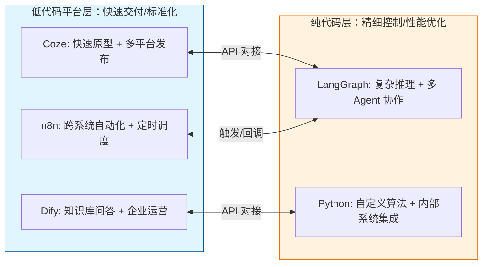

# 基于低代码平台的智能体搭建 —— 了解 Coze、Dify、n8n 等低代码智能体平台使用

> 面试生普（LLM 500 题）· 低代码平台篇。本章覆盖低代码智能体平台概念、Coze/Dify/n8n 三大平台核心特征与适用场景、三平台横向对比与选型、手把手用 Coze/Dify/n8n 搭建简单智能体、低代码平台局限与注意事项、低代码 vs 纯代码的混合使用，共 10 个问题。正文面向“会一点编程语言和深度学习基础，除此之外没有任何其他背景”的读者，重要概念配大白话解释、Python 代码（演示 API 调用与纯代码对比）和 mermaid/ASCII 图。

---

## Q1. 什么是低代码智能体平台？为什么需要它？

**回答**

如果你之前读过《智能体经典范式构建》那一章，你已经学会了用 Python 亲手写 ReAct、Plan-and-Solve、Reflection 这些智能体范式。亲手写代码的好处是看清骨架、能深度定制，但坏处是：**门槛高、慢、维护重**。你要懂 Python、懂 API 调用、懂状态管理、懂错误重试，还要自己搭环境、部署服务器。

这时候，“低代码智能体平台”就派上用场了。

### 什么是低代码智能体平台？

**低代码智能体平台**，大白话就是一个“搭积木一样做智能体”的可视化平台。你不需要写几百行 Python 代码，而是在网页界面里拖拽节点、配置提示词、连接数据源、点一下发布，就能做出一个能跑的智能体应用。

它把智能体开发里那些“底层脚手架”工作——调用模型 API、管理对话历史、处理工具调用失败、存储向量知识库、做可观测性日志——都帮你封装成了一个个可视化模块。你只需要关心业务逻辑：“用户问什么，智能体该调用什么工具，最后输出什么”。

### 为什么需要它？四个核心价值

业界通常把低代码平台的价值归纳为四点（这也能帮你在面试里答出“为什么要用低代码平台”）：

| 价值 | 大白话解释 | 解决了什么痛点 |
|------|-----------|--------------|
| **降低技术门槛** | 产品经理、运营、业务专家不需要写代码，也能亲手搭出智能体原型 | 以前只有程序员能做，现在业务人员也能参与 |
| **提升开发效率** | 原本要写好几天的原型，现在几小时甚至几分钟就能出来 | 把工程精力从“底层管道”挪到“业务逻辑和提示词优化” |
| **更好的可观测性** | 数据在每个节点怎么流动，一眼就能看见，哪个环节失败了直接标出来 | 以前靠终端打印日志猜哪里卡住了，现在像看行车轨迹图 |
| **标准化与最佳实践沉淀** | 平台内置了预设的 ReAct 模板、调优过的知识库检索引擎、标准化工具接入 | 不用从零搭这些样板，团队项目更统一 |

### 一个生活化的比喻

做智能体开发，以前就像**盖房子**：你得自己烧砖、混水泥、砌墙、拉电线、装水管，每一环都要懂。低代码平台就像**买精装房 + 家具**：房子已经�好了，水电都通了，你只需要挑沙发、摆装饰，决定“这个房间怎么用”。

当然，低代码平台也不是万能药，后面章节会讲它的局限。但对于“快速验证想法”“业务人员参与”“标准化交付”这些场景，它是非常实用的工具。

**面试要点**：低代码智能体平台 = 可视化拖拽 + 封装底层脚手架（模型调用、状态管理、工具编排、可观测性）。四大核心价值：降门槛、提效率、强可观测、标准化沉淀。适合快速原型、非技术人员参与、标准化交付的场景。

---

## Q2. Coze（扣子）是什么？核心特征和适用场景？

**回答**

Coze（扣子）是字节跳动推出的 AI 智能体开发平台，主打**零代码/低代码**，让不懂编程的人也能快速搭出功能不简单的智能体，并一键发布到多个平台。

如果把低代码平台比作盖房子的工具，Coze 就像一个“智能体乐高盒子”——字节已经把常用的零件（插件、模型、工作流节点、发布渠道）都做好了，你只需要拖拽拼装，写几句大白话提示词，半天就能拼出一个能用的智能体。

---

### Coze 的核心特征

#### 1. 零代码门槛，拖拽操作

你不需要写 Python，也不需要懂 API。Coze 的界面左边是插件库，右边是操作画布，你想要什么功能，直接把对应的节点拖过来，连上线就行。

#### 2. 插件生态丰富

Coze 内置了大量现成插件，涵盖搜索、图片生成、代码执行、数据抓取、天气、翻译、视频剪辑等。大部分插件点一下就能用，不用你自己去申请 API 密钥、写复杂的接入代码。

#### 3. 一键多平台发布

做好智能体后，Coze 支持一键发布到抖音、飞书、微信公众号、Discord、Telegram 等多个渠道。你不需要自己搭前端、对接各平台 API，Coze 帮你搞定了分发。

#### 4. 长期记忆和定时任务

Coze 支持给智能体配置长期记忆（记住用户偏好、历史对话），也支持定时触发（比如每天早上 8 点自动发简报）。

#### 5. 国内生态友好

Coze 是字节自家产品，和豆包大模型、抖音、剪映、头条等字节生态产品原生打通。对国内用户来说，注册、使用、模型选择都比较方便，不需要科学上网。

---

### Coze 的局限

- **生态相对封闭**：目前主要提供云端服务，私有化部署选项有限；数据和应用逻辑跑在字节服务器上，对有严格数据隔离要求的企业可能不适配。
- **模型切换灵活性较差**：模型多和字节生态内的豆包深度绑定，想自由切换各类第三方大模型，灵活性相比开源平台稍弱。
- **不支持 MCP**：Coze 不支持 Model Context Protocol（MCP），工具被圈在它自己的插件市场里，扩展到市场之外的自定义工具相对麻烦。
- **配置迁移较困难**：在 Coze 里配置好的流程，不容易导出成标准文件迁移到其他平台。

---

### 适用场景

| 场景 | 为什么选 Coze |
|------|-------------|
| 快速做个聊天机器人尝鲜 | 零代码，半天就能出成果，建立信心 |
| 内容创作自动化 | 比如小红书爆款文案、短视频脚本，插件齐全 |
| 多平台分发 | 做完一键发到抖音、飞书、微信公众号 |
| 非技术用户（产品经理、运营） | 完全不需要写代码，拖拽即可 |
| 个人/小团队快速验证想法 | 免费额度较足，试错成本低 |

---

### Coze 平台的一句话定位（ASCII 图）

```
Coze（扣子） = 零代码入口 + 插件生态 + 一键多平台发布
        │
        ├─ 插件库（搜索、图片、代码、天气……）
        ├─ 操作画布（拖拽节点，连线）
        ├─ 长期记忆 + 定时任务
        └─ 发布渠道（抖音、飞书、微信公众号、Discord……）
```

**面试要点**：Coze 是字节跳动的零代码/低代码智能体平台，核心特征是“零代码门槛、插件生态丰富、一键多平台发布、长期记忆与定时任务、国内生态友好”。适合快速原型、内容创作、多平台分发、非技术用户参与。局限是生态封闭、私有化有限、不支持 MCP、配置迁移难。

---

## Q3. Dify 是什么？核心特征和适用场景？

**回答**

如果 Coze 像个“智能体乐高盒子”，Dify 更像一个“企业级智能体工厂”。Dify 是一个开源的大语言模型（LLM）应用开发平台，融合了后端即服务（BaaS）和 LLMOps 思路，从原型设计到生产部署提供全流程支持。

Dify 由苏州语灵人工智能科技公司打造，Apache 2.0 开源协议，代码托管在 GitHub，社区热度很高（Star 数接近十万）。它最大的亮点是**开源 + 私有化部署**，数据牢牢掌握在自己手里，很受金融、医疗等对数据安全要求高的行业欢迎。

---

### Dify 的核心特征

#### 1. 开源 + 私有化部署

Dify 支持 Docker Compose 一键本地部署，也可以部署到自己的服务器或私有云。这意味着你的数据、知识库、应用逻辑都不出公司大门，适合对数据隐私和合规要求高的场景。

#### 2. 全栈能力，从原型到生产

Dify 不只是做个聊天界面，它覆盖了 AI 应用的完整生命周期：

- **工作流（Workflow）**：可视化有向无环图（DAG）编排，支持分支判断、代码块、并行调用、变量传递；
- **RAG 知识库**：内置文档分段、向量化、清洗、重排（Rerank）引擎，企业知识库建设体验好；
- **Prompt IDE**：可视化提示词编辑和调试；
- **模型管理**：兼容 OpenAI、DeepSeek、通义千问等上百种模型，也支持任何兼容 OpenAI API 的模型；
- **可观测性**：内置会话日志、运行面板，出了问题好排查；
- **版本控制**：草稿/发布分离，支持灰度发布。

#### 3. 模型中立，兼容性强

Dify 不绑定某一款模型，GPT、DeepSeek、Llama、本地模型都能接。你想换模型，在配置里切换一下就行，不用改代码。

#### 4. 插件生态

Dify Marketplace 提供模型、工具、智能体策略、扩展、捆绑包等插件，支持一键部署，社区贡献活跃。

#### 5. 企业级特性

多租户隔离、RBAC 权限控制、AES-256 加密、审计日志、API 网关等，适合企业生产环境。

---

### Dify 的局限

- **学习曲线较陡**：功能全，但概念多（工作流、RAG、Prompt、变量、条件分支……），新手需要花点时间摸。
- **核心服务端由 Python 实现**：在极高并发场景下，性能可能不如编译型语言实现的平台，需要额外优化。
- **多智能体协作能力偏弱**：遇到极度复杂的多 Agent 协同任务时，编排成本会上升。

---

### 适用场景

| 场景 | 为什么选 Dify |
|------|-------------|
| 企业级 AI 应用，私有化部署 | 开源、可自建、数据不出门 |
| 企业知识库问答、智能客服 | RAG 开箱即用，文档解析+向量检索 |
| 需要复杂业务逻辑的工作流 | DAG 编排支持分支、并行、代码块 |
| 有技术团队，要长期运营 | 版本控制、可观测性、灰度发布 |
| 想自由切换大模型 | 模型中立，兼容 OpenAI API |

---

### Dify 平台的一句话定位（ASCII 图）

```
Dify = 开源企业级 LLM 应用平台 + 全栈 LLMOps
        │
        ├─ 可视化工作流（DAG：分支/并行/代码块）
        ├─ RAG 知识库（分段/向量化/重排）
        ├─ Prompt IDE + 模型管理（模型中立）
        ├─ 可观测性（会话日志/运行面板）
        ├─ 版本控制（草稿/发布/灰度）
        ├─ 私有化部署（Docker Compose）
        └─ 企业级特性（多租户/RBAC/审计日志）
```

**面试要点**：Dify 是开源的企业级 LLM 应用开发平台，核心特征是“开源+私有化部署、全栈 LLMOps（工作流/RAG/Prompt/可观测/版本控制）、模型中立、企业级特性”。适合企业知识库、智能客服、复杂业务工作流、私有化部署场景。局限是学习曲线陡、Python 服务端高并发需优化、多 Agent 协作能力偏弱。

---

## Q4. n8n 是什么？核心特征和适用场景？

**回答**

如果说 Coze 是“智能体乐手盒子”，Dify 是“企业级智能体工厂”，那 n8n 就像一个“通用工作流自动化胶水”。n8n 的核心定位从来不是专门的 AI 平台，而是一个开源的工作流自动化工具，后来才加入了 AI 能力。

n8n 由 n8n GmbH 团队开发，读作“n-eight-n”，有点像大家熟知的 Zapier，作用就是把五花八门的软件、服务串联起来。只不过 n8n 更偏向开发者，支持本地部署，也能给到充足的代码自定义权限。

---

### n8n 的核心特征

#### 1. 通用工作流自动化之王

n8n 拥有超过 400 个官方主流 SaaS、数据库和网络协议的连接节点，能把 CRM、邮件、数据库、表单、日历、云存储等几乎所有系统串起来。它的自动化容错、重试、定时触发、错误捕获机制属于行业顶尖。

#### 2. AI 是工作流的一环，而非全部

n8n 后来加入了 AI 智能体节点，允许在标准的自动化流程中嵌入大模型思考。也就是说，n8n 的主体还是“自动化流程”，AI 只是其中一个节点。这个区别很重要：Dify 和 Coze 是“以 AI 为核心的平台”，n8n 是“以自动化为核心、AI 作为增强能力的平台”。

#### 3. 支持本地部署和代码自定义

n8n 支持 Docker/K8s 自托管，社区版无限制。你可以写自定义节点、插入 JavaScript/Python 代码块，做非常细致的定制。

#### 4. 连接能力极强

只要某个工具支持 API，n8n 几乎都能和它对接——从 Stripe 支付、Notion 文档，到小众的行业软件，几乎没有限制。

---

### n8n 的局限

- **AI 功能相对薄弱**：不适合构建复杂生产级智能体系统，AI 只是自动化流程里的一个节点。
- **学习曲线较陡**：没有现成模板引导，新手打开界面可能会懵——“我该从哪个节点开始？”需要自己理清“第一步做什么、第二步触发什么”。
- **内存态存储不持久**：Simple Memory / Simple Vector Store 重启即丢，生产环境需要换 Redis、Pinecone 等。
- **版本管理较弱**：对流程版本控制的支持不如 Dify。

---

### 适用场景

| 场景 | 为什么选 n8n |
|------|-------------|
| 跨系统自动化 | 比如“每天抓取网站新闻 → 丢给 AI 摘要 → 发微信”，跨系统串联是它的看家本领 |
| 企业运维、运营、营销自动化 | 把 ERP、CRM、财务系统等已有系统打通 |
| 需要本地部署和代码自定义 | 支持 Docker 自托管，可写自定义代码块 |
| AI 只是流程的一环 | 比如“自动化流程里嵌入一个 LLM 节点做摘要”，而非围绕 AI 重新搭一套应用 |

---

### n8n 平台的一句话定位（ASCII 图）

```
n8n = 通用工作流自动化平台 + AI 节点增强
        │
        ├─ 400+ 原生集成节点（SaaS/数据库/API）
        ├─ 可视化节点拖拽构建工作流
        ├─ 自动化容错/重试/定时触发/错误捕获
        ├─ 支持本地部署（Docker/K8s）+ 代码自定义
        └─ AI 只是其中一环（LLM 节点嵌入自动化流程）
```

**面试要点**：n8n 是通用工作流自动化平台，后来加入 AI 能力，核心特征是“400+ 集成节点、自动化容错/重试/定时触发、支持本地部署和代码自定义、AI 只是流程一环”。适合跨系统自动化、企业运维/运营/营销、本地部署定制场景。局限是 AI 功能薄弱、学习曲线陡、内存态不持久、版本管理弱。

---

## Q5. 三个平台怎么选？横向对比与选型建议

**回答**

Coze、Dify、n8n 三个平台不是替代品，而是四种不同的工程取舍。选型的核心原则是：**找出你的任务瓶颈卡在哪一环，就选在那一环最强的平台。**

---

### 三平台横向对比表

| 维度 | Coze | Dify | n8n |
|------|------|------|-----|
| 核心定位 | 零代码 / 低代码 Agent 构建 | 开源企业级 LLM 应用平台 | 通用工作流自动化 + AI 节点 |
| 第一等公民 | 插件生态 + 一键多平台发布 | 全栈能力 + LLMOps | 节点与“连接”能力 |
| 上手门槛 | 最低（零代码） | 中（需技术背景） | 较高（需理清流程） |
| 私有化部署 | 无（主要云端） | 支持（Docker Compose） | 支持（Docker/K8s） |
| 模型切换 | 较弱（绑定字节生态） | 强（模型中立，兼容 OpenAI API） | 弱（AI 非核心） |
| RAG 知识库 | 一般 | 强（开箱即用） | 弱 |
| 工作流编排 | 简单工作流 | 强（DAG：分支/并行/代码块） | 强（节点编排，侧重自动化） |
| 多平台发布 | 强（抖音/飞书/微信/Discord） | 弱 | 弱 |
| 跨系统集成 | 弱 | 中 | 强（400+ 节点） |
| 可观测性 | 有调试器 | 有运行日志面板 | 有完整执行历史 |
| 适合人群 | 非技术用户、产品经理、运营 | 有技术背景的开发者、企业团队 | 需要深度业务集成的开发者 |

---

### 选型决策树（ASCII）

```
开始：面对一个新项目
   │
   ▼
我的任务瓶颈卡在哪一环？
   │
   ├─ 瓶颈是“发布与传播” → 选 Coze
   │   （快速原型、多平台发布、非技术用户）
   │
   ├─ 瓶颈是“长期运营与多模态/企业知识库” → 选 Dify
   │   （私有化部署、RAG 知识库、复杂业务工作流、长期运营）
   │
   ├─ 瓶颈是“打通已有系统/跨系统自动化” → 选 n8n
   │   （ERP/CRM 对接、自动化流程、本地部署定制）
   │
   └─ 以上都不是，或需要极致定制 → 考虑纯代码（LangGraph 等）
```

---

### 选型口诀（大白话）

> **快做个聊天机器人、要多平台发、不会写代码 → 选 Coze；**
> **企业知识库、要私有化部署、有技术团队 → 选 Dify；**
> **把现有系统串起来、要自动化流程、要本地部署 → 选 n8n；**
> **极致定制、性能要求高、团队全是资深程序员 → 跳过低代码，直接写代码（LangGraph 等）。**

---

### 低代码 vs 纯代码：不是非此即彼

低代码平台并不取代代码开发，而是提供一种互补选择。实际项目可以按阶段和功能切换：

- **用低代码平台**处理标准化流程、快速原型、运营发布、跨系统连接；
- **用代码实现**精细控制、性能优化、复杂算法、内部系统深度集成；
- **混合开发**：低代码平台负责快速交付，代码负责扩展和稳定。比如核心工作流用 LangGraph 写，业务方临时要的小工具用 Dify 让运营自己搭；或者外层用 n8n 做调度，中间塞一个 LangGraph 的服务做复杂逻辑。

**面试要点**：三平台选型核心是“找瓶颈，选该环最强者”。Coze 胜在快速上线和多平台发布，Dify 胜在全栈企业级应用和私有化部署，n8n 胜在跨系统集成和自动化。低代码不取代代码，两者可混合使用。

---

## Q6. 手把手用 Coze 搭一个简单智能体（流程篇）

**回答**

Coze 是零代码平台，没有 Python 代码可写，但搭建流程本身就是一种“可视化编程”。下面咱们手把手走一遍用 Coze 搭一个“小红书爆款文案智能体”的完整流程，你就能明白低代码平台开发到底长什么样。

> 注意：Coze 是字节跳动的云端 SaaS 平台，具体界面可能随版本调整。下面描述的是通用流程，重点是理解“节点 → 插件 → 提示词 → 发布”这个逻辑，而不是死记具体按钮位置。

---

### 场景：小红书爆款文案智能体

目标：用户输入一个产品主题（比如“美妆护肤”），智能体自动生成一篇带爆款标题、痛点开头、干货正文、结尾引导的小红书文案，并可选配图建议。

---

### 搭建步骤

#### 步骤 1：创建智能体

1. 注册 Coze 账号，进入 Coze 官网；
2. 点击“创建智能体”，给它起个名字，比如“小红书文案助手”；
3. 选择一个大模型作为“大脑”（比如豆包模型）；
4. 写一段**系统提示词（System Prompt）**，定义智能体的人设和任务：

```
你是一名资深小红书运营专家，擅长写爆款文案。
用户会给你一个产品主题，请你按照以下结构生成文案：
1. 爆款标题（带 emoji，吸引点击）
2. 痛点开头（直击用户痛点，共鸣）
3. 干货正文（分点列出，实用可操作）
4. 结尾引导（引导评论、点赞、收藏）
语言风格：亲切、真诚、像朋友推荐，避免过于商业化。
```

#### 步骤 2：添加插件（工具）

在左侧插件库中，添加以下插件：

- **AI 图片生成**：根据文案内容建议配图风格；
- **搜索插件**：如果需要查最新的美妆趋势；
- **敏感词检测**：检查生成的文案是否有违规词。

你不需要写代码，点一下“添加”就行，Coze 已经帮你把 API 接入做好了。

#### 步骤 3：配置工作流（可选）

如果你想让文案生成更有结构，可以在 Coze 的工作流编排里加几个节点：

```
开始节点（用户输入主题）
    │
    ▼
[LLM 节点：生成爆款标题]
    │
    ▼
[LLM 节点：生成痛点开头]
    │
    ▼
[LLM 节点：生成干货正文]
    │
    ▼
[LLM 节点：生成结尾引导]
    │
    ▼
[合并节点：把四部分拼成完整文案]
    │
    ▼
结束节点（输出给用户）
```

每个 LLM 节点里写不同的提示词，把前一个节点的输出作为输入，形成流水线。

#### 步骤 4：调试和测试

在 Coze 的调试面板里，输入一个主题（比如“秋季护肤”），点击运行，看看生成的文案是否符合预期。如果不满意，调整提示词、换个插件、调整节点连接，再运行，直到满意。

#### 步骤 5：发布

点击“发布”，选择发布渠道（比如飞书、微信公众号、抖音，或生成一个 Web 链接/嵌入代码）。发布后，用户就能通过这些渠道跟你的智能体对话了。

---

### Coze 搭建流程图（ASCII）

```
创建智能体 → 选大模型 → 写系统提示词（人设+任务）
                              │
                              ▼
                    添加插件（搜索/图片/敏感词检测）
                              │
                              ▼
                    配置工作流（LLM 节点串联成流水线）
                              │
                              ▼
                    调试测试（输入主题，看输出，调提示词）
                              │
                              ▼
                    发布（飞书/微信/抖音/Web 链接）
```

---

### 用 Python 调用 Coze 智能体（API 对接）

虽然搭建不需要写代码，但发布后的智能体通常会生成一个 API Endpoint，你可以用 Python 调用它，把它集成到自己的应用里。下面是一个**概念版**的 Python 调用代码（真实的接口和字段以 Coze 官方文档为准）：

```python
"""
调用已发布的 Coze 智能体 API（概念版，真实接口以官方文档为准）
"""

import requests

COZE_API_BASE = "https://api.coze.cn"  # 示例地址，以官方为准
BOT_ID = "你的智能体 ID"
API_TOKEN = "你的 API Token"

def call_coze_bot(user_message: str, user_id: str = "user_001") -> str:
    url = f"{COZE_API_BASE}/v3/chat"
    headers = {
        "Authorization": f"Bearer {API_TOKEN}",
        "Content-Type": "application/json",
    }
    payload = {
        "bot_id": BOT_ID,
        "user_id": user_id,
        "query": user_message,
        "stream": False,
    }
    try:
        resp = requests.post(url, json=payload, headers=headers, timeout=30)
        resp.raise_for_status()
        data = resp.json()
        # 真实的字段名以 Coze 官方文档为准，这里只是示意
        return data.get("messages", [{}])[-1].get("content", "无响应")
    except Exception as e:
        return f"调用失败：{e}"


if __name__ == "__main__":
    answer = call_coze_bot("帮我写一篇秋季护肤的小红书爆款文案")
    print(answer)
```

**面试要点**：Coze 搭建是“可视化拖拽 + 配置提示词 + 添加插件 + 工作流编排 + 调试 + 发布”，不需要写 Python 代码。但发布后可通过 API 调用集成到其他应用，Python 代码主要用于对接 API 端点。

---

## Q7. 手把手用 Dify 搭一个知识库问答智能体（流程篇）

**回答**

Dify 的强项是 RAG 知识库和企业级工作流。下面咱们手把手走一遍用 Dify 搭一个“企业内部知识库问答智能体”的完整流程，目标是：员工可以用自然语言问公司内部规定，智能体从知识库里检索相关文档，生成准确答案并标注来源。

> 注意：Dify 可自建部署（Docker Compose）或使用云端 SaaS，界面可能随版本调整。下面描述通用流程，重点是理解“知识库 → 检索 → 增强生成 → 引用”这一 RAG 链路。

---

### 场景：企业内部知识库问答智能体

目标：上传公司的员工手册、报销制度、IT 政策等 PDF/Word 文档，员工问“报销流程是什么？”，智能体从文档里检索相关条款，生成答案，并告诉你条款出自哪个文档的哪一页。

---

### 搭建步骤

#### 步骤 1：创建知识库

1. 在 Dify 控制台进入“知识库”模块，点击“创建知识库”，命名如“公司内部文档”；
2. 选择嵌入模型（Embedding Model，用于把文档转成向量），比如 OpenAI 的 text-embedding 或本地模型；
3. 设置分块策略（比如每段 500 字，重叠 50 字）和向量数据库（Dify 内置或外部如 Pinecone、Milvus）。

#### 步骤 2：上传文档

把公司文档上传到知识库：

- 支持 PDF、Word、TXT、Markdown、网页等格式；
- 上传后，Dify 会自动做**文档分段（Chunking）→ 向量化（Embedding）→ 存入向量数据库**。这个过程就是 RAG 的“索引”阶段。

#### 步骤 3：创建应用（聊天助手）

1. 进入“应用”模块，创建一个“聊天助手”类型的应用；
2. 在应用设置里，关联刚才创建的知识库；
3. 配置**系统提示词（System Prompt）**，定义回答规则：

```
你是公司内部知识库助手。请基于提供的文档内容回答员工问题。
要求：
- 只基于文档内容回答，不要编造；
- 如果文档里没有相关信息，诚实说明“文档中未找到相关信息”；
- 回答时标注信息来源（文档名 + 页码/段落）；
- 语言简洁专业，用中文回答。
```

#### 步骤 4：配置检索参数

- **检索方式**：向量检索、全文检索或混合检索；
- **Top K**：每次检索返回多少个相关片段（比如 5 个）；
- **相似度阈值**：只有相似度超过多少的片段才采用。

#### 步骤 5：调试和测试

在 Dify 的对话测试面板里，问几个问题：

- “报销流程是什么？” → 智能体应该从报销制度文档里找到相关条款；
- “入职需要带什么材料？” → 从员工手册里找；
- “公司的 WiFi 密码是多少？” → 如果文档里没有，智能体应诚实回答未找到。

测试满意后，点击“发布”，生成 Web 应用或 API Endpoint。

---

### Dify RAG 链路图（ASCII）

```
用户问题（"报销流程是什么？"）
        │
        ▼
┌─────────────────┐
│ 查询向量化        │  （把问题转成向量）
└────────┬────────┘
         │
         ▼
┌─────────────────┐
│ 向量数据库检索    │  （Top K 相关文档片段）
│ （员工手册/报销制度）│
└────────┬────────┘
         │
         ▼
┌─────────────────┐
│ Prompt 拼接       │  （问题 + 检索到的片段 + 系统提示词）
└────────┬────────┘
         │
         ▼
┌─────────────────┐
│ 大模型生成答案    │  （基于片段生成，标注来源）
└────────┬────────┘
         │
         ▼
    最终答案 + 引用来源
```

---

### 用 Python 调用 Dify 应用 API（概念版）

发布后，Dify 会给你一个 API Endpoint，可以用 Python 调用：

```python
"""
调用已发布的 Dify 应用 API（概念版，真实接口以官方文档为准）
"""

import requests

DIFY_API_BASE = "https://api.dify.ai/v1"  # 示例地址
APP_TOKEN = "你的 Dify 应用 Token"

def ask_dify(question: str, user: str = "employee_001") -> str:
    url = f"{DIFY_API_BASE}/chat-messages"
    headers = {
        "Authorization": f"Bearer {APP_TOKEN}",
        "Content-Type": "application/json",
    }
    payload = {
        "inputs": {},
        "query": question,
        "response_mode": "blocking",
        "user": user,
    }
    try:
        resp = requests.post(url, json=payload, headers=headers, timeout=60)
        resp.raise_for_status()
        data = resp.json()
        return data.get("answer", "无响应")
    except Exception as e:
        return f"调用失败：{e}"


if __name__ == "__main__":
    answer = ask_dify("公司报销流程是什么？")
    print(answer)
```

**面试要点**：Dify 搭建知识库问答的核心流程是“创建知识库 → 上传文档（分段+向量化） → 创建聊天应用并关联知识库 → 配置系统提示词和检索参数 → 调试 → 发布”。RAG 链路是：问题向量化 → 向量数据库检索 → Prompt 拼接 → 大模型生成答案 + 引用来源。发布后可通过 Python 调用 Dify API 集成到其他应用。

---

## Q8. 手把手用 n8n 搭一个自动化流程（流程篇）

**回答**

n8n 的强项是把各种系统串起来，AI 只是其中一个节点。下面咱们手把手走一遍用 n8n 搭一个“每天自动抓取行业新闻，用 AI 摘要后发到微信”的自动化流程，目标是：每天早上定时抓新闻 → 调用 AI 生成摘要 → 发送到微信群，全程自动，无需人工干预。

> 注意：n8n 支持 Docker 自托管或云端版本，界面可能随版本调整。下面描述通用流程，重点是理解“触发器 → 节点 → 连线 → AI 节点 → 动作节点”这个自动化逻辑。

---

### 场景：每日行业新闻自动摘要并发微信

目标：每天早上 8 点，自动从指定网站抓取最新行业新闻，调用 AI 生成中文摘要，发送到企业微信/飞书群。

---

### 搭建步骤

#### 步骤 1：创建工作流

1. 在 n8n 控制台点击“创建工作流”，给它命名，比如“每日新闻摘要”；
2. 工作流画布是空的，你需要从左侧节点库拖拽节点。

#### 步骤 2：添加触发器（定时启动）

拖拽一个**Cron 触发器节点**，配置：

- 表达式：`0 8 * * *`（每天早上 8 点执行）；
- 时区：Asia/Shanghai。

这是整个流程的“入口”，没有触发器，工作流不会自动启动。

#### 步骤 3：抓取新闻（HTTP 请求节点）

拖拽一个**HTTP 请求节点**，配置：

- URL：目标新闻网站或 RSS 地址；
- 方法：GET；
- 响应格式：JSON 或 HTML。

这一步抓取原始新闻数据。

#### 步骤 4：提取新闻标题和内容（代码节点或解析节点）

如果返回的是 HTML，可以拖拽一个**代码节点**（写少量 JavaScript）或使用 HTML 解析节点，提取出新闻标题、链接、正文摘要等字段。

#### 步骤 5：调用 AI 生成摘要（AI 节点 / LLM 节点）

拖拽 n8n 的**AI 代理节点**或**LLM 节点**，配置：

- 模型：选择接入的大模型（OpenAI、Azure 等）；
- 提示词：把抓取的新闻内容喂给模型，比如：

```
请对以下新闻生成一段 100 字以内的中文摘要：
{{$json.news_content}}
```

这一步就是 n8n 中“嵌入 AI 能力”的关键——AI 只是流程里的一个节点，前面是抓取，后面是发送。

#### 步骤 6：发送到微信/飞书（消息节点）

拖拽一个**消息发送节点**（如企业微信机器人、飞书机器人、钉钉机器人），配置：

- Webhook URL：机器人的 Webhook 地址；
- 消息内容：把步骤 5 生成的摘要填进去。

#### 步骤 7：连线和测试

把所有节点按顺序连线：

```
Cron 触发器（每天8点）
    │
    ▼
HTTP 请求（抓新闻）
    │
    ▼
代码节点（提取标题正文）
    │
    ▼
AI 节点（生成摘要）
    │
    ▼
消息节点（发微信/飞书）
```

点击“执行工作流”测试一遍，看看每个节点的输入输出是否正确。n8n 每次执行都有完整的执行历史，你可以点开每个节点看输入输出，调试很方便。

#### 步骤 8：激活工作流

测试通过后，点击“激活”，工作流就会按照 Cron 表达式每天自动运行了。

---

### n8n 工作流图（ASCII）

```
Cron 触发器（每天 08:00）
        │
        ▼
┌───────────────┐
│ HTTP 请求节点 │────→ 抓取新闻网页/RSS
└───────┬───────┘
        │
        ▼
┌───────────────┐
│ 代码/解析节点 │────→ 提取标题、正文、链接
└───────┬───────┘
        │
        ▼
┌───────────────┐
│ AI/LLM 节点   │────→ 调用大模型生成中文摘要
└───────┬───────┘
        │
        ▼
┌───────────────┐
│ 消息发送节点  │────→ 发到企业微信/飞书群
└───────────────┘
```

---

### 用 Python 做同样的事（纯代码对比）

为了让你对比“低代码平台”和“纯代码”的区别，下面是一个用 Python 实现相同功能的概念版代码：

```python
"""
纯代码版：每日新闻摘要并发微信（概念版）
与 n8n 低代码流程对应，你需要自己写每一步。
"""

import requests
import schedule
import time
from bs4 import BeautifulSoup


def fetch_news(url: str) -> str:
    """步骤 1：抓取新闻"""
    resp = requests.get(url, timeout=10)
    resp.raise_for_status()
    soup = BeautifulSoup(resp.text, "html.parser")
    # 极简提取：取前几个标题
    titles = [h.get_text(strip=True) for h in soup.find_all(["h1", "h2"])[:5]]
    return "\n".join(titles)


def summarize_with_ai(news_text: str, api_key: str) -> str:
    """步骤 2：调用 AI 生成摘要（概念版，真实接口以模型商为准）"""
    url = "https://api.openai.com/v1/chat/completions"
    headers = {"Authorization": f"Bearer {api_key}", "Content-Type": "application/json"}
    payload = {
        "model": "gpt-3.5-turbo",
        "messages": [{"role": "user", "content": f"请对以下新闻生成 100 字以内中文摘要：\n{news_text}"}],
    }
    resp = requests.post(url, json=payload, headers=headers, timeout=30)
    resp.raise_for_status()
    return resp.json()["choices"][0]["message"]["content"]


def send_to_wechat(summary: str, webhook_url: str) -> None:
    """步骤 3：发送到微信/企业微信"""
    payload = {"msgtype": "text", "text": {"content": summary}}
    requests.post(webhook_url, json=payload, timeout=10)


def job():
    """整个任务，n8n 里是可视化连线，这里是顺序执行的 Python 函数"""
    news = fetch_news("https://example-news-site.com")
    summary = summarize_with_ai(news, "你的 API Key")
    send_to_wechat(summary, "你的 Webhook URL")


# 定时任务：每天早上 8 点
schedule.every().day.at("08:00").do(job)

if __name__ == "__main__":
    while True:
        schedule.run_pending()
        time.sleep(60)
```

**对比看**：
- **n8n 低代码**：拖拽节点、连线、配置参数，可视化看到每步输入输出，非技术人员也能看懂；
- **纯代码 Python**：写函数、处理异常、自己管定时、自己管部署，灵活度高但门槛高、维护重。

**面试要点**：n8n 搭建自动化流程的核心是“触发器 → 节点 → 连线 → 动作节点”，AI 是其中一个节点而非全部。适合跨系统自动化、本地部署、代码自定义场景。与纯代码 Python 对比：低代码可视化、易调试、门槛低；纯代码灵活、可定制、但门槛和维护成本高。

---

## Q9. 低代码平台的局限和注意事项

**回答**

低代码平台很好用，但绝非银弹。如果你只听它的优点，不了解它的坑，上手容易踩雷。下面咱们用大白话把低代码平台的主要局限和注意事项挑明。

---

### 局限 1：平台锁定（Vendor Lock-in）

在 Coze 里配置好的工作流、插件、提示词，基本没法导出成标准代码迁移到 Dify 或 n8n。一旦你选定了平台，以后想换就得从头重做。这在长期项目里是个沉没成本。

**应对**：选平台时考虑长期迁移成本；核心业务逻辑尽量用文档形式沉淀，不要全依赖平台的可视化配置。

---

### 局限 2：定制化能力受限

低代码平台封装了底层细节，这也是它的优点，但也是缺点。当你需要非常细致的控制（比如自定义某个算法、做复杂的并发控制、对接一个平台没有现成插件的冷门系统）时，可能发现平台做不了，或者做得很别扭。

**应对**：核心复杂逻辑用纯代码（LangGraph 等），标准化流程用低代码平台，采用“混合开发”。

---

### 局限 3：数据安全与合规

Coze 等 SaaS 平台主要是云端服务，数据和应用逻辑跑在厂商服务器上。金融、医疗等对数据隐私要求高的行业，可能不适合直接用。Dify 和 n8n 支持私有化部署，但你自己要负责运维和安全。

**应对**：敏感数据用私有化部署（Dify/n8n 自建）；不把机密信息写在提示词里；做好权限控制和审计日志。

---

### 局限 4：可观测性有上限

虽然低代码平台比终端打印日志好很多，但当流程非常复杂（几十个节点、多层嵌套）时，可视化界面也可能看得眼花缭乱，定位问题仍需一定经验。

**应对**：节点别切得太细，保持工作流简洁；务必开启平台的日志和可观测面板；复杂逻辑加失败兜底。

---

### 局限 5：AI 本身的局限仍然存在

低代码平台解决了“怎么搭”的问题，但没解决 AI 本身的问题——幻觉、常识缺乏、偏见、安全风险。在低代码平台上搭的智能体，照样会胡说八道，照样需要人工确认关键步骤。

**应对**：涉及付款、删除、发对外邮件等操作加人工确认；关键结果人工复核；不要过度依赖智能体做最终决策。

---

### 使用低代码平台的 Checklist（ASCII 版）

```
低代码平台上手 Checklist：
┌─────────────────────────────────────────────────────────┐
│ □ 明确任务瓶颈在哪一环（发布/知识库/跨系统集成）          │
│ □ 选对平台（Coze/Dify/n8n 各有所长）                    │
│ □ 数据是否敏感？敏感则选私有化部署（Dify/n8n 自建）     │
│ □ 核心逻辑是否需要纯代码定制？需要则考虑混合开发         │
│ □ 节点别切太细，保持工作流简洁                          │
│ □ 必须开启平台日志和可观测面板                          │
│ □ 关键操作（付款/删除/发邮件）加人工确认                │
│ □ 关键结果人工复核，不要过度依赖智能体                  │
└─────────────────────────────────────────────────────────┘
```

**面试要点**：低代码平台局限包括平台锁定、定制化受限、数据安全合规、可观测性有上限、AI 本身局限仍在。注意事项：选对平台、敏感数据私有化部署、核心逻辑考虑混合开发、节点别太细、开启日志、关键操作加人工确认、关键结果人工复核。

---

## Q10. 低代码 vs 纯代码：怎么混合使用？

**回答**

前面几章我们既学了用 Python 亲手写 ReAct/Plan-and-Solve/Reflection（纯代码），也学了 Coze/Dify/n8n 这些低代码平台。很多初学者会纠结：“到底是用低代码平台，还是写代码？”答案是：**不是非此即彼，而是按场景混合使用。** 行业里公认的最佳实践叫“混合开发”。

---

### 混合开发的核心思路

| 用低代码平台 | 用纯代码 |
|-----------|---------|
| 快速原型验证 | 精细控制、性能优化 |
| 标准化流程 | 复杂算法、自定义逻辑 |
| 运营发布、非技术人员参与 | 内部系统深度集成 |
| 跨系统连接（n8n 强项） | 内部核心算法、独特业务规则 |
| 长期运营的标准化部分 | 需要快速迭代、频繁改动的实验性部分 |

一句话：低代码平台负责快速交付和标准化，代码负责扩展和稳定。

---

### 实际的混合开发模式

#### 模式 1：低代码做原型，代码做生产

先用 Coze 或 Dify 快速搭出一个原型，验证业务想法是否可行。如果验证通过，需要更高性能、更复杂的定制，再用 LangGraph 或纯 Python 重写生产版本。

#### 模式 2：外层低代码，内层代码

外层用 n8n 做调度和触发（比如每天定时抓数据、发消息），中间塞一个用 LangGraph 写的 Python 服务做复杂的推理和决策，最后结果再通过 n8n 发出去。

#### 模式 3：低代码给业务人员，代码给开发人员

运营人员用 Dify 自己搭简单的知识库问答、文案生成；开发人员用 Python 写核心算法、对接内部系统、做性能优化。两者通过 API 对接。

---

### 用 mermaid 画混合开发架构



---

### 决策建议：什么时候该用什么？

| 场景 | 推荐 | 原因 |
|------|------|------|
| 个人练手、快速验证想法 | Coze | 零代码，半天出成果 |
| 企业知识库问答、智能客服 | Dify | RAG 开箱即用，私有化部署 |
| 跨系统自动化、定时任务 | n8n | 400+ 集成节点，自动化容错强 |
| 复杂多 Agent 协作、极致性能 | LangGraph / 纯 Python | 代码控制最强，性能最高 |
| 长期运营的标准化应用 | Dify + 纯代码混合 | 低代码做标准化，代码做扩展 |
| 业务人员要自己改流程 | 低代码平台 | 可视化，业务人员可直接参与 |

---

### 本章小结：低代码平台一张图搞懂

**回答**

本章咱们聊了低代码智能体平台的概念，以及 Coze、Dify、n8n 三大平台的核心特征、适用场景、局限，手把手走过了用三个平台搭建简单智能体/自动化流程的全过程，最后讨论了低代码与纯代码的混合使用。

下面是本章速查表，帮你记住关键点。

---

### 本章速查表

| 知识点 | 一句话大白话 | 面试常考点 |
|--------|------------|-----------|
| 低代码平台 | 拖拽搭积木做智能体，不写代码 | 能否说出四大核心价值 |
| Coze | 零代码 + 插件丰富 + 一键多平台发布 | 能否说出适用场景和局限 |
| Dify | 开源企业级平台 + 私有化部署 + RAG | 能否说出模型中立、全栈 LLMOps |
| n8n | 通用工作流自动化 + AI 节点 + 本地部署 | 能否说出 AI 只是流程一环 |
| 三平台选型 | 找瓶颈，选该环最强者 | 能否说出 Coze/Dify/n8n 各胜在哪 |
| 低代码局限 | 平台锁定、定制受限、数据安全、AI 局限仍在 | 能否说出至少 3 个局限 |
| 混合开发 | 低代码做标准化，代码做扩展和稳定 | 能否说出混合开发模式 |

---

### 全景图（ASCII）

```
┌─────────────────────────────────────────────────────────────┐
│                   低代码智能体平台全景                       │
│                                                              │
│  Coze（字节）         Dify（开源企业）     n8n（自动化胶水） │
│  零代码入口           工作流/RAG/Prompt     400+ 集成节点   │
│  插件生态丰富         私有化部署           AI 只是流程一环   │
│  一键多平台发布       模型中立             支持本地部署+代码  │
│                                                              │
│  适合：快速原型/内容创作/多平台分发   适合：企业知识库/私有化  适合：跨系统自动化/本地定制 │
│         /非技术用户            /复杂业务工作流            /代码自定义 │
│                                                              │
│  ┌─────────────────────────────────────────────────────┐   │
│  │ 混合开发：低代码平台（快速交付/标准化） ←→ 纯代码    │   │
│  │           （精细控制/性能优化/深度集成）              │   │
│  └─────────────────────────────────────────────────────┘   │
└─────────────────────────────────────────────────────────────┘
```

---

### 下章预告

下一章《框架开发实践》我们将介绍 AutoGen、AgentScope、LangGraph 等主流智能体框架，带你在代码层面构建更复杂、更可控的多智能体应用。敬请期待！

---

> **本章正文结束。** 如需继续，请阅读《框架开发实践》章节。
