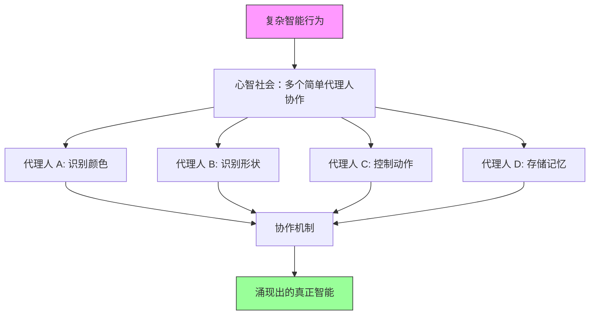
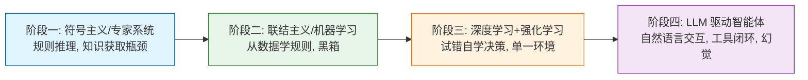
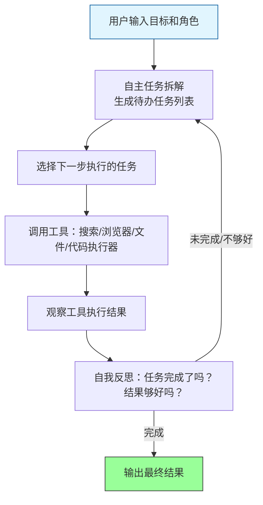
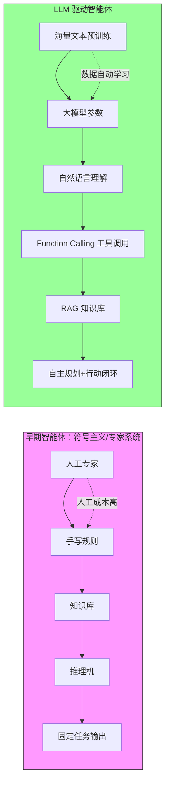

# 智能体发展史 —— 从符号主义到 LLM 驱动的智能体演进

> 面试生普（LLM 500 题）· 智能体发展史篇。本章覆盖智能体概念的起源、符号主义与物理符号系统假说、专家系统与早期代表（SHRDLU/ELIZA）、Minsky《心智社会》、联结主义与强化学习、多智能体系统的起源、AutoGPT 与 2023 智能体元年、LLM 驱动智能体与早期智能体的根本差异，共 10 个问题。正文面向“会一点编程语言和深度学习基础，除此之外没有任何其他背景”的读者，重要概念配大白话解释、Python 代码和 mermaid/ASCII 图。

---

## Q1. 智能体的概念是怎么来的？历史最早能追溯到什么时候？

**回答**

如果你以为“智能体（Agent）”是最近两年才因为大模型火起来的新词，那就大错特错了。**“智能体”这个概念在人工智能领域已经存在了好几十年**，远比 ChatGPT、DeepSeek 这些模型要老得多。

咱们先把时间线拉回到 20 世纪 80 年代。

### 1986 年：Marvin Minsky 和《心智社会》

马文·明斯基（Marvin Minsky）是人工智能领域的先驱之一，麻省理工学院的教授，图灵奖得主。1986 年，他出版了一本非常有名的书，叫《心智社会》（The Society of Mind）。

书里的一个核心观点，用大白话就是说：

> 人的心智不是一个整体，而是由很多简单的“心智代理人（mental agents）”组成的社会。每个代理人单独干的时候只能做一些很简单、不需要思考的事；但当你把这些代理人以某种特殊的方式组织成社会时，就产生了真正的智能。

这就是**“智能体”这个词最早进入人工智能领域**的重要时刻之一。Minsky 想表达的是：智能不是从天而降的神奇能力，而是很多简单部件协作出来的结果。

### 1995 年：Wooldridge 和 Jennings 给智能体下正式定义

到了 1995 年，Michael Wooldridge 和 Nicholas R. Jennings 发表了一篇经典论文，叫《Intelligent agents: theory and practice》（智能体：理论与实践）。这篇论文的目的，是为了消除当时研究界对“智能体”概念的混淆——因为大家各说各话，说不清什么算智能体，什么不算。

论文里给出了两个定义，咱们用大白话解释：

- **弱定义**：智能体就是能够感知环境、自主行动以达成目标的软件或硬件系统。它不一定很“聪明”，只要能自主感知和行动，就勉强算个智能体。
- **强定义**：除了弱定义的那些能力，还得具备更多特质，比如自主性、反应性、主动性、社会能力（能和其他智能体或人沟通），才算真正的、合格的智能体。

这篇论文后来成了整个多智能体系统研究领域的奠基性文献之一，1995 年也被认为是多智能体系统作为独立研究领域的重要起点（当年第一届国际多智能体系统会议 ICMAS 也在那一年召开）。

---

### 更早的根源：1976 年“物理符号系统假说”

如果要把智能体的思想根源再往前追，绕不开 1976 年 Allen Newell 和 Herbert A. Simon（两位图灵奖得主）提出的**物理符号系统假说**（Physical Symbol System Hypothesis, PSSH）。

这个假说大胆宣称：

> 智能的本质，就是符号的计算与处理。任何一个物理符号系统，都具备产生通用智能行为的充分手段。

简单来说，就是他们认为：人类的思维本质上是在操作符号（比如概念、逻辑规则），而计算机也能操作符号，所以只要我们找对了方式表示知识、设计好推理规则，就能在计算机上实现通用智能。

这个假说影响了整整一代 AI 研究者，也直接催生了后面咱们要说的“符号主义”智能体和专家系统。

---

### 用一张 ASCII 时间轴把早期历史串起来

```
1976年 ────── 物理符号系统假说 (Newell & Simon)
              │  “智能 = 符号计算”
              ▼
1986年 ────── Minsky《心智社会》
              │  “心智是由很多简单代理人组成的社会”
              ▼
1995年 ────── Wooldridge & Jennings《Intelligent agents: theory and practice》
              │  弱定义 vs 强定义，划清智能体边界
              ▼
1995年 ────── 第一届国际多智能体系统会议 (ICMAS)
              │  多智能体系统成为独立研究领域
```

**面试要点**：智能体概念并非大模型时代才有。1986 年 Minsky 在《心智社会》里引入“心智代理人”思想；1995 年 Wooldridge 和 Jennings 给出弱定义/强定义，奠定现代智能体研究的边界；更早的 1976 年物理符号系统假说则提供了“智能=符号计算”的理论根基。

---

## Q2. 什么是符号主义？物理符号系统假说是什么？用大白话解释。

**回答**

符号主义（Symbolicism），也叫“逻辑 AI”或“传统 AI”，是 20 世纪人工智能的第一个大范式。要理解它，咱们得先知道当时的研究者在想什么。

### 符号主义的核心信念

符号主义者普遍持有一个信念：

> **人类的智能，尤其是逻辑推理能力，可以被形式化的符号体系所捕捉和复现。**

用大白话就是说：他们认为，人脑思考的时候，本质上是在拿一堆“符号”（比如概念、类别、逻辑规则）来做运算。比如你想“所有鸟都会飞，企鹅是鸟，所以企鹅会飞”，在这个过程中，你的脑子里在操作“鸟”、“会飞”、“企鹅”这些符号，按照“如果 A 则 B”这样的规则推理。

符号主义者觉得：既然人脑是在操作符号，那计算机也能操作符号。只要我们：
1. 把知识用符号表示出来（建立知识库）；
2. 写好操作这些符号的规则（推理规则）；
3. 让计算机按规则推理；

就能让计算机表现出智能行为。

### 物理符号系统假说（PSSH）

1976 年，Allen Newell 和 Herbert A. Simon 提出了**物理符号系统假说**。这是符号主义最重要的理论支柱。

假说里有两个论断：

- **充分性论断**：任何一个物理符号系统，都有产生通用智能行为的足够手段。也就是说，只要你搭了一个能操作符号的系统，理论上它就能做出智能行为。
- **必要性论断**：任何能表现出通用智能行为的系统，本质上必然是一个物理符号系统。也就是说，没有符号操作，就没有智能。

**物理符号系统**指的是什么？大白话解释：就是一个在物理世界中存在的系统，由一组“符号”和一组“操作符号的过程”组成。

这些符号可以组合成更复杂的结构（比如“IF 天气是雨天 THEN 带伞”这样的规则），而过程则可以创建、修改、复制、销毁这些符号结构。

### 一句话总结

PSSH 简直是在大声宣布：**“智能的本质，就是符号的计算与处理。”**

这个假说影响极大。它把“心智”这种模糊复杂的哲学问题，转化成了一个可以在计算机上工程化实现的具体问题。整个符号主义时代的研究——从专家系统到自动规划，几乎都是在这一假说的指引下展开的。

---

### 一个极简的符号系统 Python 示例

下面这段代码用 Python 演示了什么是“符号系统”：我们用字典存知识（符号 + 关系），用简单的规则引擎做推理。虽然很粗糙，但骨架就是符号主义的骨架。

```python
"""
物理符号系统极简演示：符号 + 规则 = 推理
符号主义智能体的骨架：知识库（符号） + 推理规则
"""

from typing import Dict, List, Tuple


class SymbolicSystem:
    """一个极简的物理符号系统。"""

    def __init__(self):
        # 知识库：存储符号之间的关系
        # 格式: (主语, 谓语, 宾语) 例如 ("企鹅", "是", "鸟")
        self.facts: List[Tuple[str, str, str]] = []
        # 规则库：(前提模式, 结论模式) 例如 (("X", "是", "鸟"), ("X", "会", "飞"))
        self.rules: List[Tuple[Tuple[str, str, str], Tuple[str, str, str]]] = []

    def add_fact(self, subject: str, predicate: str, obj: str):
        """添加一条事实（符号关系）。"""
        self.facts.append((subject, predicate, obj))
        print(f"[知识库] 添加事实：{subject} {predicate} {obj}")

    def add_rule(self, premise: Tuple[str, str, str], conclusion: Tuple[str, str, str]):
        """添加一条推理规则。"""
        self.rules.append((premise, conclusion))
        p_sub, p_pred, p_obj = premise
        c_sub, c_pred, c_obj = conclusion
        print(f"[规则库] 添加规则：如果 {p_sub} {p_pred} {p_obj}，则 {c_sub} {c_pred} {c_obj}")

    def infer(self) -> List[Tuple[str, str, str]]:
        """基于已有事实和规则进行推理，返回新推导出的事实。"""
        new_facts = []
        for fact in self.facts:
            for premise, conclusion in self.rules:
                # 简单模式匹配：检查事实是否匹配规则的前提
                if self._matches(fact, premise):
                    new_conclusion = self._apply(fact, premise, conclusion)
                    if new_conclusion and new_conclusion not in self.facts:
                        new_facts.append(new_conclusion)
                        print(f"[推理] 推导出新事实：{new_conclusion[0]} {new_conclusion[1]} {new_conclusion[2]}")
        return new_facts

    def _matches(self, fact: Tuple[str, str, str], premise: Tuple[str, str, str]) -> bool:
        """检查事实是否匹配前提模式（支持变量 X, Y, Z）。"""
        for f_val, p_val in zip(fact, premise):
            if p_val in ("X", "Y", "Z"):  # 变量可以匹配任何符号
                continue
            if f_val != p_val:
                return False
        return True

    def _apply(self, fact, premise, conclusion):
        """根据匹配结果，把结论模式里的变量替换成实际符号。"""
        mapping = {}
        for f_val, p_val in zip(fact, premise):
            if p_val in ("X", "Y", "Z"):
                mapping[p_val] = f_val

        new_conclusion = []
        for c_val in conclusion:
            if c_val in mapping:
                new_conclusion.append(mapping[c_val])
            else:
                new_conclusion.append(c_val)
        return tuple(new_conclusion)


if __name__ == "__main__":
    system = SymbolicSystem()

    # 添加事实（符号）
    system.add_fact("企鹅", "是", "鸟")
    system.add_fact("知更鸟", "是", "鸟")
    system.add_fact("鸟", "会", "飞")   # 这是一个错误的常识（企鹅不会飞），符号主义也会犯这种错

    # 添加推理规则：如果 X 是 鸟，则 X 会 飞
    system.add_rule(("X", "是", "鸟"), ("X", "会", "飞"))

    # 推理
    print("\n开始推理：")
    system.infer()

    print("\n当前所有事实：")
    for f in system.facts:
        print(f"  {f[0]} {f[1]} {f[2]}")
```

**运行输出示例：**

```
[知识库] 添加事实：企鹅 是 鸟
[知识库] 添加事实：知更鸟 是 鸟
[知识库] 添加事实：鸟 会 飞
[规则库] 添加规则：如果 X 是 鸟，则 X 会 飞

开始推理：
[推理] 推导出新事实：企鹅 会 飞
[推理] 推导出新事实：知更鸟 会 飞

当前所有事实：
  企鹅 是 鸟
  知更鸟 是 鸟
  鸟 会 飞
  企鹅 会 飞
  知更鸟 会 飞
```

你看，这个系统完全按照规则推理，得出了“企鹅会飞”这种荒谬的结论——**这就是符号主义的典型局限**：它完全依赖人预设的规则和知识，缺乏常识，也不会自己从数据中学习。如果规则写错了，或者知识不全，它就会笨拙地犯错，而且纠不回来。

**面试要点**：符号主义认为智能=符号计算；PSSH（1976）是其理论基石，提出充分性和必要性两个论断。符号系统用“知识库（符号）+推理规则”工作，优点是可解释、规则明确；缺点是缺乏常识、不会自主学习、知识获取瓶颈（要人工一个一个输入规则）。

---

## Q3. 专家系统是什么？早期智能体长什么样？（SHRDLU、ELIZA 例子）

**回答**

符号主义时代最成功、最有影响力的应用，就是**专家系统（Expert System）**。如果要把早期智能体比作“学生”，那专家系统就是那个“班里成绩最好、最先拿到奖学金”的学生。

---

### 什么是专家系统？

专家系统的核心目标，用大白话说就是：**模拟人类专家在某个特定领域里解决问题的能力。**

比如你生病了，去看医生。医生脑子里有一堆医学知识，能根据你的症状推断出可能得了什么病，再开治疗方案。专家系统就是想让计算机也做这件事：把某个领域专家脑子里的知识，用“规则”的形式输入给计算机，让计算机像专家一样给出建议。

一个典型的专家系统由三部分组成：

| 组件 | 大白话解释 | 类比 |
|------|-----------|------|
| **知识库** | 存放该领域的所有规则和事实（由人工专家输入） | 医生脑子里的医学知识 |
| **推理机** | 根据知识库的规则，对用户输入的情况进行推理，得出结论 | 医生根据症状推断病情的大脑 |
| **用户界面** | 让用户输入症状，显示诊断结果 | 挂号单和诊断书 |

专家系统在 20 世纪 70-80 年代非常风靡，应用于医疗诊断、化学分析、矿藏勘查、配电系统故障诊断等领域。最著名的例子包括 **MYCIN**（诊断细菌感染并推荐抗生素）和 **DENDRAL**（化学结构推断）。

### 专家系统的局限（为什么后来式微了）

专家系统看起来很美，但实践中遇到了大麻烦，主要有三个：

1. **知识获取瓶颈**：把专家脑子里的知识一个一个变成规则，太慢了，而且专家自己也说不清楚为什么有时候这么判断、有时候那么判断。
2. **缺乏常识**：专家系统只懂本领域的规则，不懂生活常识。比如它可能知道“青霉素治肺炎”，但不知道“病人吃东西前要先咽下去”，这种常识没人会专门写成规则。
3. **脆弱性**：遇到知识库里没覆盖的情况，系统就直接卡住或给出荒谬结论，不会像人类专家那样说“我不知道，让我再查查”。

---

### 早期智能体的代表：SHRDLU 和 ELIZA

除了专家系统，早期还有两个非常经典的智能体代表，分别体现了两种不同的思路。

#### SHRDLU（1968~1970，Terry Winograd，MIT）

SHRDLU 是早期自然语言理解的里程碑。它的场景是一个“积木世界”：一个虚拟的桌面上放着各种形状、颜色、大小的积木，用户用英语命令它，比如：

> “把红色的方块放到绿色的金字塔上面。”

SHRDLU 能理解这句话，识别出哪个是红色的方块、哪个是绿色的金字塔，然后控制一个机械手臂把方块移过去。它还能回答问题，比如“桌面上有多少个方块？”，还能解释自己的行为：“我之前把红方块移开了，因为你说要把它放在金字塔上。”

**大白话**：SHRDLU 像一个只在小小积木世界里“生活”的智能体，它懂得感知（看到积木）、理解语言、规划动作（移动积木），还能自我说明。但它的局限也很明显：只能在那个封闭的积木世界里干活，换个场景就废了。

#### ELIZA（1966，Joseph Weizenbaum，MIT）

ELIZA 是最早的聊天机器人之一，最著名的一个版本叫“DOCTOR”，模拟一个心理治疗师。它不懂心理学，也不是真的在倾听，它只是用简单的**模式匹配**和**句子变换**来应付用户：

- 用户说：“我最近觉得很沮丧。”
- ELIZA 可能回答：“请告诉我更多关于你沮丧的事情。”
- 用户说：“我和我妈妈关系不好。”
- ELIZA 可能回答：“你的家庭关系怎么样？”

**大白话**：ELIZA 根本不理解你在说什么，它只是抓住几个关键词，套用模板把你的话原样打回来。很多人跟它聊几句却产生了“真有人在倾听”的错觉，Weizenbaum 自己后来都对此感到担忧——这就是后来被称为“ELIZA 效应”的现象：人容易把简单的模式匹配误认为真正的理解。

---

### 用 mermaid 把早期智能体谱系画出来

```mermaid
flowchart TD
    A[1956 达特茅斯会议：AI 诞生] --> B[符号主义范式]
    B --> C[物理符号系统假说 PSSH (1976)]
    C --> D[专家系统 (1970-80年代)]
    C --> E[早期智能体代表]
    D --> D1[MYCIN: 细菌感染诊断]
    D --> D2[DENDRAL: 化学结构推断]
    E --> E1[SHRDLU: 积木世界 (1968-70)]
    E --> E2[ELIZA: 模拟心理治疗师 (1966)]
    D --> D3[局限: 知识获取瓶颈、缺乏常识、脆弱性]
```

**面试要点**：专家系统是符号主义最成功的应用，由“知识库+推理机+界面”组成，模拟特定领域专家解决问题。早期智能体代表 SHRDLU（积木世界，懂感知+语言+动作，但只能在封闭场景干活）和 ELIZA（模式匹配聊天机器人，不懂真正理解）。专家系统的局限（知识获取瓶颈、缺乏常识、脆弱性）直接导致了后来 AI 的“寒冬”，也为后续联结主义和机器学习的兴起埋下伏笔。

---

## Q4. 什么是心智社会理论？它对智能体有什么启发？

**回答**

提到智能体的发展史，绕不开一个非常有名的理论——**《心智社会》（The Society of Mind）**。这是马文·明斯基（Marvin Minsky）在 1986 年出版的书里提出的核心思想。虽然这本书出版于符号主义鼎盛时期，但它的观点却在今天的 LLM 驱动智能体、尤其是多智能体系统中，焕发出了新的生命力。

### 核心观点：心智不是一个整体

明斯基的核心观点，用大白话说就是：

> **人的心智不是一个统一的、神奇的整体，而是由非常多简单的“心智代理人（mental agents）”组成的社会。** 每个代理人单独干活的时候，只能做一些极其简单、甚至不需要思考的事；但当你把这些代理人以特殊的方式组织起来、让它们协作时，就产生了我们感知到的“真正的智能”。

明斯基原话大意是：

> Each mental agent by itself can only do some simple thing that needs no mind or thought at all. Yet when we join these agents in societies - in certain very special ways - this leads to true intelligence.

翻译过来：每个心智代理人单独只能做一些根本不需要心智或思考的简单事情。但当我们以某些非常特殊的方式把这些代理人组织成社会时，这就产生了真正的智能。

### 用大白话打个比方

你可以把人的大脑想象成一个大公司：

- 公司里有很多员工（心智代理人），每个人只负责一件小事：
  - 有一个员工专门负责“识别颜色”，看到红色就喊“红”；
  - 有一个员工专门负责“识别形状”，看到圆就喊“圆”；
  - 有一个员工专门负责“控制手指”，收到指令就伸手去拿东西；
  - 有一个员工专门负责“记忆名字”，记得“这是苹果”。

- 任何一个员工单独干，都不算“聪明”：
  - “识别颜色”员工只会喊颜色，不知道红色的苹果能吃；
  - “控制手指”员工只会机械地伸手，不知道伸手去拿什么。

- 但当这些员工按一定的流程组织起来协作时：
  - “识别颜色”员工说“红”，“识别形状”员工说“圆”，“记忆名字”员工说“苹果”，最后“控制手指”员工伸手去拿……
  - 整个表现出来的行为，就像一个聪明的人在“看到一个红苹果并拿起来”。

**这个“大公司”里涌现出的智能，就不是任何一个员工单独拥有的，而是协作涌现出来的。** 这就是“心智社会”的核心。

### 对智能体的启发

Minsky 的心智社会理论对现代智能体，尤其是**多智能体系统**，有非常直接的启发：

| 启发点 | 大白话解释 | 现代体现 |
|--------|-----------|---------|
| **智能是涌现的** | 不是一个超级大脑包打天下，而是很多简单部件协作出来的 | 多智能体系统中，多个简单 Agent 协作完成复杂任务 |
| **模块化分工** | 不同的代理人负责不同的小任务 | 一个 Agent 负责规划，一个负责调工具，一个负责记忆，一个负责反思 |
| **不需要每个部件都聪明** | 每个代理人自己可以很简单 | 现代 Agent 框架里，很多子模块只是简单的函数或提示词模板 |
| **组织方式很重要** | 同样的代理人，组织方式不同，智能表现完全不同 | Agent 的工作流编排、通信协议、协作模式决定了系统上限 |

用一个 mermaid 图来表示心智社会的 idea：



**ASCII 简易版：**

```
          简单代理人 A (识颜色) ───┐
          简单代理人 B (识形状) ───┤
          简单代理人 C (控动作) ───┼──→ 协作机制 ──→ 复杂智能行为
          简单代理人 D (存记忆) ───┤
          ……                      ───┘
```

**面试要点**：心智社会理论认为智能不是单一整体，而是由众多简单代理人以特殊方式组织协作涌现出来的。这一思想是现代多智能体系统（Multi-Agent System）的重要思想根源：智能体之间分工协作、组织方式比单个智能体有多聪明更重要。

---

## Q5. 智能体发展史上有哪几个主要阶段？分别解决了什么问题？

**回答**

要把智能体的发展史讲清楚，不能只记时间点，更要懂**每一个新阶段为什么出现**——因为上一代范式遇到了解决不了的痛点，新范式才应运而生。业界通常把智能体的发展大致分成四个阶段，下面咱们一个个拆，用大白话配上每个阶段“解决了什么问题”“留下了什么局限”。

---

### 第一阶段：符号主义与专家系统时代（20 世纪 50 年代 ~ 80 年代）

**核心代表**：物理符号系统假说、专家系统（MYCIN、DENDRAL）、SHRDLU、ELIZA。

**解决了什么问题**：
- 证明了“计算机可以按规则推理”这个方向是可行的；
- 在特定领域（如细菌感染诊断、化学结构推断）达到了人类专家水平；
- 建立了“知识表示 + 推理”的基本范式。

**留下的局限**：
- **知识获取瓶颈**：专家脑子里的知识，要人工一个一个变成规则，太慢太贵；
- **缺乏常识**：只懂本领域规则，不懂生活常识；
- **脆弱性**：遇到没覆盖的情况就直接崩溃或胡说。

用大白话：这一代智能体像个“只会背书的书呆子”，规则里有的事它能答，规则里没的事它一脸懵。

---

### 第二阶段：联结主义与机器学习时代（20 世纪 80 年代 ~ 2010 年代初）

**核心代表**：神经网络、反向传播算法、支持向量机、早期的强化学习、深度学习的初步突破。

**解决了什么问题**：
- 计算机开始能**从数据中自动学习规则**，不需要人工一个一个输入规则；
- 图像识别、语音识别等任务取得突破（比如卷积神经网络识别手写数字、人脸）；
- 智能体开始具备一定的“适应性”，能根据环境反馈调整自己的行为。

**留下的局限**：
- 数据饥渴：需要大量标注数据；
- 可解释性差：神经网络是个“黑箱”，不知道它为什么做这个决定；
- 任务窄：一个模型通常只擅长一件事，识别猫的模型不会识别狗，更不会帮你订机票。

用大白话：这一代智能体像个“勤奋的实习生”，能看大量数据总结规律，但一遇到没见过的情况就懵，而且你不懂它为什么这么干。

---

### 第三阶段：深度学习与强化学习结合时代（2010 年代中期 ~ 2022 年）

**核心代表**：Deep Q-Network (DQN)、AlphaGo (2016)、AlphaZero、各种深度强化学习智能体。

**解决了什么问题**：
- 智能体能在复杂环境中通过试错自学（比如 AlphaGo 通过自我对弈成为围棋世界冠军）；
- 从像素输入直接学习控制策略（比如从游戏画面直接学会打 Atari 游戏）；
- 决策能力大幅提升，能处理比专家系统复杂得多的环境。

**留下的局限**：
- 训练极其耗时耗算力；
- 通常只能在单一固定环境里表现好，换个环境得重新训练；
- 不能用自然语言和人灵活沟通，不会理解“帮我订张去北京的机票”这种话。

用大白话：这一代智能体像个“围棋神童”，在棋盘上无敌，但让它帮你买张机票它根本不知道从何说起。

---

### 第四阶段：LLM 驱动的现代智能体时代（2022 年末 ~ 至今）

**核心代表**：ChatGPT (2022)、AutoGPT (2023)、各种基于 LLM 的 Agent 框架（LangChain、LangGraph、AutoGen、CrewAI 等）。

**解决了什么问题**：
- **自然语言交互**：智能体终于能听懂人话了，用户可以用自然语言下达任务（“帮我调研竞品并写报告”）；
- **通用推理能力**：一个大模型可以处理写作、编程、数学、常识推理等多种任务，不需要为每个任务重新训练；
- **工具使用与闭环**：通过 Function Calling / Tool Use，智能体可以调用搜索、计算器、API、代码执行器，真正“动手办事”；
- **快速原型**：不需要深厚的 AI 背景，业务人员也能用提示词（Prompt）和低代码平台搭出一个智能体原型。

**留下的局限**（本章 Q8 已详述）：
- 幻觉（胡说八道，甚至基于胡说去行动）；
- 常识缺乏；
- 数据依赖（不知道私有/实时信息，除非配 RAG）；
- 安全和失控风险；
- 调试和可解释性难。

用大白话：这一代智能体像个“博学但偶尔 unreliable 的助手”，什么都知道一点，什么都能尝试干，但偶尔会自信地胡说，还需要人盯着。

---

### 四个阶段对照表（ASCII 版）

```
┌─────────────────────┬─────────────────────┬─────────────────────┬─────────────────────┐
│   阶段一            │   阶段二            │   阶段三            │   阶段四            │
│ 符号主义/专家系统   │  联结主义/机器学习  │ 深度学习+强化学习 │   LLM 驱动智能体    │
│  50年代~80年代      │  80年代~2010年初    │  2010年代中期~2022│  2022年末~至今     │
├─────────────────────┼─────────────────────┼─────────────────────┼─────────────────────┤
│ 核心思想            │ 从数据中自动学规则   │ 通过试错自学决策    │ 用大模型做大脑，用    │
│ 知识表示+推理规则   │                     │                     │ 工具做手脚，闭环办事│
├─────────────────────┼─────────────────────┼─────────────────────┼─────────────────────┤
│ 解决了什么          │ 能做图像/语音识别   │ AlphaGo 围棋冠军    │ 自然语言交互、通用推理│
│ 专家领域诊断/推断   │ 简单模式识别        │ 复杂游戏决策        │ 工具调用、多任务协作  │
├─────────────────────┼─────────────────────┼─────────────────────┼─────────────────────┤
│ 主要局限            │ 数据饥渴、黑箱、任务│ 训练贵、单一环境、    │ 幻觉、常识缺乏、安全、  │
│ 知识获取瓶颈、常识缺│ 窄、可解释性差      │ 不懂自然语言        │ 调试难                │
│ 乏、脆弱            │                     │                     │                     │
└─────────────────────┴─────────────────────┴─────────────────────┴─────────────────────┘
```

---

### 用 mermaid 把四个阶段画成演进阶梯



**面试要点**：智能体发展可分为四个阶段：符号主义/专家系统（规则推理，知识瓶颈）→ 联结主义/机器学习（从数据学规则，黑箱）→ 深度学习+强化学习（试错决策，单一环境）→ LLM 驱动现代智能体（自然语言交互+工具闭环，幻觉与安全挑战）。每个阶段都是为解决上一代的核心痛点而出现，同时也带来了新的局限，为下一代埋下伏笔。

---

## Q6. 什么是联结主义？它和符号主义有什么不同？

**回答**

在聊智能体发展史时，绕不开一个和“符号主义”相对的大概念——**联结主义（Connectionism）**。如果符号主义是“按规则背书”，那联结主义就是“通过大量练习摸规律”。这两个流派不仅代表了 AI 不同的技术路线，也直接决定了智能体从“符号推理”到“神经网络”再到“LLM 驱动”的演进脉络。

### 联结主义的核心思想

联结主义的核心观点，用大白话说就是：

> **智能不是靠几条人写好的规则，而是靠大量简单的“神经元”连接在一起，通过不断调整连接强度（权重），从数据中自动学习出规律。**

联结主义者认为，人的大脑是由无数神经元通过突触连接而成的，学习的本质就是加强或减弱这些连接。计算机也可以模仿这个结构，搭建人工神经网络，让它从海量数据里自己“摸”出规律，而不是靠人工一个一个输入规则。

### 符号主义 vs 联结主义：大白话对比

| 维度 | 符号主义（Symbolicism） | 联结主义（Connectionism） |
|------|------------------------|--------------------------|
| **核心比喻** | 像个“背书的书呆子” | 像个“摸规律的实习生” |
| **知识怎么来** | 人工专家一个一个写规则 | 从大量数据中自动学习 |
| **怎么推理** | 按“如果…那么…”规则推理 | 神经网络前向传播，输出概率 |
| **可解释性** | 高，每条规则都能追溯 | 低，是个“黑箱” |
| **常识处理** | 差，没写规则就懵 | 一般，能从数据里泛化出一些常识 |
| **擅长场景** | 规则明确、逻辑严密的领域 | 模式识别、图像、语音、文本 |
| **代表系统** | 专家系统 (MYCIN、DENDRAL) | 神经网络、深度学习模型 |

### 用大白话打个比方

**符号主义**就像给学生一本《法典》，所有法律条文都写死在书里，学生遇到案子就对照法典判决。优点是判决有章可循、能解释清楚；缺点是法典没写的案子学生完全没办法，而且法典得由法官（专家）一个一个条款写出来，太慢了。

**联结主义**就像让学生法庭实习一万天，看一万个真实案例和法官的判决，学生自己慢慢摸出“一般什么情况下怎么判”。优点是不用人写法典，能处理没见过的类似案子；缺点是学生自己也说不清“凭什么这么判”，而且需要看一万个案例才行。

### 一段 Python 代码：对比两种流派

下面这段代码用 Python 同时演示符号主义和联结主义解决同一个问题的骨架——**“根据水果特征判断水果种类”**。

```python
"""
符号主义 vs 联结主义：判断水果种类
符号主义：人工写规则（如果颜色=红色 且 形状=圆 则 可能是苹果）
联结主义：极简神经网络，从数据中自动学习权重
"""

import numpy as np


# ========== 符号主义版本 ==========
class SymbolicFruitClassifier:
    """符号主义分类器：基于人工编写的 IF-THEN 规则。"""

    def __init__(self):
        # 知识库：人工专家编写的规则
        self.rules = [
            ("颜色", "红色", "形状", "圆", "质地", "脆", "苹果"),
            ("颜色", "黄色", "形状", "长弯", "质地", "软", "香蕉"),
            ("颜色", "紫色", "形状", "圆", "质地", "多汁", "葡萄"),
        ]

    def classify(self, color: str, shape: str, texture: str) -> str:
        for rule in self.rules:
            attr1, val1, attr2, val2, attr3, val3, result = rule
            if color == val1 and shape == val2 and texture == val3:
                return result
        return "未知水果（规则库未覆盖）"


# ========== 联结主义版本（极简神经网络） ==========
class ConnectionistFruitClassifier:
    """联结主义分类器：极简神经网络，从数据中学习权重。"""

    def __init__(self, input_dim: int = 9, output_dim: int = 3, lr: float = 0.1):
        # 输入：9 个特征（颜色红/黄/紫，形状圆/长弯，质地脆/软/多汁，用 one-hot 编码）
        # 输出：3 个类别（苹果/香蕉/葡萄）
        self.W = np.random.randn(input_dim, output_dim) * 0.1  # 连接权重
        self.lr = lr  # 学习率

    def _encode(self, color: str, shape: str, texture: str) -> np.ndarray:
        """把特征编码为 one-hot 向量（9 维）。"""
        x = np.zeros(9)
        color_idx = {"红色": 0, "黄色": 1, "紫色": 2}.get(color, -1)
        shape_idx = {"圆": 3, "长弯": 4}.get(shape, -1)
        texture_idx = {"脆": 5, "软": 6, "多汁": 7}.get(texture, -1)
        # 这里简化，只演示前 3 维，实际应完整 one-hot
        if color_idx >= 0:
            x[color_idx] = 1.0
        if shape_idx >= 0:
            x[shape_idx] = 1.0
        if texture_idx >= 0:
            x[texture_idx] = 1.0
        return x

    def predict(self, x: np.ndarray) -> int:
        """前向传播：x @ W 得到各类别得分，取最大者。"""
        scores = x @ self.W
        return int(np.argmax(scores))

    def train(self, x: np.ndarray, y_true: int):
        """极简梯度下降：根据预测误差调整权重 W。"""
        scores = x @ self.W
        y_pred = int(np.argmax(scores))
        if y_pred != y_true:
            # 简单的感知学习规则：正确类权重加，错误类权重减
            self.W[:, y_true] += self.lr * x
            self.W[:, y_pred] -= self.lr * x


if __name__ == "__main__":
    print("=" * 50)
    print("符号主义分类器：")
    sym = SymbolicFruitClassifier()
    print(f"红色+圆+脆 -> {sym.classify('红色', '圆', '脆')}")
    print(f"黄色+长弯+软 -> {sym.classify('黄色', '长弯', '软')}")
    print(f"绿色+圆+脆 -> {sym.classify('绿色', '圆', '脆')}  （规则库没覆盖，返回未知）")

    print("\n" + "=" * 50)
    print("联结主义分类器（训练前随机猜测）：")
    conn = ConnectionistFruitClassifier()
    x_apple = conn._encode("红色", "圆", "脆")
    print(f"训练前，红色+圆+脆 被预测为类别 {conn.predict(x_apple)}")

    # 训练：告诉它红色+圆+脆是苹果（类别 0）
    conn.train(x_apple, y_true=0)
    print(f"训练1次后，红色+圆+脆 被预测为类别 {conn.predict(x_apple)}")
    conn.train(x_apple, y_true=0)
    conn.train(x_apple, y_true=0)
    print(f"训练3次后，红色+圆+脆 被预测为类别 {conn.predict(x_apple)}")
```

**运行输出示例（概念版）：**

```
==================================================
符号主义分类器：
红色+圆+脆 -> 苹果
黄色+长弯+软 -> 香蕉
绿色+圆+脆 -> 未知水果（规则库未覆盖）

==================================================
联结主义分类器（训练前随机猜测）：
训练前，红色+圆+脆 被预测为类别 2
训练1次后，红色+圆+脆 被预测为类别 0
训练3次后，红色+圆+脆 被预测为类别 0
```

你看：符号主义分类器对“绿色+圆+脆”直接返回“未知”，因为规则库里没人写；联结主义分类器经过几次训练后，就能把“红色+圆+脆”稳定预测为苹果，而且不需要人写任何 IF-THEN 规则。

**面试要点**：符号主义靠人工写规则（知识表示+推理），可解释但获取成本高、缺乏常识；联结主义靠神经网络从数据自动学习权重，擅长模式识别但可解释性差、是黑箱。两者的较量和融合，贯穿了整个 AI 发展史，也直接导向了今天 LLM 驱动智能体的形态。

---

## Q7. AutoGPT 是什么？为什么说 2023 年是“智能体元年”？

**回答**

如果你在 2023 年关注过 AI 领域，一定听说过 **AutoGPT** 这个名字。它是那段时间 GitHub 上星星数增长最快的开源项目之一，短短几天就拿下几万颗星，后来更是冲到十几万。业界很多人把 2023 年称为“智能体元年”（Year of the Agent），AutoGPT 是这个称号的直接推手之一。

下面咱们用大白话讲清楚：AutoGPT 是什么，它干了什么，为什么能让整个行业突然意识到“智能体时代来了”。

---

### AutoGPT 是什么？

AutoGPT 是一个**开源的、基于 GPT-4（或 GPT-3.5）的自主智能体应用**。它由一位名叫 Toran Bruce Richards 的开发者于 2023 年 3 月开源。

用大白话解释：**AutoGPT 是一个“能自己规划、自己行动、自己修正”的 AI 程序。** 你只需要给它一个目标和一个角色，比如：

> 角色：你是一个创业者。
> 目标：帮我做一个关于“个人记账 APP”的市场调研，并写一份可行性分析报告。

AutoGPT 就会自己开始干活，不需要你每一步都喂指令：

1. **自主拆解任务**：它先想一想，调研记账 APP 需要做哪些步骤（搜索竞品、分析用户痛点、调研定价模型、写报告……）；
2. **调用工具**：它自己决定什么时候用搜索引擎查竞品，什么时候用浏览器打开网站，什么时候写文件；
3. **执行行动**：它会调用 GPT-4 生成搜索关键词、调用搜索 API、读取网页内容、把信息写进本地文件；
4. **观察结果**：看搜索到的信息是否有用，网页能不能打开；
5. **自我修正**：如果某个网站打不开，或者搜不到有用信息，它会调整关键词、换个网站再试；
6. **反思与迭代**：写完报告后，它会自己审读一遍，觉得哪里写得不够好就修改，直到满意。

在这个过程中，**你不需要告诉它“第一步搜什么，第二步看哪个网页”**，它自己想，自己干，自己改。

---

### 为什么 AutoGPT 能引起这么大轰动？

在 AutoGPT 出现之前，大多数人用大模型（比如 ChatGPT）的方式是：

> 用户：帮我写个 Python 脚本爬取新闻。
>
> ChatGPT：[给出代码]
>
> 用户：这个代码运行报错了，怎么改？
>
> ChatGPT：[给出修改后的代码]

也就是说，大模型处于“人问、AI答”的被动位置，每一步都需要人来推。大模型很聪明，但它是个“好嘴不伸手”的助手——它能写代码，但不会自己去运行代码、看结果、再改代码。

AutoGPT 的颠覆之处在于：**它把大模型从“聊天机器人”变成了“自主代理人”。** 它不只是回答你，它还会围绕你的目标连续行动，中间不需要你每五分钟就喂一次指令。

这让很多人第一次看到了“AI 能干活，而不只是会聊天”的可能性，于是 2023 年被很多人称为“智能体元年”。

---

### AutoGPT 的工作流（简化版）

下面是一个极简的 AutoGPT 风格工作流，用 mermaid 画出来：



**ASCII 简易版：**

```
用户目标 → 自主拆解任务 → 选下一步 → 调用工具 → 观察结果 → 自我反思
                                             ↑                ↓
                                             └── 不完善 → 重新拆解/修正 ──┘
                                                 ↓
                                           输出最终结果
```

---

### AutoGPT 的局限（为什么它没“统治世界”）

AutoGPT 虽然轰动一时，但实际使用中也暴露了不少问题，这些问题恰恰也是后来 LLM 智能体研究的重点：

1. **容易陷入死循环**：它自己想不出下一步怎么办时，可能重复尝试同一个无效动作，一直转圈不退出。
2. **没有人工确认**：如果它调用了删除文件、发邮件等破坏性工具，可能一不小心就把事情搞砸了，没人拦着。
3. **成本高、慢**：每一步都要调用 GPT-4 去推理，一次任务可能调用几十上百次模型，又慢又贵。
4. **长期记忆差**：它主要依赖上下文窗口，任务做得太久，前面的信息就可能被挤出去忘掉。
5. **规划能力有限**：面对复杂的多步任务，它的计划经常不完整，或者中途跑偏。

**面试要点**：AutoGPT 是 2023 年爆火的开源自主智能体，标志着大模型从“被动回答”向“自主规划+执行”转变，是“智能体元年”的重要里程碑。但它也暴露了死循环、无人工确认、成本高、记忆差等问题，这些正是后续智能体框架（LangGraph、AutoGen 等）试图解决的痛点。

---

## Q8. LLM 驱动的智能体和早期智能体有什么根本不同？

**回答**

前面几章我们已经聊了早期智能体（符号主义、专家系统、SHRDLU、ELIZA）和 LLM 驱动的现代智能体（AutoGPT 之后的各种 Agent）。很多人会问：它们不都是“能感知环境、自主行动的智能系统”吗？有什么本质区别？

答案是：**区别很大，核心差别在于“大脑是怎么来的”、“怎么理解用户”、“怎么学习新知识”以及“能不能灵活泛化”这几个维度。** 下面咱们一个个拆，用大白话配对比表。

---

### 根本差异对比表

| 维度 | 早期智能体（符号主义/专家系统） | LLM 驱动的现代智能体 |
|------|-------------------------------|---------------------|
| **大脑来源** | 人工专家一个一个写的规则 | 大模型从海量文本中自动学习的参数 |
| **理解用户** | 只认预设的关键词和句式 | 能理解自然语言，甚至模糊表达 |
| **知识范围** | 规则库里有什么，就只能干什么 | 泛化能力强，没见过的任务也能尝试 |
| **常识** | 几乎没有，只懂本领域规则 | 从海量文本中吸收了一定常识 |
| **学习新知识** | 要人工重新编写规则、重新编译 | 接入 RAG/知识库即可，不需要重新训练模型 |
| **工具使用** | 预设好的固定接口，不能自主决定调用时机 | 通过 Function Calling 动态决定调用哪个工具、何时调用 |
| **可解释性** | 高，每条规则都能追溯 | 低，模型内部是黑箱 |
| **开发门槛** | 高，需要领域专家和知识工程师 | 较低，用提示词和低代码平台就能搭原型 |
| **典型代表** | MYCIN、DENDRAL、SHRDLU、ELIZA | AutoGPT、LangChain Agent、各种基于 LLM 的 Assistant |

---

### 具体拆解四个根本差异

#### 差异 1：大脑怎么来的——人工写规则 vs 数据自动学习

早期智能体的“大脑”是**人工专家写的规则**。比如一个医疗诊断智能体，专家得把“如果发烧且咳嗽且肺部有阴影，则可能是肺炎”这样的规则一个一个输入。知识从哪来？从专家脑子里，得由知识工程师一个一个提取、整理、编码。

LLM 驱动智能体的“大脑”是**大模型**。大模型在互联网上的海量文本上预训练，自己学习出了语言模式、常识、逻辑推理等能力。你不需要告诉它“什么是苹果”、“什么是发烧”，它从训练数据里已经“摸”出来了。

用大白话：早期智能体像个“只会背书的学生”，LLM 智能体像个“读过大量书籍的博学青年”。

#### 差异 2：理解用户——只认预设句式 vs 理解自然语言

早期智能体（比如 ELIZA）通常靠**模式匹配**和**关键词匹配**。你说“我觉得很难过”，它抓住“难过”两个字，套模板回复“请告诉我更多关于难过的事情”。它根本不懂你在说什么，说换个说法它可能就听不懂了。

LLM 驱动智能体能理解**自然语言**。你说“帮我查下下周三北京到上海的高铁，最好是早上的窗座”，它能理解：
- 时间：下周三；
- 路线：北京到上海；
- 交通方式：高铁；
- 偏好：早上、窗座。

它不需要你按“1. 查车次 2. 选时间 3. 选座位”的固定流程来，你随便怎么说，它都能大概明白。

#### 差异 3：学习新知识——改代码 vs 接知识库

早期智能体要学新知识，得重新找专家、写新规则、重新编译系统，周期长、成本高。

LLM 驱动智能体可以通过 **RAG（检索增强生成）** 接入私有知识库。比如你的公司有内部文档，你把文档存进向量数据库，智能体回答问题时先去向量库里检索相关片段，再结合大模型生成答案。不需要重新训练模型，也不用人工写规则。

用大白话：早期智能体学新东西得“动手术（改代码）”，LLM 智能体学新东西就像“给它一本书读一读（接 RAG 知识库）”。

#### 差异 4：泛化能力——窄任务 vs 通用任务

早期智能体通常只擅长**一件事**。MYCIN 只能诊断细菌感染，让它去查天气它完全不行。SHRDLU 只能在积木世界里玩，带到现实厨房里它就废了。

LLM 驱动智能体具有**通用推理能力**。同一个模型可以帮你写代码、分析数据、写邮件、查常识，不需要为每个任务重新训练。当然，它也不完美，偶尔会幻觉，但“多面手”这一点是早期智能体完全不具备的。

---

### 用 mermaid 对比两种智能体的“长相”



**面试要点**：LLM 驱动智能体和早期智能体的根本不同在于：大脑来源（人工规则 vs 大模型参数）、对用户理解（关键词匹配 vs 自然语言理解）、学习新知识（改代码 vs 接 RAG 知识库）、泛化能力（单一任务 vs 通用任务）。早期智能体可解释但脆弱，LLM 智能体灵活强大但存在幻觉和黑箱问题。

---

## Q9. 多智能体系统是怎么发展起来的？

**回答**

前面几章我们主要聊的是“一个智能体”怎么来的、怎么干活的。但在现实世界里，复杂任务通常不是一个人能包打天下的——开发一个 App 需要产品经理、开发、测试、经理分工协作；一家公司运转需要销售、技术、财务、客服各司其职。智能体也是这样：**当任务复杂到一个 Agent 搞不定时，就需要多个 Agent 组成一个“团队”来协作，这就是多智能体系统（Multi-Agent System, MAS）。**

多智能体系统作为一个研究领域，也有好几十年的历史了，它的发展和单智能体并不完全一样。下面咱们用大白话梳理一下它是怎么一步步走到今天的。

---

### 起源：20 世纪 80 年代末，分布式人工智能（DAI）

多智能体系统的直接前身，是**分布式人工智能（Distributed Artificial Intelligence, DAI）**。20 世纪 80 年代末，一些研究者开始意识到：把所有智能集中在一个程序里（像传统专家系统那样），会遇到可扩展性和鲁棒性问题。如果这个中心程序挂了，整个系统就瘫痪了。

于是，他们开始思考：**能不能把智能分散到多个独立的实体上，让它们各自负责一部分，然后通过沟通协作完成任务？** 这就是 DAI 的初衷，也是多智能体系统的雏形。

用大白话：早期 AI 像个“独裁者”，一个人说了算；DAI 则主张“民主制”，大家分工协作。

---

### 1995 年：概念正式定型，独立研究领域诞生

1995 年是个重要的节点：

- Michael Wooldridge 和 Nicholas R. Jennings 发表了《Intelligent agents: theory and practice》，给智能体下了正式定义（弱定义、强定义），消除了概念混淆；
- 第一届国际多智能体系统会议（ICMAS）在同年召开，标志着多智能体系统成为一个独立的研究领域。

后来，国际智能体及多智能体系统协会（IFAAMAS）成立，整合了 AGENTS、ICMAS、ATAL 等会议，联合举办 AAMAS（国际智能体及多智能体系统联合会议），成为这个领域最具影响力的国际会议。

---

### 2000 年代 ~ 2010 年代：协调、通信、协作机制的研究

在这个阶段，研究者主要在解决多智能体系统的核心问题：

- **智能体架构**：每个智能体内部怎么设计？
- **协调（Coordination）**：多个智能体怎么不打架、不重复干活？
- **通信（Communication）**：智能体之间怎么传信息？用什么语言？（比如早期有 KQML、FIPA-ACL 等智能体通信语言）
- **协作（Collaboration）**：怎么分工？怎么分配任务？
- **博弈（Game Theory）**：如果智能体之间有利益冲突，怎么达成协议？

这个阶段的多智能体系统，大多应用在机器人足球（RoboCup）、自动拍卖、交通调度等领域。智能体之间的通信靠的是预设的协议和消息格式，不像今天这样能用自然语言聊天。

---

### 2010 年代末 ~ 2020 年代：深度学习和强化学习的加入

随着深度学习和深度强化学习的发展，多智能体系统也迎来了新的动力：

- **多智能体强化学习（MARL）**：多个智能体在同一个环境里同时学习，通过试错学会协作或竞争。比如无人机编队飞行、多机器人仓库搬运、游戏 AI（比如《王者荣耀》的 AI 对战）。
- 智能体不再只靠预设规则沟通，而是能从交互中学习如何更好地协作。

但这个阶段的多智能体系统，通常还是针对**特定环境、特定任务**训练的，换个场景往往要重新训练，而且不擅长用自然语言和人沟通。

---

### 2022 年末 ~ 至今：LLM 赋能的多智能体系统

这是最新的阶段，也是现在最火的阶段。LLM（大语言模型）的出现，给多智能体系统带来了几个质变：

1. **自然语言即通信协议**：智能体之间可以用人类语言直接沟通，不需要再设计复杂的 FIPA-ACL 这种消息格式了。一个 Agent 可以说“哥们，这部分数据你处理，我负责写报告”，另一个 Agent 能听懂。
2. **角色即分工**：通过提示词（Prompt）给不同的 Agent 设定不同角色，比如“产品经理 Agent”“开发 Agent”“测试 Agent”，它们就能像部门一样分工协作。
3. **通用推理能力**：不需要为每个协作场景重新训练模型，一个 LLM 可以胜任多种角色。

现代多智能体系统的典型框架包括 **AutoGen**、**CrewAI**、**LangGraph** 等，它们让开发者可以比较容易地搭建“多个 LLM Agent 组成的团队”。

---

### 多智能体系统发展时间轴（ASCII）

```
1980年代末 ──── DAI（分布式人工智能）萌芽
              │  “智能可以分散到多个实体”
              ▼
1995年 ────── Wooldridge & Jennings 定义智能体；ICMAS 首届会议
              │  多智能体系统成为独立研究领域
              ▼
2000-2010年代 ── 协调、通信、协作机制研究（KQML、FIPA-ACL 等）
              │  应用：RoboCup 机器人足球、自动拍卖、交通调度
              ▼
2010年代末-2020 多智能体强化学习（MARL）兴起
              │  应用：无人机编队、多机器人仓库、游戏 AI
              ▼
2022年末至今 ── LLM 赋能的多智能体系统（AutoGen、CrewAI、LangGraph）
              │  自然语言通信、角色分工、通用推理
```

---

### 多智能体系统 vs 单智能体：什么时候用多个？

| 场景 | 推荐 | 原因 |
|------|------|------|
| 简单任务，比如“查今天天气” | 单智能体 | 一个 Agent 搞得定，多了浪费资源 |
| 复杂项目，比如“开发一个 App” | 多智能体 | 需要产品、开发、测试、经理分工协作 |
| 需要互相审核、制衡 | 多智能体 | 一个写代码，一个审代码，一个测试，质量更高 |
| 需要并行处理 | 多智能体 | 多个 Agent 同时搜不同信息，速度更快 |

当然，多智能体也有麻烦：Agent 之间可能沟通不畅、互相推诿、错误可能传递（一个 Agent 出错了，下一个 Agent 基于错误信息继续干，错得更离谱），调试也比单智能体难。所以不是什么都要上多智能体，要根据任务复杂度来选。

**面试要点**：多智能体系统起源于 20 世纪 80 年代末的 DAI，1995 年 Wooldridge 和 Jennings 的论文及 ICMAS 会议标志其成为独立研究领域；2000-2010 年代研究协调/通信/协作机制；2010 年代末引入多智能体强化学习；2022 年末以来 LLM 赋能让自然语言通信、角色分工、通用推理成为可能（AutoGen、CrewAI、LangGraph 等）。多智能体适合复杂任务和分工协作场景，但也面临沟通、错误传播、调试难等挑战。

---

## Q10. 本章小结：智能体发展史的关键节点一张图搞懂

**回答**

本章咱们梳理了智能体从诞生到今天的发展脉络：1986 年 Minsky 的《心智社会》、1976 年 PSSH 假说、1995 年 Wooldridge & Jennings 的正式定义、符号主义与专家系统、SHRDLU/ELIZA 等早期代表、联结主义和机器学习、深度学习与强化学习、2023 年 AutoGPT 引发的“智能体元年”、以及 LLM 驱动的现代智能体和多智能体系统。

为了让你记得牢，我把本章最重要的知识点浓缩成下面这张“发展史大图”和速查表。

---

### 智能体发展史全景图（ASCII）

```
                              1956 达特茅斯会议：AI 诞生
                                       │
                                       ▼
                    ┌─────────────────────────────────────┐
                    │   阶段一：符号主义与专家系统         │
                    │   1950年代~1980年代                  │
                    │   PSSH (1976) │ Minsky《心智社会》   │
                    │   (1986) │ MYCIN/DENDRAL            │
                    │   SHRDLU/ELIZA                      │
                    │   核心：知识表示+规则推理             │
                    │   局限：知识获取瓶颈、缺乏常识、脆弱  │
                    └─────────────────────────────────────┘
                                       │
                                       ▼
                    ┌─────────────────────────────────────┐
                    │   阶段二：联结主义与机器学习         │
                    │   1980年代~2010年代初                │
                    │   核心：从数据中自动学规则             │
                    │   局限：数据饥渴、黑箱、任务窄         │
                    └─────────────────────────────────────┘
                                       │
                                       ▼
                    ┌─────────────────────────────────────┐
                    │   阶段三：深度学习+强化学习          │
                    │   2010年代中期~2022年                 │
                    │   核心：试错自学决策 (AlphaGo 等)     │
                    │   局限：训练贵、单一环境、不懂自然语言│
                    └─────────────────────────────────────┘
                                       │
                                       ▼
                    ┌─────────────────────────────────────┐
                    │   阶段四：LLM 驱动的现代智能体       │
                    │   2022年末~至今                      │
                    │   AutoGPT (2023) │ 智能体元年       │
                    │   LangChain/LangGraph/AutoGen/CrewAI │
                    │   核心：自然语言交互+工具闭环+多智能体│
                    │   局限：幻觉、常识缺乏、安全、调试难 │
                    └─────────────────────────────────────┘
```

---

### 本章速查表

| 知识点 | 一句话大白话 | 面试常考点 |
|--------|------------|-----------|
| 智能体起源 | 1986 Minsky《心智社会》引入心智代理人 | 能否说出 Minsky 的核心观点 |
| 正式定义 | 1995 Wooldridge & Jennings 弱定义/强定义 | 能否区分弱定义和强定义 |
| 理论根基 | 1976 PSSH：智能 = 符号计算 | 能否解释 PSSH 的充分性和必要性论断 |
| 专家系统 | 知识库+推理机，模拟特定领域专家 | 能否说出专家系统的三个组件和局限 |
| 早期代表 | SHRDLU（积木世界）、ELIZA（模式匹配聊天） | 能否分别举例并说明局限 |
| 联结主义 | 从数据自动学规则，神经网络 | 能否与符号主义对比 |
| 阶段划分 | 符号主义→联结主义→深度RL→LLM驱动 | 能否按时间顺序说出四个阶段 |
| AutoGPT | 2023年爆火的自主智能体，智能体元年 | 能否说出它的特点和局限 |
| LLM vs 早期 | 人工规则 vs 大模型参数；关键词 vs 自然语言 | 能否对比根本差异 |
| 多智能体系统 | DAI起源，1995年独立领域，LLM赋能后复兴 | 能否说出发展脉络和适用场景 |

---

### 下章预告

下一章《智能体经典范式构建》我们将手把手实现三种最经典的智能体范式：**ReAct（推理+行动，边想边做）**、**Plan-and-Solve（三思而后行，先规划再执行）** 和 **Reflection（自我反思，做完查一查）**。每种范式都会配合完整的 Python 代码，带你从零写出能跑通的智能体。敬请期待！

---

> **本章正文结束。** 如需继续，请阅读《智能体经典范式构建》章节。
