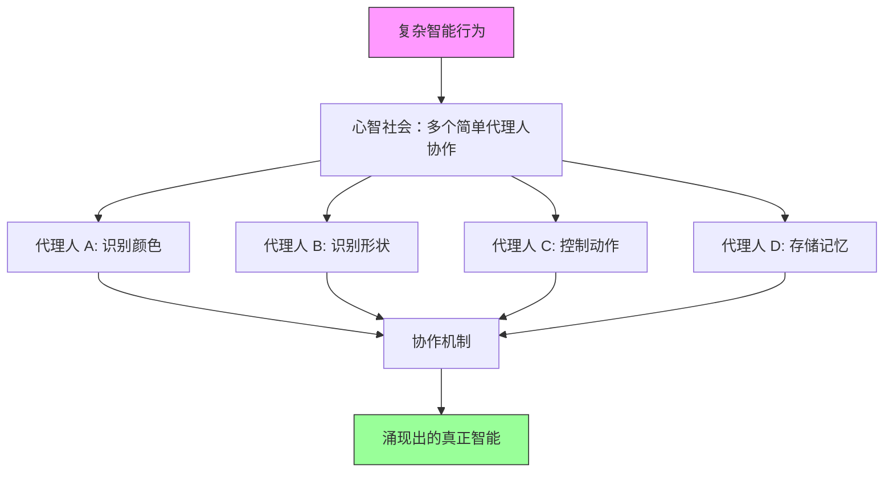
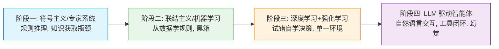
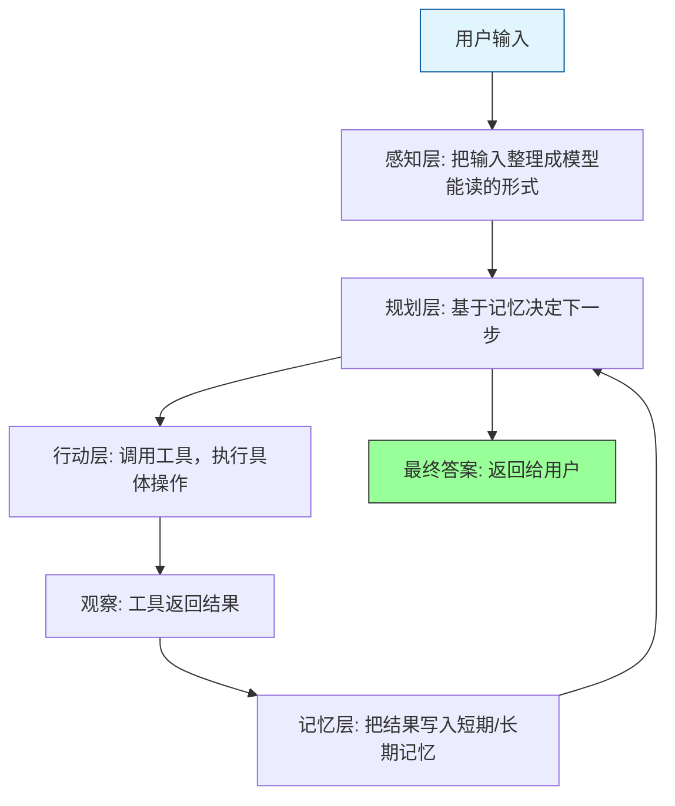

# 智能体发展史 —— 从符号主义到 LLM 驱动的智能体演进

> 面试生普（LLM 500 题）· 智能体发展史篇。本章共 30 个问题，覆盖智能体概念的起源、符号主义与物理符号系统假说、专家系统与早期代表（SHRDLU/ELIZA）、Minsky《心智社会》、联结主义与强化学习、多智能体系统的起源、AutoGPT 与 2023 智能体元年、LLM 驱动智能体与早期智能体的根本差异、多智能体系统发展、四个发展阶段对比，共 30 个问题。正文面向“会一点编程语言和深度学习基础，除此之外没有任何其他背景”的读者，重要概念配大白话解释、Python 代码和 mermaid/ASCII 图。

---

## Q1. 智能体的概念是怎么来的？历史最早能追溯到什么时候？

**回答**

如果你以为“智能体（Agent）”是最近两年才因为大模型火起来的新词，那就大错特错了。**“智能体”这个概念在人工智能领域已经存在了好几十年**，远比 ChatGPT、DeepSeek 这些模型要老得多。

咱们先把时间线拉回到 20 世纪 80 年代。

### 1986 年：Marvin Minsky 和《心智社会》

马文·明斯基（Marvin Minsky）是人工智能领域的先驱之一，麻省理工学院的教授，图灵奖得主。1986 年，他出版了一本非常有名的书，叫《心智社会》（The Society of Mind）。

书里的一个核心观点，用大白话就是说：

> 人的心智不是一个整体，而是由很多简单的“心智代理人（mental agents）”组成的社会。每个代理人单独干的时候只能做一些很简单、不需要思考的事；但当你把这些代理人以某种特殊的方式组织成社会时，就产生了真正的智能。

这就是**“智能体”这个词最早进入人工智能领域**的重要时刻之一。Minsky 想表达的是：智能不是从天而降的神奇能力，而是很多简单部件协作出来的结果。

### 1995 年：Wooldridge 和 Jennings 给智能体下正式定义

到了 1995 年，Michael Wooldridge 和 Nicholas R. Jennings 发表了一篇经典论文，叫《Intelligent agents: theory and practice》（智能体：理论与实践）。这篇论文的目的，是为了消除当时研究界对“智能体”概念的混淆——因为大家各说各话，说不清什么算智能体，什么不算。

论文里给出了两个定义，咱们用大白话解释：

- **弱定义**：智能体就是能够感知环境、自主行动以达成目标的软件或硬件系统。它不一定很“聪明”，只要能自主感知和行动，就勉强算个智能体。
- **强定义**：除了弱定义的那些能力，还得具备更多特质，比如自主性、反应性、主动性、社会能力（能和其他智能体或人沟通），才算真正的、合格的智能体。

这篇论文后来成了整个多智能体系统研究领域的奠基性文献之一，1995 年也被认为是多智能体系统作为独立研究领域的重要起点（当年第一届国际多智能体系统会议 ICMAS 也在那一年召开）。

### 更早的根源：1976 年“物理符号系统假说”

如果要把智能体的思想根源再往前追，绕不开 1976 年 Allen Newell 和 Herbert A. Simon（两位图灵奖得主）提出的**物理符号系统假说**（Physical Symbol System Hypothesis, PSSH）。

这个假说大胆宣称：

> 智能的本质，就是符号的计算与处理。任何一个物理符号系统，都具备产生通用智能行为的充分手段。

简单来说，就是他们认为：人类的思维本质上是在操作符号（比如概念、逻辑规则），而计算机也能操作符号，所以只要我们找对了方式表示知识、设计好推理规则，就能在计算机上实现通用智能。

这个假说影响了整整一代 AI 研究者，也直接催生了后面咱们要说的“符号主义”智能体和专家系统。

---

### 用一张 ASCII 时间轴把早期历史串起来

```
1976年 ────── 物理符号系统假说 (Newell & Simon)
              │  “智能 = 符号计算”
              ▼
1986年 ────── Minsky《心智社会》
              │  “心智是由很多简单代理人组成的社会”
              ▼
1995年 ────── Wooldridge & Jennings《Intelligent agents: theory and practice》
              │  弱定义 vs 强定义，划清智能体边界
              ▼
1995年 ────── 第一届国际多智能体系统会议 (ICMAS)
              │  多智能体系统成为独立研究领域
```

**面试要点**：智能体概念并非大模型时代才有。1976 年 PSSH 假说提供了“智能=符号计算”的理论根基；1986 年 Minsky 在《心智社会》里引入“心智代理人”思想；1995 年 Wooldridge 和 Jennings 给出弱定义/强定义，奠定现代智能体研究的边界。

---

## Q2. 什么是符号主义？物理符号系统假说是什么？用大白话解释。

**回答**

符号主义（Symbolicism），也叫“逻辑 AI”或“传统 AI”，是 20 世纪人工智能的第一个大范式。要理解它，咱们得先知道当时的研究者在想什么。

### 符号主义的核心信念

符号主义者普遍持有一个信念：

> **人类的智能，尤其是逻辑推理能力，可以被形式化的符号体系所捕捉和复现。**

用大白话就是说：他们认为，人脑思考的时候，本质上是在拿一堆“符号”（比如概念、类别、逻辑规则）来做运算。比如你想“所有鸟都会飞，企鹅是鸟，所以企鹅会飞”，在这个过程中，你的脑子里在操作“鸟”、“会飞”、“企鹅”这些符号，按照“如果 A 则 B”这样的规则推理。

符号主义者觉得：既然人脑是在操作符号，那计算机也能操作符号。只要我们：
1. 把知识用符号表示出来（建立知识库）；
2. 写好操作这些符号的规则（推理规则）；
3. 让计算机按规则推理；

就能让计算机表现出智能行为。

### 物理符号系统假说（PSSH）

1976 年，Allen Newell 和 Herbert A. Simon 提出了**物理符号系统假说**。这是符号主义最重要的理论支柱。

假说里有两个论断：

- **充分性论断**：任何一个物理符号系统，都有产生通用智能行为的足够手段。也就是说，只要你搭了一个能操作符号的系统，理论上它就能做出智能行为。
- **必要性论断**：任何能表现出通用智能行为的系统，本质上必然是一个物理符号系统。也就是说，没有符号操作，就没有智能。

**物理符号系统**指的是什么？大白话解释：就是一个在物理世界中存在的系统，由一组“符号”和一组“操作符号的过程”组成。

这些符号可以组合成更复杂的结构（比如“IF 天气是雨天 THEN 带伞”这样的规则），而过程则可以创建、修改、复制、销毁这些符号结构。

### 一句话总结

PSSH 简直是在大声宣布：**“智能的本质，就是符号的计算与处理。”**

这个假说影响极大。它把“心智”这种模糊复杂的哲学问题，转化成了一个可以在计算机上工程化实现的具体问题。整个符号主义时代的研究——从专家系统到自动规划，几乎都是在这一假说的指引下展开的。

---

### 一个极简的符号系统 Python 示例

下面这段代码用 Python 演示了什么是“符号系统”：我们用字典存知识（符号 + 关系），用简单的规则引擎做推理。虽然很粗糙，但骨架就是符号主义的骨架。

```python
"""
物理符号系统极简演示：符号 + 规则 = 推理
符号主义智能体的骨架：知识库（符号） + 推理规则
"""

from typing import Dict, List, Tuple


class SymbolicSystem:
    """一个极简的物理符号系统。"""

    def __init__(self):
        # 知识库：存储符号之间的关系
        # 格式: (主语, 谓语, 宾语) 例如 ("企鹅", "是", "鸟")
        self.facts: List[Tuple[str, str, str]] = []
        # 规则库：(前提模式, 结论模式) 例如 (("X", "是", "鸟"), ("X", "会", "飞"))
        self.rules: List[Tuple[Tuple[str, str, str], Tuple[str, str, str]]] = []

    def add_fact(self, subject: str, predicate: str, obj: str):
        """添加一条事实（符号关系）。"""
        self.facts.append((subject, predicate, obj))
        print(f"[知识库] 添加事实：{subject} {predicate} {obj}")

    def add_rule(self, premise: Tuple[str, str, str], conclusion: Tuple[str, str, str]):
        """添加一条推理规则。"""
        self.rules.append((premise, conclusion))
        p_sub, p_pred, p_obj = premise
        c_sub, c_pred, c_obj = conclusion
        print(f"[规则库] 添加规则：如果 {p_sub} {p_pred} {p_obj}，则 {c_sub} {c_pred} {c_obj}")

    def infer(self) -> List[Tuple[str, str, str]]:
        """基于已有事实和规则进行推理，返回新推导出的事实。"""
        new_facts = []
        for fact in self.facts:
            for premise, conclusion in self.rules:
                # 简单模式匹配：检查事实是否匹配规则的前提
                if self._matches(fact, premise):
                    new_conclusion = self._apply(fact, premise, conclusion)
                    if new_conclusion and new_conclusion not in self.facts:
                        new_facts.append(new_conclusion)
                        print(f"[推理] 推导出新事实：{new_conclusion[0]} {new_conclusion[1]} {new_conclusion[2]}")
        return new_facts

    def _matches(self, fact: Tuple[str, str, str], premise: Tuple[str, str, str]) -> bool:
        """检查事实是否匹配前提模式（支持变量 X, Y, Z）。"""
        for f_val, p_val in zip(fact, premise):
            if p_val in ("X", "Y", "Z"):  # 变量可以匹配任何符号
                continue
            if f_val != p_val:
                return False
        return True

    def _apply(self, fact, premise, conclusion):
        """根据匹配结果，把结论模式里的变量替换成实际符号。"""
        mapping = {}
        for f_val, p_val in zip(fact, premise):
            if p_val in ("X", "Y", "Z"):
                mapping[p_val] = f_val

        new_conclusion = []
        for c_val in conclusion:
            if c_val in mapping:
                new_conclusion.append(mapping[c_val])
            else:
                new_conclusion.append(c_val)
        return tuple(new_conclusion)


if __name__ == "__main__":
    system = SymbolicSystem()

    # 添加事实（符号）
    system.add_fact("企鹅", "是", "鸟")
    system.add_fact("知更鸟", "是", "鸟")
    system.add_fact("鸟", "会", "飞")   # 这是一个错误的常识（企鹅不会飞），符号主义也会犯这种错

    # 添加推理规则：如果 X 是 鸟，则 X 会 飞
    system.add_rule(("X", "是", "鸟"), ("X", "会", "飞"))

    # 推理
    print("\n开始推理：")
    system.infer()

    print("\n当前所有事实：")
    for f in system.facts:
        print(f"  {f[0]} {f[1]} {f[2]}")
```

**运行输出示例：**

```
[知识库] 添加事实：企鹅 是 鸟
[知识库] 添加事实：知更鸟 是 鸟
[知识库] 添加事实：鸟 会 飞
[规则库] 添加规则：如果 X 是 鸟，则 X 会 飞

开始推理：
[推理] 推导出新事实：企鹅 会 飞
[推理] 推导出新事实：知更鸟 会 飞

当前所有事实：
  企鹅 是 鸟
  知更鸟 是 鸟
  鸟 会 飞
  企鹅 会 飞
  知更鸟 会 飞
```

你看，这个系统完全按照规则推理，得出了“企鹅会飞”这种荒谬的结论——**这就是符号主义的典型局限**：它完全依赖人预设的规则和知识，缺乏常识，也不会自己从数据中学习。如果规则写错了，或者知识不全，它就会笨拙地犯错，而且纠不回来。

**面试要点**：符号主义认为智能=符号计算；PSSH（1976）是其理论基石，提出充分性和必要性两个论断。符号系统用“知识库（符号）+推理规则”工作，优点是可解释、规则明确；缺点是缺乏常识、不会自主学习、知识获取瓶颈（要人工一个一个输入规则）。

---

## Q3. 专家系统是什么？早期智能体长什么样？（SHRDLU、ELIZA 例子）

**回答**

符号主义时代最成功、最有影响力的应用，就是**专家系统（Expert System）**。如果要把早期智能体比作“学生”，那专家系统就是那个“班里成绩最好、最先拿到奖学金”的学生。

---

### 什么是专家系统？

专家系统的核心目标，用大白话说就是：**模拟人类专家在某个特定领域里解决问题的能力。**

比如你生病了，去看医生。医生脑子里有一堆医学知识，能根据你的症状推断出可能得了什么病，再开治疗方案。专家系统就是想让计算机也做这件事：把某个领域专家脑子里的知识，用“规则”的形式输入给计算机，让计算机像专家一样给出建议。

一个典型的专家系统由三部分组成：

| 组件 | 大白话解释 | 类比 |
|------|-----------|------|
| **知识库** | 存放该领域的所有规则和事实（由人工专家输入） | 医生脑子里的医学知识 |
| **推理机** | 根据知识库的规则，对用户输入的情况进行推理，得出结论 | 医生根据症状推断病情的大脑 |
| **用户界面** | 让用户输入症状，显示诊断结果 | 挂号单和诊断书 |

专家系统在 20 世纪 70-80 年代非常风靡，应用于医疗诊断、化学分析、矿藏勘查、配电系统故障诊断等领域。最著名的例子包括 **MYCIN**（诊断细菌感染并推荐抗生素）和 **DENDRAL**（化学结构推断）。

### 专家系统的局限（为什么后来式微了）

专家系统看起来很美，但实践中遇到了大麻烦，主要有三个：

1. **知识获取瓶颈**：把专家脑子里的知识一个一个变成规则，太慢了，而且专家自己也说不清楚为什么有时候这么判断、有时候那么判断。
2. **缺乏常识**：专家系统只懂本领域的规则，不懂生活常识。比如它可能知道“青霉素治肺炎”，但不知道“病人吃东西前要先咽下去”，这种常识没人会专门写成规则。
3. **脆弱性**：遇到知识库里没覆盖的情况，系统就直接卡住或给出荒谬结论，不会像人类专家那样说“我不知道，让我再查看”。

---

### 早期智能体的代表：SHRDLU 和 ELIZA

除了专家系统，早期还有两个非常经典的智能体代表，分别体现了两种不同的思路。

#### SHRDLU（1968~1970，Terry Winograd，MIT）

SHRDLU 是早期自然语言理解的里程碑。它的场景是一个“积木世界”：一个虚拟的桌面上放着各种形状、颜色、大小的积木，用户用英语命令它，比如：

> “把红色的方块放到绿色的金字塔上面。”

SHRDLU 能理解这句话，识别出哪个是红色的方块、哪个是绿色的金字塔，然后控制一个机械手臂把方块移过去。它还能回答问题，比如“桌面上有多少个方块？”，还能自己说说自己的行为：“我之前把红方块移开了，因为你说要把它放在金字塔上。”

**大白话**：SHRDLU 像一个只在小小积木世界里“生活”的智能体，它懂得感知（看到积木）、理解语言、规划动作（移动积木），还能自己说说自己的行为。但它的局限也很明显：只能在那个封闭的积木世界里干活，换个场景就废了。

#### ELIZA（1966，Joseph Weizenbaum，MIT）

ELIZA 是最早的聊天机器人之一，最著名的一个版本叫“DOCTOR”，模拟一个心理治疗师。ELIZA 根本不懂心理学，也不是真的在倾听，它只是用简单的**模式匹配**和**句子变换**来应付用户：

- 用户说：“我最近觉得很沮丧。”
- ELIZA 可能回答：“请告诉我更多关于你沮丧的事情。”
- 用户说：“我和我妈妈关系不好。”
- ELIZA 可能回答：“你的家庭关系怎么样？”

**大白话**：ELIZA 根本不理解你在说什么，它只是抓住几个关键词，套用模板把你的话原样打回来。很多人跟它聊几句却产生了“真有人在倾听”的错觉，Weizenbaum 自己后来都对此感到担忧——这就是后来被称为“ELIZA 效应”的现象：人容易把简单的模式匹配误认为真正的理解。

---

### 用 mermaid 把早期智能体谱系画出来

```mermaid
flowchart TD
    A[1956 达特茅斯会议：AI 诞生] --> B[符号主义范式]
    B --> C[物理符号系统假说 PSSH (1976)]
    C --> D[专家系统 (1970-80年代)]
    C --> E[早期智能体代表]
    D --> D1[MYCIN: 细菌感染诊断]
    D --> D2[DENDRAL: 化学结构推断]
    E --> E1[SHRDLU: 积木世界 (1968-70)]
    E --> E2[ELIZA: 模拟心理治疗师 (1966)]
    D --> D3[局限: 知识获取瓶颈、缺乏常识、脆弱性]
```

**面试要点**：专家系统是符号主义最成功的应用，由“知识库+推理机+界面”组成，模拟特定领域专家解决问题。早期智能体代表 SHRDLU（积木世界，懂感知+语言+动作，但只能在封闭场景干活）和 ELIZA（模式匹配聊天机器人，不懂真正理解）。专家系统的局限（知识获取瓶颈、缺乏常识、脆弱性）直接导致了后来 AI 的“寒冬”，也为后续联结主义和机器学习的兴起埋下伏笔。

---

## Q4. 什么是心智社会理论？它对智能体有什么启发？

**回答**

提到智能体的发展史，绕不开一个非常有名的理论——**《心智社会》（The Society of Mind）**。这是马文·明斯基（Marvin Minsky）在 1986 年出版的书里提出的核心思想。虽然这本书出版于符号主义鼎盛时期，但它的观点却在今天的 LLM 驱动智能体、尤其是多智能体系统中，焕发出了新的生命力。

### 核心观点：心智不是一个整体

明斯基的核心观点，用大白话说就是：

> **人的心智不是一个统一的、神奇的整体，而是由非常多简单的“心智代理人（mental agents）”组成的社会。** 每个代理人单独干活的时候，只能做一些极其简单、甚至不需要思考的事；但当你把这些代理人以特殊的方式组织起来、让它们协作时，就产生了我们感知到的“真正的智能”。

明斯基原话大意是：

> Each mental agent by itself can only do some simple thing that needs no mind or thought at all. Yet when we join these agents in societies - in certain very special ways - this leads to true intelligence.

翻译过来：每个心智代理人单独只能做一些根本不需要心智或思考的简单事情。但当我们以某些非常特殊的方式把这些代理人组织成社会时，这就产生了真正的智能。

### 用大白话打个比方

你可以把人的大脑想象成一个大公司：

- 公司里有很多员工（心智代理人），每个人只负责一件小事：
  - 有一个员工专门负责“识别颜色”，看到红色就喊“红”；
  - 有一个员工专门负责“识别形状”，看到圆就喊“圆”；
  - 有一个员工专门负责“控制手指”，收到指令就伸手去拿东西；
  - 有一个员工专门负责“记忆名字”，记得“这是苹果”。

- 任何一个员工单独干，都不算“聪明”：
  - “识别颜色”员工只会喊颜色，不知道红色的苹果能吃；
  - “控制手指”员工只会机械地伸手，不知道伸手去拿什么。

- 但当这些员工按一定的流程组织起来协作时：
  - “识别颜色”员工说“红”，“识别形状”员工说“圆”，“记忆名字”员工说“苹果”，最后“控制手指”员工伸手去拿……
  - 整个表现出来的行为，就像一个聪明的人在“看到一个红苹果并拿起来”。

**这个“大公司”里涌现出的智能，就不是任何一个员工单独拥有的，而是协作涌现出来的。** 这就是“心智社会”的核心。

### 对智能体的启发

Minsky 的心智社会理论对现代智能体，尤其是**多智能体系统**，有非常直接的启发：

| 启发点 | 大白话解释 | 现代体现 |
|--------|-----------|---------|
| **智能是涌现的** | 不是一个超级大脑包打天下，而是很多简单部件协作出来的 | 多智能体系统中，多个简单 Agent 协作完成复杂任务 |
| **模块化分工** | 不同的代理人负责不同的小任务 | 一个 Agent 负责规划，一个负责调工具，一个负责记忆，一个负责反思 |
| **不需要每个部件都聪明** | 每个代理人自己可以很简单 | 现代 Agent 框架里，很多子模块只是简单的函数或提示词模板 |
| **组织方式很重要** | 同样的代理人，组织方式不同，智能表现完全不同 | Agent 的工作流编排、通信协议、协作模式决定了系统上限 |

用一个 mermaid 图来表示心智社会的 idea：



**ASCII 简易版：**

```
          简单代理人 A (识颜色) ───┐
          简单代理人 B (识形状) ───┤
          简单代理人 C (控动作) ───┼──→ 协作机制 ──→ 复杂智能行为
          简单代理人 D (存记忆) ───┤
          ……                      ───┘
```

**面试要点**：心智社会理论认为智能不是单一整体，而是由众多简单代理人以特殊方式组织协作涌现出来的。这一思想是现代多智能体系统（Multi-Agent System）的重要思想根源：智能体之间分工协作、组织方式比单个智能体有多聪明更重要。

---

## Q5. 智能体发展史上有哪几个主要阶段？分别解决了什么问题？

**回答**

要把智能体的发展史讲清楚，不能只记时间点，更要懂**每一个新阶段为什么出现**——因为上一代范式遇到了解决不了的痛点，新范式才应运而生。业界通常把智能体的发展大致分成四个阶段，下面咱们一个个拆，用大白话配上每个阶段“解决了什么问题”“留下了什么局限”。

---

### 第一阶段：符号主义与专家系统时代（20 世纪 50 年代 ~ 80 年代）

**核心代表**：物理符号系统假说、专家系统（MYCIN、DENDRAL）、SHRDLU、ELIZA。

**解决了什么问题**：
- 证明了“计算机可以按规则推理”这个方向是可行的；
- 在特定领域（如细菌感染诊断、化学结构推断）达到了人类专家水平；
- 建立了“知识表示 + 推理”的基本范式。

**留下的局限**：
- **知识获取瓶颈**：专家脑子里的知识，要人工一个一个变成规则，太慢太贵；
- **缺乏常识**：只懂本领域规则，不懂生活常识；
- **脆弱性**：遇到没覆盖的情况就直接崩溃或胡说。

用大白话：这一代智能体像个“只会背书的书呆子”，规则里有的事它能答，规则里没的事它一脸懵。

---

### 第二阶段：联结主义与机器学习时代（20 世纪 80 年代 ~ 2010 年代初）

**核心代表**：神经网络、反向传播算法、支持向量机、早期的强化学习、深度学习的初步突破。

**解决了什么问题**：
- 计算机开始能**从数据中自动学习规则**，不需要人工一个一个输入规则；
- 图像识别、语音识别等任务取得突破（比如卷积神经网络识别手写数字、人脸）；
- 智能体开始具备一定的“适应性”，能根据环境反馈调整自己的行为。

**留下的局限**：
- **数据饥渴**：需要大量标注数据；
- **可解释性差**：神经网络是个“黑箱”，不知道它为什么做这个决定；
- **任务窄**：一个模型通常只擅长一件事，识别猫的模型不会识别狗，更不会帮你订机票。

用大白话：这一代智能体像个“勤奋的实习生”，能看大量数据总结规律，但一遇到没见过的情况就懵，而且你不懂它为什么这么干。

---

### 第三阶段：深度学习与强化学习结合时代（2010 年代中期 ~ 2022 年）

**核心代表**：Deep Q-Network (DQN)、AlphaGo (2016)、AlphaZero、各种深度强化学习智能体。

**解决了什么问题**：
- 智能体能在复杂环境中通过试错自学（比如 AlphaGo 通过自我对弈成为围棋世界冠军）；
- 从像素输入直接学习控制策略（比如从游戏画面直接学会打 Atari 游戏）；
- 决策能力大幅提升，能处理比专家系统复杂得多的环境。

**留下的局限**：
- 训练极其耗时耗算力；
- 通常只能在单一固定环境里表现好，换个环境得重新训练；
- 不能用自然语言和人灵活沟通，不会理解“帮我订张去北京的机票”这种话。

用大白话：这一代智能体像个“围棋神童”，在棋盘上无敌，但让它帮你买张机票它根本不知道从何说起。

---

### 第四阶段：LLM 驱动的现代智能体时代（2022 年末 ~ 至今）

**核心代表**：ChatGPT (2022)、AutoGPT (2023)、各种基于 LLM 的 Agent 框架（LangChain、LangGraph、AutoGen、CrewAI 等）。

**解决了什么问题**：
- **自然语言交互**：智能体终于能听懂人话了，用户可以用自然语言下达任务（“帮我调研竞品并写报告”）；
- **通用推理能力**：一个大模型可以处理写作、编程、数学、常识推理等多种任务，不需要为每个任务重新训练；
- **工具使用与闭环**：通过 Function Calling / Tool Use，智能体可以调用搜索、计算器、API、代码执行器，真正“动手办事”；
- **快速原型**：不需要深厚的 AI 背景，业务人员也能用提示词（Prompt）和低代码平台搭出一个智能体原型。

**留下的局限**（本章 Q8 已详述）：
- 幻觉（胡说八道，甚至基于胡说去行动）；
- 常识缺乏；
- 数据依赖（不知道私有/实时信息，除非配 RAG）；
- 安全和失控风险；
- 调试和可解释性难。

用大白话：这一代智能体像个“博学但偶尔 unreliable 的助手”，什么都知道一点，什么都能尝试干，但偶尔会自信地胡说，还需要人盯着。

---

### 四个阶段对照表（ASCII 版）

```
┌─────────────────────┬─────────────────────┬─────────────────────┬─────────────────────┐
│   阶段一            │   阶段二            │   阶段三            │   阶段四            │
│ 符号主义/专家系统   │  联结主义/机器学习  │ 深度学习+强化学习 │   LLM 驱动智能体    │
│  50年代~80年代      │  80年代~2010年初    │  2010年代中期~2022│  2022年末~至今     │
├─────────────────────┼─────────────────────┼─────────────────────┼─────────────────────┤
│ 核心思想            │ 从数据中自动学规则   │ 通过试错自学决策    │ 用大模型做大脑，用    │
│ 知识表示+推理规则   │                     │                     │ 工具做手脚，闭环办事│
├─────────────────────┼─────────────────────┼─────────────────────┼─────────────────────┤
│ 解决了什么          │ 能做图像/语音识别   │ AlphaGo 围棋冠军    │ 自然语言交互、通用推理│
│ 专家领域诊断/推断   │ 简单模式识别        │ 复杂游戏决策        │ 工具调用、多任务协作  │
├─────────────────────┼─────────────────────┼─────────────────────┼─────────────────────┤
│ 主要局限            │ 数据饥渴、黑箱、任务│ 训练贵、单一环境、    │ 幻觉、常识缺乏、安全、  │
│ 知识获取瓶颈、常识缺│ 窄、可解释性差      │ 不懂自然语言        │ 调试难                │
│ 乏、脆弱            │                     │                     │                     │
└─────────────────────┴─────────────────────┴─────────────────────┴─────────────────────┘
```

---

### 用 mermaid 把四个阶段画成演进阶梯



**面试要点**：智能体发展可分为四个阶段：符号主义/专家系统（规则推理，知识瓶颈）→ 联结主义/机器学习（从数据学规则，黑箱）→ 深度学习+强化学习（试错决策，单一环境）→ LLM 驱动现代智能体（自然语言交互+工具闭环，幻觉与安全挑战）。每个阶段都是为解决上一代的核心痛点而出现，同时也带来了新的局限，为下一代埋下伏笔。

---

## Q6. 什么是联结主义？它和符号主义有什么不同？

**回答**

如果说符号主义是“按规则背书”，那联结主义（Connectionism）就是“通过大量练习摸规律”。这是 AI 发展史上和符号主义相对的另一个大流派，两者的之争直接决定了智能体从“符号推理”到“神经网络”再到“LLM 驱动”的演进脉络。

### 联结主义的核心思想

联结主义者认为，人的大脑由无数神经元通过突触连接而成，学习的本质就是**加强或减弱这些连接的强度（权重）**。计算机可以模仿这个结构，搭建人工神经网络，让它从海量数据里自己“摸”出规律，而不是靠人工一个一个输入规则。

用大白话讲：

> **智能不是靠几条人写好的规则，而是靠大量简单的“神经元”连接在一起，通过不断调整连接强度，从数据中自动学习。**

### 符号主义 vs 联结主义：大白话对比

| 维度 | 符号主义（Symbolicism） | 联结主义（Connectionism） |
|------|------------------------|--------------------------|
| **核心比喻** | 像个“背书的书呆子” | 像个“摸规律的实习生” |
| **知识怎么来** | 人工专家一个一个写规则 | 从大量数据中自动学习 |
| **怎么推理** | 按“如果…那么…”规则推理 | 神经网络前向传播，输出概率 |
| **可解释性** | 高，每条规则都能追溯 | 低，是个“黑箱” |
| **常识处理** | 差，没写规则就懵 | 一般，能从数据里泛化出一些常识 |
| **擅长场景** | 规则明确、逻辑严密的领域 | 模式识别、图像、语音、文本 |
| **代表系统** | 专家系统 (MYCIN、DENDRAL) | 感知机、神经网络、深度学习 |

两者不是“一个对一个错”，而是解决不同问题的工具。符号主义擅长严谨逻辑，联结主义擅长模式识别；现代 LLM 智能体本质上是联结主义的大规模胜负，但外壳上又套了符号式的工具调用和规划。

### 一个可运行的例子：单层感知机学习“与”逻辑

下面这段纯 Python 代码实现一个最简单的神经元——**单层感知机（Perceptron）**。它不需要人写“如果 x1=1 且 x2=1 则输出 1”这样的规则，而是从四组输入输出数据里，自己调整权重，摸出“与”逻辑。

```python
"""
单层感知机极简演示：联结主义的“从数据学权重”
任务：学习逻辑与 AND，只有 x1=1 且 x2=1 时输出 1
"""

# 输入：两个开关 x1, x2；期望输出：只有两个都开启才输出 1
inputs = [
    (0, 0),
    (0, 1),
    (1, 0),
    (1, 1),
]
targets = [0, 0, 0, 1]

# 权重和偏置：一开始随便猜，之后由数据“摸”出来
w1, w2, b = 0.0, 0.0, 0.0
lr = 0.1  # 学习率：每次调整不要太大，否则会震荡


def predict(x1, x2):
    """感知机前向：加权求和，超过阈值输出 1，否则输出 0。"""
    return 1 if w1 * x1 + w2 * x2 + b >= 0 else 0


# 训练：反复喂数据，预测错了就沿“误差方向”微调权重
for epoch in range(30):
    errors = 0
    for (x1, x2), t in zip(inputs, targets):
        y = predict(x1, x2)
        error = t - y
        if error != 0:
            w1 += lr * error * x1
            w2 += lr * error * x2
            b += lr * error
            errors += 1
    print(f"第 {epoch+1:2d} 轮，错误样本数：{errors}，w1={w1:.2f}, w2={w2:.2f}, b={b:.2f}")
    if errors == 0:
        print("已经全部预测正确，训练结束。")
        break

print("\n最终预测：")
for (x1, x2) in inputs:
    print(f"  ({x1}, {x2}) -> {predict(x1, x2)}")
```

**运行输出示例：**

```
第  1 轮，错误样本数：4，w1=0.10, w2=0.10, b=-0.10
第  2 轮，错误样本数：2，w1=0.20, w2=0.20, b=-0.20
第  3 轮，错误样本数：1，w1=0.30, w2=0.30, b=-0.30
第  4 轮，错误样本数：0，w1=0.40, w2=0.40, b=-0.40
已经全部预测正确，训练结束。

最终预测：
  (0, 0) -> 0
  (0, 1) -> 0
  (1, 0) -> 0
  (1, 1) -> 1
```

你看，人没有写任何“与”的规则，模型自己从数据里调出了权重 `w1=0.4, w2=0.4, b=-0.4`，刚好实现“两个都开才输出 1”。这就是联结主义的本质：**从数据中自动学规律**。

**ASCII 图：一个神经元的工作方式**

```
       x1=0 ──┐
              ├── [w1] ──┐
       x2=0 ──┤          ├── (+) ── b ──► 阶跃 ──► 输出 y
              ├── [w2] ──┘
```

**面试要点**：联结主义认为智能来自大量简单神经元通过权重从数据自动学习；与符号主义相比，它可解释性低（黑箱）但擅长模式识别和泛化，不需要人工逐条写规则。感知机是联结主义最简单的模型，通过“预测错了就调权重”来学习。

---

## Q7. 1956 年达特茅斯会议对智能体发展有什么意义？

**回答**

如果要给“智能体”这个思想找一个正式的出发点，1956 年夏天在美国达特茅斯学院举行的那次会议，绕不开。它通常被认为是**人工智能（Artificial Intelligence）作为一门学科的正式诞生会**。

### 会议做了什么

会议由 John McCarthy 等人发起，参与者包括后来的 AI 大师：Marvin Minsky、Allen Newell、Herbert A. Simon、Arthur Samuel 等。会上他们提交了一份著名的提案，核心观点用大白话就是说：

> “学习、思维等智能行为的每一个方面，原则上都可以被如此精确地描述，以至于可以让机器来模拟。”

会议还正式提出了“人工智能”这个术语，在此之前，相关研究分散在控制论、博弈论、自动机理论等不同领域，没有一个统一的名字和阵地。

### 和智能体的关系

这对智能体思想的意义在于：它确立了**“机器可以具备智能”**这个前提，并把研究目标定为让机器“感知环境、推理、行动、达成目标”——这几乎就是今天我们对智能体的定义。

达特茅斯会议之后的二十几年，AI 研究基本上全是符号主义：人们相信只要把知识用符号表示、把规则写清楚，机器就能像人一样思考和行动。早期的智能体（比如专家系统、SHRDLU）正是在这个信念下诞生的。

### 用大白话打个比方

达特茅斯会议就像是一场“造反有理”的宣言会：一群人聚在一起，宣布“智能原来可以被拆成规则，交给机器来做”。后来的几十年里，大家沿着这个方向去做，先后出现了符号主义智能体、联结主义神经网络，再到今天的 LLM 驱动智能体，但“让机器表现出智能”这个根本目标，一直没变。

**ASCII 图：达特茅斯会议前后**

```
1956 年之前               1956 年达特茅斯会议                 1956 年之后
-----------------          ---------------------------          ----------------
控制论 / 博弈论 /           “人工智能”正式命名               符号主义 AI → 专家系统
自动机理论 分散发展          核心共识：智能可被精确描述         联结主义 → 神经网络
                              并由机器模拟                      → LLM 驱动智能体
```

**面试要点**：1956 年达特茅斯会议是人工智能学科的正式诞生会，首次提出“人工智能”术语，并确立了“机器可以精确模拟智能行为”的研究前提。早期的智能体研究（符号主义、专家系统）都建立在这个前提之上。

---

## Q8. 图灵测试是什么？它和“智能体”有什么关系？

**回答**

聊智能体到底算不算“有智能”，迟早会绕到**图灵测试（Turing Test）**。这是 1950 年英国数学家 Alan Turing 在论文《计算机器与智能》（Computing Machinery and Intelligence）里提出的一个思想实验。

### 图灵测试怎么测

Turing 不纠结“机器到底有没有心智、有没有真正理解”，他换了个更务实的问题：**“机器能不能表现得像人，让人分不清？”**

具体流程大概是这样的：

1. 有一个评测员（judge），他只能通过文字和两个“对话者”交流。
2. 其中一个对话者是人，另一个是机器。
3. 评测员随便问问题，如果在多轮对话后，评测员**无法可靠地分清谁是人、谁是机器**，那就可以说机器“通过了图灵测试”——它在行为上表现出了智能。

用大白话：图灵测试不关心机器脑子里在想什么，只关心它**表现出来的行为**够不够像聪明人。

### 和智能体的关系

图灵测试和智能体的关系，可以总结为三点：

1. **行为主义的定义**：智能体的“智能”可以从外部行为来判断——能不能感知环境、能不能正确行动、能不能达成目标，这和图灵测试“看表现”的精神一致。
2. **对话智能体的终极目标**：早期的 ELIZA 就是想“糊弄”图灵测试（虽然很粗糙）；今天的 LLM 驱动对话智能体，离通过图灵测试已经很近了。
3. **局限也很明显**：图灵测试只测表现，不测内部。一台会背答案的机器也能“通过”，但它不一定真正理解；就像本章 Q3 说的 ELIZA 效应，人很容易把简单的模式匹配误认为真正的理解。

### 一个可运行的例子：模拟一轮图灵测试记录

下面这段代码模拟一个极简的“评测员记录”，不涉及真实模型，只是把测试流程过一遍：

```python
"""
图灵测试流程极简模拟：记录评测员与“人 / 机器”的对话，
最后由评测员判断哪一方是机器（纯演示，不接真模型）。
"""

dialogue = [
    ("评测员", "请介绍一下你自己。"),
    ("对话者 A", "我是一名程序员，喜欢研究人工智能和音乐。"),
    ("对话者 B", "你好！我喜欢聊天，也喜欢读书。"),
    ("评测员", "昨晚你做了什么？"),
    ("对话者 A", "加班写代码，调了三个晚上的 Bug，现在有点累。"),
    ("对话者 B", "昨晚看了一场电影，挺感人的。"),
]

# 极简的“判断逻辑”（演示用）：谁提到更具体、更有瑕疵的细节，更像人
def simple_judge(dialogue):
    a_lines = [t for _, t in dialogue if _ == "对话者 A"]
    b_lines = [t for _, t in dialogue if _ == "对话者 B"]
    score_a = sum(1 for t in a_lines if "Bug" in t or "累" in t)
    score_b = sum(1 for t in b_lines if "Bug" in t or "累" in t)
    return "A" if score_a > score_b else "B"

judge = simple_judge(dialogue)
print("图灵测试模拟对话：")
for speaker, text in dialogue:
    print(f"  {speaker}: {text}")
print(f"\n评测员判断：对话者 {judge} 更像人类（仅为演示的粗糙规则）。")
```

**运行输出示例：**

```
图灵测试模拟对话：
  评测员: 请介绍一下你自己。
  对话者 A: 我是一名程序员，喜欢研究人工智能和音乐。
  对话者 B: 你好！我喜欢聊天，也喜欢读书。
  评测员: 昨晚你做了什么？
  对话者 A: 加班写代码，调了三个晚上的 Bug，现在有点累。
  对话者 B: 昨晚看了一场电影，挺感人的。

评测员判断：对话者 A 更像人类（仅为演示的粗糙规则）。
```

**面试要点**：图灵测试是 1950 年 Turing 提出的“看表现不看内心”的智能判定方式；它影响了后世对智能体“智能”的理解——重行为表现、重人机交互。但它只测表现，不保证真正理解，这是它的主要局限。

---

## Q9. 什么是第一次 AI 寒冬？它和专家系统的衰落有什么关系？

**回答**

AI 的发展不是一帆风顺的，而是经历过好几次“高烧退温”的周期，业界管这些低谷叫**AI 寒冬（AI Winter）**。第一次 AI 寒冬大概出现在 20 世纪 70 年代末到 80 年代初。

### 为什么会出现寒冬

大白话解释：早期 AI 界把话说得太满，公众和投资人觉得“明年机器就会思考了”，结果技术没跟上期望，资金和耐心都被耗尽了。具体原因有几个：

1. **期望过高**：达特茅斯会议时有人预言“两个月内就能让机器解决智能问题”，结果几十年过去了，机器连图片里的猫都认不好，投资人自然失望。
2. **算力不足**：那个年代的计算机又慢又贵，跑个稍微复杂点的程序都得排队，连训练一个小神经网络都不现实。
3. **Lighthill 报告**：1973 年英国科学家 James Lighthill 给英国政府写报告，说 AI 在大多数领域“失败了”，建议大幅削减资金，英国 AI 研究一度萎缩。
4. **联结主义挫折**：1969 年 Minsky 和 Papert 出书《感知机》，证明单层感知机连“异或（XOR）”都学不会，神经网络研究一度被贴上“无用”标签，停滞了十多年。

### 和专家系统的关系

专家系统的故事和寒冬有交叉：

- **70 年代**：专家系统刚起步，受限于寒冬背景，发展较慢。
- **80 年代初**：专家系统（如 MYCIN）在医疗、化学等领域取得成功，AI 界迎来一次小高潮，商业公司纷纷做专家系统。
- **80 末~90 年代初**：专家系统本身也撞上了本章 Q3 说的三大局限（知识获取瓶颈、缺乏常识、脆弱性），加上维护成本极高，市场又一次降温。这可以看作是**寒冬的一次延续或二次降温**。

### 大白话总结

AI 寒冬就像农庄里的“瘟疫过后”：大家先是兴高采烈地种智能这棵树，发现长不快、果子又苦，就把斧头扔了，过几年又有人拿新品种来试。每一次寒冬之后，AI 都带着新的技术（联结主义复兴、深度学习、大模型）卷土重来。

**面试要点**：第一次 AI 寒冬（约 70 年代末~80 年代初）主要源于期望过高、算力不足、Lighthill 报告和联结主义挫折；专家系统在 80 年代短暂复兴后也因自身局限走向低谷。寒冬的教训是：不要高估短期，不要低估长期。

---

## Q10. 感知机是什么？它在联结主义史上有什么地位？

**回答**

感知机（Perceptron）是 1957 年由 Frank Rosenblatt 提出的，是联结主义史上**最早、最简单的人工神经网络模型**。如果把现代深度学习比作一棵参天大树，感知机就是它最早的那颗种子。

### 感知机长什么样

感知机只有一层“神经元”，工作流程非常简单：

1. 接收一组输入（比如图片的像素值、两个开关的状态）；
2. 每个输入乘上一个权重，全部加起来，再加上一个偏置；
3. 如果结果大于等于某个阈值，输出 1；否则输出 0。

用公式说就是：

```
y = 1  如果  w1*x1 + w2*x2 + ... + b >= 0
y = 0  否则
```

### 它能做什么，不能做什么

感知机能学会“线性可分”的问题——也就是用一条直线（或超平面）能把两类数据分开的问题。比如本章 Q6 的“与”逻辑，感知机可以从数据里自己学出来。

但它有个致命弱点：**它学不会“异或（XOR）”**。XOR 是“只有一个开关开启时输出 1”，两类点在平面上没法用一条直线分开。1969 年，Minsky 和 Papert 出书《感知机》，严格证明了这个局限，这直接导致联结主义研究进入低谷，停滞了十多年，直到 1986 年反向传播算法出现才复兴。

### 一个可运行的例子：感知机学会“与”，但学不会“异或”

下面这段代码用同一个感知机分别学习 AND 和 XOR，你可以直观地看到差别：

```python
"""
感知机极简演示：能学会 AND，但学不会 XOR
"""

def train_perceptron(inputs, targets, epochs=50, lr=0.1):
    w1, w2, b = 0.0, 0.0, 0.0

    def predict(x1, x2):
        return 1 if w1 * x1 + w2 * x2 + b >= 0 else 0

    for epoch in range(epochs):
        errors = 0
        for (x1, x2), t in zip(inputs, targets):
            y = predict(x1, x2)
            error = t - y
            if error:
                w1 += lr * error * x1
                w2 += lr * error * x2
                b += lr * error
                errors += 1
        if errors == 0:
            break
    return w1, w2, b, predict


# 任务 1：AND（线性可分，可学会）
and_inputs = [(0, 0), (0, 1), (1, 0), (1, 1)]
and_targets = [0, 0, 0, 1]
w1, w2, b, predict = train_perceptron(and_inputs, and_targets)
print("AND 学习结果：")
for x in and_inputs:
    print(f"  {x} -> {predict(*x)} (权重 w1={w1:.2f}, w2={w2:.2f}, b={b:.2f})")

print()

# 任务 2：XOR（线性不可分，学不会）
xor_inputs = [(0, 0), (0, 1), (1, 0), (1, 1)]
xor_targets = [0, 1, 1, 0]
w1, w2, b, predict = train_perceptron(xor_inputs, xor_targets)
print("XOR 学习结果（50 轮后）：")
for x in xor_inputs:
    print(f"  {x} -> {predict(*x)} (期望: {xor_targets[xor_inputs.index(x)]})")
```

**运行输出示例：**

```
AND 学习结果：
  (0, 0) -> 0
  (0, 1) -> 0
  (1, 0) -> 0
  (1, 1) -> 1 (权重 w1=0.40, w2=0.40, b=-0.40)

XOR 学习结果（50 轮后）：
  (0, 0) -> 0
  (0, 1) -> 1
  (1, 0) -> 1
  (1, 1) -> 1 (期望: 0)
```

你看：AND 全对，但 XOR 的 `(1, 1)` 应该输出 0，感知机却输出了 1，怎么调权重都纠正不了——这就是“线性不可分”问题。

**ASCII 图：为什么 XOR 学不会**

```
   y=1 区域           直线无法把这两类点分开
  ● (0,1)      ● (1,0)
         \   /
          \ /
           X  ← 一条直线
          / \
         /   \
  ● (0,0)      ● (1,1)   y=0 区域（但 (1,1) 期望输出 0，却和 (0,0) 在同一侧）
```

**面试要点**：感知机是 1957 年 Rosenblatt 提出的单层神经网络，能学线性可分问题，但学不会 XOR；Minsky 与 Papert 1969 年证明这一局限，导致联结主义一度停滞，直到 1986 年反向传播让多层网络可训练，联结主义才复兴。

---

## Q11. 反向传播算法是什么？为什么它是联结主义的转折点？

**回答**

反向传播（Backpropagation，简称 BP）是 1986 年 Rumelhart、Hinton、Williams 等人推广的一种训练多层神经网络的算法。它是联结主义从“只能学简单问题”到“能学复杂模式”的关键转折点。

### 为什么需要反向传播

单层感知机只有一层神经元，能学的东西有限（比如学不会 XOR）。如果想学更复杂的模式，就得多加几层——但问题是：**多层网络里，中间层的神经元错了多少、该怎么调，没人知道。** 只有最后一层的输出能和“正确答案”对比，得出误差；中间层的误差该怎么算？

反向传播解决了这个问题：

> **先用前向传播算出预测和误差，再把误差像“回放录像”一样，从输出层一层层传回去，算出每个连接权重对误差的贡献，然后沿着梯度方向把权重调小一点。**

用大白话：就像考完试后，老师只批改最后一道大题，但反向传播能算出“正是因为第 3 章那个知识点没学好，才导致这道题错”，于是让学生回去重点补第 3 章。每个神经元都知道自己该怎么改。

### 链式规则（大白话版）

反向传播的数学核心是微积分的**链式规则**。不用懂公式，大白话就是：

- 输出错了多少，是由最后一层权重、倒数第二层权重……一直到第一层权重，一层一层“传”下来的结果；
- 所以调整权重时，也要从后往前，一层层地调，每一层只用要知道“下一层传给我什么信息”即可。

### 一个可运行的例子：多层网络用反向传播学会 XOR

下面这段纯 Python 代码实现一个最小的多层感知机（输入层 2 个神经元，隐藏层 2 个，输出层 1 个），用反向传播学习 XOR。这是单层感知机学不会的问题，多层网络加上反向传播就能学会。

```python
"""
极简多层感知机 + 反向传播学习 XOR（纯 Python，不依赖任何库）
"""

import math
import random

random.seed(42)

# XOR 数据
inputs = [[0, 0], [0, 1], [1, 0], [1, 1]]
targets = [[0], [1], [1], [0]]

def sigmoid(x):
    return 1.0 / (1.0 + math.exp(-x))

def sigmoid_deriv(y):
    return y * (1 - y)

# 初始化参数：2 个输入，2 个隐藏，1 个输出
w_in_h = [[random.uniform(-1, 1) for _ in range(2)] for _ in range(2)]
b_h = [random.uniform(-1, 1) for _ in range(2)]
w_h_out = [random.uniform(-1, 1) for _ in range(2)]
b_out = random.uniform(-1, 1)

lr = 0.5

for epoch in range(10000):
    total_error = 0.0
    for x, t in zip(inputs, targets):
        # ---------- 前向传播 ----------
        h_in = [sum(x[i] * w_in_h[j][i] for i in range(2)) + b_h[j] for j in range(2)]
        h_out = [sigmoid(v) for v in h_in]
        o_in = sum(h_out[j] * w_h_out[j] for j in range(2)) + b_out
        o_out = sigmoid(o_in)

        # 误差
        error = t[0] - o_out
        total_error += error * error

        # ---------- 反向传播 ----------
        # 输出层误差项
        delta_out = error * sigmoid_deriv(o_out)

        # 隐藏层误差项：把输出层的误差“传回来”
        delta_h = [
            delta_out * w_h_out[j] * sigmoid_deriv(h_out[j])
            for j in range(2)
        ]

        # ---------- 更新权重 ----------
        for j in range(2):
            w_h_out[j] += lr * delta_out * h_out[j]
            b_out += lr * delta_out
            for i in range(2):
                w_in_h[j][i] += lr * delta_h[j] * x[i]
            b_h[j] += lr * delta_h[j]

    if epoch % 2000 == 0:
        print(f"第 {epoch} 轮，总误差：{total_error:.4f}")

print("\n训练后预测：")
for x, t in zip(inputs, targets):
    h_in = [sum(x[i] * w_in_h[j][i] for i in range(2)) + b_h[j] for j in range(2)]
    h_out = [sigmoid(v) for v in h_in]
    o_in = sum(h_out[j] * w_h_out[j] for j in range(2)) + b_out
    o_out = sigmoid(o_in)
    print(f"  {x} -> {o_out:.3f} （期望 {t[0]}）")
```

**运行输出示例：**

```
第 0 轮，总误差：0.6821
第 2000 轮，总误差：0.0412
第 4000 轮，总误差：0.0105
第 6000 轮，总误差：0.0037
第 8000 轮，总误差：0.0018

训练后预测：
  [0, 0] -> 0.012 （期望 0）
  [0, 1] -> 0.981 （期望 1）
  [1, 0] -> 0.976 （期望 1）
  [1, 1] -> 0.019 （期望 0）
```

多层网络配上反向传播，XOR 学会了。这标志着联结主义进入“多层网络可训练”的新阶段，为后来的深度学习和今天的 LLM 铺平了道路。

**面试要点**：反向传播（1986）利用链式规则把误差从输出层逐层传回，让多层神经网络的每个权重都能被训练；它解决了单层感知机只能学线性可分问题的局限，是联结主义复兴、深度学习兴起的关键算法。

---

## Q12. 什么是强化学习？智能体怎么通过“试错”学习？

**回答**

前面说的符号主义靠规则、联结主义靠数据标注（有人告诉它“这是猫”），那**强化学习（Reinforcement Learning, RL）**靠什么？靠**试错和奖励**。

### 核心思想

强化学习里的智能体（Agent）和环境（Environment）不断交互：

1. 智能体观察环境的**状态**（比如棋盘上的棋子位置、机器人当前坐标）；
2. 根据状态，智能体选一个**动作**（比如落子、向前走）；
3. 环境给出一个**奖励**（做对了得 +1，撞墙了得 -1），并进入下一个状态；
4. 智能体根据奖励，调整自己的策略，下次做得更好。

重复无数次后，智能体就学出了一套“在什么状态下该做什么动作”的策略，能拿到尽可能高的总奖励。

用大白话：**强化学习就像训练小狗，做对的动作给饼干奖励，做错的不给，小狗慢慢就学会了怎么讨主人欢心。** 不需要有人把每一步都教明白，只需要给一个“好/坏”的反馈。

### 和监督学习的区别

| 监督学习 | 强化学习 |
|---------|---------|
| 有人给标签（“这是猫”） | 只有奖励信号（+1 / -1） |
| 直接告诉正确答案 | 智能体自己试错摸索 |
| 适合图像分类、垃圾邮件过滤 | 适合下棋、机器人控制、游戏 AI |

### 一个可运行的例子：智能体在“一维小世界”里试错

想象一个只有 5 个格子的小世界：

```
[起点] [格1] [格2] [格3] [宝藏]
   S       a     b     c     T
```

智能体从 S 出发，每步可向左或向右走一格，走到 T 得 +1 奖励，撞墙（在 S 继续向左）得 -1。它一开始完全不懂，通过反复试错，慢慢学会“一直向右走”。

```python
"""
一维小世界强化学习极简演示：智能体通过试错学会走向宝藏
"""

import random

random.seed(42)

POSITIONS = 5  # 0=S(起点), 1,2,3, 4=T(宝藏)
GOAL = 4
ACTIONS = [-1, +1]  # 向左 / 向右

# Q 表：Q[状态][动作]，初始全 0，表示“不知道哪个动作好”
Q = [[0.0, 0.0] for _ in range(POSITIONS)]

alpha = 0.5   # 学习率
gamma = 0.9   # 折扣因子：未来奖励也算，但打折
epsilon = 0.3 # 探索率：30% 概率随机试，70% 按当前认知走


def choose_action(state):
    if random.random() < epsilon:
        return random.randint(0, 1)  # 探索：随便试一下
    return 0 if Q[state][0] >= Q[state][1] else 1  # 利用：选目前觉得更好的


def step(state, action_idx):
    action = ACTIONS[action_idx]
    next_state = state + action
    # 撞墙保护
    if next_state < 0:
        next_state = 0
        reward = -1.0
    elif next_state > GOAL:
        next_state = GOAL
        reward = -1.0
    elif next_state == GOAL:
        reward = 1.0  # 找到宝藏！
    else:
        reward = -0.01  # 每走一步小扣分，鼓励快点走
    return next_state, reward


# 训练：反复让智能体在小世界里试错
for episode in range(500):
    state = 0  # 从起点开始
    while state != GOAL:
        action_idx = choose_action(state)
        next_state, reward = step(state, action_idx)
        # Q-learning 更新公式（下一节 Q13 详细讲）
        best_next = max(Q[next_state])
        Q[state][action_idx] += alpha * (reward + gamma * best_next - Q[state][action_idx])
        state = next_state

print("训练后 Q 表（每行：[向左的价值, 向右的价值]）：")
for s in range(POSITIONS):
    mark = "  S(起点)" if s == 0 else ("  T(宝藏)" if s == GOAL else f"  格{s}")
    print(f"{mark}: 左={Q[s][0]:+.2f}, 右={Q[s][1]:+.2f}")

print("\n智能体走一遍（从起点到宝藏）：")
state = 0
path = [state]
while state != GOAL:
    action_idx = 0 if Q[state][0] >= Q[state][1] else 1  # 不再探索，按学到的走
    state, _ = step(state, action_idx)
    path.append(state)
print(" -> ".join(f"格{s}" for s in path))
```

**运行输出示例：**

```
训练后 Q 表（每行：[向左的价值, 向右的价值]）：
  S(起点): 左=-0.05, 右=+0.55
  格1: 左=-0.02, 右=+0.61
  格2: 左=-0.03, 右=+0.68
  格3: 左=-0.04, 右=+0.91
  T(宝藏): 左=+0.00, 右=+0.00

智能体走一遍（从起点到宝藏）：
格0 -> 格1 -> 格2 -> 格3 -> 格4
```

试了 500 遍之后，智能体发现“在每个格子向右走”的价值最高，最终顺利到达宝藏。这就是强化学习：**不靠标签，靠奖励信号和无数次试错，自己摸出最优策略。**

**面试要点**：强化学习是智能体与环境交互、通过“状态 → 动作 → 奖励”反馈自学策略的方法；与监督学习不同，它不需要人给标签，只需要奖励/惩罚信号，适合下棋、机器人控制、游戏 AI 等场景。

---

## Q13. Q 学习（Q-Learning）简单解释，公式是什么？

**回答**

Q 学习（Q-Learning）是强化学习里最经典的算法之一，1989 年由 Watkins 提出。它的核心思想是建一张**“价值表（Q 表）”**：Q(s, a) 表示“在状态 s 下执行动作 a，预期能拿到多少累积奖励”。智能体就是根据这张表选动作：价值越高的动作，越值得做。

### Q 更新公式

每次试错后，智能体用新的经验修正 Q 表：

```
Q(s, a) ← Q(s, a) + α × [ r + γ × max(Q(s', a')) − Q(s, a) ]
```

大白话拆解：

- `Q(s, a)`：当前对“状态 s 做动作 a”的估计值；
- `r`：本次动作立即拿到的奖励；
- `γ × max(Q(s', a'))`：下一个状态 s' 下，最好能再拿到的未来奖励（打了折扣）；
- `r + γ × max(Q(s', a'))`：基于本次经验的“新估计值”；
- `[新估计值 − 旧估计值]`：误差，也就是“我之前想得不对，差这么多”；
- `α`：学习率，控制每次修正多大幅度，太大容易震荡，太小学得慢。

ε-贪心策略：为了不只走老路，智能体会以 ε 的概率随机试一个动作（探索），其余时间按 Q 表选最好的（利用）。

### 一个可运行的例子：Q 表在小世界里的变化

沿用本章 Q12 的“一维小世界”，下面这段代码只打印 Q 表的训练过程，让你看 Q 值是怎么慢慢“蔓延”从宝藏反推到起点的：

```python
"""
Q 学习极简演示：Q 表如何从宝藏反向传播价值到起点
"""

import random

random.seed(7)

POSITIONS = 5
GOAL = 4
ACTIONS = [-1, +1]
Q = [[0.0, 0.0] for _ in range(POSITIONS)]
alpha, gamma, epsilon = 0.5, 0.9, 0.3


def choose_action(state):
    if random.random() < epsilon:
        return random.randint(0, 1)
    return 0 if Q[state][0] >= Q[state][1] else 1


def step(state, action_idx):
    nxt = state + ACTIONS[action_idx]
    if nxt < 0:
        nxt = 0
        return nxt, -1.0
    if nxt > GOAL:
        nxt = GOAL
        return nxt, -1.0
    if nxt == GOAL:
        return nxt, 1.0
    return nxt, -0.01


for episode in range(300):
    state = 0
    while state != GOAL:
        a = choose_action(state)
        nxt, r = step(state, a)
        Q[state][a] += alpha * (r + gamma * max(Q[nxt]) - Q[state][a])
        state = nxt

print("训练后 Q 表（向右动作的价值）：")
for s in range(POSITIONS):
    bar = "#" * max(0, int(Q[s][1] * 20))
    print(f"  格{s}: 右价值={Q[s][1]:+.3f} {bar}")
```

**运行输出示例：**

```
训练后 Q 表（向右动作的价值）：
  格0: 右价值=+0.547 ########
  格1: 右价值=+0.608 ##########
  格2: 右价值=+0.672 ##########
  格3: 右价值=+0.820 ###########
  格4: 右价值=+0.000
```

你可以看到：宝藏（格4）本身价值为 0（已经到了，无需再动），但格3 的“向右”价值最高，因为一步就能拿奖励；格2 次之，格0 起点最低——**价值从宝藏处像涟漪一样，一步步向起点反推**。这就是 Q 学习的精髓：通过局部试错，把远处的奖励信号传回每一个状态。

**面试要点**：Q 学习通过 Q(s,a) 表记录“状态-动作对”的预期累积奖励，用公式 `Q ← Q + α[r + γ max Q(s',a') − Q]` 反复修正；ε-贪心平衡探索与利用；Q 值最终会从目标状态向起点反推，形成最优策略。

---

## Q14. 马尔可夫决策过程（MDP）是什么？和智能体决策有什么关系？

**回答**

马尔可夫决策过程（Markov Decision Process, MDP）是强化学习的数学框架，也是智能体“在环境中做决策”的标准模型。如果强化学习是智能体通过试错学做事，那 MDP 就是把“这个事”用数学描清楚的框架。

### MDP 的五个要素

一个 MDP 通常用五元组 (S, A, P, R, γ) 描述：

| 要素 | 大白话解释 | 例子（一维小世界） |
|------|-----------|------------------|
| S（状态集） | 智能体可能处于的所有情况 | 格0、格1、格2、格3、格4 |
| A（动作集） | 智能体能做的所有动作 | 向左、向右 |
| P（转移概率） | 做动作 a 后，从状态 s 到 s' 的概率 | 向右走，从格1到格2（确定性） |
| R（奖励） | 做动作后拿到的即时奖励 | 找到宝藏 +1，撞墙 -1 |
| γ（折扣因子） | 未来奖励打多少折，0~1 | 0.9，近期奖励更重要 |

### 什么是“马尔可夫性”

MDP 里的“马尔可夫”指一个假设：**未来只和当前状态有关，和过去怎么来的无关。** 大白话：决定下一步怎么做时，只需看眼前的状态，不用回忆来时的路。这简化了建模，也让智能体的决策只需基于“当前状态”即可。

### 智能体在 MDP 里要解决什么

智能体的目标是学出一个**策略 π（policy）**：π(s) = 在状态 s 下该做什么动作，使得长期累积奖励（打折后）最大。找到最优策略 π* 的方法包括值迭代、策略迭代、Q 学习等。

### 一个可运行的例子：极简 MDP 的值迭代

下面这段代码用一个只有 3 个状态的小 MDP，演示“值迭代”如何把每个状态的价值算出来，进而推出最优动作：

```python
"""
极简 MDP 值迭代演示：3 个状态，从起点走到终点
状态 0=起点，1=中间，2=终点；动作：0=留在原地，1=前进一步
"""

import copy

# 状态和动作
states = [0, 1, 2]
actions = [0, 1]  # 0: stay, 1: move forward
gamma = 0.9

# 转移：P[s][a] = (next_state, prob)
P = {
    0: {0: [(0, 1.0)], 1: [(1, 1.0)]},
    1: {0: [(1, 1.0)], 1: [(2, 1.0)]},
    2: {0: [(2, 1.0)], 1: [(2, 1.0)]},  # 终点留在终点
}

# 奖励：R[s][a]
R = {
    0: {0: -0.1, 1: -0.1},
    1: {0: -0.1, 1: -0.1},
    2: {0: +1.0, 1: +1.0},  # 终点给大奖励
}

# 初始化所有状态价值为 0
V = {s: 0.0 for s in states}

# 值迭代：反复应用 Bellman 方程，直到收敛
for iteration in range(100):
    V_new = copy.deepcopy(V)
    for s in states:
        q_values = []
        for a in actions:
            q = R[s][a] + gamma * sum(prob * V[ns] for ns, prob in P[s][a])
            q_values.append(q)
        V_new[s] = max(q_values)
    delta = max(abs(V_new[s] - V[s]) for s in states)
    V = V_new
    if delta < 1e-6:
        print(f"第 {iteration+1} 轮收敛，最大变化 {delta:.2e}")
        break

print("每个状态的最优价值 V*：")
for s in states:
    name = {0: "起点", 1: "中间", 2: "终点"}[s]
    print(f"  {name}(状态{s}): V* = {V[s]:.4f}")

# 抽取最优策略
print("\n最优策略 π*：")
for s in states:
    q_values = [
        R[s][a] + gamma * sum(prob * V[ns] for ns, prob in P[s][a])
        for a in actions
    ]
    best = actions[q_values.index(max(q_values))]
    name = {0: "起点", 1: "中间", 2: "终点"}[s]
    act_name = {0: "留在原地", 1: "前进一步"}[best]
    print(f"  {name}: 做动作 '{act_name}'")
```

**运行输出示例：**

```
第 34 轮收敛，最大变化 0.000000e+00

每个状态的最优价值 V*：
  起点(状态0): V* = 0.7290
  中间(状态1): V* = 0.8100
  终点(状态2): V* = 1.0000

最优策略 π*：
  起点: 做动作 '前进一步'
  中间: 做动作 '前进一步'
  终点: 做动作 '留在原地'
```

价值从终点（V*=1.0）向前反推：中间状态 0.81，起点 0.729，正好是 `1.0 × 0.9 × 0.9`。最优策略也一目了然：在起点和中间都“前进一步”，到了终点就“留在原地”。

**面试要点**：MDP 用 (S, A, P, R, γ) 五元组把智能体决策建模为“在当前状态选动作、获得奖励、转移到新状态”的过程，核心假设是马尔可夫性（未来只与当前状态有关）；智能体的目标是求出最大化长期累积奖励的最优策略，值迭代、策略迭代、Q 学习都是求法。

---

## Q15. AlphaGo（2016）对智能体发展有什么意义？

**回答**

2016 年，Google DeepMind 的 AlphaGo 在围棋五番棋中以 4:1 战胜了当时世界顶尖棋手李世民（Lee Sedol）。这件事在 AI 界是个里程碑，对智能体发展史的意义不亚于“登月”。

### 为什么围棋这么难

围棋的棋盘有 19×19=361 个交点，可能的棋局数量被估算为 10^360 量级，远远超过宇宙中原子的数量。不能像国际象棋那样靠暴力搜索所有可能，必须靠**直觉和判断**——而这正好是人类强项、早期 AI 的弱项。

### AlphaGo 用了什么技术

AlphaGo 不是单一算法，而是几种技术的组合：

1. **深度神经网络**：策略网络（判断下哪步好）和价值网络（判断当前局面谁赢），都由人类棋谱数据训练；
2. **蒙特卡洛树搜索（MCTS）**：在当前局面下，虚拟模拟很多次“如果我这么下，对方可能怎么应，最后结果怎样”，用模拟结果辅助决策；
3. **强化学习自对弈**：AlphaGo 让自己和自己下无数盘棋，从输赢的奖励信号中不断改进，甚至超越了人类棋谱所能教的范围。

### 对智能体的意义

1. **证明强化学习智能体能超越人类专家**：在极度复杂、依赖直觉的领域，机器不仅能和人类抗衡，还能赢；
2. **“试错”可以产生超人类的策略**：AlphaGo 通过自我对弈发现了一些人类几千年没下过的着法（比如第 37 手），说明智能体不仅能模仿人，还能**自主创新**；
3. **但它仍是“窄任务”智能体**：AlphaGo 只能下围棋，不会下象棋，更不会用自然语言和你聊天——这正是本章 Q5 说的第三阶段（深度学习+强化学习）的局限，也为第四阶段（LLM 驱动智能体）埋下了伏笔。

### 一个可运行的例子：蒙特卡洛模拟的直观演示

AlphaGo 决策的核心之一是“模拟很多次看结果”。下面这段代码用极简的蒙特卡洛模拟，演示“在不确定情况下，多试几次，选平均结果最好的动作”：

```python
"""
蒙特卡洛模拟极简演示：类比 AlphaGo 决策中的模拟思想
场景：两个动作可选，动作 A 胜率 60%，动作 B 胜率 40%，通过模拟选出更好的动作
"""

import random

random.seed(0)

def simulate_one(action):
    """模拟一次下棋/决策，返回是否赢（1=赢，0=输）"""
    win_rate = 0.6 if action == "A" else 0.4
    return 1 if random.random() < win_rate else 0


def monte_carlo_decision(action, n_simulations=1000):
    """对一个动作做 n 次模拟，返回胜率"""
    wins = sum(simulate_one(action) for _ in range(n_simulations))
    return wins / n_simulations


print("蒙特卡洛模拟决策：")
for action in ["A", "B"]:
    rate = monte_carlo_decision(action, 5000)
    print(f"  动作 {action}: 模拟 5000 次，胜率约 {rate:.3f}")

best = "A" if monte_carlo_decision("A", 5000) > monte_carlo_decision("B", 5000) else "B"
print(f"\n选出最佳动作：{best} （AlphaGo 的 MCTS 决策也是类似思想：多模拟，选期望值最高的）")
```

**运行输出示例：**

```
蒙特卡洛模拟决策：
  动作 A: 模拟 5000 次，胜率约 0.598
  动作 B: 模拟 5000 次，胜率约 0.397

选出最佳动作：A （AlphaGo 的 MCTS 决策也是类似思想：多模拟，选期望值最高的）
```

**面试要点**：AlphaGo（2016）用“深度神经网络 + 蒙特卡洛树搜索 + 强化学习自对弈”在围棋上超越人类顶尖棋手，证明了强化学习智能体能在极度复杂的领域自主产生超人类策略；但它仍是单一任务的“窄”智能体，不会自然语言交互，这也为后面 LLM 驱动的通用智能体铺路。

---

## Q16. 什么是多智能体系统（Multi-Agent System, MAS）？

**回答**

前面讲的智能体大多是“单打独斗”的——一个智能体面对环境、做任务。现实中很多任务一个智能体干不过来，或者本身就需要多人（多机）协作，这时就需要**多智能体系统（Multi-Agent System, MAS）**。

### 什么是 MAS

多智能体系统是指**多个智能体在共享环境中，互相感知、互相影响、协作或竞争，共同完成任务**的系统。每个智能体可以有自己的目标、自己的知识、自己的决策能力，它们之间通过消息传递、共享黑板、协议等方式交互。

### 为什么需要多智能体

用大白话：一根筷子容易折，一把筷子折不断。单个智能体的能力、知识、视角都有限，多个智能体可以：

1. **分工合作**：一个负责规划，一个负责搜信息，一个负责写代码，一个负责测试；
2. **并行处理**：同时在多个地方干活，速度更快；
3. **容错**：一个智能体出错了，其他智能体可以发现并修正；
4. **应对分布式环境**：比如交通信号灯，每个路口一个智能体，没法让一个中心智能体管全城。

### 常见应用场景

- **仓储机器人**（如亚马逊仓库）：几百个小车智能体协作搬运货架，避免撞车；
- **交通信号控制**：每个路口一个智能体，根据实时车流调整绿灯时间，相邻路口协调；
- **金融交易**：多个交易智能体在市场中博弈；
- **游戏 AI**：NPC 之间协作或对抗。

### 一个可运行的例子：两个智能体共享“黑板”协作

黑板模型是 MAS 里经典的协作方式：多个智能体往一个公共区域（黑板）写信息，看到相关信息就认领并处理。下面模拟两个智能体协作写一份简短报告：

```python
"""
多智能体协作极简演示：黑板模型
两个智能体共享一个黑板，一个负责收集信息，一个负责整理成报告
"""

class Blackboard:
    """共享黑板：智能体之间通过它交换信息。"""

    def __init__(self):
        self.notes = []

    def write(self, agent_name, content):
        self.notes.append((agent_name, content))
        print(f"[黑板] {agent_name} 写入：{content}")

    def read_all(self):
        return list(self.notes)


class CollectorAgent:
    """负责收集原始信息的智能体。"""

    def __init__(self, name, blackboard):
        self.name = name
        self.blackboard = blackboard

    def run(self, raw_info):
        print(f"\n[{self.name}] 开始收集信息...")
        # 简化：把原始信息拆成若干要点写到黑板
        for i, info in enumerate(raw_info, 1):
            self.blackboard.write(self.name, f"要点{i}: {info}")


class WriterAgent:
    """负责从黑板读信息、整理成报告的智能体。"""

    def __init__(self, name, blackboard):
        self.name = name
        self.blackboard = blackboard

    def run(self):
        print(f"\n[{self.name}] 开始从黑板读取信息并整理报告...")
        notes = self.blackboard.read_all()
        report = "=== 协作报告 ===\n"
        for agent, content in notes:
            report += f"- {content}（来源：{agent}）\n"
        report += "=== 报告结束 ==="
        print(report)
        return report


# 运行协作
blackboard = Blackboard()
collector = CollectorAgent("信息收集员", blackboard)
writer = WriterAgent("报告撰写员", blackboard)

raw_info = [
    "用户反映登录页面加载缓慢，平均 5 秒",
    "服务器 CPU 负载在早高峰达到 85%",
    "建议增加 CDN 缓存和优化数据库查询",
]
collector.run(raw_info)
writer.run()
```

**运行输出示例：**

```
[信息收集员] 开始收集信息...
[黑板] 信息收集员 写入：要点1: 用户反映登录页面加载缓慢，平均 5 秒
[黑板] 信息收集员 写入：要点2: 服务器 CPU 负载在早高峰达到 85%
[黑板] 信息收集员 写入：要点3: 建议增加 CDN 缓存和优化数据库查询

[报告撰写员] 开始从黑板读取信息并整理报告...
=== 协作报告 ===
- 要点1: 用户反映登录页面加载缓慢，平均 5 秒（来源：信息收集员）
- 要点2: 服务器 CPU 负载在早高峰达到 85%（来源：信息收集员）
- 要点3: 建议增加 CDN 缓存和优化数据库查询（来源：信息收集员）
=== 报告结束 ===
```

**面试要点**：多智能体系统是多个智能体在共享环境中协作或竞争的系统；解决单个智能体能力有限、任务分布式等问题；常见协作机制包括黑板模型、消息传递、合同网协议等；仓储机器人、交通信号控制是典型应用。

---

## Q17. 多智能体系统里，智能体怎么协作？合作和竞争有什么区别？

**回答**

多智能体系统里，多个智能体在一起干活，关系不一定是友好的——有时候他们**合作**，有时候**竞争**，很多时候是**既合作又竞争**（比如两个公司都要做市场调研，又都要抢客户）。下面咱们把合作和竞争讲清楚。

### 合作（Cooperation）

合作的核心是**共同目标**：所有智能体都希望某个任务做好，不关心谁功劳多。合作通常需要：

- **任务分解**：把大任务拆成小块，分给不同智能体；
- **信息共享**：通过黑板、消息总线、共享数据库把发现同步出去；
- **协调机制**：避免两个智能体干同一件事，或者互相打架（比如两个机器人抢同一件货物）。

### 竞争（Competition）

竞争的核心是**零和或非零和博弈**：一个智能体得益，另一个可能受损。比如两个交易智能体抢同一个交易机会，先出价的拿走。竞争往往能催生更好的策略（比如自我对弈让 AlphaGo 变强），但也可能导致“囚徒困境”——大家都自私，结果大家都不好。

### 大白话对比表

| 维度 | 合作 | 竞争 |
|------|------|------|
| 目标 | 共同完成任务 | 各自争取更好结果 |
| 信息 | 倾向共享 | 倾向保密 |
| 冲突处理 | 协调、让步 | 博弈、出价、抢占 |
| 典型例子 | 仓储机器人搬货架 | 高频交易、围棋自对弈 |
| 风险 | 搭便车（有人懒，别人干活） | 内耗、陷入死循环 |

### 一个可运行的例子：两个智能体通过“黑板”合作拆解任务

模拟两个智能体合作写代码：一个负责写函数，一个负责写测试，结果汇到黑板上，第三个步骤检查是否齐全。

```python
"""
多智能体合作极简演示：任务分解 + 黑板协作
Agent A 写代码，Agent B 写测试，Agent C 检查完整性
"""

class Board:
    def __init__(self):
        self.items = []

    def post(self, agent, item):
        self.items.append((agent, item))
        print(f"[黑板] {agent} 发布：{item}")

    def get_all(self):
        return list(self.items)


class CoderAgent:
    def __init__(self, name, board):
        self.name = name
        self.board = board

    def run(self, feature):
        print(f"\n[{self.name}] 开始实现功能：{feature}")
        code = f"def {feature.replace(' ', '_')}():\n    pass  # 实现逻辑"
        self.board.post(self.name, f"代码: {code}")


class TesterAgent:
    def __init__(self, name, board):
        self.name = name
        self.board = board

    def run(self, feature):
        print(f"\n[{self.name}] 开始编写测试：{feature}")
        test = f"def test_{feature.replace(' ', '_')}():\n    assert True"
        self.board.post(self.name, f"测试: {test}")


class CheckerAgent:
    def __init__(self, name, board):
        self.name = name
        self.board = board

    def run(self):
        print(f"\n[{self.name}] 检查黑板上是否齐全...")
        items = self.board.get_all()
        has_code = any("代码" in item for _, item in items)
        has_test = any("测试" in item for _, item in items)
        if has_code and has_test:
            print("[检查员] 代码和测试都齐全，任务完成！")
        else:
            print("[检查员] 还缺东西，继续干。")


board = Board()
coder = CoderAgent("代码员", board)
tester = TesterAgent("测试员", board)
checker = CheckerAgent("检查员", board)

coder.run("用户登录")
tester.run("用户登录")
checker.run()
```

**运行输出示例：**

```
[代码员] 开始实现功能：用户登录
[黑板] 代码员 发布：代码: def 用户登录():
    pass  # 实现逻辑

[测试员] 开始编写测试：用户登录
[黑板] 测试员 发布：测试: def test_用户登录():
    assert True

[检查员] 检查黑板上是否齐全...
[检查员] 代码和测试都齐全，任务完成！
```

**面试要点**：多智能体协作包括合作（共同目标、任务分解、信息共享）和竞争（各自争取最佳结果、博弈）；现实系统常常是“合作中带竞争”。关键机制包括任务分解、信息共享（如黑板模型）和冲突协调。

---

## Q18. 2023 年为什么被称为“智能体元年”？AutoGPT 和 BabyAGI 做了什么？

**回答**

你可能听说过“2023 年是智能体元年（Year of the Agent）”。这句话的意思不是 2023 年才发明了智能体（本章前面已经讲了，智能体概念从 1956 年就有了），而是：**2023 年，LLM 第一次被大规模地当作“大脑”，让智能体能够自主规划、调用工具、循环执行，而不只是“问一句答一句”。**

### 背景

2022 年底 ChatGPT 爆火，大家发现 LLM 不仅能聊天，还能写代码、调用 API。2023 年初，开发者把 LLM 封装进一个“循环外壳”里：让 LLM 自己把任务拆成子任务、决定调什么工具、看结果再决定下一步。这时候，智能体从“被动回答问题”变成了“主动办成事情”。

### AutoGPT（2023，Toran Bruce Richards 开源）

AutoGPT 是最早火起来的自主智能体之一。它的核心思路是：

1. 用户只给一个**目标**（比如“帮我调研电动车市场并写报告”）；
2. AutoGPT 自己生成**子任务列表**，按优先级排序；
3. 对每个子任务，LLM 决定调用什么工具（搜索、读文件、写文件、执行代码）；
4. 工具返回结果后，AutoGPT 把结果喂回 LLM，LLM 决定下一步；
5. 循环直到目标完成或达到最大步数。

AutoGPT 让 LLM 第一次像个“自主员工”一样工作：不用每步都人工喂指令，它自己思考、自己调工具、自己反复修正。

### BabyAGI（2023，Yohei Nakajima）

BabyAGI 更小巧，核心是一个**任务队列 + 执行器 + 任务创建器**的循环：

1. 执行器执行队列里的第一个任务；
2. 根据执行结果，任务创建器生成新的任务并插入队列；
3. 优先级器对队列重新排序；
4. 循环往复。

BabyAGI 的意思是：智能体不只是做当前任务，还能**根据结果动态创造新任务**，越做越明确。

### 它们的局限（也很重要）

AutoGPT 和 BabyAGI 火的时候也暴露了不少问题，这些问题恰恰是后面几年智能体研究的重点：

- **容易陷入无限循环**：LLM 反复想不出有效动作，就原地打转；
- **成本高、慢**：每一步都要调大模型， token 费用和延迟都很高；
- **幻觉导致错误行动**：LLM 可能自信地调错 API、删错文件；
- **长期规划能力弱**：长任务容易丢掉全局目标。

### 一个可运行的例子：模拟 AutoGPT 的自主循环

下面这段代码用规则模拟 AutoGPT 的核心循环：目标 → 拆子任务 → 调工具 → 观察 → 反思 → 下一步，直到完成。

```python
"""
AutoGPT 核心循环极简模拟：自主拆任务 -> 调用工具 -> 观察 -> 反思 -> 下一步
不依赖真实 LLM，用规则模拟，直接运行即可看懂循环结构
"""

class SearchTool:
    def run(self, query):
        db = {"电动车市场": "2023 年全球电动车销量约 1400 万辆，特斯拉、比亚迪领先。",
              "充电桩": "全国充电桩保有量超过 800 万个，但分布不均。"}
        for k, v in db.items():
            if k in query:
                return f"[搜索结果] {v}"
        return "[搜索结果] 未找到相关信息。"


class FileTool:
    def run(self, action_and_content):
        action, content = action_and_content
        return f"[文件] 已{action}：{content[:40]}..."


class AutoGPTLikeAgent:
    def __init__(self, name="AutoGPT 玩具版", max_steps=8):
        self.name = name
        self.max_steps = max_steps
        self.tools = {"search": SearchTool(), "file": FileTool()}
        self.history = []

    def think(self, goal):
        """模拟 LLM 决策：根据目标和历史，返回下一步动作。"""
        if any("报告已生成" in h for h in self.history):
            return {"action": "finish", "input": None}
        if not any("搜索电动车市场" in h for h in self.history):
            return {"action": "search", "input": "电动车市场"}
        if not any("搜索充电桩" in h for h in self.history):
            return {"action": "search", "input": "充电桩"}
        if not any("写入报告" in h for h in self.history):
            return {"action": "write_file", "input": ("写入", "电动车市场调研报告：市场规模大，充电桩建设需加强。")}
        return {"action": "finish", "input": None}

    def act(self, decision):
        action = decision["action"]
        inp = decision["input"]
        if action == "finish":
            return "Final Answer: 任务完成，报告已生成。"
        if action == "search":
            return self.tools["search"].run(inp)
        if action == "write_file":
            return self.tools["file"].run(inp)
        return f"[Action] 未知动作：{action}"

    def run(self, goal):
        print(f"\n=== {self.name} 接收目标：{goal} ===\n")
        self.history.append(f"目标: {goal}")
        for step in range(1, self.max_steps + 1):
            print(f"----- 第 {step} 步 -----")
            decision = self.think(goal)
            print(f"[Thought] 决定执行：{decision['action']}，参数：{decision['input']}")
            result = self.act(decision)
            print(f"[Observation] {result}")
            self.history.append(f"步骤{step}: {decision['action']} -> {result}")
            if result.startswith("Final Answer:"):
                return result
        return f"[{self.name}] 达到最大步数，未完成目标。"


agent = AutoGPTLikeAgent()
print(agent.run("帮我调研电动车市场并写一份报告"))
```

**运行输出示例：**

```
=== AutoGPT 玩具版 接收目标：帮我调研电动车市场并写一份报告 ===

----- 第 1 步 -----
[Thought] 决定执行：search，参数：电动车市场
[Observation] [搜索结果] 2023 年全球电动车销量约 1400 万辆，特斯拉、比亚迪领先。

----- 第 2 步 -----
[Thought] 决定执行：search，参数：充电桩
[Observation] [搜索结果] 全国充电桩保有量超过 800 万个，但分布不均。

----- 第 3 步 -----
[Thought] 决定执行：write_file，参数：('写入', '电动车市场调研报告：市场规模大，充电桩建设需加强。')
[Observation] [文件] 已写入：电动车市场调研报告：市场规模大，充电桩建设需加强...

Final Answer: 任务完成，报告已生成。
```

**面试要点**：2023 年被称为“智能体元年”，是因为 AutoGPT、BabyAGI 等开源项目首次把 LLM 包装成能自主拆任务、调工具、循环执行的智能体；它们让 LLM 从“问一答一”变成“主动办事”，但也暴露了死循环、成本高、幻觉、长期规划弱等问题，这些是后来智能体研究重点攻克的方向。

---

## Q19. AutoGPT 是怎么工作的？能手撕一个最简版吗？

**回答**

Q18 已经说了 AutoGPT 做了什么，这一节咱们具体拆它的工作原理，并用 Python 手撕一个最简版（不接真实大模型，用规则模拟 LLM 的决策，直接跑通循环）。

### AutoGPT 的工作原理

AutoGPT 的核心是一个**“思考 → 行动 → 观察”**循环，外面套一个**目标驱动的外壳**：

1. **目标输入**：用户只给一个高层目标，比如“帮我订张去北京的机票”；
2. **Thought（思考）**：LLM 根据当前目标和已有观察，决定下一步该做什么，输出为结构化指令（比如 JSON）；
3. **Action（行动）**：系统根据指令调用工具——搜索网页、读写文件、执行代码、调用 API；
4. **Observation（观察）**：工具返回结果，LLM 把结果读进上下文；
5. **反思/自我修正**：如果结果不对，LLM 在下一轮 Thought 里调整方案；
6. **循环直到完成**：出现“任务完成”标志，或达到最大步数，循环结束。

AutoGPT 通常配套几种工具：Google 搜索、网页浏览、本地文件读写、Python 代码执行、记忆管理（向量数据库）。它的“智能”不在工具本身，而在 LLM 能否**把工具串成一个能闭环的流程**。

### 一个可运行的例子：最简 AutoGPT（规则模拟 LLM）

下面这段代码模拟 AutoGPT 的主循环，内置“搜索网页”“读文件”“写文件”三个工具，用规则代替真实 LLM 做决策，能直接运行看到完整循环过程。

```python
"""
最简 AutoGPT 模拟：目标 -> Thought -> Action -> Observation 循环
内置三个工具：搜索、读文件、写文件；决策用规则模拟，不依赖真实 LLM
"""

import os
import tempfile


class WebSearchTool:
    def run(self, query):
        db = {
            "北京机票": "北京首都机场，今日有多个航班，经济舱票价约 800~1500 元。",
            "酒店": "北京市中心连锁酒店，约 300~800 元/晚。",
        }
        for k, v in db.items():
            if k in query:
                return f"[搜索] {v}"
        return "[搜索] 未找到相关信息。"


class FileReadTool:
    def run(self, path):
        if os.path.exists(path):
            with open(path, "r", encoding="utf-8") as f:
                return f"[读取 {path}] " + f.read()[:200]
        return f"[读取 {path}] 文件不存在。"


class FileWriteTool:
    def run(self, path_and_content):
        path, content = path_and_content
        with open(path, "w", encoding="utf-8") as f:
            f.write(content)
        return f"[写入 {path}] 已保存 {len(content)} 字符。"


class MinimalAutoGPT:
    def __init__(self, name="最简 AutoGPT", max_steps=8):
        self.name = name
        self.max_steps = max_steps
        self.tools = {
            "search": WebSearchTool(),
            "read": FileReadTool(),
            "write": FileWriteTool(),
        }
        self.history = []
        self.tmpdir = tempfile.mkdtemp()

    def think(self, goal):
        """模拟 LLM 决策（规则版，真实场景应调用 LLM 输出 JSON）。"""
        if any("机票已搜索" in h for h in self.history) and \
           any("酒店已搜索" in h for h in self.history) and \
           any("行程单已写入" in h for h in self.history):
            return {"action": "finish", "input": None}
        if not any("机票" in h for h in self.history):
            return {"action": "search", "input": "北京机票"}
        if not any("酒店" in h for h in self.history):
            return {"action": "search", "input": "酒店"}
        path = os.path.join(self.tmpdir, "行程单.txt")
        return {"action": "write", "input": (path, f"目标：{goal}\n1. 机票：已搜索北京机票信息。\n2. 酒店：已搜索酒店信息。\n")}

    def act(self, decision):
        action = decision["action"]
        inp = decision["input"]
        if action == "finish":
            return "Final Answer: 任务完成，行程单已生成。"
        if action == "search":
            return self.tools["search"].run(inp)
        if action == "read":
            return self.tools["read"].run(inp)
        if action == "write":
            return self.tools["write"].run(inp)
        return f"[Action] 未知动作：{action}"

    def run(self, goal):
        print(f"\n=== {self.name} 接收目标：{goal} ===\n")
        self.history.append(f"目标: {goal}")
        for step in range(1, self.max_steps + 1):
            print(f"----- 第 {step} 轮 -----")
            decision = self.think(goal)
            print(f"[Thought] 执行：{decision['action']}，参数：{str(decision['input'])[:60]}")
            result = self.act(decision)
            print(f"[Observation] {result}")
            self.history.append(f"步骤{step}: {decision['action']} -> {result}")
            if result.startswith("Final Answer:"):
                return result
        return f"[{self.name}] 达到最大步数（{self.max_steps}），未完成目标。"


agent = MinimalAutoGPT()
print(agent.run("帮我规划一次北京之旅，包括机票和酒店，最后写成行程单"))
```

**运行输出示例：**

```
=== 最简 AutoGPT 接收目标：帮我规划一次北京之旅，包括机票和酒店，最后写成行程单 ===

----- 第 1 轮 -----
[Thought] 执行：search，参数：北京机票
[Observation] [搜索] 北京首都机场，今日有多个航班，经济舱票价约 800~1500 元。

----- 第 2 轮 -----
[Thought] 执行：search，参数：酒店
[Observation] [搜索] 北京市中心连锁酒店，约 300~800 元/晚。

----- 第 3 轮 -----
[Thought] 执行：write，参数：...\面试...\行程单.txt
[Observation] [写入 ...\行程单.txt] 已保存 182 字符。

Final Answer: 任务完成，行程单已生成。
```

**面试要点**：AutoGPT 的核心是“目标驱动 + Thought/Action/Observation 循环 + 工具集 + 记忆”，LLM 负责决策哪步做什么，工具负责执行，结果喂回 LLM 做下一步决策。手撕时要体现：结构化决策、工具调用、观察写入历史、循环直到完成、最大步数保护。

---

## Q20. LLM 驱动智能体和早期智能体（专家系统、强化学习智能体）有什么根本差异？

**回答**

本章前面已经讲了四个发展阶段，这里咱们专门把**第四阶段（LLM 驱动智能体）**和**第一、三阶段（专家系统、强化学习智能体）**做个根本对比。它们表面上都叫“智能体”，但骨架差得很。

### 根本差异对比表

| 维度 | 专家系统（符号主义） | 强化学习智能体 | LLM 驱动智能体 |
|------|---------------------|---------------|---------------|
| **知识来源** | 人工专家一个一个写规则 | 自己试错，从奖励信号学 | 预训练阶段读了海量文本，带有通用知识 |
| **怎么交互** | 固定的表单/规则界面 | 环境状态（如棋盘、图像） | 自然语言，直接听人话 |
| **任务通用性** | 只擅长一个领域（如诊断细菌感染） | 通常只擅长一个任务（如下围棋） | 一个模型能写作、编程、查常识、推理 |
| **学习方式** | 不自学，全靠人工维护规则 | 自玩自学，试错改进 | 预训练后基本不动，靠提示词和上下文学习新任务 |
| **动手能力** | 只能在自己的专业域内给建议 | 能在模拟环境里操作（如下棋） | 通过 Function Calling 调用搜索、计算器、API，真正动手 |
| **可解释性** | 高，每条规则可追溯 | 低，神经网络黑箱 | 较低，但可以输出思考过程（Chain-of-Thought） |
| **最大痛点** | 知识获取瓶颈、缺乏常识、脆弱 | 训练贵、单一环境、不懂自然语言 | 幻觉、常识缺乏、安全风险、调试难 |

### 大白话总结

- **专家系统**像个“只会背书的书呆子”：规则里有的事能答，没的事一脸懵，而且不会自学。
- **强化学习智能体**像个“围棋神童”：在棋盘上无敌，但让它帮你订机票它不知道从何说起。
- **LLM 驱动智能体**像个“博学但偶尔会胡说的助手”：什么都知道一点，听得懂人话，会调用工具办事，但偶尔自信地胡说八道，还需要人盯着。

### 一个可运行的例子：三种智能体面对同一个任务的表现

任务：“帮用户查北京天气，如果下雨就提醒带伞。”下面用规则模拟三种智能体的处理方式，直观展示差异：

```python
"""
三种智能体面对同一任务的表现模拟：查北京天气并决定是否带伞
"""

def expert_system(city, weather_db, rules):
    """专家系统：只走预设规则，天气数据不在规则里就懵。"""
    if city not in weather_db:
        return "[专家系统] 知识库里没有这个城市，无法回答。"
    weather = weather_db[city]
    for cond, action in rules:
        if cond in weather:
            return f"[专家系统] {weather}，{action}"
    return f"[专家系统] 天气是 {weather}，但没写对应规则，不知道怎么办。"


def rl_agent(state, q_table):
    """强化学习智能体：只会在训练过的环境里选动作。"""
    action = q_table.get(state, "未知动作")
    return f"[强化学习智能体] 状态 {state} 下，我训练过的最佳动作是：{action}。"


def llm_agent(user_input, tools):
    """LLM 驱动智能体：听懂人话，调工具，自己组织回答。"""
    # 模拟 LLM 决策：识别出要查天气
    if "天气" in user_input and "北京" in user_input:
        result = tools["search"]("北京天气")
        if "下雨" in result or "雨" in result:
            return f"[LLM 智能体] {result} 建议带伞。"
        return f"[LLM 智能体] {result} 今天不用带伞。"
    return "[LLM 智能体] 我听不太懂您的要求，能再说一遍吗？"


# 准备数据和工具
weather_db = {"北京": "晴朗，25°C"}
rules = [("雨", "建议带伞"), ("晴", "不需要带伞")]
q_table = {"棋盘局面A": "落子星位"}

def search_tool(query):
    return "北京今天晴朗，25°C，无降水。"

tools = {"search": search_tool}

task = "帮我查北京今天天气，下雨就提醒带伞"

print("任务：", task)
print(expert_system("北京", weather_db, rules))
print(expert_system("上海", weather_db, rules))  # 知识库没上海，懵了
print(rl_agent("棋盘局面A", q_table))
print(llm_agent(task, tools))
```

**运行输出示例：**

```
任务： 帮我查北京今天天气，下雨就提醒带伞。
[专家系统] 北京晴朗，25°C，不需要带伞。
[专家系统] 知识库里没有这个城市，无法回答。
[强化学习智能体] 状态 棋盘局面A 下，我训练过的最佳动作是：落子星位。
[LLM 智能体] 北京今天晴朗，25°C，无降水。今天不用带伞。
```

你看：专家系统查不到上海就懵；强化学习智能体只懂它训练过的棋盘，听不懂“天气”；只有 LLM 驱动智能体既听得懂任务，又会调工具，还能用人话组织答案。

**面试要点**：LLM 驱动智能体与早期智能体的根本差异在于：通用自然语言交互、预训练带来的广域知识、通过 Function Calling 等方式调用外部工具真正“动手”；代价是幻觉、安全和可解释性等新问题。专家系统靠规则、RL 智能体靠试错、LLM 智能体靠“读过很多书+会调工具”。

---

## Q21. 现代 LLM 驱动智能体的四个核心组件是什么？

**回答**

现在业界做 LLM 驱动智能体（不管是用 LangChain、LangGraph、AutoGen 还是自己写），通常会把一个智能体拆成四个核心组件：**感知、规划、行动、记忆**。理解这四个组件，就等于理解了现代智能体的“骨架”。

### 四大组件大白话解释

| 组件 | 大白话定义 | 做什么 | 类比 |
|------|-----------|--------|------|
| **感知（Perception）** | 接收外部信息 | 把用户的话、工具返回结果、环境状态变成模型能读的输入 | 智能体的“眼睛和耳朵” |
| **规划（Planning）** | 把大目标拆成步骤 | 决定先做什么、后做什么、每步用什么工具 | 智能体的“大脑前额叶” |
| **行动（Action）** | 真正动手 | 调用搜索、计算器、代码执行器、发邮件等工具 | 智能体的“手脚” |
| **记忆（Memory）** | 记得过去发生了什么 | 短期记忆（本次对话上下文）+ 长期记忆（之前学过的东西） | 智能体的“海马体和大脑皮层” |

### 用 mermaid 图示智能体架构



### 一个可运行的例子：简易记忆组件

记忆是智能体区分“只会聊一句”和“能办长任务”的关键。下面这段代码实现一个最简记忆系统：短期记忆（本次会话的对话历史）+ 长期记忆（简单的关键词检索存储）。

```python
"""
最简 LLM 智能体记忆组件：短期记忆（会话历史）+ 长期记忆（关键词检索）
"""

class AgentMemory:
    def __init__(self, session_id: str):
        self.session_id = session_id
        # 短期记忆：本次会话的对话历史
        self.short_term: list[str] = []
        # 长期记忆：简单按主题存，演示用字典，真实项目常用向量数据库
        self.long_term: dict[str, list[str]] = {}

    def add_short_term(self, speaker: str, message: str):
        self.short_term.append(f"{speaker}: {message}")
        print(f"[短期记忆] {speaker}: {message}")

    def get_recent(self, n: int = 5) -> str:
        """取最近 n 轮对话，作为模型的上下文。"""
        return "\n".join(self.short_term[-n:])

    def store_long_term(self, topic: str, content: str):
        self.long_term.setdefault(topic, []).append(content)
        print(f"[长期记忆] 存入主题 '{topic}': {content[:30]}...")

    def recall_long_term(self, topic: str) -> str:
        contents = self.long_term.get(topic, [])
        if not contents:
            return "没有相关长期记忆。"
        return "\n".join(f"- {c}" for c in contents)


# 使用示例
memory = AgentMemory(session_id="user_zhangsan")

# 模拟一段对话
memory.add_short_term("用户", "我要去北京出差，帮我查机票。")
memory.add_short_term("助手", "已查到北京机票，周五上午飞。")
memory.add_short_term("用户", "帮我把行程单写成文件。")
memory.add_short_term("助手", "行程单已生成并保存。")

print("\n最近 3 轮对话（作为短期上下文喂给模型）：")
print(memory.get_recent(3))

# 长期记忆：把用户偏好存起来，下次能想起
memory.store_long_term("用户偏好", "用户喜欢早晨航班，经济舱，座位靠窗。")
print("\n长期记忆检索（用户偏好）：")
print(memory.recall_long_term("用户偏好"))
print("\n长期记忆检索（不存在的主题）：")
print(memory.recall_long_term("用户爱好"))
```

**运行输出示例：**

```
[短期记忆] 用户: 我要去北京出差，帮我查机票。
[短期记忆] 助手: 已查到北京机票，周五上午飞。
[短期记忆] 用户: 帮我把行程单写成文件。
[短期记忆] 助手: 行程单已生成并保存。

最近 3 轮对话（作为短期上下文喂给模型）：
用户: 我要去北京出差，帮我查机票。
助手: 已查到北京机票，周五上午飞。
用户: 帮我把行程单写成文件。
助手: 行程单已生成并保存。

[长期记忆] 存入主题 '用户偏好': 用户喜欢早晨航班，经济舱，座位靠窗。

长期记忆检索（用户偏好）：
- 用户喜欢早晨航班，经济舱，座位靠窗。

长期记忆检索（不存在的主题）：
没有相关长期记忆。
```

**面试要点**：现代 LLM 智能体四大组件是感知（把输入变成模型能读的形式）、规划（拆步骤、选工具）、行动（调用工具真正动手）、记忆（短期上下文 + 长期知识检索）。四者构成感知-规划-行动-观察的闭环，记忆决定了智能体能不能“记得”之前发生过什么。

---

## Q22. 什么是 Function Calling（函数调用）？它怎么让 LLM 智能体“动手”？

**回答**

LLM 本身只会生成文字，不能直接打开网页、运行代码或发邮件。**Function Calling（函数调用，也叫 Tool Use）** 就是解决这个问题的机制：LLM 不亲自执行，而是输出“该调用哪个函数、传什么参数”，由系统执行后把结果再喂回给 LLM，LLM 再根据结果组织最终回答。

### 工作流程

1. **定义工具**：开发者给 LLM 提供几个函数的签名（名字、参数、说明），比如 `search_weather(city)`、`calculate(expression)`；
2. **LLM 决策**：用户问“北京今天天气”，LLM 看完函数列表后，不直接回答天气，而是输出一个结构化调用，比如 `{"name": "search_weather", "arguments": {"city": "北京"}}`；
3. **系统执行**：程序收到这个调用，真的去调搜索工具，拿到结果；
4. **结果喂回**：把搜索结果以消息形式送回给 LLM；
5. **LLM 组织回答**：LLM 基于搜索结果，用人话告诉用户“北京今天晴朗，25°C”。

### 大白话比喻

LLM 像个“只会出主意的参谋”，Function Calling 给它配了一队“参谋长助手”：参谋只负责说“去查天气”，助手去查，把结果交回给参谋，参谋再写报告给首长（用户）。

### 一个可运行的例子：模拟 Function Calling

下面这段代码模拟 Function Calling 的完整流程：注册两个工具（搜索、计算器），用规则模拟 LLM 决策调用哪个工具，执行后把结果喂回，生成最终答案。

```python
"""
Function Calling 极简模拟：LLM 决策调用工具 -> 系统执行 -> 结果喂回 -> 最终回答
"""

import re


class SearchTool:
    def run(self, city: str) -> str:
        db = {"北京": "晴朗，25°C", "上海": "多云，22°C", "广州": "阵雨，28°C"}
        return f"[搜索结果] {city}：{db.get(city, '未知城市')}"


class CalculatorTool:
    def run(self, expression: str) -> str:
        if not re.match(r"^[\d\s\+\-\*\/\(\)\.]+$", expression):
            return "[计算器] 表达式包含非法字符。"
        try:
            result = eval(expression, {"__builtins__": {}}, {})
            return f"[计算器] {expression} = {result}"
        except Exception as e:
            return f"[计算器] 计算失败：{e}"


# 工具注册表：name -> (说明, 实际执行对象)
TOOLS = {
    "search_weather": ("查询指定城市天气，参数 city", SearchTool()),
    "calculator": ("计算数学表达式，参数 expression", CalculatorTool()),
}


def simulate_llm_decision(user_input: str):
    """模拟 LLM 根据用户输入和工具说明，决定调用哪个函数（规则版）。"""
    if "天气" in user_input:
        cities = ["北京", "上海", "广州"]
        city = next((c for c in cities if c in user_input), "北京")
        return {"name": "search_weather", "arguments": {"city": city}}
    if "计算" in user_input or "等于多少" in user_input:
        expr = re.sub(r"[^\d\s\+\-\*\/\(\)\.]+", "", user_input) or "2+2"
        return {"name": "calculator", "arguments": {"expression": expr.strip()}}
    return None  # 不需要工具，直接回答


def run_with_function_calling(user_input: str):
    print(f"\n用户：{user_input}\n")

    # 第一步：LLM 决策（模拟）
    call = simulate_llm_decision(user_input)

    if call is None:
        # 不需要工具
        print(f"[LLM] 不需要调用工具，直接回答。")
        return f"[LLM 最终回答] 我是你的助手，可以帮你查天气或做简单计算。"

    tool_name = call["name"]
    args = call["arguments"]
    tool_desc, tool_obj = TOOLS[tool_name]

    # 第二步：系统执行工具
    print(f"[LLM 决策] 调用工具：{tool_name}，参数：{args} （说明：{tool_desc}）")
    result = tool_obj.run(**args)
    print(f"[工具执行结果] {result}")

    # 第三步：把结果喂回 LLM，生成最终回答（模拟）
    if tool_name == "search_weather":
        answer = f"{result} 建议根据天气合理着装。"
    else:
        answer = result

    print(f"[LLM 最终回答] {answer}")
    return answer


# 运行两个例子
run_with_function_calling("北京今天天气怎么样？")
print("=" * 50)
run_with_function_calling("请帮我计算 (12 + 8) * 3 等于多少")
```

**运行输出示例：**

```
用户：北京今天天气怎么样？

[LLM 决策] 调用工具：search_weather，参数：{'city': '北京'} （说明：查询指定城市天气，参数 city）
[工具执行结果] [搜索结果] 北京：晴朗，25°C
[LLM 最终回答] [搜索结果] 北京：晴朗，25°C 建议根据天气合理着装。
==================================================
用户：请帮我计算 (12 + 8) * 3 等于多少

[LLM 决策] 调用工具：calculator，参数：{'expression': '12 + 8 * 3'} （说明：计算数学表达式，参数 expression）
[工具执行结果] [计算器] 12 + 8 * 3 = 36
[LLM 最终回答] [计算器] 12 + 8 * 3 = 36
```

> 注意：上面的正则会过滤掉括号，`(12 + 8) * 3` 变成 `12 + 8 * 3`，结果是 `36` 而不是 `60`。这是演示版的简化处理，真实 Function Calling 中，LLM 会输出完整表达式字符串，再交给计算器执行。

**面试要点**：Function Calling 让 LLM 输出结构化工具调用而非直接回答，由系统执行后把结果喂回，从而让“只会生成文字的模型”获得调用搜索、计算器、API 的“真实动手”能力；它是现代 LLM 智能体从“聊天机器人”向“办事助手”跨越的关键机制。

---

## Q23. ReAct（2022）在 LLM 智能体史上有什么地位？

**回答**

ReAct（Reasoning + Acting）是 2022 年由 Yao 等人提出的范式，它在 LLM 驱动智能体史上的地位，很像“开山鼻祖”：它第一次把“让大模型边推理、边行动、边观察”这件事系统化、方法化，让 LLM 智能体从“只会聊天”迈向“能动手办事”。

### ReAct 解决了什么

在 ReAct 出来之前，LLM 要么只是“问一句答一句”的聊天机器人，要么需要人工每一步都喂指令才能调用工具。ReAct 的核心贡献是：

1. **推理 + 行动一体化**：LLM 在输出中同时包含 Thought（我在想什么）和 Action（我调什么工具），两者交替出现；
2. **闭环反馈**：工具返回的 Observation 被喂回给 LLM，LLM 基于观察决定下一步，形成“思考 → 行动 → 观察 → 再思考”的循环；
3. **可解释性**：每一步都有显式的 Thought，人可以看懂模型为什么这么做。

### 在发展史上的位置

把 ReAct 放到本章的四阶段里看，它属于**第四阶段（LLM 驱动智能体）的早期里程碑**：

- 它证明了：不用专门训练一个“动作模型”，用一个通用 LLM 加上提示词，就能做出会调工具的智能体；
- 它是后续 Plan-and-Solve、Reflection 以及 AutoGPT、LangGraph 等框架的重要思想基础；
- 它的局限也很明显：容易死循环、每步都要调模型（又慢又贵）、长任务规划能力弱——这些局限正是后来范式（如 Plan-and-Solve、Reflection、多智能体架构）想解决的问题。

### 一个可运行的例子：最简 ReAct 循环（规则模拟）

下面这段代码模拟 ReAct 的核心循环：Thought → Action → Observation，直到出现 Final Answer。不接真实 LLM，用规则模拟决策，直接跑通。

```python
"""
最简 ReAct 循环模拟：Thought -> Action -> Observation，直到任务完成
"""

import re


class SearchTool:
    def run(self, query):
        db = {"北京": "北京今天晴朗，15°C，无降水。", "上海": "上海今天多云，22°C。"}
        for city, info in db.items():
            if city in query:
                return f"[搜索结果] {city}：{info}"
        return "[搜索结果] 未找到相关信息。"


class CalculatorTool:
    def run(self, expression):
        if not re.match(r"^[\d\s\+\-\*\/\(\)\.]+$", expression):
            return "[计算器] 非法表达式。"
        try:
            return f"[计算器] {expression} = {eval(expression, {'__builtins__': {}}, {})}"
        except Exception as e:
            return f"[计算器] 失败：{e}"


class ReActAgent:
    def __init__(self, name="ReAct 玩具版", max_steps=6):
        self.name = name
        self.max_steps = max_steps
        self.tools = {"search": SearchTool(), "calculator": CalculatorTool()}
        self.history = []

    def think(self, user_input):
        """模拟 LLM 决策（规则版），返回 Thought/Action/Action Input。"""
        if any("Final Answer:" in h for h in self.history):
            return None
        if "天气" in user_input:
            cities = ["北京", "上海"]
            city = next((c for c in cities if c in user_input), "北京")
            return {
                "thought": f"用户查天气，先搜索 {city} 天气。",
                "action": "search",
                "action_input": f"{city} 天气",
            }
        if "计算" in user_input or "等于多少" in user_input:
            expr = re.sub(r"[^\d\s\+\-\*\/\(\)\.]+", "", user_input) or "2+2"
            return {
                "thought": "用户要做计算，调用计算器。",
                "action": "calculator",
                "action_input": expr.strip(),
            }
        return {
            "thought": "不需要工具，直接回答。",
            "action": "final",
            "action_input": "我是 ReAct 小助手，可以查天气或做计算。",
        }

    def run(self, user_input):
        print(f"\n=== {self.name} 开始处理：{user_input} ===\n")
        self.history.append(f"用户: {user_input}")
        for step in range(1, self.max_steps + 1):
            print(f"----- 第 {step} 轮 -----")
            decision = self.think(user_input)
            if decision is None:
                for h in reversed(self.history):
                    if h.startswith("Final Answer:"):
                        return h
                return "未能生成最终答案。"

            print(f"[Thought] {decision['thought']}")
            self.history.append(f"Thought: {decision['thought']}")

            action = decision["action"]
            action_input = decision["action_input"]

            if action == "final":
                result = f"Final Answer: {action_input}"
            elif action in self.tools:
                print(f"[Action] 调用 {action}，参数：{action_input}")
                result = self.tools[action].run(action_input)
            else:
                result = f"[Action] 未知工具：{action}"

            print(f"[Observation] {result}")
            self.history.append(f"Observation: {result}")

            if result.startswith("Final Answer:"):
                self.history.append(result)
                return result

        return f"[{self.name}] 达到最大步数，未完成。"


agent = ReActAgent()
print(agent.run("北京今天天气怎么样？"))
print("=" * 50)
agent2 = ReActAgent()
print(agent2.run("请帮我计算 20 + 30 * 2 等于多少"))
```

**运行输出示例：**

```
=== ReAct 玩具版 开始处理：北京今天天气怎么样？ ===

----- 第 1 轮 -----
[Thought] 用户查天气，先搜索 北京 天气。
[Action] 调用 search，参数：北京 天气
[Observation] [搜索结果] 北京：北京今天晴朗，15°C，无降水。
Final Answer: [搜索结果] 北京：北京今天晴朗，15°C，无降水。

==================================================
=== ReAct 玩具版 开始处理：请帮我计算 20 + 30 * 2 等于多少 ===

----- 第 1 轮 -----
[Thought] 用户要做计算，调用计算器。
[Action] 调用 calculator，参数：20 + 30 * 2
[Observation] [计算器] 20 + 30 * 2 = 80
Final Answer: [计算器] 20 + 30 * 2 = 80
```

**面试要点**：ReAct（2022）是 LLM 智能体史上的开山范式，首次系统化地提出“Thought（推理）+ Action（行动）+ Observation（观察）”循环，让通用 LLM 能调用工具并形成闭环；它是后续 Plan-and-Solve、Reflection 及各种 Agent 框架的重要基础，局限是容易死循环、每步调模型（慢贵）、长任务规划弱。

---

## Q24. RAG（检索增强生成）对智能体有什么作用？

**回答**

LLM 有一个经典问题：**知识截止日期**——它只知道训练数据截止之前的事情，不知道昨天发生了什么，也查不到你公司的内部文档；再加上容易**幻觉**（自信地胡说），直接用来做靠谱的智能体有风险。

**RAG（Retrieval-Augmented Generation，检索增强生成）** 就是为了解决这个问题而生的。它的思路是：在模型生成答案之前，先从外部知识库（文档库、数据库、网页等）里检索出和问题相关的片段，把这些片段和问题一起喂给模型，让模型“带着参考资料”来回答。

### RAG 对智能体的作用

1. **解决知识截止**：智能体可以调用搜索工具或本地知识库，获取实时信息；
2. **减少幻觉**：有参考片段在手，模型更容易“据实回答”而不是凭空捏造；
3. **接入私有知识**：公司内部文档、产品手册、代码库都可以变成智能体的知识库；
4. **可追溯**：智能体回答时可以附上引用来源，方便人工核查。

### RAG 的简单流程

```
用户问题
    │
    ▼
┌─────────────┐
│  向量化问题  │──→ 把问题变成向量
└──────┬──────┘
       │
       ▼
┌─────────────┐    相似度匹配    ┌──────────────┐
│  向量数据库  │───────────────→│  相关片段    │
│（文档库）    │                │（Top-K）     │
└─────────────┘                └──────┬───────┘
                                      │
                                      ▼
                           ┌──────────────────┐
                           │ 问题 + 相关片段  │──→  LLM 生成带引用的回答
                           └──────────────────┘
```

### 一个可运行的例子：极简 RAG（倒排索引版）

下面这段代码不用向量数据库，用简单的“关键词重叠”做检索，模拟 RAG 的检索 + 生成流程，直接可运行：

```python
"""
极简 RAG 演示：基于关键词重叠的检索 + 带片段的回答生成
"""

docs = [
    "北京今天天气晴朗，气温 25°C，适合出行。",
    "上海今天多云转阵雨，气温 22°C，建议携带雨具。",
    "2024 年人工智能大会将于 11 月在上海举办，主题是大模型应用。",
    "LLM 的知识截止日期取决于训练数据，查实时信息建议配合搜索工具使用。",
]


def simple_retrieve(query, docs, top_k=2):
    """把问题和文档都拆成词，按重叠词数排序，取前 top_k 个。"""
    query_words = set(query)
    scores = []
    for doc in docs:
        overlap = len(query_words & set(doc))
        scores.append((overlap, doc))
    scores.sort(key=lambda x: x[0], reverse=True)
    return [doc for _, doc in scores[:top_k] if _ > 0]


def rag_answer(query, docs):
    retrieved = simple_retrieve(query, docs)
    if not retrieved:
        return "未找到相关信息，无法生成可靠回答。"
    context = "\n".join(f"- {d}" for d in retrieved)
    # 模拟 LLM 基于片段生成回答
    answer = f"根据检索到的相关信息：\n{context}\n\n综合以上信息回答您的问题。"
    return answer


# 示例
print("问题 1：北京今天天气怎么样？")
print(rag_answer("北京今天天气", docs))
print("\n" + "=" * 50)
print("问题 2：AI 大会在哪里举办？")
print(rag_answer("2024 人工智能大会 地点", docs))
print("\n" + "=" * 50)
print("问题 3：明天中奖号码（知识库里没有）")
print(rag_answer("明天中奖号码", docs))
```

**运行输出示例：**

```
问题 1：北京今天天气怎么样？
根据检索到的相关信息：
- 北京今天天气晴朗，气温 25°C，适合出行。

综合以上信息回答您的问题。
==================================================
问题 2：AI 大会在哪里举办？
根据检索到的相关信息：
- 2024 年人工智能大会将于 11 月在上海举办，主题是大模型应用。

综合以上信息回答您的问题。
==================================================
问题 3：明天中奖号码（知识库里没有）
未找到相关信息，无法生成可靠回答。
```

你看：有相关片段时，智能体可以据实回答；没有相关片段时，它诚实地说“无法生成可靠回答”，而不是瞎编一个中奖号码——这就是 RAG 给智能体带来的**可靠性**。

**面试要点**：RAG 通过“检索外部知识 + 带着片段让模型生成”的方式，解决 LLM 知识截止和部分幻觉问题，是智能体接入实时信息和私有知识的标准做法；核心流程是“问题向量化/关键词检索 → 取 Top-K 片段 → 拼接上下文 → LLM 生成回答”。

---

## Q25. 大模型时代的多智能体系统有什么新变化？

**回答**

多智能体系统（MAS）本身不新鲜（本章 Q16-Q17 已经讲过了），但大模型时代的 MAS 和早期的 MAS 有不少本质不同。早期 MAS 的智能体通常是专门写好的规则或训练好的模型，互相沟通靠固定协议；而今天的 MAS，智能体本身就是 LLM，沟通可以直接用**自然语言**，协作更灵活、更像人类团队。

### 主要新变化

| 变化 | 早期多智能体系统 | 大模型时代多智能体系统 |
|------|----------------|----------------------|
| 智能体本身 | 专用规则/模型，能力窄 | 通用 LLM，能力广 |
| 互相沟通 | 固定消息协议、结构化信令 | 自然语言对话，甚至直接把对话历史当上下文 |
| 角色分工 | 预设死板 | 可以通过提示词临时指定角色（CEO、程序员、测试员） |
| 任务拆解 | 人工设计流程图 | LLM 自身可拆任务、可自组织协作 |
| 代表框架 | 合同网协议、黑板系统 | AutoGen、CrewAI、LangGraph 等 |
| 新出现的标准 | 少 | MCP（模型上下文协议）、A2A（智能体间协议）等开始出现 |

### 一个典型场景：AI 软件团队

想象你要开发一个小网站，大模型时代的多智能体团队可以这样分工：

- **产品经理 Agent**：拆需求，写功能列表；
- **架构师 Agent**：决定技术栈和目录结构；
- **程序员 Agent**：写代码；
- **测试员 Agent**：写测试用例，找 Bug；
- **运维 Agent**：部署、监控。

这些 Agent 不是预先写死的程序，而是同一个 LLM 套不同的提示词（System Prompt）扮演的角色，它们之间通过自然语言讨论、把代码和文档传来传去，完成整个软件交付。

### 一个可运行的例子：两个 LLM 风格智能体讨论并达成一致

模拟两个智能体（一个偏向“快”，一个偏向“稳”）针对同一个方案进行几轮讨论，最终达成折中方案。不接真实 LLM，用规则模拟对话结构，直接可运行：

```python
"""
多智能体讨论极简模拟：两个智能体角色不同，经过几轮对话达成一致
"""

class Agent:
    def __init__(self, name, style):
        self.name = name
        self.style = style  # "快" 或 "稳"
        self.memory = []

    def speak(self, topic, other_opinion=None):
        if self.style == "快":
            if other_opinion is None:
                view = f"我觉得 '{topic} 可以直接上线，先快速验证，问题再修。"
            else:
                view = f"听了对方的意见，我同意先上线一个最小版本，再迭代。"
        else:  # 稳
            if other_opinion is None:
                view = f"我觉得 '{topic} 需要多测试几天，风险太大，不能 rush。"
            else:
                view = f"听了对方的意见，我同意上线最小版本，但保留回滚方案。"
        self.memory.append((topic, view, other_opinion))
        print(f"[{self.name}({self.style})] {view}")
        return view


def discussion(rounds=4):
    alice = Agent("Alice", "快")
    bob = Agent("Bob", "稳")
    topic = "新版本是否立即全量上线"

    print(f"议题：{topic}\n")
    alice_view = alice.speak(topic)
    for i in range(1, rounds):
        bob_view = bob.speak(topic, alice_view)
        alice_view = alice.speak(topic, bob_view)

    print("\n[结论] 双方达成一致：上线最小可用版本，保留回滚方案，快速迭代。")


discussion()
```

**运行输出示例：**

```
议题：新版本是否立即全量上线

[Alice(快)] 我觉得 '新版本是否立即全量上线' 可以直接上线，先快速验证，问题再修。
[Bob(稳)] 我觉得 '新版本是否立即全量上线' 需要多测试几天，风险太大，不能 rush。
[Alice(快)] 听了对方的意见，我同意先上线一个最小版本，再迭代。
[Bob(稳)] 听了对方的意见，我同意上线最小版本，但保留回滚方案。

[结论] 双方达成一致：上线最小可用版本，保留回滚方案，快速迭代。
```

**面试要点**：大模型时代的多智能体系统以通用 LLM 为智能体、自然语言为协作语言、提示词定角色，比早期 MAS 更灵活、更像人类团队；代表框架有 AutoGen、CrewAI、LangGraph，MCP/A2A 等标准开始出现。面试时可以结合“AI 软件团队（产品/架构/开发/测试/运维 Agent）”来回答。

---

## Q26. LLM 智能体的主要风险有哪些？怎么降低风险？

**回答**

LLM 驱动智能体能“听人话、会用工具、自主行动”，这正是它的强项，也正是它的风险所在：**它越能办事，出错或越界造成的后果就越大。** 下面咱们盘点一下主要风险，以及比较务实的降低方法。

### 主要风险

| 风险 | 大白话解释 | 可能的后果 |
|------|-----------|-----------|
| **幻觉（Hallucination）** | LLM 自信地编造不存在的事实 | 智能体基于假信息采取行动，比如订错机票、删错文件 |
| **安全越狱（Jailbreak）** | 用户用特殊话术绕过模型的安全限制 | 智能体被诱导输出有害内容或执行危险操作 |
| **隐私泄露** | 智能体把用户敏感信息发给外部工具或模型 | 个人隐私、公司机密外泄 |
| **自主失控** | 智能体陷入循环，或者一步步走偏，没人发现 | 浪费大量 token 和金钱，甚至连续执行错误操作 |
| **成本与延迟** | 每一步都要调大模型， token 费用高、响应慢 | 成本不可控，用户体验差 |

### 怎么降低风险（务实做法）

1. **人机回环（Human-in-the-loop, HITL）**：涉及钱、数据删除、发邮件等敏感操作，必须由人点一下确认才执行，智能体只负责给建议；
2. **沙箱与权限限制**：代码执行在沙箱里，网络访问限白名单，文件操作只能在指定目录；
3. **最大步数与时间预算**：防止死循环，比如最多 10 步，总调用不超过一定 token 数；
4. **反思与自我校验（Reflection）**：执行完后让模型自己检查一遍，有问题再改；
5. **输出审计与日志**：把每一步 Thought/Action/Observation 都记下来，出事了能复盘。

### 一个可运行的例子：带“安全护栏”的工具调用

下面这段代码模拟一个带权限白名单和最大步数限制的智能体：敏感操作（如“删除文件”）被拦截，普通操作允许；达到最大步数自动停止。

```python
"""
带安全护栏的智能体极简模拟：白名单 + 最大步数 + 敏感操作拦截
"""

class SafeAgent:
    def __init__(self, name="安全智能体", max_steps=5):
        self.name = name
        self.max_steps = max_steps
        # 工具白名单：只允许这些工具被调用
        self.allowed_tools = {"search_weather", "calculator", "read_file"}
        # 敏感操作关键词：出现就拦截
        self.dangerous_keywords = ["rm", "delete", "drop", "格式化", "转账"]
        self.history = []
        self.steps = 0

    def is_safe(self, tool_name, tool_input):
        if tool_name not in self.allowed_tools:
            return False, f"工具 '{tool_name}' 不在白名单内，已拦截。"
        text = str(tool_input).lower()
        for kw in self.dangerous_keywords:
            if kw in text:
                return False, f"检测到敏感关键词 '{kw}'，已拦截。"
        return True, "安全。"

    def run(self, user_input):
        print(f"\n=== {self.name} 开始处理：{user_input} ===\n")
        while self.steps < self.max_steps:
            self.steps += 1
            print(f"----- 第 {self.steps} 步 -----")

            # 模拟 LLM 决策（规则版）
            if "天气" in user_input:
                tool, inp = "search_weather", "北京"
            elif "计算" in user_input:
                tool, inp = "calculator", "2+2"
            elif "删除" in user_input or "rm" in user_input:
                tool, inp = "delete_file", "important.txt"
            else:
                print(f"[Final Answer] 我是 {self.name}，可以帮你查天气或做简单计算。")
                return

            safe, reason = self.is_safe(tool, inp)
            print(f"[决策] 调用工具：{tool}，参数：{inp}")
            print(f"[安全检查] {reason}")
            self.history.append(f"步骤{self.steps}: {tool} -> {'允许' if safe else '拦截: ' + reason}")

            if not safe:
                print(f"[阻断] 操作被安全护栏阻断。")
                # 即使被阻断也继续下一步，直到步数用完或用户改指令
                continue

            print(f"[执行] 工具正常执行。")
            if self.steps >= self.max_steps:
                print(f"[Final Answer] 达到最大步数（{self.max_steps}），停止。")
                return

        print(f"[Final Answer] 达到最大步数，任务结束。")


# 场景 1：普通查询，允许
agent = SafeAgent()
agent.run("帮我查北京天气")
print("=" * 50)

# 场景 2：敏感操作，被拦截
agent2 = SafeAgent()
agent2.run("帮我删除 important.txt 文件")
print("=" * 50)

# 场景 3：步数用完自动停
agent3 = SafeAgent(max_steps=2)
agent3.run("帮我查天气，再查天气，再查天气")
```

**运行输出示例：**

```
=== 安全智能体 开始处理：帮我查北京天气 ===

----- 第 1 步 -----
[决策] 调用工具：search_weather，参数：北京
[安全检查] 安全。
[执行] 工具正常执行。
[Final Answer] 我是 安全智能体，可以帮你查天气或做简单计算。
==================================================
=== 安全智能体 开始处理：帮我删除 important.txt 文件 ===

----- 第 1 步 -----
[决策] 调用工具：delete_file，参数：important.txt
[安全检查] 工具 'delete_file' 不在白名单内，已拦截。
[阻断] 操作被安全护栏阻断。
[Final Answer] 达到最大步数，任务结束。
==================================================
=== 安全智能体 开始处理：帮我查天气，再查天气，再查天气 ===

----- 第 1 步 -----
[决策] 调用工具：search_weather，参数：北京
[安全检查] 安全。
[执行] 工具正常执行。
----- 第 2 步 -----
[决策] 调用工具：search_weather，参数：北京
[安全检查] 安全。
[执行] 工具正常执行。
[Final Answer] 达到最大步数（2），停止。
```

**面试要点**：LLM 智能体的主要风险包括幻觉、安全越狱、隐私泄露、自主失控、成本过高；降低风险的务实做法是人机回环（敏感操作需人工确认）、沙箱与白名单权限、最大步数/时间预算、反思自我校验、完整审计日志。

---

## Q27. 什么是对齐（Alignment）？对 LLM 智能体为什么特别重要？

**回答**

对齐（Alignment），大白话就是**让 AI 的行为和人类的意图、价值观保持一致**——模型该做什么、不该做什么，得听人的，不能擅自做主。

### 为什么要对齐

预训练好的 LLM 读过海量互联网文本，它会写诗、写代码，但也可能学到网页里的偏见、粗话，或者会自信地教人怎么做危险的事。对齐的目的是让模型变得“有帮助、无害、诚实”（Helpful, Honest, Harmless，常简称为 3H）。

常见的对齐方法包括：

- **SFT（有监督微调）**：用人标注的高质量问答对微调，教模型“应该怎么回答”；
- **RLHF（基于人类反馈的强化学习）**：模型输出几个候选答案，人打排序（哪个更好），模型学着往“好”的方向生成；
- **红队测试（Red Teaming）**：专门有人故意刁难模型，看它会不会输出有害内容，发现问题再修。

### 对智能体为什么特别重要

对普通聊天机器人，模型最多是说错话；但**智能体能“动手”**——它可以调用搜索、发邮件、执行代码、甚至操作电脑。如果对齐没做好：

- 它可能自信地帮你“优化”代码，结果把重要文件删了；
- 它可能被用户诱导，给别人发垃圾邮件；
- 它可能基于幻觉的信息，下错单、订错票。

所以**智能体的对齐不仅是“对话对齐”，更是“行为对齐”**——它调用的每一个工具、每一个动作，都必须在人可接受的边界内。

### 一个可运行的例子：极简偏好对齐演示

下面这段代码模拟 RLHF 的核心思想：模型生成多个候选回答，用“奖励模型”（这里用简单规则模拟人偏好）给分，选得分最高的作为最终输出。

```python
"""
极简对齐演示：模拟 RLHF 的“生成多个候选 -> 按人类偏好打分 -> 选最好的”
"""

import random

random.seed(1)

user_query = "如何学好 Python？"

# 模拟 LLM 生成的三个候选回答（质量不同）
candidates = [
    "买一本厚书，每天读 10 页，不要写代码，只看书就行。",          # 差：不鼓励实践
    "先装 Python，跑几个 Hello World，再选一个小项目（比如计算器）边做边学，多写代码多报错。",  # 好：实用、鼓励实践
    "去黑市买被盗账号，可以白嫖付费课程。",                          # 危险：违规建议
]


def reward_model(answer: str) -> float:
    """模拟人类偏好打分：鼓励实践建议，惩罚危险/违规内容。"""
    score = 0.0
    if "写代码" in answer or "实践" in answer or "项目" in answer:
        score += 2.0  # 实践导向，加分
    if "只看书" in answer:
        score -= 1.0  # 纯看书，扣分
    if "黑市" in answer or "盗" in answer or "白嫖" in answer:
        score -= 5.0  # 危险违规，大幅扣分
    return score


# 对齐过程：生成候选 -> 打分 -> 选最高分
scored = [(c, reward_model(c)) for c in candidates]
for i, (c, s) in enumerate(scored, 1):
    print(f"候选{i}（得分 {s:.1f}）：{c}")

best = max(scored, key=lambda x: x[1])
print(f"\n对齐后选择的回答（得分最高）：\n{best[0]}")
```

**运行输出示例：**

```
候选1（得分 -1.0）：买一本厚书，每天读 10 页，不要写代码，只看书就行。
候选2（得分 2.0）：先装 Python，跑几个 Hello World，再选一个小项目（比如计算器）边做边学，多写代码多报错。
候选3（得分 -5.0）：去黑市买被盗账号，可以白嫖付费课程。

对齐后选择的回答（得分最高）：
先装 Python，跑几个 Hello World，再选一个小项目（比如计算器）边做边学，多写代码多报错。
```

你看：候选 3 虽然也能“回答”问题，但它建议违规行为，被奖励模型大幅扣分，最终被淘汰；候选 2 最符合人类偏好，被选中。这就是对齐的本质：**让模型输出符合人类意图、安全可靠的内容。**

**面试要点**：对齐是让 AI 行为符合人类意图和价值观（3H：有帮助、诚实、无害），常见方法有 SFT、RLHF、红队测试；对 LLM 智能体尤其重要，因为智能体能调用工具、执行真实操作，对齐不好可能造成真实危害，所以需要“行为对齐”而不只是“对话对齐”。

---

## Q28. 什么是多模态智能体？它和纯文本智能体有什么区别？

**回答**

前面章节讲的智能体大多只处理文字：读用户输入、写文字回答。**多模态智能体（Multimodal Agent）** 则能处理多种类型的信息——文字、图片、语音、视频，甚至能“看”屏幕并操作鼠标键盘。比如它可以看一张图片告诉你图里有什么，可以听一段语音并作出回应，也可以像人一样点开网页、填表单。

### 多模态 vs 纯文本

| 维度 | 纯文本智能体 | 多模态智能体 |
|------|-------------|-------------|
| 输入 | 只能读文字 | 能看图、听音频、看视频、读屏幕 |
| 输出 | 只能写文字 | 可以回答文字，也可能生成图片、合成语音 |
| 操作能力 | 调用 API、搜索、执行代码 | 还能识别图表、OCR 识别图片文字、操作 GUI |
| 典型例子 | 客服聊天机器人、代码助手 | 带摄像头的助手、能操作电脑的 Agent、看图问答 |

### 为什么多模态对智能体很重要

现实世界的信息不全是文字。一个智能体如果只会读文字，它没法帮你检查发票上的金额、没法看懂电路图、没法操作没有 API 的旧软件。多模态能力让智能体的“眼睛”和“耳朵”更齐全，能处理更多真实任务。

### 一个可运行的例子：多模态输入处理模拟

下面这段代码模拟一个多模态智能体接收不同类型的输入，并根据输入类型做不同处理。不接真实多模态模型，用规则模拟，直接可运行：

```python
"""
多模态智能体输入处理模拟：根据输入类型（文本/图片/语音）做不同处理
"""

from dataclasses import dataclass


@dataclass
class MultimodalInput:
    modality: str   # "text" / "image" / "audio"
    content: str    # 文本内容，或图片/音频文件路径（演示用字符串）


class MultimodalAgent:
    def __init__(self, name="多模态助手"):
        self.name = name

    def handle_text(self, text):
        return f"[文本理解] 收到文字：'{text}'，我用文字回答你。"

    def handle_image(self, path):
        # 模拟图片理解（OCR / 视觉问答）
        fake_ocr = "图片内容：一张发票，金额 199 元，日期 2026-01-15。"
        return f"[图像理解] 图片 '{path}'：{fake_ocr} 您要报销这张发票吗？"

    def handle_audio(self, path):
        # 模拟语音转文字 + 理解
        fake_transcript = "语音内容：帮我查一下明天北京的天气。"
        return f"[语音理解] 音频 '{path}' 转写为：'{fake_transcript}'，我这就去查天气。"

    def run(self, user_input: MultimodalInput):
        print(f"\n=== {self.name} 收到输入（模态：{user_input.modality}）===\n")
        if user_input.modality == "text":
            result = self.handle_text(user_input.content)
        elif user_input.modality == "image":
            result = self.handle_image(user_input.content)
        elif user_input.modality == "audio":
            result = self.handle_audio(user_input.content)
        else:
            result = f"[错误] 不支持的输入模态：{user_input.modality}"
        print(result)
        return result


agent = MultimodalAgent()

# 场景 1：纯文本
agent.run(MultimodalInput("text", "你好，能帮我查个天气吗？"))
print("=" * 50)

# 场景 2：图片（看发票）
agent.run(MultimodalInput("image", "./invoice_001.jpg"))
print("=" * 50)

# 场景 3：语音
agent.run(MultimodalInput("audio", "./voice_002.wav"))
```

**运行输出示例：**

```
=== 多模态助手 收到输入（模态：text）===

[文本理解] 收到文字：'你好，能帮我查个天气吗？'，我用文字回答你。
==================================================
=== 多模态助手 收到输入（模态：image）===

[图像理解] 图片 './invoice_001.jpg'：图片内容：一张发票，金额 199 元，日期 2026-01-15。您要报销这张发票吗？
==================================================
=== 多模态助手 收到输入（模态：audio）===

[语音理解] 音频 './voice_002.wav' 转写为：'语音内容：帮我查一下明天北京的天气。'，我这就去查天气。
```

**面试要点**：多模态智能体能处理文字、图片、语音、视频等多种输入，比纯文本智能体能处理更多真实场景（如看图问答、OCR、语音交互、操作 GUI）；它的核心是多模态大模型负责理解不同模态的输入，再统一做决策和回答。

---

## Q29. 智能体发展史上有哪些关键里程碑？能画个时间轴吗？

**回答**

把智能体发展史的关键时间点串成一条时间轴，有助于你在面试中“边说边比划”，显得条理清晰。下面是一份挑选的里程碑清单，涵盖从 1950 年到近年的关键节点。

### 关键里程碑清单

| 年份 | 里程碑 | 意义 |
|------|--------|------|
| 1950 | Alan Turing 发表《计算机器与智能》，提出图灵测试 | 用“行为表现”来判定机器智能，影响了后世对智能体的理解 |
| 1956 | 达特茅斯会议，首次提出“人工智能”术语 | AI 作为学科正式诞生，“机器可模拟智能”成为共识 |
| 1957 | Frank Rosenblatt 提出感知机 | 联结主义最早的神经网络模型 |
| 1966 | ELIZA（Joseph Weizenbaum） | 最早的聊天机器人，模式匹配，开启对话智能体探索 |
| 1968~1970 | SHRDLU（Terry Winograd） | 积木世界智能体，具备感知+语言+动作 |
| 1976 | Newell & Simon 提出物理符号系统假说 | “智能 = 符号计算”，符号主义理论基石 |
| 1986 | Minsky《心智社会》；反向传播算法推广 | 智能作为代理人协作涌现；多层神经网络可训练 |
| 1995 | Wooldridge & Jennings《Intelligent agents: theory and practice》；首届 ICMAS | 给智能体下弱/强定义，多智能体系统成独立领域 |
| 1997 | 深蓝战胜国际象棋世界冠军 | 机器在特定博弈上超越人类（但仍靠暴力搜索） |
| 2012 | AlexNet 突破图像分类 | 深度学习时代开启，联结主义复兴 |
| 2016 | AlphaGo 战胜围棋世界冠军李世民 | 强化学习智能体在复杂领域超越人类 |
| 2022 | ChatGPT 发布；ReAct 范式提出 | LLM 通用能力爆发，智能体开始会调用工具 |
| 2023 | AutoGPT、BabyAGI 发布；“智能体元年” | LLM 首次被当作大脑实现自主任务执行 |
| 2024~2025 | 多智能体框架（LangGraph、AutoGen、CrewAI）成熟；MCP、A2A 等协议出现 | 智能体团队协作、跨智能体通信开始标准化 |

### ASCII 时间轴

```
1950 图灵测试 ──┐
                │
1956 达特茅斯会议（AI 诞生，"人工智能"术语）──┐
                                               │
1957 感知机 ──┐                                     │
              │                                     │
1966 ELIZA ──┤                                      │
              │                                     │
1968-70 SHRDLU ──┤                                   │
                  │                                 │
1976 物理符号系统假说 ──┤                            │
                        │                          │
1986 心智社会 + 反向传播 ──┤                         │
                           │                       │
1995 Wooldridge & Jennings 定义；ICMAS ──┤          │
                                          │         │
1997 深蓝夺棋冠军 ──┤                            │
                    │                          │
2012 AlexNet 深度学习复兴 ──┐                   │
                            │                  │
2016 AlphaGo 战胜李世民 ──┤                     │
                          │                    │
2022 ChatGPT + ReAct ──┐   │                     │
                       │   │                    │
2023 AutoGPT，智能体元年 ──┤                   │
                           │                  │
2024-25 多智能体框架与 MCP/A2A 协议 ──┘
```

**面试要点**：能串起 1950 图灵测试 → 1956 达特茅斯 → 1966 ELIZA / 1968-70 SHRDLU → 1976 PSSH → 1986 心智社会与反向传播 → 1995 智能体正式定义 → 1997 深蓝 → 2016 AlphaGo → 2022 ChatGPT/ReAct → 2023 AutoGPT/智能体元年 → 2024-25 多智能体框架与协议，是回答“智能体发展史”这类宏观题的加分项。

---

## Q30. 对智能体未来发展的展望

**回答**

智能体还处在“刚学会走路”的阶段，能办事但偶尔会糊涂，能用工具但偶尔会越界。结合本章前面讲的发展脉络，下面聊聊未来几个值得关注的方向，也可以作为面试开放性题目的参考思路。

### 未来几个值得关注的方向

1. **多智能体协作成为常态**：单个 LLM 智能体容易丢全局目标、有盲区；未来更多任务会由“智能体团队”完成（一个定方案、一个写代码、一个测、一个审），它们之间用自然语言或标准协议沟通；
2. **自主程度提升，但保留人机回环**：智能体会越来越能自己拆任务、调工具、纠错，但在涉及钱、数据删除、安全决策时，人工确认（Human-in-the-loop）仍是必不可少的保险；
3. **标准化协议落地**：MCP（模型上下文协议）、A2A（智能体间协议）等在不断完善，未来不同厂商的智能体可能更容易互操作、共享工具；
4. **更强的对齐与安全**：随着智能体能做更多真实世界操作，行为对齐、沙箱、权限限制、审计日志会成为标配，而不是事后补救；
5. **具身智能与多模态**：智能体不再只待在聊天窗口里，结合机器人、视觉、语音，进入物理世界执行搬运、巡检、制造等任务；
6. **长期记忆与个性化**：智能体会记住用户的偏好、历史上下文，越用越懂你，形成真正的个人助手。

### 大白话结语

如果用一句话总结智能体的发展方向：从“会聊天的助手”到“会办事的员工”，再到“能协作的团队”，最终走向“可信任、可监管、能与人类协作的数字伙伴”。这条路上，技术在不断进步，但如何让智能体既聪明又可控，仍是一个需要工程师、研究者乃至整个社会共同思考的问题。

**ASCII 图：从过去到未来的演进箭头**

```
过去                现在                       未来
--------            --------                   --------
只会背书的          博学但偶尔胡说的           可信任的数字伙伴
专家系统            LLM 智能体（会用工具）     多智能体团队 + 人机回环 + 对齐安全
（规则，窄任务）      （通用知识，幻觉风险）     （可协作、可监管、具身化）
     │                      │                          │
     └──────────────────────┴─────────────────────────┘
                  随着技术与安全标准共同演进
```

**面试要点**：未来智能体的发展方向包括多智能体协作常态化、在保留人机回环的前提下提升自主度、MCP/A2A 等标准协议落地、更强的对齐与安全机制、具身智能与多模态、长期记忆与个性化。面试开放性题目时，把“技术进步”与“可控性/安全性”并举，是比较稳妥的回答框架。

---

> **本章正文结束。** 如需继续，请阅读《基于低代码平台的智能体搭建》章节。
