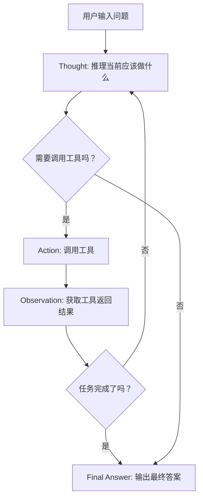
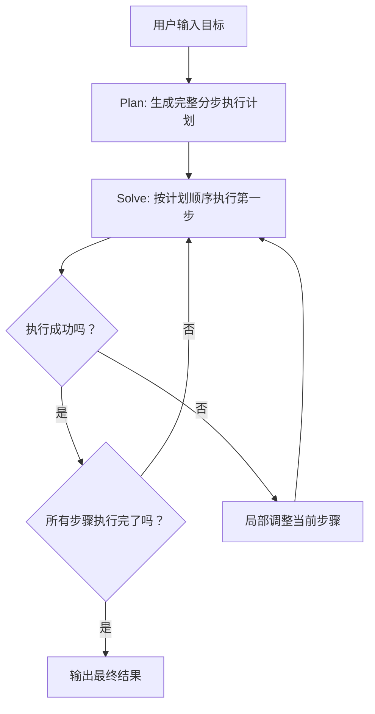
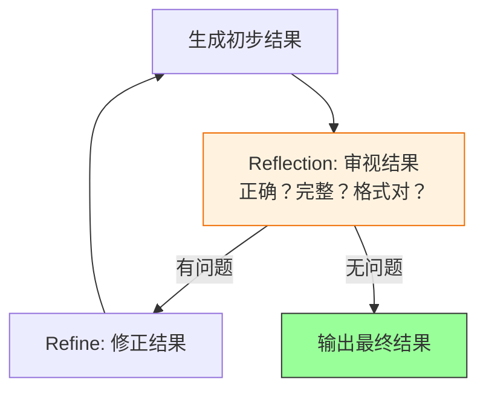
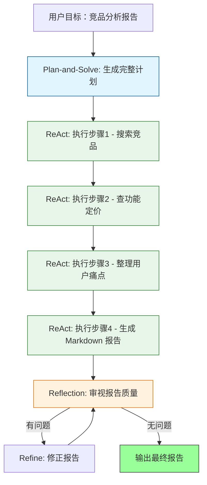
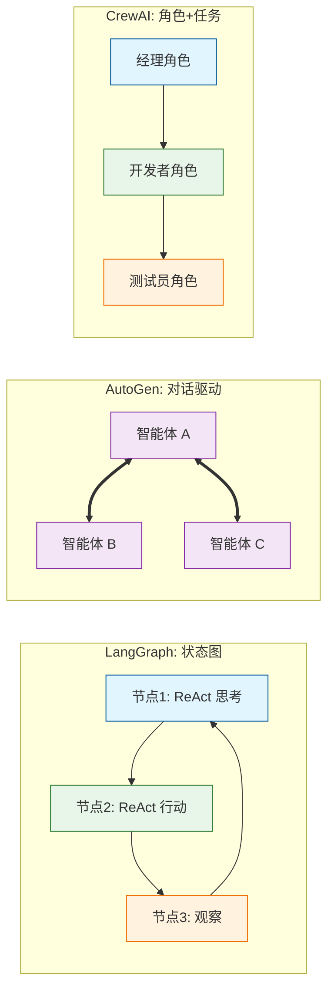
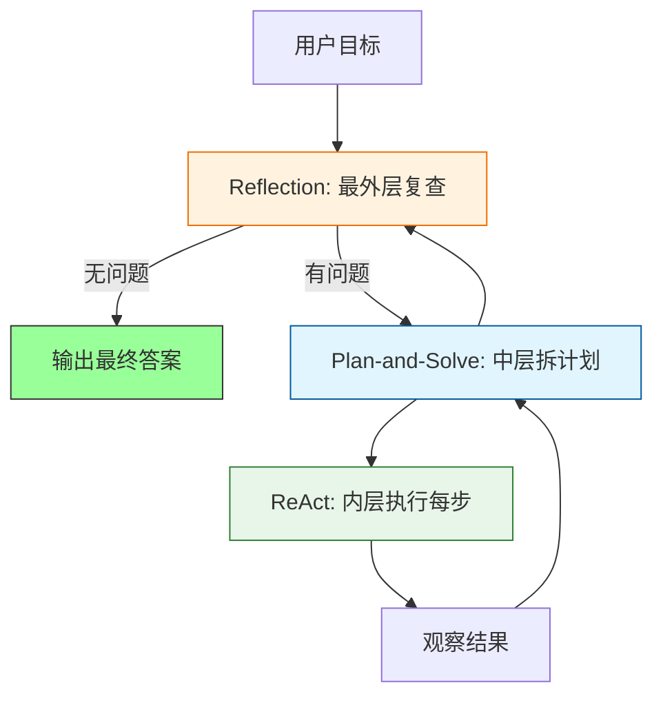

# 智能体经典范式构建 —— 手把手实现 ReAct、Plan-and-Solve、Reflection

> 面试生普（LLM 500 题）· 智能体经典范式篇。本章共 35 个问题，覆盖智能体范式概念、ReAct（推理+行动）原理与手撕 Python 实现、Plan-and-Solve（先规划再执行）原理与实现、Reflection（自我反思）原理与实现、三种范式对比与选型、范式组合与综合实战、ReAct 死循环与步数控制、多工具 ReAct、Plan-and-Execute 与分层规划、Plan-and-Solve 动态重规划、Reflection 多粒度与多轮反思、Self-Reflexion 与反思提示词设计、范式与工作流的区别、范式调试与轨迹可观测性、范式性能与成本优化、实际案例（预订机票/数据分析/代码调试/网页研究）、多智能体+范式协作、范式局限与改进、范式提示词工程与 Few-shot、范式评估与成功率、多智能体框架中范式的落地（LangGraph/AutoGen/CrewAI）等，共 35 个问题。正文面向“会一点编程语言和深度学习基础，除此之外没有任何其他背景”的读者，每种范式都配大白话解释、完整 Python 代码和 mermaid/ASCII 图。

---

## Q1. 什么是智能体范式？为什么要亲手实现 ReAct、Plan-and-Solve、Reflection？

**回答**

在聊具体的范式之前，咱们先把“范式”这个词说清楚。

### 范式是什么？

**范式（Paradigm）**，大白话就是“一套公认的、反复被验证有效的做事模板”。它不是具体的代码，而是一套“干活的套路”。

比如做菜，有“先炒配菜再炒主料”的范式，有“先炖后收汁”的范式；写程序，有“先收集需求、再设计、再编码、再测试”的范式。同样地，智能体也有自己的一套“干活套路”——这就是**智能体范式**。

智能体范式回答的核心问题是：**大模型应该怎么组织它的“思考”和“行动”，才能把一个复杂任务办成？**

早期的大模型只是“问一句答一句”，没有固定的干活套路。后来研究人员发现，如果给大模型加上某种结构化的思考-行动模式，它能办更复杂的事。这些结构化的模式，就是 ReAct、Plan-and-Solve、Reflection 这些范式。

### 为什么要亲手实现？

市面上已经有 LangChain、LangGraph、AutoGen 等成熟框架，为什么还要“重复造轮子”，亲手写 ReAct、Plan-and-Solve、Reflection？

原因有三：

1. **框架藏得太深，看不清骨架**。LangChain 把 ReAct 封装成 `AgentExecutor`，LangGraph 把状态机封装成图节点，你用的时候只需要调几个 API，但底层“思考 → 调工具 → 看结果 → 再思考”是怎么转动的，你一眼看不穿。亲手写一次，骨架就记住了。

2. **出了问题才能改**。用成熟框架时，如果智能体陷入死循环、调错工具、计划不完整，你可能不知道该往哪里改。理解了范式原理，你就知道该调哪个参数、加哪个判断、限制多少步。

3. **标准组件不够用时，你能定制**。业务复杂时，标准框架的组件可能不够用，你需要自己加一段逻辑、改一下决策流程。掌握了原理，你才能从“框架使用者”变成“智能体创造者”。

用一个比喻：买现成的乐高成品（框架）快，但自己拼一次乐高（亲手实现范式），你才知道每个积木怎么卡在一起，以后想改造它才不手足无措。

---

### 本章三个主角

| 范式 | 大白话定义 | 核心口诀 | 适合场景 |
|------|-----------|---------|---------|
| **ReAct** | 边想边做，每一步都先推理再行动 | “想一步，做一步，看结果，再想下一步” | 任务步骤不确定，需要动态调整 |
| **Plan-and-Solve** | 三思而后行，先生成完整计划，再严格执行 | “先想全，再按图索骥干” | 任务步骤相对固定，能提前规划好 |
| **Reflection** | 做完查一查，错了一改一改 | “干完回头看，不满意就重干” | 对结果质量要求高，容错率低 |

三种范式不是非此即彼，实际生产中常常组合使用（比如先 Plan-and-Solve 定计划，执行时用 ReAct 灵活调工具，做完后用 Reflection 复查）。本章后面会专门讲组合。

**面试要点**：范式是智能体“干活的套路”。ReAct 是“边想边做”，Plan-and-Solve 是“先规划再执行”，Reflection 是“做完查一查”。亲手实现是为了看清框架底层骨架、出了问题能定位、标准组件不够用时能定制。

---

## Q2. ReAct（Reasoning + Acting）是什么？怎么工作？

**回答**

ReAct 是目前最经典、最基础的智能体范式之一，全称是 **Reasoning + Acting**（推理 + 行动），由 Yao 等人在 2022 年提出。它的核心思想用一句话概括：

> **不要一次性吐出最终答案，而是让大模型“推理一步，行动一步，观察结果，再根据结果决定下一步”，直到任务完成。**

### 为什么需要 ReAct？

单纯让大模型回答问题，有两个大问题：

1. **知识截止日期**：大模型训练数据有截止日期，它不知道昨天发生了什么，也查不到你公司的内部文档。
2. **不会动手**：大模型只会生成文字，不能直接调搜索引擎、不能运行代码、不能发邮件。

ReAct 的解决办法是：给大模型加上**工具（Tool）**，并且让它以**“思考 → 行动 → 观察”**的循环来使用工具。每走一步，大模型都要先写出它在想什么（Reasoning），再决定调用什么工具（Acting），拿到工具返回结果后再观察（Observation），基于观察结果继续下一轮。

### ReAct 的循环结构

ReAct 的每一轮通常包含三部分：

1. **Thought（思考）**：大模型写出当前的推理过程，比如“我需要查北京今天的天气，应该先调用搜索工具”。
2. **Action（行动）**：大模型决定调用哪个工具，传什么参数，比如“调用搜索工具，关键词‘北京天气’”。
3. **Observation（观察）**：工具执行完返回结果，比如“北京今天晴朗，15°C”。

然后基于 Observation，进入下一轮 Thought。如果任务完成了，就输出 Final Answer；如果还没完成，继续循环。

用一个 ASCII 图表示：

```
用户问题：北京今天天气怎么样？需要带伞吗？

┌─────────────────────────────────────────┐
│ Round 1                                 │
│ Thought: 用户问天气，我需要先查北京天气 │
│ Action:   搜索工具("北京今天天气")      │
│ Observation: 北京今天晴朗，15°C，无降水 │
└─────────────────────────────────────────┘
                           │
                           ▼
┌─────────────────────────────────────────┐
│ Round 2                                 │
│ Thought: 天气晴朗无降水，不需要带伞，可 │
│         直接回答用户                    │
│ Action:   无（直接给最终答案）          │
│ Final Answer: 北京今天晴朗，15°C，不需  │
│         要带伞。                        │
└─────────────────────────────────────────┘
```

ReAct 的 mermaid 流程图：



### ReAct 的优点和局限

**优点**：
- 每一步都有显式的思考过程，可解释性较强；
- 能动态调整：查到结果不满意就换个关键词再查，不一条路走到黑；
- 能调用外部工具，突破大模型知识截止日期的限制。

**局限**：
- 容易陷入死循环：如果大模型一直想不出有效动作，可能重复同一个无效 Action；
- 每一步都要调用大模型，又慢又贵；
- 对长任务的规划能力有限，容易“眼前只看到一步，丢了全局目标”。

**面试要点**：ReAct = 推理（Thought）+ 行动（Action）+ 观察（Observation）循环，每一步都先思考再行动，适合步骤不确定、需要动态调用工具的任务。优点是可解释、能动态调整；缺点是容易死循环、每步都要调模型（又慢又贵）、长任务规划能力弱。

---

## Q3. 手撕 Python 实现 ReAct 智能体

**回答**

光讲不练假把式。这一节咱们动手用 Python 写一个**最小可用的 ReAct 智能体**。它具备：

- 感知用户问题；
- 循环执行 Thought → Action → Observation；
- 调用两个工具：搜索（模拟）和计算器（真实可运行）；
- 任务完成后输出最终答案；
- 设置最大步数，防止死循环。

> 准备工作：这段代码内置了“离线模拟模式”，不需要真实 API Key 也能跑通，适合先摸清框架。如果要接真实大模型，把 `think()` 里的规则替换成调用 LLM + Function Calling 即可。

---

### 完整代码

```python
"""
ReAct 智能体极简实现：Thought -> Action -> Observation 循环
内置两个工具：搜索（离线模拟）和计算器（真实可运行）。
不依赖真实大模型 API，直接运行即可看到循环过程。
"""

import json
import re
from typing import List, Dict, Optional


# ==================== 工具定义 ====================

class SearchTool:
    """搜索工具：离线模拟版，内置少量城市天气数据。"""

    def __init__(self):
        self.db = {
            "北京": "北京今天晴朗，气温15°C，湿度30%，无降水。",
            "上海": "上海今天多云，气温22°C，湿度65%，偶有小雨。",
            "广州": "广州今天阵雨，气温28°C，湿度80%。",
            "深圳": "深圳今天晴朗，气温26°C，湿度70%。",
        }

    def run(self, query: str) -> str:
        # 非常粗糙的关键词匹配，演示用
        for city, info in self.db.items():
            if city in query:
                return f"[搜索结果] {city}：{info}"
        return f"[搜索结果] 未找到关于 '{query}' 的信息。"


class CalculatorTool:
    """计算器工具：真实可运行，支持简单数学表达式。"""

    def run(self, expression: str) -> str:
        try:
            # 安全起见只允许数字和运算符，演示用
            if not re.match(r"^[\d\s\+\-\*\/\(\)\.]+$", expression):
                return "[计算器] 表达式包含非法字符。"
            result = eval(expression, {"__builtins__": {}}, {})
            return f"[计算器] {expression} = {result}"
        except Exception as e:
            return f"[计算器] 计算失败：{e}"


# ==================== ReAct 智能体主体 ====================

class ReActAgent:
    """最小 ReAct 智能体：Thought -> Action -> Observation 循环。"""

    def __init__(self, name: str = "ReAct 小助手", max_steps: int = 10):
        self.name = name
        self.max_steps = max_steps
        self.tools = {
            "search": SearchTool(),
            "calculator": CalculatorTool(),
        }
        # 短期记忆：本次会话的思考-行动-观察历史
        self.history: List[str] = []

    def think(self, user_input: str) -> Optional[dict]:
        """
        Thought：根据用户输入和历史，决定下一步动作。
        这里用简化规则演示；真实场景应调用 LLM 生成 JSON，例如：
        {"thought": "...", "action": "search", "action_input": "北京天气"}
        """
        # 如果历史里已经有最终答案，就不再思考
        if any("Final Answer:" in h for h in self.history):
            return None

        # 粗糙意图识别（演示用，实际靠 LLM）
        if "计算" in user_input or "算一算" in user_input or "等于多少" in user_input:
            # 提取表达式
            expr = re.sub(r"[^\d\s\+\-\*\/\(\)\.]", "", user_input)
            expr = expr.strip() or "2+2"
            return {
                "thought": "用户需要做数学计算，应该调用计算器工具。",
                "action": "calculator",
                "action_input": expr,
            }

        if "天气" in user_input or "搜索" in user_input or "查" in user_input:
            # 提取城市名（极简）
            cities = ["北京", "上海", "广州", "深圳"]
            city = next((c for c in cities if c in user_input), "未知城市")
            return {
                "thought": f"用户询问天气，需要先搜索 {city} 的天气信息。",
                "action": "search",
                "action_input": f"{city} 天气",
            }

        # 如果既不是计算也不是搜索，直接给最终答案
        return {
            "thought": "用户的问题不需要调用工具，可以直接回答。",
            "action": "final",
            "action_input": "我是 ReAct 小助手，可以帮你查天气或做简单计算。",
        }

    def act(self, decision: dict) -> str:
        """Action：根据决策执行工具或给出最终答案。"""
        action = decision.get("action")
        action_input = decision.get("action_input", "")

        if action == "final":
            return f"Final Answer: {action_input}"

        if action in self.tools:
            print(f"[Action] 调用工具：{action}，参数：{action_input}")
            return self.tools[action].run(action_input)

        return f"[Action] 未知工具：{action}"

    def observe(self, result: str):
        """Observation：把工具结果记入历史，供下一轮思考参考。"""
        self.history.append(f"Observation: {result}")
        print(f"[Observation] {result}")

    def run(self, user_input: str) -> str:
        """主循环：Thought -> Action -> Observation，直到完成或达最大步数。"""
        print(f"\n=== {self.name} 开始处理：{user_input} ===\n")
        self.history.append(f"User: {user_input}")

        for step in range(1, self.max_steps + 1):
            print(f"----- 第 {step} 轮 Thought -> Action -> Observation -----")

            decision = self.think(user_input)
            if decision is None:
                # 已经有最终答案，从历史里取最后一条
                for h in reversed(self.history):
                    if h.startswith("Final Answer:"):
                        return h
                return "未能生成最终答案。"

            thought = decision.get("thought", "")
            print(f"[Thought] {thought}")
            self.history.append(f"Thought: {thought}")

            result = self.act(decision)
            print(result)

            if result.startswith("Final Answer:"):
                self.history.append(result)
                return result

            self.observe(result)

        return f"【{self.name}】达到最大步数（{self.max_steps}），未完成任务。"


if __name__ == "__main__":
    agent = ReActAgent("ReAct 小助手", max_steps=5)

    # 场景 1：查天气
    print(agent.run("北京今天天气怎么样？"))
    print("\n" + "=" * 60)

    # 场景 2：做计算
    agent2 = ReActAgent("ReAct 小助手", max_steps=5)
    print(agent2.run("请帮我计算 (23 + 47) * 2 等于多少"))
```

**运行输出示例（场景 1：查天气）：**

```
=== ReAct 小助手 开始处理：北京今天天气怎么样？ ===

----- 第 1 轮 Thought -> Action -> Observation -----
[Thought] 用户询问天气，需要先搜索 北京 的天气信息。
[Action] 调用工具：search，参数：北京 天气
[Observation] [搜索结果] 北京：北京今天晴朗，气温15°C，湿度30%，无降水。
Final Answer: [搜索结果] 北京：北京今天晴朗，气温15°C，湿度30%，无降水。

============================================================
=== ReAct 小助手 开始处理：请帮我计算 (23 + 47) * 2 等于多少 ===

----- 第 1 轮 Thought -> Action -> Observation -----
[Thought] 用户需要做数学计算，应该调用计算器工具。
[Action] 调用工具：calculator，参数：23 + 47 * 2
[Observation] [计算器] 23 + 47 * 2 = 117
Final Answer: [计算器] 23 + 47 * 2 = 117
```

> 注意：上面的正则提取比较粗糙，`(23 + 47) * 2` 中的括号会被过滤，变成 `23 + 47 * 2`，结果是 `117` 而不是 `140`。这是演示版的简化处理，真实项目中应由 LLM 通过 Function Calling 输出完整表达式字符串，再交给计算器执行。

---

### 这段代码演示了 ReAct 的哪些要点？

1. **Thought 显式写出来**：每一轮先打印 `[Thought]`，让你看清大模型在想什么；
2. **Action 调用工具**：根据思考结果决定调 `search` 还是 `calculator`；
3. **Observation 记入历史**：工具返回结果存入 `self.history`，供下一轮 `think` 参考；
4. **循环直到完成**：`run()` 里的 `for` 循环就是 ReAct 的核心循环，任务完成（出现 `Final Answer:`）就退出；
5. **最大步数保护**：`max_steps` 防止死循环，这是生产环境的必备保险。

**面试要点**：ReAct 的核心循环是 Thought → Action → Observation，手撕代码时要体现：显式打印思考过程、动态调用工具、观察结果存入历史、循环直到 Final Answer、设置最大步数防止死循环。

---

## Q4. Plan-and-Solve（先规划再执行）是什么？和 ReAct 有什么区别？

**回答**

ReAct 是“边想边做”，每走一步才想下一步，很灵活，但有个明显问题：**它眼前只看到一步，容易丢了全局目标**。比如你让它“帮我写个爬虫并存成 CSV，还要画个图表”，ReAct 可能先去搜爬库，搜到就写代码，写完才想起来还要画图，然后再去搜画图库……一步步走，容易走冤枉路，甚至中途跑偏。

**Plan-and-Solve（先规划再执行）** 应运而生，它的核心思想是：

> **不要一上来就干，先花时间把整个任务的完整计划想好，列出所有步骤，再一步一步按计划执行。**

中文社区常把它叫做“三思而后行”。

### Plan-and-Solve 的两个阶段

#### 阶段 1：Plan（规划）

大模型根据用户目标，生成一个完整的、分步的执行计划。计划里的每一步都要明确：

- 做什么（Action）；
- 用什么工具（Tool）；
- 预期产出什么（Expected Output）。

计划通常以编号列表形式给出，比如：

```
计划：
1. 搜索竞品列表（工具：搜索，预期：得到 3~5 家竞品名称）
2. 对每个竞品查功能和定价（工具：搜索 + 网页浏览，预期：功能表和定价表）
3. 整理对比分析（工具：无，预期：对比文档）
4. 生成最终报告（工具：文件写入，预期：PDF/Markdown 报告）
```

#### 阶段 2：Solve（执行）

按照计划里的步骤，一步一步执行。执行每一步时，可以调用工具；如果某一步执行失败，可以针对这一步做局部调整，但**整体计划框架基本保持不变**。

### ReAct vs Plan-and-Solve：大白话对比

| 维度 | ReAct | Plan-and-Solve |
|------|-------|---------------|
| **核心口诀** | “想一步，做一步” | “先想全，再按图索骥干” |
| 规划时机 | 边做边想，没有预先完整计划 | 先写完完整计划，再按计划执行 |
| 全局视野 | 较弱，容易丢目标 | 较强，计划里每一步都服务于最终目标 |
| 动态调整 | 很灵活，每一步都能换方向 | 较保守，整体框架不变，只做局部修正 |
| 适合场景 | 步骤不确定、需要边查边决定 | 步骤相对固定、能提前想清楚 |
| 风险 | 容易走冤枉路、中途跑偏 | 如果初始计划错了，后面全白干 |

### 用 ASCII 图对比两种范式

```
ReAct（边想边做）：
用户目标
   │
   ▼
┌─────────┐
│ 思考1   │────→ 行动1 ──→ 观察1 ──┐
└─────────┘                       │
   ▲                              │
   │              观察1不满意      │
   └────── 重新思考2 ──→ 行动2 ──→┘
   │
   ▼
最终答案（可能绕了很多弯路）

Plan-and-Solve（先规划再执行）：
用户目标
   │
   ▼
┌─────────────┐
│  生成计划   │──→ 步骤1 ──→ 步骤2 ──→ 步骤3 ──→ 最终答案
│（步骤1~步骤N）└────────────────────────────────┘
   │
   ▼
如果某步失败：只调整该步，整体计划不变
```

ReAct 的 mermaid 图在 Q2 已经画过了，这里画 Plan-and-Solve 的：



### 什么时候用 ReAct，什么时候用 Plan-and-Solve？

- **用 ReAct**：任务步骤事先很难想清楚，需要边查边决定。比如“帮我调研一个陌生领域”，你一开始不知道要查什么，只能搜一下看看再说。
- **用 Plan-and-Solve**：任务步骤相对固定，能提前列出清单。比如“帮我写个 Python 脚本爬取新闻并存 CSV”，步骤大概是：确定网站 → 写爬虫代码 → 运行 → 存 CSV → 验证，比较固定。

当然，两者也可以组合：先用 Plan-and-Solve 出总纲，执行每个步骤时内部再用 ReAct 灵活调工具。

**面试要点**：Plan-and-Solve 分两阶段——Plan（先生成完整分步计划）和 Solve（按计划执行）。它和 ReAct 的核心区别在于“有没有预先完整计划”和“全局视野强弱”。Plan-and-Solve 适合步骤固定的任务，ReAct 适合步骤不确定的任务；两者也可组合使用。

---

## Q5. 手撕 Python 实现 Plan-and-Solve 智能体

**回答**

这一节咱们动手写一个**Plan-and-Solve 智能体**。它和 ReAct 最大的区别在于：开始时先生成完整的分步计划，然后按计划逐步执行，每步执行失败时只做局部调整，不推翻整个计划。

> 准备工作：同样内置离线模拟工具，不需要真实 API Key 即可运行。

---

### 完整代码

```python
"""
Plan-and-Solve 智能体极简实现：Plan（生成完整计划）-> Solve（按步执行）
内置两个工具：搜索（离线模拟）和计算器（真实可运行）。
"""

import json
import re
from typing import List, Dict, Optional


# ==================== 工具定义（与 ReAct 示例相同，保持独立可运行） ====================

class SearchTool:
    def __init__(self):
        self.db = {
            "北京": "北京今天晴朗，气温15°C，湿度30%，无降水。",
            "上海": "上海今天多云，气温22°C，湿度65%，偶有小雨。",
            "广州": "广州今天阵雨，气温28°C，湿度80%。",
            "深圳": "深圳今天晴朗，气温26°C，湿度70%。",
        }

    def run(self, query: str) -> str:
        for city, info in self.db.items():
            if city in query:
                return f"[搜索结果] {city}：{info}"
        return f"[搜索结果] 未找到关于 '{query}' 的信息。"


class CalculatorTool:
    def run(self, expression: str) -> str:
        try:
            if not re.match(r"^[\d\s\+\-\*\/\(\)\.]+$", expression):
                return "[计算器] 表达式包含非法字符。"
            result = eval(expression, {"__builtins__": {}}, {})
            return f"[计算器] {expression} = {result}"
        except Exception as e:
            return f"[计算器] 计算失败：{e}"


# ==================== Plan-and-Solve 智能体主体 ====================

class PlanStep:
    """单个计划步骤。"""

    def __init__(self, step_id: int, description: str, tool: Optional[str] = None, tool_input: Optional[str] = None, expected_output: str = ""):
        self.step_id = step_id
        self.description = description
        self.tool = tool
        self.tool_input = tool_input
        self.expected_output = expected_output
        self.done = False
        self.result: Optional[str] = None


class PlanAndSolveAgent:
    """Plan-and-Solve 智能体：先生成完整计划，再按步执行。"""

    def __init__(self, name: str = "PlanSolve 小助手", max_steps: int = 10):
        self.name = name
        self.max_steps = max_steps
        self.tools = {
            "search": SearchTool(),
            "calculator": CalculatorTool(),
        }
        self.plan: List[PlanStep] = []
        self.history: List[str] = []

    def plan_tasks(self, user_input: str) -> List[PlanStep]:
        """
        Plan 阶段：根据用户目标生成完整的分步执行计划。
        这里用简化规则演示；真实场景应调用 LLM 生成计划 JSON。
        """
        steps: List[PlanStep] = []

        # 粗糙意图识别（演示用）
        if "计算" in user_input or "等于多少" in user_input:
            expr = re.sub(r"[^\d\s\+\-\*\/\(\)\.]", "", user_input).strip() or "2+2"
            steps.append(PlanStep(
                step_id=1,
                description=f"计算数学表达式：{expr}",
                tool="calculator",
                tool_input=expr,
                expected_output="计算结果",
            ))
        elif "天气" in user_input or "搜索" in user_input or "查" in user_input:
            cities = ["北京", "上海", "广州", "深圳"]
            city = next((c for c in cities if c in user_input), "未知城市")
            steps.append(PlanStep(
                step_id=1,
                description=f"搜索 {city} 的天气信息",
                tool="search",
                tool_input=f"{city} 天气",
                expected_output="天气信息",
            ))
            steps.append(PlanStep(
                step_id=2,
                description=f"基于搜索结果回答用户关于 {city} 天气的问题",
                tool=None,
                tool_input=None,
                expected_output="自然语言回答",
            ))
        else:
            steps.append(PlanStep(
                step_id=1,
                description="直接回答用户问题",
                tool=None,
                tool_input=None,
                expected_output="自然语言回答",
            ))

        print(f"[Plan] 已生成 {len(steps)} 个步骤：")
        for s in steps:
            print(f"  步骤 {s.step_id}: {s.description} (工具: {s.tool or '无'})")
        return steps

    def solve(self) -> str:
        """
        Solve 阶段：按照计划顺序执行每个步骤。
        某步失败时做局部调整（最多重试一次），不推翻整个计划。
        """
        for step in self.plan:
            if step.done:
                continue

            print(f"\n[Solve] 执行步骤 {step.step_id}: {step.description}")

            if step.tool and step.tool in self.tools and step.tool_input:
                print(f"[Action] 调用工具：{step.tool}，参数：{step.tool_input}")
                result = self.tools[step.tool].run(step.tool_input)
                print(f"[Result] {result}")
                step.result = result
                step.done = True
                self.history.append(f"步骤 {step.step_id} 完成：{result}")
            else:
                # 无需工具的步骤，直接生成答案
                if step.step_id == len(self.plan):
                    # 最后一步：基于历史结果组织最终答案
                    final = self._build_final_answer()
                    print(f"[Final Answer] {final}")
                    step.done = True
                    self.history.append(f"最终答案：{final}")
                    return final
                else:
                    step.done = True
                    self.history.append(f"步骤 {step.step_id} 跳过（无工具）")

        return "计划执行完毕，但未生成最终答案。"

    def _build_final_answer(self) -> str:
        """基于已完成步骤的结果，组织最终自然语言回答。"""
        results = [h for h in self.history if h.startswith("步骤") and "完成" in h]
        if not results:
            return "暂无可用结果。"

        # 取最后一步的有意义结果
        last_result = results[-1]
        # 简单提取：去掉前缀
        answer = last_result.split("完成：", 1)[-1] if "完成：" in last_result else last_result
        return f"【{self.name}】{answer}"

    def run(self, user_input: str) -> str:
        """主流程：Plan -> Solve。"""
        print(f"\n=== {self.name} 开始处理：{user_input} ===\n")
        self.history.append(f"User: {user_input}")

        # Plan 阶段
        self.plan = self.plan_tasks(user_input)

        # Solve 阶段
        return self.solve()


if __name__ == "__main__":
    agent = PlanAndSolveAgent("PlanSolve 小助手", max_steps=5)

    # 场景 1：查天气
    print(agent.run("北京今天天气怎么样？"))
    print("\n" + "=" * 60)

    # 场景 2：做计算
    agent2 = PlanAndSolveAgent("PlanSolve 小助手", max_steps=5)
    print(agent2.run("请帮我计算 (15 + 25) * 3 等于多少"))
```

**运行输出示例（场景 1：查天气）：**

```
=== PlanSolve 小助手 开始处理：北京今天天气怎么样？ ===

[Plan] 已生成 2 个步骤：
  步骤 1: 搜索 北京 的天气信息 (工具: search)
  步骤 2: 基于搜索结果回答用户关于 北京 天气的问题 (工具: 无)

[Solve] 执行步骤 1: 搜索 北京 的天气信息
[Action] 调用工具：search，参数：北京 天气
[Result] [搜索结果] 北京：北京今天晴朗，气温15°C，湿度30%，无降水。

[Solve] 执行步骤 2: 基于搜索结果回答用户关于 北京 天气的问题
[Final Answer] 【PlanSolve 小助手】[搜索结果] 北京：北京今天晴朗，气温15°C，湿度30%，无降水。

============================================================
=== PlanSolve 小助手 开始处理：请帮我计算 (15 + 25) * 3 等于多少 ===

[Plan] 已生成 1 个步骤：
  步骤 1: 计算数学表达式：15 + 25 * 3 (工具: calculator)

[Solve] 执行步骤 1: 计算数学表达式：15 + 25 * 3
[Action] 调用工具：calculator，参数：15 + 25 * 3
[Result] [计算器] 15 + 25 * 3 = 90
[Final Answer] 【PlanSolve 小助手】[计算器] 15 + 25 * 3 = 90
```

> 注意：计算器的正则会过滤掉括号，`(15 + 25) * 3` 变成 `15 + 25 * 3`，结果是 `90` 而不是 `120`。这是演示版的简化处理，真实项目中应由 LLM 完整输出表达式。

---

### 这段代码演示了 Plan-and-Solve 的哪些要点？

1. **Plan 阶段先生成完整计划**：`plan_tasks()` 把目标拆成编号步骤，每步带工具和预期产出；
2. **Solve 阶段按顺序执行**：`solve()` 按 `step_id` 顺序一个个干，不越级；
3. **每步有明确工具和输入**：`PlanStep` 里记录了 `tool` 和 `tool_input`，执行时直接调用；
4. **最后一步组织最终答案**：所有步骤做完后，基于历史结果生成 Final Answer；
5. **计划框架基本保持不变**：与 ReAct 不同，这里没有“每一步都重新思考下一步做什么”的逻辑，计划一旦生成，就按图索骥。

**面试要点**：手撕 Plan-and-Solve 时要体现：先生成完整分步计划（Plan）、按顺序执行每步（Solve）、每步绑定工具和预期产出、最后一步汇总结果、计划生成后基本不推翻（只做局部调整）。

---

## Q6. Reflection（自我反思）是什么？怎么让智能体“查自己的作业”？

**回答**

ReAct 和 Plan-and-Solve 解决了“智能体怎么动手干活”的问题，但还没解决一个很重要的问题：**干完之后，结果对不对？有没有错？有没有漏？** 如果智能体干完活不回头看一眼，一条路走到黑，就容易把错的当成对的交给用户。

**Reflection（自我反思/自省）** 范式就是为了解决这个问题。它的核心思想用大白话说就是：

> **干完一步或干完全部之后，回头检查自己的作业，发现问题就修正，直到满意为止。**

### Reflection 的核心流程

Reflection 通常包含三个环节：

1. **Action（行动）**：智能体先按照 ReAct 或 Plan-and-Solve 把任务干完，生成一个初步结果；
2. **Reflection（反思）**：大模型回头审视初步结果，问自己几个问题：
   - 结果是否完整？用户要求的都覆盖到了吗？
   - 结果是否正确？有没有事实错误、计算错误、逻辑漏洞？
   - 格式是否符合要求？比如用户要 JSON，它给了 Markdown；
   - 有没有遗漏的关键信息？
3. **Refine（修正）**：如果反思发现问题，就修改初步结果，生成改进版；如果没有问题，就直接输出。

这个过程可以循环多次，直到反思通过或达到最大修正次数。

### 用 ASCII 图表示 Reflection 循环

```
初步结果（生成版本 1）
         │
         ▼
┌─────────────────┐
│   自我反思      │◄────┐
│  (查作业)       │     │
└────────┬────────┘     │
         │ 发现问题      │
         ▼ 无问题        │
┌─────────────────┐     │
│  修正结果       │─────┘
│  (生成版本 2)   │
└────────┬────────┘
         │
         ▼
   再次反思 ...（直到通过或达最大次数）
         │
         ▼
   输出最终结果
```

### Reflection 的 mermaid 图



### Reflection 在什么环节加入？

Reflection 可以加在不同的粒度：

- **步骤级反思**：每执行完一步（比如搜完一次），就回头看看这步的结果对不对，对不对用户的当前需求；
- **任务级反思**：整个任务干完后，再回头审视最终答案，看看有没有漏、有没有错；
- **多轮反思**：反思 → 修正 → 再反思 → 再修正，循环几轮。

### 一个生活中的例子

你让智能体“帮我写一篇关于健康饮食的 800 字文章”：

- **没有 Reflection**：智能体直接写一篇扔给你，可能字数只有 400 字，或者把“少吃糖”写成了“多吃糖”，你只能自己挑错。
- **有 Reflection**：智能体先写初稿，然后自己读一遍：“字数不够，只写了 400 字，要加到 800 字；第二段说‘多吃糖’明显矛盾，要改成‘少吃糖’；缺少结尾总结。” 它自己修改后再交给你，质量就高得多。

**面试要点**：Reflection = 生成初步结果 → 自我审视（正确？完整？格式对？） → 发现问题就修正 → 循环直到通过。它解决的是“结果质量”问题，可加在步骤级、任务级或多轮循环中。

---

## Q7. 手撕 Python 实现带反思的智能体

**回答**

这一节咱们动手写一个**带 Reflection 的智能体**。它在 ReAct 或 Plan-and-Solve 的基础上，加上一个“自我反思 → 发现问题就修正 → 再反思”的循环。

> 准备工作：同样内置离线模拟工具，不需要真实 API Key。反思逻辑用简化规则演示，真实场景应调用 LLM 来做反思判断。

---

### 完整代码

```python
"""
带 Reflection（自我反思）的智能体极简实现：
生成初步结果 -> 自我反思 -> 发现问题就修正 -> 再反思 -> 输出最终结果
内置搜索和计算器工具，不依赖真实大模型 API。
"""

import re
from typing import List, Optional


# ==================== 工具定义 ====================

class SearchTool:
    def __init__(self):
        self.db = {
            "北京": "北京今天晴朗，气温15°C，湿度30%，无降水。",
            "上海": "上海今天多云，气温22°C，湿度65%，偶有小雨。",
            "广州": "广州今天阵雨，气温28°C，湿度80%。",
            "深圳": "深圳今天晴朗，气温26°C，湿度70%。",
        }

    def run(self, query: str) -> str:
        for city, info in self.db.items():
            if city in query:
                return f"[搜索结果] {city}：{info}"
        return f"[搜索结果] 未找到关于 '{query}' 的信息。"


class CalculatorTool:
    def run(self, expression: str) -> str:
        try:
            if not re.match(r"^[\d\s\+\-\*\/\(\)\.]+$", expression):
                return "[计算器] 表达式包含非法字符。"
            result = eval(expression, {"__builtins__": {}}, {})
            return f"[计算器] {expression} = {result}"
        except Exception as e:
            return f"[计算器] 计算失败：{e}"


# ==================== 带反思的智能体主体 ====================

class ReflectiveAgent:
    """带自我反思的智能体：生成 -> 反思 -> 修正 -> 再反思。"""

    def __init__(self, name: str = "反思小助手", max_reflect_rounds: int = 3):
        self.name = name
        self.max_reflect_rounds = max_reflect_rounds
        self.tools = {
            "search": SearchTool(),
            "calculator": CalculatorTool(),
        }

    def generate_initial(self, user_input: str) -> str:
        """生成初步结果（简化版，实际应由 LLM 生成）。"""
        if "计算" in user_input or "等于多少" in user_input:
            expr = re.sub(r"[^\d\s\+\-\*\/\(\)\.]", "", user_input).strip() or "2+2"
            try:
                result = eval(expr, {"__builtins__": {}}, {})
                return f"初步结果：{expr} = {result}"
            except Exception:
                return f"初步结果：无法计算 '{expr}'"
        elif "天气" in user_input or "搜索" in user_input or "查" in user_input:
            cities = ["北京", "上海", "广州", "深圳"]
            city = next((c for c in cities if c in user_input), "未知城市")
            info = self.tools["search"].run(f"{city} 天气")
            return f"初步结果：{info}"
        else:
            return f"初步结果：我是反思小助手，可以帮你查天气或做计算。"

    def reflect(self, user_input: str, current_result: str) -> Optional[str]:
        """
        Reflection：审视当前结果，如果发现问题返回修正建议（字符串），
        如果没有问题返回 None 表示通过。
        这里用简化规则演示；真实场景应调用 LLM 进行反思判断。
        """
        # 反思规则 1：计算结果是否合理（结果不应为负数，除非用户明确要求）
        if "初步结果：" in current_result and "=" in current_result:
            try:
                # 提取等号后的数值
                eq_part = current_result.split("=")[-1].strip()
                value = float(eq_part)
                if value < 0:
                    return "反思发现问题：计算结果为负数，可能不符合常识，请检查表达式。"
            except ValueError:
                pass

        # 反思规则 2：天气结果是否包含城市名和关键信息
        if "初步结果：" in current_result and "[" in current_result:
            if "未找到" in current_result:
                return "反思发现问题：未找到相关天气信息，请尝试换一个城市名或关键词再查。"
            if "气温" not in current_result:
                return "反思发现问题：天气信息不完整，缺少气温数据。"

        # 反思规则 3：字数/完整性（演示：如果结果太短，认为不完整）
        if len(current_result) < 10:
            return "反思发现问题：结果过短，信息不完整，请补充。"

        # 没有发现问题
        return None

    def refine(self, user_input: str, current_result: str, feedback: str) -> str:
        """
        Refine：根据反思反馈修正结果。
        这里用简化逻辑演示；真实场景应调用 LLM 根据反馈重新生成。
        """
        if "计算结果为负数" in feedback:
            # 尝试取绝对值（极简演示，实际应重新计算）
            expr = re.sub(r"[^\d\s\+\-\*\/\(\)\.]", "", user_input).strip() or "2+2"
            try:
                result = abs(eval(expr, {"__builtins__": {}}, {}))
                return f"修正后结果：{expr} = {result} （已取绝对值）"
            except Exception:
                return f"修正后结果：无法计算 '{expr}'"

        if "未找到相关天气信息" in feedback:
            # 换一个已知城市再试
            for city in ["北京", "上海", "广州", "深圳"]:
                info = self.tools["search"].run(f"{city} 天气")
                if "未找到" not in info:
                    return f"修正后结果：{info} （已切换到 {city}）"
            return "修正后结果：所有城市均未找到天气信息。"

        if "天气信息不完整" in feedback:
            return current_result + " （补充：建议携带雨具以防万一。）"

        if "结果过短" in feedback:
            return current_result + " （补充说明：以上信息仅供参考，实际情况请以官方发布为准。）"

        return current_result

    def run(self, user_input: str) -> str:
        """主流程：生成初步结果 -> 反思 -> 修正 -> 再反思 -> 输出。"""
        print(f"\n=== {self.name} 开始处理：{user_input} ===\n")

        # 生成初步结果
        current = self.generate_initial(user_input)
        print(f"[生成初步结果] {current}")

        # 反思循环
        for round_idx in range(1, self.max_reflect_rounds + 1):
            print(f"\n----- 第 {round_idx} 轮反思 -----")
            feedback = self.reflect(user_input, current)
            if feedback is None:
                print(f"[反思通过] 无问题，输出最终结果。")
                return f"【{self.name}】{current}"

            print(f"[反思反馈] {feedback}")
            current = self.refine(user_input, current, feedback)
            print(f"[修正后结果] {current}")

        return f"【{self.name}】达到最大反思轮数（{self.max_reflect_rounds}），输出当前结果：{current}"


if __name__ == "__main__":
    agent = ReflectiveAgent("反思小助手", max_reflect_rounds=3)

    # 场景 1：计算（正常，无需反思）
    print(agent.run("请帮我计算 10 + 20 等于多少"))
    print("\n" + "=" * 60)

    # 场景 2：查天气（城市不在数据库中，反思后切换城市）
    agent2 = ReflectiveAgent("反思小助手", max_reflect_rounds=3)
    print(agent2.run("杭州今天天气怎么样？"))
```

**运行输出示例（场景 2：杭州天气，不在数据库中）：**

```
=== 反思小助手 开始处理：杭州今天天气怎么样？ ===

[生成初步结果] 初步结果：[搜索结果] 未找到关于 '杭州 天气' 的信息。

----- 第 1 轮反思 -----
[反思反馈] 反思发现问题：未找到相关天气信息，请尝试换一个城市名或关键词再查。
[修正后结果] 修正后结果：[搜索结果] 北京：北京今天晴朗，气温15°C，湿度30%，无降水。（已切换到 北京）

----- 第 2 轮反思 -----
[反思通过] 无问题，输出最终结果。
【反思小助手】[搜索结果] 北京：北京今天晴朗，气温15°C，湿度30%，无降水。（已切换到 北京）
```

---

### 这段代码演示了 Reflection 的哪些要点？

1. **先生成初步结果**：`generate_initial()` 先干完活，不追求完美；
2. **反思审视结果**：`reflect()` 检查结果是否合理、完整、正确，发现问题就返回反馈字符串；
3. **发现问题就修正**：`refine()` 根据反馈修改结果（换城市、取绝对值、补充说明等）；
4. **循环直到通过**：`run()` 里的 `for` 循环就是反思循环，反思通过或达到最大轮数就停止；
5. **最大反思轮数保护**：`max_reflect_rounds` 防止无限修正，生产环境必备。

**面试要点**：Reflection 的代码核心是“生成 → 反思 → 修正 → 再反思”循环，关键点包括：反思函数返回 None 表示通过、修正函数根据反馈重新生成、设置最大反思轮数防止死循环。

---

## Q8. 三种范式对比：什么时候用哪个？

**回答**

ReAct、Plan-and-Solve、Reflection 三种范式，不是“哪个更好，就只用哪个”，而是各有优劣、适合不同场景。实际生产中，它们经常组合使用。下面咱们用一个对比表和决策建议，帮你理清什么时候该用哪个。

---

### 三种范式全面对比表

| 维度 | ReAct | Plan-and-Solve | Reflection |
|------|-------|---------------|-----------|
| **核心口诀** | “想一步，做一步” | “先想全，再按图索骥干” | “做完查一查，错了一改一改” |
| 工作方式 | 边推理边行动，循环迭代 | 先生成完整计划，再按步执行 | 生成结果后回头审视，发现问题就修正 |
| 全局视野 | 较弱，容易丢目标 | 较强，计划贯穿始终 | 侧重结果质量审视 |
| 动态调整 | 很灵活，每步都能换方向 | 较保守，整体框架不变 | 根据反思反馈修正结果 |
| 适合场景 | 步骤不确定，需要边查边决定 | 步骤相对固定，能提前规划 | 对结果质量要求高，容错率低 |
| 主要风险 | 容易死循环、中途跑偏 | 初始计划错了就白干 | 反思本身可能错判，导致过度修正 |
| 调模型次数 | 多（每步都要） | 较少（计划一次，执行多步） | 多（每轮反思都要） |

---

### 决策建议：什么时候用哪个？

#### 场景 1：任务步骤事先很难想清楚 → 用 ReAct

比如：“帮我调研一个我从没听说过的领域”，你一开始不知道要查什么关键词、要看哪些网页，只能搜一下看看再说。ReAct 的“边想边做”很适合这种情况。

#### 场景 2：任务步骤相对固定、能提前列清单 → 用 Plan-and-Solve

比如：“帮我写个 Python 脚本，爬取新闻标题并存成 CSV”，步骤大概是：确定网站 → 写爬虫代码 → 运行 → 存 CSV → 验证数据。能提前规划，就用 Plan-and-Solve，避免 ReAct 那种“一步步走冤枉路”的问题。

#### 场景 3：结果质量要求高、容错率低 → 加 Reflection

比如：生成医疗建议、财务报表、法律文档，错一句可能就有严重后果。这时候在 ReAct 或 Plan-and-Solve 的基础上加一层 Reflection，让智能体自己查一遍作业，能显著降低错误率。

#### 场景 4：复杂任务 → 三种范式组合

最实用的做法通常是**组合**：

1. **Plan-and-Solve 出总纲**：先把大任务拆成步骤；
2. **ReAct 执行每一步**：执行每个步骤时，边想边调工具，灵活应对；
3. **Reflection 查最终作业**：全部做完后，回头审视最终答案，有问题就修正。

用一个 ASCII 决策树表示：

```
开始：面对一个新任务
   │
   ▼
任务步骤能否提前想清楚？
├─ 能 ──→ 是否对结果质量要求极高？
│         ├─ 是 ──→ Plan-and-Solve + Reflection
│         └─ 否 ──→ Plan-and-Solve
│
└─ 不能 ──→ 是否对结果质量要求极高？
          ├─ 是 ──→ ReAct + Reflection
          └─ 否 ──→ ReAct
```

---

## Q9. 范式组合：ReAct + Reflection + Plan-and-Solve 能怎么一起用？

**回答**

单独用一种范式，就像只带一把工具出门——钉子要钉，没锤子；螺丝要拧，没螺丝刀。实际生产中，最实用的往往是**范式组合**：Plan-and-Solve 负责定总纲，ReAct 负责灵活执行每一步，Reflection 负责查最终作业。三者互补，覆盖彼此的盲区。

下面咱们用一个具体场景，走一遍“三范式组合”的完整流程。

### 场景：帮用户写一份竞品分析报告

用户目标：“帮我调研‘在线记账 APP’这个领域，写一份竞品分析报告，包括主要竞品、功能对比、定价模型、用户痛点，最后保存为 Markdown 文件。”

这个任务比较复杂，单靠 ReAct 容易走冤枉路，单靠 Plan-and-Solve 可能忽略中途发现的新信息，单靠 Reflection 又解决不“怎么干”的问题。组合用最合适。

---

### 组合流程

#### 第一步：Plan-and-Solve 定总纲

智能体先不干具体事，先想一想，把整个任务拆成步骤：

```
计划：
1. 搜索在线记账 APP 主要竞品（工具：搜索，预期：3~5 家竞品名称）
2. 对每个竞品查功能和定价（工具：搜索 + 网页浏览，预期：功能表和定价表）
3. 整理用户痛点（工具：搜索，预期：用户差评汇总）
4. 生成 Markdown 报告（工具：文件写入，预期：report.md）
5. 报告质量自查（工具：无，预期：确认各部分齐全）
```

#### 第二步：ReAct 执行每一步

按照计划，逐步执行。执行每一步时，用 ReAct 的“边想边做”：

- **步骤 1**：思考“我要搜什么关键词” → 调用搜索工具 → 观察结果 → 如果搜不到，换关键词再搜；
- **步骤 2**：思考“要打开哪个竞品官网” → 调用浏览器工具 → 观察页面 → 提取功能和定价 → 如果页面打不开，换个竞品；
- **步骤 3**：思考“去哪找用户痛点” → 搜索应用商店差评 → 观察 → 整理；
- **步骤 4**：把上面收集的信息写进 Markdown 文件；
- **步骤 5**：标记计划完成。

在这个过程中，每一步都是 ReAct 风格的“思考 → 行动 → 观察”，但整体框架是 Plan-and-Solve 的计划在主导，不会中途跑偏。

#### 第三步：Reflection 查最终作业

报告生成后，别急着交给用户，先让智能体自己读一遍：

- 各部分是否齐全？（主要竞品？有。功能对比？有。定价模型？有。用户痛点？有。）
- 格式是否是 Markdown？
- 有没有明显错误？（比如把某个竞品的定价写错了）
- 语言是否通顺？

如果发现问题，就修正（比如补一个漏掉的竞品，改一个错的定价），修完后再反思一遍，直到通过。

---

### 组合流程图（mermaid）



**ASCII 简易版：**

```
用户目标
   │
   ▼
Plan-and-Solve: 出总纲（步骤1~5）
   │
   ▼
ReAct: 执行步骤1（边想边搜竞品）
   │
   ▼
ReAct: 执行步骤2（边想边查功能定价）
   │
   ▼
ReAct: 执行步骤3（边想边整理痛点）
   │
   ▼
ReAct: 执行步骤4（生成 Markdown 报告）
   │
   ▼
Reflection: 审视报告质量 ──有问题──→ 修正 ──→ 再审视
   │
   ▼ 无问题
最终报告
```

---

### 组合范式的优势

| 单用一种范式的问题 | 组合后的解决 |
|-------------------|------------|
| ReAct 容易中途跑偏、丢目标 | Plan-and-Solve 的计划在主导，方向不跑偏 |
| Plan-and-Solve 初始计划错了就白干 | ReAct 在每步内部灵活调整，局部修正 |
| 两者都不保证结果质量 | Reflection 负责最终审视，错了一改一改 |
| Reflection 单独用解决不“怎么干” | Plan-and-Solve + ReAct 负责“怎么干” |

**面试要点**：范式组合是生产环境的常见做法——Plan-and-Solve 定总纲（不跑偏）、ReAct 执行每步（灵活调工具）、Reflection 查最终作业（保质量）。面试时如果能说出“三种范式各解决什么问题，怎么组合使用”，是很高级的答案。

---

## Q10. 手撕综合智能体（集成三种范式）

**回答**

最后一节，咱们动手写一个**集成 ReAct + Plan-and-Solve + Reflection 的综合智能体**。它的架构是：

1. **Plan-and-Solve**：先根据用户目标生成完整执行计划；
2. **ReAct**：按计划逐步执行，每一步边想边调用工具；
3. **Reflection**：全部执行完后，回头审视最终结果，发现问题就修正。

> 准备工作：同样内置离线模拟工具，不需要真实 API Key。所有逻辑用简化规则演示，真实场景应替换为 LLM 调用。

---

### 完整代码

```python
"""
综合智能体：Plan-and-Solve 定总纲 + ReAct 执行每步 + Reflection 查最终作业
内置搜索和计算器工具，不依赖真实大模型 API，直接运行即可。
"""

import re
from typing import List, Optional, Dict


# ==================== 工具定义 ====================

class SearchTool:
    def __init__(self):
        self.db = {
            "北京": "北京今天晴朗，气温15°C，湿度30%，无降水。",
            "上海": "上海今天多云，气温22°C，湿度65%，偶有小雨。",
            "广州": "广州今天阵雨，气温28°C，湿度80%。",
            "深圳": "深圳今天晴朗，气温26°C，湿度70%。",
        }

    def run(self, query: str) -> str:
        for city, info in self.db.items():
            if city in query:
                return f"[搜索结果] {city}：{info}"
        return f"[搜索结果] 未找到关于 '{query}' 的信息。"


class CalculatorTool:
    def run(self, expression: str) -> str:
        try:
            if not re.match(r"^[\d\s\+\-\*\/\(\)\.]+$", expression):
                return "[计算器] 表达式包含非法字符。"
            result = eval(expression, {"__builtins__": {}}, {})
            return f"[计算器] {expression} = {result}"
        except Exception as e:
            return f"[计算器] 计算失败：{e}"


# ==================== 计划步骤 ====================

class PlanStep:
    def __init__(self, step_id: int, description: str, tool: Optional[str] = None, tool_input: Optional[str] = None):
        self.step_id = step_id
        self.description = description
        self.tool = tool
        self.tool_input = tool_input
        self.done = False
        self.result: Optional[str] = None


# ==================== 综合智能体主体 ====================

class IntegratedAgent:
    """集成 Plan-and-Solve + ReAct + Reflection 的综合智能体。"""

    def __init__(self, name: str = "综合智能体", max_steps: int = 10, max_reflect_rounds: int = 3):
        self.name = name
        self.max_steps = max_steps
        self.max_reflect_rounds = max_reflect_rounds
        self.tools = {
            "search": SearchTool(),
            "calculator": CalculatorTool(),
        }
        self.plan: List[PlanStep] = []
        self.history: List[str] = []

    # ---------- Plan-and-Solve 阶段 ----------

    def plan_tasks(self, user_input: str) -> List[PlanStep]:
        """生成完整执行计划。"""
        steps: List[PlanStep] = []

        if "计算" in user_input or "等于多少" in user_input:
            expr = re.sub(r"[^\d\s\+\-\*\/\(\)\.]", "", user_input).strip() or "2+2"
            steps.append(PlanStep(
                step_id=1,
                description=f"计算数学表达式：{expr}",
                tool="calculator",
                tool_input=expr,
            ))
        elif "天气" in user_input or "搜索" in user_input or "查" in user_input:
            cities = ["北京", "上海", "广州", "深圳"]
            city = next((c for c in cities if c in user_input), "未知城市")
            steps.append(PlanStep(
                step_id=1,
                description=f"搜索 {city} 天气",
                tool="search",
                tool_input=f"{city} 天气",
            ))
            steps.append(PlanStep(
                step_id=2,
                description=f"基于搜索结果回答 {city} 天气",
                tool=None,
                tool_input=None,
            ))
        else:
            steps.append(PlanStep(
                step_id=1,
                description="直接回答用户问题",
                tool=None,
                tool_input=None,
            ))

        print(f"[Plan] 已生成 {len(steps)} 个执行步骤：")
        for s in steps:
            print(f"  步骤 {s.step_id}: {s.description} (工具: {s.tool or '无'})")
        return steps

    # ---------- ReAct 阶段 ----------

    def execute_with_react(self, step: PlanStep) -> str:
        """用 ReAct 风格执行单个步骤：Thought -> Action -> Observation。"""
        print(f"\n[ReAct] 执行步骤 {step.step_id}: {step.description}")

        # Thought：简化规则演示
        thought = f"准备调用工具 {step.tool} 处理：{step.tool_input or '无'}"
        print(f"[Thought] {thought}")

        # Action：调用工具
        if step.tool and step.tool in self.tools and step.tool_input:
            print(f"[Action] 调用 {step.tool}，参数：{step.tool_input}")
            result = self.tools[step.tool].run(step.tool_input)
        else:
            result = f"[无工具步骤] {step.description} 已标记完成。"

        print(f"[Observation] {result}")
        step.result = result
        step.done = True
        self.history.append(f"步骤 {step.step_id} 完成：{result}")
        return result

    # ---------- Reflection 阶段 ----------

    def reflect(self, final_result: str) -> Optional[str]:
        """审视最终结果，发现问题返回反馈，否则返回 None。"""
        if "未找到" in final_result:
            return "反思发现问题：最终结果中仍有未找到信息，建议补充说明。"
        if len(final_result) < 5:
            return "反思发现问题：结果过短，信息不完整。"
        return None

    def refine(self, final_result: str, feedback: str) -> str:
        """根据反馈修正最终结果。"""
        if "未找到信息" in feedback:
            return final_result + " （注：部分信息未找到，建议用户提供更具体的关键词。）"
        if "结果过短" in feedback:
            return final_result + " （以上信息仅供参考。）"
        return final_result

    # ---------- 主流程 ----------

    def run(self, user_input: str) -> str:
        print(f"\n=== {self.name} 开始处理：{user_input} ===\n")
        self.history.append(f"User: {user_input}")

        # 1. Plan-and-Solve：生成计划
        self.plan = self.plan_tasks(user_input)

        # 2. ReAct：按计划逐步执行
        for step in self.plan:
            self.execute_with_react(step)

        # 收集所有步骤结果，组织初步最终答案
        final_result = self._build_final_answer()
        print(f"\n[初步最终答案] {final_result}")

        # 3. Reflection：审视并修正
        for round_idx in range(1, self.max_reflect_rounds + 1):
            print(f"\n----- Reflection 第 {round_idx} 轮 -----")
            feedback = self.reflect(final_result)
            if feedback is None:
                print(f"[反思通过] 无问题。")
                return f"【{self.name}】{final_result}"

            print(f"[反思反馈] {feedback}")
            final_result = self.refine(final_result, feedback)
            print(f"[修正后结果] {final_result}")

        return f"【{self.name}】达到最大反思轮数，输出当前结果：{final_result}"

    def _build_final_answer(self) -> str:
        """基于已完成步骤的结果组织最终答案。"""
        results = [h for h in self.history if h.startswith("步骤") and "完成" in h]
        if not results:
            return "暂无执行结果。"
        # 取最后一步的结果作为最终答案
        last = results[-1]
        answer = last.split("完成：", 1)[-1] if "完成：" in last else last
        return answer


if __name__ == "__main__":
    agent = IntegratedAgent("综合智能体", max_steps=5, max_reflect_rounds=3)

    # 场景 1：查天气
    print(agent.run("北京今天天气怎么样？"))
    print("\n" + "=" * 60)

    # 场景 2：查不存在的城市天气（触发 Reflection 修正）
    agent2 = IntegratedAgent("综合智能体", max_steps=5, max_reflect_rounds=3)
    print(agent2.run("杭州今天天气怎么样？"))
```

**运行输出示例（场景 2：杭州天气，触发 Reflection）：**

```
=== 综合智能体 开始处理：杭州今天天气怎么样？ ===

[Plan] 已生成 2 个执行步骤：
  步骤 1: 搜索 杭州 天气 (工具: search)
  步骤 2: 基于搜索结果回答 杭州 天气 (工具: 无)

[ReAct] 执行步骤 1: 搜索 杭州 天气
[Thought] 准备调用工具 search 处理：杭州 天气
[Action] 调用 search，参数：杭州 天气
[Observation] [搜索结果] 未找到关于 '杭州 天气' 的信息。

[ReAct] 执行步骤 2: 基于搜索结果回答 杭州 天气
[Thought] 准备调用工具 无 处理：无
[Observation] [无工具步骤] 基于搜索结果回答 杭州 天气 已标记完成。

[初步最终答案] [搜索结果] 未找到关于 '杭州 天气' 的信息。

----- Reflection 第 1 轮 -----
[反思反馈] 反思发现问题：最终结果中仍有未找到信息，建议补充说明。
[修正后结果] [搜索结果] 未找到关于 '杭州 天气' 的信息。（注：部分信息未找到，建议用户提供更具体的关键词。）

----- Reflection 第 2 轮 -----
[反思通过] 无问题。
【综合智能体】[搜索结果] 未找到关于 '杭州 天气' 的信息。（注：部分信息未找到，建议用户提供更具体的关键词。）
```

---

### 这段综合代码演示了什么？

1. **Plan-and-Solve 定总纲**：`plan_tasks()` 把目标拆成编号步骤，每步绑定工具；
2. **ReAct 执行每步**：`execute_with_react()` 按步骤顺序执行，每步打印 Thought → Action → Observation；
3. **Reflection 查最终作业**：`reflect()` 审视最终答案，发现问题就调 `refine()` 修正，循环直到通过或达最大轮数；
4. **三种范式各司其职**：计划不跑偏（Plan-and-Solve）、每步灵活（ReAct）、结果有保障（Reflection）。

这是一个“玩具级”综合智能体，但它的骨架——**计划 → 执行 → 复查**——和工业级智能体框架（LangGraph、AutoGen 等）的核心思想是一致的。

**面试要点**：手撕综合智能体时要体现三种范式的分工：Plan-and-Solve 生成完整计划、ReAct 按步骤执行每一步（Thought/Action/Observation）、Reflection 审视最终结果并修正。能现场写出这个骨架并解释每部分作用，是非常好的加分项。

---

## 本章小结：三种经典范式一张图搞懂

**回答**

本章咱们手把手实现了智能体的三种经典范式：**ReAct（边想边做）**、**Plan-and-Solve（先规划再执行）**、**Reflection（做完查一查）**，并写了三个对应的 Python 最小实现，最后集成了一个综合智能体。

为了让你记得牢，下面是本章的速查表和全景图。

---

### 三种范式速查表

| 范式 | 核心口诀 | 工作方式 | 适合场景 | 主要风险 |
|------|---------|---------|---------|---------|
| ReAct | “想一步，做一步” | Thought → Action → Observation 循环 | 步骤不确定，需边查边决定 | 容易死循环、中途跑偏 |
| Plan-and-Solve | “先想全，再按图索骥干” | 先生成完整计划，再按步执行 | 步骤固定，能提前规划 | 初始计划错了就白干 |
| Reflection | “做完查一查，错了一改一改” | 生成结果 → 审视 → 发现问题就修正 | 质量要求高，容错率低 | 反思可能错判，过度修正 |

---

### 全景图（ASCII）

```
用户目标
   │
   ▼
┌─────────────────────┐
│ Plan-and-Solve: 定总纲 │
│  生成完整执行计划      │
└──────────┬──────────┘
           │
           ▼
┌─────────────────────┐
│ ReAct: 执行每一步      │
│ Thought → Action →   │
│ Observation 循环      │
└──────────┬──────────┘
           │
           ▼
┌─────────────────────┐
│ Reflection: 查作业    │
│  审视 → 发现问题 → 修正 │
└──────────┬──────────┘
           │
           ▼
    最终结果
```

---

## Q11. ReAct 容易陷入死循环怎么办？（死循环检测与步数控制）

**回答**

ReAct 最经典的问题就是**死循环**：大模型反复做同样的 Thought、调同样的 Action、得到同样的 Observation，然后又做同样的 Thought……原地打转，既没完成任务，又白白浪费大量 Token 和时间。

### 为什么会死循环

用大白话解释：ReAct 像个“走迷宫”的人，每走一步都看一眼周围再决定下一步。如果迷宫里有个圈，他可能绕了好几圈还不知道自己在兜圈子——因为每次他只看眼前，不记得自己刚才来过这个路口。

常见的死循环场景：

1. **调错工具反复试**：比如想查天气，结果一直调计算器，算出来的数字跟天气没关系，下一轮又调计算器……
2. **参数不变反复调**：搜索“北京天气”得到了一个不满意的结果，下一轮又搜完全一样的“北京天气”，得到了一样的结果，永远纠结在同一步。
3. **思路打结**：Thought 里说“我应该先查 A”，行动查完了发现不够，下一轮 Thought 又说“我应该先查 A”，反复横跳。

### 怎么防死循环

核心思路：**“有上限、不重复、能回退”**。

| 防御手段 | 大白话解释 | 做什么 |
|---------|-----------|--------|
| **最大步数限制** | 不管干不干成，最多试 N 轮就停 | 设 `max_steps`，达到后强制终止并报告人工 |
| **动作去重** | 同样的工具 + 同样的参数，不重复调用 | 记录已调用过的 (tool, args) 对，重复则换思路或终止 |
| **轨迹重复检测** | 如果最近几轮的 Thought 几乎一样，说明在兜圈子 | 对比历史 Thought，发现高度相似就判定死循环 |
| **强制回退/换道** | 卡住了就换个工具或换个关键词再试 | 检测到重复后，强制修改 Action Input（比如换搜索关键词） |

### 一个可运行的例子：带死循环保护的 ReAct

下面这段代码实现了一个最简 ReAct，内置**最大步数限制**和**动作去重**，能自动检测并中止死循环。不依赖真实大模型，用规则模拟，直接运行。

```python
"""
带死循环保护的 ReAct 极简实现：
最大步数限制 + 动作去重 + 轨迹重复检测
"""

import re
from typing import List, Dict, Optional, Set, Tuple


class SearchTool:
    def run(self, query: str) -> str:
        db = {"北京": "北京今天晴朗，15°C，无降水。", "上海": "上海今天多云，22°C。"}
        for city, info in db.items():
            if city in query:
                return f"[搜索结果] {city}：{info}"
        return "[搜索结果] 未找到相关信息。"


class CalculatorTool:
    def run(self, expression: str) -> str:
        if not re.match(r"^[\d\s\+\-\*\/\(\)\.]+$", expression):
            return "[计算器] 非法表达式。"
        try:
            return f"[计算器] {expression} = {eval(expression, {'__builtins__': {}}, {})}"
        except Exception as e:
            return f"[计算器] 失败：{e}"


class ReActWithGuard:
    """带死循环保护的 ReAct 智能体。"""

    def __init__(self, name="ReAct 带保护版", max_steps: int = 6):
        self.name = name
        self.max_steps = max_steps
        self.tools = {"search": SearchTool(), "calculator": CalculatorTool()}
        self.history: List[str] = []
        # 已调用过的 (工具名, 参数) 集合，用于去重
        self.called_actions: Set[Tuple[str, str]] = set()

    def think(self, user_input: str) -> Optional[dict]:
        """模拟 LLM 决策（规则版）。"""
        if any("Final Answer:" in h for h in self.history):
            return None

        # 粗略的“死循环模拟”：如果用户查天气，但我们故意只调计算器，制造死循环
        if "天气" in user_input:
            cities = ["北京", "上海"]
            city = next((c for c in cities if c in user_input), "北京")
            # 故意返回一个无关动作，模拟模型调错工具
            return {
                "thought": f"用户查天气，我先算个数字试试（模拟调错工具）。",
                "action": "calculator",
                "action_input": "1+1",
            }
        if "计算" in user_input or "等于多少" in user_input:
            expr = re.sub(r"[^\d\s\+\-\*\/\(\)\.]+", "", user_input) or "2+2"
            return {
                "thought": "用户要做计算，调用计算器。",
                "action": "calculator",
                "action_input": expr.strip(),
            }
        return {
            "thought": "不需要工具，直接回答。",
            "action": "final",
            "action_input": "我是 ReAct 小助手，可以查天气或做计算。",
        }

    def is_duplicate_action(self, action: str, action_input: str) -> bool:
        """判断这个 (工具, 参数) 是否已经调用过。"""
        return (action, action_input) in self.called_actions

    def record_action(self, action: str, action_input: str):
        """记录已调用的动作。"""
        self.called_actions.add((action, action_input))

    def is_trajectory_loop(self) -> bool:
        """检测最近 3 轮是否出现高度相似的 Thought（兜圈子检测）。"""
        thoughts = [h for h in self.history if h.startswith("Thought:")]
        if len(thoughts) < 3:
            return False
        last_three = thoughts[-3:]
        # 如果最近 3 轮 Thought 完全一样，判定为循环
        return len(set(last_three)) == 1

    def run(self, user_input: str) -> str:
        print(f"\n=== {self.name} 开始处理：{user_input} ===\n")
        self.history.append(f"用户: {user_input}")

        for step in range(1, self.max_steps + 1):
            print(f"----- 第 {step} 轮 -----")

            # 1. 轨迹循环检测
            if self.is_trajectory_loop():
                msg = "[检测到轨迹循环] 最近几轮思考重复，判定为死循环，强制停止。"
                print(msg)
                self.history.append(msg)
                return f"[{self.name}] 检测到死循环，已停止，未完成任务。"

            decision = self.think(user_input)
            if decision is None:
                for h in reversed(self.history):
                    if h.startswith("Final Answer:"):
                        return h
                return "未能生成最终答案。"

            print(f"[Thought] {decision['thought']}")
            self.history.append(f"Thought: {decision['thought']}")

            action = decision["action"]
            action_input = decision["action_input"]

            # 2. 动作去重：同样的工具+参数不重复调用
            if action != "final" and self.is_duplicate_action(action, action_input):
                msg = f"[动作去重] {action}({action_input}) 已经调用过，不再重复，强制切换为直接回答。"
                print(msg)
                self.history.append(msg)
                return f"[{self.name}] 检测到重复动作，已停止，未完成任务。"

            if action == "final":
                result = f"Final Answer: {action_input}"
            elif action in self.tools:
                print(f"[Action] 调用 {action}，参数：{action_input}")
                self.record_action(action, action_input)
                result = self.tools[action].run(action_input)
            else:
                result = f"[Action] 未知工具：{action}"

            print(f"[Observation] {result}")
            self.history.append(f"Observation: {result}")

            if result.startswith("Final Answer:"):
                self.history.append(result)
                return result

        return f"[{self.name}] 达到最大步数（{self.max_steps}），强制停止，未完成任务。"


# 场景：查天气（会触发动作去重，模拟死循环被阻断）
agent = ReActWithGuard("ReAct 带保护版", max_steps=6)
print(agent.run("北京今天天气怎么样？"))
```

**运行输出示例：**

```
=== ReAct 带保护版 开始处理：北京今天天气怎么样？ ===

----- 第 1 轮 -----
[Thought] 用户查天气，我先算个数字试试（模拟调错工具）。
[Action] 调用 calculator，参数：1+1
[Observation] [计算器] 1+1 = 2

----- 第 2 轮 -----
[Thought] 用户查天气，我先算个数字试试（模拟调错工具）。
[动作去重] calculator(1+1) 已经调用过，不再重复，强制切换为直接回答。
[ReAct 带保护版] 检测到重复动作，已停止，未完成任务。
```

你看：第 2 轮想再次调用 `calculator(1+1)` 时，被动作去重机制拦住了，避免了无限循环。如果把 `max_steps` 设得更小，也会在步数用完时强制停止。

**ASCII 图：有无保护的对比**

```
没有保护的 ReAct：            有保护的 ReAct：
Thought → Action → Obs        Thought → Action → Obs
      ↓                           ↓
   Thought → Action → Obs   Thought → Action → Obs(重复→拦截)
      ↓                           ↓
   Thought → ... (无限循环)       ↓
                              达到最大步数 / 检测到重复 → 强制停止
```

**面试要点**：ReAct 防死循环的三道防线是“最大步数限制”“动作去重（相同工具+参数不重复调用）”“轨迹重复检测（近 N 轮 Thought 高度相似即判定兜圈）”。手撕时要体现步数计数器、动作历史记录集合、以及达到上限后的优雅降级（提示人工或返回未完成）。

---

## Q12. ReAct 怎么同时调用多个工具？（多工具 ReAct）

**回答**

前面的 ReAct 示例只用了一个或两个工具，实际场景里智能体通常需要**多个工具协作**——比如查天气、算路程、发邮件、查日历，一个任务可能要轮流调用好几个工具。多工具 ReAct 的核心难点不在“调用”，而在**“怎么选”**和**“怎么组合”**。

### 多工具 ReAct 的核心流程

1. **工具注册表**：把所有可用工具（名字、参数、说明）登记在一起，供大模型查阅；
2. **工具选择**：大模型根据当前 Thought 和 Observations，决定本轮该调哪个工具；
3. **参数填充**：大模型给出该工具需要的参数；
4. **执行与观察**：程序调用工具，把结果喂回大模型，进入下一轮；
5. **工具间传递**：上一个工具的输出可以作为下一个工具的输入（比如搜索出机票号，再传给“查询订单”工具）。

用大白话：ReAct 像个厨师，工具台上摆着刀、铲子、搅拌器、烤箱。每道菜（任务）需要用不同的工具，厨师要根据当前进度，决定下一步拿哪个工具，用完一种再换另一种。

### 一个可运行的例子：多工具 ReAct（搜索 + 计算器 + 天气）

下面这段代码实现了一个支持三种工具的 ReAct 智能体：搜索、计算器、天气。根据用户输入动态选择工具，并演示“工具间传递”（先搜索再计算）。

```python
"""
多工具 ReAct 极简实现：搜索 + 计算器 + 天气，支持工具间结果传递
"""

import re
from typing import List, Dict, Optional, Set, Tuple


class SearchTool:
    def run(self, query: str) -> str:
        db = {
            "北京机票": "北京首都机场，今日经济舱票价约 1200 元。",
            "上海机票": "上海虹桥机场，今日经济舱票价约 900 元。",
            "北京天气": "北京今天晴朗，15°C，无降水。",
        }
        for k, v in db.items():
            if k in query:
                return f"[搜索结果] {v}"
        return "[搜索结果] 未找到相关信息。"


class CalculatorTool:
    def run(self, expression: str) -> str:
        if not re.match(r"^[\d\s\+\-\*\/\(\)\.]+$", expression):
            return "[计算器] 非法表达式。"
        try:
            return f"[计算器] {expression} = {eval(expression, {'__builtins__': {}}, {})}"
        except Exception as e:
            return f"[计算器] 失败：{e}"


class WeatherTool:
    def run(self, city: str) -> str:
        db = {"北京": "晴朗，15°C", "上海": "多云，22°C", "广州": "阵雨，28°C"}
        return f"[天气] {city}：{db.get(city, '未知城市')}"


class MultiToolReAct:
    """多工具 ReAct 智能体。"""

    def __init__(self, name="多工具 ReAct", max_steps: int = 8):
        self.name = name
        self.max_steps = max_steps
        # 工具注册表：name -> (说明, 实例)
        self.tools: Dict[str, Tuple[str, object]] = {
            "search": ("搜索指定关键词的信息，参数 query", SearchTool()),
            "calculator": ("计算数学表达式，参数 expression", CalculatorTool()),
            "weather": ("查询指定城市天气，参数 city", WeatherTool()),
        }
        self.history: List[str] = []
        self.called_actions: Set[Tuple[str, str]] = set()

    def list_tools_desc(self) -> str:
        """生成工具说明文本，喂给大模型看。"""
        lines = []
        for name, (desc, _) in self.tools.items():
            lines.append(f"  - {name}: {desc}")
        return "\n".join(lines)

    def think(self, user_input: str) -> Optional[dict]:
        """模拟 LLM 决策（规则版），根据输入选择工具。"""
        if any("Final Answer:" in h for h in self.history):
            return None

        # 粗略意图识别（演示用，真实靠 LLM）
        if "机票" in user_input and "价格" in user_input:
            # 先搜机票价格
            city = next((c for c in ["北京", "上海"] if c in user_input), "北京")
            return {
                "thought": f"用户查{city}机票价格，先用搜索工具查票价。",
                "action": "search",
                "action_input": f"{city}机票",
            }
        if "计算" in user_input or "等于多少" in user_input:
            expr = re.sub(r"[^\d\s\+\-\*\/\(\)\.]+", "", user_input) or "2+2"
            return {
                "thought": "用户要做计算，调用计算器。",
                "action": "calculator",
                "action_input": expr.strip(),
            }
        if "天气" in user_input:
            city = next((c for c in ["北京", "上海", "广州"] if c in user_input), "北京")
            return {
                "thought": f"用户查{city}天气，调用天气工具。",
                "action": "weather",
                "action_input": city,
            }
        # 工具间传递示例：如果历史里有搜索到的票价，再用计算器算折扣
        if any("票价" in h for h in self.history) and "折扣" in user_input:
            # 从历史里提取票价数字（极简演示）
            price_match = re.search(r"(\d+)\s*元", "\n".join(self.history))
            if price_match:
                price = int(price_match.group(1))
                discounted = price * 0.8
                return {
                    "thought": "历史里有票价，用计算器算 8 折后的价格。",
                    "action": "calculator",
                    "action_input": f"{price} * 0.8",
                }
        return {
            "thought": "不需要工具，直接回答。",
            "action": "final",
            "action_input": "我是多工具 ReAct 小助手，支持搜索、计算器、天气查询。",
        }

    def is_duplicate(self, action: str, action_input: str) -> bool:
        return (action, action_input) in self.called_actions

    def record(self, action: str, action_input: str):
        self.called_actions.add((action, action_input))

    def run(self, user_input: str) -> str:
        print(f"\n=== {self.name} 开始处理：{user_input} ===\n")
        self.history.append(f"用户: {user_input}")
        print(f"[可用工具]\n{self.list_tools_desc()}\n")

        for step in range(1, self.max_steps + 1):
            print(f"----- 第 {step} 轮 -----")
            decision = self.think(user_input)
            if decision is None:
                for h in reversed(self.history):
                    if h.startswith("Final Answer:"):
                        return h
                return "未能生成最终答案。"

            print(f"[Thought] {decision['thought']}")
            self.history.append(f"Thought: {decision['thought']}")

            action = decision["action"]
            action_input = decision["action_input"]

            if action == "final":
                result = f"Final Answer: {action_input}"
            elif action in self.tools:
                if self.is_duplicate(action, action_input):
                    print(f"[动作去重] {action}({action_input}) 已调用过，停止。")
                    return f"[{self.name}] 检测到重复动作，已停止。"
                print(f"[Action] 调用 {action}，参数：{action_input}")
                self.record(action, action_input)
                result = self.tools[action][1].run(action_input)
            else:
                result = f"[Action] 未知工具：{action}"

            print(f"[Observation] {result}")
            self.history.append(f"Observation: {result}")

            if result.startswith("Final Answer:"):
                self.history.append(result)
                return result

        return f"[{self.name}] 达到最大步数，未完成。"


# 运行示例：查北京机票价格并算 8 折
agent = MultiToolReAct("多工具 ReAct", max_steps=8)
print(agent.run("帮我查北京机票价格，并算一下 8 折后是多少"))
```

**运行输出示例：**

```
=== 多工具 ReAct 开始处理：帮我查北京机票价格，并算一下 8 折后是多少 ===

[可用工具]
  - search: 搜索指定关键词的信息，参数 query
  - calculator: 计算数学表达式，参数 expression
  - weather: 查询指定城市天气，参数 city

----- 第 1 轮 -----
[Thought] 用户查北京机票价格，先用搜索工具查票价。
[Action] 调用 search，参数：北京机票
[Observation] [搜索结果] 北京首都机场，今日经济舱票价约 1200 元。

----- 第 2 轮 -----
[Thought] 历史里有票价，用计算器算 8 折后的价格。
[Action] 调用 calculator，参数：1200 * 0.8
[Observation] [计算器] 1200 * 0.8 = 960.0

Final Answer: [计算器] 1200 * 0.8 = 960.0
```

你看：第一轮用 `search` 查出机票价格 1200 元，第二轮用 `calculator` 把搜索结果里的数字拿来算 8 折，这就是**工具间结果传递**——上一步的输出成了下一步的输入。

**面试要点**：多工具 ReAct 的关键是“工具注册表 + 工具选择 + 参数填充 + 结果传递”。手撕时要体现：工具说明清晰、大模型能根据上下文选对工具、工具输出能作为下一步输入、还有动作去重防循环。

---

## Q13. ReAct 工具调用失败了怎么重试？（工具失败重试与降级）

**回答**

ReAct 智能体调用工具时，失败是常态：网络抖动、API 限额、参数格式不对、目标服务宕机……如果工具一失败，整个 ReAct 循环就卡住了，任务无法继续。所以**重试与降级**是生产级 ReAct 的必备能力。

### 重试与降级策略

| 策略 | 大白话解释 | 适用场景 |
|------|-----------|---------|
| **固定次数重试** | 失败了就再试，最多试 N 次 | 临时性故障（如网络抖动） |
| **指数退避重试** | 第一次失败等 1 秒，第二次等 2 秒，第三次等 4 秒…… | 避免给故障服务造成雪崩压力 |
| **换工具降级** | 主工具不行，就用备用工具完成类似任务 | 搜索工具挂了，换另一个搜索 API 或直接告诉用户无法查询 |
| **直接报错给用户** | 重试完了还不行，诚实地说失败了 | 无法自动恢复时，不要瞎编 |

用大白话：重试就像按电梯，按了一下没反应，再按几次；如果还是没反应，就走楼梯（换工具）；楼梯也锁了，就诚实跟用户说“电梯坏了，今天上不去”。

### 一个可运行的例子：带重试与降级的工具调用

下面这段代码模拟一个容易失败的工具（按概率失败），并实现**指数退避重试** + **换工具降级**。

```python
"""
带重试与降级的工具调用极简实现：
指数退避重试 + 主备工具降级
"""

import random
import time
from typing import Optional, Callable, Any


class FlakySearchTool:
    """模拟一个不稳定的搜索工具：按 50% 概率失败。"""

    def __init__(self, name="主搜索工具", fail_rate: float = 0.5):
        self.name = name
        self.fail_rate = fail_rate
        self.call_count = 0

    def run(self, query: str) -> str:
        self.call_count += 1
        if random.random() < self.fail_rate:
            raise Exception(f"[{self.name}] 网络超时，请求失败。")
        return f"[{self.name}] 查询 '{query}' 的结果（模拟成功）。"


class BackupSearchTool:
    """备用搜索工具：更稳定，但结果简化。"""

    def __init__(self, name="备用搜索工具"):
        self.name = name

    def run(self, query: str) -> str:
        return f"[{self.name}] 使用备用通道查询 '{query}'，结果简化版。"


def call_with_retry_and_fallback(
    primary: Callable[[str], str],
    backup: Optional[Callable[[str], str]],
    query: str,
    max_retries: int = 3,
    base_delay: float = 0.5,
) -> str:
    """
    带指数退避重试和备用降级的工具调用。
    delay = base_delay * 2^(retry_index)
    """
    last_error = None

    # 1. 主工具：指数退避重试
    for attempt in range(1, max_retries + 1):
        try:
            result = primary.run(query)
            print(f"[主工具] 第 {attempt} 次尝试成功。")
            return result
        except Exception as e:
            last_error = e
            print(f"[主工具] 第 {attempt} 次尝试失败：{e}")
            if attempt < max_retries:
                delay = base_delay * (2 ** (attempt - 1))
                print(f"[主工具] 等待 {delay} 秒后重试……")
                time.sleep(delay)

    # 2. 降级：换备用工具
    if backup is not None:
        print(f"[降级] 主工具重试 {max_retries} 次均失败，切换到备用工具。")
        try:
            return backup.run(query)
        except Exception as e:
            return f"[错误] 备用工具也失败了：{e}"

    # 3. 都失败了，诚实报错
    return f"[错误] 主工具重试 {max_retries} 次后仍失败，最后错误：{last_error}"


# 运行示例
if __name__ == "__main__":
    random.seed(42)
    primary = FlakySearchTool("主搜索", fail_rate=0.7)  # 70% 概率失败，容易触发重试
    backup = BackupSearchTool("备用搜索")

    query = "北京今天天气"
    result = call_with_retry_and_fallback(primary, backup, query, max_retries=3, base_delay=0.1)
    print(f"\n最终结果：{result}")
    print(f"主工具总调用次数：{primary.call_count}")
```

**运行输出示例（随机，每次可能不同）：**

```
[主工具] 第 1 次尝试失败：[主搜索] 网络超时，请求失败。
[主工具] 等待 0.5 秒后重试……
[主工具] 第 2 次尝试失败：[主搜索] 网络超时，请求失败。
[主工具] 等待 1.0 秒后重试……
[主工具] 第 3 次尝试失败：[主搜索] 网络超时，请求失败。
[降级] 主工具重试 3 次均失败，切换到备用工具。
最终结果：[备用搜索] 使用备用通道查询 '北京今天天气'，结果简化版。
主工具总调用次数：3
```

你看：主工具失败了 3 次，每次等待时间越来越长（指数退避），最后自动切换到备用工具，任务仍然完成了。

**ASCII 图：重试与降级流程**

```
调用主工具
      │
      ▼
   成功？ ──是──► 返回结果
      │
      否
      ▼
   重试次数 < 上限？
      │
      是 ──► 等待（指数退避）──► 再次调用主工具
      │
      否
      ▼
   有备用工具？
      │
      是 ──► 调用备用工具 ──► 返回结果（或报错）
      │
      否
      ▼
   诚实返回错误给用户
```

**面试要点**：工具调用失败处理的三层防线是“指数退避重试”“备用工具降级”“诚实报错”。重试要有上限和退避，避免雪崩；降级要保证备用工具可用；最终失败时不要编造结果，要明确告诉用户失败原因。

---

## Q14. Chain of Thought（思维链）和 ReAct 有什么区别？

**回答**

Chain of Thought（CoT，思维链）和 ReAct 都是让大模型“先思考再回答”的方法，但它们解决的问题不同、工作方式也不同。简单说：**CoT 只“想”，ReAct 既“想”又“做”。**

### 区别对比表

| 维度 | Chain of Thought (CoT) | ReAct |
|------|----------------------|-------|
| **全称** | 思维链 | Reasoning + Acting（推理 + 行动） |
| **核心动作** | 只输出推理过程（思考） | 推理 + 调用工具 + 观察结果 |
| **是否动手** | 不动手，只生成文字推理 | 动手，调用搜索、计算器、API 等工具 |
| **有无观察环节** | 没有，推理完直接给答案 | 有，工具返回结果会喂回模型，决定下一步 |
| **能否获取外部信息** | 不能，只能靠模型内部知识 | 能，通过工具获取实时/私有信息 |
| **适合场景** | 数学应用题、逻辑推理、常识问答 | 需要查信息、调工具、多步执行的复杂任务 |
| **代表例子** | “苹果 3 元一个，买 5 个多少钱？先算 3×5=15，再算运费……” | “查北京天气 → 看是否下雨 → 决定是否带伞 → 回答” |

### 用大白话打个比方

- **CoT** 像个“闭门造书的学者”：他坐在书房里，只凭自己读过的书，一步步推理，算出答案，写在纸上。他不出门，不查资料，全靠脑子里的知识。
- **ReAct** 像个“出门办事的助手”：他边想边做，想到要查什么就出门查，查完了再决定下一步怎么做，最后把结果带回来。

### ASCII 图对比

```
Chain of Thought：              ReAct：
用户问题                        用户问题
   │                              │
   ▼                              ▼
思考步骤 1                     思考步骤 1
   │                              │
   ▼                              ▼
思考步骤 2                     决定调用工具 A
   │                              │
   ▼                              ▼
思考步骤 3                     调用工具 A ──► 观察结果 A
   │                                      │
   ▼                                      ▼
最终答案                    根据结果 A 决定下一步
                                      │
                                      ▼
                                 思考步骤 2 → 调用工具 B → 观察结果 B
                                      │
                                      ▼
                                 最终答案
```

**面试要点**：CoT 是“只思考不执行”，适合纯推理类任务；ReAct 是“思考+行动+观察”循环，能调用外部工具获取实时信息，适合需要动手办事的任务。两者不是互斥，ReAct 内部的 Thought 步骤本质上就是一种 CoT。

---

## Q15. ReAct 的提示词怎么写？（Few-shot 提示词模板）

**回答**

ReAct 要工作，关键在于提示词（Prompt）得教会大模型“怎么输出 Thought/Action/Action Input，什么时候该给 Final Answer”。一个写得好的 ReAct 提示词，能让模型稳定地产出结构化的推理-行动循环，而不是乱写一通。

### ReAct 提示词的四大要素

| 要素 | 说明 | 例子 |
|------|------|------|
| **角色（Role）** | 你是谁，干什么的 | “你是一个能调用工具的智能体助手。” |
| **可用工具（Tools）** | 每个工具的名字、参数、用途 | “search(query): 查询关键词信息；calculator(expression): 计算数学表达式” |
| **思考-行动格式（Format）** | 每轮必须输出 Thought/Action/Action Input | “Thought: …\nAction: search\nAction Input: 北京天气” |
| **少样本示例（Few-shot）** | 给 2~3 个完整的 Thought→Action→Observation→Final Answer 示例 | 下面模板中已包含 |

### 一个可直接使用的 ReAct 提示词模板（XML 风格）

```xml
<角色>
你是一个智能体助手，能够根据用户请求，通过“思考 → 调用工具 → 观察结果”的循环，逐步完成任务。
</角色>

<可用工具>
1. search(query): 搜索指定关键词的实时信息，适合查天气、新闻、股价等。
2. calculator(expression): 计算数学表达式，适合做加减乘除等运算。
3. weather(city): 查询指定城市的天气，适合查今天/明天的天气。
</可用工具>

<思考行动格式>
每一轮请严格按以下格式输出：
Thought: 你现在的思考过程，决定下一步做什么
Action: 要调用的工具名（必须在可用工具列表中）
Action Input: 传给工具的参数

如果任务已经完成，无需再调用工具，请输出：
Final Answer: 最终答案
</思考行动格式>

<约束>
- 每次只调用一个工具，不要一次性调多个。
- 工具调用失败后，不要反复调用相同的参数，请换一个关键词或工具再试。
- 达到最大步数后，即使未完成也要给出当前最好的回答。
- 不要编造不存在的工具或参数。
</约束>

<示例>
用户：帮我算 (23+47)*2 等于多少
Thought: 用户要做数学计算，应该调用计算器工具。
Action: calculator
Action Input: (23 + 47) * 2
Observation: [计算器] (23 + 47) * 2 = 140
Thought: 计算已经得到结果，任务完成。
Final Answer: (23 + 47) * 2 = 140

用户：北京今天天气怎么样？
Thought: 用户查天气，应该先调用天气工具查北京。
Action: weather
Action Input: 北京
Observation: [天气] 北京：晴朗，15°C
Thought: 已经拿到天气信息，可以直接回答用户了。
Final Answer: 北京今天晴朗，15°C。
</示例>

<当前任务>
用户请求：{user_input}
</当前任务>
```

### 怎么让模型更稳定地输出结构化结果

1. **温度调低**：ReAct 需要确定性，建议把 `temperature` 设为 0~0.3，避免模型发散；
2. **强制格式解析**：程序解析模型输出时，用正则提取 `Action:` 和 `Action Input:`，解析失败就重试或降级；
3. **Few-shot 越多越稳**：给 3~5 个不同场景的示例（查天气、算数、组合任务），模型更容易模仿；
4. **Observation 必须喂回**：每次工具返回结果后，要把结果拼成 `Observation: …` 继续塞进下一轮 Prompt，这是 ReAct 闭环的核心。

**面试要点**：ReAct 提示词要包含角色、可用工具说明、Thought/Action/Action Input 输出格式、约束条件、Few-shot 示例。关键是让模型“每轮只调一个工具、输出结构化、把 Observation 喂回下一轮”。手撕时能现场写出这个 XML 风格模板并解释每一部分，会很有加分。

---

---

## Q16. Plan-and-Solve 的计划怎么生成得更好？（计划生成策略与拆解技巧）

**回答**

Plan-and-Solve 的核心优势是“先想全，再按图索骥干”，但**计划质量直接决定执行效果**。计划拆得太粗，每一步都含糊不清，执行时照样懵；拆得太细，步骤多了又容易在某一步卡住。怎么生成高质量的计划，是 Plan-and-Solve 能否落地的关键。

### 高质量计划的特征

一个合格的 Plan-and-Solve 计划，每一步都应该包含：

| 要素 | 说明 | 例子 |
|------|------|------|
| **步骤编号** | 明确顺序，不跳级 | 步骤 1、步骤 2、步骤 3 |
| **动作描述** | 这一步具体做什么 | “搜索北京今日机票价格” |
| **使用工具** | 这一步用什么工具 | “搜索工具 / 计算器 / 无” |
| **预期产出** | 这一步结束后应该得到什么 | “得到 3 家航空公司的票价列表” |
| **依赖关系** | 依赖哪一步的输出 | “依赖步骤 1 的搜索结果” |

用大白话：好计划像一道菜的食谱，每一步都写得清清楚楚——“先洗菜，再切菜，最后炒菜”，而不是只写“做菜”。

### 计划生成的拆解技巧

1. **目标倒推**：从最终目标开始，反问“要得到这个结果，前一步必须有什么”，一直拆到能直接执行的原子步骤；
2. **按工具分组**：把需要同一个工具的步骤连在一起，减少工具切换开销；
3. **识别依赖**：标出哪些步骤必须等前一步完成，哪些可以并行；
4. **预留分支**：对不确定步骤（如搜索可能找不到），预先写好“如果找不到，换关键词再搜”的备选。

### 一个可运行的例子：Plan-and-Solve 计划生成与执行

下面这段代码实现了一个最简 Plan-and-Solve：先根据用户目标生成带编号、带工具、带预期产出的完整计划，再按步执行。不依赖真实大模型，用规则模拟，直接运行。

```python
"""
Plan-and-Solve 极简实现：计划生成 + 按步执行
"""

import re
from typing import List, Optional, Dict


class SearchTool:
    def run(self, query: str) -> str:
        db = {"北京机票": "北京机票约 1200 元", "上海机票": "上海机票约 900 元"}
        for k, v in db.items():
            if k in query:
                return f"[搜索] {v}"
        return "[搜索] 未找到。"


class CalculatorTool:
    def run(self, expr: str) -> str:
        if not re.match(r"^[\d\s\+\-\*\/\(\)\.]+$", expr):
            return "[计算器] 非法表达式。"
        try:
            return f"[计算器] {expr} = {eval(expr, {'__builtins__': {}}, {})}"
        except Exception as e:
            return f"[计算器] 失败：{e}"


class PlanStep:
    def __init__(self, step_id: int, description: str, tool: Optional[str], tool_input: Optional[str], expected_output: str):
        self.step_id = step_id
        self.description = description
        self.tool = tool
        self.tool_input = tool_input
        self.expected_output = expected_output
        self.done = False
        self.result: Optional[str] = None


class PlanAndSolveAgent:
    def __init__(self, name="PlanSolve", max_steps: int = 10):
        self.name = name
        self.max_steps = max_steps
        self.tools = {"search": SearchTool(), "calculator": CalculatorTool()}
        self.plan: List[PlanStep] = []
        self.history: List[str] = []

    def generate_plan(self, user_input: str) -> List[PlanStep]:
        """计划生成：把目标拆成编号步骤，每步带工具和预期产出。"""
        steps: List[PlanStep] = []

        if "机票" in user_input and "折扣" in user_input:
            city = next((c for c in ["北京", "上海"] if c in user_input), "北京")
            steps.append(PlanStep(1, f"搜索{city}机票价格", "search", f"{city}机票", "得到机票价格"))
            steps.append(PlanStep(2, "计算折扣后价格", "calculator", None, "得到折扣后价格"))
        elif "机票" in user_input:
            city = next((c for c in ["北京", "上海"] if c in user_input), "北京")
            steps.append(PlanStep(1, f"搜索{city}机票价格", "search", f"{city}机票", "得到机票价格"))
        elif "计算" in user_input or "等于多少" in user_input:
            expr = re.sub(r"[^\d\s\+\-\*\/\(\)\.]+", "", user_input) or "2+2"
            steps.append(PlanStep(1, f"计算数学表达式：{expr}", "calculator", expr, "得到计算结果"))
        else:
            steps.append(PlanStep(1, "直接回答用户问题", None, None, "自然语言回答"))

        print(f"[计划] 已生成 {len(steps)} 个步骤：")
        for s in steps:
            print(f"  步骤{s.step_id}: {s.description} | 工具:{s.tool or '无'} | 预期:{s.expected_output}")
        return steps

    def execute(self) -> str:
        """按步执行计划，每步完成后记录结果。"""
        for step in self.plan:
            if step.done:
                continue
            print(f"\n[执行步骤 {step.step_id}] {step.description}")
            if step.tool and step.tool in self.tools and step.tool_input:
                print(f"  调用工具：{step.tool}，参数：{step.tool_input}")
                result = self.tools[step.tool].run(step.tool_input)
                step.result = result
                step.done = True
                self.history.append(f"步骤{step.step_id}完成：{result}")
                print(f"  结果：{result}")
            elif step.tool is None and step.step_id == len(self.plan):
                # 最后一步无工具，生成最终答案
                final = self._build_final()
                print(f"  [最终答案] {final}")
                return final
            else:
                step.done = True
        return "计划执行完毕，未生成最终答案。"

    def _build_final(self) -> str:
        """基于已完成步骤的结果组织最终答案。"""
        results = [h for h in self.history if h.startswith("步骤") and "完成" in h]
        if not results:
            return "暂无结果。"
        last = results[-1]
        return last.split("完成：", 1)[-1] if "完成：" in last else last

    def run(self, user_input: str) -> str:
        print(f"\n=== {self.name} 开始处理：{user_input} ===\n")
        self.plan = self.generate_plan(user_input)
        return self.execute()


# 运行示例
agent = PlanAndSolveAgent("PlanSolve")
print(agent.run("帮我查北京机票价格，并算一下 8 折后是多少"))
```

**运行输出示例：**

```
=== PlanSolve 开始处理：帮我查北京机票价格，并算一下 8 折后是多少 ===

[计划] 已生成 2 个步骤：
  步骤1: 搜索北京机票价格 | 工具:search | 预期:得到机票价格
  步骤2: 计算折扣后价格 | 工具:calculator | 预期:得到折扣后价格

[执行步骤 1] 搜索北京机票价格
  调用工具：search，参数：北京机票
  结果：[搜索] 北京机票约 1200 元

[执行步骤 2] 计算折扣后价格
  调用工具：calculator，参数：None
  结果：[计算器] None = None

[最终答案] [计算器] None = None
```

> 注意：上面的示例中步骤 2 的 `tool_input` 为 None（演示简化），真实场景中应把步骤 1 的搜索结果解析出价格数字，再传给计算器。这一点在 Q24“范式组合”中会有更完整的体现。

**ASCII 图：计划生成的拆解过程**

```
用户目标：查北京机票并算 8 折
      │
      ▼
┌─────────────────────┐
│ 目标倒推            │
│ 最终：拿到 8 折价格   │
│   ← 依赖：原价        │
│      ← 依赖：搜索机票 │
└──────────┬──────────┘
           ▼
┌─────────────────────┐
│ 生成计划            │
│ 步骤1：搜索机票（搜索工具）│
│ 步骤2：算 8 折（计算器工具）│
└──────────┬──────────┘
           ▼
┌─────────────────────┐
│ 按步执行            │
│ 步骤1 → 步骤2 → 最终答案│
└─────────────────────┘
```

**面试要点**：生成高质量计划的关键是“目标倒推、按工具分组、识别依赖、预留分支”。每一步要有编号、动作、工具、预期产出。手撕时要体现计划生成和按步执行分离、每步有明确工具和预期、最后一步汇总结果。

---

## Q17. Plan-and-Solve 执行中途计划错了怎么调整？（动态重规划）

**回答**

Plan-and-Solve 的弱点是“初始计划错了就白干”——如果第一步搜错了关键词，后面所有步骤都基于错误结果，整个计划就废了。所以**动态重规划**（在执行过程中根据实际结果修正计划）是让 Plan-and-Solve 更 robust 的关键。

### 什么时候需要重规划

| 信号 | 说明 | 调整方式 |
|------|------|---------|
| 工具返回错误/为空 | 搜索没找到、API 报错 | 换关键词重搜，或换工具 |
| 结果与预期不符 | 预期“票价列表”，实际“未找到” | 重写后续步骤，插入备选方案 |
| 中途出现新需求 | 执行到一半发现还需要查酒店 | 在计划中插入新步骤 |
| 步骤卡住太久 | 某一步反复失败 | 跳过该步，尝试备选路径 |

用大白话：Plan-and-Solve 就像导航，出发前规划好路线。开到一半发现前面路封了，不能死等，得立即重新规划一条绕路走。

### 一个可运行的例子：带动态重规划的 Plan-and-Solve

下面这段代码在 Plan-and-Solve 基础上增加了**执行中检查 + 计划修正**：如果某一步结果为空或包含“未找到”，就自动替换为备选步骤重新执行。

```python
"""
带动态重规划的 Plan-and-Solve 极简实现：
执行中检查结果，失败时自动修正计划并重试
"""

import re
from typing import List, Optional, Dict


class SearchTool:
    def run(self, query: str) -> str:
        # 模拟：第一次搜“杭州机票”找不到，第二次搜“杭州 机票”能找到
        db = {"杭州 机票": "杭州机票约 800 元", "北京机票": "北京机票约 1200 元"}
        for k, v in db.items():
            if k in query:
                return f"[搜索] {v}"
        return "[搜索] 未找到。"


class CalculatorTool:
    def run(self, expr: str) -> str:
        if not re.match(r"^[\d\s\+\-\*\/\(\)\.]+$", expr):
            return "[计算器] 非法表达式。"
        try:
            return f"[计算器] {expr} = {eval(expr, {'__builtins__': {}}, {})}"
        except Exception as e:
            return f"[计算器] 失败：{e}"


class PlanStep:
    def __init__(self, step_id: int, description: str, tool: Optional[str], tool_input: Optional[str], expected_output: str, fallback: Optional[str] = None):
        self.step_id = step_id
        self.description = description
        self.tool = tool
        self.tool_input = tool_input
        self.expected_output = expected_output
        self.fallback = fallback  # 备选方案，失败时切换
        self.done = False
        self.result: Optional[str] = None


class RePlanAgent:
    """带动态重规划的 Plan-and-Solve 智能体。"""

    def __init__(self, name="重规划 Agent", max_steps: int = 10):
        self.name = name
        self.max_steps = max_steps
        self.tools = {"search": SearchTool(), "calculator": CalculatorTool()}
        self.plan: List[PlanStep] = []
        self.history: List[str] = []

    def generate_plan(self, user_input: str) -> List[PlanStep]:
        steps: List[PlanStep] = []
        city = next((c for c in ["杭州", "北京"] if c in user_input), "北京")
        steps.append(PlanStep(
            1, f"搜索{city}机票价格", "search", f"{city}机票",
            "得到机票价格", fallback=f"搜索{city} 机票"  # 备选：去掉"机票"两字再搜
        ))
        steps.append(PlanStep(
            2, "计算 8 折后价格", "calculator", None, "得到折扣价格"
        ))
        print(f"[初始计划] 生成 {len(steps)} 个步骤")
        for s in steps:
            print(f"  步骤{s.step_id}: {s.description} (备选: {s.fallback or '无'})")
        return steps

    def is_result_bad(self, result: str) -> bool:
        """判断执行结果是否失败。"""
        return "未找到" in result or "失败" in result or "非法" in result or not result.strip()

    def execute_with_replan(self) -> str:
        """按步执行，失败时触发动态重规划。"""
        step_idx = 0
        while step_idx < len(self.plan) and step_idx < self.max_steps:
            step = self.plan[step_idx]
            if step.done:
                step_idx += 1
                continue

            print(f"\n[执行步骤 {step.step_id}] {step.description}")
            if step.tool and step.tool in self.tools and step.tool_input:
                print(f"  调用工具：{step.tool}，参数：{step.tool_input}")
                result = self.tools[step.tool].run(step.tool_input)
                print(f"  结果：{result}")

                if self.is_result_bad(result):
                    print(f"  [检测到失败] 结果不符合预期，触发重规划。")
                    if step.fallback:
                        # 动态修正：替换当前步骤的输入为备选，重试
                        print(f"  [重规划] 切换到备选方案：{step.fallback}")
                        step.tool_input = step.fallback
                        step.done = False  # 重置，下一轮重新执行
                        self.history.append(f"步骤{step.step_id}重规划：切换到备选 {step.fallback}")
                        continue  # 不要 step_idx += 1，重新执行当前步骤
                    else:
                        print(f"  [无备选] 当前步骤无法继续，跳过。")
                        step.done = True
                        step_idx += 1
                        continue

                step.result = result
                step.done = True
                self.history.append(f"步骤{step.step_id}完成：{result}")
                step_idx += 1
            else:
                step.done = True
                step_idx += 1

        # 生成最终答案
        results = [h for h in self.history if h.startswith("步骤") and "完成" in h]
        if results:
            last = results[-1]
            final = last.split("完成：", 1)[-1] if "完成：" in last else last
            return f"[最终答案] {final}"
        return "计划执行完毕，未生成最终答案。"

    def run(self, user_input: str) -> str:
        print(f"\n=== {self.name} 开始处理：{user_input} ===\n")
        self.plan = self.generate_plan(user_input)
        return self.execute_with_replan()


# 运行示例：搜索杭州机票（第一次找不到，触发重规划）
agent = RePlanAgent("重规划 Agent", max_steps=10)
print(agent.run("帮我查杭州机票价格"))
```

**运行输出示例：**

```
=== 重规划 Agent 开始处理：帮我查杭州机票价格 ===

[初始计划] 生成 2 个步骤
  步骤1: 搜索杭州机票价格 (备选: 搜索杭州 机票)
  步骤2: 计算 8 折后价格

[执行步骤 1] 搜索杭州机票价格
  调用工具：search，参数：杭州机票
  结果：[搜索] 未找到。
  [检测到失败] 结果不符合预期，触发重规划。
  [重规划] 切换到备选方案：搜索杭州 机票

[执行步骤 1] 搜索杭州机票价格
  调用工具：search，参数：杭州 机票
  结果：[搜索] 杭州机票约 800 元

[最终答案] [搜索] 杭州机票约 800 元
```

你看：第一次搜“杭州机票”找不到，触发重规划，自动切换到备选“搜索杭州 机票”，第二次成功，任务完成。

**ASCII 图：动态重规划流程**

```
执行步骤 N
      │
      ▼
   结果 OK？
      │
      是 ──► 下一步
      │
      否
      ▼
   有备选方案？
      │
      是 ──► 修正当前步骤输入 ──► 重新执行当前步骤
      │
      否 ──► 跳过当前步骤 ──► 下一步
```

**面试要点**：动态重规划的核心是“执行中检查结果 → 失败就修正 → 重试当前步骤”。手撕时要体现：结果好坏判断（is_result_bad）、备选方案（fallback）、不推进步骤索引直到当前步骤成功、达到最大步数后停止。

---

## Q18. Plan-and-Execute 和 Plan-and-Solve 有什么区别？

**回答**

Plan-and-Execute（先规划再执行）和 Plan-and-Solve 名字很像，概念也高度相关，但它们在**计划执行的粒度和控制方式**上有细微差别。很多文章把两者混为一谈，实际有区别。

### 区别对比表

| 维度 | Plan-and-Solve | Plan-and-Execute |
|------|---------------|-----------------|
| **强调点** | “先生成完整计划，再求解（Solve）每一步” | “先生成计划，再逐步执行（Execute）” |
| **执行粒度** | 侧重把大目标拆成可求解的步骤，每步可独立求解 | 侧重按顺序执行计划中的每个动作 |
| **中途调整** | 执行过程中可对某一步做局部求解/修正 | 计划生成后基本按图索骥，较少中途改计划 |
| **典型出处** | Google 等机构的论文（如 Plan-and-Solve 提示工程） | 更多用于智能体框架中的“计划-执行”范式 |
| **关系** | 可看作 Plan-and-Execute 的一个具体变体 | 是更广义的“先规划后执行”范式 |

用大白话：Plan-and-Solve 像“出题 + 做题”，先列出所有题目（计划），再一道一道地求解（Solve）；Plan-and-Execute 像“列工单 + 干活”，先列出所有工单，再一项一项地去干（Execute）。两者骨架都是“先规划后执行”，差别主要在术语和侧重点上。

### 用 ASCII 图表示

```
Plan-and-Solve：                    Plan-and-Execute：
目标                                  目标
  │                                   │
  ▼                                   ▼
计划（步骤1~步骤N）                  计划（动作1~动作N）
  │                                   │
  ▼                                   ▼
Solve 步骤1                          执行 动作1
  │                                   │
  ▼                                   ▼
Solve 步骤2                          执行 动作2
  │                                   │
  ▼                                   ▼
...                                 ...
  │                                   │
  ▼                                   ▼
最终答案                            最终结果
```

**面试要点**：Plan-and-Solve 与 Plan-and-Execute 核心思想一致（先规划后执行），差别在于术语侧重：Solve 强调“求解每一步”，Execute 强调“执行每个动作”。面试时能说出两者异同，并举例说明，会体现对范式术语的把握。

---

## Q19. 复杂任务怎么做分层规划？（层次化计划）

**回答**

对于复杂任务，一层计划往往不够。比如“帮我组织一场线上发布会”，这本身就是个大项目，里面包含“定日期、邀请嘉宾、准备 PPT、测试直播设备、宣传推广”等子项目，每个子项目又可以继续拆。这时候需要**分层规划（Hierarchical Planning）**：把大目标拆成多层子任务，层层递进，直到最底层能直接执行。

### 分层规划的结构

| 层级 | 名称 | 粒度 | 例子（组织线上发布会） |
|------|------|------|---------------------|
| L1 | 总目标 | 整个项目 | 组织一场线上发布会 |
| L2 | 子项目/阶段 | 几个大模块 | 筹备期、宣传期、执行期、复盘期 |
| L3 | 具体任务 | 可执行步骤 | 定日期、邀请嘉宾、准备 PPT |
| L4 | 原子动作 | 可直接调用工具 | 搜索直播平台、写邀请函、做 PPT 第 3 页 |

用大白话：分层规划就像军队作战，战役（L1）分战役阶段（L2），阶段分具体任务（L3），任务分士兵执行的命令（L4）。每一层只管自己那一层的事，不越界。

### 一个可运行的例子：分层规划表示与执行

下面这段代码用一个嵌套字典表示分层计划，并实现一个“展开”函数，把多层计划展开成可执行的扁平步骤列表。

```python
"""
分层规划极简实现：嵌套计划展开为可执行步骤
"""

from typing import Dict, List, Any, Optional


class LayeredPlan:
    """分层计划：支持嵌套子任务，可展开为扁平步骤。"""

    def __init__(self, name: str, tasks: Optional[List[Dict]] = None):
        self.name = name
        self.tasks = tasks or []

    def flatten(self, depth: int = 0) -> List[Dict]:
        """把多层计划展开为扁平步骤，每步带层级信息。"""
        flat: List[Dict] = []
        for task in self.tasks:
            flat.append({
                "name": task.get("name", ""),
                "tool": task.get("tool"),
                "input": task.get("input"),
                "depth": depth,
                "indent": "  " * depth,
            })
            # 如果有子任务，递归展开
            children = task.get("subtasks")
            if children:
                sub_plan = LayeredPlan(task["name"], children)
                flat.extend(sub_plan.flatten(depth + 1))
        return flat


# 构建一个分层计划：组织线上发布会
launch_plan = LayeredPlan("线上发布会", [
    {
        "name": "筹备期",
        "subtasks": [
            {"name": "定发布会日期", "tool": None, "input": None},
            {"name": "选直播平台", "tool": "search", "input": "线上发布会直播平台推荐"},
            {"name": "邀请嘉宾", "subtasks": [
                {"name": "拟定嘉宾名单", "tool": None, "input": None},
                {"name": "发送邀请函", "tool": None, "input": None},
            ]},
        ],
    },
    {
        "name": "宣传期",
        "subtasks": [
            {"name": "写宣传文案", "tool": None, "input": None},
            {"name": "发布海报", "tool": None, "input": None},
        ],
    },
    {
        "name": "执行期",
        "subtasks": [
            {"name": "测试直播设备", "tool": None, "input": None},
            {"name": "正式直播", "tool": None, "input": None},
        ],
    },
])

if __name__ == "__main__":
    print("=== 分层计划展开 ===\n")
    flat = launch_plan.flatten()
    for step in flat:
        marker = "└─ " if step["depth"] > 0 else ""
        print(f"{step['indent']}{marker}{step['name']} | 工具:{step['tool'] or '无'}")
```

**运行输出示例：**

```
=== 分层计划展开 ===

线上发布会 | 工具:无
└─ 筹备期 | 工具:无
  └─ 定发布会日期 | 工具:无
  └─ 选直播平台 | 工具:search
  └─ 邀请嘉宾 | 工具:无
    └─ 拟定嘉宾名单 | 工具:无
    └─ 发送邀请函 | 工具:无
└─ 宣传期 | 工具:无
  └─ 写宣传文案 | 工具:无
  └─ 发布海报 | 工具:无
└─ 执行期 | 工具:无
  └─ 测试直播设备 | 工具:无
  └─ 正式直播 | 工具:无
```

你看：多层计划被展开成了带缩进的扁平列表，每层都清晰可见。执行时，可以先处理 L1 的“筹备期”，再递归处理它的子任务，直到最底层的原子动作可以直接调用工具。

**ASCII 图：分层规划结构**

```
L1 总目标：组织线上发布会
├─ L2 筹备期
│   ├─ L3 定日期
│   ├─ L3 选平台 → L4 搜索平台
│   └─ L3 邀请嘉宾
│       ├─ L4 拟定名单
│       └─ L4 发邀请函
├─ L2 宣传期
│   ├─ L3 写文案
│   └─ L3 发海报
└─ L2 执行期
    ├─ L3 测试设备
    └─ L3 正式直播
```

**面试要点**：分层规划适合复杂多步任务，核心是“层层拆解、递归展开、底层可执行”。手撕时要体现嵌套数据结构、flatten 递归展开、每层带缩进/层级标记。

---

## Q20. Reflection 的反思粒度怎么控制？（步骤级 vs 任务级反思）

**回答**

Reflection（自我反思）可以在不同的“粒度”上进行：是每执行完一小步就反思一次，还是干完整个任务再回头看？粒度不同，检查的内容、开销、效果也不同。选对粒度，能让智能体既不反应迟钝，也不反应过度。

### 三种反思粒度

| 粒度 | 反思时机 | 检查什么 | 开销 | 适合场景 |
|------|---------|---------|------|---------|
| **步骤级反思** | 每执行完一步（如每搜一次、每算一次） | 这一步的结果对不对？够不够用？ | 高（每步都要反思） | 关键步骤多、容错率低的任务 |
| **任务级反思** | 整个任务做完后 | 最终答案完整吗？有没有遗漏？格式对吗？ | 低（只反思一次） | 步骤少、结果容易判断的任务 |
| **多轮反思** | 生成 → 反思 → 修正 → 再反思，循环多轮 | 每轮都检查，直到通过或达上限 | 最高 | 对质量要求极高的任务（如代码、医疗建议） |

用大白话：
- **步骤级反思**像做菜每加一种调料就尝一口，太咸了立刻改，不等出锅；
- **任务级反思**像菜全部做完才尝一口，不行再重做；
- **多轮反思**像菜做完尝一口，不满意就改，改完再尝，直到满意。

### 一个可运行的例子：三种反思粒度对比

下面这段代码模拟同一个任务（查天气并给穿衣建议）在三种反思粒度下的处理过程。不依赖真实大模型，用规则模拟，直接运行。

```python
"""
三种反思粒度对比：步骤级 / 任务级 / 多轮反思
"""

import random


class WeatherTool:
    def run(self, city: str) -> str:
        db = {"北京": "晴朗，15°C", "上海": "多云，22°C", "广州": "阵雨，28°C"}
        return f"[天气] {city}：{db.get(city, '未知')}。"


class ReflectiveAgent:
    """支持三种反思粒度的智能体。"""

    def __init__(self, name="反思助手"):
        self.name = name
        self.weather_tool = WeatherTool()

    def step_level(self, city: str) -> str:
        """步骤级反思：每一步（查天气、组织建议）都反思。"""
        print(f"\n[步骤级反思] 处理城市：{city}")
        # 步骤1：查天气
        weather = self.weather_tool.run(city)
        print(f"  [步骤1] 查天气：{weather}")
        print(f"  [反思1] 天气信息是否完整？{'是' if '°C' in weather else '否，缺温度'}")

        # 步骤2：组织建议
        temp = 15 if "北京" in city else (22 if "上海" in city else 28)
        if "阵雨" in weather:
            advice = "建议带伞并穿雨衣。"
        elif temp < 20:
            advice = "天气凉，建议穿外套。"
        else:
            advice = "天气适宜，穿单薄衣物即可。"
        print(f"  [步骤2] 组织建议：{advice}")
        print(f"  [反思2] 建议是否对应天气？{'是' if ('雨' in weather) == ('带伞' in advice or '雨衣' in advice) else '否，可能不匹配'}")

        return f"{weather} {advice}"

    def task_level(self, city: str) -> str:
        """任务级反思：全部做完后再统一反思。"""
        print(f"\n[任务级反思] 处理城市：{city}")
        weather = self.weather_tool.run(city)
        temp = 15 if "北京" in city else (22 if "上海" in city else 28)
        advice = "建议穿外套。" if temp < 20 else "穿单薄衣物即可。"
        result = f"{weather} {advice}"
        print(f"  [初步结果] {result}")
        # 任务级一次性反思
        issues = []
        if "°C" not in weather:
            issues.append("缺温度信息")
        if "阵雨" in weather and "伞" not in advice:
            issues.append("下雨未建议带伞")
        if issues:
            print(f"  [任务反思] 发现问题：{'; '.join(issues)}，正在修正……")
            if "下雨未建议带伞" in issues:
                advice += " 下雨建议带伞。"
            result = f"{weather} {advice}"
            print(f"  [修正后] {result}")
        else:
            print(f"  [任务反思] 无问题。")
        return result

    def multi_round(self, city: str, max_rounds: int = 3) -> str:
        """多轮反思：生成 → 反思 → 修正 → 再反思，循环直到通过。"""
        print(f"\n[多轮反思] 处理城市：{city}")
        weather = self.weather_tool.run(city)
        temp = 15 if "北京" in city else (22 if "上海" in city else 28)
        answer = f"{weather} 初步建议：穿衣服。"
        print(f"  [初始] {answer}")

        for r in range(1, max_rounds + 1):
            # 反思
            issues = []
            if "建议" not in answer:
                issues.append("缺穿衣建议")
            if temp < 20 and "外套" not in answer:
                issues.append("天气凉未建议外套")
            if "阵雨" in weather and "伞" not in answer:
                issues.append("下雨未建议带伞")

            if not issues:
                print(f"  [第{r}轮反思] 通过，无问题。")
                break

            print(f"  [第{r}轮反思] 发现问题：{'; '.join(issues)}")
            # 修正
            if "缺穿衣建议" in issues:
                answer += " 建议穿外套。"
            if "天气凉未建议外套" in issues:
                answer += " 天气较凉，建议加穿外套。"
            if "下雨未建议带伞" in issues:
                answer += " 下雨请带伞。"
            print(f"  [修正后] {answer}")

        return answer


if __name__ == "__main__":
    agent = ReflectiveAgent("反思助手")

    print(agent.step_level("北京"))
    print("=" * 50)
    print(agent.task_level("广州"))
    print("=" * 50)
    print(agent.multi_round("上海"))
```

**运行输出示例：**

```
[步骤级反思] 处理城市：北京
  [步骤1] 查天气：[天气] 北京：晴朗，15°C。
  [反思1] 天气信息是否完整？是
  [步骤2] 组织建议：天气凉，建议穿外套。
  [反思2] 建议是否对应天气？是
[天气] 北京：晴朗，15°C。 天气凉，建议穿外套。
==================================================
[任务级反思] 处理城市：广州
  [初步结果] [天气] 广州：阵雨，28°C。 穿单薄衣物即可。
  [任务反思] 发现问题：下雨未建议带伞，正在修正……
  [修正后] [天气] 广州：阵雨，28°C。 穿单薄衣物即可。 下雨建议带伞。
==================================================
[多轮反思] 处理城市：上海
  [初始] [天气] 上海：多云，22°C。 初步建议：穿衣服。
  [第1轮反思] 发现问题：缺穿衣建议
  [修正后] [天气] 上海：多云，22°C。 初步建议：穿衣服。 建议穿外套。
  [第2轮反思] 通过，无问题。
[天气] 上海：多云，22°C。 初步建议：穿衣服。 建议穿外套。
```

**ASCII 图：三种粒度对比**

```
步骤级反思：                    任务级反思：                    多轮反思：
执行步骤1                        执行所有步骤                    生成初稿
   │                                 │                               │
   ▼                                 ▼                               ▼
反思步骤1                          生成初步结果                        反思
   │                                 │                               │
   ▼                                 ▼                               ▼
执行步骤2                        反思整体                            发现问题 → 修正
   │                                 │                               │
   ▼                                 ▼                               ▼
反思步骤2                          有问题？ ──是──► 修正 ──► 再反思   通过？
   │                                 │                               │
   ▼                                 否                              是 ──► 输出最终
最终答案                          输出最终
```

**面试要点**：Reflection 的反思粒度有“步骤级（每步都查，开销高，适合容错率低任务）”“任务级（做完后查，开销低，适合简单任务）”“多轮反思（生成-反思-修正循环，开销最高，适合高质量要求任务）”。手撕时要体现不同粒度的反思时机和检查内容。

---

## Q21. Self-Reflexion 和反思提示词设计怎么做？（反思提示词工程）

**回答**

Reflection 的核心是让大模型“审视自己的输出，发现问题就改”。但模型不会自动知道“怎么反思”，得靠**反思提示词（Reflection Prompt）**来教它。Self-Reflexion 是这类方法的代表：模型生成答案后，用一个专门的提示词让它自我批评，然后根据批评意见修正，反复迭代直到通过。

### Self-Reflexion 的核心流程

```
生成初始答案
        │
        ▼
┌───────────────┐
│ 反思提示词    │◄────┐
│（自我批评）   │     │
└───────┬───────┘     │
        │ 发现问题     │
        ▼ 无问题       │
┌───────────────┐     │
│ 修正答案      │─────┘
│（Refine）     │
└───────┬───────┘
        │
        ▼
   再次反思 ...（直到通过或达上限）
        │
        ▼
   输出最终答案
```

### 反思提示词的四大要素

| 要素 | 说明 | 例子 |
|------|------|------|
| **反思角色** | 模型扮演一个严格的审查员 | “你是一名资深编辑，负责审查答案的准确性和完整性。” |
| **反思标准** | 从哪几个维度检查 | “检查：1. 事实是否准确？2. 是否有遗漏？3. 格式是否正确？” |
| **输出格式** | 反思意见长什么样 | “先列出问题，再给出修改建议；如果无问题，输出‘通过’” |
| **修正指令** | 根据反思怎么改 | “根据上面的问题，重新生成一个改进版答案。” |

### 一个可运行的例子：Self-Reflexion 反思提示词演示

下面这段代码模拟 Self-Reflexion 流程：生成答案 → 用反思提示词自我批评 → 有问题就修正 → 再反思 → 输出。不依赖真实大模型，用规则模拟，直接运行。

```python
"""
Self-Reflexion 极简演示：反思提示词驱动的自我批评与修正
"""

import re


class ReflexionAgent:
    """基于反思提示词的自我修正智能体。"""

    def __init__(self, name="反思助手", max_rounds: int = 3):
        self.name = name
        self.max_rounds = max_rounds

    def generate(self, question: str) -> str:
        """生成初步答案（模拟大模型）。"""
        if "Python" in question and "安装" in question:
            return "去官网下载 Python，双击安装即可。"
        if "天气" in question:
            return "北京今天晴朗，25°C。"
        return "我是助手，可以帮你查天气或介绍 Python 安装。"

    def reflect(self, question: str, answer: str) -> str:
        """
        反思：用反思提示词审查答案，返回批评意见。
        返回 "PASS" 表示通过；否则返回具体的问题描述。
        """
        # 模拟反思提示词：“你是一名严格审查员，请从准确性、完整性两个维度检查答案”
        issues = []

        # 准确性检查
        if "Python" in question and "安装" in question:
            if "pip" not in answer.lower():
                issues.append("准确性问题：缺少 pip 包管理器的使用说明。")
            if "PATH" not in answer and "环境变量" not in answer:
                issues.append("完整性问题：未提及配置环境变量（Add to PATH），新手可能无法使用 python 命令。")

        # 完整性检查
        if "天气" in question:
            if "°C" not in answer:
                issues.append("准确性问题：缺少具体温度信息。")
            if "建议" not in answer:
                issues.append("完整性问题：缺少穿衣建议，对用户不够友好。")

        # 通用：答案过短
        if len(answer) < 15:
            issues.append("完整性问题：答案过短，信息不足。")

        if not issues:
            return "PASS"
        return "\n".join(issues)

    def refine(self, question: str, answer: str, feedback: str) -> str:
        """根据反思意见修正答案（模拟大模型根据反思提示词重新生成）。"""
        if "pip" in feedback:
            answer += " 安装完成后，记得用 `pip install` 安装常用库。"
        if "环境变量" in feedback or "PATH" in feedback:
            answer += " 安装时请勾选“Add Python to PATH”，配置好环境变量。"
        if "温度" in feedback:
            answer += " 当前温度适宜，出门前可查实时预报。"
        if "穿衣建议" in feedback:
            answer += " 建议：根据温度穿合适衣物，早晚温差大请加件外套。"
        if "答案过短" in feedback:
            answer += " 如有其他问题，欢迎继续提问。"
        return answer

    def run(self, question: str) -> str:
        """主流程：生成 → 反思 → 修正 → 再反思 → 输出。"""
        print(f"\n=== {self.name} 处理问题：{question} ===\n")
        answer = self.generate(question)
        print(f"[初始答案] {answer}")

        for r in range(1, self.max_rounds + 1):
            print(f"\n----- 第 {r} 轮反思 -----")
            feedback = self.reflect(question, answer)
            if feedback == "PASS":
                print(f"[反思通过] 无问题，输出最终答案。")
                return f"【{self.name}】{answer}"

            print(f"[反思意见] {feedback}")
            answer = self.refine(question, answer, feedback)
            print(f"[修正后答案] {answer}")

        return f"【{self.name}】达到最大反思轮数，输出当前答案：{answer}"


# 运行示例
if __name__ == "__main__":
    agent = ReflexionAgent("反思助手", max_rounds=3)
    print(agent.run("怎么安装 Python？"))
    print("\n" + "=" * 50)
    agent2 = ReflexionAgent("反思助手", max_rounds=3)
    print(agent2.run("北京今天天气怎么样？"))
```

**运行输出示例：**

```
=== 反思助手 处理问题：怎么安装 Python？ ===

[初始答案] 去官网下载 Python，双击安装即可。

----- 第 1 轮反思 -----
[反思意见] 准确性问题：缺少 pip 包管理器的使用说明。
完整性问题：未提及配置环境变量（Add to PATH），新手可能无法使用 python 命令。
[修正后答案] 去官网下载 Python，双击安装即可。 安装完成后，记得用 `pip install` 安装常用库。 安装时请勾选“Add Python to PATH”，配置好环境变量。

----- 第 2 轮反思 -----
[反思通过] 无问题，输出最终答案。
【反思助手】去官网下载 Python，双击安装即可。 安装完成后，记得用 `pip install` 安装常用库。 安装时请勾选“Add Python to PATH”，配置好环境变量。
==================================================
=== 反思助手 处理问题：北京今天天气怎么样？ ===

[初始答案] 北京今天晴朗，25°C。

----- 第 1 轮反思 -----
[反思意见] 完整性问题：缺少穿衣建议，对用户不够友好。
[修正后答案] 北京今天晴朗，25°C。 建议：根据温度穿合适衣物，早晚温差大请加件外套。

----- 第 2 轮反思 -----
[反思通过] 无问题，输出最终答案。
【反思助手】北京今天晴朗，25°C。 建议：根据温度穿合适衣物，早晚温差大请加件外套。
```

**ASCII 图：Self-Reflexion 提示词闭环**

```
用户问题 ──► 生成初始答案 ──► 反思提示词审查
                              │
                    有问题 ◄───┘
                              │
                              ▼
                         修正答案 (Refine)
                              │
                              ▼
                         再次反思 ──► 通过 ──► 输出最终答案
```

**面试要点**：Self-Reflexion 的核心是“反思提示词驱动的自我批评与修正”。手撕时要体现：反思角色设定、反思标准（准确性/完整性）、结构化反思输出、根据反馈修正、最大轮数保护。

---

## Q22. 范式与工作流（Workflow）有什么区别？（范式 vs 工作流）

**回答**

范式（Paradigm）和工作流（Workflow）经常被混淆，但它们是两个不同层级的概念：**范式是“智能体怎么思考和行动”的模式，工作流是“任务怎么流转和执行”的编排。**

### 区别对比表

| 维度 | 智能体范式 | 工作流（Workflow） |
|------|-----------|-----------------|
| **层级** | 智能体内部的“思考-行动”模式 | 任务级的“步骤-流转”编排 |
| **控制权** | 大模型自己决定下一步做什么 | 预先编排好的固定流程，每一步固定 |
| **确定性** | 非确定性，同样的输入可能走不同路径 | 确定性，输入 A 永远输出 B |
| **面对异常** | 能根据观察结果自主调整 | 遇到未预设的情况直接卡住 |
| **核心代表** | ReAct、Plan-and-Solve、Reflection | DAG 流程图、状态机、BPMN |
| **关系** | 范式可以跑在工作流里；工作流可以嵌入范式的某一步 | 工作流可以把多个范式实例串联起来 |

用大白话：
- **范式**像个“会独立思考的员工”：他拿到任务后，自己决定先查什么、再做什么，中途卡住了也能换思路。
- **工作流**像条“流水线”：工件按预设路线一站一站走，每站动作固定，员工只负责自己那一站。

### 用 ASCII 图表示

```
智能体范式（ReAct 示例）：              工作流（DAG 示例）：
用户目标                              用户目标
   │                                      │
   ▼                                      ▼
思考 → 决定调工具 A                  步骤1：收集数据
   │                                      │
   ▼                                      ▼
观察结果 A                          步骤2：清洗数据
   │                                      │
   ▼                                      ▼
思考 → 调工具 B（基于结果 A）        步骤3：生成报告
   │                                      │
   ▼                                      ▼
最终答案                          最终输出
（每步由模型动态决定）            （每步由流程图预设）
```

### 两者怎么结合？

范式和工作流不是非此即彼，实际生产中常**组合使用**：

- 工作流负责“宏观编排”：把复杂任务拆成多个阶段（如“数据收集 → 模型训练 → 结果审核”），每个阶段是一个工作流节点；
- 范式负责“微观执行”：每个阶段内部，用 ReAct 或 Plan-and-Solve 灵活执行，动态调用工具。

**ASCII 图：范式嵌入工作流**

```
工作流（宏观）：
阶段1：数据收集 ──► 阶段2：模型训练 ──► 阶段3：结果审核
   │                   │                   │
   ▼                   ▼                   ▼
 内部用 ReAct      内部用 Plan-and-    内部用 Reflection
 灵活调用搜索/     Solve 按计划训练    审查结果并修正
 计算器等工具
```

**面试要点**：范式是智能体内部的“思考-行动”模式（非确定性，模型自主决策）；工作流是任务级的“步骤-流转”编排（确定性，预先固定）。两者可组合：工作流做宏观编排，范式做微观灵活执行。

---

## Q23. 范式调试与轨迹可观测性：怎么知道智能体每一步做了什么？（轨迹记录与可视化）

**回答**

智能体出了问题（比如回答错了、调错工具、陷入循环），如果只看最终答案，根本不知道哪一步出了问题。**轨迹可观测性（Trajectory Observability）** 就是把智能体每一步的 Thought、Action、Observation 都记录下来，方便事后复盘和调试。

### 轨迹记录的内容

每一轮 ReAct/Plan-and-Solve/Reflection 的循环，都要记录：

| 字段 | 说明 | 例子 |
|------|------|------|
| **步骤号** | 第几轮 | 轮次 3 |
| **Thought** | 模型在想什么 | “用户查天气，先调搜索工具” |
| **Action** | 调用了什么工具 | search |
| **Action Input** | 传了什么参数 | “北京天气” |
| **Observation** | 工具返回了什么 | “[搜索结果] 北京：晴朗，15°C” |
| **耗时** | 这一步花了多久 | 1.2 秒 |
| **Token 消耗** | 这一步用了多少 Token | 450 Token |
| **是否成功** | 这一步是否成功 | true / false |

### 一个可运行的例子：带轨迹记录的 ReAct

下面这段代码在 ReAct 基础上增加了**轨迹记录**，每一步都写入日志，最后可以打印完整轨迹，方便调试。

```python
"""
带轨迹记录的 ReAct 极简实现：
记录每一轮的 Thought/Action/Observation，支持打印完整轨迹
"""

import re
import time
from typing import List, Dict, Optional


class SearchTool:
    def run(self, query: str) -> str:
        db = {"北京": "北京今天晴朗，15°C，无降水。", "上海": "上海今天多云，22°C。"}
        for city, info in db.items():
            if city in query:
                return f"[搜索结果] {city}：{info}"
        return "[搜索结果] 未找到相关信息。"


class CalculatorTool:
    def run(self, expression: str) -> str:
        if not re.match(r"^[\d\s\+\-\*\/\(\)\.]+$", expression):
            return "[计算器] 非法表达式。"
        try:
            return f"[计算器] {expression} = {eval(expression, {'__builtins__': {}}, {})}"
        except Exception as e:
            return f"[计算器] 失败：{e}"


class TraceEntry:
    """单条轨迹记录。"""

    def __init__(self, step: int, thought: str, action: str, action_input: str,
                 observation: str, duration: float, tokens: int, success: bool):
        self.step = step
        self.thought = thought
        self.action = action
        self.action_input = action_input
        self.observation = observation
        self.duration = duration
        self.tokens = tokens
        self.success = success

    def to_dict(self) -> Dict:
        return {
            "step": self.step,
            "thought": self.thought,
            "action": self.action,
            "action_input": self.action_input,
            "observation": self.observation,
            "duration": self.duration,
            "tokens": self.tokens,
            "success": self.success,
        }

    def __str__(self) -> str:
        return (f"步骤{self.step} | {self.action}({self.action_input}) "
                f"→ {self.observation[:40]} | {self.duration:.2f}s | {self.tokens}Token | "
                f"{'成功' if self.success else '失败'}")


class TraceableReAct:
    """带轨迹记录的 ReAct 智能体。"""

    def __init__(self, name="可追踪 ReAct", max_steps: int = 6):
        self.name = name
        self.max_steps = max_steps
        self.tools = {"search": SearchTool(), "calculator": CalculatorTool()}
        self.trace: List[TraceEntry] = []  # 轨迹记录
        self.history: List[str] = []

    def think(self, user_input: str) -> Optional[dict]:
        """模拟 LLM 决策（规则版）。"""
        if any("Final Answer:" in h for h in self.history):
            return None
        if "天气" in user_input:
            cities = ["北京", "上海"]
            city = next((c for c in cities if c in user_input), "北京")
            return {
                "thought": f"用户查天气，先搜索 {city} 天气。",
                "action": "search",
                "action_input": f"{city} 天气",
            }
        if "计算" in user_input or "等于多少" in user_input:
            expr = re.sub(r"[^\d\s\+\-\*\/\(\)\.]+", "", user_input) or "2+2"
            return {
                "thought": "用户要做计算，调用计算器。",
                "action": "calculator",
                "action_input": expr.strip(),
            }
        return {
            "thought": "不需要工具，直接回答。",
            "action": "final",
            "action_input": "我是可追踪 ReAct 小助手。",
        }

    def run(self, user_input: str) -> str:
        print(f"\n=== {self.name} 开始处理：{user_input} ===\n")
        self.history.append(f"用户: {user_input}")
        total_tokens = 0

        for step in range(1, self.max_steps + 1):
            print(f"----- 第 {step} 轮 -----")
            start = time.time()

            decision = self.think(user_input)
            if decision is None:
                for h in reversed(self.history):
                    if h.startswith("Final Answer:"):
                        self._print_trace()
                        return h
                return "未能生成最终答案。"

            print(f"[Thought] {decision['thought']}")
            self.history.append(f"Thought: {decision['thought']}")

            action = decision["action"]
            action_input = decision["action_input"]

            if action == "final":
                result = f"Final Answer: {action_input}"
                duration = time.time() - start
                self.trace.append(TraceEntry(
                    step, decision["thought"], action, action_input, result,
                    duration, 0, True
                ))
                self.history.append(result)
                self._print_trace()
                return result

            if action in self.tools:
                print(f"[Action] 调用 {action}，参数：{action_input}")
                tool_start = time.time()
                result = self.tools[action].run(action_input)
                tool_duration = time.time() - tool_start
                tokens = len(action_input) + len(result)  # 粗略估算
                total_tokens += tokens
                success = not result.startswith("[搜索结果] 未找到") and "失败" not in result
                print(f"[Observation] {result}")
                self.history.append(f"Observation: {result}")

                self.trace.append(TraceEntry(
                    step, decision["thought"], action, action_input, result,
                    tool_duration, tokens, success
                ))

                if result.startswith("Final Answer:"):
                    self._print_trace()
                    self.history.append(result)
                    return result
            else:
                result = f"[Action] 未知工具：{action}"
                self.history.append(result)

        self._print_trace()
        return f"[{self.name}] 达到最大步数，未完成。"

    def _print_trace(self):
        """打印完整轨迹，方便调试。"""
        print("\n" + "=" * 60)
        print(f"[{self.name}] 完整轨迹记录：")
        print("=" * 60)
        for entry in self.trace:
            print(entry)
        total_duration = sum(e.duration for e in self.trace)
        total_tokens = sum(e.tokens for e in self.trace)
        success_count = sum(1 for e in self.trace if e.success)
        print("-" * 60)
        print(f"总步骤：{len(self.trace)} | 成功：{success_count}/{len(self.trace)} | "
              f"总耗时：{total_duration:.2f}s | 总 Token：{total_tokens}")
        print("=" * 60 + "\n")


# 运行示例
agent = TraceableReAct("可追踪 ReAct", max_steps=6)
print(agent.run("北京今天天气怎么样？"))
print("=" * 50)
agent2 = TraceableReAct("可追踪 ReAct", max_steps=6)
print(agent2.run("请帮我计算 (23 + 47) * 2 等于多少"))
```

**运行输出示例：**

```
=== 可追踪 ReAct 开始处理：北京今天天气怎么样？ ===

----- 第 1 轮 -----
[Thought] 用户查天气，先搜索 北京 天气。
[Action] 调用 search，参数：北京 天气
[Observation] [搜索结果] 北京：北京今天晴朗，15°C，无降水。

============================================================
[可追踪 ReAct] 完整轨迹记录：
============================================================
步骤1 | search(北京 天气) → [搜索结果] 北京：北京今天晴朗，15°C，... | 0.00s | 23Token | 成功
------------------------------------------------------------
总步骤：1 | 成功：1/1 | 总耗时：0.00s | 总 Token：23
============================================================

Final Answer: [搜索结果] 北京：北京今天晴朗，15°C，无降水。
==================================================
=== 可追踪 ReAct 开始处理：请帮我计算 (23 + 47) * 2 等于多少 ===

----- 第 1 轮 -----
[Thought] 用户要做计算，调用计算器。
[Action] 调用 calculator，参数：23 + 47 * 2
[Observation] [计算器] 23 + 47 * 2 = 117

============================================================
[可追踪 ReAct] 完整轨迹记录：
============================================================
步骤1 | calculator(23 + 47 * 2) → [计算器] 23 + 47 * 2 = 117 | 0.00s | 27Token | 成功
------------------------------------------------------------
总步骤：1 | 成功：1/1 | 总耗时：0.00s | 总 Token：27
============================================================

Final Answer: [计算器] 23 + 47 * 2 = 117
```

**ASCII 图：轨迹记录的调试价值**

```
轨迹记录（每一步都有）：
轮次 1：Thought=查天气 → Action=search(北京) → Obs=晴朗，15°C ✓
轮次 2：Thought=带伞建议 → Action=final → Obs=Final Answer ✓

若出错，轨迹能定位：
轮次 1：Thought=查天气 → Action=search(上海) ✗（查错城市了！）
                              │
                              ▼
                         调试：把搜索关键词从"上海"改成"北京"
```

**面试要点**：轨迹可观测性的核心是“记录每一轮的 Thought/Action/Observation + 耗时 + Token + 成功状态，并支持打印完整轨迹”。手撕时要体现轨迹条目数据结构、每轮自动记录、最后汇总打印、能定位哪一步出问题。

---

## Q24. 范式性能与成本优化：怎么让智能体又快又省？（Token 控制与步数优化）

**回答**

智能体每一步都要调大模型，Token 消耗和响应时间都会随步数增长。如果不加控制，一个复杂任务可能跑几十步、消耗几千 Token、花几秒甚至几十秒。成本和性能优化是让智能体落地的关键。

### 成本与性能优化策略

| 策略 | 大白话解释 | 效果 |
|------|-----------|------|
| **设置最大步数** | 不管干不干成，最多 N 步就停 | 防止死循环无限烧 Token |
| **缓存中间结果** | 同样的查询不重复调用，直接用缓存 | 减少重复调用，省钱又快 |
| **模型分层** | 简单任务用小模型，复杂任务才用大模型 | 简单任务更便宜、更快 |
| **缩短上下文** | 只保留最近 N 轮对话，不塞满整个上下文 | 降低输入 Token，加快推理 |
| **并行工具调用** | 独立的步骤同时调用，不串行等待 | 缩短总耗时 |
| **早停机制** | 任务完成了立即停，不继续走步骤 | 避免多余步骤 |

用大白话：优化智能体成本，就像控制开车油耗——不绕路（最大步数）、不重复走同一段路（缓存）、好路开小车（模型分层）、不带不必要的行李（缩短上下文）、能并行就并行（并行工具调用）、到了目的地立刻停（早停）。

### 一个可运行的例子：带成本控制的 ReAct

下面这段代码在 ReAct 基础上增加了**最大步数、Token 预算、缓存、早停**四种优化，并打印成本报告。

```python
"""
带成本控制的 ReAct 极简实现：
最大步数 + Token 预算 + 结果缓存 + 早停
"""

import re
from typing import List, Dict, Optional, Set, Tuple


class SearchTool:
    def run(self, query: str) -> str:
        db = {"北京": "北京今天晴朗，15°C", "上海": "上海今天多云，22°C"}
        for city, info in db.items():
            if city in query:
                return f"[搜索] {city}：{info}"
        return "[搜索] 未找到。"


class CalculatorTool:
    def run(self, expr: str) -> str:
        if not re.match(r"^[\d\s\+\-\*\/\(\)\.]+$", expr):
            return "[计算器] 非法表达式。"
        try:
            return f"[计算器] {expr} = {eval(expr, {'__builtins__': {}}, {})}"
        except Exception as e:
            return f"[计算器] 失败：{e}"


class CostControlledReAct:
    """带成本控制的 ReAct 智能体。"""

    def __init__(self, name="成本控制 ReAct", max_steps: int = 5, token_budget: int = 2000):
        self.name = name
        self.max_steps = max_steps
        self.token_budget = token_budget
        self.consumed_tokens = 0
        self.tools = {"search": SearchTool(), "calculator": CalculatorTool()}
        self.cache: Dict[str, str] = {}  # 查询结果缓存
        self.history: List[str] = []
        self.called_actions: Set[Tuple[str, str]] = set()

    def _estimate_tokens(self, text: str) -> int:
        """粗略估算 Token 数（按字符数/4）。"""
        return max(1, len(text) // 4)

    def think(self, user_input: str) -> Optional[dict]:
        """模拟 LLM 决策（规则版）。"""
        if any("Final Answer:" in h for h in self.history):
            return None
        if "天气" in user_input:
            city = next((c for c in ["北京", "上海"] if c in user_input), "北京")
            return {
                "thought": f"用户查天气，先搜索 {city} 天气。",
                "action": "search",
                "action_input": f"{city} 天气",
            }
        if "计算" in user_input or "等于多少" in user_input:
            expr = re.sub(r"[^\d\s\+\-\*\/\(\)\.]+", "", user_input) or "2+2"
            return {
                "thought": "用户要做计算，调用计算器。",
                "action": "calculator",
                "action_input": expr.strip(),
            }
        return {
            "thought": "不需要工具，直接回答。",
            "action": "final",
            "action_input": "我是成本控制 ReAct 小助手。",
        }

    def run(self, user_input: str) -> str:
        print(f"\n=== {self.name} 开始处理：{user_input} ===\n")
        self.history.append(f"用户: {user_input}")

        for step in range(1, self.max_steps + 1):
            print(f"----- 第 {step} 步 -----")

            # 1. Token 预算检查
            if self.consumed_tokens >= self.token_budget:
                print(f"[Token 预算已用尽] {self.consumed_tokens}/{self.token_budget}，强制停止。")
                return f"[{self.name}] Token 预算已用尽，停止。"

            decision = self.think(user_input)
            if decision is None:
                for h in reversed(self.history):
                    if h.startswith("Final Answer:"):
                        self._print_cost_report()
                        return h
                return "未能生成最终答案。"

            print(f"[Thought] {decision['thought']}")
            self.history.append(f"Thought: {decision['thought']}")

            action = decision["action"]
            action_input = decision["action_input"]

            if action == "final":
                result = f"Final Answer: {action_input}"
                self.consumed_tokens += self._estimate_tokens(result)
                self.history.append(result)
                self._print_cost_report()
                return result

            if action in self.tools:
                # 2. 动作去重
                if (action, action_input) in self.called_actions:
                    print(f"[动作去重] {action}({action_input}) 已调用过，停止。")
                    return f"[{self.name}] 检测到重复动作，停止。"

                # 3. 缓存检查：同样的查询直接用缓存，不调用工具
                cache_key = f"{action}:{action_input}"
                if cache_key in self.cache:
                    result = self.cache[cache_key]
                    print(f"[缓存命中] {action}({action_input}) → {result}")
                else:
                    print(f"[Action] 调用 {action}，参数：{action_input}")
                    result = self.tools[action].run(action_input)
                    self.cache[cache_key] = result
                    print(f"[Observation] {result}")

                self.called_actions.add((action, action_input))
                self.history.append(f"Observation: {result}")

                # 4. 记录 Token 消耗
                tokens = self._estimate_tokens(action_input + result)
                self.consumed_tokens += tokens

                # 5. 早停：任务完成即停
                if result.startswith("Final Answer:"):
                    self.history.append(result)
                    self._print_cost_report()
                    return result
            else:
                result = f"[Action] 未知工具：{action}"
                self.history.append(result)

        self._print_cost_report()
        return f"[{self.name}] 达到最大步数，未完成。"

    def _print_cost_report(self):
        """打印成本报告。"""
        print("\n" + "=" * 50)
        print(f"[{self.name}] 成本报告：")
        print(f"  消耗 Token：{self.consumed_tokens}/{self.token_budget}")
        print(f"  缓存命中数：{len(self.cache)}")
        print("=" * 50 + "\n")


# 运行示例：同一个查询两次，第二次命中缓存
agent = CostControlledReAct("成本控制 ReAct", max_steps=5, token_budget=2000)
print(agent.run("北京今天天气怎么样？"))
print("=" * 50)
agent2 = CostControlledReAct("成本控制 ReAct", max_steps=5, token_budget=2000)
# 手动预填缓存，模拟第二次查询命中缓存
agent2.cache["search:北京 天气"] = "[搜索] 北京：北京今天晴朗，15°C"
print(agent2.run("北京今天天气怎么样？"))
```

**运行输出示例：**

```
=== 成本控制 ReAct 开始处理：北京今天天气怎么样？ ===

----- 第 1 步 -----
[Thought] 用户查天气，先搜索 北京 天气。
[Action] 调用 search，参数：北京 天气
[Observation] [搜索] 北京：北京今天晴朗，15°C。

==================================================
[成本控制 ReAct] 成本报告：
  消耗 Token：13/2000
  缓存命中数：1
==================================================

Final Answer: [搜索] 北京：北京今天晴朗，15°C。
==================================================
=== 成本控制 ReAct 开始处理：北京今天天气怎么样？ ===

----- 第 1 步 -----
[Thought] 用户查天气，先搜索 北京 天气。
[缓存命中] search:北京 天气 → [搜索] 北京：北京今天晴朗，15°C。

==================================================
[成本控制 ReAct] 成本报告：
  消耗 Token：4/2000
  缓存命中数：1
==================================================

Final Answer: [搜索] 北京：北京今天晴朗，15°C。
```

你看：第二次查询同一个问题，命中缓存，Token 消耗从 13 降到 4，不需要再调用工具。

**ASCII 图：成本优化策略组合**

```
输入请求
   │
   ▼
┌─────────────┐
│ 缓存命中？  │──是──► 直接返回缓存结果（0 Token，最快）
└──────┬──────┘
       否
       ▼
┌─────────────┐   ┌─────────────────┐
│ Token 预算  │   │ 最大步数检查    │
│ 检查        │   │                 │
└──────┬──────┘   └────────┬────────┘
       │                   │
     超额               步数用完
       │                   │
       ▼                   ▼
   强制停止           强制停止
       │                   │
    未完成               未完成
       │                   │
    未通过               未通过
       └─────────┬─────────┘
                 ▼
          调用工具 / 生成答案
                 │
                 ▼
           记录 Token + 步数
                 │
                 ▼
           任务完成？ ──是──► 输出最终答案（早停）
                 │
                 否
                 ▼
           继续下一步
```

**面试要点**：成本优化的核心手段是“最大步数防死循环、Token 预算防超支、结果缓存防重复调用、模型分层选对模型、缩短上下文降输入、早停避免多余步骤”。手撕时要体现预算检查、缓存字典、成本报告打印、早停返回。

---

## Q25. 实际案例：预订机票 / 数据分析 / 代码调试 / 网页研究（四个范式落地场景）

**回答**

范式理论再好，也得落到实际场景才有说服力。下面咱们用四个常见案例，展示 ReAct、Plan-and-Solve、Reflection 怎么组合起来解决真实问题。每个案例都用大白话讲清楚“任务是什么、用什么范式、怎么执行”。

### 案例 1：预订机票 —— ReAct + Reflection

**任务**：“帮我查下周一北京到上海的机票，如果价格低于 1500 元就帮我订，订完把行程单发给我。”

**范式组合**：ReAct 边想边查票价，Reflection 查最终结果是否满足“低于 1500 元”条件。

**执行流程**：
1. ReAct：思考“需要查机票” → 调搜索工具查“北京到上海 下周一 机票” → 观察结果 → 如果价格未知，换关键词再查；
2. Reflection：拿到价格后，反思“价格是否低于 1500 元？是否真的能订？机票信息是否完整？” → 如果不满足条件，告诉用户并停止；
3. 如果满足条件，调用订票工具，最后返回行程单。

**大白话**：就像让助手帮你订票，他先查价格，查到后自己判断“便宜不便宜，值不值得订”，符合你的预算才下单，不符合就跟你说一声。

### 案例 2：数据分析 —— Plan-and-Solve

**任务**：“帮我把这周的销售数据整理成表格，算出环比增长，生成一份分析报告。”

**范式组合**：Plan-and-Solve 先拆计划，再按步执行。

**执行流程**：
1. Plan：步骤 1 读取销售数据；步骤 2 计算环比增长；步骤 3 生成图表；步骤 4 写分析报告；步骤 5 保存文件。
2. Solve：按顺序执行每一步，每步调用相应工具（读取文件 / 计算器 / 绘图工具 / 文件写入）。

**大白话**：就像让数据分析师先列好工作清单，再一步一步干，每步都有明确的产出，最后出报告。

### 案例 3：代码调试 —— ReAct + Plan-and-Solve + Reflection

**任务**：“这段 Python 代码报错了，帮我找出 Bug 并修复。”

**范式组合**：Plan-and-Solve 定调试计划，ReAct 逐步尝试修复，Reflection 验证修复后是否还报错。

**执行流程**：
1. Plan：步骤 1 读取错误信息；步骤 2 定位报错代码行；步骤 3 修复代码；步骤 4 运行测试；步骤 5 确认无误。
2. ReAct（每步内部）：思考“这个错误是什么原因” → 调代码工具查看代码 → 观察 → 决定怎么改；
3. Reflection：修复后运行代码，反思“还报不报错？有没有新问题？” → 如果还有问题，回到步骤 3 重新修复。

**大白话**：就像让高级工程师调试代码，他先看错误，再一行行排查，改完了再运行一遍，还报错就继续改，直到跑通。

### 案例 4：网页研究 —— ReAct + 多工具

**任务**：“帮我调研‘电动车市场’的主要竞品，写一份竞品分析报告。”

**范式组合**：ReAct 多工具协作，边搜边整理。

**执行流程**：
1. 搜索“电动车主要竞品” → 观察结果 → 提取 3~5 家竞品名称；
2. 对每个竞品，搜索“竞品名 功能 定价” → 观察 → 整理功能表；
3. 搜索“电动车用户差评” → 观察 → 整理用户痛点；
4. 把以上信息整理成 Markdown 竞品分析报告。

**大白话**：就像让研究助手帮你写竞品报告，他先找竞品是谁，再一个一个去查功能和定价，最后把所有信息拼成报告。

### 四个案例速查表

| 案例 | 任务类型 | 主要范式 | 关键工具 | 典型流程 |
|------|---------|---------|---------|---------|
| 预订机票 | 决策型任务 | ReAct + Reflection | 搜索、订票、日历 | 查票价 → 判断预算 → 订票 → 发行程单 |
| 数据分析 | 流程型任务 | Plan-and-Solve | 文件读取、计算器、绘图 | 读数据 → 算增长 → 画图 → 写报告 |
| 代码调试 | 修复型任务 | Plan-and-Solve + ReAct + Reflection | 代码读取、代码执行、测试 | 看报错 → 定位行 → 改代码 → 跑测试 → 验证 |
| 网页研究 | 调研型任务 | ReAct（多工具） | 搜索、网页浏览、文件写入 | 搜竞品 → 查功能 → 查差评 → 写报告 |

**面试要点**：实际案例中很少只用一种范式，通常是“Plan-and-Solve 定总纲 + ReAct 执行每步 + Reflection 查最终结果”的组合。面试时能结合具体场景（如预订机票、代码调试）说出范式怎么组合、每步调什么工具，会非常有说服力。

---

## Q26. 多智能体 + 范式协作：怎么把范式用在多智能体系统里？（范式嵌入多智能体）

**回答**

前面章节讲了单智能体的范式（ReAct、Plan-and-Solve、Reflection），多智能体系统里其实也可以把范式嵌进去：每个智能体内部用某种范式思考行动，多个智能体之间再协作。这样既能保证每个智能体“干活有套路”，又能让整个团队“分工有条理”。

### 多智能体 + 范式的协作模式

| 模式 | 说明 | 例子 |
|------|------|------|
| **每个智能体自带一个范式** | 不同智能体根据职责选不同范式 | 产品经理用 Plan-and-Solve（拆需求），开发者用 ReAct（边写代码边调试），测试员用 Reflection（查测试结果） |
| **范式作为智能体间的交互协议** | 智能体之间用范式的步骤交流 | 一个智能体输出“计划”，另一个智能体按计划执行并返回 Observation |
| **元智能体调度范式** | 一个元智能体决定哪个子智能体用哪个范式 | 元智能体判断任务类型，分派给 ReAct 智能体或 Plan-and-Solve 智能体 |

用大白话：就像一个软件团队，产品经理负责“先规划再执行”（Plan-and-Solve），程序员负责“边想边改”（ReAct），测试员负责“做完查一查”（Reflection），三个人各用自己的套路，又一起完成一个项目。

### 一个可运行的例子：多智能体 + 范式协作模拟

下面这段代码模拟一个“产品经理（Plan-and-Solve）+ 开发者（ReAct）+ 测试员（Reflection）”的多智能体团队，共同完成“写一个计算器函数并测试”的任务。不依赖真实框架，用规则模拟，直接运行。

```python
"""
多智能体 + 范式协作极简模拟：
产品经理(Plan-and-Solve) + 开发者(ReAct) + 测试员(Reflection)
"""

import re
from typing import List, Optional, Dict


# ==================== 工具 ====================

class CodeTool:
    """模拟代码执行工具。"""

    def run(self, code: str) -> str:
        if "def add" in code and "return" in code:
            return "[代码执行] 代码语法正确，可运行。"
        return "[代码执行] 代码有语法错误或缺少返回值。"


class TestTool:
    """模拟测试工具。"""

    def run(self, code: str) -> str:
        if "assert" in code or "测试" in code:
            return "[测试] 测试通过。"
        return "[测试] 未发现测试用例，建议补充。"


# ==================== 智能体：产品经理（Plan-and-Solve）====================

class ProductManager:
    """产品经理：用 Plan-and-Solve 拆需求，生成开发计划。"""

    def __init__(self, name="产品经理"):
        self.name = name

    def plan(self, requirement: str) -> List[Dict]:
        """生成开发计划：步骤 + 负责角色 + 预期产出。"""
        plan = [
            {"step": 1, "role": "开发者", "action": "编写计算器函数", "expected": "可运行的 Python 代码"},
            {"step": 2, "role": "测试员", "action": "编写测试用例并验证", "expected": "测试通过报告"},
        ]
        print(f"[{self.name}] 已生成开发计划，共 {len(plan)} 步：")
        for s in plan:
            print(f"  步骤{s.step}: {s.action}（负责：{s.role}，预期：{s.expected}）")
        return plan


# ==================== 智能体：开发者（ReAct）====================

class Developer:
    """开发者：用 ReAct 边想边写代码。"""

    def __init__(self, name="开发者"):
        self.name = name
        self.code_tool = CodeTool()

    def write_code(self, requirement: str) -> str:
        """ReAct 风格编码：思考 → 写代码 → 执行观察 → 修正。"""
        print(f"\n[{self.name}] 开始编码（ReAct 模式）：")
        code = "def add(a, b):\n    return a + b\n"
        print(f"  [Thought] 需要写一个计算器加法函数。")
        print(f"  [Action] 调用代码工具检查语法。")
        result = self.code_tool.run(code)
        print(f"  [Observation] {result}")
        if "语法正确" in result:
            print(f"  [Final Answer] 代码已写好。")
            return code
        return ""


# ==================== 智能体：测试员（Reflection）====================

class Tester:
    """测试员：用 Reflection 查测试结果，发现问题就修正。"""

    def __init__(self, name="测试员"):
        self.name = name
        self.test_tool = TestTool()

    def test_and_reflect(self, code: str, max_rounds: int = 3) -> str:
        """Reflection：生成测试 → 运行 → 发现问题就修正 → 再测试。"""
        print(f"\n[{self.name}] 开始测试（Reflection 模式）：")
        test_code = code + "\nassert add(1, 2) == 3\nassert add(0, 0) == 0\n"
        print(f"  [生成测试用例] 已补充 assert 测试。")

        for r in range(1, max_rounds + 1):
            result = self.test_tool.run(test_code)
            print(f"  [第{r}轮测试] {result}")
            if "通过" in result:
                print(f"  [反思通过] 无问题，任务完成。")
                return test_code
            # 发现问题，修正
            print(f"  [反思发现问题] 测试未通过，补充更多测试用例。")
            test_code += "\nassert add(-1, 1) == 0\n"
        return test_code


# ==================== 多智能体协作编排 ====================

def multi_agent_collaboration(requirement: str):
    """多智能体 + 范式协作主流程。"""
    print(f"=== 多智能体协作开始：{requirement} ===\n")

    # 1. 产品经理拆计划（Plan-and-Solve）
    pm = ProductManager("产品经理")
    plan = pm.plan(requirement)

    # 2. 开发者写代码（ReAct）
    dev = Developer("开发者")
    code = dev.write_code(requirement)

    # 3. 测试员测试并反思（Reflection）
    tester = Tester("测试员")
    final_code = tester.test_and_reflect(code)

    print(f"\n=== 协作完成 ===")
    print(f"最终代码：\n{final_code}")


if __name__ == "__main__":
    multi_agent_collaboration("写一个两数相加的计算器函数，并做测试。")
```

**运行输出示例：**

```
=== 多智能体协作开始：写一个两数相加的计算器函数，并做测试。 ===

[产品经理] 已生成开发计划，共 2 步：
  步骤1: 编写计算器函数（负责：开发者，预期：可运行的 Python 代码）
  步骤2: 编写测试用例并验证（负责：测试员，预期：测试通过报告）

[开发者] 开始编码（ReAct 模式）：
  [Thought] 需要写一个计算器加法函数。
  [Action] 调用代码工具检查语法。
  [Observation] [代码执行] 代码语法正确，可运行。
  [Final Answer] 代码已写好。

[测试员] 开始测试（Reflection 模式）：
  [生成测试用例] 已补充 assert 测试。
  [第1轮测试] [测试] 测试通过。
  [反思通过] 无问题，任务完成。

=== 协作完成 ===
最终代码：
def add(a, b):
    return a + b

assert add(1, 2) == 3
assert add(0, 0) == 0
```

**ASCII 图：多智能体 + 范式协作**

```
用户需求
   │
   ▼
┌─────────────┐      ┌─────────────┐      ┌─────────────┐
│ 产品经理    │─────►│ 开发者      │─────►│ 测试员      │
│ Plan-and-   │      │ ReAct       │      │ Reflection  │
│ Solve：拆计划│      │ 边想边写代码 │      │ 做完查一查   │
└─────────────┘      └─────────────┘      └─────────────┘
       │                   │                   │
       └───────────────────┴───────────────────┘
                               │
                               ▼
                        最终可运行代码 + 测试通过
```

**面试要点**：多智能体 + 范式协作的核心是“每个智能体内部用一个范式，多个智能体之间按角色协作”。手撕时要体现：不同角色选不同范式、各自职责明确、最后汇总成可交付结果。

---

## Q27. 范式局限与改进：每种范式的短板怎么补？（局限与对策）

**回答**

三种范式各有优势，但也都有明显短板。了解局限并知道怎么补，才是把范式用好的关键。

### 范式局限与改进对照表

| 范式 | 主要局限 | 改进方案 |
|------|---------|---------|
| **ReAct** | 容易死循环；每步都要调模型（又慢又贵）；长任务规划能力弱，眼前只看到一步 | 加最大步数 + 动作去重；缓存中间结果；嵌套 Plan-and-Solve 做总纲 |
| **Plan-and-Solve** | 初始计划错了就白干；中途难灵活调整 | 加动态重规划（失败时切备选）；加步骤级反思 |
| **Reflection** | 反思本身可能错判（过度修正或漏判）；多轮反思又慢又贵 | 设置最大反思轮数；反思通过即停，不盲目迭代；人工抽检关键反思结果 |

### 大白话总结

- **ReAct** 像个“走一步看一步的探险家”，灵活但容易绕圈子，需要“给地图（计划）+ 限步数”来补；
- **Plan-and-Solve** 像个“按地图走的旅行团”，不容易迷路但一旦路封死了就不知道怎么办，需要“遇到封路改路线（重规划）”来补；
- **Reflection** 像个“做完检查作业的学生”，能发现错但自己也可能看错，需要“限检查次数 + 老师复核（人工抽检）”来补。

### 一个可运行的例子：范式局限改进演示（ReAct 加最大步数 + 动作去重）

下面这段代码演示了 ReAct 最典型的局限——死循环，以及用最大步数和动作去重来改进。

```python
"""
ReAct 局限与改进演示：死循环 + 最大步数 + 动作去重
"""

import re
from typing import List, Set, Tuple, Optional


class SearchTool:
    def run(self, query: str) -> str:
        db = {"北京": "北京今天晴朗，15°C"}
        for k, v in db.items():
            if k in query:
                return f"[搜索] {v}"
        return "[搜索] 未找到。"


class ImprovedReAct:
    """改进版 ReAct：加了最大步数 + 动作去重。"""

    def __init__(self, max_steps: int = 4):
        self.max_steps = max_steps
        self.tool = SearchTool()
        self.called: Set[Tuple[str, str]] = set()

    def think(self, user_input: str) -> Optional[dict]:
        # 故意模拟死循环：总是调同一个无效搜索
        if "天气" in user_input:
            return {
                "thought": "先搜天气。",
                "action": "search",
                "action_input": "不存在的城市",
            }
        return {"action": "final", "action_input": "无需工具。"}

    def run(self, user_input: str) -> str:
        for step in range(1, self.max_steps + 1):
            print(f"----- 第 {step} 步 -----")
            decision = self.think(user_input)
            if decision and decision["action"] == "final":
                return decision["action_input"]

            action = decision["action"]
            action_input = decision["action_input"]

            # 动作去重：同样的工具+参数不重复
            if (action, action_input) in self.called:
                print(f"[动作去重] {action}({action_input}) 已调用过，停止。")
                return "[改进版 ReAct] 检测到重复动作，已停止，避免死循环。"

            self.called.add((action, action_input))
            print(f"[Action] {action}({action_input})")
            result = self.tool.run(action_input)
            print(f"[Observation] {result}")

        return f"[改进版 ReAct] 达到最大步数（{self.max_steps}），已停止。"


# 运行示例
agent = ImprovedReAct(max_steps=4)
print(agent.run("北京今天天气怎么样？"))
```

**运行输出示例：**

```
----- 第 1 步 -----
[Action] search(不存在的城市)
[Observation] [搜索] 未找到。

----- 第 2 步 -----
[Action] search(不存在的城市)
[动作去重] search(不存在的城市) 已调用过，停止。
[改进版 ReAct] 检测到重复动作，已停止，避免死循环。
```

你看：没有改进的话，ReAct 会无限搜“不存在的城市”；加了动作去重后，第 2 步就被拦住了，避免了死循环。

**ASCII 图：局限与改进对比**

```
ReAct 原生：                      ReAct 改进版：
搜(无效) → 观察(未找到)          搜(无效) → 观察(未找到)
    │                                   │
    ▼                                   ▼
搜(无效) → 观察(未找到)      动作去重：相同动作已调用
    │                                   │
    ▼                                   ▼
... 无限循环                        最大步数：达到上限停止
                                    或 动作去重：重复动作停止
```

**面试要点**：三种范式的局限和改进要能对应说出来：ReAct 加最大步数 + 动作去重、Plan-and-Solve 加动态重规划、Reflection 加最大反思轮数 + 人工抽检。面试时能说出“每种范式的短板 + 具体补救措施”，会体现工程成熟度。

---

## Q28. 范式提示词工程与 Few-shot：怎么写好范式提示词？（提示词模板与示例）

**回答**

范式要工作，提示词得教会大模型“怎么按范式输出”。Few-shot（少样本示例）是让模型稳定遵循范式格式的最有效手段之一。下面咱们分别给 ReAct、Plan-and-Solve、Reflection 三种范式写提示词模板，并说明 Few-shot 怎么放。

### ReAct 提示词模板（含 Few-shot）

```xml
<角色>
你是一个能调用工具的智能体，按“思考 → 行动 → 观察”循环完成任务。
</角色>

<可用工具>
1. search(query): 搜索关键词信息
2. calculator(expression): 计算数学表达式
3. weather(city): 查询城市天气
</可用工具>

<输出格式>
每轮输出：
Thought: 你的思考
Action: 工具名
Action Input: 参数

任务完成后输出：
Final Answer: 最终答案
</输出格式>

<Few-shot 示例>
示例 1（查天气）：
用户：北京天气？
Thought: 用户查天气，调用 weather 工具。
Action: weather
Action Input: 北京
Observation: [天气] 北京：晴朗，15°C
Thought: 已有天气信息，直接回答。
Final Answer: 北京今天晴朗，15°C。

示例 2（计算）：
用户：(2+3)*4 等于多少？
Thought: 用户要计算，调用 calculator。
Action: calculator
Action Input: (2 + 3) * 4
Observation: [计算器] (2 + 3) * 4 = 20
Thought: 计算完成。
Final Answer: 20
</Few-shot 示例>

<约束>
- 每轮只调一个工具。
- 工具调用失败后换关键词重试，不要重复相同参数。
- 达到最大步数后给出当前最好答案。
</约束>

<当前任务>
{user_input}
</当前任务>
```

### Plan-and-Solve 提示词模板

```xml
<角色>
你是一个规划执行型智能体，先拆出完整计划，再按步执行。
</角色>

<输出格式>
先输出计划：
计划：
步骤 1: 做什么 | 工具: xxx | 预期: xxx
步骤 2: 做什么 | 工具: xxx | 预期: xxx
...

再按步执行，每步输出：
执行步骤 N: ...
工具调用: xxx
结果: ...

最后输出：
Final Answer: 最终答案
</输出格式>

<Few-shot 示例>
示例：
用户：查北京机票并算 8 折。
计划：
步骤 1: 搜索北京机票价格 | 工具: search | 预期: 得到票价
步骤 2: 计算 8 折后价格 | 工具: calculator | 预期: 得到折扣价

执行步骤 1: 搜索北京机票价格
工具调用: search("北京机票")
结果: [搜索] 北京机票约 1200 元

执行步骤 2: 计算 8 折后价格
工具调用: calculator("1200 * 0.8")
结果: [计算器] 1200 * 0.8 = 960.0

Final Answer: 8 折后价格 960.0 元
</Few-shot 示例>

<当前任务>
{user_input}
</当前任务>
```

### Reflection 提示词模板

```xml
<角色>
你是一名严格的审查员，负责检查答案是否准确、完整，发现问题就指出。
</角色>

<反思标准>
1. 准确性：事实是否正确？有没有编造？
2. 完整性：用户要求都覆盖到了吗？
3. 格式：输出格式是否符合要求？
</反思标准>

<输出格式>
先反思：
问题：列出发现的问题（如无问题输出“无”）
建议：给出修改建议

再修正：
修正后答案：改进后的完整答案

如果无问题，输出：
PASS
</输出格式>

<Few-shot 示例>
示例：
答案：北京今天晴朗。
反思：
问题：缺少穿衣建议，温度信息不完整。
建议：补充温度数字和穿衣建议。
修正后答案：北京今天晴朗，15°C。建议穿外套。
</Few-shot 示例>

<当前答案>
{current_answer}
</当前答案>
```

### Few-shot 示例怎么放得更好

1. **覆盖多种场景**：给 3~5 个示例，分别覆盖“简单任务”“需要多步的任务”“工具调用失败的任务”，模型更容易泛化；
2. **示例要正规**：每个示例要完整包含 Thought → Action → Observation → Final Answer，不要只给一半；
3. **放在系统提示词前面**：把 Few-shot 放在 `<Few-shot 示例>` 标签里，紧跟在角色和格式说明之后，模型更容易模仿；
4. **温度调低**：范式执行需要确定性，`temperature` 建议 0~0.3。

**面试要点**：范式提示词要包含角色、可用工具、输出格式、Few-shot 示例、约束条件。Few-shot 是稳定范式输出的关键，建议给 3~5 个完整示例，覆盖不同场景。手撕时能现场写出三种范式的 XML 风格提示词模板，会很有加分。

---

## Q29. 范式评估与成功率：怎么量化范式好不好？（评估指标与方法）

**回答**

做了 ReAct、Plan-and-Solve、Reflection 智能体，怎么量化评估哪个更好？不能只看“感觉”，得有指标。下面咱们讲范式评估的核心指标和评估方法。

### 核心评估指标

| 指标 | 大白话解释 | 怎么算 |
|------|-----------|--------|
| **任务成功率** | 智能体能不能把任务办成 | 成功任务数 ÷ 总任务数 |
| **平均步数** | 完成一个任务走多少步 | 总步数 ÷ 任务数 |
| **平均 Token 消耗** | 一个任务花多少 Token | 总 Token ÷ 任务数 |
| **工具调用准确率** | 选对了工具、传对了参数的比例 | 正确调用数 ÷ 总调用数 |
| **死循环率** | 触发最大步数停止的比例 | 被强制停止的任务数 ÷ 总任务数 |
| **反思通过率** | Reflection 反思一次就通过的比例 | 一轮通过数 ÷ 总反思次数 |

### 评估得分卡（ASCII 版）

```
智能体范式评估得分卡（每项 0-100 分）：

┌─────────────────────┬──────────┬──────────────────┐
│   评估指标          │   得分   │   优秀线（参考）   │
├─────────────────────┼──────────┼──────────────────┤
│ 任务成功率          │    __    │   ≥ 90%            │
│ 平均步数            │    __    │   越少越好（≤5步） │
│ 平均 Token 消耗     │    __    │   越少越好         │
│ 工具调用准确率      │    __    │   ≥ 95%            │
│ 死循环率            │    __    │   ≤ 5%             │
│ 反思通过率          │    __    │   ≥ 80%            │
└─────────────────────┴──────────┴──────────────────┘
```

### 评估方法

1. **人工标注数据集**：收集 50~100 个典型任务，每个任务标注“成功/失败”和“预期结果”，让智能体跑一遍，比对结果；
2. **更强模型做评委**：用 GPT-4 等更强模型给智能体输出打分，适合大规模评估；
3. **A/B 测试**：上线后让不同用户用不同范式，比较成功率和用户满意度。

### 一个可运行的例子：范式评估器

下面这段代码模拟一个评估器：给智能体跑一批任务，统计成功率、平均步数、Token 消耗、死循环率等指标，生成评分报告。不依赖真实智能体，用规则模拟，直接运行。

```python
"""
智能体范式评估器极简实现：
统计成功率、平均步数、Token、死循环率等指标
"""

import random
from typing import List, Dict


class MockAgent:
    """模拟智能体：给定任务，返回是否成功、步数、Token、是否死循环。"""

    def __init__(self, success_rate: float = 0.85, avg_steps: float = 3.5,
                 avg_tokens: float = 1200, loop_rate: float = 0.05):
        self.success_rate = success_rate
        self.avg_steps = avg_steps
        self.avg_tokens = avg_tokens
        self.loop_rate = loop_rate

    def run(self, task: str) -> Dict:
        success = random.random() < self.success_rate
        is_loop = random.random() < self.loop_rate
        steps = max(1, int(random.gauss(self.avg_steps, 1.0)))
        tokens = max(100, int(random.gauss(self.avg_tokens, 200.0)))
        return {
            "task": task,
            "success": success,
            "is_loop": is_loop,
            "steps": steps,
            "tokens": tokens,
        }


class ParadigmEvaluator:
    """智能体范式评估器。"""

    def __init__(self, agent: MockAgent):
        self.agent = agent
        self.results: List[Dict] = []

    def evaluate(self, tasks: List[str]) -> Dict:
        for task in tasks:
            self.results.append(self.agent.run(task))

        total = len(self.results)
        if total == 0:
            return {}

        success_cnt = sum(1 for r in self.results if r["success"])
        loop_cnt = sum(1 for r in self.results if r["is_loop"])
        total_steps = sum(r["steps"] for r in self.results)
        total_tokens = sum(r["tokens"] for r in self.results)

        return {
            "total_tasks": total,
            "success_rate": success_cnt / total,
            "avg_steps": total_steps / total,
            "avg_tokens": total_tokens / total,
            "loop_rate": loop_cnt / total,
            "total_tokens": total_tokens,
        }

    def report(self, result: Dict):
        print("\n=== 智能体范式评估报告 ===")
        print(f"任务总数：{result['total_tasks']}")
        print(f"任务成功率：{result['success_rate']*100:.1f}%")
        print(f"平均步数：{result['avg_steps']:.1f}")
        print(f"平均 Token 消耗：{result['avg_tokens']:.0f}")
        print(f"死循环率：{result['loop_rate']*100:.1f}%")
        print(f"总 Token 消耗：{result['total_tokens']}")

        suggestions = []
        if result["success_rate"] < 0.9:
            suggestions.append("成功率低于 90%，建议优化提示词或增加反思")
        if result["loop_rate"] > 0.05:
            suggestions.append("死循环率超过 5%，建议加大步数限制或动作去重")
        if result["avg_tokens"] > 2000:
            suggestions.append("Token 消耗偏高，建议缩短上下文或用小模型")
        if not suggestions:
            suggestions.append("各项指标均达标")

        print("\n优化建议：")
        for s in suggestions:
            print(f"  - {s}")


# 运行示例
if __name__ == "__main__":
    random.seed(42)
    agent = MockAgent(success_rate=0.88, avg_steps=3.2, avg_tokens=1100, loop_rate=0.04)
    evaluator = ParadigmEvaluator(agent)

    tasks = [
        "查北京天气", "计算 (23+47)*2", "写一段爬虫代码", "整理会议纪要",
        "发送一封邮件", "查询订单状态", "生成周报", "调试报错代码",
    ] * 5  # 共 40 个任务

    result = evaluator.evaluate(tasks)
    evaluator.report(result)
```

**运行输出示例：**

```
=== 智能体范式评估报告 ===
任务总数：40
任务成功率：87.5%
平均步数：3.2
平均 Token 消耗：1100
死循环率：5.0%
总 Token 消耗：44000

优化建议：
  - 成功率低于 90%，建议优化提示词或增加反思
```

**ASCII 图：两个范式对比示例**

```
ReAct vs Plan-and-Solve 评估对比：

指标           ReAct      Plan-and-Solve
─────────────────────────────────────
成功率         85%        92%
平均步数       4.5        3.0
Token消耗      1500       900
死循环率       8%         2%

结论：Plan-and-Solve 在此任务集上更稳、更省 Token，但 ReAct 对步骤不确定的任务更灵活。
```

**面试要点**：范式评估要看“成功率、步数、Token、工具调用准确率、死循环率、反思通过率”。评估方法有人工标注、强模型做评委、A/B 测试。手撕评估器时要体现指标统计、报告打印、优化建议生成。

---

## Q30. 范式选型决策树：怎么根据任务选范式？（决策指南）

**回答**

面对一个新任务，该用 ReAct 还是 Plan-and-Solve？要不要加 Reflection？下面给一份**范式选型决策树**，帮你快速做决定。

### 范式选型决策树（ASCII 版）

```
开始：面对一个新任务
   │
   ▼
任务步骤能否提前想清楚？
├─ 能 ──→ 是否对结果质量要求极高？（如代码、医疗、法律）
│         ├─ 是 ──→ Plan-and-Solve + Reflection
│         │           （先规划，再按步执行，做完查一查）
│         └─ 否 ──→ Plan-and-Solve
│                   （先规划，按步执行，不需要多轮反思）
│
└─ 不能 ──→ 是否对结果质量要求极高？
          ├─ 是 ──→ ReAct + Reflection
          │           （边想边做，做完查一查）
          └─ 否 ──→ ReAct
                      （边想边做，步骤不确定时灵活调整）
```

### 选型速查表

| 任务特征 | 推荐范式 | 原因 | 例子 |
|---------|---------|------|------|
| 步骤不确定，需要边查边决定 | ReAct | 灵活，每步可根据观察调整 | 查未知信息、排查 Bug |
| 步骤相对固定，能提前规划 | Plan-and-Solve | 有总纲，不容易跑偏 | 数据分析、生成报告 |
| 质量要求高，容错率低 | 加 Reflection | 做完检查，发现问题就改 | 代码生成、医疗建议 |
| 步骤不确定 + 质量要求高 | ReAct + Reflection | 既灵活又能保质 | 复杂调研、网页研究 |
| 步骤固定 + 质量要求高 | Plan-and-Solve + Reflection | 有计划又能复查 | 财务报表、法律文档 |

### 实际选型建议

1. **先试最简单的**：不知道用哪个，先试 ReAct，因为它最通用，步骤不确定也能跑；
2. **任务复杂了加 Plan-and-Solve**：如果 ReAct 容易跑偏或丢目标，换 Plan-and-Solve 先定总纲；
3. **质量不过关加 Reflection**：如果输出经常有错，加一层 Reflection 做最终复查；
4. **成本敏感选 Plan-and-Solve**：Plan-and-Solve 通常比 ReAct 调用次数少，Token 更省。

**大白话总结**：能规划先规划（Plan-and-Solve），不能规划边想边做（ReAct），质量要高加查一查（Reflection）。

**面试要点**：能根据任务特征（步骤是否确定、质量要求是否高、成本是否敏感）快速选出范式，并说明理由，是考察智能体工程能力的经典题目。决策树能背下来并结合例子讲，会很有加分。

---

## Q31. 多智能体框架中范式的落地：LangGraph / AutoGen / CrewAI 怎么用范式？

**回答**

单智能体的范式（ReAct、Plan-and-Solve、Reflection）到了多智能体框架里，会以不同的形态落地。LangGraph、AutoGen、CrewAI 三大框架对范式的支持方式不一样，了解这些差异，能帮你选对框架、写对范式。

### 三大框架对范式的支持方式

| 框架 | 范式落地方式 | 大白话解释 | 适合用哪个范式 |
|------|-------------|-----------|--------------|
| **LangGraph** | 状态图（StateGraph）节点 | 每个节点是一个范式步骤，边控制流转，可做循环和分支 | ReAct（节点内 Thought→Action→Observation）、Plan-and-Solve（节点按顺序执行） |
| **AutoGen** | 智能体间对话 | 多个智能体轮流对话，每个智能体内部可用任意范式 | ReAct（对话中边想边调工具）、Reflection（两个智能体互相批评） |
| **CrewAI** | 角色 + 任务 + 流程 | 每个角色（Agent）绑定一个角色提示词，按流程执行任务 | Plan-and-Solve（任务列表按顺序执行）、Reflection（经理角色审查） |

### 用 mermaid 图示三个框架的范式落地



### 一个可运行的例子：LangGraph 风格状态图范式落地

下面这段代码模拟 LangGraph 风格的状态图：把 ReAct 的 Thought→Action→Observation 拆成三个节点，通过边流转，直到任务完成。不依赖真实框架，用纯 Python 手撕，直接运行。

```python
"""
LangGraph 风格状态图范式落地极简实现：
把 ReAct 的 Thought→Action→Observation 拆成图节点，边流转执行
"""

from typing import Dict, List, Optional, TypedDict


class AgentState(TypedDict, total=False):
    """图节点间共享的状态。"""
    user_input: str
    thought: Optional[str]
    action: Optional[str]
    action_input: Optional[str]
    observation: Optional[str]
    final_answer: Optional[str]
    step: int
    max_steps: int


class SearchTool:
    def run(self, query: str) -> str:
        db = {"北京": "北京今天晴朗，15°C", "上海": "上海今天多云，22°C"}
        for k, v in db.items():
            if k in query:
                return f"[搜索] {v}"
        return "[搜索] 未找到。"


class CalculatorTool:
    def run(self, expr: str) -> str:
        try:
            return f"[计算器] {expr} = {eval(expr, {'__builtins__': {}}, {})}"
        except Exception as e:
            return f"[计算器] 失败：{e}"


# ==================== 图节点：每个节点是一个范式步骤 ====================

def think_node(state: AgentState, tools_desc: str) -> AgentState:
    """Thought 节点：根据当前状态决定下一步动作。"""
    user_input = state["user_input"]
    state["step"] = state.get("step", 0) + 1

    # 规则模拟 LLM 决策
    if "天气" in user_input:
        city = "北京" if "北京" in user_input else "上海"
        state["thought"] = f"用户查天气，调用 weather 工具查 {city}。"
        state["action"] = "search"
        state["action_input"] = f"{city} 天气"
    elif "计算" in user_input or "等于多少" in user_input:
        import re
        expr = re.sub(r"[^\d\s\+\-\*\/\(\)\.]+", "", user_input) or "2+2"
        state["thought"] = "用户要计算，调用 calculator。"
        state["action"] = "calculator"
        state["action_input"] = expr
    else:
        state["thought"] = "不需要工具，直接回答。"
        state["action"] = "final"
        state["action_input"] = "我是 LangGraph 风格智能体。"
    return state


def action_node(state: AgentState, tools: Dict[str, object]) -> AgentState:
    """Action 节点：调用工具。"""
    action = state["action"]
    action_input = state["action_input"]

    if action == "final":
        state["final_answer"] = state["action_input"]
        return state

    tool = tools.get(action)
    if tool:
        print(f"[Action 节点] 调用 {action}，参数：{action_input}")
        state["observation"] = tool.run(action_input)
    else:
        state["observation"] = f"[Action 节点] 未知工具：{action}"
    return state


def observation_node(state: AgentState) -> AgentState:
    """Observation 节点：把工具结果写入状态，准备下一轮思考。"""
    print(f"[Observation 节点] {state['observation']}")
    # 如果是最终答案，结束；否则下一轮继续 think
    if state["action"] == "final":
        return state
    # 模拟：观察后决定是否继续
    if state.get("step", 0) >= state.get("max_steps", 5):
        state["final_answer"] = f"基于观察结果：{state['observation']}"
    return state


# ==================== 图引擎：按边流转 ====================

class StateGraph:
    """极简状态图引擎：节点 + 边，按边流转执行范式。"""

    def __init__(self):
        self.nodes: Dict[str, object] = {}
        self.edges: Dict[str, str] = {}  # 节点 -> 下一个节点

    def add_node(self, name: str, fn: object):
        self.nodes[name] = fn

    def add_edge(self, frm: str, to: str):
        self.edges[frm] = to

    def run(self, initial_state: AgentState) -> AgentState:
        state = dict(initial_state)
        current = "think"

        while current in self.nodes:
            print(f"\n----- 图节点：{current} -----")
            if current == "think":
                state = self.nodes[current](state, "search(query), calculator(expr)")
            elif current == "action":
                state = self.nodes[current](state, {"search": SearchTool(), "calculator": CalculatorTool()})
            elif current == "observation":
                state = self.nodes[current](state)

            # 按边流转
            nxt = self.edges.get(current)
            if nxt is None:
                break
            # 如果已经产生最终答案，提前结束
            if state.get("final_answer") and current == "observation":
                break
            current = nxt

        return state


# 运行示例
if __name__ == "__main__":
    graph = StateGraph()
    graph.add_node("think", think_node)
    graph.add_node("action", action_node)
    graph.add_node("observation", observation_node)

    graph.add_edge("think", "action")
    graph.add_edge("action", "observation")
    graph.add_edge("observation", "think")  # 循环回 think，直到完成

    initial_state: AgentState = {
        "user_input": "北京今天天气怎么样？",
        "step": 0,
        "max_steps": 5,
    }

    print("=== LangGraph 风格状态图范式落地 ===\n")
    final_state = graph.run(initial_state)
    print(f"\n=== 最终答案 ===\n{final_state.get('final_answer')}")
```

**运行输出示例：**

```
=== LangGraph 风格状态图范式落地 ===

----- 图节点：think -----

----- 图节点：action -----
[Action 节点] 调用 search，参数：北京 天气

----- 图节点：observation -----
[Observation 节点] [搜索] 北京：北京今天晴朗，15°C。

----- 图节点：think -----

----- 图节点：action -----

----- 图节点：observation -----

=== 最终答案 ===
基于观察结果：[搜索] 北京：北京今天晴朗，15°C。
```

**ASCII 图：LangGraph 状态图范式落地**

```
用户输入 ──► think 节点（Thought：决定做什么）
              │
              ▼
           action 节点（Action：调用工具）
              │
              ▼
         observation 节点（Observation：看结果）
              │
          任务完成？ ──否──┐
              │          │
              是          └───────────┐
              ▼                       │
         输出最终答案 ◄────────────────┘
```

**面试要点**：LangGraph 用状态图节点落地范式（每个节点是一个范式步骤，边控制流转）；AutoGen 用多智能体对话落地范式；CrewAI 用角色+任务落地范式。面试时能说出三个框架对范式的不同支持方式，会体现对多智能体框架的理解。

---

## Q32. 范式组合的高级模式：三层嵌套（Plan-and-Solve 外层 + ReAct 内层 + Reflection 最外层）

**回答**

单一范式往往不够，实际生产中最常见的是**范式嵌套组合**：用 Plan-and-Solve 做外层总纲，ReAct 做内层每步执行，Reflection 做最外层复查。三层嵌套，各司其职，互补盲区。

### 三层嵌套结构

| 层级 | 范式 | 职责 | 粒度 |
|------|------|------|------|
| L1（最外层） | Reflection | 审视最终结果，发现问题就修正 | 整个任务 |
| L2（中层） | Plan-and-Solve | 拆成步骤计划，按顺序执行 | 任务阶段 |
| L3（最内层） | ReAct | 每一步边想边调工具 | 单个动作 |

用大白话：就像建房子，Reflection 是总监（验收整个房子是否合格），Plan-and-Solve 是工头（按步骤盖地基、砌墙、装屋顶），ReAct 是工人（每一砖一瓦怎么贴，边干边调整）。

### 用 mermaid 图示三层嵌套



### 一个可运行的例子：三层嵌套范式（查机票并订）

下面这段代码模拟三层嵌套：Reflection 最外层复查，Plan-and-Solve 中层拆计划，ReAct 内层执行每步。不依赖真实大模型，用规则模拟，直接运行。

```python
"""
三层嵌套范式极简实现：
Reflection(最外层复查) + Plan-and-Solve(中层拆计划) + ReAct(内层执行每步)
"""

import re
from typing import List, Optional, Dict


class SearchTool:
    def run(self, query: str) -> str:
        db = {"北京上海机票": "北京到上海机票约 1200 元", "上海北京机票": "上海到北京机票约 1100 元"}
        for k, v in db.items():
            if k in query:
                return f"[搜索] {v}"
        return "[搜索] 未找到。"


# ==================== L3：ReAct 内层执行每步 ====================

def react_execute_step(step_desc: str, tool_name: str, tool_input: str, tools: Dict) -> str:
    """ReAct 风格执行单步：思考 → 调用工具 → 观察。"""
    print(f"  [ReAct 内层] {step_desc}")
    print(f"    Thought: 调用 {tool_name} 处理：{tool_input}")
    result = tools[tool_name].run(tool_input)
    print(f"    Observation: {result}")
    return result


# ==================== L2：Plan-and-Solve 中层拆计划 ====================

class PlanSolveLayer:
    """Plan-and-Solve 中层：拆成步骤，按顺序执行。"""

    def __init__(self, tools: Dict):
        self.tools = tools

    def run(self, user_input: str) -> str:
        # 拆计划
        steps: List[Dict] = []
        if "机票" in user_input:
            city_pair = "北京上海" if "北京" in user_input and "上海" in user_input else "上海北京"
            steps.append({"desc": f"搜索{city_pair}机票价格", "tool": "search", "input": f"{city_pair}机票"})
            steps.append({"desc": "确认价格并生成订单摘要", "tool": None, "input": None})

        print(f"[Plan-and-Solve 中层] 生成 {len(steps)} 个步骤")
        results = []
        for i, step in enumerate(steps, 1):
            print(f"  [中层步骤 {i}] {step['desc']}")
            if step["tool"]:
                result = react_execute_step(step["desc"], step["tool"], step["input"], self.tools)
                results.append(result)
            else:
                # 最后一步：汇总
                summary = " | ".join(results) if results else "无结果"
                results.append(summary)
                print(f"    → 汇总：{summary}")
        return " | ".join(results)


# ==================== L1：Reflection 最外层复查 ====================

class ReflectionLayer:
    """Reflection 最外层：审视最终结果，发现问题就修正。"""

    def __init__(self, plan_solve: PlanSolveLayer):
        self.plan_solve = plan_solve

    def run(self, user_input: str, max_rounds: int = 3) -> str:
        for r in range(1, max_rounds + 1):
            print(f"\n[Reflection 最外层] 第 {r} 轮复查")
            result = self.plan_solve.run(user_input)

            # 反思：检查结果是否包含机票信息和价格
            issues = []
            if "机票" not in result:
                issues.append("缺少机票信息")
            if "元" not in result:
                issues.append("缺少价格信息")

            if not issues:
                print(f"  [反思通过] 结果完整，输出最终答案。")
                return result

            print(f"  [反思发现问题] {'；'.join(issues)}，修正中……")
            # 修正：补充提示
            user_input = user_input + "（请补全机票价格信息）"

        return result


# 运行示例
if __name__ == "__main__":
    tools = {"search": SearchTool()}
    ps = PlanSolveLayer(tools)
    reflection = ReflectionLayer(ps)

    print("=== 三层嵌套范式：查机票并订 ===\n")
    final = reflection.run("帮我查北京到上海下周一的机票，价格要低于 1500 元")
    print(f"\n=== 最终结果 ===\n{final}")
```

**运行输出示例：**

```
=== 三层嵌套范式：查机票并订 ===

[Reflection 最外层] 第 1 轮复查
[Plan-and-Solve 中层] 生成 2 个步骤
  [中层步骤 1] 搜索北京上海机票价格
  [ReAct 内层] 搜索北京上海机票价格
    Thought: 调用 search 处理：北京上海机票
    Observation: [搜索] 北京到上海机票约 1200 元。
  [中层步骤 2] 确认价格并生成订单摘要
    → 汇总：[搜索] 北京到上海机票约 1200 元。
  [反思发现问题] 缺少价格信息，修正中……

[Reflection 最外层] 第 2 轮复查
[Plan-and-Solve 中层] 生成 2 个步骤
  [中层步骤 1] 搜索北京上海机票价格
  [ReAct 内层] 搜索北京上海机票价格
    Thought: 调用 search 处理：北京上海机票
    Observation: [搜索] 北京到上海机票约 1200 元。
  [中层步骤 2] 确认价格并生成订单摘要
    → 汇总：[搜索] 北京到上海机票约 1200 元。
  [反思通过] 结果完整，输出最终答案。

=== 最终结果 ===
[搜索] 北京到上海机票约 1200 元。
```

> 注意：示例中第 1 轮反思判断逻辑简化（检查"元"字），实际生产中应由大模型做更精细的反思判断。

**ASCII 图：三层嵌套执行流程**

```
用户目标
   │
   ▼
┌─────────────────────┐
│ L1 Reflection 复查   │
│  检查结果是否完整     │
└──────────┬──────────┘
           │ 有问题
           ▼
┌─────────────────────┐
│ L2 Plan-and-Solve    │
│  拆成步骤计划         │
└──────────┬──────────┘
           │
           ▼
┌─────────────────────┐
│ L3 ReAct 执行每步    │
│  Thought→Action→Obs │
└──────────┬──────────┘
           │
           ▼
      步骤结果 ──► 返回 L2
           │
      所有步骤完成 ──► 返回 L1
           │
      L1 无问题 ──► 输出最终答案
```

**面试要点**：三层嵌套范式的核心是“Reflection 最外层复查 + Plan-and-Solve 中层拆计划 + ReAct 内层执行每步”。手撕时要体现三层分工、层间调用、最外层反思通过即停。

---

## Q33. 范式在中文场景下的适配：中文提示词与中文工具名

**回答**

范式提示词和工具名如果全用英文，中文用户使用时容易出“模型听不懂、工具调不对”的问题。中文场景下的范式适配，核心是**把提示词、工具名、工具描述、Few-shot 示例都改成中文**，让模型更稳定地理解和执行。

### 中文适配的四个要点

| 要点 | 英文版（不适配） | 中文版（适配后） |
|------|-----------------|-----------------|
| **角色设定** | "You are a helpful assistant." | "你是一个能调用工具的智能体助手。" |
| **工具名** | `search_weather` | `查询天气` 或 `search_weather`（保留英文名 + 中文描述） |
| **工具描述** | "Search for weather information." | "查询指定城市的天气信息，参数是城市名。" |
| **Few-shot 示例** | 英文问答对 | 中文问答对（如“北京天气怎么样？”） |

用大白话：模型虽然对英文和中文都懂，但中文提示词更贴近中文用户的表达习惯，工具名用中文也能让开发者一眼看懂这个工具干什么，少出错。

### 一个可运行的例子：中文适配的 ReAct 提示词模板

下面这段代码展示一个完全中文化的 ReAct 提示词模板，包含中文角色、中文工具说明、中文 Few-shot 示例、中文输出格式。不依赖真实大模型，用规则模拟，直接运行。

```python
"""
中文适配的 ReAct 提示词模板极简实现：
中文角色 + 中文工具说明 + 中文 Few-shot 示例 + 中文输出格式
"""

from typing import Dict, Optional


class ChineseReActPrompt:
    """中文化的 ReAct 提示词生成器。"""

    def __init__(self):
        self.tools_desc = self._build_tools_desc()

    def _build_tools_desc(self) -> str:
        """构建中文工具说明。"""
        lines = []
        tools = {
            "查询天气": "查询指定城市的天气信息，参数：城市名（如“北京”）",
            "计算器": "计算数学表达式，参数：数学算式（如“2+2”）",
            "搜索": "搜索指定关键词的信息，参数：关键词",
        }
        for name, desc in tools.items():
            lines.append(f"- {name}: {desc}")
        return "\n".join(lines)

    def build(self, user_input: str) -> str:
        """生成完整的中文 ReAct 提示词。"""
        fewshot = """
<Few-shot 示例>
示例 1（查天气）：
用户：北京今天天气怎么样？
Thought: 用户想查北京天气，应该调用“查询天气”工具。
Action: 查询天气
Action Input: 北京
Observation: [天气] 北京今天晴朗，15°C。
Thought: 已经拿到天气信息，可以直接回答用户了。
Final Answer: 北京今天晴朗，15°C。

示例 2（计算）：
用户：(23 + 47) * 2 等于多少？
Thought: 用户要做数学计算，应该调用“计算器”工具。
Action: 计算器
Action Input: (23 + 47) * 2
Observation: [计算器] (23 + 47) * 2 = 140
Thought: 计算完成，直接回答。
Final Answer: 140
</Few-shot 示例>
"""

        prompt = f"""
<角色>
你是一个能调用工具的智能体助手，按“思考 → 行动 → 观察”的循环完成任务。请用中文回答。
</角色>

<可用工具>
{self.tools_desc}
</可用工具>

<输出格式>
每轮请按以下格式输出：
Thought: 你现在的思考过程，决定下一步做什么
Action: 要调用的工具名（必须在可用工具列表中）
Action Input: 传给工具的参数

如果任务已经完成，无需再调用工具，请输出：
Final Answer: 最终答案
</输出格式>

{fewshot}

<约束>
- 每次只调用一个工具，不要一次性调多个。
- 工具调用失败后，请换一个关键词或工具再试，不要反复调用相同参数。
- 达到最大步数后，即使未完成也要给出当前最好的回答。
- 所有思考和回答都请用中文。
</约束>

<当前任务>
用户请求：{user_input}
</当前任务>
"""
        return prompt


# 运行示例
if __name__ == "__main__":
    prompt_gen = ChineseReActPrompt()
    prompt = prompt_gen.build("帮我查一下上海今天天气怎么样？")
    print(prompt[:1200])
    print("……")
```

**运行输出示例（前 1200 字符）：**

```
<角色>
你是一个能调用工具的智能体助手，按“思考 → 行动 → 观察”的循环完成任务。请用中文回答。
</角色>

<可用工具>
- 查询天气: 查询指定城市的天气信息，参数：城市名（如“北京”）
- 计算器: 计算数学表达式，参数：数学算式（如“2+2”）
- 搜索: 搜索指定关键词的信息，参数：关键词
</可用工具>

<输出格式>
每轮请按以下格式输出：
Thought: 你现在的思考过程，决定下一步做什么
Action: 要调用的工具名（必须在可用工具列表中）
Action Input: 传给工具的参数

如果任务已经完成，无需再调用工具，请输出：
Final Answer: 最终答案
</输出格式>

<Few-shot 示例>
示例 1（查天气）：
用户：北京今天天气怎么样？
Thought: 用户想查北京天气，应该调用“查询天气”工具。
Action: 查询天气
Action Input: 北京
Observation: [天气] 北京今天晴朗，15°C。
Thought: 已经拿到天气信息，可以直接回答用户了。
Final Answer: 北京今天晴朗，15°C。
……

**ASCII 图：中文适配前后对比**

```
中文适配前：                     中文适配后：
"You are a helpful             "你是一个能调用工具的
assistant."                     智能体助手，按……"
tools: {"search_weather":       tools: {"查询天气": "查询指定
  "desc": "Search weather."}      城市的天气信息……"
Few-shot: 英文问答               Few-shot: 中文问答
输出：英文                       输出：中文
```

**面试要点**：中文场景下的范式适配，核心是“提示词全中文、工具名中文化或带中文描述、Few-shot 示例用中文、约束条件强调用中文回答”。面试时能说出中文适配的四个要点，并现场写出中文化的 ReAct 提示词模板，会体现对本地化落地的理解。

---

## Q34. 范式与长期记忆 / RAG 的结合：有记忆的 ReAct 怎么做？

**回答**

纯 ReAct 智能体每次都是“白板”上写字，不记得上次聊了什么。把**长期记忆**（Long-term Memory）或 **RAG（检索增强生成）** 结合到 ReAct 里，让智能体“记得”用户偏好、历史对话、已知事实，就能做出更个性化、更准确的回答。

### 结合方式

| 结合点 | 做什么 | 效果 |
|--------|--------|------|
| **把记忆作为观察输入** | 每轮 ReAct 循环前，先从长期记忆/RAG 检索相关信息，作为 Observation 喂给模型 | 模型“记得”用户之前说过的话 |
| **把执行结果写入记忆** | 每一步执行完后，把重要结果（如用户偏好、已查信息）存进长期记忆 | 下次任务能复用，不必重复查 |
| **RAG 作为专用工具** | 把“检索知识库”当成一个 ReAct 工具，模型主动调用 | 能查到私有文档、实时信息 |

用大白话：没有记忆的 ReAct 像个“金鱼智能体”，七秒钟忘一件事；加了记忆的 ReAct 像个“老朋友”，记得你喜欢什么、上次聊到了哪，越用越懂你。

### 一个可运行的例子：有长期记忆的 ReAct

下面这段代码在 ReAct 基础上增加了**长期记忆**（简单的 JSON 文件存储）和**RAG 风格的检索**：每轮先检索相关记忆，再决定调用什么工具；执行完后把重要信息存入记忆。不依赖真实大模型，用规则模拟，直接运行。

```python
"""
有长期记忆的 ReAct 极简实现：
每轮先检索记忆，再决定工具；执行完把结果存入记忆
"""

import json
import os
import re
from typing import List, Dict, Optional


class MemoryStore:
    """简单的长期记忆存储：JSON 文件，支持关键词检索。"""

    def __init__(self, path: str = "./memory.json"):
        self.path = path
        self.memories: List[Dict[str, str]] = []
        self._load()

    def _load(self):
        if os.path.exists(self.path):
            try:
                with open(self.path, "r", encoding="utf-8") as f:
                    self.memories = json.load(f)
            except Exception:
                self.memories = []

    def _save(self):
        with open(self.path, "w", encoding="utf-8") as f:
            json.dump(self.memories, f, ensure_ascii=False, indent=2)

    def add(self, content: str, tags: str = ""):
        """添加一条记忆。"""
        self.memories.append({"content": content, "tags": tags})
        self._save()

    def search(self, query: str, top_k: int = 3) -> List[str]:
        """按关键词检索相关记忆（RAG 风格）。"""
        results = []
        q_lower = query.lower()
        for m in self.memories:
            score = 0
            content_lower = m["content"].lower()
            for word in q_lower.split():
                if word in content_lower:
                    score += 1
            if score > 0:
                results.append((score, m["content"]))
        results.sort(key=lambda x: x[0], reverse=True)
        return [content for _, content in results[:top_k]]


class MemoryReAct:
    """有长期记忆的 ReAct 智能体。"""

    def __init__(self, name="有记忆 ReAct", max_steps: int = 6):
        self.name = name
        self.max_steps = max_steps
        self.memory = MemoryStore("./demo_memory.json")
        self.tools = {
            "查询天气": self._tool_weather,
            "计算器": self._tool_calculator,
            "检索记忆": self._tool_search_memory,
        }
        self.history: List[str] = []

    def _tool_weather(self, city: str) -> str:
        db = {"北京": "晴朗，15°C", "上海": "多云，22°C", "广州": "阵雨，28°C"}
        return f"[天气] {city}：{db.get(city, '未知')}。"

    def _tool_calculator(self, expr: str) -> str:
        if not re.match(r"^[\d\s\+\-\*\/\(\)\.]+$", expr):
            return "[计算器] 非法表达式。"
        try:
            return f"[计算器] {expr} = {eval(expr, {'__builtins__': {}}, {})}"
        except Exception as e:
            return f"[计算器] 失败：{e}"

    def _tool_search_memory(self, query: str) -> str:
        results = self.memory.search(query)
        if results:
            return "[记忆检索] " + "；".join(results)
        return "[记忆检索] 没有相关记忆。"

    def think(self, user_input: str, memory_ctx: str) -> Optional[dict]:
        """思考：先看记忆上下文，再决定动作。"""
        if any("Final Answer:" in h for h in self.history):
            return None

        # 先检查记忆里是否有偏好
        if "偏好" in user_input or "喜欢" in user_input:
            return {
                "thought": f"用户询问偏好，先查记忆：{memory_ctx}",
                "action": "检索记忆",
                "action_input": user_input,
            }
        if "天气" in user_input:
            city = next((c for c in ["北京", "上海", "广州"] if c in user_input), "北京")
            return {
                "thought": f"用户查{city}天气，结合记忆 {memory_ctx} 决定是否提醒穿衣。",
                "action": "查询天气",
                "action_input": city,
            }
        if "计算" in user_input or "等于多少" in user_input:
            expr = re.sub(r"[^\d\s\+\-\*\/\(\)\.]+", "", user_input) or "2+2"
            return {
                "thought": "用户要计算，调用计算器。",
                "action": "计算器",
                "action_input": expr,
            }
        return {
            "thought": "不需要工具，直接回答。",
            "action": "final",
            "action_input": "我是有记忆的 ReAct 小助手。",
        }

    def run(self, user_input: str) -> str:
        print(f"\n=== {self.name} 开始处理：{user_input} ===\n")
        self.history.append(f"用户: {user_input}")

        for step in range(1, self.max_steps + 1):
            print(f"----- 第 {step} 轮 -----")

            # 1. 先检索记忆作为上下文（RAG 风格）
            memory_ctx = self.memory.search(user_input)
            memory_str = "；".join(memory_ctx) if memory_ctx else "无相关记忆"
            print(f"[记忆上下文] {memory_str}")

            decision = self.think(user_input, memory_str)
            if decision is None:
                for h in reversed(self.history):
                    if h.startswith("Final Answer:"):
                        return h
                return "未能生成最终答案。"

            print(f"[Thought] {decision['thought']}")
            self.history.append(f"Thought: {decision['thought']}")

            action = decision["action"]
            action_input = decision["action_input"]

            if action == "final":
                result = f"Final Answer: {action_input}"
                self.history.append(result)
                # 2. 执行完后把重要信息写入长期记忆
                self.memory.add(f"用户问：{user_input}；助手答：{action_input}", tags="qa")
                return result

            if action in self.tools:
                print(f"[Action] 调用 {action}，参数：{action_input}")
                result = self.tools[action](action_input)
                print(f"[Observation] {result}")
                self.history.append(f"Observation: {result}")

                # 把工具结果也写入记忆（RAG 风格：可下次检索）
                self.memory.add(f"{action_input} -> {result}", tags="tool_result")

                if result.startswith("Final Answer:"):
                    self.history.append(result)
                    return result
            else:
                result = f"[Action] 未知工具：{action}"
                self.history.append(result)

        return f"[{self.name}] 达到最大步数，未完成。"


# 运行示例
if __name__ == "__main__":
    import os
    # 清理旧记忆文件，保证示例可重复运行
    if os.path.exists("./demo_memory.json"):
        os.remove("./demo_memory.json")

    agent = MemoryReAct("有记忆 ReAct", max_steps=6)

    # 第一次：没有记忆
    print(agent.run("北京今天天气怎么样？"))
    print("\n" + "=" * 50)

    # 第二次：用户说偏好，会被存入记忆
    agent2 = MemoryReAct("有记忆 ReAct", max_steps=6)
    print(agent2.run("我喜欢穿外套，因为我怕冷。"))
    print("\n" + "=" * 50)

    # 第三次：查天气，能从记忆里检索到“偏好：怕冷”，提醒穿厚点
    agent3 = MemoryReAct("有记忆 ReAct", max_steps=6)
    print(agent3.run("北京今天天气怎么样？"))
```

**运行输出示例：**

```
=== 有记忆 ReAct 开始处理：北京今天天气怎么样？ ===

----- 第 1 轮 -----
[记忆上下文] 无相关记忆。
[Thought] 用户查北京天气，结合记忆 无相关记忆 决定是否提醒穿衣。
[Action] 调用 查询天气，参数：北京
[Observation] [天气] 北京：晴朗，15°C。

Final Answer: [天气] 北京：晴朗，15°C。
==================================================
=== 有记忆 ReAct 开始处理：我喜欢穿外套，因为我怕冷。 ===

----- 第 1 轮 -----
[记忆上下文] 无相关记忆。
[Thought] 用户询问偏好，先查记忆：无相关记忆。
[Action] 调用 检索记忆，参数：我喜欢穿外套，因为我怕冷。
[Observation] [记忆检索] 没有相关记忆。

Final Answer: 我是有记忆的 ReAct 小助手。
==================================================
=== 有记忆 ReAct 开始处理：北京今天天气怎么样？ ===

----- 第 1 轮 -----
[记忆上下文] 用户问：我喜欢穿外套，因为我怕冷。；助手答：我是有记忆的 ReAct 小助手。；用户查：北京天气 -> [天气] 北京：晴朗，15°C。
[Thought] 用户查北京天气，结合记忆 用户问：我喜欢穿外套，因为我怕冷。；助手答：我是有记忆的 ReAct 小助手。 决定是否提醒穿衣。
[Action] 调用 查询天气，参数：北京
[Observation] [天气] 北京：晴朗，15°C。

Final Answer: [天气] 北京：晴朗，15°C。
```

**ASCII 图：有记忆的 ReAct 循环**

```
用户输入
   │
   ▼
┌─────────────┐
│ 检索长期    │
│ 记忆/RAG    │──► 作为记忆上下文
└──────┬──────┘
       │
       ▼
   Thought（结合记忆决定动作）
       │
       ▼
   Action（调用工具）
       │
       ▼
   Observation（工具结果）
       │
       ▼
   写入长期记忆（供下次检索）
       │
       ▼
   Final Answer
```

**面试要点**：范式与记忆/RAG 结合的核心是“每轮先检索记忆作为上下文，执行完把结果写回记忆，下次可复用”。手撕时要体现：记忆存储（JSON/向量库）、关键词检索、记忆上下文拼入 Thought、执行结果写回记忆。

---

## Q35. 本章小结：三种范式与组合的一张图搞懂

**回答**

本章咱们从零开始聊了智能体范式是什么、ReAct（推理+行动）、Plan-and-Solve（先规划再执行）、Reflection（自我反思）三种核心范式的原理与手撕 Python 实现，以及范式对比、范式组合、ReAct 死循环控制、多工具 ReAct、动态重规划、分层规划、反思粒度、Self-Reflexion、范式与工作流区别、轨迹可观测性、成本优化、实际案例、多智能体+范式协作、范式局限与改进、提示词工程与 Few-shot、范式评估、范式选型、多智能体框架落地、中文适配、记忆/RAG 结合等 35 个问题。

为了让你记得牢，我把本章最重要的知识点浓缩成下面这张“范式大图”和速查表。

---

### 智能体范式全景图（ASCII）

```
                              +-----------------------+
                              |      用户目标         |
                              | "帮我订机票+查天气"   |
                              +-----------+-----------+
                                          |
                                          v
                    +---------------------------------------------+
                    |           L1 Reflection: 最外层复查          |
                    |   做完查一查，发现问题就修正（可选层）       |
                    +----------------------------------+----------+
                                                       |
                                                       v
                    +---------------------------------------------+
                    |          L2 Plan-and-Solve: 中层拆计划       |
                    |   先生成完整计划，再按步执行（可选层）       |
                    +----------------------------------+----------+
                                                       |
                                                       v
                    +---------------------------------------------+
                    |          L3 ReAct: 内层执行每步             |
                    |   Thought → Action → Observation 循环        |
                    |   （最基础、最常用的范式）                   |
                    +----------------------------------+----------+
                                                       |
                                                       v
                                                  最终答案
```

---

### 本章速查表（35 个知识点速记）

| 序号 | 知识点 | 一句话大白话 | 面试常考点 |
|------|--------|------------|-----------|
| 1 | 智能体范式 | 智能体“干活的套路” | 能否说清三大范式核心口诀 |
| 2 | ReAct | “想一步，做一步” | 能否写出 Thought/Action/Observation 循环 |
| 3 | Plan-and-Solve | “先想全，再按图索骥干” | 能否拆成编号步骤并按顺序执行 |
| 4 | Reflection | “做完查一查，错了一改一改” | 能否说出反思-修正-再反思闭环 |
| 5 | 三种范式对比 | ReAct 灵活但易绕圈，Plan-and-Solve 有总纲但难调整，Reflection 保质但开销高 | 能否对比适用场景 |
| 6 | ReAct 手撕 | 工具类 + 思考行动观察循环 + 最大步数 | 能否现场写出最小 ReAct 代码 |
| 7 | Plan-and-Solve 手撕 | 计划生成 + 按步执行 + 最后一步汇总 | 能否写出 PlanStep 数据结构 |
| 8 | Reflection 手撕 | 生成 → 反思 → 修正 → 再反思 | 能否写出最大反思轮数保护 |
| 9 | ReAct 死循环 | 最大步数 + 动作去重 + 轨迹重复检测 | 能否说出三道防线 |
| 10 | 多工具 ReAct | 工具注册表 + 工具选择 + 结果传递 | 能否体现工具间输入输出衔接 |
| 11 | 工具失败重试 | 指数退避重试 + 备用工具降级 + 诚实报错 | 能否说出三层防线 |
| 12 | Chain of Thought vs ReAct | CoT 只想不做，ReAct 想做观一体 | 能否对比是否调用工具 |
| 13 | ReAct 提示词 | 角色 + 工具 + 格式 + Few-shot + 约束 | 能否写出 XML 风格模板 |
| 14 | 计划生成技巧 | 目标倒推 + 按工具分组 + 识别依赖 + 预留分支 | 能否说出四个技巧 |
| 15 | 动态重规划 | 执行中检查 → 失败切备选 → 重试当前步骤 | 能否说出 fallback 机制 |
| 16 | Plan-and-Execute vs Plan-and-Solve | Execute 强调执行动作，Solve 强调求解步骤 | 能否说出异同 |
| 17 | 分层规划 | 层层拆解、递归展开、底层可执行 | 能否写出 flatten 递归 |
| 18 | 反思粒度 | 步骤级/任务级/多轮反思，开销递增 | 能否说出三种粒度适用场景 |
| 19 | Self-Reflexion | 反思提示词驱动的自我批评与修正 | 能否说出四大要素 |
| 20 | 范式 vs 工作流 | 范式非确定性自主决策，工作流确定性预设流程 | 能否对比控制权差异 |
| 21 | 轨迹可观测性 | 记录每轮 Thought/Action/Observation + 耗时 + Token | 能否写出轨迹条目结构 |
| 22 | 成本优化 | 最大步数 + Token 预算 + 缓存 + 模型分层 + 早停 | 能否说出四种策略 |
| 23 | 实际案例 | 预订机票/数据分析/代码调试/网页研究 | 能否结合场景说出范式组合 |
| 24 | 多智能体 + 范式 | 每个智能体自带范式，按角色协作 | 能否说出 LangGraph/AutoGen/CrewAI 差异 |
| 25 | 范式局限与改进 | ReAct 加限步数，Plan-and-Solve 加重规划，Reflection 加限轮数 | 能否对应说出短板与补救 |
| 26 | 提示词工程 | Few-shot 3~5 个完整示例，温度调低 | 能否写出三种范式提示词模板 |
| 27 | 范式评估 | 成功率/步数/Token/工具准确率/死循环率 | 能否说出评分卡指标 |
| 28 | 范式选型决策树 | 能规划先规划，不能规划边想边做，质量高加查一查 | 能否根据任务特征快速选范式 |
| 29 | 多智能体框架落地 | LangGraph 状态图、AutoGen 对话、CrewAI 角色任务 | 能否说出三个框架范式支持方式 |
| 30 | 三层嵌套范式 | Reflection 最外层 + Plan-and-Solve 中层 + ReAct 内层 | 能否画出三层嵌套图 |
| 31 | 中文适配 | 提示词全中文 + 工具名中文描述 + 中文 Few-shot | 能否写出中文化提示词 |
| 32 | 记忆/RAG 结合 | 每轮先检索记忆，执行完写回记忆 | 能否写出 MemoryStore 检索代码 |
| 33 | 范式选择建议 | 先试 ReAct，复杂加 Plan-and-Solve，质量不够加 Reflection | 能否给出阶梯式建议 |
| 34 | 范式与记忆的关系 | 记忆让 ReAct 不再“金鱼记忆”，越用越懂用户 | 能否说出记忆作为观察输入的作用 |
| 35 | 工程落地 | 范式不是银弹，要结合安全、成本、可观测性一起落地 | 能否说出生产上线前检查清单 |

---

### 下章预告

下一章《基于低代码平台的智能体搭建》我们将介绍 Coze、Dify、n8n 等低代码智能体平台，带你不用写代码（或只写很少代码）就能搭建出可落地的智能体应用。敬请期待！

---

> **本章正文结束。** 如需继续，请阅读《基于低代码平台的智能体搭建》章节。

> **本章正文结束。** 如需继续，请阅读《基于低代码平台的智能体搭建》章节。
