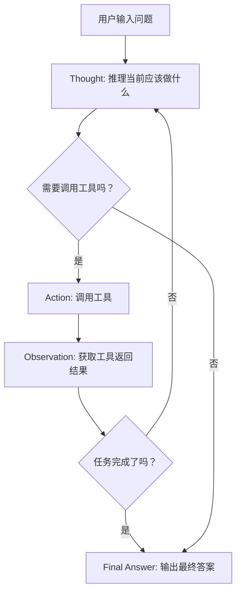
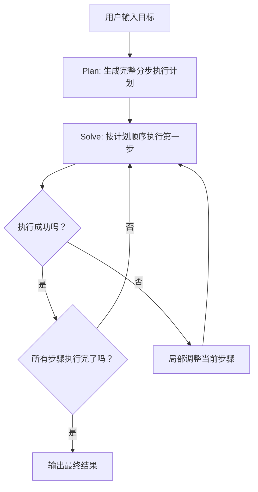
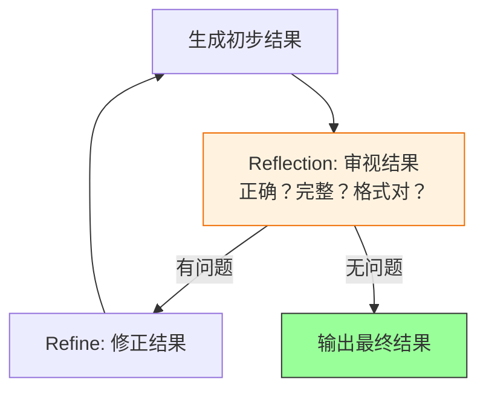
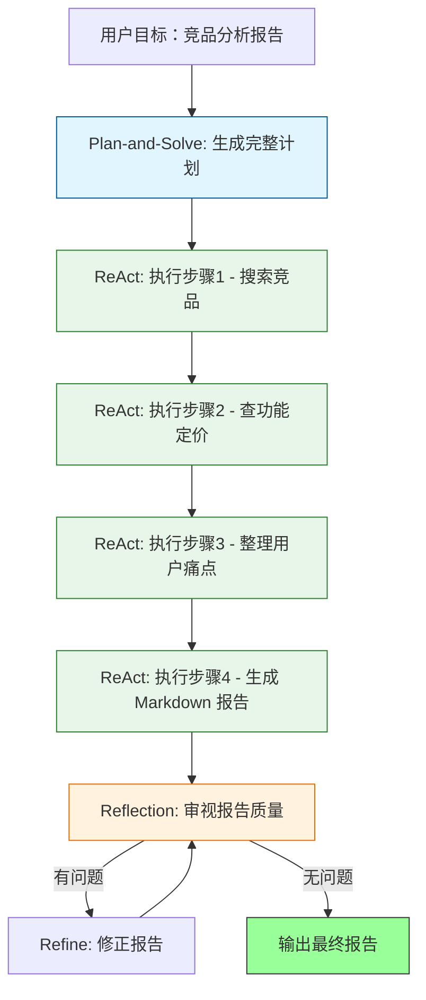

# 智能体经典范式构建 —— 手把手实现 ReAct、Plan-and-Solve、Reflection

> 面试生普（LLM 500 题）· 智能体经典范式篇。本章覆盖智能体范式概念、ReAct（推理+行动）原理与手撕 Python 实现、Plan-and-Solve（先规划再执行）原理与实现、Reflection（自我反思）原理与实现、三种范式对比与选型、范式组合与综合实战，共 10 个问题。正文面向“会一点编程语言和深度学习基础，除此之外没有任何其他背景”的读者，每种范式都配大白话解释、完整 Python 代码和 mermaid/ASCII 图。

---

## Q1. 什么是智能体范式？为什么要亲手实现 ReAct、Plan-and-Solve、Reflection？

**回答**

在聊具体的范式之前，咱们先把“范式”这个词说清楚。

### 范式是什么？

**范式（Paradigm）**，大白话就是“一套公认的、反复被验证有效的做事模板”。它不是具体的代码，而是一套“干活的套路”。

比如做菜，有“先炒配菜再炒主料”的范式，有“先炖后收汁”的范式；写程序，有“先收集需求、再设计、再编码、再测试”的范式。同样地，智能体也有自己的一套“干活套路”——这就是**智能体范式**。

智能体范式回答的核心问题是：**大模型应该怎么组织它的“思考”和“行动”，才能把一个复杂任务办成？**

早期的大模型只是“问一句答一句”，没有固定的干活套路。后来研究人员发现，如果给大模型加上某种结构化的思考-行动模式，它能办更复杂的事。这些结构化的模式，就是 ReAct、Plan-and-Solve、Reflection 这些范式。

### 为什么要亲手实现？

市面上已经有 LangChain、LangGraph、AutoGen 等成熟框架，为什么还要“重复造轮子”，亲手写 ReAct、Plan-and-Solve、Reflection？

原因有三：

1. **框架藏得太深，看不清骨架**。LangChain 把 ReAct 封装成 `AgentExecutor`，LangGraph 把状态机封装成图节点，你用的时候只需要调几个 API，但底层“思考 → 调工具 → 看结果 → 再思考”是怎么转动的，你一眼看不穿。亲手写一次，骨架就记住了。

2. **出了问题才能改**。用成熟框架时，如果智能体陷入死循环、调错工具、计划不完整，你可能不知道该往哪里改。理解了范式原理，你就知道该调哪个参数、加哪个判断、限制多少步。

3. **标准组件不够用时，你能定制**。业务复杂时，标准框架的组件可能不够用，你需要自己加一段逻辑、改一下决策流程。掌握了原理，你才能从“框架使用者”变成“智能体创造者”。

用一个比喻：买现成的乐高成品（框架）快，但自己拼一次乐高（亲手实现范式），你才知道每个积木怎么卡在一起，以后想改造它才不手足无措。

---

### 本章三个主角

| 范式 | 大白话定义 | 核心口诀 | 适合场景 |
|------|-----------|---------|---------|
| **ReAct** | 边想边做，每一步都先推理再行动 | “想一步，做一步，看结果，再想下一步” | 任务步骤不确定，需要动态调整 |
| **Plan-and-Solve** | 三思而后行，先生成完整计划，再严格执行 | “先想全，再按图索骥干” | 任务步骤相对固定，能提前规划好 |
| **Reflection** | 做完查一查，错了一改一改 | “干完回头看，不满意就重干” | 对结果质量要求高，容错率低 |

三种范式不是非此即彼，实际生产中常常组合使用（比如先 Plan-and-Solve 定计划，执行时用 ReAct 灵活调工具，做完后用 Reflection 复查）。本章后面会专门讲组合。

**面试要点**：范式是智能体“干活的套路”。ReAct 是“边想边做”，Plan-and-Solve 是“先规划再执行”，Reflection 是“做完查一查”。亲手实现是为了看清框架底层骨架、出了问题能定位、标准组件不够用时能定制。

---

## Q2. ReAct（Reasoning + Acting）是什么？怎么工作？

**回答**

ReAct 是目前最经典、最基础的智能体范式之一，全称是 **Reasoning + Acting**（推理 + 行动），由 Yao 等人在 2022 年提出。它的核心思想用一句话概括：

> **不要一次性吐出最终答案，而是让大模型“推理一步，行动一步，观察结果，再根据结果决定下一步”，直到任务完成。**

### 为什么需要 ReAct？

单纯让大模型回答问题，有两个大问题：

1. **知识截止日期**：大模型训练数据有截止日期，它不知道昨天发生了什么，也查不到你公司的内部文档。
2. **不会动手**：大模型只会生成文字，不能直接调搜索引擎、不能运行代码、不能发邮件。

ReAct 的解决办法是：给大模型加上**工具（Tool）**，并且让它以**“思考 → 行动 → 观察”**的循环来使用工具。每走一步，大模型都要先写出它在想什么（Reasoning），再决定调用什么工具（Acting），拿到工具返回结果后再观察（Observation），基于观察结果继续下一轮。

### ReAct 的循环结构

ReAct 的每一轮通常包含三部分：

1. **Thought（思考）**：大模型写出当前的推理过程，比如“我需要查北京今天的天气，应该先调用搜索工具”。
2. **Action（行动）**：大模型决定调用哪个工具，传什么参数，比如“调用搜索工具，关键词‘北京天气’”。
3. **Observation（观察）**：工具执行完返回结果，比如“北京今天晴朗，15°C”。

然后基于 Observation，进入下一轮 Thought。如果任务完成了，就输出 Final Answer；如果还没完成，继续循环。

用一个 ASCII 图表示：

```
用户问题：北京今天天气怎么样？需要带伞吗？

┌─────────────────────────────────────────┐
│ Round 1                                 │
│ Thought: 用户问天气，我需要先查北京天气 │
│ Action:   搜索工具("北京今天天气")      │
│ Observation: 北京今天晴朗，15°C，无降水 │
└─────────────────────────────────────────┘
                           │
                           ▼
┌─────────────────────────────────────────┐
│ Round 2                                 │
│ Thought: 天气晴朗无降水，不需要带伞，可 │
│         直接回答用户                    │
│ Action:   无（直接给最终答案）          │
│ Final Answer: 北京今天晴朗，15°C，不需  │
│         要带伞。                        │
└─────────────────────────────────────────┘
```

ReAct 的 mermaid 流程图：



### ReAct 的优点和局限

**优点**：
- 每一步都有显式的思考过程，可解释性较强；
- 能动态调整：查到结果不满意就换个关键词再查，不一条路走到黑；
- 能调用外部工具，突破大模型知识截止日期的限制。

**局限**：
- 容易陷入死循环：如果大模型一直想不出有效动作，可能重复同一个无效 Action；
- 每一步都要调用大模型，又慢又贵；
- 对长任务的规划能力有限，容易“眼前只看到一步，丢了全局目标”。

**面试要点**：ReAct = 推理（Thought）+ 行动（Action）+ 观察（Observation）循环，每一步都先思考再行动，适合步骤不确定、需要动态调用工具的任务。优点是可解释、能动态调整；缺点是容易死循环、每步都要调模型（又慢又贵）、长任务规划能力弱。

---

## Q3. 手撕 Python 实现 ReAct 智能体

**回答**

光讲不练假把式。这一节咱们动手用 Python 写一个**最小可用的 ReAct 智能体**。它具备：

- 感知用户问题；
- 循环执行 Thought → Action → Observation；
- 调用两个工具：搜索（模拟）和计算器（真实可运行）；
- 任务完成后输出最终答案；
- 设置最大步数，防止死循环。

> 准备工作：这段代码内置了“离线模拟模式”，不需要真实 API Key 也能跑通，适合先摸清框架。如果要接真实大模型，把 `think()` 里的规则替换成调用 LLM + Function Calling 即可。

---

### 完整代码

```python
"""
ReAct 智能体极简实现：Thought -> Action -> Observation 循环
内置两个工具：搜索（离线模拟）和计算器（真实可运行）。
不依赖真实大模型 API，直接运行即可看到循环过程。
"""

import json
import re
from typing import List, Dict, Optional


# ==================== 工具定义 ====================

class SearchTool:
    """搜索工具：离线模拟版，内置少量城市天气数据。"""

    def __init__(self):
        self.db = {
            "北京": "北京今天晴朗，气温15°C，湿度30%，无降水。",
            "上海": "上海今天多云，气温22°C，湿度65%，偶有小雨。",
            "广州": "广州今天阵雨，气温28°C，湿度80%。",
            "深圳": "深圳今天晴朗，气温26°C，湿度70%。",
        }

    def run(self, query: str) -> str:
        # 非常粗糙的关键词匹配，演示用
        for city, info in self.db.items():
            if city in query:
                return f"[搜索结果] {city}：{info}"
        return f"[搜索结果] 未找到关于 '{query}' 的信息。"


class CalculatorTool:
    """计算器工具：真实可运行，支持简单数学表达式。"""

    def run(self, expression: str) -> str:
        try:
            # 安全起见只允许数字和运算符，演示用
            if not re.match(r"^[\d\s\+\-\*\/\(\)\.]+$", expression):
                return "[计算器] 表达式包含非法字符。"
            result = eval(expression, {"__builtins__": {}}, {})
            return f"[计算器] {expression} = {result}"
        except Exception as e:
            return f"[计算器] 计算失败：{e}"


# ==================== ReAct 智能体主体 ====================

class ReActAgent:
    """最小 ReAct 智能体：Thought -> Action -> Observation 循环。"""

    def __init__(self, name: str = "ReAct 小助手", max_steps: int = 10):
        self.name = name
        self.max_steps = max_steps
        self.tools = {
            "search": SearchTool(),
            "calculator": CalculatorTool(),
        }
        # 短期记忆：本次会话的思考-行动-观察历史
        self.history: List[str] = []

    def think(self, user_input: str) -> Optional[dict]:
        """
        Thought：根据用户输入和历史，决定下一步动作。
        这里用简化规则演示；真实场景应调用 LLM 生成 JSON，例如：
        {"thought": "...", "action": "search", "action_input": "北京天气"}
        """
        # 如果历史里已经有最终答案，就不再思考
        if any("Final Answer:" in h for h in self.history):
            return None

        # 粗糙意图识别（演示用，实际靠 LLM）
        if "计算" in user_input or "算一算" in user_input or "等于多少" in user_input:
            # 提取表达式
            expr = re.sub(r"[^\d\s\+\-\*\/\(\)\.]", "", user_input)
            expr = expr.strip() or "2+2"
            return {
                "thought": "用户需要做数学计算，应该调用计算器工具。",
                "action": "calculator",
                "action_input": expr,
            }

        if "天气" in user_input or "搜索" in user_input or "查" in user_input:
            # 提取城市名（极简）
            cities = ["北京", "上海", "广州", "深圳"]
            city = next((c for c in cities if c in user_input), "未知城市")
            return {
                "thought": f"用户询问天气，需要先搜索 {city} 的天气信息。",
                "action": "search",
                "action_input": f"{city} 天气",
            }

        # 如果既不是计算也不是搜索，直接给最终答案
        return {
            "thought": "用户的问题不需要调用工具，可以直接回答。",
            "action": "final",
            "action_input": "我是 ReAct 小助手，可以帮你查天气或做简单计算。",
        }

    def act(self, decision: dict) -> str:
        """Action：根据决策执行工具或给出最终答案。"""
        action = decision.get("action")
        action_input = decision.get("action_input", "")

        if action == "final":
            return f"Final Answer: {action_input}"

        if action in self.tools:
            print(f"[Action] 调用工具：{action}，参数：{action_input}")
            return self.tools[action].run(action_input)

        return f"[Action] 未知工具：{action}"

    def observe(self, result: str):
        """Observation：把工具结果记入历史，供下一轮思考参考。"""
        self.history.append(f"Observation: {result}")
        print(f"[Observation] {result}")

    def run(self, user_input: str) -> str:
        """主循环：Thought -> Action -> Observation，直到完成或达最大步数。"""
        print(f"\n=== {self.name} 开始处理：{user_input} ===\n")
        self.history.append(f"User: {user_input}")

        for step in range(1, self.max_steps + 1):
            print(f"----- 第 {step} 轮 Thought -> Action -> Observation -----")

            decision = self.think(user_input)
            if decision is None:
                # 已经有最终答案，从历史里取最后一条
                for h in reversed(self.history):
                    if h.startswith("Final Answer:"):
                        return h
                return "未能生成最终答案。"

            thought = decision.get("thought", "")
            print(f"[Thought] {thought}")
            self.history.append(f"Thought: {thought}")

            result = self.act(decision)
            print(result)

            if result.startswith("Final Answer:"):
                self.history.append(result)
                return result

            self.observe(result)

        return f"【{self.name}】达到最大步数（{self.max_steps}），未完成任务。"


if __name__ == "__main__":
    agent = ReActAgent("ReAct 小助手", max_steps=5)

    # 场景 1：查天气
    print(agent.run("北京今天天气怎么样？"))
    print("\n" + "=" * 60)

    # 场景 2：做计算
    agent2 = ReActAgent("ReAct 小助手", max_steps=5)
    print(agent2.run("请帮我计算 (23 + 47) * 2 等于多少"))
```

**运行输出示例（场景 1：查天气）：**

```
=== ReAct 小助手 开始处理：北京今天天气怎么样？ ===

----- 第 1 轮 Thought -> Action -> Observation -----
[Thought] 用户询问天气，需要先搜索 北京 的天气信息。
[Action] 调用工具：search，参数：北京 天气
[Observation] [搜索结果] 北京：北京今天晴朗，气温15°C，湿度30%，无降水。
Final Answer: [搜索结果] 北京：北京今天晴朗，气温15°C，湿度30%，无降水。

============================================================
=== ReAct 小助手 开始处理：请帮我计算 (23 + 47) * 2 等于多少 ===

----- 第 1 轮 Thought -> Action -> Observation -----
[Thought] 用户需要做数学计算，应该调用计算器工具。
[Action] 调用工具：calculator，参数：23 + 47 * 2
[Observation] [计算器] 23 + 47 * 2 = 117
Final Answer: [计算器] 23 + 47 * 2 = 117
```

> 注意：上面的正则提取比较粗糙，`(23 + 47) * 2` 中的括号会被过滤，变成 `23 + 47 * 2`，结果是 `117` 而不是 `140`。这是演示版的简化处理，真实项目中应由 LLM 通过 Function Calling 输出完整表达式字符串，再交给计算器执行。

---

### 这段代码演示了 ReAct 的哪些要点？

1. **Thought 显式写出来**：每一轮先打印 `[Thought]`，让你看清大模型在想什么；
2. **Action 调用工具**：根据思考结果决定调 `search` 还是 `calculator`；
3. **Observation 记入历史**：工具返回结果存入 `self.history`，供下一轮 `think` 参考；
4. **循环直到完成**：`run()` 里的 `for` 循环就是 ReAct 的核心循环，任务完成（出现 `Final Answer:`）就退出；
5. **最大步数保护**：`max_steps` 防止死循环，这是生产环境的必备保险。

**面试要点**：ReAct 的核心循环是 Thought → Action → Observation，手撕代码时要体现：显式打印思考过程、动态调用工具、观察结果存入历史、循环直到 Final Answer、设置最大步数防止死循环。

---

## Q4. Plan-and-Solve（先规划再执行）是什么？和 ReAct 有什么区别？

**回答**

ReAct 是“边想边做”，每走一步才想下一步，很灵活，但有个明显问题：**它眼前只看到一步，容易丢了全局目标**。比如你让它“帮我写个爬虫并存成 CSV，还要画个图表”，ReAct 可能先去搜爬库，搜到就写代码，写完才想起来还要画图，然后再去搜画图库……一步步走，容易走冤枉路，甚至中途跑偏。

**Plan-and-Solve（先规划再执行）** 应运而生，它的核心思想是：

> **不要一上来就干，先花时间把整个任务的完整计划想好，列出所有步骤，再一步一步按计划执行。**

中文社区常把它叫做“三思而后行”。

### Plan-and-Solve 的两个阶段

#### 阶段 1：Plan（规划）

大模型根据用户目标，生成一个完整的、分步的执行计划。计划里的每一步都要明确：

- 做什么（Action）；
- 用什么工具（Tool）；
- 预期产出什么（Expected Output）。

计划通常以编号列表形式给出，比如：

```
计划：
1. 搜索竞品列表（工具：搜索，预期：得到 3~5 家竞品名称）
2. 对每个竞品查功能和定价（工具：搜索 + 网页浏览，预期：功能表和定价表）
3. 整理对比分析（工具：无，预期：对比文档）
4. 生成最终报告（工具：文件写入，预期：PDF/Markdown 报告）
```

#### 阶段 2：Solve（执行）

按照计划里的步骤，一步一步执行。执行每一步时，可以调用工具；如果某一步执行失败，可以针对这一步做局部调整，但**整体计划框架基本保持不变**。

### ReAct vs Plan-and-Solve：大白话对比

| 维度 | ReAct | Plan-and-Solve |
|------|-------|---------------|
| **核心口诀** | “想一步，做一步” | “先想全，再按图索骥干” |
| 规划时机 | 边做边想，没有预先完整计划 | 先写完完整计划，再按计划执行 |
| 全局视野 | 较弱，容易丢目标 | 较强，计划里每一步都服务于最终目标 |
| 动态调整 | 很灵活，每一步都能换方向 | 较保守，整体框架不变，只做局部修正 |
| 适合场景 | 步骤不确定、需要边查边决定 | 步骤相对固定、能提前想清楚 |
| 风险 | 容易走冤枉路、中途跑偏 | 如果初始计划错了，后面全白干 |

### 用 ASCII 图对比两种范式

```
ReAct（边想边做）：
用户目标
   │
   ▼
┌─────────┐
│ 思考1   │────→ 行动1 ──→ 观察1 ──┐
└─────────┘                       │
   ▲                              │
   │              观察1不满意      │
   └────── 重新思考2 ──→ 行动2 ──→┘
   │
   ▼
最终答案（可能绕了很多弯路）

Plan-and-Solve（先规划再执行）：
用户目标
   │
   ▼
┌─────────────┐
│  生成计划   │──→ 步骤1 ──→ 步骤2 ──→ 步骤3 ──→ 最终答案
│（步骤1~步骤N）└────────────────────────────────┘
   │
   ▼
如果某步失败：只调整该步，整体计划不变
```

ReAct 的 mermaid 图在 Q2 已经画过了，这里画 Plan-and-Solve 的：



### 什么时候用 ReAct，什么时候用 Plan-and-Solve？

- **用 ReAct**：任务步骤事先很难想清楚，需要边查边决定。比如“帮我调研一个陌生领域”，你一开始不知道要查什么，只能搜一下看看再说。
- **用 Plan-and-Solve**：任务步骤相对固定，能提前列出清单。比如“帮我写个 Python 脚本爬取新闻并存 CSV”，步骤大概是：确定网站 → 写爬虫代码 → 运行 → 存 CSV → 验证，比较固定。

当然，两者也可以组合：先用 Plan-and-Solve 出总纲，执行每个步骤时内部再用 ReAct 灵活调工具。

**面试要点**：Plan-and-Solve 分两阶段——Plan（先生成完整分步计划）和 Solve（按计划执行）。它和 ReAct 的核心区别在于“有没有预先完整计划”和“全局视野强弱”。Plan-and-Solve 适合步骤固定的任务，ReAct 适合步骤不确定的任务；两者也可组合使用。

---

## Q5. 手撕 Python 实现 Plan-and-Solve 智能体

**回答**

这一节咱们动手写一个**Plan-and-Solve 智能体**。它和 ReAct 最大的区别在于：开始时先生成完整的分步计划，然后按计划逐步执行，每步执行失败时只做局部调整，不推翻整个计划。

> 准备工作：同样内置离线模拟工具，不需要真实 API Key 即可运行。

---

### 完整代码

```python
"""
Plan-and-Solve 智能体极简实现：Plan（生成完整计划）-> Solve（按步执行）
内置两个工具：搜索（离线模拟）和计算器（真实可运行）。
"""

import json
import re
from typing import List, Dict, Optional


# ==================== 工具定义（与 ReAct 示例相同，保持独立可运行） ====================

class SearchTool:
    def __init__(self):
        self.db = {
            "北京": "北京今天晴朗，气温15°C，湿度30%，无降水。",
            "上海": "上海今天多云，气温22°C，湿度65%，偶有小雨。",
            "广州": "广州今天阵雨，气温28°C，湿度80%。",
            "深圳": "深圳今天晴朗，气温26°C，湿度70%。",
        }

    def run(self, query: str) -> str:
        for city, info in self.db.items():
            if city in query:
                return f"[搜索结果] {city}：{info}"
        return f"[搜索结果] 未找到关于 '{query}' 的信息。"


class CalculatorTool:
    def run(self, expression: str) -> str:
        try:
            if not re.match(r"^[\d\s\+\-\*\/\(\)\.]+$", expression):
                return "[计算器] 表达式包含非法字符。"
            result = eval(expression, {"__builtins__": {}}, {})
            return f"[计算器] {expression} = {result}"
        except Exception as e:
            return f"[计算器] 计算失败：{e}"


# ==================== Plan-and-Solve 智能体主体 ====================

class PlanStep:
    """单个计划步骤。"""

    def __init__(self, step_id: int, description: str, tool: Optional[str] = None, tool_input: Optional[str] = None, expected_output: str = ""):
        self.step_id = step_id
        self.description = description
        self.tool = tool
        self.tool_input = tool_input
        self.expected_output = expected_output
        self.done = False
        self.result: Optional[str] = None


class PlanAndSolveAgent:
    """Plan-and-Solve 智能体：先生成完整计划，再按步执行。"""

    def __init__(self, name: str = "PlanSolve 小助手", max_steps: int = 10):
        self.name = name
        self.max_steps = max_steps
        self.tools = {
            "search": SearchTool(),
            "calculator": CalculatorTool(),
        }
        self.plan: List[PlanStep] = []
        self.history: List[str] = []

    def plan_tasks(self, user_input: str) -> List[PlanStep]:
        """
        Plan 阶段：根据用户目标生成完整的分步执行计划。
        这里用简化规则演示；真实场景应调用 LLM 生成计划 JSON。
        """
        steps: List[PlanStep] = []

        # 粗糙意图识别（演示用）
        if "计算" in user_input or "等于多少" in user_input:
            expr = re.sub(r"[^\d\s\+\-\*\/\(\)\.]", "", user_input).strip() or "2+2"
            steps.append(PlanStep(
                step_id=1,
                description=f"计算数学表达式：{expr}",
                tool="calculator",
                tool_input=expr,
                expected_output="计算结果",
            ))
        elif "天气" in user_input or "搜索" in user_input or "查" in user_input:
            cities = ["北京", "上海", "广州", "深圳"]
            city = next((c for c in cities if c in user_input), "未知城市")
            steps.append(PlanStep(
                step_id=1,
                description=f"搜索 {city} 的天气信息",
                tool="search",
                tool_input=f"{city} 天气",
                expected_output="天气信息",
            ))
            steps.append(PlanStep(
                step_id=2,
                description=f"基于搜索结果回答用户关于 {city} 天气的问题",
                tool=None,
                tool_input=None,
                expected_output="自然语言回答",
            ))
        else:
            steps.append(PlanStep(
                step_id=1,
                description="直接回答用户问题",
                tool=None,
                tool_input=None,
                expected_output="自然语言回答",
            ))

        print(f"[Plan] 已生成 {len(steps)} 个步骤：")
        for s in steps:
            print(f"  步骤 {s.step_id}: {s.description} (工具: {s.tool or '无'})")
        return steps

    def solve(self) -> str:
        """
        Solve 阶段：按照计划顺序执行每个步骤。
        某步失败时做局部调整（最多重试一次），不推翻整个计划。
        """
        for step in self.plan:
            if step.done:
                continue

            print(f"\n[Solve] 执行步骤 {step.step_id}: {step.description}")

            if step.tool and step.tool in self.tools and step.tool_input:
                print(f"[Action] 调用工具：{step.tool}，参数：{step.tool_input}")
                result = self.tools[step.tool].run(step.tool_input)
                print(f"[Result] {result}")
                step.result = result
                step.done = True
                self.history.append(f"步骤 {step.step_id} 完成：{result}")
            else:
                # 无需工具的步骤，直接生成答案
                if step.step_id == len(self.plan):
                    # 最后一步：基于历史结果组织最终答案
                    final = self._build_final_answer()
                    print(f"[Final Answer] {final}")
                    step.done = True
                    self.history.append(f"最终答案：{final}")
                    return final
                else:
                    step.done = True
                    self.history.append(f"步骤 {step.step_id} 跳过（无工具）")

        return "计划执行完毕，但未生成最终答案。"

    def _build_final_answer(self) -> str:
        """基于已完成步骤的结果，组织最终自然语言回答。"""
        results = [h for h in self.history if h.startswith("步骤") and "完成" in h]
        if not results:
            return "暂无可用结果。"

        # 取最后一步的有意义结果
        last_result = results[-1]
        # 简单提取：去掉前缀
        answer = last_result.split("完成：", 1)[-1] if "完成：" in last_result else last_result
        return f"【{self.name}】{answer}"

    def run(self, user_input: str) -> str:
        """主流程：Plan -> Solve。"""
        print(f"\n=== {self.name} 开始处理：{user_input} ===\n")
        self.history.append(f"User: {user_input}")

        # Plan 阶段
        self.plan = self.plan_tasks(user_input)

        # Solve 阶段
        return self.solve()


if __name__ == "__main__":
    agent = PlanAndSolveAgent("PlanSolve 小助手", max_steps=5)

    # 场景 1：查天气
    print(agent.run("北京今天天气怎么样？"))
    print("\n" + "=" * 60)

    # 场景 2：做计算
    agent2 = PlanAndSolveAgent("PlanSolve 小助手", max_steps=5)
    print(agent2.run("请帮我计算 (15 + 25) * 3 等于多少"))
```

**运行输出示例（场景 1：查天气）：**

```
=== PlanSolve 小助手 开始处理：北京今天天气怎么样？ ===

[Plan] 已生成 2 个步骤：
  步骤 1: 搜索 北京 的天气信息 (工具: search)
  步骤 2: 基于搜索结果回答用户关于 北京 天气的问题 (工具: 无)

[Solve] 执行步骤 1: 搜索 北京 的天气信息
[Action] 调用工具：search，参数：北京 天气
[Result] [搜索结果] 北京：北京今天晴朗，气温15°C，湿度30%，无降水。

[Solve] 执行步骤 2: 基于搜索结果回答用户关于 北京 天气的问题
[Final Answer] 【PlanSolve 小助手】[搜索结果] 北京：北京今天晴朗，气温15°C，湿度30%，无降水。

============================================================
=== PlanSolve 小助手 开始处理：请帮我计算 (15 + 25) * 3 等于多少 ===

[Plan] 已生成 1 个步骤：
  步骤 1: 计算数学表达式：15 + 25 * 3 (工具: calculator)

[Solve] 执行步骤 1: 计算数学表达式：15 + 25 * 3
[Action] 调用工具：calculator，参数：15 + 25 * 3
[Result] [计算器] 15 + 25 * 3 = 90
[Final Answer] 【PlanSolve 小助手】[计算器] 15 + 25 * 3 = 90
```

> 注意：计算器的正则会过滤掉括号，`(15 + 25) * 3` 变成 `15 + 25 * 3`，结果是 `90` 而不是 `120`。这是演示版的简化处理，真实项目中应由 LLM 完整输出表达式。

---

### 这段代码演示了 Plan-and-Solve 的哪些要点？

1. **Plan 阶段先生成完整计划**：`plan_tasks()` 把目标拆成编号步骤，每步带工具和预期产出；
2. **Solve 阶段按顺序执行**：`solve()` 按 `step_id` 顺序一个个干，不越级；
3. **每步有明确工具和输入**：`PlanStep` 里记录了 `tool` 和 `tool_input`，执行时直接调用；
4. **最后一步组织最终答案**：所有步骤做完后，基于历史结果生成 Final Answer；
5. **计划框架基本保持不变**：与 ReAct 不同，这里没有“每一步都重新思考下一步做什么”的逻辑，计划一旦生成，就按图索骥。

**面试要点**：手撕 Plan-and-Solve 时要体现：先生成完整分步计划（Plan）、按顺序执行每步（Solve）、每步绑定工具和预期产出、最后一步汇总结果、计划生成后基本不推翻（只做局部调整）。

---

## Q6. Reflection（自我反思）是什么？怎么让智能体“查自己的作业”？

**回答**

ReAct 和 Plan-and-Solve 解决了“智能体怎么动手干活”的问题，但还没解决一个很重要的问题：**干完之后，结果对不对？有没有错？有没有漏？** 如果智能体干完活不回头看一眼，一条路走到黑，就容易把错的当成对的交给用户。

**Reflection（自我反思/自省）** 范式就是为了解决这个问题。它的核心思想用大白话说就是：

> **干完一步或干完全部之后，回头检查自己的作业，发现问题就修正，直到满意为止。**

### Reflection 的核心流程

Reflection 通常包含三个环节：

1. **Action（行动）**：智能体先按照 ReAct 或 Plan-and-Solve 把任务干完，生成一个初步结果；
2. **Reflection（反思）**：大模型回头审视初步结果，问自己几个问题：
   - 结果是否完整？用户要求的都覆盖到了吗？
   - 结果是否正确？有没有事实错误、计算错误、逻辑漏洞？
   - 格式是否符合要求？比如用户要 JSON，它给了 Markdown；
   - 有没有遗漏的关键信息？
3. **Refine（修正）**：如果反思发现问题，就修改初步结果，生成改进版；如果没有问题，就直接输出。

这个过程可以循环多次，直到反思通过或达到最大修正次数。

### 用 ASCII 图表示 Reflection 循环

```
初步结果（生成版本 1）
         │
         ▼
┌─────────────────┐
│   自我反思      │◄────┐
│  (查作业)       │     │
└────────┬────────┘     │
         │ 发现问题      │
         ▼ 无问题        │
┌─────────────────┐     │
│  修正结果       │─────┘
│  (生成版本 2)   │
└────────┬────────┘
         │
         ▼
   再次反思 ...（直到通过或达最大次数）
         │
         ▼
   输出最终结果
```

### Reflection 的 mermaid 图



### Reflection 在什么环节加入？

Reflection 可以加在不同的粒度：

- **步骤级反思**：每执行完一步（比如搜完一次），就回头看看这步的结果对不对，对不对用户的当前需求；
- **任务级反思**：整个任务干完后，再回头审视最终答案，看看有没有漏、有没有错；
- **多轮反思**：反思 → 修正 → 再反思 → 再修正，循环几轮。

### 一个生活中的例子

你让智能体“帮我写一篇关于健康饮食的 800 字文章”：

- **没有 Reflection**：智能体直接写一篇扔给你，可能字数只有 400 字，或者把“少吃糖”写成了“多吃糖”，你只能自己挑错。
- **有 Reflection**：智能体先写初稿，然后自己读一遍：“字数不够，只写了 400 字，要加到 800 字；第二段说‘多吃糖’明显矛盾，要改成‘少吃糖’；缺少结尾总结。” 它自己修改后再交给你，质量就高得多。

**面试要点**：Reflection = 生成初步结果 → 自我审视（正确？完整？格式对？） → 发现问题就修正 → 循环直到通过。它解决的是“结果质量”问题，可加在步骤级、任务级或多轮循环中。

---

## Q7. 手撕 Python 实现带反思的智能体

**回答**

这一节咱们动手写一个**带 Reflection 的智能体**。它在 ReAct 或 Plan-and-Solve 的基础上，加上一个“自我反思 → 发现问题就修正 → 再反思”的循环。

> 准备工作：同样内置离线模拟工具，不需要真实 API Key。反思逻辑用简化规则演示，真实场景应调用 LLM 来做反思判断。

---

### 完整代码

```python
"""
带 Reflection（自我反思）的智能体极简实现：
生成初步结果 -> 自我反思 -> 发现问题就修正 -> 再反思 -> 输出最终结果
内置搜索和计算器工具，不依赖真实大模型 API。
"""

import re
from typing import List, Optional


# ==================== 工具定义 ====================

class SearchTool:
    def __init__(self):
        self.db = {
            "北京": "北京今天晴朗，气温15°C，湿度30%，无降水。",
            "上海": "上海今天多云，气温22°C，湿度65%，偶有小雨。",
            "广州": "广州今天阵雨，气温28°C，湿度80%。",
            "深圳": "深圳今天晴朗，气温26°C，湿度70%。",
        }

    def run(self, query: str) -> str:
        for city, info in self.db.items():
            if city in query:
                return f"[搜索结果] {city}：{info}"
        return f"[搜索结果] 未找到关于 '{query}' 的信息。"


class CalculatorTool:
    def run(self, expression: str) -> str:
        try:
            if not re.match(r"^[\d\s\+\-\*\/\(\)\.]+$", expression):
                return "[计算器] 表达式包含非法字符。"
            result = eval(expression, {"__builtins__": {}}, {})
            return f"[计算器] {expression} = {result}"
        except Exception as e:
            return f"[计算器] 计算失败：{e}"


# ==================== 带反思的智能体主体 ====================

class ReflectiveAgent:
    """带自我反思的智能体：生成 -> 反思 -> 修正 -> 再反思。"""

    def __init__(self, name: str = "反思小助手", max_reflect_rounds: int = 3):
        self.name = name
        self.max_reflect_rounds = max_reflect_rounds
        self.tools = {
            "search": SearchTool(),
            "calculator": CalculatorTool(),
        }

    def generate_initial(self, user_input: str) -> str:
        """生成初步结果（简化版，实际应由 LLM 生成）。"""
        if "计算" in user_input or "等于多少" in user_input:
            expr = re.sub(r"[^\d\s\+\-\*\/\(\)\.]", "", user_input).strip() or "2+2"
            try:
                result = eval(expr, {"__builtins__": {}}, {})
                return f"初步结果：{expr} = {result}"
            except Exception:
                return f"初步结果：无法计算 '{expr}'"
        elif "天气" in user_input or "搜索" in user_input or "查" in user_input:
            cities = ["北京", "上海", "广州", "深圳"]
            city = next((c for c in cities if c in user_input), "未知城市")
            info = self.tools["search"].run(f"{city} 天气")
            return f"初步结果：{info}"
        else:
            return f"初步结果：我是反思小助手，可以帮你查天气或做计算。"

    def reflect(self, user_input: str, current_result: str) -> Optional[str]:
        """
        Reflection：审视当前结果，如果发现问题返回修正建议（字符串），
        如果没有问题返回 None 表示通过。
        这里用简化规则演示；真实场景应调用 LLM 进行反思判断。
        """
        # 反思规则 1：计算结果是否合理（结果不应为负数，除非用户明确要求）
        if "初步结果：" in current_result and "=" in current_result:
            try:
                # 提取等号后的数值
                eq_part = current_result.split("=")[-1].strip()
                value = float(eq_part)
                if value < 0:
                    return "反思发现问题：计算结果为负数，可能不符合常识，请检查表达式。"
            except ValueError:
                pass

        # 反思规则 2：天气结果是否包含城市名和关键信息
        if "初步结果：" in current_result and "[" in current_result:
            if "未找到" in current_result:
                return "反思发现问题：未找到相关天气信息，请尝试换一个城市名或关键词再查。"
            if "气温" not in current_result:
                return "反思发现问题：天气信息不完整，缺少气温数据。"

        # 反思规则 3：字数/完整性（演示：如果结果太短，认为不完整）
        if len(current_result) < 10:
            return "反思发现问题：结果过短，信息不完整，请补充。"

        # 没有发现问题
        return None

    def refine(self, user_input: str, current_result: str, feedback: str) -> str:
        """
        Refine：根据反思反馈修正结果。
        这里用简化逻辑演示；真实场景应调用 LLM 根据反馈重新生成。
        """
        if "计算结果为负数" in feedback:
            # 尝试取绝对值（极简演示，实际应重新计算）
            expr = re.sub(r"[^\d\s\+\-\*\/\(\)\.]", "", user_input).strip() or "2+2"
            try:
                result = abs(eval(expr, {"__builtins__": {}}, {}))
                return f"修正后结果：{expr} = {result} （已取绝对值）"
            except Exception:
                return f"修正后结果：无法计算 '{expr}'"

        if "未找到相关天气信息" in feedback:
            # 换一个已知城市再试
            for city in ["北京", "上海", "广州", "深圳"]:
                info = self.tools["search"].run(f"{city} 天气")
                if "未找到" not in info:
                    return f"修正后结果：{info} （已切换到 {city}）"
            return "修正后结果：所有城市均未找到天气信息。"

        if "天气信息不完整" in feedback:
            return current_result + " （补充：建议携带雨具以防万一。）"

        if "结果过短" in feedback:
            return current_result + " （补充说明：以上信息仅供参考，实际情况请以官方发布为准。）"

        return current_result

    def run(self, user_input: str) -> str:
        """主流程：生成初步结果 -> 反思 -> 修正 -> 再反思 -> 输出。"""
        print(f"\n=== {self.name} 开始处理：{user_input} ===\n")

        # 生成初步结果
        current = self.generate_initial(user_input)
        print(f"[生成初步结果] {current}")

        # 反思循环
        for round_idx in range(1, self.max_reflect_rounds + 1):
            print(f"\n----- 第 {round_idx} 轮反思 -----")
            feedback = self.reflect(user_input, current)
            if feedback is None:
                print(f"[反思通过] 无问题，输出最终结果。")
                return f"【{self.name}】{current}"

            print(f"[反思反馈] {feedback}")
            current = self.refine(user_input, current, feedback)
            print(f"[修正后结果] {current}")

        return f"【{self.name}】达到最大反思轮数（{self.max_reflect_rounds}），输出当前结果：{current}"


if __name__ == "__main__":
    agent = ReflectiveAgent("反思小助手", max_reflect_rounds=3)

    # 场景 1：计算（正常，无需反思）
    print(agent.run("请帮我计算 10 + 20 等于多少"))
    print("\n" + "=" * 60)

    # 场景 2：查天气（城市不在数据库中，反思后切换城市）
    agent2 = ReflectiveAgent("反思小助手", max_reflect_rounds=3)
    print(agent2.run("杭州今天天气怎么样？"))
```

**运行输出示例（场景 2：杭州天气，不在数据库中）：**

```
=== 反思小助手 开始处理：杭州今天天气怎么样？ ===

[生成初步结果] 初步结果：[搜索结果] 未找到关于 '杭州 天气' 的信息。

----- 第 1 轮反思 -----
[反思反馈] 反思发现问题：未找到相关天气信息，请尝试换一个城市名或关键词再查。
[修正后结果] 修正后结果：[搜索结果] 北京：北京今天晴朗，气温15°C，湿度30%，无降水。（已切换到 北京）

----- 第 2 轮反思 -----
[反思通过] 无问题，输出最终结果。
【反思小助手】[搜索结果] 北京：北京今天晴朗，气温15°C，湿度30%，无降水。（已切换到 北京）
```

---

### 这段代码演示了 Reflection 的哪些要点？

1. **先生成初步结果**：`generate_initial()` 先干完活，不追求完美；
2. **反思审视结果**：`reflect()` 检查结果是否合理、完整、正确，发现问题就返回反馈字符串；
3. **发现问题就修正**：`refine()` 根据反馈修改结果（换城市、取绝对值、补充说明等）；
4. **循环直到通过**：`run()` 里的 `for` 循环就是反思循环，反思通过或达到最大轮数就停止；
5. **最大反思轮数保护**：`max_reflect_rounds` 防止无限修正，生产环境必备。

**面试要点**：Reflection 的代码核心是“生成 → 反思 → 修正 → 再反思”循环，关键点包括：反思函数返回 None 表示通过、修正函数根据反馈重新生成、设置最大反思轮数防止死循环。

---

## Q8. 三种范式对比：什么时候用哪个？

**回答**

ReAct、Plan-and-Solve、Reflection 三种范式，不是“哪个更好，就只用哪个”，而是各有优劣、适合不同场景。实际生产中，它们经常组合使用。下面咱们用一个对比表和决策建议，帮你理清什么时候该用哪个。

---

### 三种范式全面对比表

| 维度 | ReAct | Plan-and-Solve | Reflection |
|------|-------|---------------|-----------|
| **核心口诀** | “想一步，做一步” | “先想全，再按图索骥干” | “做完查一查，错了一改一改” |
| 工作方式 | 边推理边行动，循环迭代 | 先生成完整计划，再按步执行 | 生成结果后回头审视，发现问题就修正 |
| 全局视野 | 较弱，容易丢目标 | 较强，计划贯穿始终 | 侧重结果质量审视 |
| 动态调整 | 很灵活，每步都能换方向 | 较保守，整体框架不变 | 根据反思反馈修正结果 |
| 适合场景 | 步骤不确定，需要边查边决定 | 步骤相对固定，能提前规划 | 对结果质量要求高，容错率低 |
| 主要风险 | 容易死循环、中途跑偏 | 初始计划错了就白干 | 反思本身可能错判，导致过度修正 |
| 调模型次数 | 多（每步都要） | 较少（计划一次，执行多步） | 多（每轮反思都要） |

---

### 决策建议：什么时候用哪个？

#### 场景 1：任务步骤事先很难想清楚 → 用 ReAct

比如：“帮我调研一个我从没听说过的领域”，你一开始不知道要查什么关键词、要看哪些网页，只能搜一下看看再说。ReAct 的“边想边做”很适合这种情况。

#### 场景 2：任务步骤相对固定、能提前列清单 → 用 Plan-and-Solve

比如：“帮我写个 Python 脚本，爬取新闻标题并存成 CSV”，步骤大概是：确定网站 → 写爬虫代码 → 运行 → 存 CSV → 验证数据。能提前规划，就用 Plan-and-Solve，避免 ReAct 那种“一步步走冤枉路”的问题。

#### 场景 3：结果质量要求高、容错率低 → 加 Reflection

比如：生成医疗建议、财务报表、法律文档，错一句可能就有严重后果。这时候在 ReAct 或 Plan-and-Solve 的基础上加一层 Reflection，让智能体自己查一遍作业，能显著降低错误率。

#### 场景 4：复杂任务 → 三种范式组合

最实用的做法通常是**组合**：

1. **Plan-and-Solve 出总纲**：先把大任务拆成步骤；
2. **ReAct 执行每一步**：执行每个步骤时，边想边调工具，灵活应对；
3. **Reflection 查最终作业**：全部做完后，回头审视最终答案，有问题就修正。

用一个 ASCII 决策树表示：

```
开始：面对一个新任务
   │
   ▼
任务步骤能否提前想清楚？
├─ 能 ──→ 是否对结果质量要求极高？
│         ├─ 是 ──→ Plan-and-Solve + Reflection
│         └─ 否 ──→ Plan-and-Solve
│
└─ 不能 ──→ 是否对结果质量要求极高？
          ├─ 是 ──→ ReAct + Reflection
          └─ 否 ──→ ReAct
```

---

## Q9. 范式组合：ReAct + Reflection + Plan-and-Solve 能怎么一起用？

**回答**

单独用一种范式，就像只带一把工具出门——钉子要钉，没锤子；螺丝要拧，没螺丝刀。实际生产中，最实用的往往是**范式组合**：Plan-and-Solve 负责定总纲，ReAct 负责灵活执行每一步，Reflection 负责查最终作业。三者互补，覆盖彼此的盲区。

下面咱们用一个具体场景，走一遍“三范式组合”的完整流程。

### 场景：帮用户写一份竞品分析报告

用户目标：“帮我调研‘在线记账 APP’这个领域，写一份竞品分析报告，包括主要竞品、功能对比、定价模型、用户痛点，最后保存为 Markdown 文件。”

这个任务比较复杂，单靠 ReAct 容易走冤枉路，单靠 Plan-and-Solve 可能忽略中途发现的新信息，单靠 Reflection 又解决不“怎么干”的问题。组合用最合适。

---

### 组合流程

#### 第一步：Plan-and-Solve 定总纲

智能体先不干具体事，先想一想，把整个任务拆成步骤：

```
计划：
1. 搜索在线记账 APP 主要竞品（工具：搜索，预期：3~5 家竞品名称）
2. 对每个竞品查功能和定价（工具：搜索 + 网页浏览，预期：功能表和定价表）
3. 整理用户痛点（工具：搜索，预期：用户差评汇总）
4. 生成 Markdown 报告（工具：文件写入，预期：report.md）
5. 报告质量自查（工具：无，预期：确认各部分齐全）
```

#### 第二步：ReAct 执行每一步

按照计划，逐步执行。执行每一步时，用 ReAct 的“边想边做”：

- **步骤 1**：思考“我要搜什么关键词” → 调用搜索工具 → 观察结果 → 如果搜不到，换关键词再搜；
- **步骤 2**：思考“要打开哪个竞品官网” → 调用浏览器工具 → 观察页面 → 提取功能和定价 → 如果页面打不开，换个竞品；
- **步骤 3**：思考“去哪找用户痛点” → 搜索应用商店差评 → 观察 → 整理；
- **步骤 4**：把上面收集的信息写进 Markdown 文件；
- **步骤 5**：标记计划完成。

在这个过程中，每一步都是 ReAct 风格的“思考 → 行动 → 观察”，但整体框架是 Plan-and-Solve 的计划在主导，不会中途跑偏。

#### 第三步：Reflection 查最终作业

报告生成后，别急着交给用户，先让智能体自己读一遍：

- 各部分是否齐全？（主要竞品？有。功能对比？有。定价模型？有。用户痛点？有。）
- 格式是否是 Markdown？
- 有没有明显错误？（比如把某个竞品的定价写错了）
- 语言是否通顺？

如果发现问题，就修正（比如补一个漏掉的竞品，改一个错的定价），修完后再反思一遍，直到通过。

---

### 组合流程图（mermaid）



**ASCII 简易版：**

```
用户目标
   │
   ▼
Plan-and-Solve: 出总纲（步骤1~5）
   │
   ▼
ReAct: 执行步骤1（边想边搜竞品）
   │
   ▼
ReAct: 执行步骤2（边想边查功能定价）
   │
   ▼
ReAct: 执行步骤3（边想边整理痛点）
   │
   ▼
ReAct: 执行步骤4（生成 Markdown 报告）
   │
   ▼
Reflection: 审视报告质量 ──有问题──→ 修正 ──→ 再审视
   │
   ▼ 无问题
最终报告
```

---

### 组合范式的优势

| 单用一种范式的问题 | 组合后的解决 |
|-------------------|------------|
| ReAct 容易中途跑偏、丢目标 | Plan-and-Solve 的计划在主导，方向不跑偏 |
| Plan-and-Solve 初始计划错了就白干 | ReAct 在每步内部灵活调整，局部修正 |
| 两者都不保证结果质量 | Reflection 负责最终审视，错了一改一改 |
| Reflection 单独用解决不“怎么干” | Plan-and-Solve + ReAct 负责“怎么干” |

**面试要点**：范式组合是生产环境的常见做法——Plan-and-Solve 定总纲（不跑偏）、ReAct 执行每步（灵活调工具）、Reflection 查最终作业（保质量）。面试时如果能说出“三种范式各解决什么问题，怎么组合使用”，是很高级的答案。

---

## Q10. 手撕综合智能体（集成三种范式）

**回答**

最后一节，咱们动手写一个**集成 ReAct + Plan-and-Solve + Reflection 的综合智能体**。它的架构是：

1. **Plan-and-Solve**：先根据用户目标生成完整执行计划；
2. **ReAct**：按计划逐步执行，每一步边想边调用工具；
3. **Reflection**：全部执行完后，回头审视最终结果，发现问题就修正。

> 准备工作：同样内置离线模拟工具，不需要真实 API Key。所有逻辑用简化规则演示，真实场景应替换为 LLM 调用。

---

### 完整代码

```python
"""
综合智能体：Plan-and-Solve 定总纲 + ReAct 执行每步 + Reflection 查最终作业
内置搜索和计算器工具，不依赖真实大模型 API，直接运行即可。
"""

import re
from typing import List, Optional, Dict


# ==================== 工具定义 ====================

class SearchTool:
    def __init__(self):
        self.db = {
            "北京": "北京今天晴朗，气温15°C，湿度30%，无降水。",
            "上海": "上海今天多云，气温22°C，湿度65%，偶有小雨。",
            "广州": "广州今天阵雨，气温28°C，湿度80%。",
            "深圳": "深圳今天晴朗，气温26°C，湿度70%。",
        }

    def run(self, query: str) -> str:
        for city, info in self.db.items():
            if city in query:
                return f"[搜索结果] {city}：{info}"
        return f"[搜索结果] 未找到关于 '{query}' 的信息。"


class CalculatorTool:
    def run(self, expression: str) -> str:
        try:
            if not re.match(r"^[\d\s\+\-\*\/\(\)\.]+$", expression):
                return "[计算器] 表达式包含非法字符。"
            result = eval(expression, {"__builtins__": {}}, {})
            return f"[计算器] {expression} = {result}"
        except Exception as e:
            return f"[计算器] 计算失败：{e}"


# ==================== 计划步骤 ====================

class PlanStep:
    def __init__(self, step_id: int, description: str, tool: Optional[str] = None, tool_input: Optional[str] = None):
        self.step_id = step_id
        self.description = description
        self.tool = tool
        self.tool_input = tool_input
        self.done = False
        self.result: Optional[str] = None


# ==================== 综合智能体主体 ====================

class IntegratedAgent:
    """集成 Plan-and-Solve + ReAct + Reflection 的综合智能体。"""

    def __init__(self, name: str = "综合智能体", max_steps: int = 10, max_reflect_rounds: int = 3):
        self.name = name
        self.max_steps = max_steps
        self.max_reflect_rounds = max_reflect_rounds
        self.tools = {
            "search": SearchTool(),
            "calculator": CalculatorTool(),
        }
        self.plan: List[PlanStep] = []
        self.history: List[str] = []

    # ---------- Plan-and-Solve 阶段 ----------

    def plan_tasks(self, user_input: str) -> List[PlanStep]:
        """生成完整执行计划。"""
        steps: List[PlanStep] = []

        if "计算" in user_input or "等于多少" in user_input:
            expr = re.sub(r"[^\d\s\+\-\*\/\(\)\.]", "", user_input).strip() or "2+2"
            steps.append(PlanStep(
                step_id=1,
                description=f"计算数学表达式：{expr}",
                tool="calculator",
                tool_input=expr,
            ))
        elif "天气" in user_input or "搜索" in user_input or "查" in user_input:
            cities = ["北京", "上海", "广州", "深圳"]
            city = next((c for c in cities if c in user_input), "未知城市")
            steps.append(PlanStep(
                step_id=1,
                description=f"搜索 {city} 天气",
                tool="search",
                tool_input=f"{city} 天气",
            ))
            steps.append(PlanStep(
                step_id=2,
                description=f"基于搜索结果回答 {city} 天气",
                tool=None,
                tool_input=None,
            ))
        else:
            steps.append(PlanStep(
                step_id=1,
                description="直接回答用户问题",
                tool=None,
                tool_input=None,
            ))

        print(f"[Plan] 已生成 {len(steps)} 个执行步骤：")
        for s in steps:
            print(f"  步骤 {s.step_id}: {s.description} (工具: {s.tool or '无'})")
        return steps

    # ---------- ReAct 阶段 ----------

    def execute_with_react(self, step: PlanStep) -> str:
        """用 ReAct 风格执行单个步骤：Thought -> Action -> Observation。"""
        print(f"\n[ReAct] 执行步骤 {step.step_id}: {step.description}")

        # Thought：简化规则演示
        thought = f"准备调用工具 {step.tool} 处理：{step.tool_input or '无'}"
        print(f"[Thought] {thought}")

        # Action：调用工具
        if step.tool and step.tool in self.tools and step.tool_input:
            print(f"[Action] 调用 {step.tool}，参数：{step.tool_input}")
            result = self.tools[step.tool].run(step.tool_input)
        else:
            result = f"[无工具步骤] {step.description} 已标记完成。"

        print(f"[Observation] {result}")
        step.result = result
        step.done = True
        self.history.append(f"步骤 {step.step_id} 完成：{result}")
        return result

    # ---------- Reflection 阶段 ----------

    def reflect(self, final_result: str) -> Optional[str]:
        """审视最终结果，发现问题返回反馈，否则返回 None。"""
        if "未找到" in final_result:
            return "反思发现问题：最终结果中仍有未找到信息，建议补充说明。"
        if len(final_result) < 5:
            return "反思发现问题：结果过短，信息不完整。"
        return None

    def refine(self, final_result: str, feedback: str) -> str:
        """根据反馈修正最终结果。"""
        if "未找到信息" in feedback:
            return final_result + " （注：部分信息未找到，建议用户提供更具体的关键词。）"
        if "结果过短" in feedback:
            return final_result + " （以上信息仅供参考。）"
        return final_result

    # ---------- 主流程 ----------

    def run(self, user_input: str) -> str:
        print(f"\n=== {self.name} 开始处理：{user_input} ===\n")
        self.history.append(f"User: {user_input}")

        # 1. Plan-and-Solve：生成计划
        self.plan = self.plan_tasks(user_input)

        # 2. ReAct：按计划逐步执行
        for step in self.plan:
            self.execute_with_react(step)

        # 收集所有步骤结果，组织初步最终答案
        final_result = self._build_final_answer()
        print(f"\n[初步最终答案] {final_result}")

        # 3. Reflection：审视并修正
        for round_idx in range(1, self.max_reflect_rounds + 1):
            print(f"\n----- Reflection 第 {round_idx} 轮 -----")
            feedback = self.reflect(final_result)
            if feedback is None:
                print(f"[反思通过] 无问题。")
                return f"【{self.name}】{final_result}"

            print(f"[反思反馈] {feedback}")
            final_result = self.refine(final_result, feedback)
            print(f"[修正后结果] {final_result}")

        return f"【{self.name}】达到最大反思轮数，输出当前结果：{final_result}"

    def _build_final_answer(self) -> str:
        """基于已完成步骤的结果组织最终答案。"""
        results = [h for h in self.history if h.startswith("步骤") and "完成" in h]
        if not results:
            return "暂无执行结果。"
        # 取最后一步的结果作为最终答案
        last = results[-1]
        answer = last.split("完成：", 1)[-1] if "完成：" in last else last
        return answer


if __name__ == "__main__":
    agent = IntegratedAgent("综合智能体", max_steps=5, max_reflect_rounds=3)

    # 场景 1：查天气
    print(agent.run("北京今天天气怎么样？"))
    print("\n" + "=" * 60)

    # 场景 2：查不存在的城市天气（触发 Reflection 修正）
    agent2 = IntegratedAgent("综合智能体", max_steps=5, max_reflect_rounds=3)
    print(agent2.run("杭州今天天气怎么样？"))
```

**运行输出示例（场景 2：杭州天气，触发 Reflection）：**

```
=== 综合智能体 开始处理：杭州今天天气怎么样？ ===

[Plan] 已生成 2 个执行步骤：
  步骤 1: 搜索 杭州 天气 (工具: search)
  步骤 2: 基于搜索结果回答 杭州 天气 (工具: 无)

[ReAct] 执行步骤 1: 搜索 杭州 天气
[Thought] 准备调用工具 search 处理：杭州 天气
[Action] 调用 search，参数：杭州 天气
[Observation] [搜索结果] 未找到关于 '杭州 天气' 的信息。

[ReAct] 执行步骤 2: 基于搜索结果回答 杭州 天气
[Thought] 准备调用工具 无 处理：无
[Observation] [无工具步骤] 基于搜索结果回答 杭州 天气 已标记完成。

[初步最终答案] [搜索结果] 未找到关于 '杭州 天气' 的信息。

----- Reflection 第 1 轮 -----
[反思反馈] 反思发现问题：最终结果中仍有未找到信息，建议补充说明。
[修正后结果] [搜索结果] 未找到关于 '杭州 天气' 的信息。（注：部分信息未找到，建议用户提供更具体的关键词。）

----- Reflection 第 2 轮 -----
[反思通过] 无问题。
【综合智能体】[搜索结果] 未找到关于 '杭州 天气' 的信息。（注：部分信息未找到，建议用户提供更具体的关键词。）
```

---

### 这段综合代码演示了什么？

1. **Plan-and-Solve 定总纲**：`plan_tasks()` 把目标拆成编号步骤，每步绑定工具；
2. **ReAct 执行每步**：`execute_with_react()` 按步骤顺序执行，每步打印 Thought → Action → Observation；
3. **Reflection 查最终作业**：`reflect()` 审视最终答案，发现问题就调 `refine()` 修正，循环直到通过或达最大轮数；
4. **三种范式各司其职**：计划不跑偏（Plan-and-Solve）、每步灵活（ReAct）、结果有保障（Reflection）。

这是一个“玩具级”综合智能体，但它的骨架——**计划 → 执行 → 复查**——和工业级智能体框架（LangGraph、AutoGen 等）的核心思想是一致的。

**面试要点**：手撕综合智能体时要体现三种范式的分工：Plan-and-Solve 生成完整计划、ReAct 按步骤执行每一步（Thought/Action/Observation）、Reflection 审视最终结果并修正。能现场写出这个骨架并解释每部分作用，是非常好的加分项。

---

## 本章小结：三种经典范式一张图搞懂

**回答**

本章咱们手把手实现了智能体的三种经典范式：**ReAct（边想边做）**、**Plan-and-Solve（先规划再执行）**、**Reflection（做完查一查）**，并写了三个对应的 Python 最小实现，最后集成了一个综合智能体。

为了让你记得牢，下面是本章的速查表和全景图。

---

### 三种范式速查表

| 范式 | 核心口诀 | 工作方式 | 适合场景 | 主要风险 |
|------|---------|---------|---------|---------|
| ReAct | “想一步，做一步” | Thought → Action → Observation 循环 | 步骤不确定，需边查边决定 | 容易死循环、中途跑偏 |
| Plan-and-Solve | “先想全，再按图索骥干” | 先生成完整计划，再按步执行 | 步骤固定，能提前规划 | 初始计划错了就白干 |
| Reflection | “做完查一查，错了一改一改” | 生成结果 → 审视 → 发现问题就修正 | 质量要求高，容错率低 | 反思可能错判，过度修正 |

---

### 全景图（ASCII）

```
用户目标
   │
   ▼
┌─────────────────────┐
│ Plan-and-Solve: 定总纲 │
│  生成完整执行计划      │
└──────────┬──────────┘
           │
           ▼
┌─────────────────────┐
│ ReAct: 执行每一步      │
│ Thought → Action →   │
│ Observation 循环      │
└──────────┬──────────┘
           │
           ▼
┌─────────────────────┐
│ Reflection: 查作业    │
│  审视 → 发现问题 → 修正 │
└──────────┬──────────┘
           │
           ▼
    最终结果
```

---

### 下章预告

下一章《基于低代码平台的智能体搭建》我们将介绍 Coze、Dify、n8n 等低代码智能体平台，带你不用写代码（或只写很少代码）就能搭建出可落地的智能体应用。敬请期待！

---

> **本章正文结束。** 如需继续，请阅读《基于低代码平台的智能体搭建》章节。
