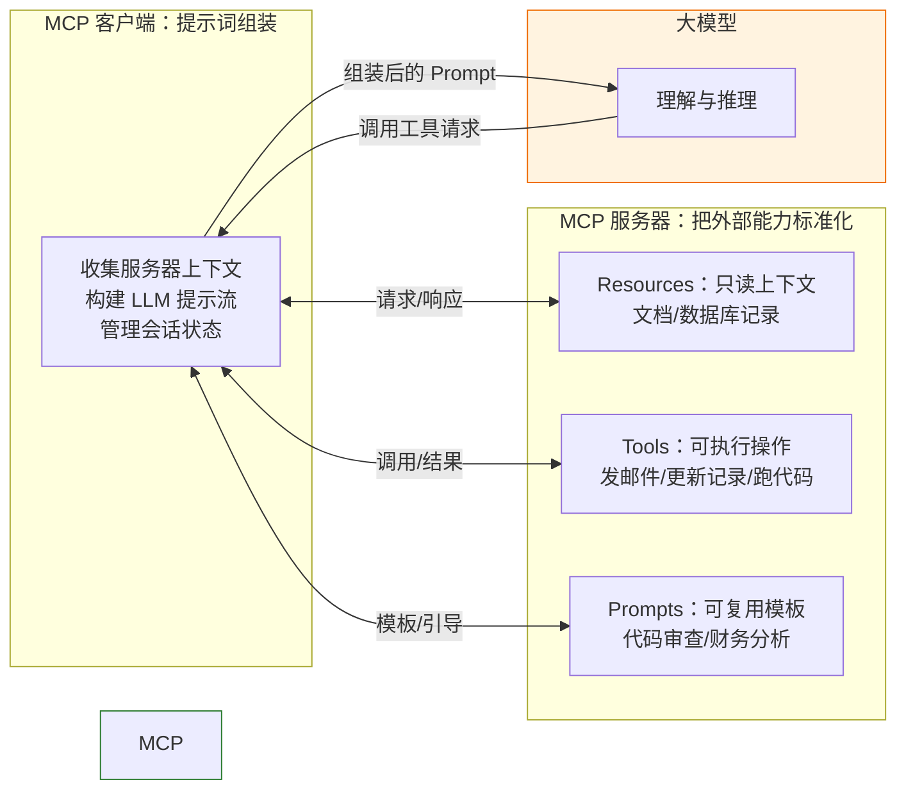
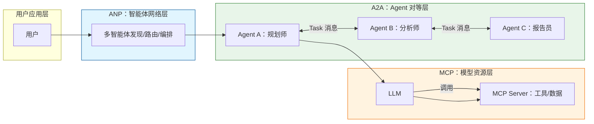

# 智能体通信协议 —— MCP、A2A、ANP 等协议解析

> 面试生普（LLM 500 题）· 智能体通信协议篇。本章覆盖智能体为什么需要通信协议、MCP（模型上下文协议）架构与三大基元（Resources/Tools/Prompts）、A2A（Agent-to-Agent 协议）与 Task 生命周期、ANP（Agent Network Protocol）介绍、三大协议横向对比表、MCP 三层 Client-Host-Server 架构、手撕 Python 代码（MCP 客户端-服务器 JSON-RPC 示例、A2A Agent Card 和 Task 生命周期示例）、协议局限与安全注意事项、本章小结，共 10 个问题。正文面向“会一点编程语言和深度学习基础，除此之外没有任何其他背景”的读者，每个部分都配大白话解释、完整 Python 代码和 mermaid/ASCII 图。

---

## Q1. 为什么智能体需要通信协议？不用协议直接调用不行吗？

**回答**

如果你写过智能体代码，肯定碰过这种情况：这个智能体要调搜索引擎，得写一套搜索 API 的调用代码；要连数据库，又得写一套数据库驱动；要调另一个智能体，又得自己定义消息格式。每个智能体和每个外部资源之间，都是“一对一”的定制集成。

用大白话说：**不用协议，每新增一个模型或一个外部资源，都要写大量定制适配器，集成成本爆炸。** 这就是业界说的“N×M 集成悖论”——N 个模型，每个都要连 M 个外部资源，传统模式下要写 N×M 套适配器。

---

### 通信协议解决的核心问题

| 没协议（直接调用） | 有协议（标准化） |
|-----------------|----------------|
| 每个模型-资源对都要写定制适配器 | 每个模型只需实现协议客户端，每个资源只需实现协议服务器 |
| 换个模型，所有集成都要重写 | 换模型，协议不变，集成复用 |
| 智能体之间互不认识，不会对话 | 智能体按协议发现彼此能力、交换任务 |
| 集成成本是 N×M（爆炸） | 集成成本是 N+M（线性） |

---

### 通信协议是什么？

**通信协议**，大白话就是“一套大家都认可的说话规矩”。它规定了：

- 消息长什么样（格式，比如 JSON-RPC 2.0）；
- 怎么发现对方能力（比如 Agent Card）；
- 任务怎么分配、怎么执行、怎么反馈；
- 安全怎么保证（认证、授权、沙箱）。

有了协议，智能体和外部资源就能“即插即用”，像电脑插 USB 设备一样，不用为每个设备写驱动。

---

### 用 ASCII 图表示 N×M 悖论和协议的价值

```
没有协议（N×M 定制集成）：
模型 A ──→ 资源 1 (写适配器)
模型 A ──→ 资源 2 (写适配器)
模型 B ──→ 资源 1 (写适配器)
模型 B ──→ 资源 2 (写适配器)
...共 N×M 套适配器

有协议（N+M 标准化）：
模型 A ──┐
模型 B ──┼──→ 协议客户端 ──→ 协议服务器 ──→ 资源 1
模型 C ──┘                           └──→ 资源 2
...共 N 套客户端 + M 套服务器

协议被业界称为“AI 领域的 USB-C 接口”。
```

**面试要点**：智能体需要通信协议，是为了解决“N×M 集成悖论”，让模型和外部资源按统一规矩对话，集成成本从 N×M 降到 N+M，实现即插即用。协议规定了消息格式、能力发现、任务分配、安全保障。

---

## Q2. MCP（模型上下文协议）是什么？核心架构和三大基元？

**回答**

MCP（Model Context Protocol，模型上下文协议）是 Anthropic 于 2024 年 11 月引入的开放标准，迅速获得 OpenAI、Google DeepMind 等厂商采纳。它的目标是让大模型能够高效、安全地连接企业级异构数据源、API 和专业工具。

业界形象地把 MCP 称为 **“AI 领域的 USB-C 接口”**——以前每个外设都要专门插口，现在统一成一个接口，即插即用。

---

### MCP 的核心架构：Client-Host-Server 三层模型

MCP 采用了“客户端-宿主-服务器（Client-Host-Server）”三层物理隔离模型：

| 角色 | 大白话解释 | 例子 |
|------|-----------|------|
| **Host（宿主）** | 最高级别协调者，管理多个 MCP 客户端，负责安全策略决策 | Claude Desktop、Cursor IDE |
| **Client（客户端）** | 嵌入在宿主内，与特定 MCP 服务器建立一对一隔离连接，负责“提示词组装”和会话状态管理 | 宿主内的 MCP 客户端实例 |
| **Server（服务器）** | 功能供给端，轻量级标准化包装组件，把外部能力转成标准协议语言 | 文件系统服务器、数据库服务器、搜索服务器 |

三层隔离确保了在复杂交互环境下能够维持清晰的逻辑边界与安全隔离。

---

### MCP 的三大基元（Resources / Tools / Prompts）

MCP 服务器通过三大核心基元，把碎片化的外部能力转化为标准化的协议语言：

| 基元 | 大白话解释 | 例子 |
|------|-----------|------|
| **Resources（资源）** | 只读终端，提供文档、数据库记录等静态上下文，减少模型幻觉 | 公司知识库文档、数据库记录 |
| **Tools（工具）** | 赋予模型执行实际操作的能力 | 发送邮件、更新财务记录、调用代码执行环境 |
| **Prompts（提示词）** | 可复用的交互模板，引导模型在垂直领域内遵循一致工作流 | 代码审查模板、财务分析模板 |

---

### MCP 的关键机制

1. **基于 JSON-RPC 2.0**：消息流规范成熟，扩展性好；
2. **能力协商（Capability Negotiation）**：客户端与服务器在交互初期明确双方支持的功能集合，支持动态服务发现、跨平台互操作性、版本兼容性管理；
3. **双向连接**：模型不仅能读资源，还能调用工具改变世界。

---

### 用 ASCII 图表示 MCP 架构

```
MCP 三层架构（Client-Host-Server）：

┌─────────────────────────────────────────────────────────────┐
│                    Host（宿主）                                │
│  (Claude Desktop / Cursor IDE 等)                            │
│  - 管理多个 MCP 客户端生命周期                                │
│  - 全局安全策略决策点                                          │
└──────────┬────────────────────────────────────────────────────┘
           │
    ┌──────▼──────┐
    │ Client 1    │ │ Client 2    │  │ Client N    │
    │ (提示词组装)  │ │ (提示词组装)  │ │ (提示词组装)  │
    └──────┬──────┘ └──────┬──────┘ └──────┬──────┘
           │               │               │
    ┌──────▼──────┐ ┌──────▼──────┐ ┌──────▼──────┐
    │ Server 1    │ │ Server 2    │ │ Server N    │
    │ (文件系统)    │ │ (数据库)      │ │ (搜索引擎)    │
    │ Resources/  │ │ Resources/    │ │ Resources/    │
    │ Tools/      │ │ Tools/        │ │ Tools/        │
    │ Prompts     │ │ Prompts       │ │ Prompts       │
    └─────────────┘ └─────────────┘ └─────────────┘
```

---

### 用 mermaid 表示 MCP 三大基元



**面试要点**：MCP 是 Anthropic 2024 年 11 月引入的开放标准，被称为“AI 领域的 USB-C 接口”。核心架构是 Client-Host-Server 三层模型；三大基元是 Resources（只读上下文）、Tools（可执行操作）、Prompts（可复用模板）。基于 JSON-RPC 2.0，支持能力协商和双向连接。

---

## Q3. A2A（Agent-to-Agent 协议）是什么？和 MCP 有什么区别？

**回答**

如果 MCP 是“模型连外部资源（工具/数据）”的协议，那 A2A（Agent-to-Agent 协议）就是“智能体之间互相通信协作”的协议。

A2A 由 Google 于 2025 年 4 月发布，同年 12 月捐赠给 Linux 基金会，2026 年 3 月由 Agent API Initiative (AAIF) 接管治理。它定位为 **独立 Agent 系统之间的对等协作协议**——核心理念是让 Agent 作为“对等方”（peer）直接通信，而非被当作工具调用。

---

### A2A 的核心特性

| 特性 | 大白话解释 |
|------|-----------|
| **Agent Card 发现** | Agent 通过 AgentCard 暴露自己的能力、技能、认证方式，别的 Agent 能发现它会干什么 |
| **Task 生命周期** | 支持异步长任务，状态包括 working、completed、failed、canceled、input_required |
| **企业级安全** | 协议规范定义认证、授权、可观测性标准 |
| **多模态交互** | 支持文本、文件、JSON 结构化数据 |

---

### MCP vs A2A：核心区别

| 维度 | MCP | A2A |
|------|-----|-----|
| 核心定位 | 模型连外部资源（工具/数据） | Agent 间对等协作 |
| 角色关系 | LLM 调用工具（主从） | Agent 作为对等方直接通信 |
| 任务发起 | LLM 调用 tools/call | Agent 直接发送消息 |
| 任务控制 | 客户端通过 tasks/get/update/cancel 推动 | Agent 原生支持任务状态轮询、推送通知 |
| 上下文传递 | 工具调用无上下文传递，每次独立 | 支持上下文在 Agent 间传递，保持协作连续性 |
| 适用场景 | 单个工具的异步执行（如长时间数据库查询） | 多个 Agent 协作编排（如 Planner → Analyst → Reporter） |

---

### 用 ASCII 图表示 MCP vs A2A 的区别

```
MCP（模型调用工具，主从关系）：

用户 ──→ LLM ──→ MCP Client ──→ MCP Server ──→ 外部工具/数据
                (主)              (从)
         “调用这个工具”   “执行并返回结果”


A2A（Agent 间对等协作，Peer-to-Peer）：

Agent A (规划师) ─────────────→ Agent B (分析师)
      “处理这个任务”              “已完成，中间结果如下”
              ←─────────────────
         Agent C (报告员) ←──── Agent B
              “基于中间结果写报告”
         三个 Agent 对等通信，互相传递上下文和中间结果
```

**面试要点**：MCP 解决“模型连外部资源（主从关系）”，A2A 解决“Agent 间对等协作（Peer-to-Peer）”。MCP 的任务由 LLM 发起，A2A 的任务由 Agent 直接发送消息；A2A 支持上下文在 Agent 间传递，MCP 的工具调用每次独立。

---

## Q4. ANP（Agent Network Protocol）是什么？

**回答**

ANP（Agent Network Protocol，智能体网络协议）是智能体通信协议生态中的另一位成员。相较于 MCP（模型连资源）和 A2A（Agent 间对等协作），ANP 更侧重于**智能体网络层面的通信与编排**——即多个智能体组成网络时，如何发现、寻址、路由、协作。

---

### ANP 的核心理念（大白话）

如果把 MCP 比作“USB-C 接口”（单个设备连外设），把 A2A 比作“两个智能体打电话”（点对点对话），那 ANP 就更像“智能体局域网/广域网协议”——规定了多个智能体在一个网络里怎么互相找到、怎么传消息、怎么协同完成大任务。

ANP 关注的问题包括：

- **智能体发现**：网络里新加入一个智能体，其他智能体怎么知道它会干什么？
- **消息路由**：消息从 Agent A 发给 Agent B，中间怎么路由？
- **网络编排**：多个智能体组成流水线，任务怎么流转？
- **容错与可观测性**：一个智能体挂了，网络里其他智能体怎么知道、怎么接手？

---

### ANP 与 MCP/A2A 的关系（大白话）

| 协议 | 像什么 | 解决什么 |
|------|--------|----------|
| MCP | USB-C 接口 | 单个模型连外部资源（工具/数据） |
| A2A | 两个智能体打电话 | Agent 间点对点对等协作 |
| ANP | 智能体局域网协议 | 多智能体组网、发现、路由、编排 |

三者不是替代关系，可以互补：MCP 让智能体能用工具，A2A 让两个智能体能对话，ANP 让一群智能体能组网协作。

---

### 用 ASCII 图表示三者关系

```
智能体通信协议生态：

┌─────────────────────────────────────────────────────────────┐
│                    应用层：智能体应用                          │
└──────────┬────────────────────────────────────────────────────┘
           │
    ┌──────▼──────┐
    │   ANP       │  智能体网络协议：多智能体组网、发现、路由、编排
    │ (网络层)    │  适用：大规模多智能体系统、跨组织协作
    └──────┬──────┘
           │
    ┌──────▼──────┐
    │   A2A       │  Agent-to-Agent 协议：Agent 间对等协作
    │ (对等层)    │  适用：Planner→Analyst→Reporter 多 Agent 链式调用
    └──────┬──────┘
           │
    ┌──────▼──────┐
    │   MCP       │  模型上下文协议：模型连外部资源（工具/数据）
    │ (资源层)    │  适用：调用搜索、数据库、代码执行器等
    └─────────────┘
```

**面试要点**：ANP 是智能体网络协议，侧重多智能体组网、发现、路由、编排。与 MCP（模型连资源）、A2A（Agent 间对等协作）相比，ANP 更侧重网络层面的多智能体协作。三者互补，可共同构成智能体通信协议生态。

---

## Q5. 三大协议（MCP/A2A/ANP）横向对比表

**回答**

为了让你更清晰地对比三个协议，下面是一个横向对比表。具体细节可能随协议版本更新，选型时请以官方文档为准。

---

### 三协议横向对比表

| 维度 | MCP | A2A | ANP |
|------|-----|-----|-----|
| 全称 | Model Context Protocol | Agent-to-Agent Protocol | Agent Network Protocol |
| 核心定位 | 模型连外部资源（工具/数据） | Agent 间对等协作 | 多智能体网络通信与编排 |
| 主要推动方 | Anthropic | Google（后由 Linux 基金会/AAIF 治理） | 多方研究与开源社区 |
| 角色关系 | LLM 调用工具（主从） | Agent 作为对等方直接通信 | 多智能体组网，分布式寻址 |
| 消息格式 | JSON-RPC 2.0 | JSON-RPC 2.0 over HTTP(S) | 协议自定义/可扩展 |
| 能力发现 | 服务器暴露 Resources/Tools/Prompts | AgentCard 暴露能力与技能 | 网络层智能体发现与寻址 |
| 任务模型 | 单次工具调用（Tasks 扩展支持异步） | Task 生命周期（working/completed/failed 等） | 网络级任务流转与编排 |
| 上下文传递 | 工具调用独立，无上下文传递 | 支持上下文在 Agent 间传递 | 支持跨网络节点的上下文传递 |
| 适用场景 | 调用搜索、数据库、代码执行器 | Planner→Analyst→Reporter 多 Agent 编排 | 大规模多智能体系统、跨组织协作 |
| 治理方 | Anthropic 主导，开放标准 | Linux 基金会 / AAIF | 开源社区 |
| 成熟度 | 较高，生态丰富 | 较高，14+ 官方 SDK | 相对较新，生态在建设 |

---

### 选型建议（大白话）

| 你的场景 | 推荐协议 | 原因 |
|---------|---------|------|
| 让模型调搜索、数据库、代码执行器 | MCP | 这是 MCP 的本职工作，生态最丰富 |
| 多个 Agent 链式协作（规划→分析→报告） | A2A | Agent 间对等协作，支持任务生命周期和上下文传递 |
| 大规模多智能体组网、跨组织协作 | ANP | 侧重网络层发现、路由、编排 |
| 不确定，先小规模试水 | MCP 或 A2A | 两者生态最成熟，文档和 SDK 最完善 |

**一句话口诀**：

> **要用工具，选 MCP；要 Agent 聊天协作，选 A2A；要 Agent 组网编排，选 ANP。**

---

### 用 mermaid 表示三协议协同关系



**面试要点**：三协议对比时要抓住核心差异：MCP 侧重模型连资源（主从），A2A 侧重 Agent 间对等协作（Peer-to-Peer，任务生命周期），ANP 侧重多智能体网络通信与编排。选型时从业务场景出发。

---

## Q6. MCP 的三层架构（Client-Host-Server）怎么工作？

**回答**

MCP 的三层架构是它的核心设计，理解了这三层，就理解了 MCP 怎么把“模型连外部资源”这件事做标准化的。下面咱们用大白话把每一层在干什么、怎么协作，讲清楚。

---

### 第一层：Host（宿主）

Host 是最高级别的协调者，比如 Claude Desktop、Cursor IDE 这种应用程序。它的职责：

- 管理多个 MCP 客户端的生命周期（启动、停止、切换）；
- 作为全局安全策略实施的决策点，确保用户的授权意图准确穿透到底层执行链路；
- 决定哪个客户端能连哪个服务器，什么时候允许调用什么工具。

**大白话**：Host 像“总管”，管着所有客户端，拍安全决定。

---

### 第二层：Client（客户端）

Client 嵌入在宿主应用内，与特定的 MCP 服务器建立一对一的隔离连接。它的核心职能是 **“提示词组装（Prompt Orchestration）”**：

- 收集来自服务器的上下文数据（Resources 返回的内容、Tools 的调用结果）；
- 构建出 LLM 能理解的高质量复杂提示流；
- 负责会话状态的精细化管理。

**大白话**：Client 像“翻译官”，把服务器返回的数据整理成模型听得懂的话。

---

### 第三层：Server（服务器）

Server 是协议的功能供给端，轻量级标准化包装组件。它通过三大基元（Resources/Tools/Prompts）把外部能力转成标准协议语言：

- Resources：提供静态上下文（文档、数据库记录）；
- Tools：提供可执行操作（发邮件、更新记录、跑代码）；
- Prompts：提供可复用交互模板。

**大白话**：Server 像“外卖平台”，把各种外部能力标准化包装，供模型调用。

---

### 三层协作流程（ASCII）

```
用户在 Host 里说：“帮我查一下订单 #12345 的状态”

     Host（总管）
        │
        ▼
     Client（翻译官）
        │  1. 组装提示词：用户要查订单，调用 order 查询工具
        ▼
     Server（外卖平台）
        │  2. 执行 Tools：调用数据库查询订单 #12345
        ▼
     外部数据库
        │  3. 返回结果：订单 #12345 已发货
        ▼
     Server ─────────────────────┐
        │  4. 返回标准化结果      │
        ▼                         │
     Client ◄─────────────────────┘
        │  5. 组装成模型听得懂的提示
        ▼
     LLM（模型）
        │  6. 生成回答：您的订单 #12345 已发货，预计 3 天送达
        ▼
     用户
```

**面试要点**：MCP 三层架构：Host 管理客户端生命周期和安全策略（总管）；Client 负责提示词组装和会话状态（翻译官）；Server 提供 Resources/Tools/Prompts 三大基元（外卖平台）。三层协作流程是：用户请求→Host 协调→Client 组装提示→Server 调用工具→外部资源返回→Client 整理结果→LLM 生成回答→用户。

---

## Q7. 手撕 Python 代码：MCP 客户端-服务器简单示例（JSON-RPC 2.0）

**回答**

MCP 基于 JSON-RPC 2.0 消息流规范。下面咱们用 Python 手撕一个最小可用的 MCP 客户端-服务器示例，演示 MCP 的核心思想：客户端向服务器请求能力（Resources/Tools/Prompts），调用工具，获取结果。

> 注意：下面的代码是**概念版**，演示 MCP 的 JSON-RPC 通信骨架和三大基元思想。真实使用 MCP 时，请安装官方 SDK（`pip install mcp-sdk` 或相关包）并参考官方文档，API 可能与本示例不同。

---

### 完整代码：mcp_demo.py

```python
"""
mcp_demo.py：MCP 客户端-服务器简单示例（概念版）
演示 MCP 的 JSON-RPC 2.0 通信骨架和三大基元（Resources/Tools/Prompts）。
不依赖真实 MCP SDK，纯 Python 演示协议交互流程。
"""

import json
import uuid
from typing import Any, Dict, List, Optional


# ==================== JSON-RPC 2.0 消息辅助 ====================

def make_rpc_request(method: str, params: Optional[Dict[str, Any]] = None, request_id: Optional[str] = None) -> Dict[str, Any]:
    """构建 JSON-RPC 2.0 请求消息。"""
    return {
        "jsonrpc": "2.0",
        "id": request_id or str(uuid.uuid4()),
        "method": method,
        "params": params or {},
    }


def make_rpc_result(request_id: str, result: Any) -> Dict[str, Any]:
    """构建 JSON-RPC 2.0 成功响应。"""
    return {
        "jsonrpc": "2.0",
        "id": request_id,
        "result": result,
    }


def make_rpc_error(request_id: str, code: int, message: str) -> Dict[str, Any]:
    """构建 JSON-RPC 2.0 错误响应。"""
    return {
        "jsonrpc": "2.0",
        "id": request_id,
        "error": {"code": code, "message": message},
    }


# ==================== MCP 服务器 ====================

class MCPServer:
    """MCP 服务器：暴露 Resources/Tools/Prompts 三大基元。"""

    def __init__(self, name: str = "演示 MCP 服务器"):
        self.name = name
        # 三大基元注册表
        self.resources: Dict[str, Dict[str, Any]] = {}
        self.tools: Dict[str, Dict[str, Any]] = {}
        self.prompts: Dict[str, Dict[str, Any]] = {}

    def register_resource(self, uri: str, description: str, content: str) -> None:
        """注册一个资源（只读上下文）。"""
        self.resources[uri] = {
            "uri": uri,
            "description": description,
            "content": content,
        }

    def register_tool(self, name: str, description: str, handler) -> None:
        """注册一个工具（可执行操作）。"""
        self.tools[name] = {
            "name": name,
            "description": description,
            "handler": handler,
        }

    def register_prompt(self, name: str, description: str, template: str) -> None:
        """注册一个提示词模板。"""
        self.prompts[name] = {
            "name": name,
            "description": description,
            "template": template,
        }

    def handle_request(self, request: Dict[str, Any]) -> Dict[str, Any]:
        """处理一个 JSON-RPC 请求。"""
        method = request.get("method", "")
        params = request.get("params", {})
        request_id = request.get("id", "")

        # 列出所有资源
        if method == "resources/list":
            return make_rpc_result(request_id, {
                "resources": [
                    {"uri": uri, "description": v["description"]}
                    for uri, v in self.resources.items()
                ]
            })

        # 读取指定资源
        elif method == "resources/read":
            uri = params.get("uri", "")
            if uri in self.resources:
                return make_rpc_result(request_id, self.resources[uri])
            return make_rpc_error(request_id, -32602, f"资源未找到：{uri}")

        # 列出所有工具
        elif method == "tools/list":
            return make_rpc_result(request_id, {
                "tools": [
                    {"name": v["name"], "description": v["description"]}
                    for v in self.tools.values()
                ]
            })

        # 调用指定工具
        elif method == "tools/call":
            tool_name = params.get("name", "")
            tool_args = params.get("arguments", {})
            if tool_name in self.tools:
                handler = self.tools[tool_name]["handler"]
                try:
                    result = handler(**tool_args)
                    return make_rpc_result(request_id, {"content": result})
                except Exception as e:
                    return make_rpc_error(request_id, -32603, f"工具执行失败：{e}")
            return make_rpc_error(request_id, -32602, f"工具未找到：{tool_name}")

        # 列出所有提示词
        elif method == "prompts/list":
            return make_rpc_result(request_id, {
                "prompts": [
                    {"name": v["name"], "description": v["description"]}
                    for v in self.prompts.values()
                ]
            })

        # 获取指定提示词
        elif method == "prompts/get":
            name = params.get("name", "")
            if name in self.prompts:
                return make_rpc_result(request_id, self.prompts[name])
            return make_rpc_error(request_id, -32602, f"提示词未找到：{name}")

        else:
            return make_rpc_error(request_id, -32601, f"未知方法：{method}")


# ==================== 演示工具处理函数 ====================

def get_weather(city: str) -> str:
    """演示天气工具处理函数。"""
    weather_db = {
        "北京": "北京今天晴朗，15°C，湿度30%。",
        "上海": "上海今天多云，22°C，湿度65%。",
        "广州": "广州今天阵雨，28°C，湿度80%。",
    }
    return weather_db.get(city, f"未找到 {city} 的天气信息。")


# ==================== MCP 客户端 ====================

class MCPClient:
    """MCP 客户端：向服务器发送请求，解析响应。"""

    def __init__(self, server: MCPServer):
        self.server = server

    def send_request(self, request: Dict[str, Any]) -> Dict[str, Any]:
        """向服务器发送请求并返回响应（演示版：直接调用服务器 handle_request）。"""
        return self.server.handle_request(request)

    def list_resources(self) -> List[Dict[str, Any]]:
        req = make_rpc_request("resources/list")
        resp = self.send_request(req)
        return resp.get("result", {}).get("resources", [])

    def read_resource(self, uri: str) -> Optional[Dict[str, Any]]:
        req = make_rpc_request("resources/read", {"uri": uri})
        resp = self.send_request(req)
        if "error" in resp:
            print(f"[客户端] 读取资源失败：{resp['error']['message']}")
            return None
        return resp.get("result")

    def list_tools(self) -> List[Dict[str, Any]]:
        req = make_rpc_request("tools/list")
        resp = self.send_request(req)
        return resp.get("result", {}).get("tools", [])

    def call_tool(self, name: str, arguments: Dict[str, Any]) -> Optional[str]:
        req = make_rpc_request("tools/call", {"name": name, "arguments": arguments})
        resp = self.send_request(req)
        if "error" in resp:
            print(f"[客户端] 调用工具失败：{resp['error']['message']}")
            return None
        return resp.get("result", {}).get("content")

    def list_prompts(self) -> List[Dict[str, Any]]:
        req = make_rpc_request("prompts/list")
        resp = self.send_request(req)
        return resp.get("result", {}).get("prompts", [])


# ==================== 使用示例 ====================

if __name__ == "__main__":
    # 初始化服务器并注册三大基元
    server = MCPServer("演示服务器")

    server.register_resource(
        uri="file://company_policy.txt",
        description="公司报销制度文档",
        content="单餐报销上限 200 元，交通费单程上限 100 元。",
    )

    server.register_tool(
        name="get_weather",
        description="查询指定城市天气",
        handler=get_weather,
    )

    server.register_prompt(
        name="expense_review",
        description="费用审查提示词模板",
        template="你是一个费用审查员，请根据公司报销制度审查以下费用申请：{{expense}}",
    )

    # 初始化客户端
    client = MCPClient(server)

    print("=== MCP 客户端-服务器演示 ===\n")

    # 1. 列出资源
    print("[1] 列出资源：")
    for r in client.list_resources():
        print(f"   - {r['uri']}: {r['description']}")

    # 2. 读取资源
    print("\n[2] 读取资源 file://company_policy.txt：")
    res = client.read_resource("file://company_policy.txt")
    if res:
        print(f"   内容：{res['content']}")

    # 3. 列出工具
    print("\n[3] 列出工具：")
    for t in client.list_tools():
        print(f"   - {t['name']}: {t['description']}")

    # 4. 调用工具
    print("\n[4] 调用工具 get_weather（北京）：")
    result = client.call_tool("get_weather", {"city": "北京"})
    if result:
        print(f"   结果：{result}")

    # 5. 列出提示词
    print("\n[5] 列出提示词：")
    for p in client.list_prompts():
        print(f"   - {p['name']}: {p['description']}")

    print("\n=== 演示结束 ===")
```

**运行输出示例：**

```
=== MCP 客户端-服务器演示 ===

[1] 列出资源：
   - file://company_policy.txt: 公司报销制度文档

[2] 读取资源 file://company_policy.txt：
   内容：单餐报销上限 200 元，交通费单程上限 100 元。

[3] 列出工具：
   - get_weather: 查询指定城市天气

[4] 调用工具 get_weather（北京）：
   结果：北京今天晴朗，15°C，湿度30%。

[5] 列出提示词：
   - expense_review: 费用审查提示词模板

=== 演示结束 ===
```

---

### 这段代码演示了 MCP 的哪些核心思想？

1. **JSON-RPC 2.0 通信**：`make_rpc_request` / `make_rpc_result` / `make_rpc_error` 构建标准消息；
2. **三大基元**：服务器分别注册 Resources、Tools、Prompts，客户端可以分别列出和读取/调用；
3. **客户端-服务器解耦**：客户端不需要知道服务器内部怎么实现，只通过标准方法（resources/list、tools/call 等）交互；
4. **能力发现**：客户端先 list 再 read/call，体现“先发现能力，再使用”。

**面试要点**：手撕 MCP 代码时要体现：JSON-RPC 2.0 消息格式、三大基元（Resources/Tools/Prompts）的注册与发现、客户端-服务器解耦、标准方法（resources/list、tools/call、prompts/list 等）。

---

## Q8. 手撕 Python 代码：A2A Agent Card 和 Task 生命周期简单示例

**回答**

A2A 是 Agent 间对等协作协议，其核心概念包括 **Agent Card**（能力发现）和 **Task 生命周期**（working/completed/failed/canceled/input_required）。下面咱们用 Python 手撕一个最小可用的 A2A 示例，演示两个 Agent 如何通过 Agent Card 发现彼此能力，并创建任务、追踪状态。

> 注意：下面的代码是**概念版**，演示 A2A 的 Agent Card 和 Task 生命周期思想。真实使用 A2A 时，请参考官方 SDK 和文档（Google 官方及 AAIF 提供的 14+ 语言 SDK），API 可能与本示例不同。

---

### 完整代码：a2a_demo.py

```python
"""
a2a_demo.py：A2A Agent Card 和 Task 生命周期简单示例（概念版）
演示两个 Agent 如何通过 Agent Card 发现能力，并创建任务、追踪状态。
"""

import uuid
from dataclasses import dataclass, field, asdict
from typing import Any, Dict, List, Optional
from datetime import datetime


# ==================== Task 状态 ====================

class TaskStatus:
    PENDING = "pending"
    WORKING = "working"
    COMPLETED = "completed"
    FAILED = "failed"
    CANCELED = "canceled"
    INPUT_REQUIRED = "input_required"


# ==================== Agent Card ====================

@dataclass
class AgentSkill:
    """Agent 技能描述。"""
    name: str
    description: str
    input_modes: List[str] = field(default_factory=lambda: ["text"])
    output_modes: List[str] = field(default_factory=lambda: ["text"])


@dataclass
class AgentCard:
    """Agent Card：Agent 暴露自己的能力、技能、认证方式，供别的 Agent 发现。"""
    agent_id: str
    name: str
    description: str
    url: str
    skills: List[AgentSkill]
    version: str = "1.0.0"

    def to_dict(self) -> Dict[str, Any]:
        return {
            "agent_id": self.agent_id,
            "name": self.name,
            "description": self.description,
            "url": self.url,
            "skills": [asdict(s) for s in self.skills],
            "version": self.version,
        }


# ==================== Task ====================

@dataclass
class Task:
    """A2A Task：Agent 间协作的任务生命周期。"""
    task_id: str
    sender_agent_id: str
    receiver_agent_id: str
    skill_name: str
    input_data: Any
    status: str = TaskStatus.PENDING
    output_data: Any = None
    created_at: str = field(default_factory=lambda: datetime.now().isoformat())
    updated_at: str = field(default_factory=lambda: datetime.now().isoformat())

    def to_dict(self) -> Dict[str, Any]:
        return asdict(self)


# ==================== Agent（A2A 参与方） ====================

class A2AAgent:
    """A2A Agent：能发布 Agent Card、接收任务、执行技能、返回结果。"""

    def __init__(self, agent_id: str, name: str, description: str, url: str):
        self.agent_id = agent_id
        self.name = name
        self.description = description
        self.url = url
        self.skills: Dict[str, AgentSkill] = {}
        self.tasks: Dict[str, Task] = {}

    def register_skill(self, name: str, description: str) -> None:
        """注册一个技能。"""
        self.skills[name] = AgentSkill(name=name, description=description)

    def get_agent_card(self) -> AgentCard:
        """获取本 Agent 的 Agent Card（能力发现）。"""
        return AgentCard(
            agent_id=self.agent_id,
            name=self.name,
            description=self.description,
            url=self.url,
            skills=list(self.skills.values()),
        )

    def create_task(self, receiver: "A2AAgent", skill_name: str, input_data: Any) -> Task:
        """向另一个 Agent 创建任务。"""
        task = Task(
            task_id=str(uuid.uuid4()),
            sender_agent_id=self.agent_id,
            receiver_agent_id=receiver.agent_id,
            skill_name=skill_name,
            input_data=input_data,
        )
        self.tasks[task.task_id] = task
        receiver.receive_task(task)
        return task

    def receive_task(self, task: Task) -> None:
        """接收来自别的 Agent 的任务。"""
        self.tasks[task.task_id] = task
        print(f"[{self.name}] 接收任务 {task.task_id[:8]}：{task.skill_name}")
        self._execute_task(task)

    def _execute_task(self, task: Task) -> None:
        """执行任务（演示版：根据技能名返回固定结果）。"""
        task.status = TaskStatus.WORKING
        task.updated_at = datetime.now().isoformat()
        print(f"[{self.name}] 任务 {task.task_id[:8]} 开始执行...")

        # 演示版：根据技能名模拟执行
        if task.skill_name == "weather_query":
            city = task.input_data if isinstance(task.input_data, str) else "未知城市"
            task.output_data = f"{city} 今天晴朗，22°C。（A2A 演示数据）"
        elif task.skill_name == "calculation":
            task.output_data = f"计算结果：{task.input_data} = 42。（A2A 演示数据）"
        else:
            task.output_data = f"未知技能：{task.skill_name}"

        task.status = TaskStatus.COMPLETED
        task.updated_at = datetime.now().isoformat()
        print(f"[{self.name}] 任务 {task.task_id[:8]} 已完成：{task.output_data}")

    def get_task_status(self, task_id: str) -> Optional[str]:
        """查询任务状态。"""
        task = self.tasks.get(task_id)
        return task.status if task else None

    def get_task_result(self, task_id: str) -> Any:
        """获取任务结果。"""
        task = self.tasks.get(task_id)
        return task.output_data if task else None


# ==================== 使用示例 ====================

if __name__ == "__main__":
    # 创建两个 Agent：规划师（Planner）和分析师（Analyst）
    planner = A2AAgent(
        agent_id="planner_001",
        name="规划师 Agent",
        description="负责拆解任务，分配给合适的 Agent",
        url="http://planner.example.com",
    )
    analyst = A2AAgent(
        agent_id="analyst_001",
        name="分析师 Agent",
        description="负责查询天气和计算数据",
        url="http://analyst.example.com",
    )

    # 注册技能
    analyst.register_skill("weather_query", "查询指定城市天气")
    analyst.register_skill("calculation", "执行数学计算")

    print("=== A2A Agent Card 发现演示 ===\n")

    # 规划师发现分析师的能力（通过 Agent Card）
    analyst_card = analyst.get_agent_card()
    print(f"[发现] {analyst_card.name} 的技能：")
    for skill in analyst_card.skills:
        print(f"   - {skill.name}: {skill.description}")

    print("\n=== A2A Task 生命周期演示 ===\n")

    # 规划师向分析师创建任务：查天气
    task1 = planner.create_task(analyst, "weather_query", "北京")
    print(f"\n[任务 {task1.task_id[:8]}] 当前状态：{planner.get_task_status(task1.task_id)}")
    print(f"[任务 {task1.task_id[:8]}] 结果：{planner.get_task_result(task1.task_id)}")

    # 规划师向分析师创建任务：计算
    task2 = planner.create_task(analyst, "calculation", "(23 + 47) * 2")
    print(f"\n[任务 {task2.task_id[:8]}] 当前状态：{planner.get_task_status(task2.task_id)}")
    print(f"[任务 {task2.task_id[:8]}] 结果：{planner.get_task_result(task2.task_id)}")

    print("\n=== 演示结束 ===")
```

**运行输出示例：**

```
=== A2A Agent Card 发现演示 ===

[发现] 分析师 Agent 的技能：
   - weather_query: 查询指定城市天气
   - calculation: 执行数学计算

=== A2A Task 生命周期演示 ===

[分析师 Agent] 接收任务 a1b2c3d4：weather_query
[分析师 Agent] 任务 a1b2c3d4 开始执行...
[分析师 Agent] 任务 a1b2c3d4 已完成：北京 今天晴朗，22°C。（A2A 演示数据）

[任务 a1b2c3d4] 当前状态：completed
[任务 a1b2c3d4] 结果：北京 今天晴朗，22°C。（A2A 演示数据）

[分析师 Agent] 接收任务 e5f6g7h8：calculation
[分析师 Agent] 任务 e5f6g7h8 开始执行...
[分析师 Agent] 任务 e5f6g7h8 已完成：计算结果：(23 + 47) * 2 = 42。（A2A 演示数据）

[任务 e5f6g7h8] 当前状态：completed
[任务 e5f6g7h8] 结果：计算结果：(23 + 47) * 2 = 42。（A2A 演示数据）

=== 演示结束 ===
```

---

### 这段代码演示了 A2A 的哪些核心思想？

1. **Agent Card（能力发现）**：`get_agent_card()` 暴露 Agent 的名称、描述、技能列表，别的 Agent 可以通过它知道“我能做什么”；
2. **Task 生命周期**：`Task` 状态流转 pending → working → completed，体现 A2A 对异步长任务的支持；
3. **Agent 间对等通信**：`create_task()` 由一个 Agent 直接向另一个 Agent 发送任务，不需要中间的“工具调用”主从关系；
4. **任务结果查询**：`get_task_status()` / `get_task_result()` 体现任务状态轮询和结果获取。

**面试要点**：手撕 A2A 代码时要体现：Agent Card 能力发现、Task 生命周期（pending/working/completed/failed/canceled/input_required）、Agent 间对等创建任务、任务状态和结果查询。

---

## Q9. 协议的局限和安全注意事项

**回答**

通信协议很好用，但也有局限和安全风险。下面咱们用大白话把协议层容易踩的坑挑明。

---

### 局限 1：协议之间不是简单替代，选错会增加复杂度

MCP、A2A、ANP 各有侧重，不是“哪个更好就只用哪个”。比如用 A2A 做单个工具调用属于“杀鸡用牛刀”，用 MCP 做多 Agent 组网则力不从心。

**应对**：从业务场景出发选型，必要时协议混合使用（MCP 做工具调用，A2A 做 Agent 对话，ANP 做组网编排）。

---

### 局限 2：动态发现带来安全风险

协议支持动态发现能力（Agent Card、服务器能力协商），但这也意味着恶意智能体可以伪装成正常智能体接入网络，进行“拉 rug”攻击（突然表现恶意，绕过初始检查）。

**应对**：对接入的智能体做身份认证和授权；能力声明与实际行为做一致性检查；关键操作加人工确认。

---

### 局限 3：沙箱逃逸

MCP 基于本地隔离运行工具，但如果工具代码有漏洞，可能逃出沙箱访问本地敏感文件或网络。

**应对**：工具运行在受限沙箱中；限制工具的网络和文件系统访问权限；定期审计工具代码。

---

### 局限 4：命令/工具名冲突

多个工具可能定义相同或相似的名称（比如多个工具都叫“search”），模型或客户端可能调错工具。

**应对**：工具命名加命名空间前缀（如 `web_search`、`db_search`）；客户端做去歧义处理。

---

### 局限 5：上下文在 Agent 间传递时的隐私泄露

A2A 支持上下文在 Agent 间传递，如果上下文里包含敏感信息（用户隐私、商业机密），传输过程中可能泄露。

**应对**：传输加密（TLS）；敏感字段脱敏；上下文传递做访问控制审计。

---

### 协议安全注意事项 Checklist（ASCII 版）

```
协议安全注意事项 Checklist：
┌─────────────────────────────────────────────────────────┐
│ □ 从业务场景出发选型（MCP/A2A/ANP 各有侧重）            │
│ □ 对接入智能体做身份认证和授权                          │
│ □ 工具运行在受限沙箱中，限制网络和文件系统访问          │
│ □ 工具命名加命名空间，避免命令冲突                      │
│ □ 上下文传输加密（TLS），敏感字段脱敏                   │
│ □ 关键操作加人工确认                                    │
│ □ 定期审计工具代码和协议实现                            │
└─────────────────────────────────────────────────────────┘
```

**面试要点**：协议局限包括选错协议增加复杂度、动态发现带来安全风险、沙箱逃逸、命令/工具名冲突、上下文传递隐私泄露。应对措施：业务场景选型、身份认证授权、沙箱限制、命名空间、传输加密与脱敏、人工确认、定期审计。

---

## Q10. 本章小结：智能体通信协议全貌一张图搞懂

**回答**

本章咱们聊了智能体为什么需要通信协议（解决 N×M 集成悖论）、MCP（模型上下文协议）的三层架构与三大基元（Resources/Tools/Prompts）、A2A（Agent-to-Agent 协议）的 Agent Card 和 Task 生命周期、ANP（Agent Network Protocol）的网络层编排、三大协议横向对比表、MCP 三层 Client-Host-Server 架构、手撕 Python 代码（MCP 客户端-服务器 JSON-RPC 示例、A2A Agent Card 和 Task 生命周期示例）、协议局限与安全注意事项。

下面是本章速查表，帮你记住关键点。

---

### 本章速查表

| 知识点 | 一句话大白话 | 面试常考点 |
|--------|------------|-----------|
| 为什么要协议 | 解决 N×M 集成悖论，集成成本从 N×M 降到 N+M | 能否说出 N×M 悖论和 N+M 优化 |
| MCP | 模型连外部资源，三层架构（Client-Host-Server），三大基元（Resources/Tools/Prompts） | 能否说出三大基元和三层架构 |
| A2A | Agent 间对等协作，Agent Card 能力发现，Task 生命周期 | 能否说出 Task 状态（working/completed/failed 等） |
| ANP | 多智能体网络通信与编排 | 能否说出 ANP 侧重网络层发现、路由、编排 |
| 三协议区别 | MCP 主从（模型调工具）/ A2A 对等（Agent 聊天）/ ANP 组网（多智能体编排） | 能否对比三者定位 |
| MCP 三层架构 | Host 总管 / Client 翻译官 / Server 外卖平台 | 能否说出每层在干什么 |
| 协议局限 | 选错协议复杂、动态发现安全、沙箱逃逸、命名冲突、隐私泄露 | 能否说出至少 3 个局限及应对 |

---

### 全景图（ASCII）

```
┌─────────────────────────────────────────────────────────────────┐
│                  智能体通信协议全景图                              │
│                                                                   │
│  用户需求                                                         │
│     │                                                           │
│     ▼                                                           │
│  ┌─────────────┐  MCP：模型连外部资源（主从）                    │
│  │   MCP       │──→ Resources/Tools/Prompts                      │
│  │ (资源层)    │──→ Client-Host-Server 三层架构                  │
│  └──────┬──────┘──→ JSON-RPC 2.0                                │
│         │                                                     │
│         ▼                                                     │
│  ┌─────────────┐  A2A：Agent 间对等协作（Peer-to-Peer）        │
│  │   A2A       │──→ Agent Card 能力发现                          │
│  │ (对等层)    │──→ Task 生命周期（working/completed/failed）    │
│  └──────┬──────┘──→ JSON-RPC 2.0 over HTTP(S)                   │
│         │                                                     │
│         ▼                                                     │
│  ┌─────────────┐  ANP：多智能体网络通信与编排                    │
│  │   ANP       │──→ 智能体发现 / 路由 / 编排                     │
│  │ (网络层)    │──→ 大规模多智能体系统、跨组织协作                │
│  └─────────────┘                                               │
│                                                                   │
│  三者互补：MCP 做工具调用，A2A 做 Agent 对话，ANP 做组网编排    │
└─────────────────────────────────────────────────────────────────┘
```

---

### 下章预告

下一章《Agentic-RL —— 从 SFT 到 GRPO 的 LLM 训练实战》我们将聊智能体的训练：从监督微调（SFT）到组相对策略优化（GRPO），怎么让智能体通过强化学习变得更强。敬请期待！

---

> **本章正文结束。** 如需继续，请阅读《Agentic-RL》章节。
